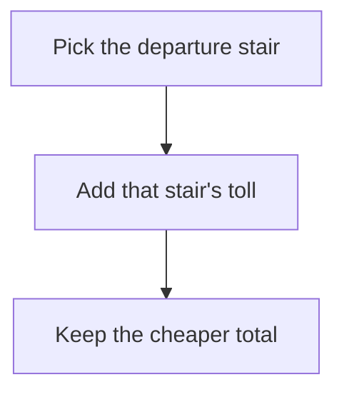

> [!tldr] Quick read
> - I define `d[i]` as the cost already paid on arrival at stair i, before paying any toll at i.
> - For a move from j to i, add `cost[j]`. Take the minimum of the two ways to arrive.
> - The destination is index n, outside the toll array. Starting positions 0 and 1 have zero cost paid.

> [!info] Context
> This is LeetCode 746 at [[en/posts/2026-11-27-neetcode-linear-dp|station DP-01: One-Dimensional Recurrences]]. The warehouse staircase now has a toll machine at every stair. All I need is arrays and addition.

> [!abstract]- Quick glossary for this post (click to open)
> - A [[en/concepts/dp-state|DP state]] specifies whether a cost belongs before or after a move.
> - `min(a,b)` keeps the cheaper of two totals.
> - A valid move advances one or two positions.

## Picture it first: a toll when leaving the stair

There are two free entrances at stairs zero and one. Standing on a stair has yet to incur its toll. I pay at the machine beside me and then move on. The trip ends when I reach the exit.

| Everyday life | Concept |
|---|---|
| Two free entrances | Base cases d[0], d[1] |
| Pay before stepping away | Toll of the departure stair |
| Record the cheapest route to each stair | Minimum value d[i] |
| Exit above the last stair | Destination n outside the array |



## The problem: minimize the cost on arrival at the exit

The array holds n costs, 2 ≤ n ≤ 1,000, each an integer from 0 to 999. I start at 0 or 1. Each departure from stair j costs `cost[j]` and moves up one or two stairs. The exit is at n. For `[6,2,8,1]`, the trip `1 → 3 → 4` costs `2 + 1 = 3`. [Original LeetCode 746 problem](https://leetcode.com/problems/min-cost-climbing-stairs/)

## How it works

I look at the arrival stair i, with i ≥ 2. The previous stair can only be i−1 or i−2. Replacing an expensive prefix with the cheapest trip to the same departure stair preserves the last move, so `d[i] = min(d[i−1] + cost[i−1], d[i−2] + cost[i−2])`. Since I can start at zero or one for free and tolls are nonnegative, set `d[0] = d[1] = 0`.

| i | From i−1 | From i−2 | d[i] |
|---|---:|---:|---:|
| 2 | 0 + 2 | 0 + 6 | 2 |
| 3 | 2 + 8 | 0 + 2 | 2 |
| 4 | 2 + 1 | 2 + 8 | 3 |

Brute force computes both branches for each prefix, repeats many states, and uses Θ(φⁿ) time with an O(n) stack. Memoization and table filling use O(n) time and O(n) auxiliary space. Two rolling variables hold `d[i−2]` and `d[i−1]` before each iteration and use O(1) auxiliary space. To print the route, fill the table and record the preceding choice at each i.

## Runnable example

[TypeScript](../code/neetcode-min-cost-climbing-stairs/stairs.ts) · [Python](../code/neetcode-min-cost-climbing-stairs/stairs.py) · [Go](../code/neetcode-min-cost-climbing-stairs/stairs.go) · [Java](../code/neetcode-min-cost-climbing-stairs/stairs.java) · [JavaScript](../code/neetcode-min-cost-climbing-stairs/stairs.js) · [PHP](../code/neetcode-min-cost-climbing-stairs/stairs.php) · [Rust](../code/neetcode-min-cost-climbing-stairs/stairs.rs)

```ts
function candidates(n: number, add: (i: number) => number, choose: (a: number, b: number) => number, base: number) {
    function brute(i: number): number {
        return i < 2 ? base : choose(brute(i - 1) + add(i - 1), brute(i - 2) + add(i - 2))
    }

    const cache: Map<number, number> = new Map<number, number>()
    function memoized(i: number): number {
        if (i < 2) return base
        const saved = cache.get(i)
        if (saved !== undefined) return saved
        const answer = choose(memoized(i - 1) + add(i - 1), memoized(i - 2) + add(i - 2))
        cache.set(i, answer)
        return answer
    }

    function tabulated() {
        const dp = [base, base]
        for (let i = 2; i <= n; i++) {
            dp[i] = choose(dp[i - 1] + add(i - 1), dp[i - 2] + add(i - 2))
        }
        return dp[n]
    }

    function rolling() {
        let twoBack = base
        let oneBack = base
        for (let i = 2; i <= n; i++) {
            const next = choose(oneBack + add(i - 1), twoBack + add(i - 2))
            twoBack = oneBack
            oneBack = next
        }
        return oneBack
    }

    return { brute: () => brute(n), memoized: () => memoized(n), tabulated, rolling }
}
```

```python
def check(n, add, choose, base, expected, small):
    def brute(i):
        if i < 2:
            return base
        return choose(brute(i - 1) + add(i - 1), brute(i - 2) + add(i - 2))

    # Avoid Python’s recursion limit when n can reach 1000.
    def table():
        dp = [base, base]
        for i in range(2, n + 1):
            dp.append(choose(dp[i - 1] + add(i - 1), dp[i - 2] + add(i - 2)))
        return dp[n]

    def rolling():
        two_back = one_back = base
        for i in range(2, n + 1):
            two_back, one_back = one_back, choose(one_back + add(i - 1), two_back + add(i - 2))
        return one_back

    if small:
        assert brute(n) == expected
    assert table() == expected
    assert rolling() == expected
```

```go
package main

import "fmt"

func check(n int, add func(int) int, choose func(int, int) int, base, expected int, small bool) {
	var brute func(int) int
	brute = func(i int) int {
		if i < 2 {
			return base
		}
		return choose(brute(i-1)+add(i-1), brute(i-2)+add(i-2))
	}
	if small && brute(n) != expected {
		panic("vét cạn sai")
	}

	dp := make([]int, n+1)
	dp[0], dp[1] = base, base
	twoBack, oneBack := base, base
	for i := 2; i <= n; i++ {
		dp[i] = choose(dp[i-1]+add(i-1), dp[i-2]+add(i-2))
		twoBack, oneBack = oneBack, choose(oneBack+add(i-1), twoBack+add(i-2))
	}
	if dp[n] != expected || oneBack != expected {
		panic("quy hoạch động sai")
	}
}
```

```java
import java.util.Arrays;
import java.util.function.IntBinaryOperator;
import java.util.function.IntUnaryOperator;

class Stairs {
    static int brute(int i, IntUnaryOperator add, IntBinaryOperator choose, int base) {
        if (i < 2) return base;
        return choose.applyAsInt(brute(i-1, add, choose, base) + add.applyAsInt(i-1),
                                 brute(i-2, add, choose, base) + add.applyAsInt(i-2));
    }

    static void check(int n, IntUnaryOperator add, IntBinaryOperator choose, int base, int expected, boolean small) {
        if (small && brute(n, add, choose, base) != expected) throw new AssertionError();
        int[] dp = new int[n+1];
        dp[0] = dp[1] = base;
        int twoBack = base;
        int oneBack = base;
        for (int i = 2; i <= n; i++) {
            dp[i] = choose.applyAsInt(dp[i-1] + add.applyAsInt(i-1), dp[i-2] + add.applyAsInt(i-2));
            int next = choose.applyAsInt(oneBack + add.applyAsInt(i-1), twoBack + add.applyAsInt(i-2));
            twoBack = oneBack;
            oneBack = next;
        }
        if (dp[n] != expected || oneBack != expected) throw new AssertionError();
    }
}
```

```js
function candidates(n, add, choose, base) {
    function brute(i) {
        return i < 2 ? base : choose(brute(i - 1) + add(i - 1), brute(i - 2) + add(i - 2))
    }

    const cache = new Map()
    function memoized(i) {
        if (i < 2) return base
        const saved = cache.get(i)
        if (saved !== undefined) return saved
        const answer = choose(memoized(i - 1) + add(i - 1), memoized(i - 2) + add(i - 2))
        cache.set(i, answer)
        return answer
    }

    function tabulated() {
        const dp = [base, base]
        for (let i = 2; i <= n; i++) {
            dp[i] = choose(dp[i - 1] + add(i - 1), dp[i - 2] + add(i - 2))
        }
        return dp[n]
    }

    function rolling() {
        let twoBack = base
        let oneBack = base
        for (let i = 2; i <= n; i++) {
            const next = choose(oneBack + add(i - 1), twoBack + add(i - 2))
            twoBack = oneBack
            oneBack = next
        }
        return oneBack
    }

    return { brute: () => brute(n), memoized: () => memoized(n), tabulated, rolling }
}
```

```php
<?php
declare(strict_types=1);

function brute(int $i, callable $add, callable $choose, int $base): int {
    if ($i < 2) return $base;
    return $choose(brute($i - 1, $add, $choose, $base) + $add($i - 1),
                   brute($i - 2, $add, $choose, $base) + $add($i - 2));
}

function check(int $n, callable $add, callable $choose, int $base, int $expected, bool $small): void {
    if ($small && brute($n, $add, $choose, $base) !== $expected) {
        throw new RuntimeException('vét cạn sai');
    }
    $dp = [$base, $base];
    $twoBack = $oneBack = $base;
    for ($i = 2; $i <= $n; $i++) {
        $dp[$i] = $choose($dp[$i - 1] + $add($i - 1), $dp[$i - 2] + $add($i - 2));
        [$twoBack, $oneBack] = [$oneBack, $choose($oneBack + $add($i - 1), $twoBack + $add($i - 2))];
    }
    if ($dp[$n] !== $expected || $oneBack !== $expected) {
        throw new RuntimeException('quy hoạch động sai');
    }
}
```

```rust
fn brute(
    i: usize,
    add: &impl Fn(usize) -> i32,
    choose: &impl Fn(i32, i32) -> i32,
    base: i32,
) -> i32 {
    if i < 2 {
        return base;
    }
    choose(
        brute(i - 1, add, choose, base) + add(i - 1),
        brute(i - 2, add, choose, base) + add(i - 2),
    )
}

fn check(
    n: usize,
    add: impl Fn(usize) -> i32,
    choose: impl Fn(i32, i32) -> i32,
    base: i32,
    expected: i32,
    small: bool,
) {
    if small {
        assert_eq!(brute(n, &add, &choose, base), expected);
    }
    let mut dp = vec![base; n + 1];
    let (mut two_back, mut one_back) = (base, base);
    for i in 2..=n {
        dp[i] = choose(dp[i - 1] + add(i - 1), dp[i - 2] + add(i - 2));
        (two_back, one_back) = (
            one_back,
            choose(one_back + add(i - 1), two_back + add(i - 2)),
        );
    }
    assert_eq!(dp[n], expected);
    assert_eq!(one_back, expected);
}
```

The files check 5 inputs covering zero tolls, two stairs, and 1,000 stairs with toll 999. The Node.js files include memoization. The other files check brute force on small inputs, the table, and two rolling values. One merge is a comparison of two ways to arrive at the same stair.

```text
5/5 cases passed
n=18: brute force 4180, memoization 17 merges
```

*(Output labels translated; the files themselves print Vietnamese.)*

## Misconceptions and common traps

- Using `cost[i]` in the **arrival-cost** state charges at the wrong time and reads beyond the array at the exit.
- Using `0` as the missing marker in a memo recomputes free segments. Check whether the key is present.
- Picking the next stair by its toll alone can make it harder to skip an expensive stair later. With `[0,1,2,100]`, starting at 0 and choosing stair 1 by its toll can cost 3. The trip `0 → 2 → 4` costs 2.

## Self-check questions

> [!question]- Do I pay a toll at exit n?
> No. Tolls belong to stairs 0 through n−1, paid on departure.

> [!question]- Can two variables store the actual route?
> They keep the total cost. Record the previous move while filling a table to trace the route backward from n.

## References

- [LeetCode 746](https://leetcode.com/problems/min-cost-climbing-stairs/)
- [MIT 6.006 lecture on subproblems and bottom-up order](https://ocw.mit.edu/courses/6-006-introduction-to-algorithms-fall-2011/resources/mit6_006f11_lec19/)
