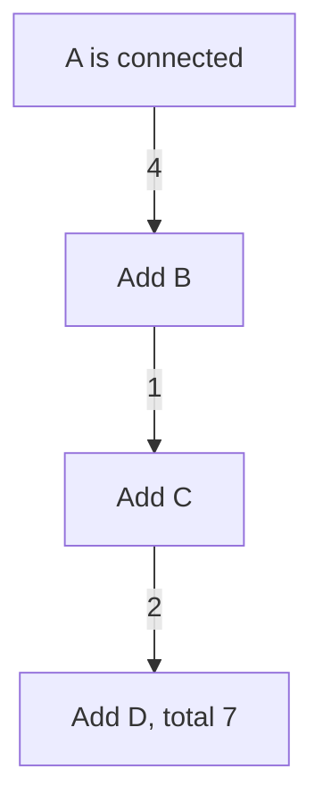

> [!tldr] Quick read
> - Each point is a vertex, and every pair has an edge weighted by Manhattan distance. The goal is the total of a [[en/concepts/minimum-spanning-tree|minimum spanning tree]].
> - Kruskal sorts every edge and adds edges joining different components.
> - Prim keeps the cheapest connection to each point outside the tree and computes edges on demand. Array-based Prim uses O(n²) time and O(n) space on this complete graph.

> [!info] Context
> LeetCode 1584 is part of [[en/posts/2026-11-27-neetcode-spanning-tree-itinerary|station 6 on spanning trees and itineraries]] on the NeetCode Graphs line. Prim only requires arrays and loops. The Kruskal section uses [[en/concepts/disjoint-set-union|Union-Find]] from station 4.

> [!abstract]- Quick glossary for this post (click to open)
> - Manhattan distance adds the absolute differences along both axes.
> - A [[en/concepts/cut-property|cut]] separates vertices into two sides. A crossing edge has an endpoint on each side.
> - A spanning tree connects every vertex without creating a cycle.

## Picture it first: wire the sensors

I have four sensors A(0,0), B(4,0), C(5,0), and D(5,2). Wires run along the axes, so wiring A directly to D costs 7. Routing through B and C lets us reuse wire that is already down. A–B, B–C, and C–D have a combined cost of 7.

| Everyday life | Concept |
|---|---|
| The sensors already connected | The in-tree side of the cut |
| The cheapest wire for an unconnected sensor | Prim's `best[i]` key |
| A cable between sensors already linked | A cycle-causing edge that Kruskal skips |



## The problem: connect all the points at minimum total cost

The input consists of 1 to 1,000 distinct coordinate pairs with each coordinate in [−10⁶, 10⁶]. Connecting p and q costs `|p.x - q.x| + |p.y - q.y|`. The finished network must have a unique simple path between every pair, so the goal is a minimum spanning tree. Return its cost. A single point costs 0.

## How it works

### Kruskal builds every edge

Build n(n−1)/2 edges and sort them by ascending weight. Use Union-Find to skip an edge whose endpoints are already in the same component. Stop after accepting n−1 edges. The intermediate structure is a forest and becomes a tree at the end. Sorting costs O(n² log n) time and storing all edges costs O(n²) space.

### Prim saves the cheapest connection

Initialize every connection key to infinity. Give the first vertex a key of 0 to select it at no cost. On each round, scan for the cheapest unselected vertex, add its key to the total, and try lowering each remaining key using the newly available edge. After selecting A, the keys of B, C, and D are 4, 5, and 7. Selecting B lowers the latter two keys to 1 and 3. Selecting C lowers D to 2.

The invariant is that `best[i]` holds the cheapest **edge** from a vertex in the tree to `i`. The cut property lets us add the lightest crossing edge and still have an MST containing our selections. If a compatible MST lacks that edge, inserting it creates a cycle. That cycle contains another crossing edge, which can be removed without increasing total weight. A tie can change the tree's shape while keeping the total.

Scan n keys and update them each round for O(n²) total time. Two arrays of length n give O(n) auxiliary space. The [edge storage experiment](../code/neetcode-spanning-tree-itinerary/compare.ts) uses n = 1,000. Kruskal stores 499,500 edges while Prim stores 1,000 `best` keys and 1,000 flags. Both versions compute every pairwise distance. They differ in sorting work and retained data.

## Runnable example

The tabs show Prim. Each full file checks Prim and Kruskal on six cases including one point, tied weights, negative coordinates, and the maximum distance of 4,000,000.

[TypeScript](../code/neetcode-min-cost-to-connect-all-points/connect.ts) · [Python](../code/neetcode-min-cost-to-connect-all-points/connect.py) · [Go](../code/neetcode-min-cost-to-connect-all-points/connect.go) · [Java](../code/neetcode-min-cost-to-connect-all-points/connect.java) · [JavaScript](../code/neetcode-min-cost-to-connect-all-points/connect.js) · [PHP](../code/neetcode-min-cost-to-connect-all-points/connect.php) · [Rust](../code/neetcode-min-cost-to-connect-all-points/connect.rs)

```typescript
type Point = [number, number];

function distance([x, y]: Point, [a, b]: Point): number {
  return Math.abs(x - a) + Math.abs(y - b);
}

function prim(points: Point[]): number {
  const n = points.length;
  const inTree = Array<boolean>(n).fill(false);
  const best = Array<number>(n).fill(Infinity);
  best[0] = 0;
  let total = 0;

  for (let step = 0; step < n; step++) {
    let next = -1;
    for (let i = 0; i < n; i++) {
      if (!inTree[i] && (next === -1 || best[i] < best[next])) next = i;
    }
    inTree[next] = true;
    total += best[next];
    for (let i = 0; i < n; i++) {
      if (!inTree[i]) best[i] = Math.min(best[i], distance(points[next], points[i]));
    }
  }
  return total;
}
```

```python
def distance(p, q):
    return abs(p[0] - q[0]) + abs(p[1] - q[1])


def prim(points):
    n = len(points)
    in_tree = [False] * n
    best = [float("inf")] * n
    best[0] = 0
    total = 0

    for _ in points:
        next_point = min((i for i in range(n) if not in_tree[i]), key=best.__getitem__)
        in_tree[next_point] = True
        total += best[next_point]
        for i in range(n):
            if not in_tree[i]:
                best[i] = min(best[i], distance(points[next_point], points[i]))
    return total
```

```go
package main

import "math"

type point [2]int
type edge struct{ weight, a, b int }

func distance(p, q point) int {
	x, y := p[0]-q[0], p[1]-q[1]
	if x < 0 {
		x = -x
	}
	if y < 0 {
		y = -y
	}
	return x + y
}

func prim(points []point) int64 {
	n := len(points)
	inTree := make([]bool, n)
	best := make([]int, n)
	for i := 1; i < n; i++ {
		best[i] = math.MaxInt
	}

	var total int64
	for range n {
		next := -1
		for i := range n {
			if !inTree[i] && (next == -1 || best[i] < best[next]) {
				next = i
			}
		}
		inTree[next] = true
		total += int64(best[next])
		for i := range n {
			if !inTree[i] {
				best[i] = min(best[i], distance(points[next], points[i]))
			}
		}
	}
	return total
}
```

```java
import java.util.Arrays;

class Connect {
    static int distance(int[] p, int[] q) {
        return Math.abs(p[0] - q[0]) + Math.abs(p[1] - q[1]);
    }

    static long prim(int[][] points) {
        int n = points.length;
        boolean[] inTree = new boolean[n];
        int[] best = new int[n];
        Arrays.fill(best, Integer.MAX_VALUE);
        best[0] = 0;
        long total = 0;

        for (int step = 0; step < n; step++) {
            int next = -1;
            for (int i = 0; i < n; i++) {
                if (!inTree[i] && (next == -1 || best[i] < best[next])) next = i;
            }
            inTree[next] = true;
            total += best[next];
            for (int i = 0; i < n; i++) {
                if (!inTree[i]) best[i] = Math.min(best[i], distance(points[next], points[i]));
            }
        }
        return total;
    }
}
```

```javascript
function distance([x, y], [a, b]) {
    return Math.abs(x - a) + Math.abs(y - b);
}
function prim(points) {
    const n = points.length;
    const inTree = Array(n).fill(false);
    const best = Array(n).fill(Infinity);
    best[0] = 0;
    let total = 0;
    for(let step = 0; step < n; step++){
        let next = -1;
        for(let i = 0; i < n; i++){
            if (!inTree[i] && (next === -1 || best[i] < best[next])) next = i;
        }
        inTree[next] = true;
        total += best[next];
        for(let i = 0; i < n; i++){
            if (!inTree[i]) best[i] = Math.min(best[i], distance(points[next], points[i]));
        }
    }
    return total;
}
```

```php
<?php
declare(strict_types=1);

function distance(array $p, array $q): int
{
    return abs($p[0] - $q[0]) + abs($p[1] - $q[1]);
}

function prim(array $points): int
{
    $n = count($points);
    $inTree = array_fill(0, $n, false);
    $best = array_fill(0, $n, PHP_INT_MAX);
    $best[0] = 0;
    $total = 0;

    for ($step = 0; $step < $n; $step++) {
        $next = -1;
        for ($i = 0; $i < $n; $i++) {
            if (!$inTree[$i] && ($next === -1 || $best[$i] < $best[$next])) {
                $next = $i;
            }
        }
        $inTree[$next] = true;
        $total += $best[$next];
        for ($i = 0; $i < $n; $i++) {
            if (!$inTree[$i]) {
                $best[$i] = min($best[$i], distance($points[$next], $points[$i]));
            }
        }
    }
    return $total;
}
```

```rust
type Point = (i32, i32);

fn distance(p: Point, q: Point) -> i32 {
    (p.0 - q.0).abs() + (p.1 - q.1).abs()
}

fn prim(points: &[Point]) -> i64 {
    let n = points.len();
    let mut in_tree = vec![false; n];
    let mut best = vec![i32::MAX; n];
    best[0] = 0;
    let mut total = 0;

    for _ in points {
        let next = (0..n)
            .filter(|&i| !in_tree[i])
            .min_by_key(|&i| best[i])
            .unwrap();
        in_tree[next] = true;
        total += i64::from(best[next]);
        for i in 0..n {
            if !in_tree[i] {
                best[i] = best[i].min(distance(points[next], points[i]));
            }
        }
    }
    total
}
```

```text
6/6 cases passed
```

*(Output labels translated; the files themselves print Vietnamese.)*

## Misconceptions and common traps

- Updating with a total distance from the starting vertex would produce a different algorithm. Use only the new edge's weight.
- A shortest-path tree rooted at one vertex has a different goal from an MST. They may select different edges.
- Using a value smaller than the maximum distance as infinity can suppress an update. Use `Infinity` or a suitably large type maximum.
- Prefer a wide accumulator. The Java and Rust examples use 64 bits for the total. PHP uses `int` in a 64-bit runtime.

## Self-check questions

> [!question]- Why can Kruskal stop after n−1 edges?
> Each accepted edge joins two distinct components and reduces their count by one, so n−1 such steps reduce n components to one.

> [!question]- Why does D's key drop to 3 after adding B?
> B–D costs 3 while A–D costs 7. Both are edges from the inside of the cut.

## References

- [LC-1584 problem](https://leetcode.com/problems/min-cost-to-connect-all-points/)
- [Princeton Algorithms, minimum spanning trees](https://algs4.cs.princeton.edu/43mst/)
