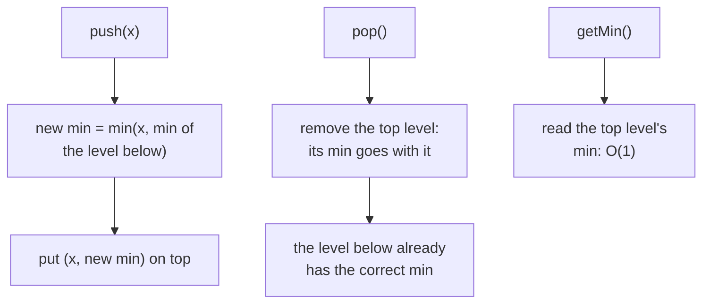

> [!tldr] Quick read
> - The problem: a stack with the usual `push`, `pop`, `top`, plus `getMin` returning the smallest element. **Every operation O(1).**
> - Scanning the whole stack on each `getMin` is O(n): 0.8 seconds for 40 000 pushes interleaved with getMin, nearly a thousand times slower than the O(1) approaches.
> - The key: a stack's min only changes on push or pop, and pop always returns the stack to **exactly its previous state**. So each level remembering "the min up to this level" is enough ([[en/concepts/auxiliary-min-stack|auxiliary min stack]]).
> - The two-stack approach must push when `x <= min`, **with the equals sign**. Without it, two equal minimums plus one pop lose the min.
> - Java has two traps of its own: comparing `peek()` of two `Deque<Integer>` with `==` (wrong from 128 up), and storing the difference `x − min` in an `int` (overflows at the 32-bit edges).

> [!info] Context
> LeetCode problem 155, part of [[en/posts/2026-11-23-neetcode-stack|station 6: Stack]] on **the NeetCode line: Arrays and Strings**. This is a **design** problem: you write a class, not a function. The solutions come in TypeScript, Python, Go, Java and JavaScript. You need to know a [[en/concepts/stack|stack]] (push, pop) and how to write a class with methods.

> [!abstract]- Quick glossary for this post (click to open)
> - **Stack**: add and remove at the same end (the top); last in, first out. See [[en/concepts/stack|Stack]].
> - **Auxiliary stack**: a second stack running alongside, recording extra information for the main one. See [[en/concepts/auxiliary-min-stack|Auxiliary Min Stack]].
> - **Boxing**: Java wraps an `int` into an `Integer` object to put it into a `Deque`. Two `Integer`s with the same value can be two different objects.
> - **Overflow**: a result exceeding the type's bits. Java's `int` and Go's `int32` wrap around silently, with no error.

## Picture it first: a pile of plates with notes

You pile plates up, each with a number written on it. Someone keeps asking "what is the smallest number in the pile?". Lifting every plate to look is slow. The trick: whenever you put a new plate down, you stick a note on it saying "smallest number from the bottom up to this plate". The answer is always on the note of the top plate.

| Everyday life | Concept |
|---|---|
| Put a plate on the pile | `push(x)` |
| Lift the top plate off | `pop()` |
| Lift every plate to find the smallest number | `getMin` scanning the whole stack, O(n) |
| The note "smallest from the bottom up to here" on each plate | each level remembers the pair (value, min up to this level) |
| Lifting a plate takes its note away; the plate below still has its correct note | pop returns exactly the previous state |
| Only stick a note on a plate that changes (or equals) the smallest number | two stacks: the auxiliary stack takes x only when `x <= min` |



## The problem

**The problem (in my own words):** implement a class `MinStack` with `push(val)`, `pop()`, `top()` and `getMin()`. Each operation must run in O(1). Values fit in a signed 32-bit integer; `pop`, `top` and `getMin` are always called on a non-empty stack; there are at most 3·10⁴ calls. Original: [LeetCode 155](https://leetcode.com/problems/min-stack/).

| Operation | Stack (bottom → top) | Returns |
|---|---|---|
| `push(-2)`, `push(0)`, `push(-3)` | `-2, 0, -3` | |
| `getMin()` | `-2, 0, -3` | `-3` |
| `pop()` | `-2, 0` | |
| `top()` | `-2, 0` | `0` |
| `getMin()` | `-2, 0` | `-2` |

I used to think one `min` variable was enough: update it when a smaller number is pushed. It turns out the hard part is **pop**: once the smallest number is gone, what is the new min? A single variable can't remember that.

## How it works

### Approach 1, scanning: getMin in O(n)

A plain array, and `getMin` scans everything. Correct, but it breaks the O(1) requirement.

### Approach 2, one pair per level

Push `(x, min(x, min of the level below))`. Pop removes the whole pair. Because the stack only changes at the top, no level below ever changes, so the min recorded at each level is always right for the part from the bottom up to that level. Twice the memory, every operation O(1).

### Approach 3, two stacks

The main stack holds every value. The auxiliary stack takes x only when `x <= top of the auxiliary stack`. On pop, if the value removed **equals** the auxiliary top, pop the auxiliary stack too. The auxiliary stack is usually much shorter (with increasing data it holds a single element).

**Why the equals sign is required.** Push `0, 1, 0`. With `<`, the second 0 doesn't enter the auxiliary stack, which is `[0]`. Pop the second 0: it equals the auxiliary top, so the auxiliary stack is popped to empty while the main stack still holds the first 0. `getMin` now reads an empty stack: JS returns `undefined`, Python raises `IndexError`.

### Approach 4, storing differences

A single stack plus a `min` variable. Pushing x stores `x − min` (the min **before** the push), then updates min. A negative difference means this level lowered the min; when it is popped, restore `old min = min − difference`. Less memory, but the difference of two 32-bit numbers needs **33 bits**: `2147483647 − (−2147483648) = 4294967295`. Java must store it as a `long`; Go is fine with `int` (64-bit) but overflows with `int32`; JS uses 64-bit floats so it stays exact; Python never overflows.

| | Memory | `getMin` | Trap |
|---|---|---|---|
| scanning | n | O(n) | slow |
| pairs | 2n | O(1) | |
| two stacks | n to 2n | O(1) | the `<=`; Java comparing `Integer`s |
| differences | n | O(1) | 32-bit overflow |

### Measured

n pushes of random numbers, each push followed by one `getMin`, TypeScript, median:

| n | scanning | pairs | two stacks | differences |
|---|---|---|---|---|
| 5 000 | 13.2 ms | 0.47 ms | 0.26 ms | 0.32 ms |
| 10 000 | 154.5 ms | 0.22 ms | 0.28 ms | 0.19 ms |
| 20 000 | 206.6 ms | 1.04 ms | 0.66 ms | 0.61 ms |
| 40 000 | 812.4 ms | 0.92 ms | 0.49 ms | 0.53 ms |
| 10⁶ | (not run) | 64.55 ms | 17.11 ms | 16.83 ms |

From 20 000 to 40 000, doubling n makes scanning 3.9 times slower: the n² shape of n calls to an O(n) `getMin`. The first two steps break that shape (12 times, then only 1.3 times, the same on all three runs); I suspect the JIT compiler optimizing the scan loop partway through, but didn't measure that separately. At 10⁶, pairs are nearly 4 times slower than the other two because each level allocates a new `[x, min]` array.

An earlier version of this page gave 4 seconds for scanning at 40 000. That was measured on data from the old random generator (`seed * 1103515245` computed in floating point), which lost precision and repeated after about 10 thousand values; why the repeated data made the scan loop 5 times slower I haven't measured. The file now uses the mulberry32 generator (every multiplication goes through `Math.imul`).

### Under the hood of the five languages

| | One level of the pair approach | Language-specific trap |
|---|---|---|
| TypeScript / JavaScript | an array `[x, min]` (one object per level) | on an empty auxiliary stack, `mins[mins.length - 1]` returns `undefined` with no error |
| Python | a tuple `(x, min)` | `min(self.a)` is short but O(n); ints never overflow |
| Go | a struct `pair{val, min}`, stored inline in the slice | `int32` wraps around silently on overflow; `int` is 64-bit on 64-bit machines |
| Java | an `int[2]` in an `ArrayDeque<int[]>` | `a.pop() == mins.peek()` compares two `Integer` **references**; an `int` difference overflows |

## Runnable example

[TypeScript](../code/neetcode-min-stack/min-stack.ts) · [Python](../code/neetcode-min-stack/min_stack.py) · [Go](../code/neetcode-min-stack/min_stack.go) · [Java](../code/neetcode-min-stack/min-stack.java) · [JavaScript](../code/neetcode-min-stack/min-stack.js)

Each file runs 6 sequences of operations, including a repeated min, both 32-bit edges and values above 127. Below are the pair and two-stack approaches.

```ts
// Approach 2: each level remembers the pair [value, min up to this level].
class PairMinStack implements MinStackLike {
  private a: [number, number][] = [];
  push(x: number) {
    const m = this.a.length === 0 ? x : Math.min(x, this.a[this.a.length - 1][1]);
    this.a.push([x, m]);
  }
  pop() { this.a.pop(); }
  top() { return this.a[this.a.length - 1][0]; }
  getMin() { return this.a[this.a.length - 1][1]; }
}

// Approach 3: two stacks; the auxiliary stack takes x only when x <= the current min (the = is required).
class TwoStackMinStack implements MinStackLike {
  private a: number[] = [];
  private mins: number[] = [];
  push(x: number) {
    this.a.push(x);
    if (this.mins.length === 0 || x <= this.mins[this.mins.length - 1]) this.mins.push(x);
  }
  pop() {
    const x = this.a.pop();
    if (x === this.mins[this.mins.length - 1]) this.mins.pop();
  }
  top() { return this.a[this.a.length - 1]; }
  getMin() { return this.mins[this.mins.length - 1]; }
}
```

```python
class PairMinStack:  # each level is a tuple (value, min up to this level)
    def __init__(self):
        self.a = []

    def push(self, x):
        self.a.append((x, min(x, self.a[-1][1]) if self.a else x))

    def pop(self):
        self.a.pop()

    def top(self):
        return self.a[-1][0]

    def getMin(self):
        return self.a[-1][1]

class TwoStackMinStack:
    def __init__(self):
        self.a, self.mins = [], []

    def push(self, x):
        self.a.append(x)
        if not self.mins or x <= self.mins[-1]:  # must be <=, not <
            self.mins.append(x)

    def pop(self):
        if self.a.pop() == self.mins[-1]:
            self.mins.pop()

    def top(self):
        return self.a[-1]

    def getMin(self):
        return self.mins[-1]
```

```go
// Each level remembers the pair (value, min up to this level).
type pair struct{ val, min int }
type PairMinStack struct{ a []pair }

func (s *PairMinStack) Push(x int) {
	m := x
	if len(s.a) > 0 {
		m = min(x, s.a[len(s.a)-1].min)
	}
	s.a = append(s.a, pair{x, m})
}
func (s *PairMinStack) Pop()        { s.a = s.a[:len(s.a)-1] }
func (s *PairMinStack) Top() int    { return s.a[len(s.a)-1].val }
func (s *PairMinStack) GetMin() int { return s.a[len(s.a)-1].min }

type TwoStackMinStack struct{ a, mins []int }

func (s *TwoStackMinStack) Push(x int) {
	s.a = append(s.a, x)
	if len(s.mins) == 0 || x <= s.mins[len(s.mins)-1] {
		s.mins = append(s.mins, x)
	}
}
func (s *TwoStackMinStack) Pop() {
	x := s.a[len(s.a)-1]
	s.a = s.a[:len(s.a)-1]
	if x == s.mins[len(s.mins)-1] {
		s.mins = s.mins[:len(s.mins)-1]
	}
}
func (s *TwoStackMinStack) Top() int    { return s.a[len(s.a)-1] }
func (s *TwoStackMinStack) GetMin() int { return s.mins[len(s.mins)-1] }
```

```java
// Each level is an int[2] {value, min up to this level}: no boxing of each number.
static class PairMinStack implements MinStackLike {
    private final ArrayDeque<int[]> a = new ArrayDeque<>();
    public void push(int x) { a.push(new int[] {x, a.isEmpty() ? x : Math.min(x, a.peek()[1])}); }
    public void pop() { a.pop(); }
    public int top() { return a.peek()[0]; }
    public int getMin() { return a.peek()[1]; }
}

static class TwoStackMinStack implements MinStackLike {
    private final ArrayDeque<Integer> a = new ArrayDeque<>(), mins = new ArrayDeque<>();
    public void push(int x) {
        a.push(x);
        if (mins.isEmpty() || x <= mins.peek()) mins.push(x); // x is an int, so <= unboxes mins.peek() and compares values
    }
    public void pop() {
        if (a.pop().equals(mins.peek())) mins.pop(); // equals compares VALUES
    }
    public int top() { return a.peek(); }
    public int getMin() { return mins.peek(); }
}
```

```js
class PairMinStack {
  constructor() { this.a = []; }
  push(x) {
    const m = this.a.length === 0 ? x : Math.min(x, this.a[this.a.length - 1][1]);
    this.a.push([x, m]);
  }
  pop() { this.a.pop(); }
  top() { return this.a[this.a.length - 1][0]; }
  getMin() { return this.a[this.a.length - 1][1]; }
}

class TwoStackMinStack {
  constructor() { this.a = []; this.mins = []; }
  push(x) {
    this.a.push(x);
    if (this.mins.length === 0 || x <= this.mins[this.mins.length - 1]) this.mins.push(x);
  }
  pop() {
    if (this.a.pop() === this.mins[this.mins.length - 1]) this.mins.pop();
  }
  top() { return this.a[this.a.length - 1]; }
  getMin() { return this.mins[this.mins.length - 1]; } // an empty stack returns undefined instead of throwing
}
```


The TypeScript file runs all four approaches and the version without the equals sign, then measures:

```text
$ node min-stack.ts
ScanMinStack        6/6 cases passed
PairMinStack        6/6 cases passed
TwoStackMinStack    6/6 cases passed
DiffMinStack        6/6 cases passed
StrictLessMinStack  5/6 cases passed; wrong on: repeated min

n          scan     pairs   2 stacks  diffs   (ms, median)
5000         13.2    0.47     0.26    0.32
10000       154.5    0.22     0.28    0.19
20000       206.6    1.04     0.66    0.61
40000       812.4    0.92     0.49    0.53
1000000         —   64.55    17.11   16.83
```

*(Output labels translated; the files themselves print Vietnamese.)*

The Java file reproduces its two traps:

```text
$ java min-stack.java
PairMinStack       6/6 cases passed
TwoStackMinStack   6/6 cases passed
DiffMinStack       6/6 cases passed
IntegerEqMinStack  4/6 cases passed; wrong on: 32-bit edges → [-2147483648, -2147483648, -2147483648, 2147483647], numbers above 127 → [500]
IntDiffMinStack    5/6 cases passed; wrong on: 32-bit edges → [-2147483648, -2147483647, -2147483648, -2147483648]
```

`IntegerEqMinStack` pushes 500 and pops: `a.pop() == mins.peek()` compares two different `Integer` objects, gets `false`, and the auxiliary stack keeps 500. Push 700, and `getMin` still returns 500. With small numbers such as 5 and 7 this version is right, because Java shares the object for −128..127. `IntDiffMinStack` computes `−2147483648 − 2147483647` as an `int`, gets 1 instead of −4294967295, and so that level is not recognized as having lowered the min.

Python has the same missing-equals version, and it raises an error instead of returning `undefined`. Go reproduces the overflow with `int32`:

```text
$ python3 min_stack.py
ScanMinStack        6/6 cases passed
PairMinStack        6/6 cases passed
TwoStackMinStack    6/6 cases passed
DiffMinStack        6/6 cases passed
StrictLessMinStack  5/6 cases passed; wrong on: repeated min (IndexError)

$ go run min_stack.go
PairMinStack      6/6 cases passed
TwoStackMinStack  6/6 cases passed
DiffMinStack      6/6 cases passed
Diff32MinStack    5/6 cases passed; wrong on: [32-bit edges → [-2147483648 -2147483647 -2147483648 -2147483648]]
```

JavaScript prints `6/6 ca đúng` ("6/6 cases passed") for all three approaches.

## Misconceptions and common traps

- **"One min variable is enough."** True while you only push. Once the smallest number is popped, that variable doesn't know the new min.
- **The missing equals sign on the auxiliary stack.** `x < min` instead of `x <= min`: breaks as soon as the smallest number appears twice.
- **Java: comparing `Integer`s with `==`.** Right for every test with small numbers, wrong from 128. Use `equals`, or compare after assigning to an `int`.
- **Storing the difference in a 32-bit type.** The difference of two 32-bit numbers needs 33 bits. Java uses `long`; Go uses `int` (64-bit); C/C++ also need a wider type.
- **"Storing differences is always better because it uses less memory."** It is harder to read, easy to overflow, and the measurement above shows it is not clearly faster than two stacks.

## Self-check questions

> [!question]- With the pair approach, write the stack after `push(3)`, `push(5)`, `push(2)`, `push(2)`, `pop()`.
> `(3,3)` → `(3,3),(5,3)` → add `(2,2)` → add `(2,2)` → pop: `(3,3),(5,3),(2,2)`. `getMin` = 2.

> [!question]- With two stacks and `<`, what is the shortest sequence that makes `getMin` wrong?
> `push(0)`, `push(0)`, `pop()`, `getMin()`: the auxiliary stack holds a single 0, and the pop empties it while the main stack still holds a 0.

> [!question]- Why does pop never make the min recorded at the levels below wrong?
> The stack only changes at the top. The min recorded at level k depends only on levels 0..k, and pop doesn't touch them.

> [!question]- In Java, does `TwoStackMinStack`'s `x <= mins.peek()`, with `x` an `int`, fall into the reference-comparison trap?
> No. One side is an `int`, so Java unboxes `mins.peek()` and compares values. The trap only happens when **both** sides of `==` are `Integer`.

## References

- [LeetCode 155: Min Stack](https://leetcode.com/problems/min-stack/) (the original problem)
- [Java Language Specification SE 21, §5.1.7 Boxing Conversion](https://docs.oracle.com/javase/specs/jls/se21/html/jls-5.html#jls-5.1.7) (boxed values in −128..127 must be the same object)
- [JLS SE 21, §15.18.2 Additive Operators](https://docs.oracle.com/javase/specs/jls/se21/html/jls-15.html#jls-15.18.2) (integer addition and subtraction that overflow keep the low bits, no error)
- [Go spec: Integer overflow](https://go.dev/ref/spec#Integer_overflow) (signed integers wrap around on overflow)
- [Python tutorial: Using lists as stacks](https://docs.python.org/3/tutorial/datastructures.html#using-lists-as-stacks)
