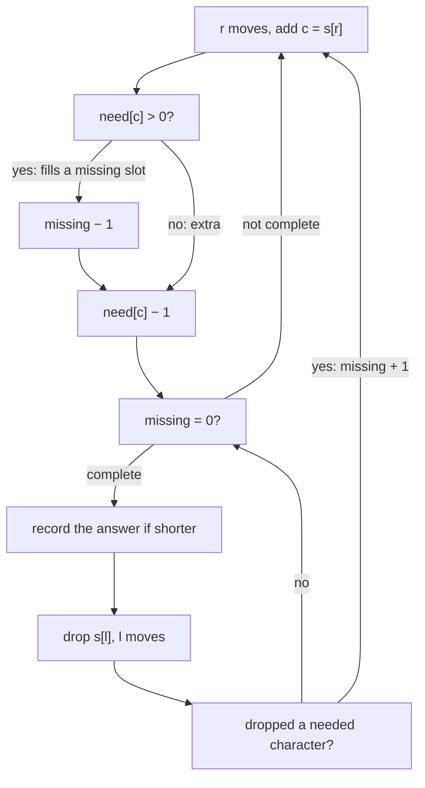

> [!tldr] Quick read
> - The problem: the **shortest** substring of `s` containing every character of `t`, **repeats included** (`t = "aa"` needs two a's). Return `""` if there is none.
> - This is the "find shortest" side of the [[en/concepts/sliding-window|sliding window]]: the right end grows until the window is **complete**, then the left end shrinks **while it stays complete**, and the answer is recorded **during** the shrink.
> - Checking "complete yet?" by comparing the whole count table each step costs O(128) per check. One `missing` variable (how many characters are still missing) answers in O(1): about **45 times** faster at 10⁶ characters.
> - The brute force looks fine on random data (each extension stops early), but becomes O(n²) when there is no answer: 732 ms at n = 8 000.
> - Traps: checking only **which** letters t has and forgetting how many (6/8 cases); in Java, comparing two `Integer` counts with `==` fails once t needs 128 or more copies of a letter.

> [!info] Context
> LeetCode problem 76, part of [[en/posts/2026-11-23-neetcode-sliding-window|station 5: Sliding Window]] on **the NeetCode line: Arrays and Strings**. The station post uses this problem as its "find shortest" example; this page digs into how to know the window is complete and measures the approaches. The solutions come in TypeScript, Python, Go, Java and JavaScript. Read [[en/problems/longest-substring-without-repeating-characters|Longest Substring Without Repeating Characters]] ("find longest") and [[en/problems/valid-anagram|Valid Anagram]] (count tables) first.

> [!abstract]- Quick glossary for this post (click to open)
> - **Complete window (cover)**: a substring `s[l..r]` with each character c at least as many times as c appears in t.
> - **Still-missing table `need`**: `need[c]` = how many c's t needs minus how many the window has. Positive means still missing, negative means extra.
> - **`missing`**: the total number of characters still missing, i.e. the sum of the positive `need[c]`. The window is complete when `missing = 0`.
> - **Invariant**: something true after every step. See [[en/concepts/window-invariant|Window Invariant]].
> - **Integer cache (Java)**: Java shares `Integer` objects for values −128..127; outside that range, two equal numbers can be two different objects.

## Picture it first: collecting a recipe on a conveyor belt

A conveyor belt carries ingredients one after another. The recipe (t) needs 1 egg, 2 tomatoes, 1 onion. You stand at the end of the belt and want the **shortest stretch of belt** that holds the whole recipe.

| Everyday life | Concept |
|---|---|
| The recipe card: what, and how many | the count table of t |
| The "still missing" list, ticked off as you pick things up | the `need` table |
| The number "4 items missing in total" | `missing` |
| Extend the right edge of the stretch by one item | `r++` |
| Once complete, try dropping the item at the left edge, while still complete | shrink `l` while `missing = 0` |
| Dropping a needed tomato: missing again, go back to extending the right edge | `need[c] > 0` after dropping → `missing++` |
| "2 tomatoes" is not the same as "has tomatoes" | count occurrences, not just presence |



## The problem

**The problem (in my own words):** given two strings `s` and `t` (lengths m, n up to 10⁵, English upper- and lowercase letters only), return the shortest substring of `s` such that every character of `t`, **repeats included**, is in it. Return `""` if there is no such substring. The problem guarantees the answer (if any) is unique. Original: [LeetCode 76](https://leetcode.com/problems/minimum-window-substring/).

| s | t | Output |
|---|---|---|
| `"ADOBECODEBANC"` | `"ABC"` | `"BANC"` |
| `"a"` | `"a"` | `"a"` |
| `"a"` | `"aa"` | `""` (needs two a's) |
| `"cabwefgewcwaefgcf"` | `"cae"` | `"cwae"` |

I used to think "find shortest" had to be the exact opposite of "find longest". It turns out it is the same window template with the answer recorded in a different place: "find longest" records when the window is **valid after shrinking**, "find shortest" records **during the shrink**, while the window is still complete.

## How it works

### Approach 1, brute force

From each left end l, extend r until `s[l..r]` is complete, then stop (extending further only makes it longer). On random data each extension stops early, so it looks fast. But when **there is no answer**, no extension ever stops: n extensions of up to n steps each, O(n²).

### Why there is no need to backtrack

If `s[l..r]` is complete, then every `s[l..r']` with `r' > r` is complete too but longer, so left end l needs nothing more. And if the shortest complete substring starting at l is `s[l..r]`, the shortest one starting at l + 1 ends at some r' ≥ r. Both ends only move forward, at most n steps each.

### Approach 2, a window that compares the whole count table

Keep a table `have` for the window. After each step, check "complete yet?" by comparing `have[c] ≥ need[c]` for all 128 characters. Correct and O(n), but with a constant of 128 comparisons per step.

### Approach 3, the still-missing table and the `missing` variable

Merge the two tables into one: `need[c]` starts as the number of c's in t, goes down when c enters the window and up when c leaves. `missing` starts as the length of t.
- Adding c: if `need[c] > 0` **before decrementing**, this character fills a missing slot: `missing − 1`. If `need[c] ≤ 0`, it is extra and `missing` stays.
- Dropping c: increment `need[c]`; if `need[c] > 0` **after incrementing**, you just dropped a needed character: `missing + 1`.

`missing = 0` holds exactly when the window is complete, and each step updates it in O(1). Total O(m + n).

Tracing `s = "ADOBECODEBANC"`, `t = "ABC"`: the window is first complete at `"ADOBEC"` (r = 5, length 6 recorded); dropping the A leaves A missing. The right end reaches the second A (r = 10): `"DOBECODEBA"` is complete again; dropping `D`, `O`, `B`, `E` keeps it complete (there is a second B), dropping `C` leaves C missing. At the last C (r = 12), `"ODEBANC"` is complete; shrinking reaches `"BANC"`, length 4: the answer.

### Measured

TypeScript, `s` random over 52 upper- and lowercase letters, `t` of 20 random letters, median:

| n | brute force | compare whole table | `missing` variable |
|---|---|---|---|
| 2 000 | 10.3 ms | 2.1 ms | 0.11 ms |
| 8 000 | 41.2 ms | 8.4 ms | 0.05 ms |
| 10⁵ | (not run) | 20.7 ms | 0.45 ms |
| 10⁶ | (not run) | 208.2 ms | 4.54 ms |

Add to t a character that never appears in s (no answer):

| n | brute force | `missing` variable |
|---|---|---|
| 2 000 | 49.1 ms | 0.01 ms |
| 4 000 | 181.1 ms | 0.01 ms |
| 8 000 | 732.1 ms | 0.02 ms |

In this case the brute force has exactly the n² shape (double n, 4 times the time). The `missing` variable is about 45 times faster than comparing the whole table at 10⁶: both O(n), different constant of 128.

### Under the hood of the five languages

| | Count table | Language-specific trap |
|---|---|---|
| TypeScript / JavaScript | a 128-slot array by `charCodeAt`, or a `Map` | `map.get(c) - 1` on a missing key gives `NaN` with no error; write `?? 0` |
| Python | `Counter` | `Counter` returns 0 for a missing key, so `need[c] -= 1` is safe; a plain `dict` raises `KeyError` |
| Go | a `[128]int` array | slicing a string `s[a:b]` doesn't copy: a small answer keeps the whole large `s` in memory |
| Java | `int[128]` | with `HashMap<Character, Integer>`, `window.get(c) == need.get(c)` compares **references**: wrong once a count reaches 128 |

## Runnable example

[TypeScript](../code/neetcode-minimum-window-substring/min-window.ts) · [Python](../code/neetcode-minimum-window-substring/min_window.py) · [Go](../code/neetcode-minimum-window-substring/min_window.go) · [Java](../code/neetcode-minimum-window-substring/min-window.java) · [JavaScript](../code/neetcode-minimum-window-substring/min-window.js)

Each file has the brute force and the `missing`-variable approach, and runs 8 cases including `t` longer than `s`, `t` with repeated letters, and no answer. Below is the `missing`-variable approach.

```ts
// Approach 3, a window with a "still missing" table and one missing variable: tells whether the window is complete in O(1). O(n + m).
function windowMissing(s: string, t: string): string {
  const need = new Array(128).fill(0); // need[c] > 0: c is still missing; < 0: the window has extra c
  for (let i = 0; i < t.length; i++) need[t.charCodeAt(i)]++;
  let missing = t.length, l = 0, bestL = 0, bestLen = Infinity;
  for (let r = 0; r < s.length; r++) {
    if (need[s.charCodeAt(r)]-- > 0) missing--; // this character fills a missing slot
    while (missing === 0) { // complete: shrink from the left while still complete, record the answer DURING the shrink
      if (r - l + 1 < bestLen) { bestL = l; bestLen = r - l + 1; }
      if (++need[s.charCodeAt(l++)] > 0) missing++; // dropped a needed character: missing again
    }
  }
  return bestLen === Infinity ? "" : s.slice(bestL, bestL + bestLen);
}
```

```python
def window_missing(s: str, t: str) -> str:
    need = Counter(t)
    missing, l = len(t), 0
    best_l, best_len = 0, float("inf")
    for r, c in enumerate(s):
        if need[c] > 0:
            missing -= 1
        need[c] -= 1
        while missing == 0:  # complete: shrink while still complete, record the answer during the shrink
            if r - l + 1 < best_len:
                best_l, best_len = l, r - l + 1
            need[s[l]] += 1
            if need[s[l]] > 0:
                missing += 1
            l += 1
    return "" if best_len == float("inf") else s[best_l : best_l + best_len]
```

```go
func windowMissing(s, t string) string {
	var need [128]int // the problem has only English letters: a 128-slot array indexed by byte
	for i := 0; i < len(t); i++ {
		need[t[i]]++
	}
	missing, l, bestL, bestLen := len(t), 0, 0, len(s)+1
	for r := 0; r < len(s); r++ {
		if need[s[r]] > 0 {
			missing--
		}
		need[s[r]]--
		for missing == 0 {
			if r-l+1 < bestLen {
				bestL, bestLen = l, r-l+1
			}
			need[s[l]]++
			if need[s[l]] > 0 {
				missing++
			}
			l++
		}
	}
	if bestLen > len(s) {
		return ""
	}
	return s[bestL : bestL+bestLen] // slicing a Go string doesn't copy: the result shares memory with s
}
```

```java
static String windowMissing(String s, String t) {
    int[] need = new int[128];
    for (char c : t.toCharArray()) need[c]++;
    int missing = t.length(), l = 0, bestL = 0, bestLen = Integer.MAX_VALUE;
    for (int r = 0; r < s.length(); r++) {
        if (need[s.charAt(r)]-- > 0) missing--;
        while (missing == 0) {
            if (r - l + 1 < bestLen) { bestL = l; bestLen = r - l + 1; }
            if (++need[s.charAt(l++)] > 0) missing++;
        }
    }
    return bestLen == Integer.MAX_VALUE ? "" : s.substring(bestL, bestL + bestLen);
}
```

```js
function windowMissing(s, t) {
  const need = new Array(128).fill(0);
  for (let i = 0; i < t.length; i++) need[t.charCodeAt(i)]++;
  let missing = t.length, l = 0, bestL = 0, bestLen = Infinity;
  for (let r = 0; r < s.length; r++) {
    if (need[s.charCodeAt(r)]-- > 0) missing--;
    while (missing === 0) {
      if (r - l + 1 < bestLen) { bestL = l; bestLen = r - l + 1; }
      if (++need[s.charCodeAt(l++)] > 0) missing++;
    }
  }
  return bestLen === Infinity ? "" : s.slice(bestL, bestL + bestLen);
}
```


The TypeScript file also runs the whole-table comparison and the version that forgets repeats, then measures:

```text
$ node min-window.ts
bruteForce         8/8 cases passed
windowCompareAll   8/8 cases passed
windowMissing      8/8 cases passed
ignoreMultiplicity 6/8 cases passed; wrong on ("a", "aa") → "a" ("aa", "aa") → "a"

n          brute     whole table  missing var    (ms, median)
2000          10.3          2.1           0.11
8000          41.2          8.4           0.05
100000           —         20.7           0.45
1000000          —        208.2           4.54

t has a character not in s (ms, median)
2000          49.1                          0.01
4000         181.1                          0.01
8000         732.1                          0.02
```

*(Output labels translated; the files themselves print Vietnamese.)*

The version that forgets repeats treats `t = "aa"` like `t = "a"`, so `("a", "aa")` gives `"a"` instead of `""`. The Java file also runs a `HashMap` version that counts "satisfied" letters and compares with `==`, with a ninth case where `t` is 200 a's:

```text
$ java min-window.java
bruteForce             9/9 cases passed
windowMissing          9/9 cases passed
windowFormedIntegerEq  8/9 cases passed; wrong on t = "a" × 200 → ""
```

When the window holds all 200 a's, `window.get('a')` and `need.get('a')` are two different `Integer` objects with the value 200, so `==` is false and the letter a is never counted as satisfied. Every case with counts ≤ 127 passes, so small tests don't catch it. Python, Go and JavaScript print `8/8 ca đúng` ("8/8 cases passed") for both approaches.

## Misconceptions and common traps

- **Forgetting repeats.** `t = "aa"` needs two a's. A Set instead of a count table passes every example of the problem except those with repeated letters.
- **Recording the answer after the shrink loop.** When the `while` loop exits, the window is **already incomplete**. Record inside the loop, before dropping the character.
- **Decrementing `missing` for extra characters too.** Only decrement when `need[c] > 0` before decrementing. If you decrement for every character that appears in t, the window `"AA"` with `t = "AB"` counts as complete.
- **Java: comparing `Integer`s with `==`.** Right up to 127, wrong from 128. Use an `int[]`, `.equals` or `.intValue()`.
- **"The brute force passes because random data runs fast."** The no-answer case is O(n²); at the problem's n = 10⁵ that is about 10¹⁰ steps.
- **"Same O(n), same speed."** Comparing the whole 128-slot table each step is about 45 times slower than the `missing` variable in the measurement above.

## Self-check questions

> [!question]- Why is the answer recorded inside the shrink loop, not after it?
> The shrink loop runs while the window is still complete. When it exits, the character just dropped has made the window incomplete. The shortest complete window is the one just before the last drop, i.e. inside the loop.

> [!question]- With `t = "AB"`, the window is `"AAB"` and `need['A'] = −1`. Does dropping the left A increase `missing`?
> No. `need['A']` goes from −1 to 0, not positive, meaning the A just dropped was extra. The window `"AB"` is still complete.

> [!question]- Which case makes the brute force slowest, and why?
> The no-answer case (or a very long answer): no extension stops early, so every left end extends to the end of the string. About n²/2 steps in total.

> [!question]- In Java, why is `window.get(c) < need.get(c)` right while `==` is not?
> `<` is only defined for numbers, so Java unboxes both `Integer`s and compares values. `==` is defined for objects, so Java compares references, and only values in −128..127 are guaranteed to share an object.

## References

- [LeetCode 76: Minimum Window Substring](https://leetcode.com/problems/minimum-window-substring/) (the original problem)
- [Java Language Specification SE 21, §5.1.7 Boxing Conversion](https://docs.oracle.com/javase/specs/jls/se21/html/jls-5.html#jls-5.1.7) (boxed values −128..127 must share an object)
- [JLS SE 21, §15.21.3 Reference Equality Operators](https://docs.oracle.com/javase/specs/jls/se21/html/jls-15.html#jls-15.21.3) (`==` between two objects compares references)
- [Python: `collections.Counter`](https://docs.python.org/3/library/collections.html#collections.Counter) (a missing key returns 0)
- [Go spec: Slice expressions](https://go.dev/ref/spec#Slice_expressions) (slicing a string shares the underlying data)
