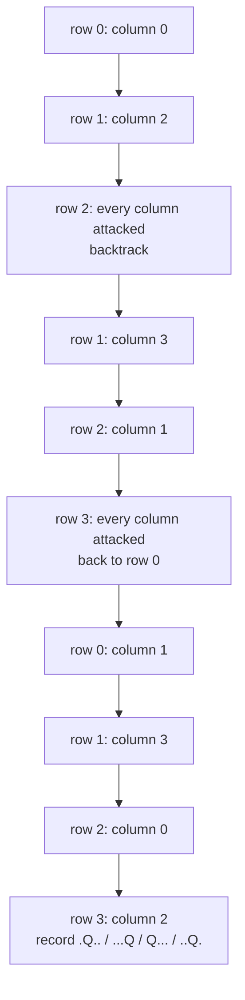
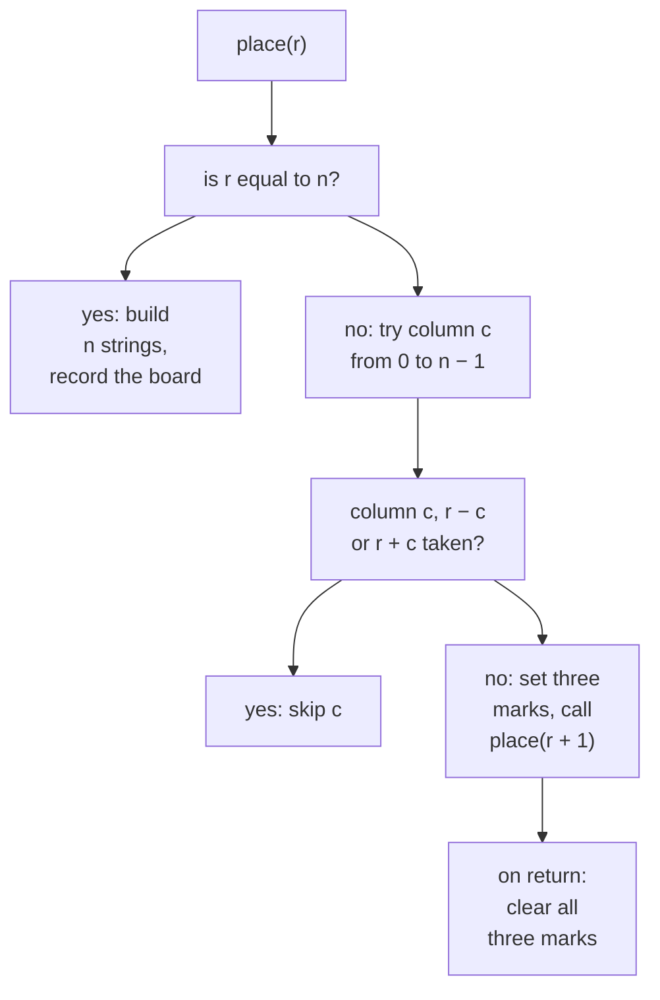

> [!tldr] Quick read
> - Every row holds exactly one queen, so I fill the rows in order and only have to choose a column. A solution is a permutation of columns that also satisfies the diagonal rule.
> - Two cells share a diagonal when `r − c` is equal, and an anti-diagonal when `r + c` is equal. Three [[en/concepts/conflict-sets|conflict sets]] (column, `r − c`, `r + c`) answer "is this cell attacked?" in O(1).
> - Check when placing, instead of waiting until all n queens are down. For n = 8, enumerating every permutation makes 109,601 recursive calls; placing row by row with pruning makes 2,057.
> - When backtracking, clear all three marks. Forgetting the anti-diagonal mark turns the 92 boards of n = 8 into 0.

> [!info] Context
> This is LeetCode 51 at [[en/posts/2026-11-28-neetcode-permutations-search|station MISC-02: Backtracking: Permutations and Search]] on the **NeetCode Line: Mixed Techniques**. I picture an invigilator seating candidates in an exam hall whose desks form a square grid, so that nobody can glance at anybody else's paper. You only need arrays, loops and recursive functions.

> [!abstract]- Quick glossary for this post (click to open)
> - A queen attacks every piece on the same row, the same column or the same diagonal, at any distance.
> - The main diagonal runs from top-left to bottom-right; the anti-diagonal runs from top-right to bottom-left.
> - [[en/concepts/backtracking|Backtracking]] makes a choice, goes deeper, then undoes that choice to try another.
> - The [[en/concepts/choice-tree|choice tree]] has the empty board as its root; each level is a row and each branch is a column where a queen is placed.
> - A bitmask is an integer whose bits stand for cells: bit c set to 1 means column c is taken.

## Picture it first: seating candidates in an exam hall

The hall has n rows of desks with n seats each. The invigilator seats exactly n candidates, one per row. Two people in the same column can see each other's paper, and so can two people on the same diagonal. The invigilator starts at the first row, notes which column and which two diagonals are now occupied, and in the next row only considers clean seats. If a row has no clean seat left, the invigilator asks the person in the row before to move.

| Everyday life | Concept |
|---|---|
| An n × n exam hall | An n × n board |
| Exactly one candidate per row of desks | Exactly one queen per row `r` |
| The seat chosen in row r | Column `cols[r]` |
| The notebook of occupied columns and diagonals | Three [[en/concepts/conflict-sets\|conflict sets]] |
| A row with no clean seat | A dead branch, backtrack |
| Asking the person in the row before to move | Clear the marks, try the next column |
| All n rows seated | One solution, built as a board of strings |

For n = 4, the first attempt puts a queen in column 0 and gets stuck on row 2. The second attempt starts in column 1 and goes all the way:



## The problem: list every way to place n queens

Given an integer n from 1 to 9, list every way to place n queens on an n × n board so that no two share a row, a column or a diagonal. Return each placement as n strings of length n, with `Q` for a queen and `.` for an empty cell; the order of the placements does not matter. For n = 5 there are 10 placements, one of them `Q....`, `..Q..`, `....Q`, `.Q...`, `...Q.`. For n = 2 and n = 3 there are none. [Original problem, LeetCode 51](https://leetcode.com/problems/n-queens/)

I used to think the way in was to try every set of n cells out of n² and filter. For n = 8 that is C(64, 8), more than 4 billion boards. The rule "one queen per row" alone cuts that to 8⁸ = 16,777,216, and "one queen per column" cuts it to 8! = 40,320.

## How it works

### Enumerating every column permutation

One queen per row and one per column, so a solution is a permutation: `cols[r]` is the column of the queen on row r. I generate every permutation by backtracking with a `used` array, and only at a leaf check the diagonals: queens on rows a and b share a diagonal when `|cols[a] − cols[b]| = b − a`.

The permutation tree has 1 + n + n(n−1) + … + n! nodes; for n = 8 that is 109,601 nodes, 40,320 of them leaves, each costing O(n²) to check. Total time is O(n!·n²), with O(n) extra memory for the path. This approach is correct and serves as the referee for cross-checking, but it walks deep into branches that were already broken at the second row.

### Placing row by row with three conflict sets

Instead of waiting for a leaf, I check while placing. Cell (r, c) is attacked when a queen already sits in column c, on the same diagonal or on the same anti-diagonal. Along a main diagonal, one row down is also one column right, so `r − c` stays constant. Along an anti-diagonal, one row down is one column left, so `r + c` stays constant.

| Line | Constant value | Range | Array index |
|---|---|---|---|
| Column | `c` | 0 … n − 1 | `c` |
| Main diagonal | `r − c` | −(n − 1) … n − 1 | `r − c + n − 1` |
| Anti-diagonal | `r + c` | 0 … 2n − 2 | `r + c` |

Three boolean arrays play the role of the [[en/concepts/conflict-sets|conflict sets]]. `r − c` can be negative, so I add n − 1 to bring the index into 0 … 2n − 2. Placing a queen sets all three marks; backtracking clears all three.



The tree shrinks sharply: for n = 8 only 2,057 calls remain. The upper bound is still O(n!), since row r has at most n − r free columns, but the three sets prune most branches. Building the strings only at leaves costs O(n²) per solution. Extra memory is O(n) for the three arrays and the recursion stack.

### Bitmask: three sets as three integers

When only a count is needed, I pack the three sets into three integers. `cols` has bit c set when column c holds a queen. `left` and `right` mark the columns on the current row that a diagonal attacks. Moving to the next row shifts each diagonal by one column, so `left` shifts left by one bit and `right` shifts right by one bit.

- `free = full & ~(cols | left | right)` is the set of columns still open on this row.
- `bit = free & −free` isolates the lowest set bit, that is, one free column.
- Recurse with `cols | bit`, `((left | bit) << 1) & full` and `(right | bit) >> 1`.

The bitmask visits exactly the same 2,057 nodes as the three arrays, since it prunes the same branches. The gain is that each node costs a few bit operations instead of a loop over n columns, and there is no undo step: the state is passed by value.

### Counting nodes

| Approach | Calls for n = 8 | Note |
|---|---|---|
| Every permutation | 109,601 | 40,320 leaves, each checked in O(n²) |
| Three conflict sets | 2,057 | Returns 92 boards |
| Bitmask | 2,057 | Counts only, builds no boards |

The number of solutions for n = 1 … 9 is 1, 0, 0, 2, 10, 4, 40, 92, 352, matching sequence A000170 in the OEIS.

## Runnable example

[TypeScript](../code/neetcode-n-queens/queens.ts) · [Python](../code/neetcode-n-queens/queens.py) · [Go](../code/neetcode-n-queens/queens.go) · [Java](../code/neetcode-n-queens/queens.java) · [JavaScript](../code/neetcode-n-queens/queens.js) · [PHP](../code/neetcode-n-queens/queens.php) · [Rust](../code/neetcode-n-queens/n_queens.rs)

```ts
function solveNQueens(n: number): string[][] {
    const result: string[][] = []
    const cols: number[] = []
    const colUsed = Array(n).fill(false)
    const diag = Array(2 * n - 1).fill(false)
    const anti = Array(2 * n - 1).fill(false)
    const place = (r: number) => {
        counter.calls++
        if (r === n) {
            result.push(toBoard(cols)) // build strings only at leaves
            return
        }
        for (let c = 0; c < n; c++) {
            const d = r - c + n - 1
            const a = r + c
            if (colUsed[c] || diag[d] || anti[a]) continue
            colUsed[c] = diag[d] = anti[a] = true
            cols.push(c)
            place(r + 1)
            cols.pop()
            colUsed[c] = diag[d] = anti[a] = false // clear all three marks
        }
    }
    place(0)
    return result
}
```

```python
def solve_n_queens(n):
    result, cols = [], []
    col_used = [False] * n
    diag = [False] * (2 * n - 1)
    anti = [False] * (2 * n - 1)

    def place(r):
        counter["calls"] += 1
        if r == n:
            result.append(to_board(cols))  # build strings only at leaves
            return
        for c in range(n):
            d, a = r - c + n - 1, r + c
            if col_used[c] or diag[d] or anti[a]:
                continue
            col_used[c] = diag[d] = anti[a] = True
            cols.append(c)
            place(r + 1)
            cols.pop()
            col_used[c] = diag[d] = anti[a] = False  # clear all three marks

    place(0)
    return result
```

```go
func solveNQueens(n int) [][]string {
	result := [][]string{}
	cols := []int{}
	colUsed := make([]bool, n)
	diag := make([]bool, 2*n-1)
	anti := make([]bool, 2*n-1)
	var place func(r int)
	place = func(r int) {
		calls++
		if r == n {
			result = append(result, toBoard(cols)) // build strings only at leaves
			return
		}
		for c := 0; c < n; c++ {
			d, a := r-c+n-1, r+c
			if colUsed[c] || diag[d] || anti[a] {
				continue
			}
			colUsed[c], diag[d], anti[a] = true, true, true
			cols = append(cols, c)
			place(r + 1)
			cols = cols[:len(cols)-1]
			colUsed[c], diag[d], anti[a] = false, false, false // clear all three marks
		}
	}
	place(0)
	return result
}
```

```java
static List<List<String>> solveNQueens(int n) {
    List<List<String>> result = new ArrayList<>();
    place(0, n, new ArrayList<>(), new boolean[n], new boolean[2 * n - 1], new boolean[2 * n - 1], result);
    return result;
}

static void place(int r, int n, List<Integer> cols, boolean[] colUsed, boolean[] diag, boolean[] anti,
                  List<List<String>> result) {
    calls++;
    if (r == n) {
        result.add(toBoard(cols)); // build strings only at leaves
        return;
    }
    for (int c = 0; c < n; c++) {
        int d = r - c + n - 1, a = r + c;
        if (colUsed[c] || diag[d] || anti[a]) continue;
        colUsed[c] = diag[d] = anti[a] = true;
        cols.add(c);
        place(r + 1, n, cols, colUsed, diag, anti, result);
        cols.remove(cols.size() - 1);
        colUsed[c] = diag[d] = anti[a] = false; // clear all three marks
    }
}
```

```js
function solveNQueens(n) {
    const result = []
    const cols = []
    const colUsed = Array(n).fill(false)
    const diag = Array(2 * n - 1).fill(false)
    const anti = Array(2 * n - 1).fill(false)
    const place = (r) => {
        counter.calls++
        if (r === n) {
            result.push(toBoard(cols)) // build strings only at leaves
            return
        }
        for (let c = 0; c < n; c++) {
            const d = r - c + n - 1
            const a = r + c
            if (colUsed[c] || diag[d] || anti[a]) continue
            colUsed[c] = diag[d] = anti[a] = true
            cols.push(c)
            place(r + 1)
            cols.pop()
            colUsed[c] = diag[d] = anti[a] = false // clear all three marks
        }
    }
    place(0)
    return result
}
```

```php
function solveNQueens(int $n): array {
    $result = [];
    $cols = [];
    $colUsed = array_fill(0, $n, false);
    $diag = array_fill(0, 2 * $n - 1, false);
    $anti = array_fill(0, 2 * $n - 1, false);
    $place = function (int $r) use (&$place, &$result, &$cols, &$colUsed, &$diag, &$anti, $n) {
        global $calls;
        $calls++;
        if ($r === $n) {
            $result[] = toBoard($cols); // build strings only at leaves
            return;
        }
        for ($c = 0; $c < $n; $c++) {
            $d = $r - $c + $n - 1;
            $a = $r + $c;
            if ($colUsed[$c] || $diag[$d] || $anti[$a]) continue;
            $colUsed[$c] = $diag[$d] = $anti[$a] = true;
            $cols[] = $c;
            $place($r + 1);
            array_pop($cols);
            $colUsed[$c] = $diag[$d] = $anti[$a] = false; // clear all three marks
        }
    };
    $place(0);
    return $result;
}
```

```rust
fn solve_n_queens(n: usize, calls: &mut u64) -> Vec<Vec<String>> {
    struct State {
        n: usize,
        cols: Vec<usize>,
        col_used: Vec<bool>,
        diag: Vec<bool>,
        anti: Vec<bool>,
        result: Vec<Vec<String>>,
    }
    fn place(r: usize, s: &mut State, calls: &mut u64) {
        *calls += 1;
        if r == s.n {
            s.result.push(to_board(&s.cols)); // build strings only at leaves
            return;
        }
        for c in 0..s.n {
            let (d, a) = (r + s.n - 1 - c, r + c); // add n - 1 before subtracting: usize cannot go negative
            if s.col_used[c] || s.diag[d] || s.anti[a] {
                continue;
            }
            s.col_used[c] = true;
            s.diag[d] = true;
            s.anti[a] = true;
            s.cols.push(c);
            place(r + 1, s, calls);
            s.cols.pop();
            s.col_used[c] = false; // clear all three marks
            s.diag[d] = false;
            s.anti[a] = false;
        }
    }
    let mut s = State {
        n,
        cols: Vec::new(),
        col_used: vec![false; n],
        diag: vec![false; 2 * n - 1],
        anti: vec![false; 2 * n - 1],
        result: Vec::new(),
    };
    place(0, &mut s, calls);
    s.result
}
```

The tabs show the row-by-row function with three conflict sets. The downloadable files also hold the permutation version, the bitmask version, a deliberately broken version that forgets to clear the anti-diagonal mark, and an independent checker that reads each board back from its strings. The 12 cases cover the solution counts for n = 1 … 9 (checking both the three sets and the bitmask), one sample board for n = 5, and every board for n = 6 being valid and distinct. The second line compares the set of boards from the three-set version with the permutation version for n = 1 … 7.

The programs print in Vietnamese: "ca đúng" means "cases correct", "đối chiếu vét mọi hoán vị" means "checked against every permutation", "lượt gọi" means "calls", and the last line reads "forgetting to clear the anti-diagonal: n = 8 gives 0 boards, the right answer is 92".

```text
12/12 ca đúng
7/7 ca đúng (đối chiếu vét mọi hoán vị)
n = 8: vét hoán vị 109601 lượt gọi, ba tập 2057 lượt gọi, bitmask 2057 lượt gọi
Quên gỡ chéo phụ: n = 8 ra 0 bàn, đúng là 92
```

All seven languages print exactly these four lines. Run with `node queens.ts`, `python3 queens.py`, `go run queens.go`, `java queens.java`, `node queens.js`, `php -d xdebug.mode=off queens.php` or `rustc --edition 2021 -O n_queens.rs -o /tmp/n_queens && /tmp/n_queens`.

## Misconceptions and common traps

- Placing all n queens and only then checking. It is correct but walks all 109,601 nodes for n = 8, more than 50 times as many as checking while placing.
- Forgetting to clear one of the three marks when backtracking. A leftover anti-diagonal mark wrongly blocks later branches, and n = 8 yields 0 boards instead of 92.
- Using `r − c` as an index without adding n − 1. I tried it with `r = 0, c = 2`:
  - Java throws `ArrayIndexOutOfBoundsException: Index -2 out of bounds for length 7`; Go stops with `index out of range [-2]`.
  - Rust computes `r − c` on `usize`: the debug build stops with "attempt to subtract with overflow", and the `-O` build reports index 18446744073709551614 as out of bounds. The Rust file adds `n − 1` before subtracting.
  - Python, JavaScript and PHP still return 1, 0, 0, 2, 10, 4, 40, 92, 352, but only by luck. Python reads negative indices from the end of the list, and with a list of length 2n − 1 the negative slots happen never to collide with the non-negative ones. JavaScript treats `diag[-2]` as a property named `"-2"`. PHP creates a new key `-2` in the array, and the first read of each negative key prints an "Undefined array key" warning (36 warnings for n = 1 … 9).
- Building the board strings at every node instead of only at leaves. Each node then pays an extra O(n²) for boards that will be thrown away.
- PHP already has a built-in function `key()`; naming your own function `key` fails with "Cannot redeclare key()". The PHP file uses the name `boardsKey`.
- The JavaScript bitmask runs on 32-bit integers, which is enough for n ≤ 9. Rust uses `free & free.wrapping_neg()` because `u32` has no negative values; Go has the `&^` (AND NOT) operator for `full &^ (cols | left | right)`.

## Self-check questions

> [!question]- Why do cells (r₁, c₁) and (r₂, c₂) share a main diagonal exactly when r₁ − c₁ = r₂ − c₂?
> Along a main diagonal, each step down one row is also one column right, so r and c grow by the same amount and the difference r − c stays the same. Conversely, if the differences are equal then r₂ − r₁ = c₂ − c₁: as many rows down as columns across, so the two cells lie on the same main diagonal.

> [!question]- How many slots does the main-diagonal array need, and why add n − 1?
> r − c runs from −(n − 1) (row 0, column n − 1) to n − 1 (row n − 1, column 0), which is 2n − 1 values. Adding n − 1 shifts that range to 0 … 2n − 2 so it can index an array.

> [!question]- The bitmask version has no undo step. Why is it still correct?
> The three numbers `cols`, `left` and `right` are passed by value into the child call. The child receives a copy with `bit` added, while the parent's variables stay unchanged, so on return the parent still sees its old state.

## References

- [LeetCode 51](https://leetcode.com/problems/n-queens/)
- [Jeff Erickson, Algorithms, chapter 2: Backtracking, the n queens section](https://jeffe.cs.illinois.edu/teaching/algorithms/book/02-backtracking.pdf)
- [OEIS A000170, number of solutions to the n queens problem](https://oeis.org/A000170)
- [Python: negative sequence indices](https://docs.python.org/3/library/stdtypes.html#common-sequence-operations) · [Go spec: index expressions](https://go.dev/ref/spec#Index_expressions) · [Java ArrayIndexOutOfBoundsException](https://docs.oracle.com/en/java/javase/21/docs/api/java.base/java/lang/ArrayIndexOutOfBoundsException.html) · [PHP key()](https://www.php.net/manual/en/function.key.php) · [Rust Book: integer overflow](https://doc.rust-lang.org/book/ch03-02-data-types.html#integer-overflow)
