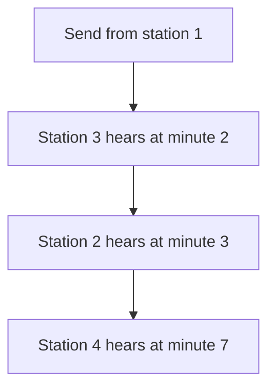

> [!tldr] Quick read
> - Find each station's earliest arrival and take the largest. An unreachable station makes the answer −1.
> - Nonnegative edges let [[en/concepts/dijkstra|Dijkstra's algorithm]] finalize the cheapest station when its queue entry still matches the ledger.
> - An old entry can stay in the heap after a distance update. Check it when you pop it.

> [!info] Context
> LeetCode 743, at [[en/posts/2026-11-27-neetcode-shortest-path|station 5: Shortest Paths]] on the NeetCode Graphs line. Loops and arrays are enough to get started.

> [!abstract]- Quick glossary for this post (click to open)
> - An [[en/concepts/adjacency-list|adjacency list]] stores outgoing edges for each vertex.
> - A [[en/concepts/heap|min-heap]] retrieves the waiting entry with the smallest cost.
> - Relaxing an edge tries to replace the recorded cost to its destination with a cheaper route through that edge.

## Picture it first: four rain warning stations

Station 1 sends a warning to station 2 over a slow channel that takes 9 minutes. It also sends the warning to station 3 in 2 minutes, and station 3 forwards it to station 2 in 1 minute. Station 2 forwards it to station 4 in 4 minutes. Station 2 hears it at minute 3 and the last station hears it at minute 7.

| Everyday life | Concept |
| --- | --- |
| Warning station | Vertex |
| One-way forwarding channel | Weighted edge |
| Next valid station in the queue | Current minimum entry |



## The problem: when does the last station get the signal

Stations are numbered from 1 to n. Each directed edge `u → v` takes `w` units. The source is `k`. Return the time when the whole network has received the signal, or −1 if any station cannot receive it. There are at most 100 stations and 6,000 edges, with weights from 0 to 100.

## How it works

### From edge scans to the lowest cost

Scanning edges synchronously for V−1 rounds gives a reference with O(V(V + E)) time and O(V) extra space. After each round, the ledger allows one more edge. A shortest path can be chosen without repeated vertices because all edge weights are nonnegative.

Dijkstra examines promising paths first. Give the source cost 0 and all other stations infinity. When popping `(d, u)`, skip it if `d` differs from `best[u]`. With a current entry, try `d + w` for every outgoing edge. On improvement, update the ledger and push the new entry.

### Why a pop finalizes the distance

Suppose there is a shorter route to `u`. The first edge on it from a finalized vertex to an unfinalized one must have given that new vertex a tentative value at most the cost of the route to `u`. Nonnegative weights preserve that inequality. The heap would pop the smaller cost first, contradicting the pop of `u`.

In the example, `(9, 2)` remains in the heap when `(3, 2)` is popped. When the entry with 9 finally comes out, `best[2]` is already 3, so we skip it. `max(best)` is 7 because sending along different routes can happen concurrently. Distances add only along one route.

With a heap that pushes a new entry on an improvement, time is O(V + E log(E + 1)) and space is O(V + E). On a chain of 100 stations, Dijkstra examines 99 edges, and a layered scan with no early exit examines `99 × 99 = 9,801` edges. The TypeScript file compares the two methods on 200 small graphs and this chain.

## Runnable example

[TypeScript](../code/neetcode-network-delay-time/signal-time.ts) · [Python](../code/neetcode-network-delay-time/signal_time.py) · [Go](../code/neetcode-network-delay-time/signal_time.go) · [Java](../code/neetcode-network-delay-time/signal-time.java) · [JavaScript](../code/neetcode-network-delay-time/signal-time.js) · [PHP](../code/neetcode-network-delay-time/signal-time.php) · [Rust](../code/neetcode-network-delay-time/signal_time.rs)

The tabs show the central function. The standalone files also run the comparison methods on the small cases. The TypeScript file adds randomized comparisons.

```ts
function networkDelay(edges: number[][], n: number, start: number): number {
  const graph = Array.from({ length: n }, (): Neighbor[] => [])
  for (const [from, to, time] of edges) graph[from - 1].push([to - 1, time])
  const lastArrival = Math.max(...leastCosts(graph, start - 1, 0, (cost, time) => cost + time))
  return lastArrival === Infinity ? -1 : lastArrival
}
```

```python
def network_delay(edges, n, start):
    graph = [[] for _ in range(n)]
    for source, target, time in edges:
        graph[source - 1].append((target - 1, time))
    last_arrival = max(least_costs(graph, start - 1, 0, lambda cost, time: cost + time))
    return -1 if last_arrival == float("inf") else last_arrival
```

```go
func networkDelay(edges [][3]int, n, start int) int {
	graph := make([][]neighbor, n)
	for _, edge := range edges {
		from, to, time := edge[0]-1, edge[1]-1, edge[2]
		graph[from] = append(graph[from], neighbor{to, time})
	}
	lastArrival := 0
	for _, time := range leastCosts(graph, start-1, 0, func(cost, time int) int { return cost + time }) {
		if time == infinity {
			return -1
		}
		lastArrival = max(lastArrival, time)
	}
	return lastArrival
}
```

```java
static int networkDelay(int[][] edges, int n, int start) {
    var graph = emptyGraph(n);
    for (int[] edge : edges) {
        graph.get(edge[0] - 1).add(new int[]{edge[1] - 1, edge[2]});
    }
    int lastArrival = Arrays.stream(leastCosts(graph, start - 1, 0, Integer::sum)).max().orElseThrow();
    return lastArrival == Integer.MAX_VALUE ? -1 : lastArrival;
}
```

```js
function networkDelay(edges, n, start) {
  const graph = Array.from({ length: n }, () => [])
  for (const [from, to, time] of edges) graph[from - 1].push([to - 1, time])
  const lastArrival = Math.max(...leastCosts(graph, start - 1, 0, (cost, time) => cost + time))
  return lastArrival === Infinity ? -1 : lastArrival
}
```

```php
function networkDelay(array $edges, int $n, int $start): int {
    $graph = array_fill(0, $n, []);
    foreach ($edges as [$from, $to, $time]) {
        $graph[$from - 1][] = [$to - 1, $time];
    }
    $lastArrival = max(leastCosts($graph, $start - 1, 0, fn($cost, $time) => $cost + $time));
    return $lastArrival === PHP_INT_MAX ? -1 : $lastArrival;
}
```

```rust
fn network_delay(edges: &[(usize, usize, i32)], n: usize, start: usize) -> i32 {
    let mut graph = vec![Vec::new(); n];
    for &(from, to, time) in edges {
        graph[from - 1].push((to - 1, time));
    }
    let last_arrival = least_costs(&graph, start - 1, 0, |cost, time| cost + time)
        .into_iter()
        .max()
        .unwrap();
    if last_arrival == i32::MAX {
        -1
    } else {
        last_arrival
    }
}
```

```text
5/5 cases passed
201/201 cross-checks passed; chain edges: Dijkstra 99, layered scan 9801
```

*(Output labels translated; the files themselves print Vietnamese.)*

## Misconceptions and common traps

- **Counting edges as in BFS.** Two edges can be faster than one.
- **Finalizing on insertion.** Station 2 can improve from 9 to 3.
- **Reversing the edge in the adjacency list.** A signal may only travel from `u` to `v`.
- **Picking the wrong heap order.** PHP's `SplPriorityQueue` and Rust's `BinaryHeap` are max-heaps by default. The code uses a negative priority and `Reverse`, respectively.

## Self-check questions

> [!question]- What if forwarding from station 3 to station 2 takes 7 minutes?
> Both routes get to station 2 at 9, and station 4 hears at 13. Equal costs need no new entry.

> [!question]- Can a station other than the source be popped at cost 0?
> Yes. Edges taking 0 time can reach another station.

## References

- [LeetCode 743 · Network Delay Time](https://leetcode.com/problems/network-delay-time/)
- [Dijkstra (1959)](https://doi.org/10.1007/BF01386390)
