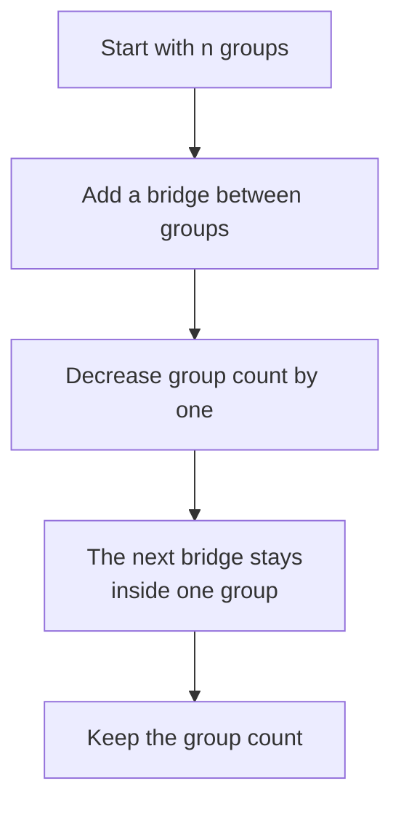

> [!tldr] Quick read
> - Each DFS started at an unseen vertex discovers exactly one [[en/concepts/connected-component|connected component]].
> - [[en/concepts/disjoint-set-union|Union-Find]] starts with `n` groups and decrements the count only when two distinct groups merge.
> - An internal edge and an isolated vertex are two useful test cases.

> [!info] Context
> LeetCode 323, from [[en/posts/2026-11-27-neetcode-union-find|station 4: Union-Find]] on [[en/series/neetcode-grph|the NeetCode Graphs line]]. The example uses a small graph and assumes only arrays and loops.

> [!abstract]- Quick glossary for this post (click to open)
> - An undirected edge joins two vertices in both directions.
> - A [[en/concepts/connected-component|connected component]] is a maximal group whose vertices can reach one another.
> - [[en/concepts/disjoint-set-union|DSU]] maintains groups by finding roots and merging them. DFS is depth-first search.

## Picture it first: islands connected by bridges

I have seven islands and a record of their bridges. A group includes every island reachable from one another by crossing bridges. An island on its own still counts as a group.

| Everyday life | Concept |
|---|---|
| Island | Vertex |
| Two-way bridge | Undirected edge |
| Group of reachable islands | Connected component |
| New bridge between two groups | Successful merge |



## The problem: counting groups after reading edges

The input contains `n` vertices numbered 0 through `n−1` and a list of undirected edges. The public NeetCode version has `1 ≤ n ≤ 2000` and up to 5,000 edges. Each edge connects distinct vertices and appears only once. The files also test an empty edge list to exercise isolated vertices.

With `n=7` and `[[0,2],[2,4],[0,4],[1,3]]`, the four groups are `{0,2,4}`, `{1,3}`, `{5}`, and `{6}`. The answer is 4.

## How it works

### Approach 1. Start one traversal per group

Build the adjacency list in both directions. Scan all `n` vertices, including those absent from the edge list. At an unseen vertex, increment the count, then run DFS to mark its entire group. Each vertex is pushed onto the stack once because I mark it on push. The algorithm uses O(V + E) time and O(V + E) auxiliary space including the adjacency list.

### Approach 2. Count successful merges

Initially each vertex stands alone, so start at `n`. For each edge, find both roots. With distinct roots, merge the groups and decrement exactly once. With matching roots, the edge lies within an existing group. This invariant means the DSU count matches the number of components for all edges read so far.

The sequence takes O(V + E α(V)) amortized time and O(V) auxiliary space. When adjacency lists already exist and I need a single result, DFS is simple and has a linear bound. When edges arrive gradually, DSU gives the group count after each merge and uses two arrays of length `V` without keeping an adjacency list.

## Runnable example

[TypeScript](../code/neetcode-number-of-connected-components-in-an-undirected-graph/solve.ts) · [Python](../code/neetcode-number-of-connected-components-in-an-undirected-graph/solve.py) · [Go](../code/neetcode-number-of-connected-components-in-an-undirected-graph/solve.go) · [Java](../code/neetcode-number-of-connected-components-in-an-undirected-graph/solve.java) · [JavaScript](../code/neetcode-number-of-connected-components-in-an-undirected-graph/solve.js) · [PHP](../code/neetcode-number-of-connected-components-in-an-undirected-graph/solve.php) · [Rust](../code/neetcode-number-of-connected-components-in-an-undirected-graph/solve.rs)

The tabs show the solution excerpt. The downloaded file includes every approach and its runnable checks.

```ts
import assert from "node:assert/strict";

type Edge = readonly [number, number];

class DisjointSet {
  private parent: number[];
  private size: number[];
  count: number;

  constructor(n: number) {
    this.parent = Array.from({ length: n }, (_, i) => i);
    this.size = new Array<number>(n).fill(1);
    this.count = n;
  }

  find(node: number): number {
    while (node !== this.parent[node]) {
      this.parent[node] = this.parent[this.parent[node]];
      node = this.parent[node];
    }
    return node;
  }

  union(a: number, b: number): boolean {
    let ra = this.find(a);
    let rb = this.find(b);
    if (ra === rb) return false;
    if (this.size[ra] < this.size[rb]) [ra, rb] = [rb, ra];
    this.parent[rb] = ra;
    this.size[ra] += this.size[rb];
    this.count--;
    return true;
  }
}

function componentsByDsu(n: number, edges: readonly Edge[]): number {
  const ds = new DisjointSet(n);
  for (const [a, b] of edges) ds.union(a, b);
  return ds.count;
}
```

```python
class DisjointSet:
    def __init__(self, n):
        self.parent = list(range(n))
        self.size = [1] * n
        self.count = n

    def find(self, node):
        while node != self.parent[node]:
            self.parent[node] = self.parent[self.parent[node]]
            node = self.parent[node]
        return node

    def union(self, a, b):
        ra, rb = self.find(a), self.find(b)
        if ra == rb:
            return False
        if self.size[ra] < self.size[rb]:
            ra, rb = rb, ra
        self.parent[rb] = ra
        self.size[ra] += self.size[rb]
        self.count -= 1
        return True


def components_by_dsu(n, edges):
    ds = DisjointSet(n)
    for a, b in edges:
        ds.union(a, b)
    return ds.count
```

```go
package main

import "fmt"

type edge [2]int

type disjointSet struct {
	parent, size []int
	count        int
}

func newDisjointSet(n int) *disjointSet {
	ds := &disjointSet{make([]int, n), make([]int, n), n}
	for i := range ds.parent {
		ds.parent[i], ds.size[i] = i, 1
	}
	return ds
}

func (ds *disjointSet) find(node int) int {
	for node != ds.parent[node] {
		ds.parent[node] = ds.parent[ds.parent[node]]
		node = ds.parent[node]
	}
	return node
}

func (ds *disjointSet) union(a, b int) bool {
	ra, rb := ds.find(a), ds.find(b)
	if ra == rb {
		return false
	}
	if ds.size[ra] < ds.size[rb] {
		ra, rb = rb, ra
	}
	ds.parent[rb] = ra
	ds.size[ra] += ds.size[rb]
	ds.count--
	return true
}

func componentsByDsu(n int, edges []edge) int {
	ds := newDisjointSet(n)
	for _, e := range edges {
		ds.union(e[0], e[1])
	}
	return ds.count
}
```

```java
class Solve {
    static final class DisjointSet {
        private final int[] parent;
        private final int[] size;
        int count;

        DisjointSet(int n) {
            parent = new int[n];
            size = new int[n];
            count = n;
            for (int i = 0; i < n; i++) {
                parent[i] = i;
                size[i] = 1;
            }
        }

        int find(int node) {
            while (node != parent[node]) {
                parent[node] = parent[parent[node]];
                node = parent[node];
            }
            return node;
        }

        boolean union(int a, int b) {
            int ra = find(a), rb = find(b);
            if (ra == rb) return false;
            if (size[ra] < size[rb]) {
                int swap = ra;
                ra = rb;
                rb = swap;
            }
            parent[rb] = ra;
            size[ra] += size[rb];
            count--;
            return true;
        }
    }

    static int componentsByDsu(int n, int[][] edges) {
        var ds = new DisjointSet(n);
        for (int[] e : edges) ds.union(e[0], e[1]);
        return ds.count;
    }
}
```

```javascript
import assert from "node:assert/strict";

class DisjointSet {
  parent;
  size;
  count;

  constructor(n) {
    this.parent = Array.from({ length: n }, (_, i) => i);
    this.size = new Array(n).fill(1);
    this.count = n;
  }

  find(node) {
    while (node !== this.parent[node]) {
      this.parent[node] = this.parent[this.parent[node]];
      node = this.parent[node];
    }
    return node;
  }

  union(a, b) {
    let ra = this.find(a);
    let rb = this.find(b);
    if (ra === rb) return false;
    if (this.size[ra] < this.size[rb]) [ra, rb] = [rb, ra];
    this.parent[rb] = ra;
    this.size[ra] += this.size[rb];
    this.count--;
    return true;
  }
}

function componentsByDsu(n, edges) {
  const ds = new DisjointSet(n);
  for (const [a, b] of edges) ds.union(a, b);
  return ds.count;
}
```

```php
<?php
declare(strict_types=1);

final class DisjointSet
{
    private array $parent;
    private array $size;
    public int $count;

    public function __construct(int $n)
    {
        $this->parent = range(0, $n - 1);
        $this->size = array_fill(0, $n, 1);
        $this->count = $n;
    }

    public function find(int $node): int
    {
        while ($node !== $this->parent[$node]) {
            $this->parent[$node] = $this->parent[$this->parent[$node]];
            $node = $this->parent[$node];
        }
        return $node;
    }

    public function union(int $a, int $b): bool
    {
        [$ra, $rb] = [$this->find($a), $this->find($b)];
        if ($ra === $rb) {
            return false;
        }
        if ($this->size[$ra] < $this->size[$rb]) {
            [$ra, $rb] = [$rb, $ra];
        }
        $this->parent[$rb] = $ra;
        $this->size[$ra] += $this->size[$rb];
        $this->count--;
        return true;
    }
}

function componentsByDsu(int $n, array $edges): int
{
    $ds = new DisjointSet($n);
    foreach ($edges as [$a, $b]) {
        $ds->union($a, $b);
    }
    return $ds->count;
}
```

```rust
type Edge = [usize; 2];

struct DisjointSet {
    parent: Vec<usize>,
    size: Vec<usize>,
    count: usize,
}

impl DisjointSet {
    fn new(n: usize) -> Self {
        Self {
            parent: (0..n).collect(),
            size: vec![1; n],
            count: n,
        }
    }

    fn find(&mut self, mut node: usize) -> usize {
        while node != self.parent[node] {
            self.parent[node] = self.parent[self.parent[node]];
            node = self.parent[node];
        }
        node
    }

    fn union(&mut self, a: usize, b: usize) -> bool {
        let mut ra = self.find(a);
        let mut rb = self.find(b);
        if ra == rb {
            return false;
        }
        if self.size[ra] < self.size[rb] {
            std::mem::swap(&mut ra, &mut rb);
        }
        self.parent[rb] = ra;
        self.size[ra] += self.size[rb];
        self.count -= 1;
        true
    }
}

fn components_by_dsu(n: usize, edges: &[Edge]) -> usize {
    let mut ds = DisjointSet::new(n);
    for &[a, b] in edges {
        ds.union(a, b);
    }
    ds.count
}
```

Output from each language file:

```text
10/10 cases passed
```

*(Output labels translated; the files themselves print Vietnamese.)*

## Misconceptions and common traps

- Scan all `n` vertices. Deriving the vertex set from the edge list omits isolated islands.
- The edge `[0,4]` closes a cycle after `[0,2]` and `[2,4]`. Decrementing for all three edges undercounts the groups by one.
- When counting from the `parent` array, count self-pointing slots or the roots returned by `find`. Intermediate parents can differ within a single group.
- PHP passes `$seen` by reference in the traversal so marks persist when the outer scan continues.

## Self-check questions

> [!question]- What is the result for seven islands and no bridges?
> Seven groups, each with one island.

> [!question]- What does adding bridge 3–5 to the example do?
> It connects `{1,3}` with `{5}`, so the count drops from 4 to 3.

## References

- [LeetCode](https://leetcode.com/problems/number-of-connected-components-in-an-undirected-graph/)
- [NeetCode](https://neetcode.io/problems/count-connected-components/question)
- [Sedgewick and Wayne, Weighted Quick Union](https://github.com/kevin-wayne/algs4/blob/master/src/main/java/edu/princeton/cs/algs4/WeightedQuickUnionUF.java)
- [Robert Tarjan, Efficiency of a Good But Not Linear Set Union Algorithm](https://doi.org/10.1145/321879.321884)
