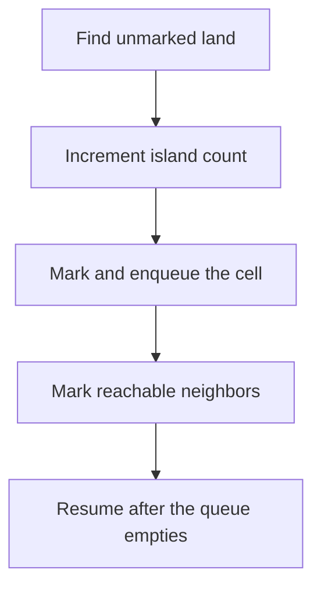

> [!tldr] Quick read
> - Each island is a [[en/concepts/connected-component|connected component]] of land cells that share edges.
> - Scan the grid row by row. At unmarked land, increment the count once and [[en/concepts/flood-fill|flood-fill]] the entire island.
> - [[en/concepts/mark-on-enqueue|Mark when adding a cell to the worklist]] so each land cell appears once in the queue or stack.
> - Both versions take `O(mn)`. BFS keeps the grid intact with a mark array. Iterative DFS uses the grid itself for marks.

> [!info] Context
> LeetCode 200 belongs to [[en/posts/2026-11-26-neetcode-grid-traversal|station 1: Grid Traversal]] on **the NeetCode Line: Graphs**. I need to count patches of land on a map made of square cells. You only need loops, queues, and stacks. [[en/problems/max-area-of-island|LC-0695]] uses the same traversal to measure the largest island.

> [!abstract]- Quick glossary for this post (click to open)
> - [[en/concepts/grid-graph|Grid graph]]: a land cell is a vertex, and land cells sharing a side have an edge.
> - A **seed** is an unmarked land cell that starts the traversal of an island.
> - [[en/concepts/breadth-first-search|BFS]] processes the oldest pending cell first. DFS with a stack processes the newest first.
> - **In-place traversal** uses a value in the grid itself as its visited mark.

## Picture it first: coloring neighborhoods

I scan a map one row at a time. Each time I find an uncolored house, I open a new pot of paint and pass it through doors between houses that share a wall. To get to a house diagonally across, I need a route through other doors. Once I have colored every reachable house, I resume the scan.

| Everyday life | Concept |
|---|---|
| Houses sharing a wall | Two vertices adjacent in one of four directions |
| Open a new pot of paint | Increment the component count |
| Paint a house when adding it to the list | Mark while adding to the queue or stack |
| Run out of pending houses | Finish the current island |



## The problem: which visits count as an island?

Each cell contains the character `'1'` for land or `'0'` for water. The grid is `m × n`, with each dimension between 1 and 300. Count groups of land connected by horizontal or vertical steps. Treat the space outside the grid as water. [Problem LC-0200](https://leetcode.com/problems/number-of-islands/)

```text
1 0 0 1 1
0 0 0 1 1
0 1 0 1 0
1 1 0 0 0
```

With zero-based coordinates, the scan starts traversals at `(0,0)`, `(0,3)`, and `(2,1)`. Those islands have 1, 5, and 3 cells. Cell `(0,4)` belongs to the same island as `(0,3)`, so I skip it when the scan reaches it. The result is **3**. Cells that touch at a corner belong to separate islands when no side-connected route joins them.

## How it works

<figure class="figure-map" style="--ar: 3 / 4">
<div class="frame"><iframe data-archify="../../diagrams/neetcode-number-of-islands/worked-example.en.html" title="Count islands by starting one fill per component" loading="lazy"></iframe></div>
<figcaption><span><b>Figure 1.</b> Count islands by starting one fill per component.</span><a href="../diagrams/neetcode-number-of-islands/worked-example.en.html" target="_blank" rel="noopener">Open full screen</a></figcaption>
</figure>

<details>
<summary>Read the steps</summary>
<ol>
<li>Scan by row to find the first seed. <code>(0,0) → 1</code></li>
<li>Fill the second island from (0,3). <code>2; area = 5</code></li>
<li>Skip land cells already marked. <code>(1,3), (1,4)</code></li>
<li>Start the third fill at (2,1). <code>3; area = 3</code></li>
<li>The scan starts exactly three fills. <code>count = 3</code></li>
</ol>
</details>

### Scan outside, flood-fill inside

A traversal starts at a seed and moves only over edges between land cells. Every visited cell therefore belongs to the seed's island. If a cell on that island were still unreached, a path from the seed would contain a processed cell directly followed by a cell that had never been added. Processing the first would add the second during its neighbor check. When the worklist empties, the entire island is marked.

The first visit to each island in the outer scan finds an unmarked land cell. The traversal above ensures that subsequent scan positions within that island are already marked. The count increases exactly once per island.

### Approach 1 — BFS with a mark array

The `seen` array holds one entry per cell. Encode `(r,c)` as `r*n+c` for the array and queue. With neighbors examined up, down, left, and right, the traversal from `(0,3)` proceeds like this.

| Cell removed | New land added | Queue still pending |
|---|---|---|
| `(0,3)` | `(1,3)`, `(0,4)` | `(1,3)`, `(0,4)` |
| `(1,3)` | `(2,3)`, `(1,4)` | `(0,4)`, `(2,3)`, `(1,4)` |
| `(0,4)` | `(1,4)` is already marked | `(2,3)`, `(1,4)` |
| `(2,3)`, then `(1,4)` | None | Empty |

Marking `(1,4)` when it is added ensures a single queue entry even though two neighbors find it. Python uses `deque.popleft()` and Java uses `ArrayDeque.removeFirst()`. TypeScript, JavaScript, and Go keep a head index to avoid moving the remaining entries on each removal. The array or slice in these three versions retains processed entries until the current island finishes.

### Approach 2 — Iterative DFS with marks in the grid

Use a stack to change processing order. Turn each cell into water as soon as it goes onto the stack. The next neighbor check skips it. After the traversal, the current island is water and the outer scan resumes. Use this approach when grid mutation is allowed. To preserve the input, choose BFS with a mark array or copy each row before calling DFS.

Recursive DFS follows the same idea. A long strip of land or a winding path can make call depth grow with the number of cells. Both runnable versions here use loops and explicit worklists. [Python's recursion limit](https://docs.python.org/3/library/sys.html#sys.getrecursionlimit)

### Measuring pushes and space

I ran both marking schedules on a `50 × 50` all-land grid from its upper-left corner. The version that marks on removal still discards duplicate queue entries when dequeued and only enqueues neighbors unmarked at the time of inspection. Both versions visit 2,500 distinct cells.

| BFS marking schedule | Total pushes, including the seed | Maximum pending entries |
|---|---:|---:|
| On enqueue | 2,500 | 50 |
| On dequeue | 4,901 | 99 |

These are operation counts and pending entries for this grid. They show how early marking cuts down on work. Pending entries exclude already processed elements retained by a head-index array.

The outer scan takes `O(mn)`. In the two solutions each land cell joins the worklist once, and each removal tests four directions. Total time is `O(mn)`. BFS holds `O(mn)` marks and a queue with an `O(L)` upper bound, where `L` is the largest island's cell count. In-place DFS needs only the stack, with an `O(L)` upper bound. Both use `O(mn)` auxiliary space in the worst case. Even an all-water grid must be read in full because any unread cell could be an island.

## Runnable example

The files parse digit rows into an integer grid of 0 and 1, then run both approaches. When submitting LC-0200, you can keep the character grid and compare against `'1'`, marking with `'0'`. The six cases include the grid above, diagonal land, all water, one row of land, a square with a cycle, and a full `300 × 300` grid. Each case also checks that BFS preserves every cell and DFS clears all land.

[TypeScript](../code/neetcode-number-of-islands/count-islands.ts) · [Python](../code/neetcode-number-of-islands/count_islands.py) · [Go](../code/neetcode-number-of-islands/count_islands.go) · [Java](../code/neetcode-number-of-islands/count-islands.java) · [JavaScript](../code/neetcode-number-of-islands/count-islands.js) · [PHP](../code/neetcode-number-of-islands/count-islands.php) · [Rust](../code/neetcode-number-of-islands/count_islands.rs)

```ts
const directions = [[-1, 0], [1, 0], [0, -1], [0, 1]]

function floodBfs(grid: number[][]): number {
  const rows = grid.length, cols = grid[0].length
  const seen = new Uint8Array(rows * cols)
  let result = 0

  for (let start = 0; start < seen.length; start++) {
    if (grid[Math.floor(start / cols)][start % cols] !== 1 || seen[start]) continue

    result++
    const queue = [start]
    seen[start] = 1
    for (let head = 0; head < queue.length; head++) {
      const cell = queue[head]
      const row = Math.floor(cell / cols), col = cell % cols
      for (const [dr, dc] of directions) {
        const r = row + dr, c = col + dc
        if (r < 0 || r >= rows || c < 0 || c >= cols || grid[r][c] !== 1) continue
        const next = r * cols + c
        if (seen[next]) continue
        seen[next] = 1
        queue.push(next)
      }
    }
  }
  return result
}

function floodDfsInPlace(grid: number[][]): number {
  const rows = grid.length, cols = grid[0].length
  let result = 0

  for (let start = 0; start < rows * cols; start++) {
    const row = Math.floor(start / cols), col = start % cols
    if (grid[row][col] !== 1) continue

    result++
    const stack = [start]
    grid[row][col] = 0
    while (stack.length > 0) {
      const cell = stack.pop()!
      const cr = Math.floor(cell / cols), cc = cell % cols
      for (const [dr, dc] of directions) {
        const r = cr + dr, c = cc + dc
        if (r < 0 || r >= rows || c < 0 || c >= cols || grid[r][c] !== 1) continue
        grid[r][c] = 0
        stack.push(r * cols + c)
      }
    }
  }
  return result
}

const cases = [
  {grid: ["10011", "00011", "01010", "11000"], want: 3},
  {grid: ["100", "010", "001"], want: 3},
  {grid: ["000", "000"], want: 0},
  {grid: ["11111"], want: 1},
  {grid: ["11", "11"], want: 1},
  {grid: Array.from({length: 300}, () => "1".repeat(300)), want: 1},
]
for (const {grid, want} of cases) {
  const cells = grid.map(row => Array.from(row, Number))
  if (floodBfs(cells) !== want || cells.some((row, i) => row.join("") !== grid[i])) {
    throw new Error("BFS sai")
  }
  if (floodDfsInPlace(cells) !== want || cells.some(row => row.some(value => value !== 0))) {
    throw new Error("DFS sai")
  }
}
console.log(`${cases.length}/${cases.length} ca đúng`)
```
```python
from collections import deque

DIRECTIONS = ((-1, 0), (1, 0), (0, -1), (0, 1))


def flood_bfs(grid):
    rows, cols = len(grid), len(grid[0])
    seen = bytearray(rows * cols)
    result = 0
    for start in range(len(seen)):
        row, col = divmod(start, cols)
        if grid[row][col] != 1 or seen[start]:
            continue
        result += 1
        queue = deque([start])
        seen[start] = 1
        while queue:
            row, col = divmod(queue.popleft(), cols)
            for dr, dc in DIRECTIONS:
                r, c = row + dr, col + dc
                if not (0 <= r < rows and 0 <= c < cols) or grid[r][c] != 1:
                    continue
                index = r * cols + c
                if seen[index]:
                    continue
                seen[index] = 1
                queue.append(index)
    return result


def flood_dfs_in_place(grid):
    rows, cols = len(grid), len(grid[0])
    result = 0
    for start in range(rows * cols):
        row, col = divmod(start, cols)
        if grid[row][col] != 1:
            continue
        result += 1
        stack = [start]
        grid[row][col] = 0
        while stack:
            row, col = divmod(stack.pop(), cols)
            for dr, dc in DIRECTIONS:
                r, c = row + dr, col + dc
                if not (0 <= r < rows and 0 <= c < cols) or grid[r][c] != 1:
                    continue
                grid[r][c] = 0
                stack.append(r * cols + c)
    return result


cases = [
    (["10011", "00011", "01010", "11000"], 3),
    (["100", "010", "001"], 3),
    (["000", "000"], 0),
    (["11111"], 1),
    (["11", "11"], 1),
    (["1" * 300] * 300, 1),
]
for grid, want in cases:
    cells = [list(map(int, row)) for row in grid]
    assert flood_bfs(cells) == want and ["".join(map(str, row)) for row in cells] == grid
    assert flood_dfs_in_place(cells) == want and not any(map(any, cells))
print(f"{len(cases)}/{len(cases)} ca đúng")
```
```go
package main

import (
	"fmt"
	"strings"
)

var directions = [][2]int{{-1, 0}, {1, 0}, {0, -1}, {0, 1}}

func floodBFS(grid [][]int) int {
	rows, cols := len(grid), len(grid[0])
	seen := make([]bool, rows*cols)
	result := 0
	for start := range seen {
		row, col := start/cols, start%cols
		if grid[row][col] != 1 || seen[start] {
			continue
		}

		result++
		queue := []int{start}
		seen[start] = true
		for head := 0; head < len(queue); head++ {
			cell := queue[head]
			row, col := cell/cols, cell%cols
			for _, d := range directions {
				r, c := row+d[0], col+d[1]
				if r < 0 || r >= rows || c < 0 || c >= cols || grid[r][c] != 1 {
					continue
				}
				next := r*cols + c
				if seen[next] {
					continue
				}
				seen[next] = true
				queue = append(queue, next)
			}
		}
	}
	return result
}

func floodDFSInPlace(grid [][]int) int {
	rows, cols := len(grid), len(grid[0])
	result := 0
	for start := 0; start < rows*cols; start++ {
		row, col := start/cols, start%cols
		if grid[row][col] != 1 {
			continue
		}

		result++
		stack := []int{start}
		grid[row][col] = 0
		for len(stack) > 0 {
			top := len(stack) - 1
			cell := stack[top]
			stack = stack[:top]
			row, col := cell/cols, cell%cols
			for _, d := range directions {
				r, c := row+d[0], col+d[1]
				if r < 0 || r >= rows || c < 0 || c >= cols || grid[r][c] != 1 {
					continue
				}
				grid[r][c] = 0
				stack = append(stack, r*cols+c)
			}
		}
	}
	return result
}

func main() {
	full := make([]string, 300)
	for i := range full {
		full[i] = strings.Repeat("1", 300)
	}
	cases := []struct {
		grid []string
		want int
	}{
		{[]string{"10011", "00011", "01010", "11000"}, 3},
		{[]string{"100", "010", "001"}, 3},
		{[]string{"000", "000"}, 0},
		{[]string{"11111"}, 1},
		{[]string{"11", "11"}, 1},
		{full, 1},
	}
	for _, example := range cases {
		cells := make([][]int, len(example.grid))
		for r, row := range example.grid {
			cells[r] = make([]int, len(row))
			for c := range row {
				cells[r][c] = int(row[c] - '0')
			}
		}
		if floodBFS(cells) != example.want {
			panic("BFS sai")
		}
		for r, row := range cells {
			for c, value := range row {
				if value != int(example.grid[r][c]-'0') {
					panic("BFS sai")
				}
			}
		}
		if floodDFSInPlace(cells) != example.want {
			panic("DFS sai")
		}
		for _, row := range cells {
			for _, value := range row {
				if value != 0 {
					panic("DFS sai")
				}
			}
		}
	}
	fmt.Printf("%d/%d ca đúng\n", len(cases), len(cases))
}
```
```java
import java.util.ArrayDeque;
import java.util.Arrays;

class CountIslands {
    static final int[][] DIRECTIONS = {{-1, 0}, {1, 0}, {0, -1}, {0, 1}};

    static int floodBfs(int[][] grid) {
        int rows = grid.length, cols = grid[0].length;
        boolean[] seen = new boolean[rows * cols];
        int result = 0;
        for (int start = 0; start < seen.length; start++) {
            int row = start / cols, col = start % cols;
            if (grid[row][col] != 1 || seen[start]) continue;

            result++;
            var queue = new ArrayDeque<Integer>();
            seen[start] = true;
            queue.addLast(start);
            while (!queue.isEmpty()) {
                int cell = queue.removeFirst();
                for (int[] d : DIRECTIONS) {
                    int r = cell / cols + d[0], c = cell % cols + d[1];
                    if (r < 0 || r >= rows || c < 0 || c >= cols || grid[r][c] != 1) continue;
                    int next = r * cols + c;
                    if (seen[next]) continue;
                    seen[next] = true;
                    queue.addLast(next);
                }
            }
        }
        return result;
    }

    static int floodDfsInPlace(int[][] grid) {
        int rows = grid.length, cols = grid[0].length;
        int result = 0;
        for (int start = 0; start < rows * cols; start++) {
            int row = start / cols, col = start % cols;
            if (grid[row][col] != 1) continue;

            result++;
            var stack = new ArrayDeque<Integer>();
            grid[row][col] = 0;
            stack.addLast(start);
            while (!stack.isEmpty()) {
                int cell = stack.removeLast();
                for (int[] d : DIRECTIONS) {
                    int r = cell / cols + d[0], c = cell % cols + d[1];
                    if (r < 0 || r >= rows || c < 0 || c >= cols || grid[r][c] != 1) continue;
                    grid[r][c] = 0;
                    stack.addLast(r * cols + c);
                }
            }
        }
        return result;
    }

    record Case(String[] grid, int want) {}

    public static void main(String[] args) {
        String[] full = new String[300];
        Arrays.fill(full, "1".repeat(300));
        Case[] cases = {
            new Case(new String[]{"10011", "00011", "01010", "11000"}, 3),
            new Case(new String[]{"100", "010", "001"}, 3),
            new Case(new String[]{"000", "000"}, 0),
            new Case(new String[]{"11111"}, 1),
            new Case(new String[]{"11", "11"}, 1),
            new Case(full, 1),
        };
        for (Case example : cases) {
            int[][] cells = Arrays.stream(example.grid)
                .map(row -> row.chars().map(ch -> ch - '0').toArray()).toArray(int[][]::new);
            if (floodBfs(cells) != example.want) throw new AssertionError("BFS sai");
            for (int r = 0; r < cells.length; r++) {
                for (int c = 0; c < cells[r].length; c++) {
                    if (cells[r][c] != example.grid[r].charAt(c) - '0') throw new AssertionError("BFS sai");
                }
            }
            if (floodDfsInPlace(cells) != example.want) throw new AssertionError("DFS sai");
            for (int[] row : cells) {
                for (int cell : row) {
                    if (cell != 0) throw new AssertionError("DFS sai");
                }
            }
        }
        System.out.printf("%d/%d ca đúng%n", cases.length, cases.length);
    }
}
```
```js
const directions = [[-1, 0], [1, 0], [0, -1], [0, 1]]

function floodBfs(grid) {
  const rows = grid.length, cols = grid[0].length
  const seen = new Uint8Array(rows * cols)
  let result = 0

  for (let start = 0; start < seen.length; start++) {
    if (grid[Math.floor(start / cols)][start % cols] !== 1 || seen[start]) continue

    result++
    const queue = [start]
    seen[start] = 1
    for (let head = 0; head < queue.length; head++) {
      const cell = queue[head]
      const row = Math.floor(cell / cols), col = cell % cols
      for (const [dr, dc] of directions) {
        const r = row + dr, c = col + dc
        if (r < 0 || r >= rows || c < 0 || c >= cols || grid[r][c] !== 1) continue
        const next = r * cols + c
        if (seen[next]) continue
        seen[next] = 1
        queue.push(next)
      }
    }
  }
  return result
}

function floodDfsInPlace(grid) {
  const rows = grid.length, cols = grid[0].length
  let result = 0

  for (let start = 0; start < rows * cols; start++) {
    const row = Math.floor(start / cols), col = start % cols
    if (grid[row][col] !== 1) continue

    result++
    const stack = [start]
    grid[row][col] = 0
    while (stack.length > 0) {
      const cell = stack.pop()
      const cr = Math.floor(cell / cols), cc = cell % cols
      for (const [dr, dc] of directions) {
        const r = cr + dr, c = cc + dc
        if (r < 0 || r >= rows || c < 0 || c >= cols || grid[r][c] !== 1) continue
        grid[r][c] = 0
        stack.push(r * cols + c)
      }
    }
  }
  return result
}

const cases = [
  {grid: ["10011", "00011", "01010", "11000"], want: 3},
  {grid: ["100", "010", "001"], want: 3},
  {grid: ["000", "000"], want: 0},
  {grid: ["11111"], want: 1},
  {grid: ["11", "11"], want: 1},
  {grid: Array.from({length: 300}, () => "1".repeat(300)), want: 1},
]
for (const {grid, want} of cases) {
  const cells = grid.map(row => Array.from(row, Number))
  if (floodBfs(cells) !== want || cells.some((row, i) => row.join("") !== grid[i])) {
    throw new Error("BFS sai")
  }
  if (floodDfsInPlace(cells) !== want || cells.some(row => row.some(value => value !== 0))) {
    throw new Error("DFS sai")
  }
}
console.log(`${cases.length}/${cases.length} ca đúng`)
```

```php
<?php
declare(strict_types=1);

const DIRECTIONS = [[-1, 0], [1, 0], [0, -1], [0, 1]];

function floodBfs(array $grid): int
{
    $rows = count($grid);
    $cols = count($grid[0]);
    $seen = array_fill(0, $rows * $cols, false);
    $result = 0;

    for ($start = 0; $start < $rows * $cols; $start++) {
        if ($grid[intdiv($start, $cols)][$start % $cols] !== 1 || $seen[$start]) {
            continue;
        }

        $result++;
        $queue = [$start];
        $seen[$start] = true;
        for ($head = 0; $head < count($queue); $head++) {
            $cell = $queue[$head];
            $row = intdiv($cell, $cols);
            $col = $cell % $cols;
            foreach (DIRECTIONS as [$dr, $dc]) {
                $r = $row + $dr;
                $c = $col + $dc;
                if ($r < 0 || $r >= $rows || $c < 0 || $c >= $cols || $grid[$r][$c] !== 1) {
                    continue;
                }
                $next = $r * $cols + $c;
                if ($seen[$next]) {
                    continue;
                }
                $seen[$next] = true;
                $queue[] = $next;
            }
        }
    }
    return $result;
}

function floodDfsInPlace(array &$grid): int
{
    $rows = count($grid);
    $cols = count($grid[0]);
    $result = 0;

    for ($start = 0; $start < $rows * $cols; $start++) {
        $row = intdiv($start, $cols);
        $col = $start % $cols;
        if ($grid[$row][$col] !== 1) {
            continue;
        }

        $result++;
        $stack = [$start];
        $grid[$row][$col] = 0;
        while ($stack) {
            $cell = array_pop($stack);
            $cr = intdiv($cell, $cols);
            $cc = $cell % $cols;
            foreach (DIRECTIONS as [$dr, $dc]) {
                $r = $cr + $dr;
                $c = $cc + $dc;
                if ($r < 0 || $r >= $rows || $c < 0 || $c >= $cols || $grid[$r][$c] !== 1) {
                    continue;
                }
                $grid[$r][$c] = 0;
                $stack[] = $r * $cols + $c;
            }
        }
    }
    return $result;
}

$cases = [
    [["10011", "00011", "01010", "11000"], 3],
    [["100", "010", "001"], 3],
    [["000", "000"], 0],
    [["11111"], 1],
    [["11", "11"], 1],
    [array_fill(0, 300, str_repeat("1", 300)), 1],
];
foreach ($cases as [$rows, $want]) {
    $cells = array_map(fn(string $row): array => array_map('intval', str_split($row)), $rows);
    $before = $cells;
    if (floodBfs($cells) !== $want || $cells !== $before) {
        throw new RuntimeException("BFS sai");
    }
    if (floodDfsInPlace($cells) !== $want) {
        throw new RuntimeException("DFS sai");
    }
    foreach ($cells as $row) {
        if (array_sum($row) !== 0) {
            throw new RuntimeException("DFS sai");
        }
    }
}
$n = count($cases);
echo "{$n}/{$n} ca đúng\n";
```

```rust
const DIRECTIONS: [(i32, i32); 4] = [(-1, 0), (1, 0), (0, -1), (0, 1)];

fn flood_bfs(grid: &[Vec<u8>]) -> usize {
    let (rows, cols) = (grid.len(), grid[0].len());
    let mut seen = vec![false; rows * cols];
    let mut result = 0;

    for start in 0..rows * cols {
        if grid[start / cols][start % cols] != 1 || seen[start] {
            continue;
        }

        result += 1;
        let mut queue = vec![start];
        seen[start] = true;
        let mut head = 0;
        while head < queue.len() {
            let cell = queue[head];
            head += 1;
            let (row, col) = ((cell / cols) as i32, (cell % cols) as i32);
            for (dr, dc) in DIRECTIONS {
                let (r, c) = (row + dr, col + dc);
                if r < 0 || r >= rows as i32 || c < 0 || c >= cols as i32 {
                    continue;
                }
                let (r, c) = (r as usize, c as usize);
                let next = r * cols + c;
                if grid[r][c] != 1 || seen[next] {
                    continue;
                }
                seen[next] = true;
                queue.push(next);
            }
        }
    }
    result
}

fn flood_dfs_in_place(grid: &mut [Vec<u8>]) -> usize {
    let (rows, cols) = (grid.len(), grid[0].len());
    let mut result = 0;

    for start in 0..rows * cols {
        let (row, col) = (start / cols, start % cols);
        if grid[row][col] != 1 {
            continue;
        }

        result += 1;
        let mut stack = vec![start];
        grid[row][col] = 0;
        while let Some(cell) = stack.pop() {
            let (cr, cc) = ((cell / cols) as i32, (cell % cols) as i32);
            for (dr, dc) in DIRECTIONS {
                let (r, c) = (cr + dr, cc + dc);
                if r < 0 || r >= rows as i32 || c < 0 || c >= cols as i32 {
                    continue;
                }
                let (r, c) = (r as usize, c as usize);
                if grid[r][c] != 1 {
                    continue;
                }
                grid[r][c] = 0;
                stack.push(r * cols + c);
            }
        }
    }
    result
}

fn main() {
    let big = vec!["1".repeat(300); 300];
    let mut cases: Vec<(Vec<String>, usize)> = vec![
        (vec!["10011", "00011", "01010", "11000"].into_iter().map(String::from).collect(), 3),
        (vec!["100", "010", "001"].into_iter().map(String::from).collect(), 3),
        (vec!["000", "000"].into_iter().map(String::from).collect(), 0),
        (vec!["11111".to_string()], 1),
        (vec!["11".to_string(), "11".to_string()], 1),
    ];
    cases.push((big, 1));

    for (rows, want) in &cases {
        let mut cells: Vec<Vec<u8>> = rows.iter().map(|row| row.bytes().map(|b| b - b'0').collect()).collect();
        let before = cells.clone();
        if flood_bfs(&cells) != *want || cells != before {
            panic!("BFS sai");
        }
        if flood_dfs_in_place(&mut cells) != *want || cells.iter().flatten().any(|&v| v != 0) {
            panic!("DFS sai");
        }
    }
    println!("{}/{} ca đúng", cases.len(), cases.len());
}
```

```text
6/6 cases passed
```

*(Output labels translated; the files themselves print Vietnamese.)*

## Misconceptions and common traps

- **Increment the island count on every pop.** Count at the outer scan when starting a new component. Counting inside the traversal would count land cells.
- **Enqueue a cell and wait until removal to mark it.** On a 2 × 2 square, both neighbors can enqueue the opposite corner. Marking on enqueue blocks the second entry.
- **Use `shift()` or `pop(0)` with a dynamic array.** Moving the remaining elements adds work. Use a head index or a deque.
- **Call a second function with the same grid after in-place DFS.** Copy each row if you need to reuse it. Copying just the outer array still shares the rows.
- **Mix characters and integers.** JavaScript distinguishes `'1'` and `1` in strict comparison. The examples consistently use integers after parsing.
- **PHP: assuming an array is passed by reference.** PHP arrays are copy-on-write, so `floodDfsInPlace` must take `array &$grid` for the land it clears to stay cleared outside the function. In turn, `floodBfs` gets a copy and cannot change the grid by accident.
- **Rust: subtracting below zero on a `usize` index.** `row - 1` with `row = 0` panics in a debug build. The Rust version switches to `i32` to add the direction, checks the bounds, and only then converts back to `usize` to index.

## Self-check questions

> [!question]- Two land cells touch only at a corner and are surrounded by water. How many islands are there?
> Two islands. A path connects them only through horizontal or vertical edges.

> [!question]- Why can I increment the count as soon as I start from a seed?
> It is unmarked, so its island has not yet been counted. After the traversal all cells on that island are marked.

> [!question]- If I need the same grid for LC-0695, which approach should I call first?
> Call the BFS that preserves the grid, or give DFS a row-by-row copy.

## References

- [LeetCode · Number of Islands](https://leetcode.com/problems/number-of-islands/) — adjacency and input limits.
- [Princeton · Connected components](https://github.com/kevin-wayne/algs4/blob/master/src/main/java/edu/princeton/cs/algs4/CC.java) — start a traversal at each unmarked vertex and increment the component count.
- [Princeton · Breadth-first paths](https://github.com/kevin-wayne/algs4/blob/master/src/main/java/edu/princeton/cs/algs4/BreadthFirstPaths.java) — mark a vertex before adding it to the queue.
- [Python · Recursion limit](https://docs.python.org/3/library/sys.html#sys.getrecursionlimit) and [Java · ArrayDeque](https://docs.oracle.com/en/java/javase/21/docs/api/java.base/java/util/ArrayDeque.html).
