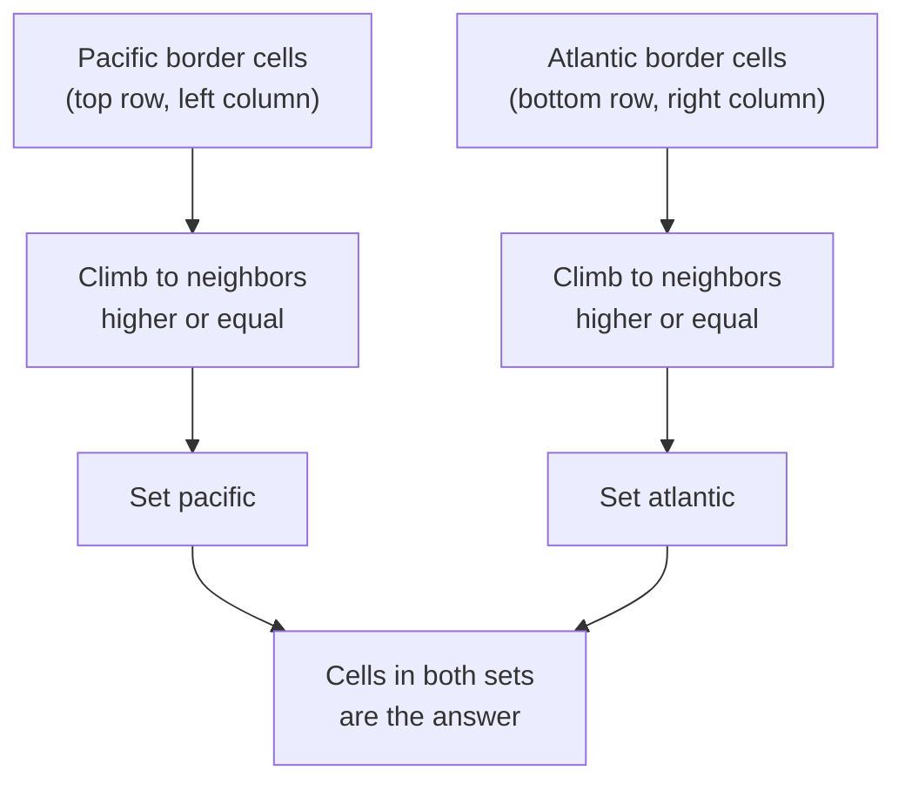
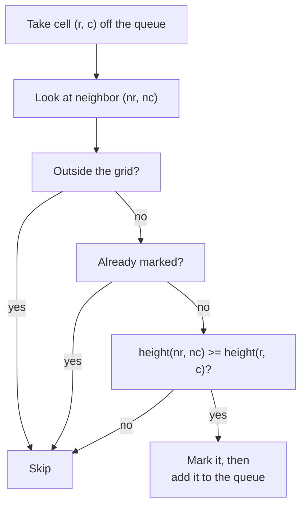

> [!tldr] Quick read
> - Each cell has a height. Water moves from a cell to an edge-adjacent cell when that neighbor is **lower or equal**. Find the cells whose water reaches **both** the Pacific (top and left edges) **and** the Atlantic (bottom and right edges).
> - The naive way releases water from every cell and follows it: one traversal per cell, `O((mn)²)` in total.
> - The good way is [[en/concepts/reverse-reachability|reverse reachability]]: start at the coast and **climb** to cells that are higher or equal. Water from any cell you can climb to flows back down to that coast.
> - Run two [[en/concepts/multi-source-bfs|multi-source BFS]] passes, one per ocean, and keep the cells both reach. `O(mn)` in total.
> - Three traps: walking backwards without flipping the comparison, using `>` instead of `>=`, and seeding only one edge per ocean.

> [!info] Context
> LeetCode 417 (Medium), on [[en/posts/2026-11-26-neetcode-graph-bfs|station 2: Graph Traversal and BFS]] of **the NeetCode Line: Graphs**. At [[en/posts/2026-11-26-neetcode-grid-traversal|station 1]] I used a [[en/concepts/flood-fill|flood fill]] on a grid to count islands. This problem uses the same traversal with two additions: it starts from a whole row of cells at once, and it walks against the direction the water flows. You only need loops, 2D arrays and queues; everything else is explained right below. The solutions cover TypeScript, Python, Go, Java and JavaScript.

> [!abstract]- Quick glossary for this post (click to open)
> - [[en/concepts/grid-graph|Grid graph]]: each cell is a vertex, and two cells sharing a side (up, down, left, right) are adjacent. Diagonal cells are not.
> - **Border cell**: a cell in the outermost row or column. Cells in the top row or left column touch the Pacific; cells in the bottom row or right column touch the Atlantic. The top-right and bottom-left corners touch both.
> - [[en/concepts/breadth-first-search|BFS]] (breadth-first search): process cells in the order they entered the queue, first in, first out.
> - [[en/concepts/multi-source-bfs|Multi-source BFS]]: instead of one start cell, put a whole group of cells in the queue at the start.
> - [[en/concepts/reverse-reachability|Reverse reachability]]: to learn "which cells can reach the target", start at the target and follow the edges backwards.
> - **Reached set** (`seen`): the array marking the cells a traversal has touched.

## Picture it first: walking up the stream from the river mouth

Picture a hilly island. The sea to the north-west is the Pacific, the sea to the south-east is the Atlantic. Rain falls on a cell, and the water rolls to a neighboring cell if that cell is not higher.

The first way is to stand on each cell, pour out a bucket and run after the water to see which sea it reaches. An island of 40,000 cells needs 40,000 buckets.

The second way is to stand at the river mouth and **walk upstream into the hills**. You only step to places that are higher than or level with where you stand. From every place you reach, water rolls back down exactly the path you walked and returns to the sea. Two groups of walkers, one starting from each coast, are enough for the whole island.

| Everyday life | Concept |
|---|---|
| A patch of land with a height | Cell `(r, c)` with value `heights[r][c]` |
| Water rolls to a place that is not higher | Move from a cell to a neighbor with height `<=` |
| Pour a bucket on every cell | Brute force: one traversal per cell |
| Stand at the river mouth and climb upstream | Reverse: from a border cell to a neighbor with height `>=` |
| A whole line of walkers along the coast starts together | Multi-source BFS, every border cell in the queue at the start |
| Two groups, two coasts | Two reached sets: `pacific`, `atlantic` |
| Places both groups set foot on | The answer: the intersection of the two sets |



## The problem: releasing water from every cell is too slow

The input is an `m × n` grid of non-negative integers, each the height of one cell. Water in a cell can move to an edge-adjacent cell whose height is less than or equal. Water reaches the Pacific when it gets to a cell in the top row or the left column, and the Atlantic when it gets to a cell in the bottom row or the right column. Return the coordinates of every cell whose water reaches both oceans, in any order. Limits: `1 ≤ m, n ≤ 200`, heights from `0` to `10⁵`. [Problem LC-0417](https://leetcode.com/problems/pacific-atlantic-water-flow/)

I use a `3 × 3` grid whose heights rise in a spiral, starting at the top-left corner and going clockwise:

```text
        cột 0  cột 1  cột 2
hàng 0    1      2      3
hàng 1    8      9      4
hàng 2    7      6      5
```

(`cột` is column, `hàng` is row.) Checking cells by hand:

| Cell | Height | Reaches the Pacific? | Reaches the Atlantic? |
|---|---:|---|---|
| `(0,0)` | 1 | Yes, top border | No: both neighbors (2 and 8) are higher, the water is stuck |
| `(0,1)` | 2 | Yes, top border | No: it can only flow to 1, and 1 is stuck too |
| `(0,2)` | 3 | Yes, top border | Yes, right border |
| `(1,1)` | 9 | Yes: 9 → 2 (top border) | Yes: 9 → 4 (right border) |
| `(2,1)` | 6 | Yes: 6 → 5 → 4 → 3 (top border) | Yes, bottom border |

Continuing the same way, the answer has **7 cells**: every cell except `(0,0)` and `(0,1)`. Working by hand like this is the brute force. It is correct, but each cell takes its own trip, and those trips repeat the same paths.

## How it works

<figure class="figure-map" style="--ar: 3 / 4">
<div class="frame"><iframe data-archify="../../diagrams/neetcode-pacific-atlantic-water-flow/worked-example.en.html" title="Walk back from both coasts, then intersect" loading="lazy"></iframe></div>
<figcaption><span><b>Figure 1.</b> Walking back from both coasts on the 3 × 3 spiral grid: the Pacific climbs to all 9 cells, the Atlantic climbs to 7, and their intersection is the answer.</span><a href="../diagrams/neetcode-pacific-atlantic-water-flow/worked-example.en.html" target="_blank" rel="noopener">Open full screen</a></figcaption>
</figure>

<details>
<summary>Read the steps</summary>
<ol>
<li>Seed the Pacific border: the top row and the left column. <code>1 2 3 | 1 8 7</code></li>
<li>Climb to cells as high or higher. <code>2→9, 3→4→5→6</code></li>
<li>The Pacific reaches all 9 cells. <code>pac = 9</code></li>
<li>Seed the Atlantic border: the bottom row and the right column. <code>7 6 5 | 3 4 5</code></li>
<li>Climb on from 7 and 6. <code>7→8, 6→9; atl = 7</code></li>
<li>Cells 1 and 2 sit below the east coast and cannot be reached. <code>3→2: 2 &lt; 3, stop</code></li>
<li>The intersection has 7 cells. <code>all but (0,0), (0,1)</code></li>
</ol>
</details>

### Approach 1: brute force, release water from every cell

For each cell, run a **downhill** BFS: from the current cell to neighbors with height `<=`. While traversing, record whether the top-left border has been touched and whether the bottom-right border has been touched. Once both are touched, stop early and add the cell to the answer.

One pass can sweep the whole grid, `mn` cells. There are `mn` passes, so the total is `O((mn)²)`. The worst case is a flat grid where every cell has the same height: water from any cell floods the entire grid. At `200 × 200`, that is about `40,000 × 40,000 = 1.6 billion` steps.

### Approach 2: walk back from the coast (multi-source BFS)

Flip the question. Instead of "which coasts can water from this cell reach?", ask "walking upstream from this coast, which cells can I reach?".

Water moves from cell `A` to neighbor `B` when `height(B) <= height(A)`. Walking backwards means going from `B` back to `A`, that is, stepping from the current cell to a neighbor that is **higher or equal**. If you can climb from a border cell to cell `X`, then water at `X` follows that same path, reversed, down to the coast.

The steps:

| Step | What to do | On the spiral grid |
|---|---|---|
| 1 | Put every cell of the top row and left column in the queue, mark them in `pacific` | 1, 2, 3, 8, 7 |
| 2 | Take cells out one by one, add unmarked neighbors with height `>=` | 2 → 9; 3 → 4 → 5 → 6 |
| 3 | Queue empty: `pacific` holds every cell whose water reaches the Pacific | all 9 cells |
| 4 | Repeat with the bottom row and right column to get `atlantic` | 7 → 8; 6 → 9; 7 cells |
| 5 | Cells marked in both arrays are the answer | 7 cells, missing 1 and 2 |



Each cell enters the queue at most once per ocean, and each removal checks four directions. Time is `O(mn)`, and memory is `O(mn)` for the two mark arrays and the queue. I [[en/concepts/mark-on-enqueue|mark a cell when it enters the queue]], as in the islands problem, so no cell enters the queue twice.

Why not run **one** traversal from all four edges? Because then you only learn "water from this cell reaches *some* ocean", not which one. Two separate mark arrays keep that information.

### Approaches 3 and 4: the same idea as DFS

Swap the queue for a stack (last in, first out) and you get an iterative DFS. The visiting order changes, but the reached set is exactly the same, because the question is only "reachable or not", not the shortest path.

Recursive DFS is the shortest version: a function `visit(r, c)` marks the cell and calls itself for every valid neighbor. The price is the [[en/concepts/recursion-depth-limit|call depth]]. On a flat `200 × 200` grid I measured a chain of nested calls exactly **40,000** deep: DFS runs through every cell in one go before backtracking.

### Measuring brute force against walking back

A flat grid (every cell the same height) is the worst case for brute force. Doubling the side quadruples the number of cells and multiplies the brute-force time by about sixteen.

| Flat grid | TypeScript: brute force | TypeScript: walk back | Go: brute force | Go: walk back | Java: brute force | Java: walk back |
|---|---:|---:|---:|---:|---:|---:|
| `20 × 20` | 1.6 ms | 0.03 ms | 1.1 ms | 0.02 ms | 0.8 ms | 0.02 ms |
| `40 × 40` | 22.7 ms | 0.09 ms | 14.4 ms | 0.11 ms | 11.5 ms | 0.10 ms |
| `80 × 80` | 348.5 ms | 0.36 ms | 262.5 ms | 0.71 ms | 143.0 ms | 0.29 ms |

Python is much slower, so I only measured up to `40 × 40`: brute force 19.5 ms and 300.1 ms, walking back 0.28 ms and 1.02 ms. Extrapolating with the factor of 16 per doubling, brute force on a flat `200 × 200` grid would take around ten seconds or more in TypeScript. Walking back on the same grid takes 3.1 ms. Timings vary by machine; read the ratios, not the last digits.

## Runnable example

Each file runs all four correct approaches and three wrong ones on 10 shared cases: one cell, one row, one column, a flat grid, a bowl (the middle cell is a pit), a low corner, the spiral grid above, equal steps, a `200 × 200` grid that rises row by row, and a flat `200 × 200` grid. Brute force skips the two `200 × 200` cases because it is too slow. Each file also compares the walking-back approaches with brute force on random grids. The excerpt below is the core of approach 2; the full file has every approach.

[TypeScript](../code/neetcode-pacific-atlantic-water-flow/pacific-atlantic.ts) · [Python](../code/neetcode-pacific-atlantic-water-flow/pacific_atlantic.py) · [Go](../code/neetcode-pacific-atlantic-water-flow/pacific_atlantic.go) · [Java](../code/neetcode-pacific-atlantic-water-flow/pacific-atlantic.java) · [JavaScript](../code/neetcode-pacific-atlantic-water-flow/pacific-atlantic.js)

```ts
// Cách 2: đi ngược từ bờ. BFS nhiều nguồn, leo lên ô cao hơn hoặc bằng. O(mn).
function climbBfs(heights: Grid, seeds: number[]): Uint8Array {
  const m = heights.length, n = heights[0].length
  const seen = new Uint8Array(m * n)
  const queue: number[] = []
  for (const s of seeds) {
    if (!seen[s]) { seen[s] = 1; queue.push(s) }
  }
  for (let head = 0; head < queue.length; head++) {
    const cr = Math.floor(queue[head] / n), cc = queue[head] % n
    for (const [dr, dc] of DIRS) {
      const nr = cr + dr, nc = cc + dc
      if (nr < 0 || nr >= m || nc < 0 || nc >= n) continue
      if (seen[nr * n + nc] || heights[nr][nc] < heights[cr][cc]) continue
      seen[nr * n + nc] = 1
      queue.push(nr * n + nc)
    }
  }
  return seen
}

function borders(m: number, n: number): { pacific: number[]; atlantic: number[] } {
  const pacific: number[] = [], atlantic: number[] = []
  for (let c = 0; c < n; c++) { pacific.push(c); atlantic.push((m - 1) * n + c) }
  for (let r = 0; r < m; r++) { pacific.push(r * n); atlantic.push(r * n + n - 1) }
  return { pacific, atlantic }
}

function intersect(a: Uint8Array, b: Uint8Array, n: number): Cell[] {
  const result: Cell[] = []
  for (let i = 0; i < a.length; i++) if (a[i] && b[i]) result.push([Math.floor(i / n), i % n])
  return result
}

function reverseBfs(heights: Grid): Cell[] {
  const m = heights.length, n = heights[0].length
  const { pacific, atlantic } = borders(m, n)
  return intersect(climbBfs(heights, pacific), climbBfs(heights, atlantic), n)
}
```
```python
def borders(m, n):
    pacific = [(0, c) for c in range(n)] + [(r, 0) for r in range(m)]
    atlantic = [(m - 1, c) for c in range(n)] + [(r, n - 1) for r in range(m)]
    return pacific, atlantic


# Cách 2: đi ngược từ bờ. BFS nhiều nguồn, leo lên ô cao hơn hoặc bằng. O(mn).
def climb_bfs(heights, seeds):
    m, n = len(heights), len(heights[0])
    seen = [[False] * n for _ in range(m)]
    queue = deque()
    for r, c in seeds:
        if not seen[r][c]:
            seen[r][c] = True
            queue.append((r, c))
    while queue:
        cr, cc = queue.popleft()
        for dr, dc in DIRS:
            nr, nc = cr + dr, cc + dc
            if 0 <= nr < m and 0 <= nc < n and not seen[nr][nc] \
                    and heights[nr][nc] >= heights[cr][cc]:
                seen[nr][nc] = True
                queue.append((nr, nc))
    return seen


def intersect(a, b):
    return [[r, c] for r in range(len(a)) for c in range(len(a[0])) if a[r][c] and b[r][c]]


def reverse_bfs(heights):
    pacific, atlantic = borders(len(heights), len(heights[0]))
    return intersect(climb_bfs(heights, pacific), climb_bfs(heights, atlantic))
```
```go
func borders(m, n int) (pacific, atlantic []int) {
	for c := 0; c < n; c++ {
		pacific = append(pacific, c)
		atlantic = append(atlantic, (m-1)*n+c)
	}
	for r := 0; r < m; r++ {
		pacific = append(pacific, r*n)
		atlantic = append(atlantic, r*n+n-1)
	}
	return
}

// climb là BFS nhiều nguồn; ok(cao mới, cao cũ) quyết định có đi tiếp không.
func climb(heights Grid, seeds []int, ok func(next, cur int) bool) []bool {
	m, n := len(heights), len(heights[0])
	seen := make([]bool, m*n)
	queue := []int{}
	for _, s := range seeds {
		if !seen[s] {
			seen[s] = true
			queue = append(queue, s)
		}
	}
	for head := 0; head < len(queue); head++ {
		cr, cc := queue[head]/n, queue[head]%n
		for _, d := range dirs {
			nr, nc := cr+d[0], cc+d[1]
			if nr < 0 || nr >= m || nc < 0 || nc >= n {
				continue
			}
			if seen[nr*n+nc] || !ok(heights[nr][nc], heights[cr][cc]) {
				continue
			}
			seen[nr*n+nc] = true
			queue = append(queue, nr*n+nc)
		}
	}
	return seen
}

func uphill(next, cur int) bool { return next >= cur }

func intersect(a, b []bool, n int) [][]int {
	result := [][]int{}
	for i := range a {
		if a[i] && b[i] {
			result = append(result, []int{i / n, i % n})
		}
	}
	return result
}

// Cách 2: đi ngược từ bờ, BFS nhiều nguồn leo lên ô cao hơn hoặc bằng. O(mn).
func reverseBfs(heights Grid) [][]int {
	m, n := len(heights), len(heights[0])
	pacific, atlantic := borders(m, n)
	return intersect(climb(heights, pacific, uphill), climb(heights, atlantic, uphill), n)
}
```
```java
static int[][] borders(int m, int n) {
    int[] pacific = new int[m + n], atlantic = new int[m + n];
    for (int c = 0; c < n; c++) { pacific[c] = c; atlantic[c] = (m - 1) * n + c; }
    for (int r = 0; r < m; r++) { pacific[n + r] = r * n; atlantic[n + r] = r * n + n - 1; }
    return new int[][] {pacific, atlantic};
}

// BFS nhiều nguồn; ok trả 1 nếu được đi từ ô cao "cur" sang ô cao "next".
static boolean[] climb(int[][] heights, int[] seeds, IntBinaryOperator ok) {
    int m = heights.length, n = heights[0].length;
    boolean[] seen = new boolean[m * n];
    ArrayDeque<Integer> queue = new ArrayDeque<>();
    for (int s : seeds) if (!seen[s]) { seen[s] = true; queue.addLast(s); }
    while (!queue.isEmpty()) {
        int cur = queue.removeFirst(), cr = cur / n, cc = cur % n;
        for (int[] d : DIRS) {
            int nr = cr + d[0], nc = cc + d[1];
            if (nr < 0 || nr >= m || nc < 0 || nc >= n) continue;
            if (seen[nr * n + nc] || ok.applyAsInt(heights[nr][nc], heights[cr][cc]) == 0) continue;
            seen[nr * n + nc] = true;
            queue.addLast(nr * n + nc);
        }
    }
    return seen;
}

static final IntBinaryOperator UPHILL = (next, cur) -> next >= cur ? 1 : 0;

static List<List<Integer>> intersect(boolean[] a, boolean[] b, int n) {
    List<List<Integer>> result = new ArrayList<>();
    for (int i = 0; i < a.length; i++) if (a[i] && b[i]) result.add(List.of(i / n, i % n));
    return result;
}

// Cách 2: đi ngược từ bờ, leo lên ô cao hơn hoặc bằng. O(mn).
static List<List<Integer>> reverseBfs(int[][] heights) {
    int n = heights[0].length;
    int[][] b = borders(heights.length, n);
    return intersect(climb(heights, b[0], UPHILL), climb(heights, b[1], UPHILL), n);
}
```
```js
// Cách 2: đi ngược từ bờ. BFS nhiều nguồn, leo lên ô cao hơn hoặc bằng. O(mn).
function climbBfs(heights, seeds) {
    const m = heights.length, n = heights[0].length;
    const seen = new Uint8Array(m * n);
    const queue = [];
    for (const s of seeds) {
        if (!seen[s]) {
            seen[s] = 1;
            queue.push(s);
        }
    }
    for (let head = 0; head < queue.length; head++) {
        const cr = Math.floor(queue[head] / n), cc = queue[head] % n;
        for (const [dr, dc] of DIRS) {
            const nr = cr + dr, nc = cc + dc;
            if (nr < 0 || nr >= m || nc < 0 || nc >= n)
                continue;
            if (seen[nr * n + nc] || heights[nr][nc] < heights[cr][cc])
                continue;
            seen[nr * n + nc] = 1;
            queue.push(nr * n + nc);
        }
    }
    return seen;
}
function borders(m, n) {
    const pacific = [], atlantic = [];
    for (let c = 0; c < n; c++) {
        pacific.push(c);
        atlantic.push((m - 1) * n + c);
    }
    for (let r = 0; r < m; r++) {
        pacific.push(r * n);
        atlantic.push(r * n + n - 1);
    }
    return { pacific, atlantic };
}
function intersect(a, b, n) {
    const result = [];
    for (let i = 0; i < a.length; i++)
        if (a[i] && b[i])
            result.push([Math.floor(i / n), i % n]);
    return result;
}
function reverseBfs(heights) {
    const m = heights.length, n = heights[0].length;
    const { pacific, atlantic } = borders(m, n);
    return intersect(climbBfs(heights, pacific), climbBfs(heights, atlantic), n);
}
```

Output of `node pacific-atlantic.ts` (the program prints in Vietnamese: `ca đúng` means "cases correct", `sai ở` "wrong on", `ném` "throws", `bỏ hai ca` "skips two cases", `ngẫu nhiên` "random", `vét cạn` "brute force", `đi ngược` "walking back", `mặt phẳng` "flat grid"):

```text
bruteForce           8/8 ca đúng (bỏ hai ca 200×200)
reverseBfs           10/10 ca đúng
reverseDfsIterative  10/10 ca đúng
reverseDfsRecursive  9/10 ca đúng; sai ở mặt phẳng 200×200 → ném RangeError
wrongDirection       6/10 ca đúng; sai ở cái chén, sống núi giữa, bậc bằng nhau, lưới tăng 200×200
wrongStrict          5/10 ca đúng; sai ở mặt phẳng 3×3, cái chén, góc trũng, bậc bằng nhau, mặt phẳng 200×200
wrongOneEdge         6/10 ca đúng; sai ở một cột, góc trũng, sống núi giữa, lưới tăng 200×200
ngẫu nhiên: 2000/2000 lưới, ba cách đi ngược khớp vét cạn
mặt phẳng 20×20: vét cạn 1.6 ms, đi ngược 0.03 ms
mặt phẳng 40×40: vét cạn 22.7 ms, đi ngược 0.09 ms
mặt phẳng 80×80: vét cạn 348.5 ms, đi ngược 0.36 ms
mặt phẳng 200×200: đi ngược BFS 3.1 ms
```

Python (`python3 pacific_atlantic.py`) gets the same counts; the recursive version throws `RecursionError` on the flat `200 × 200` grid. It also times two ways to store the reached set (`mảng hai chiều` is a 2D array, `set các tuple` a set of tuples):

```text
brute_force            8/8 ca đúng (bỏ hai ca 200×200)
reverse_bfs            10/10 ca đúng
reverse_dfs_iterative  10/10 ca đúng
reverse_dfs_recursive  9/10 ca đúng; sai ở mặt phẳng 200×200 → ném RecursionError
reverse_bfs_sets       10/10 ca đúng
wrong_direction        6/10 ca đúng; sai ở cái chén, sống núi giữa, bậc bằng nhau, lưới tăng 200×200
wrong_strict           5/10 ca đúng; sai ở mặt phẳng 3×3, cái chén, góc trũng, bậc bằng nhau, mặt phẳng 200×200
wrong_one_edge         6/10 ca đúng; sai ở một cột, góc trũng, sống núi giữa, lưới tăng 200×200
ngẫu nhiên: 1000/1000 lưới, các cách đi ngược khớp vét cạn
mặt phẳng 20×20: vét cạn 19.5 ms, đi ngược 0.28 ms
mặt phẳng 40×40: vét cạn 300.1 ms, đi ngược 1.02 ms
mặt phẳng 200×200: mảng hai chiều 28.7 ms, set các tuple 54.4 ms
```

Go (`go run pacific_atlantic.go`) is the only language where recursive DFS passes all 10, because a goroutine's stack grows on demand:

```text
bruteForce           8/8 ca đúng (bỏ hai ca 200×200)
reverseBfs           10/10 ca đúng
reverseDfsIterative  10/10 ca đúng
reverseDfsRecursive  10/10 ca đúng
wrongDirection       6/10 ca đúng; sai ở cái chén, sống núi giữa, bậc bằng nhau, lưới tăng 200×200
wrongStrict          5/10 ca đúng; sai ở mặt phẳng 3×3, cái chén, góc trũng, bậc bằng nhau, mặt phẳng 200×200
wrongOneEdge         6/10 ca đúng; sai ở một cột, góc trũng, sống núi giữa, lưới tăng 200×200
ngẫu nhiên: 2000/2000 lưới, ba cách đi ngược khớp vét cạn
mặt phẳng 20×20: vét cạn 1.1 ms, đi ngược 0.02 ms
mặt phẳng 40×40: vét cạn 14.4 ms, đi ngược 0.11 ms
mặt phẳng 80×80: vét cạn 262.5 ms, đi ngược 0.71 ms
mặt phẳng 200×200: đi ngược BFS 5.7 ms, DFS đệ quy 9.7 ms
```

Java (`java pacific-atlantic.java`) overflows the main thread's stack, but recursive DFS runs once it gets a thread with a 64 MB stack (`luồng stack 64 MB`):

```text
bruteForce           8/8 ca đúng (bỏ hai ca 200×200)
reverseBfs           10/10 ca đúng
reverseDfsIterative  10/10 ca đúng
reverseDfsRecursive  9/10 ca đúng; sai ở mặt phẳng 200×200 → ném StackOverflowError
wrongDirection       6/10 ca đúng; sai ở cái chén, sống núi giữa, bậc bằng nhau, lưới tăng 200×200
wrongStrict          5/10 ca đúng; sai ở mặt phẳng 3×3, cái chén, góc trũng, bậc bằng nhau, mặt phẳng 200×200
wrongOneEdge         6/10 ca đúng; sai ở một cột, góc trũng, sống núi giữa, lưới tăng 200×200
ngẫu nhiên: 2000/2000 lưới, ba cách đi ngược khớp vét cạn
mặt phẳng 20×20: vét cạn 0.8 ms, đi ngược 0.02 ms
mặt phẳng 40×40: vét cạn 11.5 ms, đi ngược 0.10 ms
mặt phẳng 80×80: vét cạn 143.0 ms, đi ngược 0.29 ms
mặt phẳng 200×200, DFS đệ quy trên luồng stack 64 MB: 40000 ô
```

## Misconceptions and common traps

- **Walking backwards without flipping the comparison.** Going in from the coast, you must climb (`>=`). Keeping the downhill comparison (`<=`) walks downhill from the coast, which answers a different question. `wrongDirection` gets 4 of 10 cases wrong, including the bowl and the spiral grid.
- **Using `>` instead of `>=`.** Water flows across cells of **equal** height. The strict version `wrongStrict` fails every case with a flat area or equal steps, and only gets 5 of 10 right.
- **Seeding only one edge per ocean.** The Pacific is the top row **and** the left column; the Atlantic is the bottom row **and** the right column. `wrongOneEdge` seeds only the top and bottom rows, so it misses cells that reach the sea only through a column, such as the pit in the top-right corner of the "low corner" case. It only gets 6 of 10 right.
- **Forgetting that two corners belong to both coasts.** The top-right corner `(0, n−1)` is in both the top row and the right column, so it is always in the answer. The bottom-left corner too. In a one-row or one-column grid, every cell is in the answer.
- **One traversal for all four edges.** As above, you lose "which ocean". You need two mark arrays.
- **Recursion on a large grid.** A flat `200 × 200` grid pushes recursive DFS to 40,000 levels. Python stops at about 1,000 (`RecursionError`), Java overflows the main thread's stack (`StackOverflowError`), and Node throws `RangeError`. Go survives because a goroutine's stack grows up to the 1 GB limit. BFS, or DFS with a self-managed stack, has no such limit.
- **Python: a set of tuples instead of a 2D array.** `(r, c) in seen` has to build and hash a tuple on every check. On a flat `200 × 200` grid the set version runs in 54.4 ms and the array version `[[False] * n for _ in range(m)]` in 28.7 ms. Both are correct; the array is almost twice as fast.
- **JavaScript and TypeScript: `queue.shift()`.** Taking the front of an array with `shift()` can move every remaining element. The files here keep a `head` index and never remove anything from the array.

## Self-check questions

> [!question]- Walking back from the coast, why is the condition `height(neighbor) >= height(current)`?
> Water moves from `A` to `B` when `height(B) <= height(A)`. Walking back goes from `B` to `A`, so the cell you step to (`A`) must be higher than or level with the cell you stand on (`B`).

> [!question]- The grid is a single row `[4, 1, 6]`. Which cells are in the answer?
> All three. Each cell is in the top row (Pacific) and the bottom row (Atlantic) at once, so the water does not need to go anywhere.

> [!question]- Why not run a single BFS from all four edges?
> One pass only tells you which cells reach *at least one* ocean. The problem needs *both*, so you keep two separate sets and intersect them.

> [!question]- About how many steps does brute force take on a flat `200 × 200` grid?
> About `(200 × 200)² = 1.6 · 10⁹`: each of the 40,000 cells floods all 40,000 cells.

> [!question]- Do recursive DFS and BFS produce the same reached set?
> Yes. They only differ in visiting order. The question is "reachable or not", so the final set is the same; the test file confirms it on 2,000 random grids.

## References

- [LeetCode · Pacific Atlantic Water Flow](https://leetcode.com/problems/pacific-atlantic-water-flow/): the flow rule and the input limits.
- [Princeton · Breadth-first paths](https://github.com/kevin-wayne/algs4/blob/master/src/main/java/edu/princeton/cs/algs4/BreadthFirstPaths.java): BFS starting from a set of source vertices, marking a vertex before it enters the queue.
- [Python · Recursion limit](https://docs.python.org/3/library/sys.html#sys.getrecursionlimit), [Java · Thread with a stack size](https://docs.oracle.com/en/java/javase/21/docs/api/java.base/java/lang/Thread.html#%3Cinit%3E(java.lang.ThreadGroup,java.lang.Runnable,java.lang.String,long)), [Go · runtime/debug.SetMaxStack](https://pkg.go.dev/runtime/debug#SetMaxStack).
