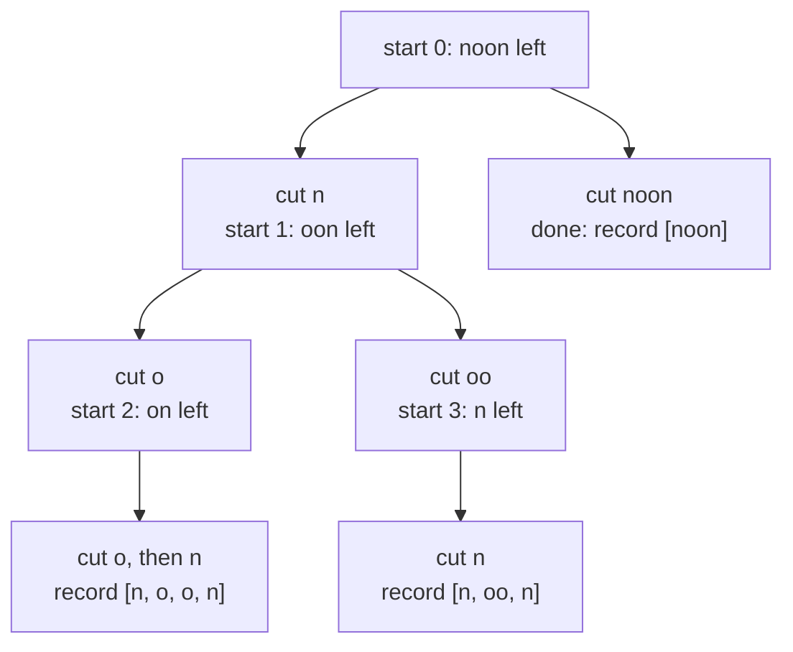

> [!tldr] Quick read
> - Each node of the [[en/concepts/choice-tree|choice tree]] is a position `start`. Its child branches are the palindromic prefixes of the rest, `s[start..]`; after cutting one piece, continue right after it.
> - Reaching the end of the string gives one partition. There is nothing to deduplicate: two different branches always differ in at least one cut.
> - Checking for a palindrome with two pointers every time is correct but repeats a lot of work. An `isPal[i][j]` table built once in O(n²) turns every check into a lookup.
> - The worst case is a string of one repeated letter: every cut is valid, 2ⁿ⁻¹ partitions. Sixteen `a`s have 32,768.

> [!info] Context
> This is LeetCode problem 131 at [[en/posts/2026-11-28-neetcode-permutations-search|station MISC-02: Backtracking: Permutations and Search]] on **the NeetCode Line: Mixed Techniques**. I picture a printed ribbon that has to be cut into pieces, each piece reading the same from both ends. You only need strings, loops and recursive functions; the palindrome table revisits the idea from [[en/posts/2026-11-27-neetcode-palindrome-centers|station DP-02: Expanding Palindromes]].

> [!abstract]- Quick glossary for this post (click to open)
> - A palindrome reads the same forward and backward: `noon`, `level`, `a`. A single character is always a palindrome.
> - A partition is a sequence of adjacent pieces that join back into exactly the original string.
> - A prefix of `s[start..]` is a substring that begins exactly at `start`.
> - [[en/concepts/backtracking|Backtracking]] adds a piece to `path`, goes deeper, then removes that piece to try a longer one.

## Picture it first: cutting a printed ribbon

The ribbon reads `noon`. I hold the scissors at the left end and ask: how long can the first piece be and still read the same both ways? `n` works, `no` and `noo` do not, `noon` does. Each valid choice leaves a shorter stretch of ribbon, and I ask the same question about that stretch. Cutting the whole ribbon gives one partition. To avoid rereading each piece every time, I prepare a lookup chart of which stretches are palindromes.

| Everyday life | Concept |
|---|---|
| Where the scissors are | `start` |
| A first piece that reads the same both ways | Palindromic prefix `s[start..end]` |
| Cut it and move the scissors past it | Go deeper with `end + 1` |
| Tape the piece back to try a longer one | `path.pop()` |
| The whole ribbon is cut | `start == n`: record one partition |
| The chart of palindromic stretches | `isPal[i][j]` |

The tree for `noon` has three leaves, one per partition. No node has more than two branches:



## The problem: every cut into palindromic pieces

Given a string `s` of length 1–16 made of lowercase English letters, return every way to split `s` into adjacent pieces so that each piece is a palindrome, in any order. For example, `noon` has three: `[n, o, o, n]`, `[n, oo, n]` and `[noon]`. [Original problem, LeetCode 131](https://leetcode.com/problems/palindrome-partitioning/)

I used to think finding the longest palindrome and cutting there would do. That gives one partition, while the problem asks for all of them. Even the question "is there any partition" always has the answer yes, because cutting one character at a time is always valid. The hard part is listing all of them without missing any, and without rereading the same stretch too many times.

## How it works

### Brute force: every placement of cuts

A string of length n has n − 1 gaps between characters, and each gap is either cut or not. There are 2ⁿ⁻¹ placements; for each, I check whether every piece equals its own reverse. This is the referee in the runnable file, because it shares no line with the solution.

### Backtracking over palindromic prefixes

`walk(start)` tries every `end` from `start` to n − 1. If `s[start..end]` is a palindrome, it adds it to `path`, calls `walk(end + 1)`, then removes it. When `start == n`, the whole string has been cut and `path` is a partition. A prefix that is not a palindrome is dropped together with its whole branch, so the tree only contains partitions that are still valid.

Two different leaves always differ in at least one cut, so no deduplication is needed as in [[en/problems/subsets-ii|Subsets II]]. No separate [[en/concepts/start-index|start index]] is needed either: `start` itself is where the next cut begins.

### Check every time, or look it up

Checking `s[start..end]` with two pointers costs up to (end − start + 1)/2 character comparisons. The same stretch is asked about in many branches: `s[2..5]` is checked again whenever a branch cuts up to position 2. An `isPal[i][j]` table answers every pair (i, j) in advance:

- `isPal[i][j]` is true when `s[i] == s[j]` and the inside `s[i+1..j-1]` is a palindrome too (for stretches of length 1 or 2, matching ends are enough);
- the inside is shorter and starts at i + 1, so i must be filled from right to left;
- the table has n(n + 1)/2 cells, one character comparison each.

It is the same idea as the [[en/concepts/palindrome-center|palindrome center]] from station DP-02, except it fills by the two ends instead of expanding from the center.

With sixteen `a`s, checking every time costs 43,682 character comparisons, while building the table costs 136. The table does not make the tree smaller: it still has 32,768 leaves, each leaf copies a list of up to 16 pieces, and the loop at every node still looks up each `end`. Both approaches are O(n·2ⁿ) in the worst case, because the output alone is that large. The table only turns each check from O(n) into O(1).

| Approach | Worst-case time | Extra memory (output excluded) | Notes |
|---|---|---|---|
| Every placement of cuts | O(n·2ⁿ) | O(n) | Referee; always walks all 2ⁿ⁻¹ placements |
| Backtracking, check every time | O(n²·2ⁿ) | O(n) | Each check costs O(n) |
| Backtracking, `isPal` lookups | O(n·2ⁿ) | O(n²) | Table built once in O(n²) |

## Runnable example

[TypeScript](../code/neetcode-palindrome-partitioning/cuts.ts) · [Python](../code/neetcode-palindrome-partitioning/cuts.py) · [Go](../code/neetcode-palindrome-partitioning/cuts.go) · [Java](../code/neetcode-palindrome-partitioning/cuts.java) · [JavaScript](../code/neetcode-palindrome-partitioning/cuts.js) · [PHP](../code/neetcode-palindrome-partitioning/cuts.php) · [Rust](../code/neetcode-palindrome-partitioning/cuts.rs)

```ts
// Main approach: build the isPal[i][j] table once (i from right to left), then backtrack with lookups only
function partition(s: string, counter = { compares: 0 }): string[][] {
    const n = s.length
    const isPal: boolean[][] = Array.from({ length: n }, () => Array(n).fill(false))
    for (let i = n - 1; i >= 0; i--) {
        for (let j = i; j < n; j++) {
            counter.compares++
            // a palindrome when both ends match and the inside (shorter, already computed) is one too
            isPal[i][j] = s[i] === s[j] && (j - i < 2 || isPal[i + 1][j - 1])
        }
    }
    const result: string[][] = []
    const path: string[] = []
    const walk = (start: number) => {
        if (start === n) {
            result.push([...path]) // the whole string is cut: record one partition
            return
        }
        for (let end = start; end < n; end++) {
            if (!isPal[start][end]) continue // first piece is not a palindrome: drop the whole branch
            path.push(s.slice(start, end + 1))
            walk(end + 1)
            path.pop()
        }
    }
    walk(0)
    return result
}
```

```python
# Main approach: build the is_pal[i][j] table once (i from right to left), then backtrack with lookups only
def partition(s, counter=None):
    n = len(s)
    is_pal = [[False] * n for _ in range(n)]
    for i in range(n - 1, -1, -1):
        for j in range(i, n):
            if counter is not None:
                counter["compares"] += 1
            # a palindrome when both ends match and the inside (shorter, already computed) is one too
            is_pal[i][j] = s[i] == s[j] and (j - i < 2 or is_pal[i + 1][j - 1])
    result, path = [], []

    def walk(start):
        if start == n:
            result.append(path[:])  # the whole string is cut: record one partition
            return
        for end in range(start, n):
            if not is_pal[start][end]:
                continue  # first piece is not a palindrome: drop the whole branch
            path.append(s[start : end + 1])
            walk(end + 1)
            path.pop()

    walk(0)
    return result
```

```go
// Main approach: build the isPal[i][j] table once (i from right to left), then backtrack with lookups only
func partition(s string, compares *int) [][]string {
	n := len(s)
	isPal := make([][]bool, n)
	for i := range isPal {
		isPal[i] = make([]bool, n)
	}
	for i := n - 1; i >= 0; i-- {
		for j := i; j < n; j++ {
			*compares++
			// a palindrome when both ends match and the inside (shorter, already computed) is one too
			isPal[i][j] = s[i] == s[j] && (j-i < 2 || isPal[i+1][j-1])
		}
	}
	result := [][]string{}
	path := []string{}
	var walk func(start int)
	walk = func(start int) {
		if start == n {
			result = append(result, slices.Clone(path)) // the whole string is cut: record one partition
			return
		}
		for end := start; end < n; end++ {
			if !isPal[start][end] {
				continue // first piece is not a palindrome: drop the whole branch
			}
			path = append(path, s[start:end+1])
			walk(end + 1)
			path = path[:len(path)-1]
		}
	}
	walk(0)
	return result
}

func reverse(p string) string {
	b := []byte(p)
	slices.Reverse(b)
	return string(b)
}
```

```java
// Main approach: build the isPal[i][j] table once (i from right to left), then backtrack with lookups only
static List<List<String>> partition(String s) {
    int n = s.length();
    boolean[][] isPal = new boolean[n][n];
    for (int i = n - 1; i >= 0; i--) {
        for (int j = i; j < n; j++) {
            compares++;
            // a palindrome when both ends match and the inside (shorter, already computed) is one too
            isPal[i][j] = s.charAt(i) == s.charAt(j) && (j - i < 2 || isPal[i + 1][j - 1]);
        }
    }
    List<List<String>> result = new ArrayList<>();
    walk(s, isPal, 0, new ArrayList<>(), result);
    return result;
}

static void walk(String s, boolean[][] isPal, int start, List<String> path, List<List<String>> result) {
    if (start == s.length()) {
        result.add(new ArrayList<>(path)); // the whole string is cut: record one partition
        return;
    }
    for (int end = start; end < s.length(); end++) {
        if (!isPal[start][end]) continue; // first piece is not a palindrome: drop the whole branch
        path.add(s.substring(start, end + 1));
        walk(s, isPal, end + 1, path, result);
        path.remove(path.size() - 1);
    }
}
```

```js
// Main approach: build the isPal[i][j] table once (i from right to left), then backtrack with lookups only
function partition(s, counter = { compares: 0 }) {
    const n = s.length
    const isPal = Array.from({ length: n }, () => Array(n).fill(false))
    for (let i = n - 1; i >= 0; i--) {
        for (let j = i; j < n; j++) {
            counter.compares++
            // a palindrome when both ends match and the inside (shorter, already computed) is one too
            isPal[i][j] = s[i] === s[j] && (j - i < 2 || isPal[i + 1][j - 1])
        }
    }
    const result = []
    const path = []
    const walk = (start) => {
        if (start === n) {
            result.push([...path]) // the whole string is cut: record one partition
            return
        }
        for (let end = start; end < n; end++) {
            if (!isPal[start][end]) continue // first piece is not a palindrome: drop the whole branch
            path.push(s.slice(start, end + 1))
            walk(end + 1)
            path.pop()
        }
    }
    walk(0)
    return result
}
```

```php
// Main approach: build the isPal[i][j] table once (i from right to left), then backtrack with lookups only
function partition(string $s): array {
    global $compares;
    $n = strlen($s);
    $isPal = array_fill(0, $n, array_fill(0, $n, false));
    for ($i = $n - 1; $i >= 0; $i--) {
        for ($j = $i; $j < $n; $j++) {
            $compares++;
            // a palindrome when both ends match and the inside (shorter, already computed) is one too
            $isPal[$i][$j] = $s[$i] === $s[$j] && ($j - $i < 2 || $isPal[$i + 1][$j - 1]);
        }
    }
    $result = [];
    $path = [];
    $walk = function (int $start) use (&$walk, &$result, &$path, $s, $n, $isPal) {
        if ($start === $n) {
            $result[] = $path; // the whole string is cut: record one partition
            return;
        }
        for ($end = $start; $end < $n; $end++) {
            if (!$isPal[$start][$end]) continue; // first piece is not a palindrome: drop the whole branch
            $path[] = substr($s, $start, $end - $start + 1);
            $walk($end + 1);
            array_pop($path);
        }
    };
    $walk(0);
    return $result;
}
```

```rust
// Main approach: build the is_pal[i][j] table once (i from right to left), then backtrack with lookups only
fn partition(s: &str, compares: &mut usize) -> Vec<Vec<String>> {
    let b = s.as_bytes();
    let n = b.len();
    let mut is_pal = vec![vec![false; n]; n];
    for i in (0..n).rev() {
        for j in i..n {
            *compares += 1;
            // a palindrome when both ends match and the inside (shorter, already computed) is one too
            is_pal[i][j] = b[i] == b[j] && (j - i < 2 || is_pal[i + 1][j - 1]);
        }
    }
    fn walk(s: &str, is_pal: &[Vec<bool>], start: usize, path: &mut Vec<String>, result: &mut Vec<Vec<String>>) {
        if start == s.len() {
            result.push(path.clone()); // the whole string is cut: record one partition
            return;
        }
        for end in start..s.len() {
            if !is_pal[start][end] {
                continue; // first piece is not a palindrome: drop the whole branch
            }
            path.push(s[start..=end].to_string());
            walk(s, is_pal, end + 1, path, result);
            path.pop();
        }
    }
    let mut result = Vec::new();
    walk(s, &is_pal, 0, &mut Vec::new(), &mut result);
    result
}
```

The tabs show the build-the-table-then-backtrack approach; the line that increments `compares` only counts for the measurement. The downloadable file also has the check-every-time version and the every-placement referee. The eight test cases cover a single character, `noon`, `level`, `racecar`, sixteen distinct letters (one partition) and sixteen `a`s (32,768 partitions). For each case, both backtracking versions must match the referee when compared regardless of order, with no partition repeated.

The second line cross-checks every string made only of `a` and `b`, of length 1–9: 1,022 strings. The last line measures character comparisons on sixteen `a`s.

```text
8/8 cases passed
1022/1022 cases passed (cross-check against every placement of cuts)
16 letters a: 32768 partitions; checking every time 43682 comparisons, isPal table 136 comparisons
```

*(Output labels translated; the files themselves print Vietnamese.)*

All seven languages print exactly these three lines.

## Misconceptions and common traps

- Cutting only the longest palindrome. That gives one partition, while the problem asks for all of them.
- Filling the table with i increasing. When `isPal[i][j]` is computed, cell `isPal[i+1][j-1]` has not been filled yet and is still false, so every palindrome of length 3 or more is missed. For `level` the result shrinks to `[l, e, v, e, l]` instead of three partitions.
- Off-by-one when slicing. Here `end` is the last index **included** in the piece, so TypeScript, JavaScript and Python write `slice(start, end + 1)` or `s[start:end + 1]`, and Java writes `substring(start, end + 1)`.
- PHP: `substr($s, $start, $length)` takes a **length**, not an end index. Write `substr($s, $start, $end - $start + 1)`.
- Go: `s[start:end+1]` shares bytes with `s` instead of copying. Storing the piece in the result is still safe because Go strings are immutable. Indices are byte indices, so a string with multi-byte characters would be cut mid-character; the problem only uses lowercase English letters, so that cannot happen here.
- Rust: `&s[start..=end]` also slices by byte and panics if it lands inside a UTF-8 character. With ASCII input as in the problem it is safe; for arbitrary strings, use `s.get(start..=end)` to get `None` instead of a panic.
- Recording `path` itself instead of a copy. The consequence is the same as in [[en/problems/subsets|Subsets]]: every partition in the result points at one list that has been emptied.

## Self-check questions

> [!question]- How many partitions does `abc` have, and why?
> One, `[a, b, c]`. No stretch longer than 1 is a palindrome, so the only option is cutting one character at a time.

> [!question]- Why does a string of n `a`s have exactly 2ⁿ⁻¹ partitions?
> Every stretch is a palindrome, so each of the n − 1 gaps between characters is free to be cut or not.

> [!question]- Does the `isPal` table make the worst case better than O(n·2ⁿ)?
> No. The output already has up to 2ⁿ⁻¹ partitions, each up to n pieces long. The table only removes the O(n) part of each check.

> [!question]- Which cell must be filled before `isPal[2][6]`?
> `isPal[3][5]`, the inside. Its row 3 is greater than 2, so the i loop must run from right to left.

## References

- [LeetCode 131](https://leetcode.com/problems/palindrome-partitioning/)
- [Jeff Erickson, Algorithms, chapter 2: backtracking](https://jeffe.cs.illinois.edu/teaching/algorithms/book/02-backtracking.pdf)
- [PHP substr](https://www.php.net/manual/en/function.substr.php) · [Go spec, slice expressions](https://go.dev/ref/spec#Slice_expressions) · [Rust str::get](https://doc.rust-lang.org/std/primitive.str.html#method.get)
