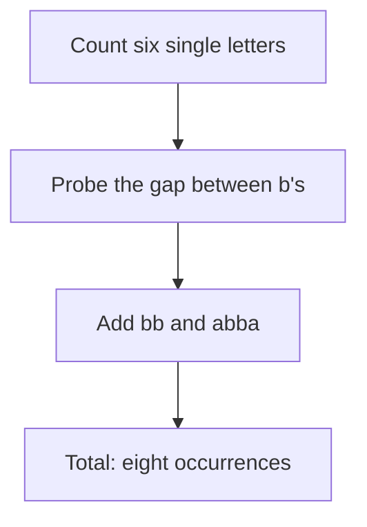

> [!tldr] Quick read
> - Equal text at different positions counts as separate occurrences.
> - Every palindrome has one [[en/concepts/palindrome-center|center]]. Add up the matches at each center.
> - In virtual coordinates a maximal [[en/concepts/palindrome-radius|radius]] of `r` contributes `⌊(r+1)/2⌋` substrings.

> [!info] Context
> LeetCode 647 belongs to [[en/posts/2026-11-27-neetcode-palindrome-centers|station 2: Expanding Palindromes]] on the NeetCode Dynamic Programming line. [[en/problems/longest-palindromic-substring|Problem 5]] keeps one longest span. Here we add every span the same expansion discovers. You only need arrays and index ranges.

> [!abstract]- Quick glossary for this post (click to open)
> - An **occurrence** is a pair of endpoints. Distinct positions can contain the same letters.
> - An **odd center** sits on a character and an **even center** sits between two.
> - A **virtual radius** is the distance from the center to its edge in the gapped sequence, which is the length of the maximal original span.

## Picture it first: circle patterns on a strip

The strip `xabbaq` has six single-letter spans. The gap between the b's yields two more, `bb` and `abba`. I circle each position and get 8. The two a's get individual circles.

| Everyday life | Concept |
|---|---|
| Where a probe starts | An even or odd center |
| A circle at a given center | One occurrence with its own endpoints |
| The total number of circles | The sum of contributions from all centers |



## The problem: count by position

The input contains 1 to 1,000 lowercase English letters. Return the count of contiguous substrings that read the same backward and forward, including single characters. `zzzz` has ten, with four of length 1, three of length 2, two of length 3, and one of length 4.

## How it works

### Count from endpoints or from centers

Checking both endpoints of every interval may cost O(n³). A DP table storing whether each interior is a palindrome reduces time to O(n²) and takes O(n²) space. A more direct option is to try each center and expand until a mismatch or an edge. Count a palindrome whenever the two characters match. A character can be a center, so the first odd-center match is that character itself. Every interval has center `(L+R)/2`, giving complete coverage without repeats. Independent expansion takes O(n²) time and O(1) auxiliary space.

### Sum the contributions of maximal radii

In gapped coordinates a center produces lengths of just one parity. Odd centers produce 1, 3, ..., r. Even centers produce 2, 4, ..., r. Both lists contain `⌊(r+1)/2⌋` terms. Compute each r with Manacher and sum on the fly in O(n) time and space. See the proof of bounded mirror reuse in the [[en/problems/longest-palindromic-substring|longest-substring problem]].

The [probe-count example](../code/neetcode-palindrome-centers/compare.ts) uses 1,000 a's and records 1,000,000 probes for independent expansion and 1,999 for Manacher, including virtual gaps. Both give 500,500 substrings, matching 1+2+…+1,000. The count does not require materializing 500,500 strings.

## Runnable example

Eight cases test independent expansion and Manacher. The length-1,000 case catches missing even spans and counters that are too narrow.

[TypeScript](../code/neetcode-palindromic-substrings/count.ts) · [Python](../code/neetcode-palindromic-substrings/count.py) · [Go](../code/neetcode-palindromic-substrings/count.go) · [Java](../code/neetcode-palindromic-substrings/count.java) · [JavaScript](../code/neetcode-palindromic-substrings/count.js) · [PHP](../code/neetcode-palindromic-substrings/count.php) · [Rust](../code/neetcode-palindromic-substrings/count.rs)

```typescript
type Stats = { start: number; length: number; count: number };

function palindromes(text: string, reuseMirror: boolean): Stats {
  const last = 2 * text.length;
  const radius = reuseMirror ? Array<number>(last + 1).fill(0) : [];
  let center = 0, right = 0;
  const answer: Stats = { start: 0, length: 0, count: 0 };

  for (let i = 0; i <= last; i++) {
    let length = reuseMirror && i < right ? Math.min(radius[2 * center - i], right - i) : 0;
    while (i - length > 0 && i + length < last) {
      const left = i - length - 1;
      const next = i + length + 1;
      if (left % 2 && text[(left - 1) / 2] !== text[(next - 1) / 2]) break;
      length++;
    }
    if (reuseMirror) {
      radius[i] = length;
      if (i + length > right) {
        center = i;
        right = i + length;
      }
    }
    if (length > answer.length) {
      answer.start = (i - length) / 2;
      answer.length = length;
    }
    answer.count += Math.floor((length + 1) / 2);
  }
  return answer;
}

function countSubstrings(text: string, reuseMirror = false): number {
  return palindromes(text, reuseMirror).count;
}
```

```python
def palindromes(text, reuse_mirror):
    last = 2 * len(text)
    radius = [0] * (last + 1) if reuse_mirror else []
    center = right = start = best = count = 0

    for i in range(last + 1):
        length = min(radius[2 * center - i], right - i) if reuse_mirror and i < right else 0
        while i - length > 0 and i + length < last:
            left, next_pos = i - length - 1, i + length + 1
            if left % 2 and text[left // 2] != text[next_pos // 2]:
                break
            length += 1
        if reuse_mirror:
            radius[i] = length
            if i + length > right:
                center, right = i, i + length
        if length > best:
            start, best = (i - length) // 2, length
        count += (length + 1) // 2
    return start, best, count


def count_substrings(text, reuse_mirror=False):
    return palindromes(text, reuse_mirror)[2]
```

```go
package main

import (
	"fmt"
	"strings"
)

type stats struct{ start, length, count int }

func palindromes(text string, reuseMirror bool) stats {
	last := 2 * len(text)
	var radius []int
	if reuseMirror {
		radius = make([]int, last+1)
	}
	center, right := 0, 0
	answer := stats{}

	for i := 0; i <= last; i++ {
		length := 0
		if reuseMirror && i < right {
			length = min(radius[2*center-i], right-i)
		}
		for i-length > 0 && i+length < last {
			left, next := i-length-1, i+length+1
			if left%2 != 0 && text[left/2] != text[next/2] {
				break
			}
			length++
		}
		if reuseMirror {
			radius[i] = length
			if i+length > right {
				center, right = i, i+length
			}
		}
		if length > answer.length {
			answer.start, answer.length = (i-length)/2, length
		}
		answer.count += (length + 1) / 2
	}
	return answer
}

func countSubstrings(text string, reuseMirror bool) int {
	return palindromes(text, reuseMirror).count
}
```

```java
class Centers {
    record Stats(int start, int length, int count) {}

    static Stats palindromes(String text, boolean reuseMirror) {
        int last = 2 * text.length();
        int[] radius = reuseMirror ? new int[last + 1] : new int[0];
        int center = 0, right = 0, start = 0, best = 0, count = 0;

        for (int i = 0; i <= last; i++) {
            int length = reuseMirror && i < right ? Math.min(radius[2 * center - i], right - i) : 0;
            while (i - length > 0 && i + length < last) {
                int left = i - length - 1, next = i + length + 1;
                if (left % 2 != 0 && text.charAt(left / 2) != text.charAt(next / 2)) break;
                length++;
            }
            if (reuseMirror) {
                radius[i] = length;
                if (i + length > right) {
                    center = i;
                    right = i + length;
                }
            }
            if (length > best) {
                start = (i - length) / 2;
                best = length;
            }
            count += (length + 1) / 2;
        }
        return new Stats(start, best, count);
    }

    static int countSubstrings(String text, boolean reuseMirror) {
        return palindromes(text, reuseMirror).count();
    }
}
```

```javascript
function palindromes(text, reuseMirror) {
    const last = 2 * text.length;
    const radius = reuseMirror ? Array(last + 1).fill(0) : [];
    let center = 0, right = 0;
    const answer = {
        start: 0,
        length: 0,
        count: 0
    };
    for(let i = 0; i <= last; i++){
        let length = reuseMirror && i < right ? Math.min(radius[2 * center - i], right - i) : 0;
        while(i - length > 0 && i + length < last){
            const left = i - length - 1;
            const next = i + length + 1;
            if (left % 2 && text[(left - 1) / 2] !== text[(next - 1) / 2]) break;
            length++;
        }
        if (reuseMirror) {
            radius[i] = length;
            if (i + length > right) {
                center = i;
                right = i + length;
            }
        }
        if (length > answer.length) {
            answer.start = (i - length) / 2;
            answer.length = length;
        }
        answer.count += Math.floor((length + 1) / 2);
    }
    return answer;
}
function countSubstrings(text, reuseMirror = false) {
    return palindromes(text, reuseMirror).count;
}
const cases = [
    [
        "",
        0
    ],
    [
        "c",
        1
    ],
    [
        "xabbaq",
        8
    ],
    [
        "tacocatx",
        11
    ],
    [
        "abab",
        6
    ],
    [
        "zzzz",
        10
    ],
    [
        "xyz",
        3
    ],
    [
        "a".repeat(1000),
        500500
    ]
];
for (const [text, expected] of cases){
    if (countSubstrings(text) !== expected || countSubstrings(text, true) !== expected) {
        throw new Error("Sai số đoạn đối xứng");
    }
}
console.log(`${cases.length}/${cases.length} ca đúng`);
```

```php
<?php
declare(strict_types=1);

function palindromes(string $text, bool $reuseMirror): array
{
    $last = 2 * strlen($text);
    $radius = $reuseMirror ? array_fill(0, $last + 1, 0) : [];
    $center = $right = $start = $best = $count = 0;

    for ($i = 0; $i <= $last; $i++) {
        $length = $reuseMirror && $i < $right ? min($radius[2 * $center - $i], $right - $i) : 0;
        while ($i - $length > 0 && $i + $length < $last) {
            $left = $i - $length - 1;
            $next = $i + $length + 1;
            if ($left % 2 && $text[intdiv($left, 2)] !== $text[intdiv($next, 2)]) {
                break;
            }
            $length++;
        }
        if ($reuseMirror) {
            $radius[$i] = $length;
            if ($i + $length > $right) {
                [$center, $right] = [$i, $i + $length];
            }
        }
        if ($length > $best) {
            [$start, $best] = [intdiv($i - $length, 2), $length];
        }
        $count += intdiv($length + 1, 2);
    }
    return [$start, $best, $count];
}

function countSubstrings(string $text, bool $reuseMirror = false): int
{
    return palindromes($text, $reuseMirror)[2];
}
```

```rust
#[derive(Default)]
struct Stats {
    start: usize,
    length: usize,
    count: usize,
}

fn palindromes(text: &str, reuse_mirror: bool) -> Stats {
    let bytes = text.as_bytes();
    let last = 2 * bytes.len();
    let mut radius = if reuse_mirror {
        vec![0; last + 1]
    } else {
        Vec::new()
    };
    let (mut center, mut right) = (0, 0);
    let mut answer = Stats::default();

    for i in 0..=last {
        let mut length = if reuse_mirror && i < right {
            radius[2 * center - i].min(right - i)
        } else {
            0
        };
        while i > length && i + length < last {
            let (left, next) = (i - length - 1, i + length + 1);
            if left % 2 != 0 && bytes[left / 2] != bytes[next / 2] {
                break;
            }
            length += 1;
        }
        if reuse_mirror {
            radius[i] = length;
            if i + length > right {
                (center, right) = (i, i + length);
            }
        }
        if length > answer.length {
            (answer.start, answer.length) = ((i - length) / 2, length);
        }
        answer.count += (length + 1) / 2;
    }
    answer
}

fn count_substrings(text: &str, reuse_mirror: bool) -> usize {
    palindromes(text, reuse_mirror).count
}
```

```text
8/8 cases passed
```

*(Output labels translated; the files themselves print Vietnamese.)*

## Misconceptions and common traps

- A set of string values merges occurrences at distinct positions. The task counts each pair of endpoints.
- Summing the virtual radii overcounts because the expansion steps through gaps do not each produce a new span. Convert to the number of valid lengths first.
- Division by 2 can produce a fractional number in JavaScript and PHP. These examples use `Math.floor` or `intdiv`.
- The Go, PHP, and Rust byte indices fit the given alphabet. For a different problem with multibyte characters, decide what unit the count and comparisons should use.

## Self-check questions

> [!question]- How many substrings does a virtual radius of 5 at an odd center contribute?
> Three, with lengths 1, 3, and 5. The formula gives `⌊(5+1)/2⌋ = 3`.

> [!question]- Why do n identical characters yield n(n+1)/2 palindromes?
> Every interval is a palindrome. There are n starts for length 1, n−1 for length 2, and so on down to one for length n.

## References

- [LC-0647 problem](https://leetcode.com/problems/palindromic-substrings/)
- [Princeton Algorithms, Manacher's radii](https://algs4.cs.princeton.edu/53substring/Manacher.java.html)
