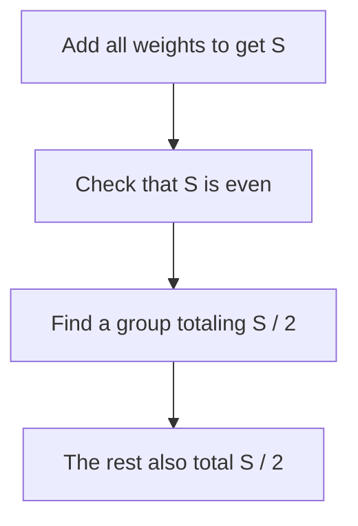

> [!tldr] Quick read
> - Let S be the array sum. S must be even, and an equal split exists exactly when some subset of positions sums to T = S / 2.
> - A two-dimensional table reads both the take and skip choices from the previous row. With a single row, scan sums downward so each position can be used at most once.
> - A bitset represents the same reachable sums. Shift it left by x and OR it with the old set to combine the take and skip choices for x.

> [!info] Context
> This is LeetCode 416, part of [[en/posts/2026-11-27-neetcode-knapsack|station 3 – Knapsack and Coin Change]] on the [[en/series/neetcode-dp|NeetCode line – Dynamic Programming]]. I start with a question about weights and work toward the loop invariant to see why changing the scan direction changes the answer.

> [!abstract]- Quick glossary for this post (click to open)
> - A [[en/concepts/knapsack-state|knapsack state]] records the question for a range of items and a sum or capacity.
> - [[en/concepts/zero-one-knapsack|0/1 knapsack]] allows each position at most once. Two positions with equal values remain separate choices.
> - The [[en/concepts/knapsack-update-order|update order]] determines whether the source cell still belongs to the previous row or already belongs to the new row.
> - A bitset uses bit s to indicate whether sum s is reachable.

## Picture it first: splitting goods across two scales

I have four packages weighing 3, 6, 7, and 10. If one scale receives 3 and 10, the other receives 6 and 7. Both weigh 13. Either scale can take either group, so I only need to find a way to bring one scale to exactly 13.

| Everyday life | Concept |
|---|---|
| Combined weight of all packages | S |
| Reading required on each scale | T = S / 2 when S is even |
| Checklist of achievable weights | Boolean array or bitset |
| Take a package from the remaining items | 0/1 transition |
| Weight of the remaining packages | S − T = T |



## The problem: two groups with equal sums

Given an array of 1 to 200 positive integers, each between 1 and 100, determine whether all **positions** can be split into two groups with equal sums. For `[3,6,7,10]`, the groups `[3,10]` and `[6,7]` both sum to 13. For `[2,3,7]`, the total is 12, but no subset sums to 6. [LeetCode 416 problem statement](https://leetcode.com/problems/partition-equal-subset-sum/)

If S is odd, two equal integer sums cannot add up to S. If S = 2T, either valid group must sum to T. Conversely, if I find a subset of positions totaling T, its complement totals S − T = T. This turns the two-group question into a search for a single target sum. Since the values are positive, I can exclude sums above T because adding another value cannot bring the sum back down.

## How it works

### Try taking or skipping each item

The recursive function tracks position i and remaining sum r. Taking `nums[i]` reduces r by that value, skipping leaves r unchanged, and both branches continue at i + 1. If r is zero, a group has been found. The branch fails if r is negative or the array ends with r still positive. Worst-case time is O(2ⁿ) and stack space is O(n). I use it as a reference on small inputs.

### Build a table from the previous row

`D[i][s]` asks whether some subset of the **first i positions** sums to exactly s. Row zero only has `D[0][0] = true` for the empty subset. For item x at position i, `D[i+1][s]` is true if `D[i][s]` is true or if s ≥ x and `D[i][s−x]` is true. Both sources are in row i because both start with choices from previously processed positions.

| Package just processed | Reachable sums up to 13 |
|---|---|
| None | 0 |
| 3 | 0, 3 |
| 6 | 0, 3, 6, 9 |
| 7 | 0, 3, 6, 7, 9, 10, 13 |
| 10 | 0, 3, 6, 7, 9, 10, 13 |

When adding 7, sum 13 comes from sum 6 in the previous row. The table has (n + 1)(T + 1) cells, with O(nT) time and auxiliary space. The **numeric value** T can grow exponentially in the number of bits that encode it, so O(nT) is pseudopolynomial. The problem bounds give T ≤ 10,000. [MIT 6.006 lecture on Subset Sum and pseudopolynomial time](https://ocw.mit.edu/courses/6-006-introduction-to-algorithms-spring-2020/resources/lecture-18-dynamic-programming-part-4-rods-subset-sum-pseudopolynomial/)

### Keep one row and scan downward

Before processing x, `reachable[s]` holds the result after the positions before x. To preserve that invariant for the source cell `reachable[s−x]`, I scan s from T down to x. Since s−x < s, the source has yet to be overwritten during this pass. Cell s accumulates both skipping x and taking x once.

For `[2,3,7]` and T = 6, scanning upward sets cells 2, 4, and 6 **during the pass for value 2**. It creates sum 6 by reusing one position three times. Scanning downward sets only cell 2 in that pass. Time remains O(nT) and auxiliary space drops to O(T).

### Pack the sums into bits

Bit s in B is 1 when sum s is reachable. B starts as 1 so only bit zero is set. Shifting old B left by x moves each sum s to s+x. OR with old B keeps the sums from skipping x and taking x. Each update reads the snapshot from before x.

With an array of w-bit words, the state needs ⌈(T + 1)/w⌉ words. The shifts and OR operations take O(n⌈(T + 1)/w⌉) word operations and O(⌈(T + 1)/w⌉) words of space. For a manual multiword shift, walk destination words from highest to lowest. A destination may receive bits from two adjacent source words. Compute the whole-word offset and remainder separately to handle shifts such as 32 in a 32-bit implementation.

## Runnable example

[TypeScript](../code/neetcode-partition-equal-subset-sum/solve.ts) · [Python](../code/neetcode-partition-equal-subset-sum/solve.py) · [Go](../code/neetcode-partition-equal-subset-sum/solve.go) · [Java](../code/neetcode-partition-equal-subset-sum/solve.java) · [JavaScript](../code/neetcode-partition-equal-subset-sum/solve.js) · [PHP](../code/neetcode-partition-equal-subset-sum/solve.php) · [Rust](../code/neetcode-partition-equal-subset-sum/solve.rs)

```ts
type Allocation = { cells: number };

function descending(nums: number[], target: number, allocation?: Allocation): boolean {
  const reachable = new Uint8Array(target + 1);
  reachable[0] = 1;
  for (const x of nums) {
    for (let sum = target; sum >= x; sum--) {
      reachable[sum] |= reachable[sum - x];
    }
  }
  if (allocation) allocation.cells = reachable.length;
  return reachable[target] === 1;
}

function bitset(nums: number[], target: number): boolean {
  const goal = 1n << BigInt(target);
  const mask = (goal << 1n) - 1n;
  let reachable = 1n;
  for (const x of nums) {
    reachable = (reachable | (reachable << BigInt(x))) & mask;
  }
  return (reachable & goal) !== 0n;
}
```

```python
def descending(nums, target):
    reachable = bytearray(target + 1)
    reachable[0] = 1
    for x in nums:
        for s in range(target, x - 1, -1):
            reachable[s] |= reachable[s - x]
    return bool(reachable[target])


def bitset(nums, target):
    goal = 1 << target
    mask = (goal << 1) - 1
    reachable = 1
    for x in nums:
        reachable = (reachable | (reachable << x)) & mask
    return bool(reachable & goal)
```

```go
func descending(nums []int, target int) bool {
	reachable := make([]bool, target+1)
	reachable[0] = true
	for _, x := range nums {
		for sum := target; sum >= x; sum-- {
			reachable[sum] = reachable[sum] || reachable[sum-x]
		}
	}
	return reachable[target]
}

func bitset(nums []int, target int) bool {
	words := make([]uint32, target/32+1)
	words[0] = 1
	for _, x := range nums {
		offset, shift := x/32, x%32
		for dst := len(words) - 1; dst >= offset; dst-- {
			src := dst - offset
			moved := words[src] << shift
			if shift != 0 && src > 0 {
				moved |= words[src-1] >> (32 - shift)
			}
			words[dst] |= moved
		}
	}
	return words[target/32]&(uint32(1)<<(target%32)) != 0
}
```

```java
import java.math.BigInteger;

class Solve {
    static boolean descending(int[] nums, int target) {
        boolean[] reachable = new boolean[target + 1];
        reachable[0] = true;
        for (int x : nums) {
            for (int sum = target; sum >= x; sum--) {
                reachable[sum] |= reachable[sum - x];
            }
        }
        return reachable[target];
    }

    static boolean bitset(int[] nums, int target) {
        BigInteger goal = BigInteger.ONE.shiftLeft(target);
        BigInteger mask = goal.shiftLeft(1).subtract(BigInteger.ONE);
        BigInteger reachable = BigInteger.ONE;
        for (int x : nums) {
            reachable = reachable.or(reachable.shiftLeft(x)).and(mask);
        }
        return reachable.testBit(target);
    }
}
```

```js
function descending(nums, target, allocation) {
  const reachable = new Uint8Array(target + 1);
  reachable[0] = 1;
  for (const x of nums) {
    for (let sum = target; sum >= x; sum--) {
      reachable[sum] |= reachable[sum - x];
    }
  }
  if (allocation) allocation.cells = reachable.length;
  return reachable[target] === 1;
}

function bitset(nums, target) {
  const goal = 1n << BigInt(target);
  const mask = (goal << 1n) - 1n;
  let reachable = 1n;
  for (const x of nums) {
    reachable = (reachable | (reachable << BigInt(x))) & mask;
  }
  return (reachable & goal) !== 0n;
}
```

```php
<?php

function descending(array $nums, int $target): bool
{
    $reachable = array_fill(0, $target + 1, false);
    $reachable[0] = true;
    foreach ($nums as $x) {
        for ($sum = $target; $sum >= $x; $sum--) {
            $reachable[$sum] = $reachable[$sum] || $reachable[$sum - $x];
        }
    }
    return $reachable[$target];
}

function bitset(array $nums, int $target): bool
{
    // Shifting a 16-bit word still fits a signed 32-bit integer.
    $words = array_fill(0, intdiv($target, 16) + 1, 0);
    $words[0] = 1;
    foreach ($nums as $x) {
        $offset = intdiv($x, 16);
        $shift = $x % 16;
        for ($dst = count($words) - 1; $dst >= $offset; $dst--) {
            $src = $dst - $offset;
            $moved = ($words[$src] << $shift) & 0xffff;
            if ($shift !== 0 && $src > 0) {
                $moved |= $words[$src - 1] >> (16 - $shift);
            }
            $words[$dst] |= $moved;
        }
    }
    return ($words[intdiv($target, 16)] & (1 << ($target % 16))) !== 0;
}
```

```rust
fn descending(nums: &[usize], target: usize) -> bool {
    let mut reachable = vec![false; target + 1];
    reachable[0] = true;
    for &x in nums {
        for sum in (x..=target).rev() {
            reachable[sum] |= reachable[sum - x];
        }
    }
    reachable[target]
}

fn bitset(nums: &[usize], target: usize) -> bool {
    let mut words = vec![0u32; target / 32 + 1];
    words[0] = 1;
    for &x in nums {
        let (offset, shift) = (x / 32, x % 32);
        for dst in (offset..words.len()).rev() {
            let src = dst - offset;
            let mut moved = words[src] << shift;
            if shift != 0 && src > 0 {
                moved |= words[src - 1] >> (32 - shift);
            }
            words[dst] |= moved;
        }
    }
    words[target / 32] & (1 << (target % 32)) != 0
}
```

Each file runs brute force on the small cases and checks the two-dimensional table, the descending row, and the bitset. TypeScript, JavaScript, and Python also compare against brute force on every array of length 1–6 with values 1 to 4. Two 200-element cases check a reachable target of 10,000 and an unreachable target of 9,999.

Output from TypeScript or JavaScript.

```text
16/16 cases passed
Cross-checked against brute force: 5460 arrays
T=9999: table 2010000 cells, single row 10000 cells
```

*(Output labels translated; the files themselves print Vietnamese.)*

Python prints the first two lines. Go, Java, PHP, and Rust print the line `16/16 cases passed`.

For T = 9,999, the measurement counts **allocated cells** in the two versions, including the initial row of the table. It excludes array bookkeeping. Compressing the table reduces the cell count by a factor of 201. With 32-bit words, the same sum range from 0 to 9,999 needs 313 words. This measures state storage. Actual speed depends on how the runtime implements arrays and bit operations.

## Misconceptions and common traps

- **Return true whenever S is even.** Even S only ensures that T is an integer. `[2,3,7]` still cannot make 6.
- **Remove duplicate values to shrink the input.** `[2,2]` can be split because the two values are at different positions. Removing one position changes the problem.
- **Shift a `Number` in TypeScript or JavaScript.** Bitwise shifts on `Number` operate on 32 bits. The example uses `BigInt` for the bitset and shift amount. [ECMAScript specification](https://tc39.es/ecma262/multipage/ecmascript-data-types-and-values.html)
- **Duplicate Python rows by multiplying the outer list.** Writing `[row] * (n + 1)` gives all rows a reference to the same object. Create each row in a comprehension. Python also uses its `int` directly for the bitset. [Python built-in types](https://docs.python.org/3/library/stdtypes.html)
- **Forget to assign the result in Java.** `BigInteger` is immutable, so `or` and `shiftLeft` produce values to assign back. Go and Rust show arrays of unsigned 32-bit words and skip the cross-word shift when the remainder is zero. PHP uses 16-bit words so even the intermediate value before masking fits in a signed 32-bit integer. [Oracle Java `BigInteger`](https://docs.oracle.com/en/java/javase/21/docs/api/java.base/java/math/BigInteger.html)

## Self-check questions

> [!question]- Why do I only have to find one group totaling T?
> The two totals must add to S, so the complement of a group totaling T has sum S − T = T.

> [!question]- During the pass for x = 2, why does descending order protect source cell 4 while processing sum 6?
> Index 4 is smaller than 6, so this pass has yet to write cell 4. If sum 4 was unreachable before x, then cell 6 cannot be set by reusing x.

> [!question]- How does the two-dimensional table help recover the chosen positions?
> Start at `D[n][T]` and work backward through the rows. If the previous row still reaches sum s, the last position can be skipped. If only s−x is reachable in the previous row, take x and continue from s−x.

## References

- [LeetCode 416 – Partition Equal Subset Sum](https://leetcode.com/problems/partition-equal-subset-sum/)
- [MIT 6.006 – Subset Sum and pseudopolynomial time](https://ocw.mit.edu/courses/6-006-introduction-to-algorithms-spring-2020/resources/lecture-18-dynamic-programming-part-4-rods-subset-sum-pseudopolynomial/)
