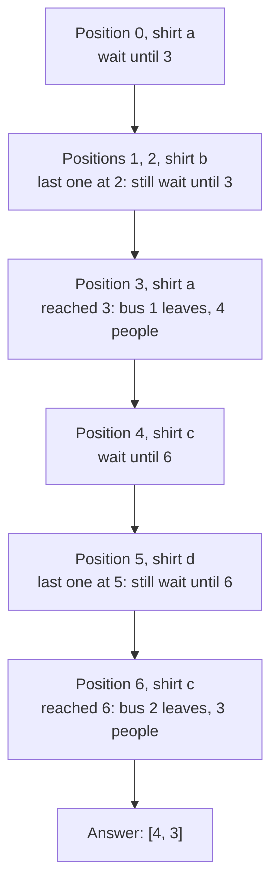
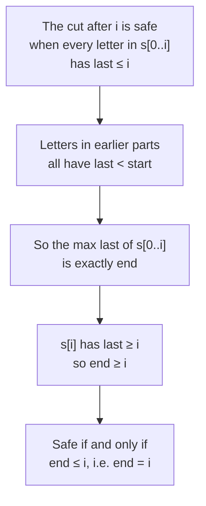
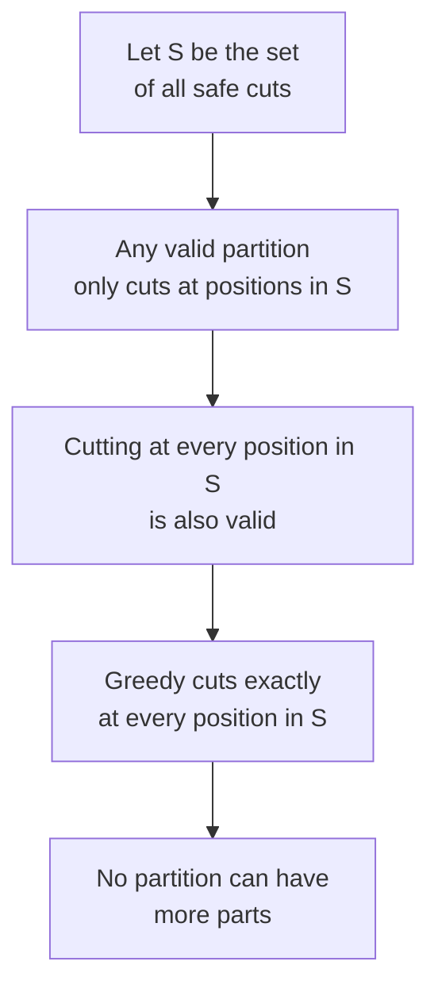

> [!tldr] Quick read
> - Each letter must sit entirely inside one part, so a part that contains letter c has to stretch all the way to c's last occurrence. The whole problem revolves around a 26-slot table `last[c]`.
> - Walk left to right and push the mark `end = max(end, last[c])`. When `i == end`, no letter in the part shows up again later: cut right there. This is the [[en/concepts/last-occurrence-boundary|last occurrence boundary]].
> - Cutting as early as possible gives the most parts, because it cuts at **every** valid cut position, and any partition can only use those positions.
> - In interval terms: each letter is an interval [first, last], and the parts are exactly the intervals left after merging the overlapping ones.
> - Brute force O(n²) takes 100,000,000 steps at n = 10,000; greedy O(n) takes 20,000 steps.

> [!info] Context
> This is LeetCode problem 763 at [[en/posts/2026-11-28-neetcode-greedy-grouping|station MISC-04: Greedy Grouping]] on **the NeetCode Line: Mixed Techniques**. I picture a line of people boarding buses, where each group of friends wears the same shirt color and insists on riding the same bus. You only need strings, arrays and loops; reading [[en/problems/jump-game|Jump Game]] first makes the familiar "remember the farthest point" move easy to spot.

> [!abstract]- Quick glossary for this post (click to open)
> - Part (partition): a contiguous piece of the string. Joining the parts in order gives back exactly the original string.
> - A 26-slot [[en/concepts/counting-array|counting array]]: use `c - 'a'` as the index for a lowercase letter, no hash map needed. Here each slot holds a letter's last position instead of a count.
> - [[en/concepts/greedy-choice|Greedy choice]]: at each step, make a local decision right away and never revisit it, then prove that the decision never loses the answer.
> - The cut after position i: the boundary between character i and character i + 1. A cut is **safe** when no letter appears on both sides.

## Picture it first: boarding buses by shirt color

A line of people waits for a bus. Everyone wears a shirt of some color; people with the same color are a group of friends and must board the same bus. A bus takes people in the exact order of the line, and only a contiguous stretch of it. The bus company wants to run as many trips as possible, even if some trips carry only a few people.

The ticket inspector has a list: for each shirt color, the position of the last person wearing it. As each person boards, he keeps in mind "I have to wait until position end before the bus can leave," and each new passenger may push that number further out. The moment the person at position end boards, every group on the bus is complete: the bus leaves immediately, without waiting for anyone else.

| Everyday life | Concept |
|---|---|
| The line of people waiting | the string `s` |
| One person's shirt color | a letter `s[i]` |
| A group of friends riding together | each letter lives in only one part |
| A trip takes a contiguous stretch | a part is a contiguous substring |
| The list "last person of each color" | the table `last[c]` |
| "Have to wait until position end" | `end = max(end, last[c])` |
| The person at end boards, bus leaves | `i == end`: cut |
| Run the most trips | the most parts |

For the line `abbacdc`, the list says a → 3, b → 2, c → 6, d → 5:



## The problem: split the string into the most parts

You get a string `s` of lowercase English letters, with length from 1 to 500. Cut `s` into as many contiguous pieces as possible so that each letter appears in at most one piece, meaning every occurrence of a letter falls into the same piece. Joining the pieces in order must give back `s`. Return the list of piece lengths, in order. My own example: `qwqeer` gives `[3, 2, 1]` (the pieces `qwq`, `ee`, `r`). [Original LeetCode 763](https://leetcode.com/problems/partition-labels/)

My first idea was to cut as soon as the current letter is done, that is, when `last[s[i]] == i`. On `abab` that cuts after position 2 (where a ends) and gives `[3, 1]`, but the letter b sits in both `aba` and `b`. The right answer is `[4]`. A part has to wait for **every** letter in it to finish, not just the one it just met. That is why you need `max`.

## How it works

### Brute force: try every cut

Each position i from 0 to n − 1 is a candidate cut (the cut after the last character always exists). For each i, scan `s[0..i]` to get the set of letters on the left, scan `s[i+1..n)` to get the set on the right, then compare the 26 slots: if no letter is on both sides, the cut is safe. Cutting at every safe cut gives the answer (the section below explains why). Each position scans exactly n characters, so the total is O(n²) time and O(26) extra memory. At the problem's limit n ≤ 500 that is 250,000 steps, still fine. I keep it as the referee in the runnable file.

What brute force wastes: the right-hand letter set for cut i and for cut i + 1 are almost identical, yet it rescans from scratch every time. Everything about "does letter c still appear after position i" fits in one number: `last[c] > i`.

### Merging intervals: each letter is an interval

Record each letter's first and last occurrence: letter c occupies the interval `[first[c], last[c]]`. If two intervals overlap, those two letters are forced into the same part, because a cut between them would split at least one letter across both sides. So the parts are exactly the result of merging overlapping intervals, the familiar interval-merging problem (Merge Intervals, LeetCode 56): sort the intervals by left end, go through them in order, close a part when a new interval starts after `hi`, otherwise extend `hi`. For `abbacdc`: a [0, 3], b [1, 2], c [4, 6], d [5, 5] merge into [0, 3] and [4, 6], that is, `[4, 3]`.

There are at most 26 intervals, so sorting costs only O(26 log 26), effectively a constant. The total is O(n) time and O(26) memory.

### One greedy pass: push the end mark, cut when you reach it

Merging intervals has one redundant step. Walking the string with i increasing, you meet each letter's first occurrence in exactly the order of their left ends, so the intervals come already sorted. There is no need to build an interval list: a `last` table, a variable `end` and a variable `start` are enough.

A first pass records `last[c]` (overwriting, so each slot ends up holding the last occurrence). In the second pass, at each i set `end = max(end, last[s[i]])`; if `i == end`, record the length `end − start + 1` and set `start = i + 1`. O(n) time, O(26) extra memory, not counting the result list.

A trace on `xyzzyxw` (last: x → 5, y → 4, z → 3, w → 6):

| i | letter | last | end | cut? |
|---|---|---|---|---|
| 0 | x | 5 | 5 | no |
| 1 | y | 4 | 5 | no |
| 2 | z | 3 | 5 | no |
| 3 | z | 3 | 5 | no |
| 4 | y | 4 | 5 | no |
| 5 | x | 5 | 5 | yes, length 6 |
| 6 | w | 6 | 6 | yes, length 1 |

Answer `[6, 1]`. Notice that at i = 3 the letter z has just finished (`last = i`), yet `end` is still 5 because x and y are not done. The "no max" bug would cut wrongly right here.

### Why cutting as early as possible gives the most parts

Two things need to be seen. First, `i == end` holds exactly when the cut after i is safe. Second, cutting at every safe cut is the partition with the most parts.





Step B: a valid partition never leaves a letter on both sides of one of its cuts, so each of its cuts is safe. Step C: between two adjacent safe cuts, no letter crosses the left cut or the right one, so each letter stays in one part. So the maximum number of parts is |S|, and greedy reaches exactly that number. In bus terms: letting the bus leave before the group is complete breaks the rule, and waiting after it is complete only merges two trips into one.

This belongs to the same family as the [[en/concepts/farthest-reach|farthest reach]] in [[en/problems/jump-game|Jump Game]]: the whole set of constraints "which letters are not done yet" is packed into a single number `end`, and you only compare i against it.

| Approach | Time | Extra memory | Notes |
|---|---|---|---|
| Brute force over every cut | O(n²) | O(26) | Referee; 250,000 steps at n = 500 |
| Merging [first, last] intervals | O(n + 26 log 26) | O(26) | Same answer, builds and sorts an interval list |
| One greedy pass | O(n) | O(26) | Main approach; cut when `i == end` |

### Measuring: brute force vs greedy

The problem's limit is small (n ≤ 500), so both approaches are fast there. To see the difference, I built a string of n = 10,000 characters made of 5 blocks of 2,000, where block k uses only its own 5 letters, so the answer is five parts of 2,000. Brute force scans exactly n characters at each position: n² = 100,000,000 steps. Greedy makes two passes: 2n = 20,000 steps. Each language measured once on my machine:

| Language | Brute force | Greedy |
|---|---|---|
| TypeScript (Node) | 107.6 ms | 0.03 ms |
| Python | 2,926.0 ms | 1.44 ms |
| Go | 40.3 ms | 0.01 ms |
| Java | 86.1 ms | 0.03 ms |
| JavaScript (Node) | 105.0 ms | 0.03 ms |
| PHP | 1,272.1 ms | 0.47 ms |
| Rust | 31.1 ms | 0.01 ms |

The step count grows with the square: double n and brute force does four times the work, while greedy only doubles.

## Runnable example

[TypeScript](../code/neetcode-partition-labels/labels.ts) · [Python](../code/neetcode-partition-labels/labels.py) · [Go](../code/neetcode-partition-labels/labels.go) · [Java](../code/neetcode-partition-labels/labels.java) · [JavaScript](../code/neetcode-partition-labels/labels.js) · [PHP](../code/neetcode-partition-labels/labels.php) · [Rust](../code/neetcode-partition-labels/labels.rs)

```ts
// Main approach: a last-occurrence table, push end to the farthest last occurrence, cut when i reaches end
function partitionLabels(s: string, counter = { steps: 0 }): number[] {
    const last = new Array(26).fill(0)
    for (let i = 0; i < s.length; i++) {
        last[s.charCodeAt(i) - 97] = i
        counter.steps++
    }
    const sizes: number[] = []
    let start = 0
    let end = 0 // the current part must reach at least this far
    for (let i = 0; i < s.length; i++) {
        end = Math.max(end, last[s.charCodeAt(i) - 97])
        counter.steps++
        if (i === end) {
            sizes.push(end - start + 1) // every letter in the part is done: cut as early as possible
            start = i + 1
        }
    }
    return sizes
}
```

```python
# Main approach: a last-occurrence table, push end to the farthest last occurrence, cut when i reaches end
def partition_labels(s, counter=None):
    last = {ch: i for i, ch in enumerate(s)}  # overwriting keeps the last one
    if counter is not None:
        counter["steps"] += len(s)
    sizes = []
    start = 0
    end = 0  # the current part must reach at least this far
    for i, ch in enumerate(s):
        end = max(end, last[ch])
        if counter is not None:
            counter["steps"] += 1
        if i == end:
            sizes.append(end - start + 1)  # every letter in the part is done: cut as early as possible
            start = i + 1
    return sizes
```

```go
// Main approach: a last-occurrence table, push end to the farthest last occurrence, cut when i reaches end
func partitionLabels(s string, steps *int64) []int {
	var last [26]int
	for i := 0; i < len(s); i++ {
		last[s[i]-'a'] = i // s[i] is a byte, not a rune
		*steps++
	}
	sizes := []int{}
	start, end := 0, 0 // the current part must reach at least end
	for i := 0; i < len(s); i++ {
		end = max(end, last[s[i]-'a'])
		*steps++
		if i == end {
			sizes = append(sizes, end-start+1) // every letter in the part is done: cut as early as possible
			start = i + 1
		}
	}
	return sizes
}
```

```java
// Main approach: a last-occurrence table, push end to the farthest last occurrence, cut when i reaches end
static List<Integer> partitionLabels(String s) {
    int[] last = new int[26];
    for (int i = 0; i < s.length(); i++) {
        last[s.charAt(i) - 'a'] = i;
        steps++;
    }
    List<Integer> sizes = new ArrayList<>();
    int start = 0;
    int end = 0; // the current part must reach at least this far
    for (int i = 0; i < s.length(); i++) {
        end = Math.max(end, last[s.charAt(i) - 'a']);
        steps++;
        if (i == end) {
            sizes.add(end - start + 1); // every letter in the part is done: cut as early as possible
            start = i + 1;
        }
    }
    return sizes;
}
```

```js
// Main approach: a last-occurrence table, push end to the farthest last occurrence, cut when i reaches end
function partitionLabels(s, counter = { steps: 0 }) {
    const last = new Array(26).fill(0)
    for (let i = 0; i < s.length; i++) {
        last[s.charCodeAt(i) - 97] = i
        counter.steps++
    }
    const sizes = []
    let start = 0
    let end = 0 // the current part must reach at least this far
    for (let i = 0; i < s.length; i++) {
        end = Math.max(end, last[s.charCodeAt(i) - 97])
        counter.steps++
        if (i === end) {
            sizes.push(end - start + 1) // every letter in the part is done: cut as early as possible
            start = i + 1
        }
    }
    return sizes
}
```

```php
// Main approach: a last-occurrence table, push end to the farthest last occurrence, cut when i reaches end
function partitionLabels(string $s): array {
    global $steps;
    $n = strlen($s);
    $last = array_fill(0, 26, 0);
    for ($i = 0; $i < $n; $i++) {
        $last[ord($s[$i]) - 97] = $i;
        $steps++;
    }
    $sizes = [];
    $start = 0;
    $end = 0; // the current part must reach at least this far
    for ($i = 0; $i < $n; $i++) {
        $end = max($end, $last[ord($s[$i]) - 97]);
        $steps++;
        if ($i === $end) {
            $sizes[] = $end - $start + 1; // every letter in the part is done: cut as early as possible
            $start = $i + 1;
        }
    }
    return $sizes;
}
```

```rust
// Main approach: a last-occurrence table, push end to the farthest last occurrence, cut when i reaches end
fn partition_labels(s: &str, steps: &mut u64) -> Vec<i32> {
    let b = s.as_bytes(); // &str cannot be indexed as s[i]: go through bytes
    let mut last = [0usize; 26];
    for (i, &ch) in b.iter().enumerate() {
        last[(ch - b'a') as usize] = i;
        *steps += 1;
    }
    let mut sizes = Vec::new();
    let mut start = 0;
    let mut end = 0; // the current part must reach at least this far
    for (i, &ch) in b.iter().enumerate() {
        end = end.max(last[(ch - b'a') as usize]);
        *steps += 1;
        if i == end {
            sizes.push((end - start + 1) as i32); // every letter in the part is done: cut as early as possible
            start = i + 1;
        }
    }
    sizes
}
```

The tabs show the one-pass greedy approach; the line that increments `steps` exists only to count for the measurement. The downloadable files also contain brute force, interval merging and the "no max" bug (cut when the current letter is done). The eight hand-made test cases cover a single character, all-distinct letters, one repeated letter, a string that starts and ends with the same letter, two parts with nested intervals, a long part followed by a one-character part, three parts of lengths 3, 2, 1, and a string where the intervals of three letters chain into one part. In each case, all three approaches must return exactly the expected list.

The second line cross-checks every string of length 1 to 7 over {a, b, c}: 3,279 strings. A string counts as correct when interval merging and greedy return exactly the brute-force list. The third line runs the bug on the same 3,279 strings. The last line is the measurement above (these are the TypeScript numbers).

```text
8/8 cases passed
3279/3279 cases passed (cross-checked against brute force)
Cut when the current letter is done (no max): wrong in 2922/3279 cases
n = 10000, 5 parts (match): brute force 100000000 steps (107.6 ms), greedy 20000 steps (0.03 ms)
```

*(Output labels translated; the files themselves print Vietnamese.)*

All seven languages print the same first three lines and the same step counts on the last line; only the times differ, as in the table in How it works.

## Misconceptions and common traps

- Cutting when the current letter is done (`last[s[i]] == i`) instead of when `i == end`. On `abab` it gives `[3, 1]` instead of `[4]`. The third line above: wrong on 2,922/3,279 strings, close to nine in ten.
- Thinking "the most parts" requires trying many partitions or backtracking. It doesn't: the safe cuts are independent of each other, and cutting at all of them is best.
- Using the first occurrence instead of the last. The pass that fills the table must overwrite (`last[c] = i` at every i), not stop at the first occurrence.
- Believing you must build and sort an interval list as in Merge Intervals. That works, but walking with i increasing already meets the intervals in left-end order.
- Off-by-one in the length: the part from `start` to `end` has length `end − start + 1`, and the next part starts at `i + 1`.
- Finding the last occurrence with a library function inside the main loop: `s.lastIndexOf(ch)` (TS, JS, Java), `s.rindex(ch)` (Python), `strrpos` (PHP). Each call scans back from the end of the string, so the worst case is O(n) per call and O(n²) overall. On my machine, in a single measurement outside the file with Python, n = 10⁵, a string that is half a and half b: `rindex` inside the loop took 28.6 ms, building a dict once took 3.7 ms. The library functions scan in C so it is not catastrophically slow yet, but the 26-slot table is still the right way.
- Python: `{ch: i for i, ch in enumerate(s)}` keeps the last occurrence on its own, because a later key overwrites the earlier one. Writing `s.index(ch)` gets the first occurrence.
- Go: `for i, c := range s` yields a rune and a **byte** index. For lowercase ASCII they match, but a string with `é` makes the index skip (`aéb` gives 0, 1, 3). The file uses `s[i]`, which is a byte.
- Java: comparing two `List<Integer>` with `==` compares references, which is always false for two distinct list objects. Use `equals`.
- PHP: `$s[$i]` is a one-character string, and `$s[$i] - 'a'` throws `TypeError: Unsupported operand types: string - string`. You need `ord($s[$i]) - 97`.
- Rust: a `&str` cannot be indexed; `s[0]` fails to compile with `the type str cannot be indexed by {integer}`. Go through `s.as_bytes()`. LeetCode offers Rust for this problem, with a signature returning `Vec<i32>`, so lengths of type `usize` must be cast to `i32`.

## Self-check questions

> [!question]- Why does `i == end` mean the cut after i is safe?
> `end` is the farthest last occurrence of every letter in the current part, and the letters of earlier parts all finished before `start`. So `end == i` means no letter on the left appears again on the right.

> [!question]- Why does cutting as early as possible give the most parts, not fewer?
> Any valid partition only cuts at safe cuts, and cutting at every safe cut is still valid. Greedy cuts at exactly all of those places, so its number of parts is the largest.

> [!question]- On `cabbcdee`, what does greedy return?
> last: c → 4, a → 1, b → 3, d → 5, e → 7. The end mark: 4, 4, 4, 4, 4 (cut, length 5), 5 (cut, length 1), 7, 7 (cut, length 2). Answer `[5, 1, 2]`.

> [!question]- How are interval merging and greedy related?
> They are the same idea: overlapping [first, last] intervals must share a part. Greedy walks with i increasing, so it meets the intervals already sorted by left end, and `end` is exactly the `hi` of the interval being merged.

## References

- [LeetCode 763: Partition Labels](https://leetcode.com/problems/partition-labels/)
