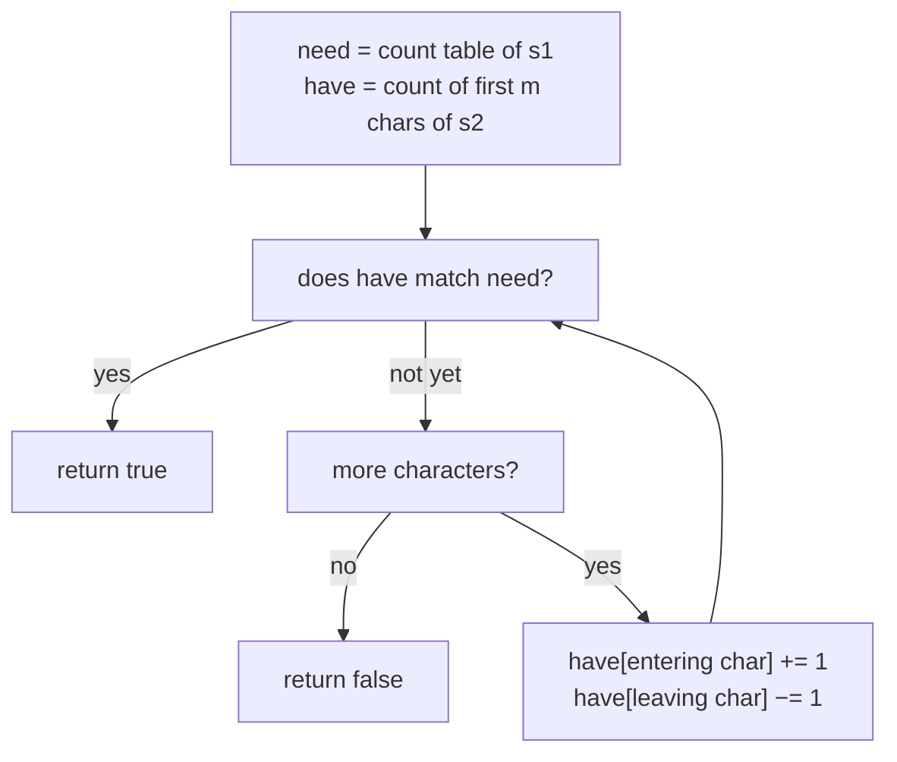

> [!tldr] Quick read
> - The problem: does s2 contain a **substring** that is a permutation of s1 (`s1 = "ab"`, `s2 = "eidbaooo"` → yes, the substring `"ba"`).
> - A permutation of s1 = a substring with the **same count table** as s1, of length exactly `|s1|`. So a [[en/concepts/fixed-size-window|fixed-size window]] of length `m = |s1|` sliding over s2 is enough: each step one character enters, one leaves.
> - Comparing two 26-cell tables each step is O(26·n). Counting **how many cells match** (0..26) and updating only the two cells that change is O(n): 3 times faster when every window nearly matches, but slower when windows differ at the very first cell, because the comparison stops early.
> - Two traps: comparing the **set** of characters (ignoring counts, 6/8 cases), and comparing two count arrays with `===` or `==` in JS and Java (comparing references, 4/8 cases).

> [!info] Context
> LeetCode problem 567, part of [[en/posts/2026-11-23-neetcode-sliding-window|station 5: Sliding Window]] on **the NeetCode line: Arrays and Strings**. This problem is [[en/problems/valid-anagram|Valid Anagram]] inside a sliding window: instead of comparing two strings once, compare s1 against every substring of length `|s1|` of s2. The solutions come in TypeScript, Python, Go, Java and JavaScript. You need loops, strings and count arrays.

> [!abstract]- Quick glossary for this post (click to open)
> - **Permutation**: the same characters with the same counts, only in a different order. `"ba"` is a permutation of `"ab"`.
> - **26-cell count table**: how many times each letter a–z appears. Two strings are permutations of each other if and only if their count tables are equal. See [[en/concepts/frequency-counting|Frequency Counting]].
> - **Fixed-size window**: a window that always has length m; each step adds on the right and drops on the left at the same time. See [[en/concepts/fixed-size-window|Fixed-size Window]].
> - **Comparing by reference**: asking "do the two variables point to the same object", not "is the content the same".

## Picture it first: finding a hand of cards in a row

You hold a hand of m cards (s1) and look at a long row of face-up cards (s2). The question: are there m **adjacent** cards in the row that are exactly the cards in your hand, in any order? You lay a frame exactly m cards wide on the row and slide it.

| Everyday life | Concept |
|---|---|
| The hand of cards, order doesn't matter | the count table `need` of s1 |
| A frame exactly m cards wide | a fixed window of length m |
| Slide the frame one card: a new card enters, an old one leaves | `have[in]++`, `have[out]--` |
| Check each kind of card between the frame and your hand | comparing 26 cells |
| A tally of "how many kinds match", updating only the two rows that changed | the matching-cell counter |
| Asking only "is this kind of card there" and forgetting to count | comparing sets, wrong with duplicate cards |



## The problem

**The problem (in my own words):** given two lowercase strings `s1`, `s2` (1 ≤ length ≤ 10⁴), return `true` if s2 has a contiguous substring that is a permutation of s1. Original: [LeetCode 567](https://leetcode.com/problems/permutation-in-string/).

| s1 | s2 | Output | Why |
|---|---|---|---|
| `"ab"` | `"eidbaooo"` | true | the substring `"ba"` |
| `"ab"` | `"eidboaoo"` | false | `b` and `a` are not adjacent |
| `"aab"` | `"abbab"` | false | every substring of length 3 has only one `a` |
| `"abc"` | `"ab"` | false | s1 is longer than s2 |

I first planned to generate every permutation of s1 and search for each one in s2. With `|s1| = 10` that is already 3.6 million permutations. It turns out order doesn't matter, so a count table is enough, and the length is fixed, so a fixed window is enough.

## How it works

### Approach 1, sorting each window: O(n · m log m)

Sort s1 once into a key. For each substring of length m of s2, sort it and compare with the key. This is the sorted key of [[en/problems/group-anagrams|Group Anagrams]], applied to n − m + 1 windows.

### Approach 2, a sliding count table, comparing 26 cells

Build `need` from s1 and `have` from the first m characters of s2. Each slide: `have[s2[r]]++` (entering on the right), `have[s2[r − m]]--` (leaving on the left), then compare 26 cells. O(26) per step, O(26·n) in total, independent of m.

### Approach 3, a matching-cell counter

Keep `diff[c] = have[c] − need[c]` and `matches` = the number of letters c with `diff[c] = 0`. Only **two** cells change per step, so only update `matches` for those two:
- before the change, if the cell is 0, `matches` goes down by 1 (about to differ);
- after the change, if the cell is back to 0, `matches` goes up by 1 (just matched).

`matches = 26` means the window is a permutation of s1. O(1) per step, O(n) in total.

| Step | `s2 = "eidbaooo"`, `s1 = "ab"` | window | differing cells | matches |
|---|---|---|---|---|
| start | | `"ei"` | a, b, e, i | 22 |
| 1 | d enters, e leaves | `"id"` | a, b, d, i | 22 |
| 2 | b enters, i leaves | `"db"` | a, d | 24 |
| 3 | a enters, d leaves | `"ba"` | (none) | 26 → true |

### Measured: O(n) doesn't always beat O(26·n)

TypeScript, random s2, s1 is `"zz…z"` so there is no permutation and every approach scans to the end, median:

| n = \|s2\| | m = \|s1\| | sorting | compare 26 | count matches |
|---|---|---|---|---|
| 10⁴ | 10 | 5.2 ms | 0.34 ms | 0.18 ms |
| 10⁴ | 1 000 | 908.0 ms | 0.12 ms | 0.04 ms |
| 10⁶ | 10 | 521.0 ms | 6.13 ms | 10.26 ms |
| 10⁶ | 1 000 | (not run) | 3.39 ms | 3.51 ms |
| 1 040 000 | 26, every window nearly matches | (not run) | 18.08 ms | 6.05 ms |

Comparing 26 cells usually does **not** compare all 26: `every` stops at the first differing cell, and with random data cell `a` usually differs already. The last row builds the worst case for it: every window matches the first 24 cells and differs at cell `y`. There the matching-cell counter is 3 times faster. Sorting grows with m: m = 1 000 already takes almost a second at n = 10⁴.

### Under the hood of the five languages

| | Comparing two count tables | Language-specific trap |
|---|---|---|
| TypeScript / JavaScript | `need.every((x, c) => x === have[c])` | `need === have` compares references: always `false` |
| Python | `need == have` (lists compare by value) | no comparison trap; a `Counter` also compares with `==` |
| Go | `need == have` on `[26]int` | fixed-size arrays compare with `==`; a `[]int` slice doesn't compile |
| Java | `Arrays.equals(need, have)` | `need == have` on `int[]` compares references: always `false` |

## Runnable example

[TypeScript](../code/neetcode-permutation-in-string/permutation-in-string.ts) · [Python](../code/neetcode-permutation-in-string/permutation_in_string.py) · [Go](../code/neetcode-permutation-in-string/permutation_in_string.go) · [Java](../code/neetcode-permutation-in-string/permutation-in-string.java) · [JavaScript](../code/neetcode-permutation-in-string/permutation-in-string.js)

Each file has the three approaches and runs 8 cases. Below are the sliding count table and the matching-cell counter.

```ts
// Approach 2: a fixed window of length m, sliding a 26-cell count table, comparing all 26 cells each step. O(26 · n).
function slideCompare26(s1: string, s2: string): boolean {
  const m = s1.length;
  if (m > s2.length) return false;
  const need = new Array(26).fill(0), have = new Array(26).fill(0);
  for (let i = 0; i < m; i++) { need[at(s1, i)]++; have[at(s2, i)]++; }
  const same = () => need.every((x, c) => x === have[c]);
  if (same()) return true;
  for (let r = m; r < s2.length; r++) {
    have[at(s2, r)]++;      // character entering on the right
    have[at(s2, r - m)]--;  // character leaving on the left
    if (same()) return true;
  }
  return false;
}

// Approach 3: count how many letters currently match (0..26). Only two cells change per step, so only those two are updated. O(n).
function matchesCounter(s1: string, s2: string): boolean {
  const m = s1.length;
  if (m > s2.length) return false;
  const diff = new Array(26).fill(0); // diff[c] = count of c in the window − count of c in s1
  for (let i = 0; i < m; i++) { diff[at(s1, i)]--; diff[at(s2, i)]++; }
  let matches = diff.filter((d) => d === 0).length;
  const bump = (c: number, delta: number) => {
    if (diff[c] === 0) matches--;  // a matching cell is about to differ
    diff[c] += delta;
    if (diff[c] === 0) matches++;  // the cell has just matched again
  };
  for (let r = m; r < s2.length && matches < 26; r++) {
    bump(at(s2, r), +1);
    bump(at(s2, r - m), -1);
  }
  return matches === 26;
}
```

```python
def slide_compare_26(s1: str, s2: str) -> bool:
    m = len(s1)
    if m > len(s2):
        return False
    need, have = [0] * 26, [0] * 26
    for i in range(m):
        need[ord(s1[i]) - 97] += 1
        have[ord(s2[i]) - 97] += 1
    if need == have:  # lists compare by value with ==
        return True
    for r in range(m, len(s2)):
        have[ord(s2[r]) - 97] += 1
        have[ord(s2[r - m]) - 97] -= 1
        if need == have:
            return True
    return False

def matches_counter(s1: str, s2: str) -> bool:
    m = len(s1)
    if m > len(s2):
        return False
    diff = [0] * 26  # count in the window − count in s1
    for i in range(m):
        diff[ord(s1[i]) - 97] -= 1
        diff[ord(s2[i]) - 97] += 1
    matches = diff.count(0)
    for r in range(m, len(s2)):
        if matches == 26:
            return True
        for c, delta in ((ord(s2[r]) - 97, 1), (ord(s2[r - m]) - 97, -1)):
            if diff[c] == 0:
                matches -= 1
            diff[c] += delta
            if diff[c] == 0:
                matches += 1
    return matches == 26
```

```go
func slideCompare26(s1, s2 string) bool {
	m := len(s1)
	if m > len(s2) {
		return false
	}
	var need, have [26]int
	for i := 0; i < m; i++ {
		need[s1[i]-'a']++
		have[s2[i]-'a']++
	}
	if need == have { // fixed-size arrays compare by content with ==
		return true
	}
	for r := m; r < len(s2); r++ {
		have[s2[r]-'a']++
		have[s2[r-m]-'a']--
		if need == have {
			return true
		}
	}
	return false
}

func matchesCounter(s1, s2 string) bool {
	m := len(s1)
	if m > len(s2) {
		return false
	}
	var diff [26]int
	for i := 0; i < m; i++ {
		diff[s1[i]-'a']--
		diff[s2[i]-'a']++
	}
	matches := 0
	for _, d := range diff {
		if d == 0 {
			matches++
		}
	}
	bump := func(c byte, delta int) {
		if diff[c] == 0 {
			matches--
		}
		diff[c] += delta
		if diff[c] == 0 {
			matches++
		}
	}
	for r := m; r < len(s2) && matches < 26; r++ {
		bump(s2[r]-'a', 1)
		bump(s2[r-m]-'a', -1)
	}
	return matches == 26
}
```

```java
static boolean slideCompare26(String s1, String s2) {
    int m = s1.length();
    if (m > s2.length()) return false;
    int[] need = new int[26], have = new int[26];
    for (int i = 0; i < m; i++) { need[s1.charAt(i) - 'a']++; have[s2.charAt(i) - 'a']++; }
    if (Arrays.equals(need, have)) return true; // need == have compares references: always false
    for (int r = m; r < s2.length(); r++) {
        have[s2.charAt(r) - 'a']++;
        have[s2.charAt(r - m) - 'a']--;
        if (Arrays.equals(need, have)) return true;
    }
    return false;
}

static boolean matchesCounter(String s1, String s2) {
    int m = s1.length();
    if (m > s2.length()) return false;
    int[] diff = new int[26];
    for (int i = 0; i < m; i++) { diff[s1.charAt(i) - 'a']--; diff[s2.charAt(i) - 'a']++; }
    int matches = 0;
    for (int d : diff) if (d == 0) matches++;
    for (int r = m; r < s2.length() && matches < 26; r++) {
        int in = s2.charAt(r) - 'a', out = s2.charAt(r - m) - 'a';
        if (diff[in] == 0) matches--;
        if (++diff[in] == 0) matches++;
        if (diff[out] == 0) matches--;
        if (--diff[out] == 0) matches++;
    }
    return matches == 26;
}
```

```js
function slideCompare26(s1, s2) {
  const m = s1.length;
  if (m > s2.length) return false;
  const need = new Array(26).fill(0), have = new Array(26).fill(0);
  for (let i = 0; i < m; i++) { need[s1.charCodeAt(i) - 97]++; have[s2.charCodeAt(i) - 97]++; }
  const same = () => need.every((x, c) => x === have[c]); // need === have compares references: always false
  if (same()) return true;
  for (let r = m; r < s2.length; r++) {
    have[s2.charCodeAt(r) - 97]++;
    have[s2.charCodeAt(r - m) - 97]--;
    if (same()) return true;
  }
  return false;
}

function matchesCounter(s1, s2) {
  const m = s1.length;
  if (m > s2.length) return false;
  const diff = new Array(26).fill(0);
  for (let i = 0; i < m; i++) { diff[s1.charCodeAt(i) - 97]--; diff[s2.charCodeAt(i) - 97]++; }
  let matches = diff.filter((d) => d === 0).length;
  const bump = (c, delta) => {
    if (diff[c] === 0) matches--;
    diff[c] += delta;
    if (diff[c] === 0) matches++;
  };
  for (let r = m; r < s2.length && matches < 26; r++) {
    bump(s2.charCodeAt(r) - 97, 1);
    bump(s2.charCodeAt(r - m) - 97, -1);
  }
  return matches === 26;
}
```


The TypeScript file also runs two wrong versions, then measures:

```text
$ node permutation-in-string.ts
sortEachWindow   8/8 cases passed
slideCompare26   8/8 cases passed
matchesCounter   8/8 cases passed
wrongSetOnly     6/8 cases passed; wrong on (aab, abbab) (hello, ooolleoooleh)
wrongArrayEquals 4/8 cases passed; wrong on (ab, eidbaooo) (adc, dcda) (a, a) (aab, xxbaa)

n = |s2|    m = |s1|   sorting   compare 26   count matches   (ms, median; no permutation, so a full scan)
10000       10              5.2      0.34       0.18
10000       1000          908.0      0.12       0.04
1000000     10            521.0      6.13      10.26
1000000     1000              —      3.39       3.51
1040000     26                —     18.08       6.05   ← every window nearly matches
```

*(Output labels translated; the files themselves print Vietnamese.)*

`wrongSetOnly` accepts `"bab"` as a permutation of `"aab"` because both have the set `{a, b}`. `wrongArrayEquals` is wrong on exactly the four cases whose answer is `true`: comparing references is never equal, so it always returns `false`. The Java file reproduces that trap with `int[] == int[]`:

```text
$ java permutation-in-string.java
sortEachWindow   8/8 cases passed
slideCompare26   8/8 cases passed
matchesCounter   8/8 cases passed
wrongArrayEquals 4/8 cases passed
```

Python, Go and JavaScript print `8/8 ca đúng` ("8/8 cases passed") for all three approaches.

## Misconceptions and common traps

- **Generating every permutation of s1.** m! permutations; m = 10 is already 3.6 million. Order doesn't matter, so a count table is enough.
- **Comparing sets of characters instead of count tables.** It forgets the counts: `"aab"` and `"bab"` have the same set.
- **Comparing two arrays with `===` (JS) or `==` (Java).** No error, just always wrong. Go and Python compare by value.
- **Forgetting the case where s1 is longer than s2.** Return `false` before building the count tables, or `s2[i]` goes out of bounds (Go and Java throw; JS gives `NaN`).
- **"O(n) is always faster than O(26·n)."** The 26-cell comparison stops at the first differing cell, so on random data it is often faster than the counter. The counter only clearly wins when windows nearly match.

## Self-check questions

> [!question]- Why is the window in this problem always exactly `|s1|` long, while in Longest Substring Without Repeating Characters it grows and shrinks?
> A permutation of s1 has exactly `|s1|` characters, so only a substring of exactly that length can be the answer. The other problem looks for the longest substring, so the length is what you are searching for.

> [!question]- During a slide, the entering and leaving characters are the same letter c. How does `matches` change?
> `diff[c]` goes up by 1 then down by 1, back to its old value. The two updates to `matches` cancel out, so `matches` is unchanged, just as the window keeps the same count table.

> [!question]- Why can Go compare `need == have` while JS can't?
> Go's `[26]int` is a value, and fixed-size arrays compare element by element with `==`. A JS array is an object, and `===` compares addresses.

> [!question]- If the input could contain any Unicode character instead of a–z, what would approach 3 need to change?
> Use a Map instead of a 26-cell array. Since the number of keys isn't known in advance, count the keys that currently **differ** (`diff ≠ 0`) instead of the ones that match; the window is a permutation when that count is 0.

## References

- [LeetCode 567: Permutation in String](https://leetcode.com/problems/permutation-in-string/) (the original problem)
- [Go spec: Comparison operators](https://go.dev/ref/spec#Comparison_operators) (arrays are comparable, slices are not)
- [Java 21 `Arrays.equals(int[], int[])`](https://docs.oracle.com/en/java/javase/21/docs/api/java.base/java/util/Arrays.html#equals(int%5B%5D,int%5B%5D)) (compares content; `==` on arrays compares references)
- [MDN: Equality comparisons and sameness](https://developer.mozilla.org/en-US/docs/Web/JavaScript/Equality_comparisons_and_sameness) (objects compare by reference with `===`)
- [Python: Comparisons](https://docs.python.org/3/reference/expressions.html#comparisons) (lists compare element by element)
