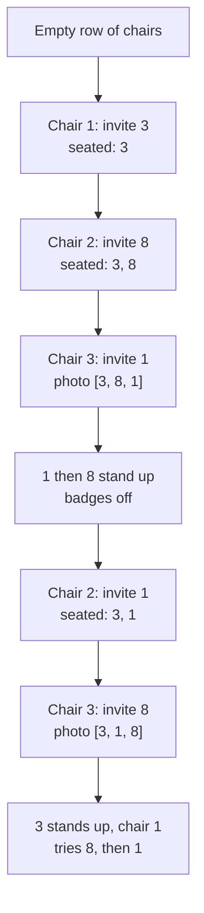

> [!tldr] Quick read
> - Permutations differ from combinations because order matters: `[3, 8, 1]` and `[8, 3, 1]` are two answers. That is why the [[en/concepts/start-index|start index]] from the previous station does not work here: it only moves right, so only one order survives.
> - Each level of the [[en/concepts/choice-tree|choice tree]] scans the whole array again and skips elements already in `path`. A [[en/concepts/used-marker|used marker]] array answers that question in O(1).
> - Mark before going deeper, unmark on the way back up. Forget to unmark and only the first permutation comes out.
> - There are n! permutations, each of length n, so nothing beats O(n·n!). For n = 6 the tree has 1,957 nodes to produce 720 permutations.

> [!info] Context
> This is LeetCode problem 46 at [[en/posts/2026-11-28-neetcode-permutations-search|station MISC-02: Backtracking: Permutations and Search]] on **the NeetCode Line: Mixed Techniques**. I picture seating a few guests along a row of chairs and listing every possible seating. You only need arrays, loops and recursive functions; reading [[en/problems/subsets|Subsets]] first makes the difference easier to see.

> [!abstract]- Quick glossary for this post (click to open)
> - A permutation is one way to arrange all the elements in an order. An array of n distinct elements has n! = n × (n − 1) × … × 1 permutations.
> - n! reads "n factorial": 3! = 6, 6! = 720.
> - [[en/concepts/backtracking|Backtracking]] adds a choice to `path`, goes deeper, then removes it to try another choice.
> - `used[i]` is a true-or-false flag that says whether element i is already in `path`.

## Picture it first: seating guests along a row of chairs

There are three guests and three chairs in a row. I go from the leftmost chair to the rightmost. At each chair I invite, one by one, each guest still standing; whoever is seated wears a "seated" badge. When all three chairs are taken, I take a photo. Then I ask the guest in the last chair to stand up, take off the badge, and try someone else. Nobody sits in two chairs, but anybody may sit in any chair.

| Everyday life | Concept |
|---|---|
| The row of chairs, left to right | `path`, the permutation being built |
| Invite a standing guest to the next chair | Choose an unused `nums[i]`, go deeper |
| The "seated" badge | `used[i] = true` |
| Ask them to stand and take off the badge | `path.pop()`, `used[i] = false` |
| Every chair taken: take a photo | Record a copy of `path` |
| Any chair may invite guests listed to the left | Each level scans again from index 0 |

With guests `3`, `8`, `1`, the first two photos come out like this:



## The problem: every order of an array

Given an array `nums` of length 1–6 with pairwise distinct values, each between −10 and 10, return every permutation of `nums` in any order. For example, `[4, 9]` has two permutations: `[4, 9]` and `[9, 4]`. [Original problem, LeetCode 46](https://leetcode.com/problems/permutations/)

My first attempt copied the [[en/problems/subsets|Subsets]] template with its start index and only moved the recording to the moment `path` holds n elements. With `[3, 8, 1]` the function returned exactly one array, `[3, 8, 1]`. The start index forces each later choice to sit to the right of the earlier one, so only one order survives: the original. That is what combinations need, and exactly what permutations must avoid.

## How it works

### Brute force: try every tuple of indices

The crudest way is to generate every tuple of n indices, each from 0 to n − 1, and keep the tuples whose indices are pairwise distinct. There are nⁿ tuples: for n = 6 that is 46,656 tuples to keep 720. I use this as the referee in the runnable file, because it shares no line with the solution.

### Marking used elements

The permutation choice tree has an empty `path` at the root. At level k, each node has n − k children, one per unused element. Each call scans all of `nums` from index 0 and skips `nums[i]` when `used[i]` is true. Set `used[i] = true` before going deeper and back to `false` after returning, so sibling branches can still use that element. It is the same rhythm as the [[en/concepts/visit-and-restore|visit-and-restore]] that Word Search uses on the grid.

Level k has n!/(n − k)! nodes. For n = 6 that is 1 + 6 + 30 + 120 + 360 + 720 + 720 = 1,957 nodes, so 1,957 calls. Each call scans n elements, and each leaf copies an array of length n. Total time is O(n·n!), with O(n) extra memory for `path`, `used` and the call stack, not counting the output.

### Swapping in place

No `used` array is needed: treat `a[0..k-1]` as the occupied chairs and `a[k..n-1]` as the guests still standing. Chair k takes each standing guest in turn by swapping `a[k]` with `a[i]`, going deeper with k + 1, then swapping back. When k = n, copy the whole array. This saves the extra array, but the permutations come out in a different order than with marking, and the array is shuffled while it runs.

### Inserting into every gap

The iterative version needs no recursion: start with `[[]]`. For each new element x, take every existing permutation (of length k) and insert x into each of its k + 1 gaps. After the k-th element there are k! permutations. This is also O(n·n!), but it keeps the whole previous layer in memory.

| Approach | Time | Extra memory (output excluded) | Notes |
|---|---|---|---|
| Every tuple of indices | O(n·nⁿ) | O(n) | Referee; 46,656 tuples at n = 6 |
| Used marker | O(n·n!) | O(n) | Main approach; output follows index order |
| Swap in place | O(n·n!) | O(n) | No `used`; array shuffled while running |
| Insert into every gap | O(n·n!) | O(n·n!) | Iterative, keeps the previous layer |

## Runnable example

[TypeScript](../code/neetcode-permutations/arrange.ts) · [Python](../code/neetcode-permutations/arrange.py) · [Go](../code/neetcode-permutations/arrange.go) · [Java](../code/neetcode-permutations/arrange.java) · [JavaScript](../code/neetcode-permutations/arrange.js) · [PHP](../code/neetcode-permutations/arrange.php) · [Rust](../code/neetcode-permutations/arrange.rs)

```ts
// Main approach: path plus a used array marking elements already in path
function permute(nums: number[], counter = { calls: 0 }): number[][] {
    const result: number[][] = []
    const path: number[] = []
    const used: boolean[] = Array(nums.length).fill(false)
    const walk = () => {
        counter.calls++
        if (path.length === nums.length) {
            result.push([...path]) // copy path, since path keeps changing
            return
        }
        for (let i = 0; i < nums.length; i++) {
            if (used[i]) continue // this element is already in path
            used[i] = true
            path.push(nums[i])
            walk()
            path.pop()
            used[i] = false // unmark it so sibling branches can use it again
        }
    }
    walk()
    return result
}
```

```python
# Main approach: path plus a used array marking elements already in path
def permute(nums, counter=None):
    result, path = [], []
    used = [False] * len(nums)

    def walk():
        if counter is not None:
            counter["calls"] += 1
        if len(path) == len(nums):
            result.append(path[:])  # copy path, since path keeps changing
            return
        for i in range(len(nums)):
            if used[i]:
                continue  # this element is already in path
            used[i] = True
            path.append(nums[i])
            walk()
            path.pop()
            used[i] = False  # unmark it so sibling branches can use it again

    walk()
    return result
```

```go
// Main approach: path plus a used array marking elements already in path
func permute(nums []int, calls *int) [][]int {
	result := [][]int{}
	path := []int{}
	used := make([]bool, len(nums))
	var walk func()
	walk = func() {
		*calls++
		if len(path) == len(nums) {
			result = append(result, slices.Clone(path)) // copy path, since its backing array gets overwritten
			return
		}
		for i := range nums {
			if used[i] {
				continue // this element is already in path
			}
			used[i] = true
			path = append(path, nums[i])
			walk()
			path = path[:len(path)-1]
			used[i] = false // unmark it so sibling branches can use it again
		}
	}
	walk()
	return result
}
```

```java
// Main approach: path plus a used array marking elements already in path
static List<List<Integer>> permute(int[] nums) {
    List<List<Integer>> result = new ArrayList<>();
    walk(nums, new boolean[nums.length], new ArrayList<>(), result);
    return result;
}

static void walk(int[] nums, boolean[] used, List<Integer> path, List<List<Integer>> result) {
    calls++;
    if (path.size() == nums.length) {
        result.add(new ArrayList<>(path)); // copy path, since path keeps changing
        return;
    }
    for (int i = 0; i < nums.length; i++) {
        if (used[i]) continue; // this element is already in path
        used[i] = true;
        path.add(nums[i]);
        walk(nums, used, path, result);
        path.remove(path.size() - 1);
        used[i] = false; // unmark it so sibling branches can use it again
    }
}
```

```js
// Main approach: path plus a used array marking elements already in path
function permute(nums, counter = { calls: 0 }) {
    const result = []
    const path = []
    const used = Array(nums.length).fill(false)
    const walk = () => {
        counter.calls++
        if (path.length === nums.length) {
            result.push([...path]) // copy path, since path keeps changing
            return
        }
        for (let i = 0; i < nums.length; i++) {
            if (used[i]) continue // this element is already in path
            used[i] = true
            path.push(nums[i])
            walk()
            path.pop()
            used[i] = false // unmark it so sibling branches can use it again
        }
    }
    walk()
    return result
}
```

```php
// Main approach: path plus a used array marking elements already in path
function permute(array $nums): array {
    global $calls;
    $n = count($nums);
    $result = [];
    $path = [];
    $used = array_fill(0, $n, false);
    $walk = function () use (&$walk, &$result, &$path, &$used, &$calls, $nums, $n) {
        $calls++;
        if (count($path) === $n) {
            $result[] = $path; // PHP arrays are copied on assignment, so this is already a copy
            return;
        }
        for ($i = 0; $i < $n; $i++) {
            if ($used[$i]) continue; // this element is already in path
            $used[$i] = true;
            $path[] = $nums[$i];
            $walk();
            array_pop($path);
            $used[$i] = false; // unmark it so sibling branches can use it again
        }
    };
    $walk();
    return $result;
}
```

```rust
// Main approach: path plus a used array marking elements already in path
fn permute(nums: &[i32], calls: &mut usize) -> Vec<Vec<i32>> {
    fn walk(nums: &[i32], used: &mut Vec<bool>, path: &mut Vec<i32>, result: &mut Vec<Vec<i32>>, calls: &mut usize) {
        *calls += 1;
        if path.len() == nums.len() {
            result.push(path.clone()); // copy path, since path keeps changing
            return;
        }
        for i in 0..nums.len() {
            if used[i] {
                continue; // this element is already in path
            }
            used[i] = true;
            path.push(nums[i]);
            walk(nums, used, path, result, calls);
            path.pop();
            used[i] = false; // unmark it so sibling branches can use it again
        }
    }
    let mut result = Vec::new();
    walk(nums, &mut vec![false; nums.len()], &mut Vec::new(), &mut result, calls);
    result
}
```

The tabs show the used-marker approach; the line that increments `calls` only counts for the measurement. The downloadable file also has the swap-in-place version, the insert-into-every-gap version, the wrong version that borrows the start index, and the every-tuple referee. The seven test cases cover a single element, negative numbers, zero, five numbers and six numbers (720 permutations). For each case, all three correct approaches must produce exactly n! permutations, none repeated, and match the referee when compared regardless of order.

The second line cross-checks every array of length 1–5 with distinct values taken from {1, 2, 3, 4, 5}: 325 arrays. The last two lines are measurements: the start-index version on `[3, 8, 1]`, and the call count of the marking approach at n = 6.

```text
7/7 cases passed
325/325 cases passed (cross-check against every tuple of indices)
Using a start index as in the combination problems on [3,8,1]: 1/6 permutations
n = 6: 720 permutations, 1957 calls
```

*(Output labels translated; the files themselves print Vietnamese.)*

All seven languages print exactly these four lines.

## Misconceptions and common traps

- Borrowing the start index from the combination problems. Only one permutation comes out, as the third line above shows.
- Forgetting `used[i] = false` after returning. After the first leaf every flag stays true forever and no branch can open again: `[3, 8, 1]` gives only `[[3, 8, 1]]`.
- Recording `path` itself instead of a copy. Every entry of the result points at one array that has been emptied. The [[en/problems/subsets|Subsets]] page has a table of what happens in each language.
- Applying this solution unchanged to an array with repeated values (LeetCode 47). Two equal numbers at two positions grow two identical branches, so `[5, 5]` yields `[5, 5]` twice. That problem needs sorting and same-level skipping as in [[en/problems/subsets-ii|Subsets II]].
- Java: `path.remove(x)` with an `int` `x` calls `remove(int index)`, which removes by **position**, not by value. With `path = [3, 8, 1]`, `remove(1)` removes the 8 and leaves `[3, 1]`; `remove(8)` throws `IndexOutOfBoundsException`. To drop the last element, write `path.remove(path.size() - 1)`.
- PHP: the closure must capture `$used` by reference, `use (&$used)`. With `use ($used)` every call gets back the copy taken when the closure was created, so every flag is always `false`: `[3, 8, 1]` gives 27 results such as `[3, 3, 3]`, all 3³ tuples with repeats.
- JavaScript, TypeScript: the swap line `[a[k], a[i]] = [a[i], a[k]]` starts with `[`. If the previous line has no semicolon, JavaScript joins the two lines into one element-access expression. Code written without semicolons should put a `;` at the start of that line.
- Python ships `itertools.permutations`, which yields the tuples in index order. Using it in real code is reasonable; writing it by hand is for understanding the tree.

## Self-check questions

> [!question]- Why does Subsets work with a start index while Permutations does not?
> Subsets ignore order, so each subset only needs to be built in one single order. A permutation is the order itself, so every chair must also be able to invite guests who sit to the left in the array.

> [!question]- For n = 4, how many nodes does the marking tree have?
> 1 + 4 + 12 + 24 + 24 = 65 nodes: level k has 4!/(4 − k)! nodes, and the last level has 24 leaves.

> [!question]- What does the swap-in-place version need to restore the array after each branch?
> Swap back exactly the pair `a[k]`, `a[i]` it just swapped, after the deeper call returns.

> [!question]- If you only need to count the permutations, do you need backtracking?
> No. With n distinct elements the answer is n!. Backtracking is only needed to list each permutation.

## References

- [LeetCode 46](https://leetcode.com/problems/permutations/)
- [Jeff Erickson, Algorithms, chapter 2: backtracking](https://jeffe.cs.illinois.edu/teaching/algorithms/book/02-backtracking.pdf)
- [Java List.remove(int)](https://docs.oracle.com/en/java/javase/21/docs/api/java.base/java/util/List.html#remove(int)) · [PHP anonymous functions](https://www.php.net/manual/en/functions.anonymous.php) · [MDN, automatic semicolon insertion](https://developer.mozilla.org/en-US/docs/Web/JavaScript/Reference/Lexical_grammar#automatic_semicolon_insertion) · [Python itertools.permutations](https://docs.python.org/3/library/itertools.html#itertools.permutations)
