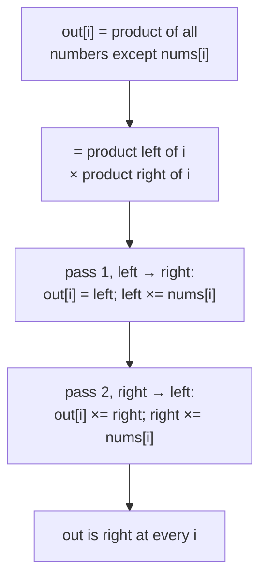

> [!tldr] Quick read
> - The problem: return an array `out` where `out[i]` is the product of every element except `nums[i]`. O(n), **no division**.
> - The key: product except i = (product of everything **left** of i) × (product of everything **right** of i). These two halves are [[en/concepts/prefix-and-suffix-products|prefix and suffix products]], computed in two passes.
> - Dividing the total by `nums[i]` breaks on **every** case with a zero: JS gives `NaN`; Python, Go and Java throw a division-by-zero error. To divide at all you must count zeros separately.
> - The first pass writes prefix products straight into `out`, the second multiplies in suffix products with one running variable: O(1) extra space beyond the result array.
> - Measured: the O(n²) brute force takes 234 ms at n = 16 000; two passes take 7 ms at n = 10⁶.

> [!info] Context
> LeetCode problem 238, the anchor problem of [[en/posts/2026-11-23-neetcode-prefix-suffix-encoding|station 3: Prefix, Suffix and Encoding]] on **the NeetCode line: Arrays and Strings**. The solutions come in TypeScript, Python, Go, Java and JavaScript. All you need to know is loops, arrays and multiplication.

> [!abstract]- Quick glossary for this post (click to open)
> - **Prefix**: the start of the array, `nums[0..i-1]`. **Suffix**: the end, `nums[i+1..n-1]`.
> - **Running product**: a variable that keeps multiplying in each element as you walk the array. The same idea as a [[en/concepts/prefix-sum|prefix sum]], with multiplication instead of addition.
> - **Extra space**: memory beyond the input and the output. The problem does not count the result array.
> - **`-0`**: the negative zero of floating-point numbers (IEEE 754). `0 * -1` gives `-0` in JS; `-0 === 0` is still true.

## Picture it first: a group photo

A row of n people lines up for a photo. For each person, the photographer wants to know "if this person stepped out, what is the product of the shirt numbers of **everyone else**?". Asking person by person and multiplying the whole row each time means walking the row n times.

| Everyday life | Concept |
|---|---|
| Ask each person, multiplying the whole row every time | brute force, O(n²) |
| Multiply the whole row once, then "divide out" that person | division, which breaks when someone wears number 0 |
| An assistant walks left to right, writing for each person the product of everyone to their **left** | the prefix pass |
| A second assistant walks right to left, multiplying in the product of everyone to the **right** | the suffix pass |
| Each assistant only remembers one number being multiplied up | the running variables `left`, `right` |



## The problem

**The problem (in my own words):** given an integer array `nums` (2 ≤ n ≤ 10⁵, each value in −30..30), return an array `out` of the same length where `out[i]` is the product of every element except `nums[i]`. The problem guarantees every prefix and suffix product fits in a 32-bit integer. It must run in O(n) without division. Original: [LeetCode 238](https://leetcode.com/problems/product-of-array-except-self/).

| Input | Output |
|---|---|
| `[1, 2, 3, 4]` | `[24, 12, 8, 6]` |
| `[-1, 1, 0, -3, 3]` | `[0, 0, 9, 0, 0]` |
| `[0, 0, 5]` | `[0, 0, 0]` |

I used to think "no division" was just a rule to make things harder. It turns out division breaks on zeros anyway, and the division-free approach is neater.

## How it works

<figure class="figure-map" style="--ar: 3 / 4">
<div class="frame"><iframe data-archify="../../diagrams/neetcode-product-of-array-except-self/worked-example.en.html" title="Multiply left and right products" loading="lazy"></iframe></div>
<figcaption><span><b>Figure 1.</b> Multiply left and right products.</span><a href="../diagrams/neetcode-product-of-array-except-self/worked-example.en.html" target="_blank" rel="noopener">Open full screen</a></figcaption>
</figure>

<details>
<summary>Read the steps</summary>
<ol>
<li>Store the product before each index. <code>[2, 3, 5] → [1, 2, 6]</code></li>
<li>Reach index 2 with right product 1. <code>6 × 1 = 6</code></li>
<li>Reach index 1 with right product 5. <code>2 × 5 = 10</code></li>
<li>Reach index 0 with right product 15. <code>1 × 15 = 15</code></li>
<li>Return products excluding each item. <code>[15, 10, 6]</code></li>
</ol>
</details>

### Approach 1, brute force: O(n²)

For each i, multiply every `nums[j]` with `j ≠ i`. Measured below: doubling n multiplies the time by about 4.

### Approach 2, division: breaks on zeros

`total / nums[i]` is right when there is no zero. With one zero, its cell needs the product of the other numbers, but `total = 0` has already lost that information; the cell becomes `0 / 0`. The fix counts zeros:
- two or more zeros: every cell is 0;
- exactly one zero: that cell is the product of the non-zero numbers, every other cell is 0;
- no zero: divide as usual.

The fix is correct, but the problem still forbids division, and on real numbers (not this problem) division also carries rounding error.

### Approach 3, prefix and suffix products

`prefix[i]` = product of `nums[0..i-1]` (`prefix[0] = 1`, the product of no elements). `suffix[i]` = product of `nums[i+1..n-1]` (`suffix[n-1] = 1`). Then `out[i] = prefix[i] · suffix[i]`. Two helper arrays, one pass each: O(n) time, O(n) extra space.

### Approach 4, fold into the result array

`prefix` is only used once at position i, so write it straight into `out`. The same goes for `suffix`, and the suffix pass walks backwards, so one variable `right` multiplying up is enough. The result: two passes, no helper array.

| i | 0 | 1 | 2 | 3 |
|---|---|---|---|---|
| `nums` | 1 | 2 | 3 | 4 |
| after pass 1 (product on the left) | 1 | 1 | 2 | 6 |
| product on the right | 24 | 12 | 4 | 1 |
| `out` after pass 2 | 24 | 12 | 8 | 6 |

### Measured

TypeScript, random values ±1 so the product neither overflows nor becomes 0, median:

| n | brute force | two helper arrays | folded into `out` |
|---|---|---|---|
| 2 000 | 4.1 ms | 0.15 ms | 0.09 ms |
| 4 000 | 16.8 ms | 0.09 ms | 0.04 ms |
| 8 000 | 65.4 ms | 0.11 ms | 0.09 ms |
| 16 000 | 234.1 ms | 0.20 ms | 0.09 ms |
| 10⁶ | (not run) | 23.42 ms | 7.28 ms |

The brute force follows the n² shape exactly (double n, about 4 times the time); at the problem's n = 10⁵ it would need about 10¹⁰ multiplications. At n = 10⁶, dropping the two helper arrays is about 3 times faster because of less allocation and less memory traffic.

### Under the hood of the five languages

| | Dividing by 0 | Language-specific trap |
|---|---|---|
| TypeScript / JavaScript | `0 / 0` gives `NaN`, `x / 0` gives `±Infinity`, no error | a product can be `-0`; `===` treats `-0` as equal to `0` |
| Python | `ZeroDivisionError` | `/` gives a float; exact division needs `//` |
| Go | `panic: integer divide by zero` | `int` is 64-bit, no overflow within the problem's limits |
| Java | `ArithmeticException: / by zero` | compare two `int[]` with `Arrays.equals`, not `==` |

## Runnable example

[TypeScript](../code/neetcode-product-of-array-except-self/product-except-self.ts) · [Python](../code/neetcode-product-of-array-except-self/product_except_self.py) · [Go](../code/neetcode-product-of-array-except-self/product_except_self.go) · [Java](../code/neetcode-product-of-array-except-self/product-except-self.java) · [JavaScript](../code/neetcode-product-of-array-except-self/product-except-self.js)

Each file has the brute force, zero-aware division, two helper arrays and the folded version, and runs 6 cases. Below are the two prefix-suffix versions.

```ts
// Two helper arrays: prefix[i] = product of nums[0..i-1], suffix[i] = product of nums[i+1..n-1].
function prefixSuffixArrays(nums: number[]): number[] {
  const n = nums.length;
  const prefix = new Array(n).fill(1), suffix = new Array(n).fill(1);
  for (let i = 1; i < n; i++) prefix[i] = prefix[i - 1] * nums[i - 1];
  for (let i = n - 2; i >= 0; i--) suffix[i] = suffix[i + 1] * nums[i + 1];
  return nums.map((_, i) => prefix[i] * suffix[i]);
}

// O(1) extra space: pass 1 writes the prefix straight into the result, pass 2 multiplies the suffix with one running variable.
function prefixSuffixInPlace(nums: number[]): number[] {
  const n = nums.length;
  const out = new Array(n).fill(1);
  let left = 1;
  for (let i = 0; i < n; i++) { out[i] = left; left *= nums[i]; }
  let right = 1;
  for (let i = n - 1; i >= 0; i--) { out[i] *= right; right *= nums[i]; }
  return out;
}
```

```python
def prefix_suffix_arrays(nums: list[int]) -> list[int]:
    n = len(nums)
    prefix, suffix = [1] * n, [1] * n
    for i in range(1, n):
        prefix[i] = prefix[i - 1] * nums[i - 1]
    for i in range(n - 2, -1, -1):
        suffix[i] = suffix[i + 1] * nums[i + 1]
    return [p * s for p, s in zip(prefix, suffix)]

def prefix_suffix_in_place(nums: list[int]) -> list[int]:
    n = len(nums)
    out = [1] * n
    left = 1
    for i in range(n):
        out[i] = left
        left *= nums[i]
    right = 1
    for i in range(n - 1, -1, -1):
        out[i] *= right
        right *= nums[i]
    return out
```

```go
func prefixSuffixArrays(nums []int) []int {
	n := len(nums)
	prefix, suffix := make([]int, n), make([]int, n)
	prefix[0], suffix[n-1] = 1, 1
	for i := 1; i < n; i++ {
		prefix[i] = prefix[i-1] * nums[i-1]
	}
	for i := n - 2; i >= 0; i-- {
		suffix[i] = suffix[i+1] * nums[i+1]
	}
	out := make([]int, n)
	for i := range out {
		out[i] = prefix[i] * suffix[i]
	}
	return out
}

func prefixSuffixInPlace(nums []int) []int {
	n := len(nums)
	out := make([]int, n)
	left := 1
	for i := 0; i < n; i++ {
		out[i] = left
		left *= nums[i]
	}
	right := 1
	for i := n - 1; i >= 0; i-- {
		out[i] *= right
		right *= nums[i]
	}
	return out
}
```

```java
static int[] prefixSuffixArrays(int[] nums) {
    int n = nums.length;
    int[] prefix = new int[n], suffix = new int[n], out = new int[n];
    prefix[0] = 1; suffix[n - 1] = 1;
    for (int i = 1; i < n; i++) prefix[i] = prefix[i - 1] * nums[i - 1];
    for (int i = n - 2; i >= 0; i--) suffix[i] = suffix[i + 1] * nums[i + 1];
    for (int i = 0; i < n; i++) out[i] = prefix[i] * suffix[i];
    return out;
}

static int[] prefixSuffixInPlace(int[] nums) {
    int n = nums.length;
    int[] out = new int[n];
    int left = 1;
    for (int i = 0; i < n; i++) { out[i] = left; left *= nums[i]; }
    int right = 1;
    for (int i = n - 1; i >= 0; i--) { out[i] *= right; right *= nums[i]; }
    return out;
}
```

```js
function prefixSuffixArrays(nums) {
  const n = nums.length;
  const prefix = new Array(n).fill(1), suffix = new Array(n).fill(1);
  for (let i = 1; i < n; i++) prefix[i] = prefix[i - 1] * nums[i - 1];
  for (let i = n - 2; i >= 0; i--) suffix[i] = suffix[i + 1] * nums[i + 1];
  return nums.map((_, i) => prefix[i] * suffix[i]);
}

function prefixSuffixInPlace(nums) {
  const n = nums.length;
  const out = new Array(n).fill(1);
  let left = 1;
  for (let i = 0; i < n; i++) { out[i] = left; left *= nums[i]; }
  let right = 1;
  for (let i = n - 1; i >= 0; i--) { out[i] *= right; right *= nums[i]; }
  return out;
}
```


```text
$ node product-except-self.ts
bruteForce           6/6 cases passed
naiveDivision        3/6 cases passed; wrong on [-1,1,0,-3,3] → [0,0,NaN,0,0] [0,0,5] → [NaN,NaN,0] [0,4,5] → [NaN,0,0]
divisionZeroAware    6/6 cases passed
prefixSuffixArrays   6/6 cases passed
prefixSuffixInPlace  6/6 cases passed

prefixSuffixInPlace([0, 0, -1]) = [-0, -0, 0]

n          brute     2 arrays   in place  (ms, median)
2000            4.1       0.15      0.09
4000           16.8       0.09      0.04
8000           65.4       0.11      0.09
16000         234.1       0.20      0.09
1000000           —      23.42      7.28
```

*(Output labels translated; the files themselves print Vietnamese.)*

Plain division breaks on all three cases with a zero, and JS raises no error: it quietly returns `NaN`. The same plain division in Python throws:

```text
$ python3 product_except_self.py
brute_force             6/6 cases passed
naive_division          3/6 cases passed; error on [-1, 1, 0, -3, 3]: ZeroDivisionError, [0, 0, 5]: ZeroDivisionError, [0, 4, 5]: ZeroDivisionError
division_zero_aware     6/6 cases passed
prefix_suffix_arrays    6/6 cases passed
prefix_suffix_in_place  6/6 cases passed
```

The `[-0, -0, 0]` line is a floating-point quirk: `0 · (−1)` gives `-0`. It is still equal to `0` under `===` and prints as `0` through `JSON.stringify`, so LeetCode accepts it. Go, Java and JavaScript run the four approaches correctly and print `6/6 ca đúng` ("6/6 cases passed").

## Misconceptions and common traps

- **"Just divide the total by each number."** It breaks on every case with a zero, and the problem forbids it.
- **Starting the prefix at `nums[0]` instead of 1.** `prefix[i]` is the product **before** i, not including `nums[i]`. The product of no elements is 1, just as the sum of no elements is 0.
- **Updating the running variable before writing.** `left *= nums[i]; out[i] = left` puts `nums[i]` itself into the product. Write first, multiply after.
- **"O(1) space" counting the result array.** The problem's convention excludes `out`; the folded version uses only two variables.
- **Overflow.** The problem guarantees prefix and suffix products fit in 32 bits. On data outside the problem, a Java `int` overflows silently; use `long` or `Math.multiplyExact` to get an error.

## Self-check questions

> [!question]- Compute `out` for `[2, 0, 3]` with the folded version, writing down `out` after each pass.
> After pass 1 (product on the left): `[1, 2, 0]`. Pass 2 multiplies in the products on the right, 0, 3, 1: `[1·0, 2·3, 0·1] = [0, 6, 0]`.

> [!question]- Why are `prefix[0]` and `suffix[n-1]` equal to 1?
> There is nothing to the left of the first element or to the right of the last. The product of an empty set is the identity of multiplication, which is 1.

> [!question]- The array has exactly one zero, at position k. Which cells of `out` are non-zero?
> Only cell k: it equals the product of all the other numbers. Every other cell includes the zero at position k in its product.

> [!question]- Change the problem: return the sum of every number except itself. Do you need prefixes and suffixes?
> No: addition can be undone, so `total − nums[i]` is always right. Multiplication cannot be undone when there is a zero, which is why this problem needs prefixes and suffixes.

## References

- [LeetCode 238: Product of Array Except Self](https://leetcode.com/problems/product-of-array-except-self/) (the original problem)
- [ECMAScript 2025: Number::multiply](https://tc39.es/ecma262/2025/#sec-numeric-types-number-multiply) (the sign of a product when a factor is 0, the source of `-0`)
- [Python: Numeric types](https://docs.python.org/3/library/stdtypes.html#numeric-types-int-float-complex) (`/` gives a float, `//` is floor division, dividing by 0 raises `ZeroDivisionError`)
- [Go spec: Integer operators](https://go.dev/ref/spec#Integer_operators) (dividing by 0 panics at run time)
- [Java 21 `Math.multiplyExact`](https://docs.oracle.com/en/java/javase/21/docs/api/java.base/java/lang/Math.html#multiplyExact(int,int)) (throws on overflow instead of wrapping)
