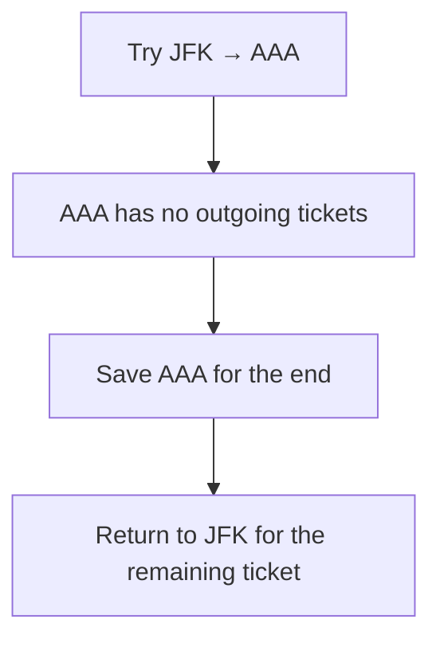

> [!tldr] Quick read
> - Each ticket is a distinct directed edge. Identical tickets still contribute two edges to the [[en/concepts/eulerian-trail|Eulerian trail]].
> - Sort each airport's destinations descending and pop the last one to try the smallest code.
> - Record an airport in the reversed answer only when its outgoing tickets are exhausted. This places a dead end at the end.

> [!info] Context
> LeetCode 332 belongs to [[en/posts/2026-11-27-neetcode-spanning-tree-itinerary|station 6 on spanning trees and itineraries]] on the NeetCode Graphs line. The station asks two different questions about edges. This problem uses every existing edge and requires only arrays, hash maps, and stacks.

> [!abstract]- Quick glossary for this post (click to open)
> - An [[en/concepts/adjacency-list|adjacency list]] records the destinations of each airport.
> - An [[en/concepts/eulerian-trail|Eulerian trail]] uses each edge exactly once. An airport can appear again.
> - Lexicographic order compares the first differing code in two itineraries.
> - [[en/concepts/hierholzers-algorithm|Hierholzer's algorithm]] splices edge paths by finalizing the suffix first.

## Picture it first: stacks of tickets at airport counters

I have three tickets, `JFK → AAA`, `JFK → BBB`, and `BBB → JFK`. If I go to AAA first and commit to that first step, I get stuck there while tickets remain. The complete route must visit BBB and come back to JFK before flying to AAA.

| Everyday life | Concept |
|---|---|
| An individual ticket with a departure and destination | One directed edge |
| The stack of tickets at a counter | An adjacency list preserving duplicate tickets |
| No remaining tickets at the current counter | Record an endpoint in the suffix |



## The problem: use each ticket once

There are 1 to 300 tickets. A ticket specifies two distinct airport codes, each made of three uppercase English letters. Duplicate tickets are allowed. The itinerary starts at JFK and the input guarantees that all tickets can be used. Choose the lexicographically smallest airport sequence if multiple itineraries work. Because all codes have equal length, comparing the sequence is equivalent to comparing the concatenated string.

## How it works

### Backtracking as a baseline

Try each remaining ticket in destination order to extend the prefix. At a dead end, return the ticket and try the next branch. The first complete branch is lexicographically smallest. The search can revisit a factorial number of ticket orderings. The stack and used flags take O(E) space.

### Finalize from the end with Hierholzer

1. Build an adjacency list for each airport and sort it descending so `pop` takes the smallest code.
2. Put JFK on the stack. As long as the top has an outgoing ticket, take one and push its destination.
3. When outgoing tickets run out, pop that airport and append it to the reversed result. Reverse the result when the stack is empty.

With the three tickets above, taking `JFK → AAA` first makes AAA the first entry in the **reversed result**. The next pass goes through BBB and returns to JFK. After reversal, the loop through BBB precedes the ticket to AAA. Finalizing an airport only when its outgoing edges are exhausted lets returning circuits splice in before the final departure. Among branches that can appear first, taking the smallest code first gives priority to the smallest destination. A guaranteed Eulerian trail is part of the problem contract, so the examples need no validator for arbitrary graphs.

For E tickets, sorting takes O(E log E) in the worst case. Each ticket is popped once and there are E+1 vertex pops. Space is O(E). The [ticket-attempt experiment](../code/neetcode-spanning-tree-itinerary/compare.ts) builds 15 tickets with six circuits at AAA and one separate circuit at JFK. Backtracking attempts 3,928 tickets and Hierholzer consumes exactly 15 tickets. This count measures ticket selections and excludes sorting.

## Runnable example

Each file checks five cases including a chain, a dead end from the smallest choice, duplicate tickets, and two forms of circuit splicing. Use Node 24 for TypeScript, `python3` for Python, `go run` for Go, `java itinerary.java` for Java, `node` for JavaScript, `php` for PHP, and `rustc --edition 2021 -O` for Rust.

[TypeScript](../code/neetcode-reconstruct-itinerary/itinerary.ts) · [Python](../code/neetcode-reconstruct-itinerary/itinerary.py) · [Go](../code/neetcode-reconstruct-itinerary/itinerary.go) · [Java](../code/neetcode-reconstruct-itinerary/itinerary.java) · [JavaScript](../code/neetcode-reconstruct-itinerary/itinerary.js) · [PHP](../code/neetcode-reconstruct-itinerary/itinerary.php) · [Rust](../code/neetcode-reconstruct-itinerary/itinerary.rs)

```typescript
function findItinerary(tickets: [string, string][]): string[] {
  const outgoing = new Map<string, string[]>();
  for (const [from, to] of tickets) {
    const list = outgoing.get(from) ?? [];
    list.push(to);
    outgoing.set(from, list);
  }
  for (const list of outgoing.values()) list.sort().reverse();

  const stack = ["JFK"];
  const suffix = [];
  while (stack.length) {
    const list = outgoing.get(stack.at(-1)!);
    if (list?.length) stack.push(list.pop()!);
    else suffix.push(stack.pop()!);
  }
  return suffix.reverse();
}
```

```python
def find_itinerary(tickets):
    outgoing = {}
    for start, end in tickets:
        outgoing.setdefault(start, []).append(end)
    for destinations in outgoing.values():
        destinations.sort(reverse=True)

    stack = ["JFK"]
    suffix = []
    while stack:
        destinations = outgoing.get(stack[-1])
        if destinations:
            stack.append(destinations.pop())
        else:
            suffix.append(stack.pop())
    return suffix[::-1]
```

```go
package main

import (
	"fmt"
	"slices"
	"strings"
)

func findItinerary(tickets [][2]string) []string {
	outgoing := make(map[string][]string)
	for _, ticket := range tickets {
		from, to := ticket[0], ticket[1]
		outgoing[from] = append(outgoing[from], to)
	}
	for _, destinations := range outgoing {
		slices.Sort(destinations)
		slices.Reverse(destinations)
	}

	stack := []string{"JFK"}
	suffix := make([]string, 0, len(tickets)+1)
	for len(stack) > 0 {
		last := len(stack) - 1
		current := stack[last]
		destinations := outgoing[current]
		if len(destinations) > 0 {
			end := len(destinations) - 1
			stack = append(stack, destinations[end])
			outgoing[current] = destinations[:end]
		} else {
			suffix = append(suffix, current)
			stack = stack[:last]
		}
	}
	slices.Reverse(suffix)
	return suffix
}
```

```java
import java.util.ArrayList;
import java.util.Collections;
import java.util.HashMap;
import java.util.ArrayDeque;
import java.util.List;

class Itinerary {
    static List<String> findItinerary(String[][] tickets) {
        var outgoing = new HashMap<String, ArrayList<String>>();
        for (String[] ticket : tickets) {
            outgoing.computeIfAbsent(ticket[0], key -> new ArrayList<>()).add(ticket[1]);
        }
        for (var destinations : outgoing.values()) {
            destinations.sort(Collections.reverseOrder());
        }

        var stack = new ArrayDeque<String>();
        var suffix = new ArrayList<String>(tickets.length + 1);
        stack.push("JFK");
        while (!stack.isEmpty()) {
            var destinations = outgoing.get(stack.peek());
            if (destinations != null && !destinations.isEmpty()) {
                stack.push(destinations.remove(destinations.size() - 1));
            } else {
                suffix.add(stack.pop());
            }
        }
        Collections.reverse(suffix);
        return suffix;
    }
}
```

```javascript
function findItinerary(tickets) {
    const outgoing = new Map();
    for (const [from, to] of tickets){
        const list = outgoing.get(from) ?? [];
        list.push(to);
        outgoing.set(from, list);
    }
    for (const list of outgoing.values())list.sort().reverse();
    const stack = [
        "JFK"
    ];
    const suffix = [];
    while(stack.length){
        const list = outgoing.get(stack.at(-1));
        if (list?.length) stack.push(list.pop());
        else suffix.push(stack.pop());
    }
    return suffix.reverse();
}
const cases = [
    [
        [
            [
                "BBB",
                "CCC"
            ],
            [
                "JFK",
                "AAA"
            ],
            [
                "AAA",
                "BBB"
            ]
        ],
        [
            "JFK",
            "AAA",
            "BBB",
            "CCC"
        ]
    ],
    [
        [
            [
                "JFK",
                "AAA"
            ],
            [
                "JFK",
                "BBB"
            ],
            [
                "BBB",
                "JFK"
            ]
        ],
        [
            "JFK",
            "BBB",
            "JFK",
            "AAA"
        ]
    ],
    [
        [
            [
                "JFK",
                "AAA"
            ],
            [
                "JFK",
                "AAA"
            ],
            [
                "AAA",
                "JFK"
            ]
        ],
        [
            "JFK",
            "AAA",
            "JFK",
            "AAA"
        ]
    ],
    [
        [
            [
                "JFK",
                "BBB"
            ],
            [
                "BBB",
                "JFK"
            ],
            [
                "JFK",
                "AAA"
            ],
            [
                "AAA",
                "JFK"
            ]
        ],
        [
            "JFK",
            "AAA",
            "JFK",
            "BBB",
            "JFK"
        ]
    ],
    [
        [
            [
                "JFK",
                "AAA"
            ],
            [
                "AAA",
                "CCC"
            ],
            [
                "CCC",
                "JFK"
            ],
            [
                "AAA",
                "BBB"
            ],
            [
                "BBB",
                "AAA"
            ]
        ],
        [
            "JFK",
            "AAA",
            "BBB",
            "AAA",
            "CCC",
            "JFK"
        ]
    ]
];
for (const [tickets, expected] of cases){
    if (findItinerary(tickets).join(",") !== expected.join(",")) throw new Error("Sai hành trình");
}
console.log(`${cases.length}/${cases.length} ca đúng`);
```

```php
<?php
declare(strict_types=1);

function findItinerary(array $tickets): array
{
    $outgoing = [];
    foreach ($tickets as [$from, $to]) {
        $outgoing[$from][] = $to;
    }
    foreach (array_keys($outgoing) as $airport) {
        rsort($outgoing[$airport], SORT_STRING);
    }

    $stack = ['JFK'];
    $suffix = [];
    while ($stack !== []) {
        $current = $stack[array_key_last($stack)];
        if (!empty($outgoing[$current])) {
            $stack[] = array_pop($outgoing[$current]);
        } else {
            $suffix[] = array_pop($stack);
        }
    }
    return array_reverse($suffix);
}
```

```rust
use std::collections::HashMap;

fn find_itinerary<'a>(tickets: &[(&'a str, &'a str)]) -> Vec<&'a str> {
    let mut outgoing: HashMap<&str, Vec<&str>> = HashMap::new();
    for &(from, to) in tickets {
        outgoing.entry(from).or_default().push(to);
    }
    for destinations in outgoing.values_mut() {
        destinations.sort_unstable_by(|a, b| b.cmp(a));
    }

    let mut stack = vec!["JFK"];
    let mut suffix = Vec::with_capacity(tickets.len() + 1);
    while let Some(&current) = stack.last() {
        if let Some(next) = outgoing.get_mut(current).and_then(Vec::pop) {
            stack.push(next);
        } else {
            suffix.push(stack.pop().unwrap());
        }
    }
    suffix.reverse();
    suffix
}
```

```text
5/5 cases passed
```

*(Output labels translated; the files themselves print Vietnamese.)*

## Misconceptions and common traps

- A visited-airport set discards valid routes. The state to remove is each individual ticket.
- A set of tickets also loses duplicates. Use lists to preserve their multiplicity.
- Using `shift` or `pop(0)` can shift the remaining array elements. Sort descending and pop the end. PHP requests `SORT_STRING` explicitly and Go stores the shortened slice after a pop.
- Locale-dependent collation is unnecessary for uppercase ASCII codes. Java uses the natural order of `String`.

## Self-check questions

> [!question]- Why finalize a dead end even if tickets remain elsewhere?
> The dead end begins a suffix, and the stack retains a path for splicing outstanding circuits in before it.

> [!question]- How many airport visits does a valid answer have for E tickets?
> E+1, including JFK. An airport can appear more than once.

## References

- [LC-0332 problem](https://leetcode.com/problems/reconstruct-itinerary/)
- [Princeton Algorithms, directed Eulerian path implementation](https://algs4.cs.princeton.edu/42digraph/DirectedEulerianPath.java.html)
