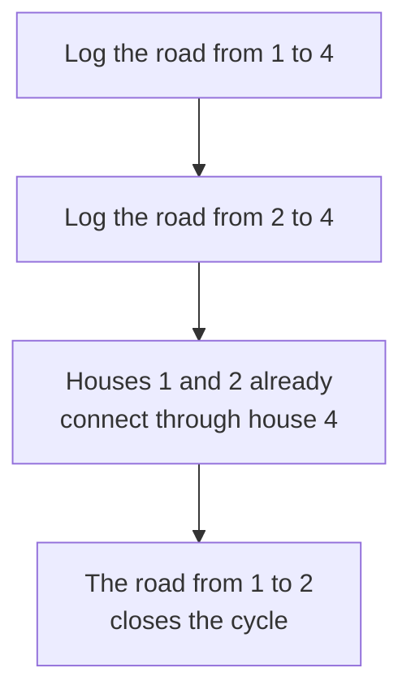

> [!tldr] Quick read
> - An edge closes a cycle when its endpoints were already connected before it arrived.
> - Repeating DFS over each prefix works and repeats a lot of work on a long path.
> - [[en/concepts/disjoint-set-union|Union-Find]] only needs to check two roots and merge distinct groups.

> [!info] Context
> LeetCode 684, from [[en/posts/2026-11-27-neetcode-union-find|station 4: Union-Find]] on [[en/series/neetcode-grph|the NeetCode Graphs line]]. The example uses a small graph and assumes only arrays and loops.

> [!abstract]- Quick glossary for this post (click to open)
> - An undirected edge joins two vertices in both directions.
> - A [[en/concepts/connected-component|connected component]] is a maximal group whose vertices can reach one another.
> - [[en/concepts/disjoint-set-union|DSU]] maintains groups by finding roots and merging them. DFS is depth-first search.

## Picture it first: roads in a neighborhood

Suppose two-way roads connect every house and form exactly one cycle. I receive the roads in the order they were logged. To remove the latest road on that cycle while keeping every house connected, I look for the first road whose endpoints already belong to the same group when it is logged.

| Everyday life | Concept |
|---|---|
| Each house | Vertex |
| A newly logged two-way road | Edge in input order |
| Two houses with a path between them | Same connected component |
| A road with already connected endpoints | Edge closing the cycle |



## The problem: choosing an edge to remove

There are `n` vertices labeled 1 through `n`, with `3 ≤ n ≤ 1000`. The list has `n` undirected edges. Every pair has distinct endpoints and no edge is repeated. The graph comes from adding one edge to a tree. The task asks for the latest edge in the input among those that can be removed to restore a tree.

In my example `[[1,4],[2,4],[1,2],[4,5],[3,5]]`, the first three edges form a cycle through 1, 4, and 2. The final two attach new houses. The answer is `[1,2]`.

## How it works

### Approach 1. Check each edge with DFS

Keep the adjacency list of edges already read. Before adding `[a,b]`, run DFS from `a`. Reaching `b` shows that the old path and the new edge form a cycle. Otherwise, add both directions to the adjacency list. Each round may revisit O(n) vertices and edges, so the whole algorithm uses O(n²) time and O(n) auxiliary space.

### Approach 2. Check two roots with DSU

Start with one group per vertex. Before each round, two vertices have the same root exactly when a path through previously read edges connects them. Different roots mean the new edge connects two components, so merge them. Matching roots prove a path already exists, so return the current edge immediately. The arrays have `n + 1` slots for the 1-based labels, with slot 0 unused.

Why does the first rejected edge satisfy the “latest” rule? Before the last edge of the unique cycle arrives, the graph seen so far is a forest. The **last cycle edge in input order** is therefore the first edge that finds its two endpoints already connected. Removing an edge outside the cycle cuts off a branch. Removing any edge on the cycle preserves connectivity and breaks the cycle.

[[en/concepts/path-compression|Path Compression]] and [[en/concepts/union-by-size|Union by Size]] give O(n α(n)) amortized time for the sequence and O(n) space. `α` is the very slowly growing inverse Ackermann function. The measurement in the file uses a path of 1,000 vertices plus one edge joining its ends. DFS visits 500,500 vertices in total, and DSU attempts 1,000 merges. The counts measure two different operations.

## Runnable example

[TypeScript](../code/neetcode-redundant-connection/solve.ts) · [Python](../code/neetcode-redundant-connection/solve.py) · [Go](../code/neetcode-redundant-connection/solve.go) · [Java](../code/neetcode-redundant-connection/solve.java) · [JavaScript](../code/neetcode-redundant-connection/solve.js) · [PHP](../code/neetcode-redundant-connection/solve.php) · [Rust](../code/neetcode-redundant-connection/solve.rs)

The tabs show the solution excerpt. The downloaded file includes every approach and its runnable checks.

```ts
import assert from "node:assert/strict";

type Edge = readonly [number, number];

class DisjointSet {
  private parent: number[];
  private size: number[];
  count: number;

  constructor(n: number) {
    this.parent = Array.from({ length: n }, (_, i) => i);
    this.size = new Array<number>(n).fill(1);
    this.count = n;
  }

  find(node: number): number {
    while (node !== this.parent[node]) {
      this.parent[node] = this.parent[this.parent[node]];
      node = this.parent[node];
    }
    return node;
  }

  union(a: number, b: number): boolean {
    let ra = this.find(a);
    let rb = this.find(b);
    if (ra === rb) return false;
    if (this.size[ra] < this.size[rb]) [ra, rb] = [rb, ra];
    this.parent[rb] = ra;
    this.size[ra] += this.size[rb];
    this.count--;
    return true;
  }
}

function redundantByDsu(n: number, edges: readonly Edge[]): Edge {
  const ds = new DisjointSet(n + 1);
  for (const edge of edges) {
    if (!ds.union(...edge)) return edge;
  }
  throw new Error("Cần đúng một cạnh dư");
}
```

```python
class DisjointSet:
    def __init__(self, n):
        self.parent = list(range(n))
        self.size = [1] * n
        self.count = n

    def find(self, node):
        while node != self.parent[node]:
            self.parent[node] = self.parent[self.parent[node]]
            node = self.parent[node]
        return node

    def union(self, a, b):
        ra, rb = self.find(a), self.find(b)
        if ra == rb:
            return False
        if self.size[ra] < self.size[rb]:
            ra, rb = rb, ra
        self.parent[rb] = ra
        self.size[ra] += self.size[rb]
        self.count -= 1
        return True


def redundant_by_dsu(n, edges):
    ds = DisjointSet(n + 1)
    for edge in edges:
        if not ds.union(*edge):
            return edge
    raise ValueError("Cần đúng một cạnh dư")
```

```go
package main

import "fmt"

type edge [2]int

type disjointSet struct {
	parent, size []int
	count        int
}

func newDisjointSet(n int) *disjointSet {
	ds := &disjointSet{make([]int, n), make([]int, n), n}
	for i := range ds.parent {
		ds.parent[i], ds.size[i] = i, 1
	}
	return ds
}

func (ds *disjointSet) find(node int) int {
	for node != ds.parent[node] {
		ds.parent[node] = ds.parent[ds.parent[node]]
		node = ds.parent[node]
	}
	return node
}

func (ds *disjointSet) union(a, b int) bool {
	ra, rb := ds.find(a), ds.find(b)
	if ra == rb {
		return false
	}
	if ds.size[ra] < ds.size[rb] {
		ra, rb = rb, ra
	}
	ds.parent[rb] = ra
	ds.size[ra] += ds.size[rb]
	ds.count--
	return true
}

func redundantByDsu(n int, edges []edge) edge {
	ds := newDisjointSet(n + 1)
	for _, e := range edges {
		if !ds.union(e[0], e[1]) {
			return e
		}
	}
	panic("Cần đúng một cạnh dư")
}
```

```java
class Solve {
    static final class DisjointSet {
        private final int[] parent;
        private final int[] size;
        int count;

        DisjointSet(int n) {
            parent = new int[n];
            size = new int[n];
            count = n;
            for (int i = 0; i < n; i++) {
                parent[i] = i;
                size[i] = 1;
            }
        }

        int find(int node) {
            while (node != parent[node]) {
                parent[node] = parent[parent[node]];
                node = parent[node];
            }
            return node;
        }

        boolean union(int a, int b) {
            int ra = find(a), rb = find(b);
            if (ra == rb) return false;
            if (size[ra] < size[rb]) {
                int swap = ra;
                ra = rb;
                rb = swap;
            }
            parent[rb] = ra;
            size[ra] += size[rb];
            count--;
            return true;
        }
    }

    static int[] redundantByDsu(int n, int[][] edges) {
        var ds = new DisjointSet(n + 1);
        for (int[] e : edges) {
            if (!ds.union(e[0], e[1])) return e;
        }
        throw new IllegalArgumentException("Cần đúng một cạnh dư");
    }
}
```

```javascript
import assert from "node:assert/strict";

class DisjointSet {
  parent;
  size;
  count;

  constructor(n) {
    this.parent = Array.from({ length: n }, (_, i) => i);
    this.size = new Array(n).fill(1);
    this.count = n;
  }

  find(node) {
    while (node !== this.parent[node]) {
      this.parent[node] = this.parent[this.parent[node]];
      node = this.parent[node];
    }
    return node;
  }

  union(a, b) {
    let ra = this.find(a);
    let rb = this.find(b);
    if (ra === rb) return false;
    if (this.size[ra] < this.size[rb]) [ra, rb] = [rb, ra];
    this.parent[rb] = ra;
    this.size[ra] += this.size[rb];
    this.count--;
    return true;
  }
}

function redundantByDsu(n, edges) {
  const ds = new DisjointSet(n + 1);
  for (const edge of edges) {
    if (!ds.union(...edge)) return edge;
  }
  throw new Error("Cần đúng một cạnh dư");
}
```

```php
<?php
declare(strict_types=1);

final class DisjointSet
{
    private array $parent;
    private array $size;
    public int $count;

    public function __construct(int $n)
    {
        $this->parent = range(0, $n - 1);
        $this->size = array_fill(0, $n, 1);
        $this->count = $n;
    }

    public function find(int $node): int
    {
        while ($node !== $this->parent[$node]) {
            $this->parent[$node] = $this->parent[$this->parent[$node]];
            $node = $this->parent[$node];
        }
        return $node;
    }

    public function union(int $a, int $b): bool
    {
        [$ra, $rb] = [$this->find($a), $this->find($b)];
        if ($ra === $rb) {
            return false;
        }
        if ($this->size[$ra] < $this->size[$rb]) {
            [$ra, $rb] = [$rb, $ra];
        }
        $this->parent[$rb] = $ra;
        $this->size[$ra] += $this->size[$rb];
        $this->count--;
        return true;
    }
}

function redundantByDsu(int $n, array $edges): array
{
    $ds = new DisjointSet($n + 1);
    foreach ($edges as [$a, $b]) {
        if (!$ds->union($a, $b)) {
            return [$a, $b];
        }
    }
    throw new InvalidArgumentException('Cần đúng một cạnh dư');
}
```

```rust
type Edge = [usize; 2];

struct DisjointSet {
    parent: Vec<usize>,
    size: Vec<usize>,
    count: usize,
}

impl DisjointSet {
    fn new(n: usize) -> Self {
        Self {
            parent: (0..n).collect(),
            size: vec![1; n],
            count: n,
        }
    }

    fn find(&mut self, mut node: usize) -> usize {
        while node != self.parent[node] {
            self.parent[node] = self.parent[self.parent[node]];
            node = self.parent[node];
        }
        node
    }

    fn union(&mut self, a: usize, b: usize) -> bool {
        let mut ra = self.find(a);
        let mut rb = self.find(b);
        if ra == rb {
            return false;
        }
        if self.size[ra] < self.size[rb] {
            std::mem::swap(&mut ra, &mut rb);
        }
        self.parent[rb] = ra;
        self.size[ra] += self.size[rb];
        self.count -= 1;
        true
    }
}

fn redundant_by_dsu(n: usize, edges: &[Edge]) -> Edge {
    let mut ds = DisjointSet::new(n + 1);
    for &[a, b] in edges {
        if !ds.union(a, b) {
            return [a, b];
        }
    }
    panic!("Cần đúng một cạnh dư");
}
```

Output from TypeScript and JavaScript. The other five files check all 6 small cases.

```text
8/8 cases passed
1000 edges: DFS visits 500500 vertices; DSU attempts 1000 merges
```

*(Output labels translated; the files themselves print Vietnamese.)*

## Misconceptions and common traps

- Read the input in order. Reordering can change which cycle edge comes last.
- Return the endpoints of the current edge. A DSU root is only a group representative.
- DSU always attaches a **root** to another root. Reparenting an arbitrary element can split its old group.
- In Python, use a comprehension to create each adjacency row. `[[]] * n` shares one inner list across all vertices.

## Self-check questions

> [!question]- Must the last listed edge be redundant?
> In the example above, `[3,5]` is the only road into house 3. Removing it disconnects the graph.

> [!question]- Why do matching roots indicate a cycle?
> Earlier merges certify a path between the two vertices. The current edge adds a direct route and closes the cycle.

## References

- [LeetCode](https://leetcode.com/problems/redundant-connection/)
- [Sedgewick and Wayne, Weighted Quick Union](https://github.com/kevin-wayne/algs4/blob/master/src/main/java/edu/princeton/cs/algs4/WeightedQuickUnionUF.java)
- [Robert Tarjan, Efficiency of a Good But Not Linear Set Union Algorithm](https://doi.org/10.1145/321879.321884)
