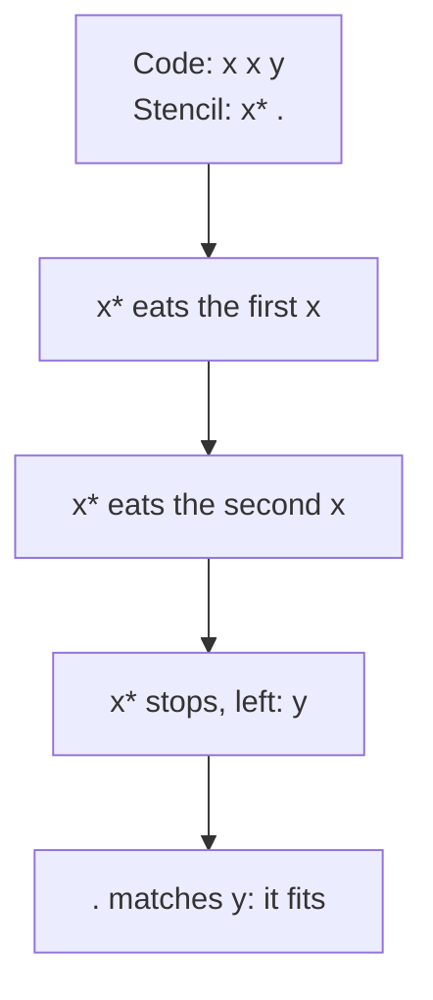
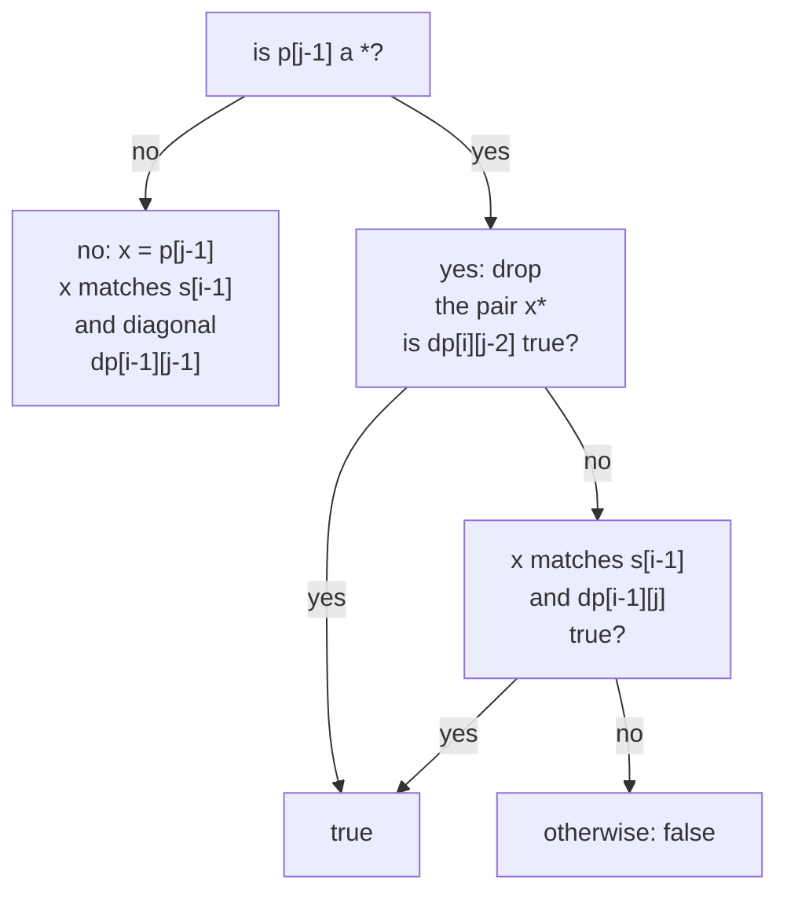

> [!tldr] Quick read
> - Let `dp[i][j]` mean "does the prefix `s[0:i]` fully match the pattern `p[0:j]`". This is a [[en/concepts/two-sequence-dp|table over two prefixes]]; the only difference is that the second string is a pattern.
> - A `.` matches exactly one character of any kind. A `*` never stands alone: it belongs to the element right before it, and the pair `x*` matches zero, one or many `x`.
> - A cell with `*` asks only two questions: drop the whole pair `x*` (cell `dp[i][j-2]`), or let the pair eat the last character of the string and still stay in place (cell `dp[i-1][j]`).
> - Row 0 is not all `false`: the empty string matches `a*b*` because each pair may be taken zero times.
> - Plain recursion can blow up exponentially. Memoization or the table has only (n+1)(m+1) states.

> [!info] Context
> This is LeetCode problem 10 at [[en/posts/2026-11-27-neetcode-interval-dp|station DP-07: Interval DP and Pattern Matching]] on **the NeetCode Line: Dynamic Programming**. I picture a stencil for checking product codes, with a few "any letter" slots and a few "this letter, repeated any number of times" slots. You only need strings, 2-D arrays and recursion; no knowledge of regex libraries is required.

> [!abstract]- Quick glossary for this post (click to open)
> - A regex (regular expression) is a way to write a string pattern. This problem uses only a tiny part of it: lowercase letters, `.` and `*`.
> - A full match means the pattern covers the whole string from its first character to its last, not just a piece in the middle.
> - The anchors `^` and `$` force a pattern to start at the beginning and end at the end of the string when you use a real regex library.
> - [[en/concepts/pattern-matching-dp|Pattern matching DP]] is my name for putting the table over prefixes of the string and of the pattern.
> - A [[en/concepts/dp-state|DP state]] says what one cell stores; the [[en/concepts/recurrence-relation|recurrence relation]] says which cells it reads.
> - [[en/concepts/memoization|Memoization]] stores a state's answer the first time it is computed.
> - Backtracking means trying one choice and, if it fails, stepping back to try another.

## Picture it first: a stencil for product codes

At the warehouse I have a stencil for checking the code on a box. The stencil reads `x*.`: the first slot is "the letter x, any number of times, including none", the second is "exactly one letter of any kind". The code `xxy` fits: both `x` letters fall into the repeat slot and `y` falls into the any-letter slot. The code `y` fits too, because the repeat slot may stay empty. The code `xyz` does not: after the repeat slot there is room for only one letter.

| Everyday life | Concept |
|---|---|
| The code on the box | String `s` |
| The stencil | Pattern `p` |
| A slot with a fixed letter | A plain character, matching exactly that letter |
| An "any letter" slot | The dot `.` |
| A "repeat letter x any number of times" slot | The pair `x*` (zero, one or many times) |
| The code must fill the stencil exactly, nothing extra, nothing missing | A full match, not a partial match |
| "Does the start of the code fit the start of the stencil?" | Cell `dp[i][j]` |



## The problem: does the string fully match the pattern

You get a string `s` of 1–20 characters, all lowercase English letters, and a pattern `p` of 1–20 characters made of lowercase letters, `.` and `*`. Every `*` is guaranteed to follow a letter or a `.`, so there is no pattern like `*a` or `a**`. A `.` matches exactly one character of any kind. A pair `x*` matches zero or more copies of the element `x` right before the star. Return `true` if the pattern covers the **whole** string. For example, `tomato` matches `to*ma*to`, but not `t.m*a*t`, because that pattern stops before the final `o`. The problem forbids a built-in regex library. [Original problem, LeetCode 10](https://leetcode.com/problems/regular-expression-matching/)

I used to think two pointers moving in step were enough: on `x*`, eat every `x` you can. That greedy approach fails on `aaa` with the pattern `a*a`. If `a*` eats all three `a`, the final `a` of the pattern has nothing left to match. The right answer is `true`, because `a*` only needs to eat two. The trouble is that you cannot know in advance how many letters `x*` should eat, so you have to try every count.

## How it works

### Recursion on suffixes: try every count for `x*`

Let `go(i, j)` ask "does the suffix `s[i:]` fully match `p[j:]`". If the pattern is used up, the answer is true only if the string is used up too. Otherwise, compute `first`: there is a character `s[i]`, and `p[j]` is that same letter or `.`.

- If `p[j+1]` is `*`, the pair `p[j]*` has two choices: take it zero times, skipping the whole pair with `go(i, j+2)`; or, when `first` holds, eat `s[i]` and **keep** the pair where it is, with `go(i+1, j)`, so it can eat again next time.
- Otherwise, `first` must hold and the call moves on to `go(i+1, j+1)`.

The two choices of the star make the call tree branch. With a string of 20 `a` and a pattern of `a*` repeated 7 times followed by `b`, every way of splitting the 20 `a` among the 7 pairs is tried before the answer comes back `false`. The function is called 2,072,069 times. In the worst case the number of calls grows exponentially with the length; this is also why backtracking regex libraries can hang on a bad pattern (Russ Cox calls it "catastrophic backtracking").

### Memoization: only (n+1)(m+1) questions

Every call depends only on the pair (i, j), with 0 ≤ i ≤ n and 0 ≤ j ≤ m. Many branches come back to the same pair: "the first pair eats 3 letters, the second eats 2" and "the first eats 2, the second eats 3" both reach i = 5 at the third pair. Store each pair's answer the first time it is computed, including a `false` answer. On the same example the call count drops to 288, counting the calls answered straight from the cache. Time is O(nm) because each pair does O(1) work besides its child calls, memory is O(nm), and the stack is at most n + m deep.

### A table over prefixes of the string and of the pattern

Flip the direction: `dp[i][j]` means "does the prefix `s[0:i]` fully match `p[0:j]`". I look at the last element of the pattern prefix.

- **Border:** `dp[0][0] = true` (empty matches empty). Column 0 for i > 0 is `false`: an empty pattern cannot match a string with letters. Row 0 can hold `true`: `dp[0][j] = (p[j-1] == '*') && dp[0][j-2]`, because the empty string only gets through pairs `x*` taken zero times.
- **`p[j-1]` is a letter or `.`:** it must match the last character `s[i-1]`, and the part before must match the part before: `dp[i-1][j-1]`.
- **`p[j-1]` is `*`:** let `x = p[j-2]` be the element it repeats.



The "eat one more" branch reads `dp[i-1][j]`, that is, **the same column j** in the row above: a prefix one letter shorter still matches the pattern with the whole pair `x*`, and the pair eats `s[i-1]` on top. Because it reads the same column again, one cell already covers every repeat count: eating 3 letters is eating 2 (the cell above) plus one more. That is why the table needs no loop over k = 0, 1, 2… the way a naive recursive version might.

The table for `xxy` and the pattern `x*.` (T is true, a dot is false):

| prefix of s | `""` | `x` | `x*` | `x*.` |
|---|---|---|---|---|
| `""` | T | · | T | · |
| `x` | · | T | T | T |
| `xx` | · | · | T | T |
| `xxy` | · | · | · | T |

- `dp[0][2]` is true thanks to row 0: `x*` taken zero times.
- `dp[2][2]` is true thanks to the "eat one more" branch: `x` matches the second letter and `dp[1][2]` is true.
- `dp[3][3]` is true because `.` matches `y` and the diagonal `dp[2][2]` is true.

Each cell reads the diagonal, the cell two columns to the left in the same row, or the cell above in the same column. Filling rows top to bottom, each row left to right, gives the right order. Time O(nm), memory O(nm), no recursion. Keeping two rows would bring memory down to O(m), but with n, m ≤ 20 a 21 × 21 table is small enough to keep whole for readability.

## Runnable example

[TypeScript](../code/neetcode-regular-expression-matching/matcher.ts) · [Python](../code/neetcode-regular-expression-matching/matcher.py) · [Go](../code/neetcode-regular-expression-matching/matcher.go) · [Java](../code/neetcode-regular-expression-matching/matcher.java) · [JavaScript](../code/neetcode-regular-expression-matching/matcher.js) · [PHP](../code/neetcode-regular-expression-matching/matcher.php) · [Rust](../code/neetcode-regular-expression-matching/regex_matcher.rs)

```ts
function isMatch(s: string, p: string): boolean {
    // dp[i][j]: does the prefix s[0:i] fully match the pattern p[0:j]?
    const n = s.length, m = p.length
    const dp = Array.from({ length: n + 1 }, () => Array(m + 1).fill(false))
    dp[0][0] = true
    for (let j = 2; j <= m; j++) {
        // the empty string only matches pairs "x*" taken zero times
        dp[0][j] = p[j - 1] === '*' && dp[0][j - 2]
    }
    for (let i = 1; i <= n; i++) {
        for (let j = 1; j <= m; j++) {
            if (p[j - 1] === '*') {
                const zero = dp[i][j - 2]
                const more = (p[j - 2] === s[i - 1] || p[j - 2] === '.') && dp[i - 1][j]
                dp[i][j] = zero || more
            } else {
                dp[i][j] = (p[j - 1] === s[i - 1] || p[j - 1] === '.') && dp[i - 1][j - 1]
            }
        }
    }
    return dp[n][m]
}
```

```python
def is_match(s, p):
    # dp[i][j]: does the prefix s[:i] fully match the pattern p[:j]?
    n, m = len(s), len(p)
    dp = [[False] * (m + 1) for _ in range(n + 1)]
    dp[0][0] = True
    for j in range(2, m + 1):
        # the empty string only matches pairs "x*" taken zero times
        dp[0][j] = p[j - 1] == "*" and dp[0][j - 2]
    for i in range(1, n + 1):
        for j in range(1, m + 1):
            if p[j - 1] == "*":
                zero = dp[i][j - 2]
                more = p[j - 2] in (s[i - 1], ".") and dp[i - 1][j]
                dp[i][j] = zero or more
            else:
                dp[i][j] = p[j - 1] in (s[i - 1], ".") and dp[i - 1][j - 1]
    return dp[n][m]
```

```go
func isMatch(s, p string) bool {
	// dp[i][j]: does the prefix s[:i] fully match the pattern p[:j]?
	n, m := len(s), len(p)
	dp := make([][]bool, n+1)
	for i := range dp {
		dp[i] = make([]bool, m+1)
	}
	dp[0][0] = true
	for j := 2; j <= m; j++ {
		// the empty string only matches pairs "x*" taken zero times
		dp[0][j] = p[j-1] == '*' && dp[0][j-2]
	}
	for i := 1; i <= n; i++ {
		for j := 1; j <= m; j++ {
			if p[j-1] == '*' {
				zero := dp[i][j-2]
				more := (p[j-2] == s[i-1] || p[j-2] == '.') && dp[i-1][j]
				dp[i][j] = zero || more
			} else {
				dp[i][j] = (p[j-1] == s[i-1] || p[j-1] == '.') && dp[i-1][j-1]
			}
		}
	}
	return dp[n][m]
}
```

```java
static boolean isMatch(String s, String p) {
    // dp[i][j]: does the prefix s[0:i] fully match the pattern p[0:j]?
    int n = s.length(), m = p.length();
    boolean[][] dp = new boolean[n + 1][m + 1];
    dp[0][0] = true;
    for (int j = 2; j <= m; j++) {
        // the empty string only matches pairs "x*" taken zero times
        dp[0][j] = p.charAt(j - 1) == '*' && dp[0][j - 2];
    }
    for (int i = 1; i <= n; i++) {
        for (int j = 1; j <= m; j++) {
            char pc = p.charAt(j - 1);
            if (pc == '*') {
                char prev = p.charAt(j - 2);
                boolean zero = dp[i][j - 2];
                boolean more = (prev == s.charAt(i - 1) || prev == '.') && dp[i - 1][j];
                dp[i][j] = zero || more;
            } else {
                dp[i][j] = (pc == s.charAt(i - 1) || pc == '.') && dp[i - 1][j - 1];
            }
        }
    }
    return dp[n][m];
}
```

```js
function isMatch(s, p) {
    // dp[i][j]: does the prefix s[0:i] fully match the pattern p[0:j]?
    const n = s.length, m = p.length
    const dp = Array.from({ length: n + 1 }, () => Array(m + 1).fill(false))
    dp[0][0] = true
    for (let j = 2; j <= m; j++) {
        // the empty string only matches pairs "x*" taken zero times
        dp[0][j] = p[j - 1] === '*' && dp[0][j - 2]
    }
    for (let i = 1; i <= n; i++) {
        for (let j = 1; j <= m; j++) {
            if (p[j - 1] === '*') {
                const zero = dp[i][j - 2]
                const more = (p[j - 2] === s[i - 1] || p[j - 2] === '.') && dp[i - 1][j]
                dp[i][j] = zero || more
            } else {
                dp[i][j] = (p[j - 1] === s[i - 1] || p[j - 1] === '.') && dp[i - 1][j - 1]
            }
        }
    }
    return dp[n][m]
}
```

```php
function isMatch(string $s, string $p): bool {
    // dp[i][j]: does the prefix s[0:i] fully match the pattern p[0:j]?
    $n = strlen($s);
    $m = strlen($p);
    $dp = array_fill(0, $n + 1, array_fill(0, $m + 1, false));
    $dp[0][0] = true;
    for ($j = 2; $j <= $m; $j++) {
        // the empty string only matches pairs "x*" taken zero times
        $dp[0][$j] = $p[$j - 1] === '*' && $dp[0][$j - 2];
    }
    for ($i = 1; $i <= $n; $i++) {
        for ($j = 1; $j <= $m; $j++) {
            if ($p[$j - 1] === '*') {
                $zero = $dp[$i][$j - 2];
                $more = ($p[$j - 2] === $s[$i - 1] || $p[$j - 2] === '.') && $dp[$i - 1][$j];
                $dp[$i][$j] = $zero || $more;
            } else {
                $dp[$i][$j] = ($p[$j - 1] === $s[$i - 1] || $p[$j - 1] === '.') && $dp[$i - 1][$j - 1];
            }
        }
    }
    return $dp[$n][$m];
}
```

```rust
fn is_match(s: &str, p: &str) -> bool {
    // dp[i][j]: does the prefix s[..i] fully match the pattern p[..j]?
    let (s, p) = (s.as_bytes(), p.as_bytes());
    let (n, m) = (s.len(), p.len());
    let mut dp = vec![vec![false; m + 1]; n + 1];
    dp[0][0] = true;
    for j in 2..=m {
        // the empty string only matches pairs "x*" taken zero times
        dp[0][j] = p[j - 1] == b'*' && dp[0][j - 2];
    }
    for i in 1..=n {
        for j in 1..=m {
            if p[j - 1] == b'*' {
                let zero = dp[i][j - 2];
                let more = (p[j - 2] == s[i - 1] || p[j - 2] == b'.') && dp[i - 1][j];
                dp[i][j] = zero || more;
            } else {
                dp[i][j] = (p[j - 1] == s[i - 1] || p[j - 1] == b'.') && dp[i - 1][j - 1];
            }
        }
    }
    dp[n][m]
}
```

The tabs show the table-filling function. Each file also has the plain recursion and the memoized version, running the same 15 cases, including the empty string with `a*b*`, the greedy-failing case `aaa` with `a*a`, and the 20-letter `a` case, the longest the problem allows. The exhaustive check tries every a/b string of length 0–4 against every pattern of 0–3 elements (`a`, `b`, `.`, each with or without `*`): 31 strings × 259 patterns. Six languages check all three approaches against the language's own regex library, anchored at both ends. Rust uses only the standard library, which has no regex, so it checks the table and the memoized version against the plain recursion and prints `(đối chiếu đệ quy thuần)` ("checked against plain recursion") on the second line. The call counter includes calls answered from the cache.

```text
15/15 cases passed
8029/8029 cases passed (checked against the language's regex)
20 letters a against (a*)×7 then b: brute force 2072069 calls, memo 288 calls
```

*(Output labels translated; the files themselves print Vietnamese.)*

Run with `node matcher.ts`, `python3 matcher.py`, `go run matcher.go`, `java matcher.java`, `node matcher.js`, `php -d xdebug.mode=off matcher.php` or `rustc --edition 2021 -O regex_matcher.rs -o /tmp/regex_matcher && /tmp/regex_matcher`. All seven languages print the same numbers.

## Misconceptions and common traps

- Reading `*` as "repeat any character" like a filename wildcard. Here `*` repeats **the element right before it**. `a*` is a run of `a`; "any string at all" must be written `.*`.
- Letting `x*` eat greedily as much as it can. `aaa` with `a*a` shows that sometimes it has to leave letters for the rest of the pattern.
- Initializing all of row 0 to `false`. The empty string matches `a*`, `a*b*` and `.*`, so forgetting the row-0 loop gets every case wrong where the pattern starts with a pair that must be taken zero times, such as `kkd` with `z*k*d`.
- In a `*` cell, comparing `s[i-1]` with the star itself instead of with `p[j-2]`. The repeated element sits one position before the star.
- Caching by truthiness. Most cells in this problem are `false`; checking "is there a true value in the cache" recomputes them forever. Python uses `in`, TS and JS compare with `undefined`, Java uses `Boolean` to get `null`, Go uses a three-state `int8`, PHP uses `array_key_exists`, Rust uses `Option<bool>`.
- Using a regex library to check yourself and forgetting the full match:
  - JavaScript: `/a*/.test('bab')` is `true` because `test` only needs one matching piece. Write `^(?:…)$`.
  - Python: `re.match('a', 'ab')` matches because `match` anchors only the start. Use `re.fullmatch`.
  - Go: `regexp.MatchString("a", "bab")` is `true`. The `regexp` package uses RE2 syntax and runs in linear time, so it does not blow up like backtracking, but you still have to anchor it yourself.
  - Java: `Matcher.matches()` (and `String.matches`) requires a full match; `find()` does not.
  - PHP: `preg_match('/^a$/', "a\n")` returns 1 because `$` can match before a trailing newline. Add the `D` modifier so `$` matches only at the real end.
- Recursion depth: each call increases i or j, so the recursion is about n + m ≤ 40 levels deep, far from Python's limit (1,000) and Xdebug's (512). What makes brute force slow is the number of branches, not the depth. Rust: use `as_bytes()` to compare byte by byte, since the problem only has ASCII lowercase letters.

## Self-check questions

> [!question]- Why does the "eat one more" branch read `dp[i-1][j]` and not `dp[i-1][j-2]`?
> After eating `s[i-1]`, the pair `x*` is still there and can keep eating the letters before it. `dp[i-1][j]` keeps the pair; `dp[i-1][j-2]` would force the pair to eat exactly one letter.

> [!question]- Can `dp[0][j]` be true when `p[j-1]` is a lowercase letter?
> No. A lowercase letter or `.` must match exactly one character, and the empty string has none.

> [!question]- Why can the plain recursion be slow even though strings are at most 20 long?
> Each pair `x*` lets you choose how many letters to eat. With 7 pairs `a*` and 20 letters `a`, the number of splits is huge, and when the tail of the pattern does not match, every split gets tried: more than two million calls versus 288 with memoization.

> [!question]- How is this problem like and unlike [[en/problems/edit-distance|Edit Distance]]?
> Alike: the same table over prefixes of two strings, reading the diagonal and the cell above. Unlike: a cell holds `true/false` instead of a step count, and a column with `*` also reads the cell two columns to the left.

## References

- [LeetCode 10](https://leetcode.com/problems/regular-expression-matching/)
- [Russ Cox, Regular Expression Matching Can Be Simple And Fast](https://swtch.com/~rsc/regexp/regexp1.html)
- [Jeff Erickson, Algorithms, chapter 3: dynamic programming](https://jeffe.cs.illinois.edu/teaching/algorithms/book/03-dynprog.pdf)
- [MDN RegExp.prototype.test](https://developer.mozilla.org/en-US/docs/Web/JavaScript/Reference/Global_Objects/RegExp/test) · [Python re.fullmatch](https://docs.python.org/3/library/re.html#re.fullmatch) · [Go regexp](https://pkg.go.dev/regexp) · [Java Matcher.matches](https://docs.oracle.com/en/java/javase/21/docs/api/java.base/java/util/regex/Matcher.html#matches()) · [PHP PCRE modifiers](https://www.php.net/manual/en/reference.pcre.pattern.modifiers.php)
