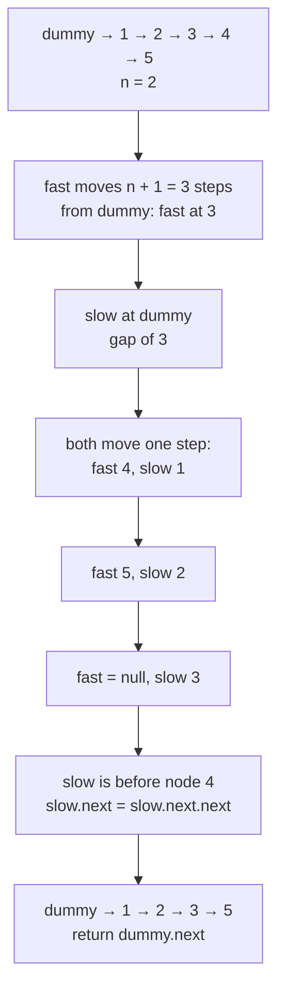

> [!tldr] Quick read
> - Problem: given the head of a [[en/concepts/linked-list|linked list]] and a number n (1 ≤ n ≤ length L), delete the nth node **counting from the end** and return the new head.
> - To delete a node in a singly linked list you must stand on **the node right before it** and set `prev.next = prev.next.next`. The real task is: find the node before the nth node from the end.
> - Two passes: count L, then walk L − n steps from a [[en/concepts/dummy-node|dummy node]]. One pass: a `fast` pointer goes **n + 1** steps ahead from the dummy node, then `fast` and `slow` walk together until `fast` leaves the list; `slow` then stands right before the node to delete ([[en/concepts/fast-slow-pointers|fast and slow pointers]] with a fixed gap).
> - "One pass" does **not** take fewer steps: at L = 10⁶, the `.next` step counts of the two approaches differ by 1. It is still up to 2 times faster for small n, because `slow` rereads exactly the nodes `fast` just read.
> - Two wrong versions actually run: without a dummy node, deleting the head itself (n = L) throws `TypeError` / `NullPointerException` / panic (5/8); moving `fast` n ahead instead of n + 1 deletes the neighbouring node (0/8).

> [!info] Context
> LeetCode problem 19 on [[en/posts/2026-11-24-neetcode-linked-list|station 1: Linked List Pointers]] of **The NeetCode Line: Linked Structures**. It uses the same dummy node as [[en/problems/merge-two-sorted-lists|Merge Two Sorted Lists]], and the same "two pointers on different beats" idea as [[en/problems/linked-list-cycle|Linked List Cycle]] and the find-the-middle step of [[en/problems/reorder-list|Reorder List]]; here the two pointers move **at the same speed but a fixed distance apart**. Solutions come in TypeScript, Python, Go, Java, JavaScript, PHP and Rust. You only need loops and the `next` pointer.

> [!abstract]- Quick glossary for this post (click to open)
> - **Singly linked list**: each node knows only the node **after** it, not the one before. See [[en/concepts/linked-list|Linked List]].
> - **Dummy node**: a node with no data placed before the head, so a "node before" always exists, even when the head itself must be deleted. See [[en/concepts/dummy-node|Dummy Node]].
> - **Two pointers k apart**: two pointers each move one step per round, the front one always k nodes ahead of the back one. A variant of [[en/concepts/two-pointers|Two Pointers]] and [[en/concepts/fast-slow-pointers|Fast and Slow Pointers]].
> - **Unlink**: `prev.next = prev.next.next`; the skipped node has nothing pointing to it any more and is reclaimed by the garbage collector.

## Picture it first: measuring along a railway with a rope n + 1 sleepers long

You walk along a railway with no markers, just sleepers one after another, and you need to plant a flag at the **nth sleeper from the end**. You don't know how long the track is. Option one: walk the whole way to count, then go back to the start and walk L − n steps. Option two: two people hold the two ends of a rope exactly n + 1 sleepers long. The front person walks, the back person follows, the rope always taut. When the front person steps off the last sleeper, the back person stands right before the sleeper to flag.

| Everyday | Concept |
|---|---|
| Sleepers one after another | the nodes, linked by `next` |
| You can only see the sleeper ahead | singly linked list: no walking backwards |
| The nth sleeper from the end | the node to delete |
| Stand right before it to remove it | `prev.next = prev.next.next` |
| A step placed before the first sleeper | dummy node `dummy` |
| Walk to the end to count, then come back | two passes |
| A rope n + 1 sleepers long, two people walking | `fast` n + 1 steps ahead of `slow` |
| The front person steps off the track | `fast === null` |



## The problem

"The nth from the end" is the (L − n + 1)th from the start, so if you know L the problem is easy. The difficulty has two layers. First, a singly linked list cannot be walked backwards, so to delete a node you must stop at the node **before** it; if the node to delete is the head itself (n = L), there is no node before it. Second, the problem hints "do it in one pass", and many people read that as meaning less work.

## How it works

<figure class="figure-map" style="--ar: 3 / 4">
<div class="frame"><iframe data-archify="../../diagrams/neetcode-remove-nth-node-from-end-of-list/worked-example.en.html" title="Keep a gap to remove from the end" loading="lazy"></iframe></div>
<figcaption><span><b>Figure 1.</b> Keep a gap to remove from the end.</span><a href="../diagrams/neetcode-remove-nth-node-from-end-of-list/worked-example.en.html" target="_blank" rel="noopener">Open full screen</a></figcaption>
</figure>

<details>
<summary>Read the steps</summary>
<ol>
<li>Put both pointers at the dummy node. <code>dummy → A → B → C → D; n = 2</code></li>
<li>Move fast two nodes ahead. <code>fast = B; slow = dummy</code></li>
<li>Advance both until fast reaches the tail. <code>fast = D; slow = B</code></li>
<li>Link B directly to D to remove C. <code>A → B → D</code></li>
</ol>
</details>

### Two passes: count, then walk

```ts
// Two passes: count the length L, then walk L − n steps from the dummy node to stand right before the node to delete.
function twoPass(head: ListNode | null, n: number): ListNode | null {
  let len = 0;
  for (let p = head; p; p = p.next) { len++; steps++; }
  const dummy = new ListNode(0, head);
  let prev = dummy;
  for (let i = 0; i < len - n; i++) { prev = prev.next!; steps++; }
  prev.next = prev.next!.next; // skip the nth node from the end
  return dummy.next;
}
```


The `steps` variable only counts `.next` steps for the measurement below. Starting at the dummy node and walking L − n steps lands on node number L − n (counting from 1), right before node L − n + 1, exactly the node to delete. When n = L the step count is 0 and `prev` is the dummy node itself: deleting the head needs no special case.

### One pass: a gap of n + 1

```ts
// One pass: fast moves n + 1 steps ahead from the dummy node; then both walk until fast leaves the list.
// Then slow stands right before the node to delete, because the gap between them is always n + 1.
function onePass(head: ListNode | null, n: number): ListNode | null {
  const dummy = new ListNode(0, head);
  let fast: ListNode | null = dummy, slow = dummy;
  for (let i = 0; i <= n; i++) { fast = fast!.next; steps++; }
  while (fast) { fast = fast.next; slow = slow.next!; steps += 2; }
  slow.next = slow.next!.next;
  return dummy.next;
}
```


The invariant of the `while` loop: **`fast` is always exactly n + 1 nodes ahead of `slow`**. When `fast` is `null` (it has passed the last node, the "node L + 1"), `slow` is at position L + 1 − (n + 1) = L − n from the dummy node, the same place as `prev` in the two-pass version. Why n + 1 and not n? Because we must stop at the node **before** the one to delete, which is n + 1 steps from the end (`null`).

The wrong version `wrongGap` moves `fast` only n steps ahead:

```ts
// WRONG: has a dummy node but fast moves only n steps ahead (one short): slow stops on the node to delete itself.
function wrongGap(head: ListNode | null, n: number): ListNode | null {
  const dummy = new ListNode(0, head);
  let fast: ListNode | null = dummy, slow = dummy;
  for (let i = 0; i < n; i++) fast = fast!.next;
  while (fast) { fast = fast.next; slow = slow.next!; }
  if (slow.next) slow.next = slow.next.next;
  return dummy.next;
}
```


`slow` stops on **the very node** to delete, and the last line deletes the node after it: the (n − 1)th from the end. With n = 1 there is no node after it, so nothing is deleted. The result is 0/8 cases, wrong in every case in the same consistent way: always one slot towards the end.

### Without a dummy node, deleting the head breaks

```ts
// WRONG: no dummy node; fast moves n steps from head. When n = L (deleting the head), fast becomes null.
function wrongNoDummy(head: ListNode | null, n: number): ListNode | null {
  let fast = head, slow = head!;
  for (let i = 0; i < n; i++) fast = fast!.next;
  while (fast!.next) { fast = fast!.next; slow = slow.next!; }
  slow.next = slow.next!.next;
  return head;
}
```


Both pointers start at `head` and `fast` moves n steps. When n = L, `fast` runs off the list to `null`, and `fast.next` throws. This version passes 5/8 cases and fails exactly the three head-deleting cases, in all seven languages: `TypeError` (TS, JS), `AttributeError` (Python), panic *nil pointer dereference* (Go), `NullPointerException` (Java), `ErrorException` (PHP, once Warnings are turned into exceptions), a panic on `unwrap()` of a `None` (Rust). A line `if (!fast) return head.next` would also fix it, but the dummy node removes that special case altogether.

### Does "one pass" save steps?

I counted the `.next` steps at L = 10⁶:

| n | Two passes | One pass |
|---|---|---|
| 1 | 1,999,999 | 2,000,000 |
| 500,000 | 1,500,000 | 1,500,001 |
| 1,000,000 | 1,000,000 | 1,000,001 |

Nearly identical, and one pass even takes 1 step more (the extra step to reach `null`). The reason: two passes walk L steps and then L − n steps; one pass moves `fast` L + 1 steps and `slow` L − n steps. Same total, only **interleaved** instead of back to back. Both are O(L) time and O(1) memory.

The time is a different story. TypeScript, 10⁶ nodes, median of 5 runs:

| n | Two passes | One pass | Array of nodes |
|---|---|---|---|
| 1 | 8.48 ms | 3.95 ms | 14.04 ms |
| 500,000 | 4.29 ms | 3.74 ms | 13.68 ms |
| 1,000,000 | 3.55 ms | 2.74 ms | 12.53 ms |

At n = 1, with the same 2·10⁶ steps, one pass is about 2 times faster. The explanation I find most likely (not measured with hardware counters): in two passes, the second pass rereads 10⁶ nodes from memory, while in one pass with a small n, `slow` reads exactly the nodes `fast` just read, which are still in cache. When n = L, both approaches go over the list only once and the times are close. Go and Java show the same shape: at n = 1, Go 3.82 vs 1.55 ms, Java 4.41 vs 2.23 ms.

Python is also faster with one pass (30.34 vs 12.22 ms at n = 1) but for a different reason: the interpreter pays per **loop iteration**. Two passes run 2·10⁶ iterations, one pass only 10⁶, each moving two pointers.

The "array of nodes" approach (one pass, store every node in an array, then take index L − n − 1) is the slowest, about 13 ms, because it writes 10⁶ elements into a growing array, and it costs O(L) memory.

### Where does the deleted node go?

After `prev.next = prev.next.next`, the skipped node has no pointer from the list to it. In JavaScript, Python, Go and Java the garbage collector reclaims it once nothing else references it (for example a variable you still hold). No `delete` or `free` needed. In C or C++ you must free that node yourself, or it leaks.

### Under the hood in seven languages

| | Dummy node | Error when reading `.next` of null | Note |
|---|---|---|---|
| TypeScript / JavaScript | `new ListNode(0, head)` | `TypeError` | TS's `fast!.next` only silences the compile-time warning; it does not stop the runtime error |
| Python | `ListNode(0, head)` | `AttributeError: 'NoneType' object has no attribute 'next'` | `dummy = slow = fast = ListNode(0, head)`: three names point to one node, which is what we want here |
| Go | `&ListNode{0, head}` | panic: *nil pointer dereference* | return `dummy.Next`, not `dummy` |
| Java | `new ListNode(0, head)` | `NullPointerException` | Java 14 and later name the null expression in the error message |
| PHP | `new ListNode(0, $head)` | only a Warning *Attempt to read property "next" on null*, then it carries on with `null` | the file turns Warnings into `ErrorException` with `set_error_handler` |
| Rust | `Box::new(ListNode { val: 0, next: head })` | no null: `None.unwrap()` panics | the one-pass version needs a copy for `fast`, because the list cannot be borrowed for reading and writing at once |

## Runnable example

[TypeScript](../code/neetcode-remove-nth-node-from-end-of-list/remove-nth.ts) · [Python](../code/neetcode-remove-nth-node-from-end-of-list/remove_nth.py) · [Go](../code/neetcode-remove-nth-node-from-end-of-list/remove_nth.go) · [Java](../code/neetcode-remove-nth-node-from-end-of-list/remove-nth.java) · [JavaScript](../code/neetcode-remove-nth-node-from-end-of-list/remove-nth.js) · [PHP](../code/neetcode-remove-nth-node-from-end-of-list/remove-nth.php) · [Rust](../code/neetcode-remove-nth-node-from-end-of-list/remove_nth.rs)

Each file runs 8 shared cases: the problem's three examples, three head deletions (n = L), one tail deletion (n = 1), and two longer lists.

One pass, a gap of n + 1:

```ts
// One pass: fast moves n + 1 steps ahead from the dummy node; then both walk until fast leaves the list.
// Then slow stands right before the node to delete, because the gap between them is always n + 1.
function onePass(head: ListNode | null, n: number): ListNode | null {
  const dummy = new ListNode(0, head);
  let fast: ListNode | null = dummy, slow = dummy;
  for (let i = 0; i <= n; i++) { fast = fast!.next; steps++; }
  while (fast) { fast = fast.next; slow = slow.next!; steps += 2; }
  slow.next = slow.next!.next;
  return dummy.next;
}
```

```python
# One pass: fast moves n + 1 steps ahead from the dummy node, then both pointers walk together.
def one_pass(head: Optional[ListNode], n: int) -> Optional[ListNode]:
    dummy = slow = fast = ListNode(0, head)
    for _ in range(n + 1):
        fast = fast.next
    while fast:
        fast, slow = fast.next, slow.next
    slow.next = slow.next.next
    return dummy.next
```

```go
// One pass: fast moves n + 1 steps ahead from the dummy node, then both pointers walk together.
func onePass(head *ListNode, n int) *ListNode {
	dummy := &ListNode{0, head}
	fast, slow := dummy, dummy
	for i := 0; i <= n; i++ {
		fast = fast.Next
	}
	for fast != nil {
		fast, slow = fast.Next, slow.Next
	}
	slow.Next = slow.Next.Next
	return dummy.Next
}
```

```java
// One pass: fast moves n + 1 steps ahead from the dummy node, then both pointers walk together.
static ListNode onePass(ListNode head, int n) {
    ListNode dummy = new ListNode(0, head), fast = dummy, slow = dummy;
    for (int i = 0; i <= n; i++) fast = fast.next;
    while (fast != null) { fast = fast.next; slow = slow.next; }
    slow.next = slow.next.next;
    return dummy.next;
}
```

```js
// One pass: fast moves n + 1 steps ahead from the dummy node, then both pointers walk together.
function onePass(head, n) {
  const dummy = new ListNode(0, head);
  let fast = dummy, slow = dummy;
  for (let i = 0; i <= n; i++) fast = fast.next;
  while (fast) { fast = fast.next; slow = slow.next; }
  slow.next = slow.next.next;
  return dummy.next;
}
```

```php
// One pass: fast moves n + 1 steps ahead from the dummy node, then both pointers walk together.
function onePass(?ListNode $head, int $n): ?ListNode
{
    $dummy = new ListNode(0, $head);
    $fast = $dummy;
    $slow = $dummy; // same object: PHP objects are passed by handle, not copied
    for ($i = 0; $i <= $n; $i++) $fast = $fast->next;
    while ($fast !== null) {
        $fast = $fast->next;
        $slow = $slow->next;
    }
    $slow->next = $slow->next->next;
    return $dummy->next;
}
```

```rust
// One pass: Rust rejects fast (read-only) and slow (writing) on the same list,
// because data cannot be borrowed for reading and writing at once. The safe way: fast runs
// on a copy. Still one pass over the real list, but the copy costs O(L) memory.
fn one_pass(head: Option<Box<ListNode>>, n: i32) -> Option<Box<ListNode>> {
    let mut dummy = Box::new(ListNode { val: 0, next: head });
    let copy = dummy.clone();
    let mut fast: &Option<Box<ListNode>> = &copy.next;
    for _ in 0..n {
        fast = &fast.as_ref().unwrap().next; // fast moves n + 1 steps ahead (counting the dummy)
    }
    let mut slow = &mut dummy;
    while let Some(f) = fast {
        fast = &f.next;
        slow = slow.next.as_mut().unwrap();
    }
    let removed = slow.next.take().unwrap();
    slow.next = removed.next;
    dummy.next
}
```


Two passes:

```ts
// Two passes: count the length L, then walk L − n steps from the dummy node to stand right before the node to delete.
function twoPass(head: ListNode | null, n: number): ListNode | null {
  let len = 0;
  for (let p = head; p; p = p.next) { len++; steps++; }
  const dummy = new ListNode(0, head);
  let prev = dummy;
  for (let i = 0; i < len - n; i++) { prev = prev.next!; steps++; }
  prev.next = prev.next!.next; // skip the nth node from the end
  return dummy.next;
}
```

```python
# Two passes: count the length, then walk L - n steps from the dummy node.
def two_pass(head: Optional[ListNode], n: int) -> Optional[ListNode]:
    length, p = 0, head
    while p:
        length, p = length + 1, p.next
    dummy = prev = ListNode(0, head)
    for _ in range(length - n):
        prev = prev.next
    prev.next = prev.next.next
    return dummy.next
```

```go
// Two passes: count the length, then walk L − n steps from the dummy node.
func twoPass(head *ListNode, n int) *ListNode {
	length := 0
	for p := head; p != nil; p = p.Next {
		length++
	}
	dummy := &ListNode{0, head}
	prev := dummy
	for i := 0; i < length-n; i++ {
		prev = prev.Next
	}
	prev.Next = prev.Next.Next
	return dummy.Next
}
```

```java
// Two passes: count the length, then walk L − n steps from the dummy node.
static ListNode twoPass(ListNode head, int n) {
    int len = 0;
    for (ListNode p = head; p != null; p = p.next) len++;
    ListNode dummy = new ListNode(0, head), prev = dummy;
    for (int i = 0; i < len - n; i++) prev = prev.next;
    prev.next = prev.next.next;
    return dummy.next;
}
```

```js
// Two passes: count the length, then walk L − n steps from the dummy node.
function twoPass(head, n) {
  let len = 0;
  for (let p = head; p; p = p.next) len++;
  const dummy = new ListNode(0, head);
  let prev = dummy;
  for (let i = 0; i < len - n; i++) prev = prev.next;
  prev.next = prev.next.next;
  return dummy.next;
}
```

```php
// Two passes: count the length L, then walk L − n steps from the dummy to stand just before the node to delete.
function twoPass(?ListNode $head, int $n): ?ListNode
{
    $len = 0;
    for ($p = $head; $p !== null; $p = $p->next) $len++;
    $dummy = new ListNode(0, $head);
    $prev = $dummy;
    for ($i = 0; $i < $len - $n; $i++) $prev = $prev->next;
    $prev->next = $prev->next->next; // skip the nth node from the end
    return $dummy->next;
}
```

```rust
// Two passes: count the length L with a read-only reference, then walk L − n steps from
// the dummy with a writing reference (&mut). The two borrows do not overlap, so the borrow checker accepts it.
fn two_pass(head: Option<Box<ListNode>>, n: i32) -> Option<Box<ListNode>> {
    let mut len = 0;
    let mut p = &head;
    while let Some(node) = p {
        len += 1;
        p = &node.next;
    }
    let mut dummy = Box::new(ListNode { val: 0, next: head });
    let mut prev = &mut dummy;
    for _ in 0..len - n {
        prev = prev.next.as_mut().unwrap();
    }
    let removed = prev.next.take().unwrap();
    prev.next = removed.next; // skip the nth node from the end
    dummy.next
}
```


Output of `node remove-nth.ts`:

```text
twoPass      8/8 cases correct
onePass      8/8 cases correct
nodeArray    8/8 cases correct
wrongNoDummy 5/8 cases correct; wrong on [1] n=1 → TypeError, [1,2] n=2 → TypeError, [1,2,3] n=3 → TypeError
wrongGap     0/8 cases correct; wrong on [1,2,3,4,5] n=2 → [1,2,3,4], [1] n=1 → [1], [1,2] n=1 → [1,2], [1,2] n=2 → [1], [1,2,3] n=3 → [1,3], [1,2,3] n=1 → [1,2,3], [5,6,7,8] n=3 → [5,6,8], [1,2,3,4,5,6,7,8,9,10] n=5 → [1,2,3,4,5,6,8,9,10]

steps along .next, L = 1000000:
n          two passes   one pass
1            1999999      2000000
500000       1500000      1500001
1000000      1000000      1000001

time, L = 1000000:
n          two pass   one pass   node array
1            8.48 ms   3.95 ms  14.04 ms
500000       4.29 ms   3.74 ms  13.68 ms
1000000      3.55 ms   2.74 ms  12.53 ms
```

`python3 remove_nth.py`:

```text
two_pass        8/8 cases correct
one_pass        8/8 cases correct
wrong_no_dummy  5/8 cases correct; wrong on [1] n=1 → AttributeError ('NoneType' object has no attribute 'next'), [1, 2] n=2 → AttributeError ('NoneType' object has no attribute 'next'), [1, 2, 3] n=3 → AttributeError ('NoneType' object has no attribute 'next')

time, L = 1000000:
n          two passes   one pass
1             30.34 ms     12.22 ms
500000        23.78 ms     12.97 ms
1000000       17.91 ms     12.35 ms
```

`go run remove_nth.go`:

```text
twoPass       8/8 cases correct
onePass       8/8 cases correct
wrongNoDummy  5/8 cases correct; wrong on [1] n=1 → panic, [1 2] n=2 → panic, [1 2 3] n=3 → panic

time, L = 1000000:
n          two pass   one pass
1            3.82 ms    1.55 ms
500000       2.31 ms    1.60 ms
1000000      1.53 ms    1.61 ms
```

`java remove-nth.java`:

```text
twoPass       8/8 cases correct
onePass       8/8 cases correct
wrongNoDummy  5/8 cases correct; wrong on [1] n=1 → NullPointerException, [1, 2] n=2 → NullPointerException, [1, 2, 3] n=3 → NullPointerException

time, L = 1000000:
n          two pass   one pass
1            4.41 ms    2.23 ms
500000       2.76 ms    1.94 ms
1000000      1.95 ms    1.65 ms
```

`node remove-nth.js`:

```text
twoPass      8/8 cases correct
onePass      8/8 cases correct
wrongNoDummy 5/8 cases correct; wrong on [1] n=1 → TypeError, [1,2] n=2 → TypeError, [1,2,3] n=3 → TypeError
```

`php -d xdebug.mode=off remove-nth.php`:

```text
twoPass      8/8 ca đúng
onePass      8/8 ca đúng
nodeArray    8/8 ca đúng
wrongNoDummy 5/8 ca đúng; sai ở [1] n=1 → ErrorException, [1,2] n=2 → ErrorException, [1,2,3] n=3 → ErrorException
wrongGap     0/8 ca đúng; sai ở [1,2,3,4,5] n=2 → [1,2,3,4], [1] n=1 → [1], [1,2] n=1 → [1,2], [1,2] n=2 → [1], [1,2,3] n=3 → [1,3], [1,2,3] n=1 → [1,2,3], [5,6,7,8] n=3 → [5,6,8], [1,2,3,4,5,6,7,8,9,10] n=5 → [1,2,3,4,5,6,8,9,10]
```

`rustc --edition 2021 -O remove_nth.rs && ./remove_nth`:

```text
two_pass       8/8 ca đúng
one_pass       8/8 ca đúng
value_vec      8/8 ca đúng
wrong_no_dummy 5/8 ca đúng; sai ở [1] n=1 → panic, [1,2] n=2 → panic, [1,2,3] n=3 → panic
wrong_gap      0/8 ca đúng; sai ở [1,2,3,4,5] n=2 → [1,2,3,4], [1] n=1 → [1], [1,2] n=1 → [1,2], [1,2] n=2 → [1], [1,2,3] n=3 → [1,3], [1,2,3] n=1 → [1,2,3], [5,6,7,8] n=3 → [5,6,8], [1,2,3,4,5,6,7,8,9,10] n=5 → [1,2,3,4,5,6,8,9,10]
```

*(Output labels translated; the files themselves print Vietnamese.)*

## Misconceptions and common traps

- **"One pass takes fewer steps than two."** The `.next` step counts are nearly equal (off by 1 at L = 10⁶). One pass only interleaves the two walks; it is faster in practice because of the cache (and the loop count in Python), not because it does less work.
- **A gap of n instead of n + 1.** `slow` stops on the node to delete instead of the node before it; every case is off by one slot.
- **No dummy node.** Deleting the head (n = L) turns `fast` into null; three of eight cases break in all seven languages.
- **Returning `head` instead of `dummy.next`.** When the head was just deleted, `head` still points to the old, dropped node, so the result is wrong. Always return `dummy.next`.
- **"You must free the deleted node."** Not in these seven languages: the garbage collector handles it (Rust frees the node when the variable that owns it goes out of scope). Only C and C++ need it.
- **Counting positions from 0 or from 1.** The problem counts from 1 ("the nth node from the end", n = 1 is the last node). One slip and you get the `wrongGap` version.
- **PHP: reading `->next` of `null` does not stop the program.** PHP 8 only emits a Warning and returns `null`. Without catching the Warning, the version with no dummy node returns `[1]` for the case `[1] n=1` (wrong) instead of failing; the file uses `set_error_handler` so the error shows.
- **Rust: `fast` and `slow` on the same list.** Written straight from TS, `fast` holds a read reference while `slow` needs a writing reference, and the borrow checker refuses. The two-pass version keeps the two borrows apart; the one-pass version lets `fast` run on a `clone()` of the list.

## Self-check questions

> [!question]- Why must `fast` move n + 1 steps ahead and not n?
> We need `slow` to stop on the node **before** the one to delete. The node to delete is n steps from `null` (the point after the last node), so the node before it is n + 1 steps from `null`. When `fast` reaches `null`, `slow` must be n + 1 steps behind it.

> [!question]- When deleting the head (n = L), how does the one-pass version with a dummy node run?
> `fast` moves L + 1 steps from the dummy node and reaches `null` immediately, the `while` loop never runs, and `slow` is still the dummy node. `dummy.next = dummy.next.next` skips the old head, and `dummy.next` is the new head.

> [!question]- At L = 10⁶, n = 1, how many `.next` steps does the one-pass version take? And two passes?
> One pass: `fast` takes 2 steps before the loop and then 999,999, `slow` takes 999,999, 2,000,000 in total. Two passes: 10⁶ counting steps and then 999,999, 1,999,999 in total.

> [!question]- If O(L) extra memory is allowed, is there another one-pass approach?
> Yes: store every node in an array and take the node at index L − n − 1 (or return `head.next` if L − n = 0). It is correct but slower and costs memory: about 13 ms against 4 ms at 10⁶ nodes.

> [!question]- Does the deleted node still take up memory?
> Until the garbage collector runs, yes. After that, if nothing references it, it is reclaimed. You need to do nothing in JS, Python, Go or Java.

## References

- [LeetCode 19: Remove Nth Node From End of List](https://leetcode.com/problems/remove-nth-node-from-end-of-list/) (original problem: 1 ≤ L ≤ 30, 1 ≤ n ≤ L, values in [0, 100]; follow-up: do it in one pass)
- [Go spec: Address operators](https://go.dev/ref/spec#Address_operators) (dereferencing a nil pointer is a run-time error)
- [Java `NullPointerException`](https://docs.oracle.com/en/java/javase/21/docs/api/java.base/java/lang/NullPointerException.html) and JEP 358 (helpful NPE messages, since Java 14)
- [Python data model: objects, values and types](https://docs.python.org/3/reference/datamodel.html#objects-values-and-types) (objects with no references left may be reclaimed)
- Knuth, *The Art of Computer Programming*, volume 1, section 2.2.3 (linked lists; deleting a node by changing the link of the node before it)
