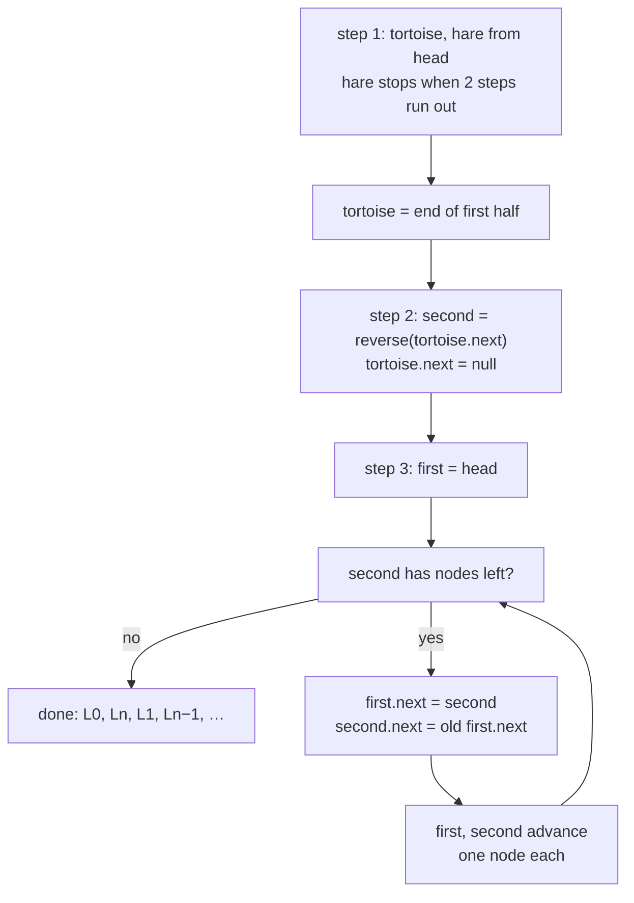

> [!tldr] Quick read
> - The problem: a list L0 → L1 → … → Ln; reorder it **in place** (change the `next` arrows, not the values) into L0 → Ln → L1 → Ln−1 → L2 → …
> - Three steps, O(n) time, O(1) memory: the [[en/concepts/fast-slow-pointers|tortoise and hare]] find the middle, [[en/concepts/pointer-reversal|reverse]] the second half, then interleave the two halves.
> - The obvious way: copy the nodes into an array (or deque) and relink them with two indices. Also O(n), but with extra memory: 31 MB at 10⁶ nodes in TypeScript, 45 MB in Go.
> - The cut decides right from wrong. Forget `slow.next = null` and the result **has a cycle** (wrong on 6/8 cases). Cut so that the second half is longer than the first and it is right on even lengths but throws on every odd length (5/8). A first half longer by 1 **or 2** nodes is fine; the page checks every length 0..300.
> - Two Python-specific traps that actually run: reversing with `prev, cur, cur.next = cur, cur.next, prev` (wrong assignment order, throws `AttributeError`) and rebinding `head` inside the function (the caller sees no change).

> [!info] Context
> LeetCode problem 143 of [[en/posts/2026-11-24-neetcode-linked-list|station 1: Linked List Pointers]] on **the NeetCode Line: Linked Structures**. This problem combines three techniques of the station into one: finding the middle with two pointers as in [[en/problems/linked-list-cycle|Linked List Cycle]], reversing a list as in [[en/problems/reverse-linked-list|Reverse Linked List]], and stitching two lists as in [[en/problems/merge-two-sorted-lists|Merge Two Sorted Lists]] (here alternating rather than by value). Solutions come in TypeScript, Python, Go, Java and JavaScript. You only need loops and objects.

> [!abstract]- Quick glossary for this post (click to open)
> - **Linked list**: a chain of nodes, each with a value and a `next` arrow; the last node points to `null`. See [[en/concepts/linked-list|Linked List]].
> - **In place**: only change the `next` arrows of the existing nodes; no new nodes, no copied values.
> - **Tortoise and hare**: two pointers, one moving 1 step and the other 2; when the hare reaches the end, the tortoise is in the middle. See [[en/concepts/fast-slow-pointers|Fast and Slow Pointers]].
> - **Reversing a list**: one pass that turns each `next` arrow back to the previous node. See [[en/concepts/pointer-reversal|Pointer Reversal]].
> - **Cut**: set `next = null` on the last node of the first half so the two halves become separate lists.
> - **Deque**: a double-ended queue, adding and removing at both ends in O(1).

## Picture it first: a riffle shuffle of a deck of cards

You have a deck ordered 1, 2, 3, …, n from the top and want the order 1, n, 2, n − 1, … Nobody pulls cards one by one from the bottom of the deck. You **cut** the deck in two, **flip** the bottom half so that card n is on top, then **interleave** the halves: one card from the top half, one from the flipped half, and so on. To know where to cut without counting, you ask two people to count: one turns 1 card per beat, the other 2; when the fast one runs out, the slow one is in the middle.

| Everyday | Concept |
|---|---|
| A card | a node |
| The order of cards in the deck | the `next` arrows |
| The person turning 1 card, the person turning 2 | the tortoise and the hare |
| Cutting the deck in two | `slow.next = null` |
| Flipping the bottom half | reversing the second half |
| Interleaving card by card | interleaving the two halves |
| Spreading all cards on the table and picking from both ends | an array or deque of nodes, O(n) memory |



## The problem

With an array this is an index game: the second element of the result is `a[n − 1]`. A linked list does not let you jump to the last node; to get Ln you walk n steps from the head. Doing it directly ("each time find the last node, detach it, insert it after the current node") costs O(n²). We need the last nodes in reverse order without walking from the head each time: either remember all the nodes (costs memory), or flip the second half once.

## How it works

<figure class="figure-map" style="--ar: 3 / 4">
<div class="frame"><iframe data-archify="../../diagrams/neetcode-reorder-list/worked-example.en.html" title="Split, reverse the second half, then weave" loading="lazy"></iframe></div>
<figcaption><span><b>Figure 1.</b> Split, reverse the second half, then weave.</span><a href="../diagrams/neetcode-reorder-list/worked-example.en.html" target="_blank" rel="noopener">Open full screen</a></figcaption>
</figure>

<details>
<summary>Read the steps</summary>
<ol>
<li>Cut after node 3. <code>[1, 2, 3], [4, 5]</code></li>
<li>Reverse the second half. <code>[5, 4]</code></li>
<li>Weave 1 with 5 and 2 with 4. <code>1 → 5 → 2 → 4</code></li>
<li>The middle node remains at the end. <code>1 → 5 → 2 → 4 → 3</code></li>
</ol>
</details>

### Approach 1: three steps in place

```ts
// Approach 1: three steps, O(1) extra memory.
function reorderThreeSteps(head: ListNode | null): void {
  if (head === null || head.next === null) return;
  // step 1: slow stops at the end of the first half (the first half is equal or longer)
  let slow = head, fast = head;
  while (fast.next !== null && fast.next.next !== null) { slow = slow.next!; fast = fast.next.next; }
  // step 2: cut, then reverse the second half
  let second = reverse(slow.next);
  slow.next = null;
  // step 3: interleave, each round one node from the first half then one from the second
  let first: ListNode | null = head;
  while (second !== null) {
    const n1: ListNode | null = first!.next, n2: ListNode | null = second.next;
    first!.next = second;
    second.next = n1;
    first = n1;
    second = n2;
  }
}
```


**Step 1, find the middle.** The hare takes 2 steps while two nodes remain ahead (`fast.next && fast.next.next`). When the hare stops, the tortoise is at **the end of the first half**: with 5 nodes it is on node 3, with 4 nodes on node 2. The first half is always equal to or exactly 1 node longer than the second.

**Step 2, cut and reverse.** `second = reverse(slow.next)` flips the second half, then `slow.next = null` cuts the first half off. With `1 2 3 4 5` we get two lists, `1 2 3` and `5 4`.

**Step 3, interleave.** Each round saves `first.next` and `second.next` in two temporaries, then links `first → second → old first.next`. The loop stops when the second half runs out; since the first half is equal or longer, its extra node (if any) is already in the right place at the end. Result: `1 5 2 4 3`.

Each step walks the list at most once: O(n) time; three or four helper pointers: O(1) memory.

### Approach 2: an array or deque of nodes

Copy every node into an array, then use two indices, i from the front and j from the back: link `nodes[i] → nodes[j] → nodes[i + 1]`, move inward, and finally set `next = null` on the middle node.

```ts
// Approach 2: copy the nodes into an array, then relink them with two indices. O(n) extra memory.
function reorderArray(head: ListNode | null): void {
  const nodes: ListNode[] = [];
  for (let cur = head; cur !== null; cur = cur.next) nodes.push(cur);
  let i = 0, j = nodes.length - 1;
  while (i < j) {
    nodes[i].next = nodes[j];
    i++;
    if (i === j) break;
    nodes[j].next = nodes[i];
    j--;
  }
  if (nodes.length > 0) nodes[i].next = null;
}
```


Shorter and harder to get wrong, at the price of O(n) memory for the array. Python has `collections.deque` (O(1) at both ends), Java has `ArrayDeque`; the idea is identical: take one node from the front, one from the back, alternately.

### The cut: how far off is still fine?

This is the part most often wrong, so the TypeScript file tries three ways to cut.

**A first half longer by 2 nodes is still right.** With a different loop condition (`while (fast && fast.next)`), the tortoise stops at the **second** middle for even lengths: with 6 nodes, first half `1 2 3 4`, second half `5 6`.

```ts
// Variant: slow stops at the second middle (condition fast && fast.next). The first half is up to 2 nodes longer, still right.
function reorderSecondMiddle(head: ListNode | null): void {
  if (head === null || head.next === null) return;
  let slow = head, fast: ListNode | null = head;
  while (fast !== null && fast.next !== null) { slow = slow.next!; fast = fast.next.next; }
  let second = reverse(slow.next);
  slow.next = null;
  let first: ListNode | null = head;
  while (second !== null) {
    const n1: ListNode | null = first!.next, n2: ListNode | null = second.next;
    first!.next = second; second.next = n1; first = n1; second = n2;
  }
}
```


Interleaving gives `1 6 2 5`, then the second half runs out and the remaining `3 4` of the first half stay as they are. The result `1 6 2 5 3 4` is still right, because those two extra nodes are exactly L2 and L3, in the order needed at the end. The file checks every length 0..300: this variant produces the same node order as the standard one on all 301 lengths.

**A longer second half is wrong.** Cutting just **before** the second middle (the second half starts at `slow` itself):

```ts
// WRONG: cuts before the second middle, so the second half is longer. On odd lengths first runs out and first.next throws.
function wrongSecondLonger(head: ListNode | null): void {
  if (head === null || head.next === null) return;
  let prev: ListNode | null = null, slow: ListNode = head, fast: ListNode | null = head;
  while (fast !== null && fast.next !== null) { prev = slow; slow = slow.next!; fast = fast.next.next; }
  prev!.next = null;
  let second = reverse(slow);
  let first: ListNode | null = head;
  while (second !== null) {
    const n1: ListNode | null = first!.next, n2: ListNode | null = second.next;
    first!.next = second; second.next = n1; first = n1; second = n2;
  }
}
```


With an even length the halves are equal and it is still right. With an odd length the second half is one node longer: the first half runs out first, `first` becomes `null`, and `first.next` throws `TypeError`. Result: 5/8 cases, failing exactly on the three cases with an odd length (3, 5, 5 nodes).

**Forgetting the cut creates a cycle.**

```ts
// WRONG: forgets the cut (slow.next = null). The first half still links on to the old head of the second half, now the tail of the reversed half: a cycle.
function wrongNoCut(head: ListNode | null): void {
  if (head === null || head.next === null) return;
  let slow = head, fast = head;
  while (fast.next !== null && fast.next.next !== null) { slow = slow.next!; fast = fast.next.next; }
  let second = reverse(slow.next);
  let first: ListNode | null = head;
  while (second !== null) {
    const n1: ListNode | null = first!.next, n2: ListNode | null = second.next;
    first!.next = second; second.next = n1; first = n1; second = n2;
  }
}
```


Without `slow.next = null`, the middle node still points to the old first node of the second half, and after the reversal that node is the **tail** of the second half and gets woven in next to the middle node. With `1 2 3 4 5` the result reads `1 5 2 4 3`, but 3 still points to 4, so 3 → 4 → 3 is a cycle. With `1 2 3 4` it is even tighter: the last weave sets `3.next` to the old `2.next`, and the old `2.next` is 3 itself, so node 3 points to itself. The file reads the result with a limit of 2n + 2 steps and finds a cycle in 6/8 cases; only the 0-node and 1-node cases (which skip the work) get through. This bug is dangerous because the function returns normally; the caller only hangs when it walks the whole list.

### Under the five languages

| | Remembering the nodes | Language-specific trap |
|---|---|---|
| TypeScript / JavaScript | an array; take the front with an index | using `shift()` to take the front of the array: right on 8/8 but each call moves the whole array, 297 ms at 10⁵ nodes against 1.5 ms with two indices |
| Python | `collections.deque`, `popleft()` and `pop()` in O(1) | reversing with `prev, cur, cur.next = cur, cur.next, prev`: wrong assignment order, throws `AttributeError` on 6/8 cases; building a new list and rebinding `head = …`: the caller sees no change, wrong on 5/8 |
| Go | a slice `[]*ListNode` | the slice doubles as it grows, so total allocation exceeds n pointers: 44.9 MB for 10⁶ nodes |
| Java | `ArrayDeque<ListNode>`, `pollFirst`/`pollLast` | a wrong cut that makes the second half longer: `NullPointerException` on odd lengths |

The Python multiple-assignment trap is worth explaining. The statement `a, b, c = x, y, z` evaluates **the whole right-hand side first**, then assigns **from left to right**. With `prev, cur, cur.next = cur, cur.next, prev`, the right side is (the current node, the next node, the old prev); `prev` is assigned, then `cur` becomes the next node, and when `cur.next` comes up, `cur` is already **the next node**: we change the arrow of the wrong node. At the last node `cur` becomes `None` and `cur.next = …` throws `AttributeError`. Writing `cur.next, prev, cur = prev, cur, cur.next` (assign `cur.next` before `cur` changes) is right; the [Python file](../code/neetcode-reorder-list/reorder_list.py) uses that order.

### Measurements

TypeScript, a list 0..n − 1, median of 5 runs; memory is the heap growth right after the function runs:

| n nodes | Three steps | Array of nodes |
|---|---|---|
| 10⁵ | 0.79 ms, ≈ 0 MB | 1.47 ms, 2.8 MB |
| 10⁶ | 8.15 ms, ≈ 0 MB | 14.74 ms, 31.3 MB |

- Three steps is about 2 times faster than the array even though it walks the list more times: the array must allocate and grow several times.
- An array of 10⁶ elements needs only 8 MB for pointers, but the heap grows by 31 MB because each growth leaves the old copy behind until it is collected.

The other languages at 10⁶ nodes: Python three steps 32.2 ms, deque 47.2 ms and 8.25 MB peak; Go three steps 3.04 ms, slice 54.79 ms and 44.9 MB allocated; Java three steps 4.64 ms, ArrayDeque 10.09 ms. JavaScript with `shift()`: 0.69 ms at 10⁴ nodes but 297.41 ms at 10⁵, more than 400 times slower for 10 times the nodes, the shape of O(n²). The problem caps the list at 5 · 10⁴ nodes, so both three steps and the array run under 1 ms on LeetCode; the difference is memory and avoiding the traps above.

## Runnable example

[TypeScript](../code/neetcode-reorder-list/reorder-list.ts) · [Python](../code/neetcode-reorder-list/reorder_list.py) · [Go](../code/neetcode-reorder-list/reorder_list.go) · [Java](../code/neetcode-reorder-list/reorder-list.java) · [JavaScript](../code/neetcode-reorder-list/reorder-list.js)

Each file runs 8 shared cases: the two examples of the problem (`1 2 3 4` and `1 2 3 4 5`), lists of 1, 2 and 3 nodes, an empty list, 6 nodes, and `7 7 7 8 8` (repeated values). The result is read back with a limit of 2n + 2 steps so that a cycle is reported instead of hanging.

Three steps:

```ts
// Approach 1: three steps, O(1) extra memory.
function reorderThreeSteps(head: ListNode | null): void {
  if (head === null || head.next === null) return;
  // step 1: slow stops at the end of the first half (the first half is equal or longer)
  let slow = head, fast = head;
  while (fast.next !== null && fast.next.next !== null) { slow = slow.next!; fast = fast.next.next; }
  // step 2: cut, then reverse the second half
  let second = reverse(slow.next);
  slow.next = null;
  // step 3: interleave, each round one node from the first half then one from the second
  let first: ListNode | null = head;
  while (second !== null) {
    const n1: ListNode | null = first!.next, n2: ListNode | null = second.next;
    first!.next = second;
    second.next = n1;
    first = n1;
    second = n2;
  }
}
```

```python
# Approach 1: find the middle, cut, reverse the second half, interleave. O(1) extra memory.
def reorder_three_steps(head):
    if not head or not head.next:
        return
    slow = fast = head
    while fast.next and fast.next.next:
        slow, fast = slow.next, fast.next.next
    second = reverse(slow.next)
    slow.next = None
    first = head
    while second:
        n1, n2 = first.next, second.next
        first.next, second.next = second, n1
        first, second = n1, n2
```

```go
// Approach 1: find the middle, cut, reverse the second half, interleave.
func reorderThreeSteps(head *ListNode) {
	if head == nil || head.Next == nil {
		return
	}
	slow, fast := head, head
	for fast.Next != nil && fast.Next.Next != nil {
		slow, fast = slow.Next, fast.Next.Next
	}
	second := reverse(slow.Next)
	slow.Next = nil
	for first := head; second != nil; {
		n1, n2 := first.Next, second.Next
		first.Next, second.Next = second, n1
		first, second = n1, n2
	}
}
```

```java
// Approach 1: find the middle, cut, reverse the second half, interleave.
static void reorderThreeSteps(ListNode head) {
    if (head == null || head.next == null) return;
    ListNode slow = head, fast = head;
    while (fast.next != null && fast.next.next != null) { slow = slow.next; fast = fast.next.next; }
    ListNode second = reverse(slow.next);
    slow.next = null;
    ListNode first = head;
    while (second != null) {
        ListNode n1 = first.next, n2 = second.next;
        first.next = second; second.next = n1;
        first = n1; second = n2;
    }
}
```

```js
// Approach 1: find the middle, cut, reverse the second half, interleave.
function reorderThreeSteps(head) {
  if (head === null || head.next === null) return;
  let slow = head, fast = head;
  while (fast.next !== null && fast.next.next !== null) { slow = slow.next; fast = fast.next.next; }
  let second = reverse(slow.next);
  slow.next = null;
  let first = head;
  while (second !== null) {
    const n1 = first.next, n2 = second.next;
    first.next = second; second.next = n1;
    first = n1; second = n2;
  }
}
```


The reverse function used in step 2:

```ts
// Reverse a list in place, return the new head.
function reverse(head: ListNode | null): ListNode | null {
  let prev: ListNode | null = null, cur = head;
  while (cur !== null) { const nxt = cur.next; cur.next = prev; prev = cur; cur = nxt; }
  return prev;
}
```

```python
# Reverse in place. The right side is evaluated in full first, then assigned left to right: cur.next must come first.
def reverse(head):
    prev, cur = None, head
    while cur:
        cur.next, prev, cur = prev, cur, cur.next
    return prev
```

```go
func reverse(head *ListNode) *ListNode {
	var prev *ListNode
	for cur := head; cur != nil; {
		nxt := cur.Next
		cur.Next = prev
		prev, cur = cur, nxt
	}
	return prev
}
```

```java
static ListNode reverse(ListNode head) {
    ListNode prev = null, cur = head;
    while (cur != null) { ListNode nxt = cur.next; cur.next = prev; prev = cur; cur = nxt; }
    return prev;
}
```

```js
function reverse(head) {
  let prev = null, cur = head;
  while (cur !== null) { const nxt = cur.next; cur.next = prev; prev = cur; cur = nxt; }
  return prev;
}
```


Remembering the nodes (array, deque):

```ts
// Approach 2: copy the nodes into an array, then relink them with two indices. O(n) extra memory.
function reorderArray(head: ListNode | null): void {
  const nodes: ListNode[] = [];
  for (let cur = head; cur !== null; cur = cur.next) nodes.push(cur);
  let i = 0, j = nodes.length - 1;
  while (i < j) {
    nodes[i].next = nodes[j];
    i++;
    if (i === j) break;
    nodes[j].next = nodes[i];
    j--;
  }
  if (nodes.length > 0) nodes[i].next = null;
}
```

```python
# Approach 2: a deque of nodes, taking the front then the back in turn. O(n) extra memory.
def reorder_deque(head):
    dq = deque()
    cur = head
    while cur:
        dq.append(cur)
        cur = cur.next
    tail = None
    take_left = True
    while dq:
        node = dq.popleft() if take_left else dq.pop()
        if tail:
            tail.next = node
        tail = node
        take_left = not take_left
    if tail:
        tail.next = None
```

```go
// Approach 2: a slice of node pointers, relinked with two indices.
func reorderSlice(head *ListNode) {
	nodes := []*ListNode{}
	for cur := head; cur != nil; cur = cur.Next {
		nodes = append(nodes, cur)
	}
	i, j := 0, len(nodes)-1
	for i < j {
		nodes[i].Next = nodes[j]
		i++
		if i == j {
			break
		}
		nodes[j].Next = nodes[i]
		j--
	}
	if len(nodes) > 0 {
		nodes[i].Next = nil
	}
}
```

```java
// Approach 2: an ArrayDeque of nodes, taking the front then the back in turn.
static void reorderDeque(ListNode head) {
    Deque<ListNode> dq = new ArrayDeque<>();
    for (ListNode cur = head; cur != null; cur = cur.next) dq.addLast(cur);
    ListNode tail = null;
    boolean left = true;
    while (!dq.isEmpty()) {
        ListNode node = left ? dq.pollFirst() : dq.pollLast();
        if (tail != null) tail.next = node;
        tail = node;
        left = !left;
    }
    if (tail != null) tail.next = null;
}
```

```js
// Approach 2: an array of nodes with two indices.
function reorderArray(head) {
  const nodes = [];
  for (let cur = head; cur !== null; cur = cur.next) nodes.push(cur);
  let i = 0, j = nodes.length - 1;
  while (i < j) {
    nodes[i].next = nodes[j];
    i++;
    if (i === j) break;
    nodes[j].next = nodes[i];
    j--;
  }
  if (nodes.length > 0) nodes[i].next = null;
}
```


Output of `node reorder-list.ts`:

```text
reorderThreeSteps   8/8 cases correct
reorderArray        8/8 cases correct
reorderSecondMiddle 8/8 cases correct
wrongNoCut          2/8 cases correct; wrong on [1,2,3,4] → cycle, [1,2,3,4,5] → cycle, [1,2] → cycle, [1,2,3] → cycle, [10,20,30,40,50,60] → cycle, [7,7,7,8,8] → cycle
wrongSecondLonger   5/8 cases correct; wrong on [1,2,3,4,5] → throws TypeError, [1,2,3] → throws TypeError, [7,7,7,8,8] → throws TypeError

every length 0..300: the three correct versions give the node order L0, Ln, L1, … on 301/301 lengths

n nodes    three steps          array of nodes
100000        0.79 ms    0.2 MB      1.47 ms    2.8 MB
1000000       8.15 ms    0.0 MB     14.74 ms   31.3 MB
```

`python3 reorder_list.py`:

```text
reorder_three_steps    8/8 cases correct
reorder_deque          8/8 cases correct
reorder_wrong_reverse  2/8 cases correct; wrong on 6 cases, all → throws AttributeError
reorder_rebind         3/8 cases correct; wrong on 5 cases, e.g. [1, 2, 3, 4] → [1, 2, 3, 4], [1, 2, 3, 4, 5] → [1, 2, 3, 4, 5]

n nodes    three steps           deque of nodes
100000         3.18 ms   0.00 MB      4.60 ms   0.83 MB
1000000       32.19 ms   0.00 MB     47.16 ms   8.25 MB
```

`go run reorder_list.go`:

```text
reorderThreeSteps 8/8 cases correct
reorderSlice      8/8 cases correct
wrongNoCut        2/8 cases correct; wrong on [1 2 3 4] → cycle, [1 2 3 4 5] → cycle, [1 2] → cycle, [1 2 3] → cycle, [10 20 30 40 50 60] → cycle, [7 7 7 8 8] → cycle

n nodes    three steps            slice of nodes
100000         0.22 ms    0.0 MB       4.02 ms    4.5 MB  
1000000        3.04 ms    0.0 MB      54.79 ms   44.9 MB  
```

`java reorder-list.java`:

```text
reorderThreeSteps  8/8 cases correct
reorderDeque       8/8 cases correct
wrongSecondLonger  5/8 cases correct; wrong on [1, 2, 3, 4, 5] → throws NullPointerException, [1, 2, 3] → throws NullPointerException, [7, 7, 7, 8, 8] → throws NullPointerException

n nodes    three steps  deque of nodes
100000         0.55 ms       1.21 ms  
1000000        4.64 ms      10.09 ms  
```

`node reorder-list.js`:

```text
reorderThreeSteps 8/8 cases correct
reorderArray      8/8 cases correct
reorderShift      8/8 cases correct

n nodes    three steps  array       shift()
10000          0.05 ms     0.06 ms     0.69 ms
100000         0.58 ms     1.50 ms   297.41 ms
```

*(Output labels translated; the files themselves print Vietnamese.)*

## Misconceptions and common traps

- **"You must find the exact middle; one node off is wrong."** A first half longer than the second by 1 or 2 nodes is fine. It is only wrong when the second half is longer than the first.
- **Forgetting to cut the first half.** Without `slow.next = null` the list has a cycle; the function still returns, and the bug only shows when someone walks the whole list.
- **"The problem returns a new list."** The problem asks for an in-place change and the function returns nothing. Creating new nodes and rebinding `head` inside the function changes nothing on the caller's side.
- **Saving the temporaries at the wrong moment.** In the interleaving loop, save `first.next` and `second.next` **before** relinking; relink first and you lose the way to the rest.
- **Multiple assignment in Python when reversing a list.** The right side is evaluated first, the left side assigned from left to right: `cur.next` must come before `cur`.
- **Using `shift()` as a queue in JavaScript.** Right, but O(n) each time; use two indices.
- **Copying values instead of relinking nodes.** Reading the values into an array and overwriting `val` in the new order prints the right result, but it is not "reordering the nodes": the problem forbids changing values.

## Self-check questions

> [!question]- With `1 2 3 4 5 6 7`, where does the tortoise stop, what are the halves, and what is the result?
> The hare goes 1 → 3 → 5 → 7 and stops (`fast.next` is null). The tortoise is on 4. First half `1 2 3 4`, second half `5 6 7` reversed into `7 6 5`. Interleaved: `1 7 2 6 3 5 4`.

> [!question]- Why does forgetting `slow.next = null` create a cycle rather than just a wrong order?
> The middle node still points to the old first node of the second half. After the reversal that node is the tail of the second half and is woven in right after the middle node. Odd lengths give two nodes pointing at each other (`3 → 4 → 3` with 5 nodes); even lengths give a node pointing to itself (`3 → 3` with 4 nodes). Following `next` never reaches `null`.

> [!question]- Cut so that the second half is 1 node longer than the first. Why are even lengths still right while odd lengths throw?
> With that cut, even lengths give two **equal** halves, so the second half is never longer. Odd lengths make the second half longer by 1: the first half runs out first, `first` becomes null while `second` still has nodes, and `first.next` throws.

> [!question]- Three steps and the array approach are both O(n). When should you pick the array?
> When memory is not a concern and you want short code with few places to go wrong (no cut, no reversal). When the problem asks for O(1) extra memory, or the list is very large, use three steps.

> [!question]- In Python, why is `prev, cur, cur.next = cur, cur.next, prev` wrong while `cur.next, prev, cur = prev, cur, cur.next` is right?
> The right side is evaluated in full first, then assigned from left to right. In the wrong version `cur` changes to the next node before `cur.next` is reached, so the arrow assigned belongs to the next node. In the right version `cur.next` is assigned while `cur` is still the current node.

## References

- [LeetCode 143: Reorder List](https://leetcode.com/problems/reorder-list/) (original problem: 1 ≤ node count ≤ 5 · 10⁴, values may not be changed, only nodes)
- [Python: Assignment statements](https://docs.python.org/3/reference/simple_stmts.html#assignment-statements) (the right side is evaluated first, the targets are assigned from left to right)
- [Python `collections.deque`](https://docs.python.org/3/library/collections.html#collections.deque) (O(1) at both ends)
- [Java `ArrayDeque`](https://docs.oracle.com/en/java/javase/21/docs/api/java.base/java/util/ArrayDeque.html)
- [ECMAScript: `Array.prototype.shift`](https://tc39.es/ecma262/#sec-array.prototype.shift) (moves every remaining element down by one index)
