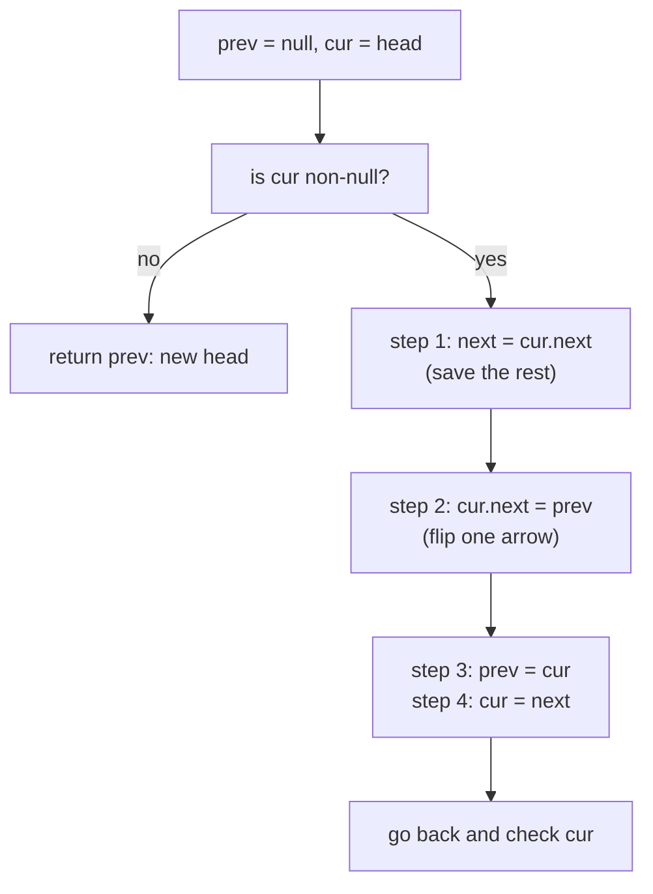

> [!tldr] Quick read
> - Problem: given the head of a singly [[en/concepts/linked-list|linked list]], return the head of the reversed list. The list has 0 to 5,000 nodes.
> - [[en/concepts/pointer-reversal|In-place reversal with three pointers]]: `prev` (the reversed segment), `cur` (the node being flipped), `next` (the rest). Each step saves `next`, flips `cur.next = prev`, then advances two pointers. O(n) time, O(1) memory.
> - The recursive version is shorter but costs one call frame per node. Measured: Node 24 stops at about 15,650 nodes, Java 21 at 29,470, Python 3.12 at 998, so Python does **not** clear the problem's limit of 5,000 unless you raise the recursion limit. Go runs 10⁶ levels.
> - Wrong versions, all run: flipping before saving `next` (2/6 cases, only one node left), recursion without `head.next = null` (2/6 cases, the first two nodes point at each other and form a cycle), Python tuple assignment in the wrong order (`AttributeError`), Go and Java forgetting the empty list.
> - Copying the values into an array and writing them back is also correct, but it takes about 10 MiB more at 10⁶ nodes and is about 6 times slower than the loop.

> [!info] Context
> LeetCode 206 (Easy), the anchor problem of [[en/posts/2026-11-24-neetcode-linked-list|station 1: Linked List Pointers]] on the **NeetCode Line: Linked Structures**. It is the first problem of the line, so this page starts from where a linked list differs from an array. You need nothing beyond loops and variables; the solution comes in TypeScript, Python, Go, Java and JavaScript.

> [!abstract]- Quick glossary for this post (click to open)
> - **Linked list**: a chain of nodes, each holding a value and a `next` pointer to the following node; the last node points to `null`. See [[en/concepts/linked-list|Linked List]].
> - **Pointer, reference**: a variable that does not contain the node, only "points at" it. Assigning `a = b` makes two variables point at the same node; it does not copy the node.
> - **`null`, `None`, `nil`**: the value "points nowhere". Reading `.next` on it is an error: `TypeError` (JS), `AttributeError` (Python), `NullPointerException` (Java), a panic (Go).
> - **Call frame, call stack**: every function call that has not returned keeps a frame on the stack; recursion n levels deep holds n frames at once. When the stack fills up the program stops with `RangeError`, `RecursionError` or `StackOverflowError`.
> - **Garbage collector (GC)**: the part of the runtime that frees objects no variable points to any more. Reversing a list creates no new nodes, so there is nothing to collect.

## Picture it first: a line of people pointing

People stand in a line, each pointing at the person behind them. Only the person at the front has their name on the board. To make the line run the other way, nobody changes places: each person just turns their hand to point at the person **in front** of them.

| Everyday | Concept |
|---|---|
| One person in the line | a node |
| The hand pointing at the person behind | the `next` pointer |
| The front person's name on the board | `head`, the only thing we hold |
| The person turning their hand | `cur` |
| The person who just turned, at the front of the turned group | `prev` |
| Remembering who is behind you before turning your hand away | `next = cur.next` |
| Turning your hand to the person in front | `cur.next = prev` |
| Forgetting who was behind: after turning, nobody knows who comes next | the rest of the list is lost |
| End of the line: the old last person is the new front | return `prev` |



## The problem

With an array, reversing means swapping the first element with the last and moving inwards: you need to jump to the last slot instantly. A linked list has no such jump. We hold only `head`, and reaching the last node means walking all n nodes. Each node also knows only the node **after** it, not the one before.

But we do not need to swap values. Reversing a list means every `next` arrow turns around and the old last node becomes the new `head`. Walk once from the front, and each node flips exactly one arrow: that is the whole solution. The only hard part is the order of the assignments.

## How it works

### Three pointers, four assignments

Keep three variables: `prev` heads the reversed segment (empty at first), `cur` is the node being handled (`head` at first), `next` holds the rest. Each iteration:

| Step | Assignment | Why |
|---|---|---|
| 1 | `next = cur.next` | `cur.next` is about to be overwritten; without saving it the rest is lost |
| 2 | `cur.next = prev` | flip `cur`'s arrow towards the reversed segment |
| 3 | `prev = cur` | the reversed segment now starts at `cur` |
| 4 | `cur = next` | move to the next node of the unreversed part |

The **invariant** after each iteration: `prev` heads the reversed segment (in reverse order), `cur` heads the unreversed part, and the two segments are not linked. When `cur` becomes `null`, the unreversed part is empty and `prev` is the whole reversed list. With `1 → 2 → 3`: after iteration 1, `1 → null` with `2 → 3` left; after iteration 2, `2 → 1 → null` with `3` left; after iteration 3, `3 → 2 → 1 → null`. The [[en/posts/2026-11-24-neetcode-linked-list|station post]] has an interactive diagram that walks exactly these three iterations.

The empty list and a single node need no special branch: empty means the loop never runs and returns `prev = null`; one node flips its arrow to `null` (already `null`) and returns itself.

### The recursive version and stack depth

The recursive version solves the smaller problem first: reverse everything after `head`, then attach `head` to the end of the reversed part. The last node of the reversed part is the old `head.next`, so the attachment is `head.next.next = head`, followed by the cut `head.next = null` because `head` is now the tail.

Each node keeps a call frame until everything after it is reversed, so a list of n nodes needs n frames at once. Measured with a binary search on n:

| Runtime | Maximum depth | Clears the problem's limit of 5,000? |
|---|---|---|
| Node 24 (TypeScript, JavaScript) | about 15,650 nodes | yes |
| Java 21 | 29,470 nodes (all three runs) | yes |
| Python 3.12 | 998 nodes (the limit of 1,000 minus a few frames of the program) | **no** |
| Go | 10⁶ nodes still run: a goroutine's stack grows as needed | yes |

The Node figure is higher than the 9,765 measured on [[en/problems/evaluate-reverse-polish-notation|Evaluate Reverse Polish Notation]] because each frame here is smaller (one parameter, one local), while that function keeps more locals and calls itself twice. A Python version that must clear 5,000 nodes needs `sys.setrecursionlimit` or the loop. The loop has no such limit: 10⁶ nodes take about 3 ms in TypeScript.

### Copying into an array: correct but costly

The most obvious approach reads every value into an array, then walks again from the front writing the values in reverse order. The result is correct, but it costs O(n) extra memory, and it changes **values**, not **nodes**: anyone holding a pointer to the old first node now sees it carrying the last value. Measured with `node --expose-gc` at n = 10⁶: a `{val, next}` node takes about 40 bytes, and the value-copy array adds about 10.4 bytes per element, or 10 MiB. In time, copying into an array takes 18.7 ms against 3.1 ms for the loop.

### Wrong versions

- **Flipping before saving `next`.** Drop step 1 and write `cur = cur.next` at the end. But `cur.next` was just set to `prev`, so `cur` goes back to the previous node, which on the first iteration is `null`. The loop stops after one node and returns a list holding only the first node: 2/6 cases correct (only the empty and one-node cases).
- **Recursion without `head.next = null`.** The old first node still points at the second node, and the second node now points back at it: two nodes pointing at each other form a cycle. Reading the result would never end, so the checker stops after n + 1 nodes and reports `CYCLE`: 2/6 cases correct.
- **Python tuple assignment in the wrong order.** `cur.next, prev, cur = prev, cur, cur.next` is correct, because the right side is evaluated in full first and then the targets are assigned left to right, so `cur.next` on the left is still the old node. Writing `prev, cur, cur.next = cur, cur.next, prev` assigns `cur` first, and `cur.next` on the left belongs to the **new** node; at the last node `cur` is already `None`, so assigning `None.next` raises `AttributeError`: 1/6 cases correct.
- **Go, Java: checking `head.next` before `head`.** On an empty list this reads `.next` through a null pointer: Go panics with `nil pointer dereference`, Java throws `NullPointerException`. The order `head == null || head.next == null` is the safe one, because `||` stops as soon as the left side is true.

### Under the hood of the five languages

| | Node | "No node" | Deep recursion | Specific trap |
|---|---|---|---|---|
| TypeScript | `class ListNode { val; next: ListNode \| null }` | `null`; `strictNullChecks` forces a check before reading `.next` | about 15,650 levels | the `!` (`slow!.next`) turns off the compiler's check; if wrong, it fails at run time |
| Python | a class with `__slots__` to stay light | `None` | 998 levels by default | tuple assignment: right side first, targets assigned left to right |
| Go | a `struct` with `Next *ListNode` | `nil` | no practical limit | reading a field through a `nil` pointer panics; `var prev *ListNode` defaults to `nil` |
| Java | nested `static class ListNode` | `null` | 29,470 levels | `NullPointerException`; the order inside `\|\|` matters |
| JavaScript | `class ListNode` | `null` | about 15,650 levels | destructuring `[a, b, c] = [x, y, z]` is correct but builds a temporary array: 6–11 times slower at 10⁶ nodes |

## Runnable example

[TypeScript](../code/neetcode-reverse-linked-list/reverse-list.ts) · [Python](../code/neetcode-reverse-linked-list/reverse_list.py) · [Go](../code/neetcode-reverse-linked-list/reverse_list.go) · [Java](../code/neetcode-reverse-linked-list/reverse-list.java) · [JavaScript](../code/neetcode-reverse-linked-list/reverse-list.js)

Each file runs 6 cases: the problem's two examples, an empty list, one node, duplicate values, and 5,000 nodes (the problem's limit). The TypeScript version also cross-checks 2,000 random lists (generated with mulberry32), measures the recursion depth, and measures time and memory.

```ts
// Loop: three pointers prev, cur, next. Save next before flipping cur.next.
function reverseIterative(head: ListNode | null): ListNode | null {
  let prev: ListNode | null = null;
  let cur = head;
  while (cur) {
    const next = cur.next; // save the rest before cutting
    cur.next = prev;       // flip one pointer
    prev = cur;            // advance two pointers
    cur = next;
  }
  return prev;
}

// Recursive: reverse the part after head, then attach head to the end of the reversed part.
function reverseRecursive(head: ListNode | null): ListNode | null {
  if (!head || !head.next) return head;
  const newHead = reverseRecursive(head.next);
  head.next.next = head; // the node after head now points back at head
  head.next = null;      // head becomes the tail
  return newHead;
}
```

```python
# Loop: save nxt before flipping cur.next.
def reverse_iterative(head):
    prev, cur = None, head
    while cur:
        nxt = cur.next
        cur.next = prev
        prev, cur = cur, nxt
    return prev

# Recursive: one call frame per node; Python stops at 1000 frames by default.
def reverse_recursive(head):
    if head is None or head.next is None:
        return head
    new_head = reverse_recursive(head.next)
    head.next.next = head
    head.next = None
    return new_head
```

```go
// Loop: save next before flipping cur.Next.
func reverseIterative(head *ListNode) *ListNode {
	var prev *ListNode
	cur := head
	for cur != nil {
		next := cur.Next
		cur.Next = prev
		prev, cur = cur, next
	}
	return prev
}

// Recursive: a goroutine's stack grows as needed, so 10⁶ levels still run.
func reverseRecursive(head *ListNode) *ListNode {
	if head == nil || head.Next == nil {
		return head
	}
	newHead := reverseRecursive(head.Next)
	head.Next.Next = head
	head.Next = nil
	return newHead
}
```

```java
// Loop: save next before flipping cur.next.
static ListNode reverseIterative(ListNode head) {
    ListNode prev = null, cur = head;
    while (cur != null) {
        ListNode next = cur.next;
        cur.next = prev;
        prev = cur;
        cur = next;
    }
    return prev;
}

// Recursive: one frame per node on the thread's stack.
static ListNode reverseRecursive(ListNode head) {
    if (head == null || head.next == null) return head;
    ListNode newHead = reverseRecursive(head.next);
    head.next.next = head;
    head.next = null;
    return newHead;
}
```

```js
// Loop: save next before flipping cur.next.
function reverseIterative(head) {
  let prev = null, cur = head;
  while (cur) {
    const next = cur.next;
    cur.next = prev;
    prev = cur;
    cur = next;
  }
  return prev;
}

// Recursive: one frame per node on V8's call stack.
function reverseRecursive(head) {
  if (!head || !head.next) return head;
  const newHead = reverseRecursive(head.next);
  head.next.next = head;
  head.next = null;
  return newHead;
}
```


Output of `node --expose-gc reverse-list.ts` (the `--expose-gc` flag is only needed for the final memory line):

```text
reverseIterative  6/6 cases correct
reverseRecursive  6/6 cases correct
reverseViaArray   6/6 cases correct
wrongLoseNext     2/6 cases correct; wrong on example 1 → [1], example 2 → [1], duplicate values → [3], 5000 nodes (problem limit) → [0]
wrongNoNullHead   2/6 cases correct; wrong on example 1 → CYCLE, example 2 → CYCLE, duplicate values → CYCLE, 5000 nodes (problem limit) → CYCLE
cross-check of 2000 random lists: 0 mismatches
max recursion depth: 15647 nodes
n          loop         recursive     copy to array
1000       0.00 ms      0.01 ms       0.01 ms
5000       0.01 ms      0.06 ms       0.03 ms
100000     0.30 ms      RangeError    1.62 ms
1000000    3.14 ms      RangeError    18.72 ms
memory, n = 10⁶: each list node ~40.0 bytes; the value-copy array adds ~10.4 bytes per element (10.0 MiB); the loop version adds 3 variables
```

Python (recursion overflows at 5,000 nodes; tuple assignment in the right and wrong order):

```text
reverse_iterative  6/6 cases correct
reverse_recursive  5/6 cases correct; wrong on 5000 nodes (problem limit) → RecursionError
reverse_tuple      6/6 cases correct
wrong_tuple_order  1/6 cases correct; wrong on example 1 → AttributeError, example 2 → AttributeError, one node → AttributeError, duplicate values → AttributeError, 5000 nodes (problem limit) → AttributeError
max recursion depth: 998 nodes (limit 1000, Python 3.12.3)
n = 100000: loop 5.79 ms, tuple assignment 5.20 ms
n = 1000000: loop 57.46 ms, tuple assignment 51.89 ms
```

Go (recursion 10⁶ levels deep still runs; dropping the `nil` check):

```text
reverseIterative  6/6 cases correct
reverseRecursive  6/6 cases correct
wrongNoNilCheck   5/6 cases correct; wrong on [empty → panic: runtime error: invalid memory address or nil pointer dereference]
n = 100000: loop 0.12 ms, recursive 5.65 ms
n = 1000000: loop 1.62 ms, recursive 46.34 ms
```

Java (maximum depth over three runs; the check in the wrong order):

```text
reverseIterative  6/6 cases correct
reverseRecursive  6/6 cases correct
wrongCheckOrder   5/6 cases correct; wrong on [empty → NullPointerException]
max recursion depth, run 1: 29470 nodes
max recursion depth, run 2: 29470 nodes
max recursion depth, run 3: 29470 nodes
```

JavaScript (destructuring against four assignments):

```text
reverseIterative     6/6 cases correct
reverseDestructuring 6/6 cases correct
reverseRecursive     6/6 cases correct
n = 10⁶: loop 3.42 ms, destructuring 21.18 ms
```

*(Output labels translated; the files themselves print Vietnamese.)*

Go shows that recursion is not free even when it does not overflow: 10⁶ nodes take 46 ms against 1.6 ms for the loop, because each level allocates a frame and the goroutine's stack has to grow (be copied to a larger region) many times.

## Misconceptions and common traps

- **"Reversing means swapping values."** You only change arrows. Swapping values also prints the right order, but it costs O(n) memory and breaks every other pointer into the nodes.
- **Returning `cur` instead of `prev`.** When the loop stops, `cur` is `null`. The new head is `prev`.
- **"Recursion is shorter, so it is better."** Shorter, but O(n) stack memory. Python's default cannot even clear the problem's own limit.
- **Forgetting to cut the tail in the recursive version.** Without `head.next = null`, the old first node and the second node point at each other. Any `while (p)` loop that reads the result runs forever.
- **Order in multiple assignment.** Python and JavaScript evaluate the right side first but assign the left side one target at a time. A target like `cur.next` reads `cur` **at the time of the assignment**, not at the start of the statement.
- **"After reversing, the GC has something to clean up."** No node is dropped: every node is still in the new list. Only the array-copy approach creates garbage (the array itself).

## Self-check questions

> [!question]- The list is `1 → 2 → 3 → 4`. After the second iteration, what do `prev`, `cur` and the two segments look like?
> `prev` points at node 2, the reversed segment is `2 → 1 → null`. `cur` points at node 3, the unreversed part is `3 → 4 → null`. The two segments are not linked: node 2 points back at 1, no longer at 3.

> [!question]- What happens if you swap steps 3 and 4 (`cur = next` first, then `prev = cur`)?
> `prev` takes the **new** value of `cur`, the next unreversed node, so on the following iteration that node flips its arrow to point at itself. The correct order advances `prev` first, because `prev` needs the node just flipped.

> [!question]- Reverse only the segment from position left to right (LC 92). How do the three pointers fit in?
> Put a [[en/concepts/dummy-node|dummy node]] before `head` and walk to the node right before position left. Reverse `right − left + 1` nodes with exactly the three-pointer loop, then reconnect both ends: the node before points at `prev`, and the old node at left (now the tail of the reversed segment) points at `cur`.

> [!question]- Why does Java measure the same 29,470 nodes on all three runs, while on the Evaluate Reverse Polish Notation page the first run was much lower?
> Because of the JIT. Before measuring, the file has already run 6 cases, including the 5,000-node case, so `reverseRecursive` has been called thousands of times and gets compiled; a compiled frame is smaller than an interpreter frame. To verify: `java -Xint reverse-list.java` (JIT off, interpreter only) gives 9,067 nodes on all three runs. On the other page, the first measurement ran on still-interpreted code.

## References

- [LeetCode 206. Reverse Linked List](https://leetcode.com/problems/reverse-linked-list/) (0 to 5,000 nodes; follow-up: implement both the iterative and the recursive version)
- [Python `sys.setrecursionlimit`](https://docs.python.org/3/library/sys.html#sys.setrecursionlimit) and [assignment statements](https://docs.python.org/3/reference/simple_stmts.html#assignment-statements) (right side evaluated first, targets assigned left to right)
- [Go spec: Address operators](https://go.dev/ref/spec#Address_operators) (dereferencing a `nil` pointer causes a run-time panic)
- [JVM Specification SE 21, §2.5.2 Java Virtual Machine Stacks](https://docs.oracle.com/javase/specs/jvms/se21/html/jvms-2.html#jvms-2.5.2) (`StackOverflowError` when a thread's stack is full)
- [TypeScript: `strictNullChecks`](https://www.typescriptlang.org/tsconfig/#strictNullChecks) and [non-null assertion `!`](https://www.typescriptlang.org/docs/handbook/2/everyday-types.html#non-null-assertion-operator-postfix-)
- Cormen, Leiserson, Rivest, Stein, *Introduction to Algorithms*, section 10.2 "Linked lists"
- Donald E. Knuth, *The Art of Computer Programming*, volume 1, section 2.2 "Linear Lists"
