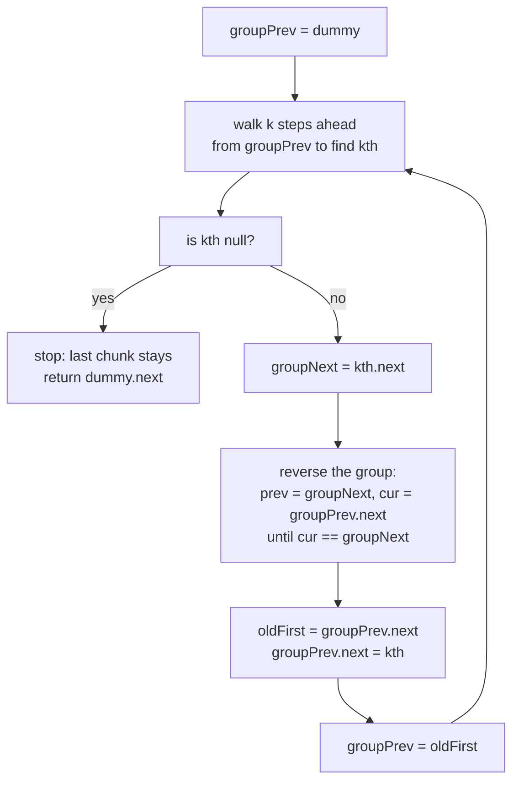

> [!tldr] Quick read
> - The problem: reverse the order of every run of k consecutive nodes; a last group shorter than k stays **as is**. Only pointers may change, not values, and the follow-up asks for O(1) extra memory.
> - The iterative approach: a dummy node before the head, and `groupPrev` right before the group about to be reversed. Each round: walk k steps ahead to find `kth` (stop if you cannot reach it), reverse the group with `prev` starting at `kth.next`, then `groupPrev.next = kth` and move `groupPrev` to the group's old first node.
> - The linking trick: start with `prev = groupNext` instead of `null`, so the group's old first node (now its tail) points to the next group by itself. Start with `null` and the list is cut off after the first group: `[1,2,3,4,5]`, k = 2 gives `[2,1]`.
> - The recursive version is shorter but n/k levels deep: Python throws `RecursionError` right at the problem's limit (5,000 nodes, k = 1), Node handles 8,192 levels, Java overflows at 10⁶ nodes with k = 10. Go does not overflow because goroutine stacks grow.
> - Measured at 10⁶ nodes: iterative 4.2 ms (TypeScript), 2.7 ms (Go), 2.9 ms (Java); copying the nodes into an array and reversing there takes 19 ms and O(n) memory.

> [!info] Context
> LeetCode problem 25 (Hard) of [[en/posts/2026-11-24-neetcode-advanced-linked-list|station 2: Advanced Linked Lists]] on **the NeetCode Line: Linked Structures**. This problem is [[en/problems/reverse-linked-list|Reverse Linked List]] run over and over on chunks, plus the hardest part: linking each reversed chunk to the one before and the one after. Solutions come in TypeScript, Python, Go, Java and JavaScript. You need to know how to reverse a list with three variables `prev`, `cur`, `next`. Its station neighbour [[en/problems/merge-k-sorted-lists|Merge k Sorted Lists]] also uses a dummy node to build the result.

> [!abstract]- Quick glossary for this post (click to open)
> - **Linked list**: a chain of nodes, each with a value and a `next` arrow. See [[en/concepts/linked-list|Linked List]].
> - **Pointer reversal**: walk along the list and turn each node's `next` arrow back to the node before it. See [[en/concepts/pointer-reversal|Pointer Reversal]].
> - **Dummy node**: a node without data placed before the head, so the first group also has a "node before the group" like every other group. See [[en/concepts/dummy-node|Dummy Node]].
> - **groupPrev**: the node right before the group about to be reversed; the dummy node at first.
> - **kth, groupNext**: the last node of the group, and the node right after it.
> - **Call stack**: every function call that has not returned takes a frame on the stack; too many levels and it overflows.

## Picture it first: flipping every pile of k cards in a row of cards

A row of face-down cards lies end to end on a table. The rule: every k adjacent cards, reverse the order of that pile; a last pile with fewer than k cards stays put.

- You keep a finger **before** the pile about to be flipped (groupPrev). At the start there is no card in front, so you put a blank card at the head of the row as a marker (the dummy node).
- Before flipping, you count k cards. If there are not enough, you stop, and the last pile stays as it is.
- After flipping, the old first card becomes the last card of the pile. It must touch the next pile, or the row breaks.
- The finger moves to the last card of the pile you just flipped, because that is "before the next pile". Forget to move it and next time you flip the same pile again.

| Everyday | Concept |
|---|---|
| A blank marker card at the head of the row | the dummy node `dummy` |
| The finger before the pile to flip | `groupPrev` |
| Counting k cards first | walking k steps ahead to find `kth` |
| A last pile with fewer than k cards | `kth === null`: stop, keep as is |
| The old first card touches the next pile | starting with `prev = groupNext` |
| Moving the finger to the end of the flipped pile | `groupPrev = oldFirst` |



## The problem

Reversing the whole list is easy (problem 206). The hard part here is the three links of each group:

1. The node before the group (`groupPrev`) must point to the group's old **last** node (`kth`), now its head.
2. The group's old **first** node, now its tail, must point to the next group (`groupNext`).
3. For the next group, the new "node before the group" is that same old first node.

One more condition: before reversing you must be sure the group has k nodes, because a short group must stay as is. Reversing first and noticing the shortfall afterwards means reversing it back.

## How it works

<figure class="figure-map" style="--ar: 3 / 4">
<div class="frame"><iframe data-archify="../../diagrams/neetcode-reverse-nodes-in-k-group/worked-example.en.html" title="Reverse each full group and reconnect" loading="lazy"></iframe></div>
<figcaption><span><b>Figure 1.</b> Reverse each full group and reconnect.</span><a href="../diagrams/neetcode-reverse-nodes-in-k-group/worked-example.en.html" target="_blank" rel="noopener">Open full screen</a></figcaption>
</figure>

<details>
<summary>Read the steps</summary>
<ol>
<li>Count two nodes in the first group. <code>1 → 2 → 3 → 4 → 5; k = 2</code></li>
<li>Reverse the first group and retain the next head. <code>2 → 1; next = 3</code></li>
<li>Reverse the group containing 3 and 4. <code>4 → 3</code></li>
<li>The final group contains only 5, so keep it. <code>2 → 1 → 4 → 3 → 5</code></li>
</ol>
</details>

### Approach 1: iterative, O(1) extra memory

```ts
// Approach 1: iterative, O(1) extra memory. groupPrev is the node right before the group to reverse.
function reverseKGroup(head: ListNode | null, k: number): ListNode | null {
  const dummy = new ListNode(0);
  dummy.next = head;
  let groupPrev = dummy;
  for (;;) {
    // walk k steps ahead to the group's last node; fewer than k nodes means stop, the last chunk stays
    let kth: ListNode | null = groupPrev;
    for (let i = 0; i < k && kth !== null; i++) kth = kth.next;
    if (kth === null) break;
    const groupNext = kth.next;
    // reverse the group: prev starts at groupNext, so the group's old first node points straight to the next group
    let prev: ListNode | null = groupNext, cur = groupPrev.next;
    while (cur !== groupNext) { const nxt: ListNode | null = cur!.next; cur!.next = prev; prev = cur; cur = nxt; }
    // link: the group's old first node is now its last, and the groupPrev of the next group
    const oldFirst = groupPrev.next!;
    groupPrev.next = kth;
    groupPrev = oldFirst;
  }
  return dummy.next;
}
```


Tracing `[1,2,3,4,5]`, k = 2:

| Round | groupPrev | kth | groupNext | After reversing and linking |
|---|---|---|---|---|
| 1 | dummy | 2 | 3 | dummy → 2 → 1 → 3 → 4 → 5 |
| 2 | 1 | 4 | 5 | dummy → 2 → 1 → 4 → 3 → 5 |
| 3 | 3 | null (only 5 left) | | stop: return 2 → 1 → 4 → 3 → 5 |

Every node is visited twice (once while counting, once while reversing), so O(n) time and O(1) extra memory. This is the solution that meets the problem's follow-up.

Why `prev = groupNext`: the reversal loop turns the arrow of the group's first node to `prev`. If `prev` starts as `groupNext`, the old first node (now the group's tail) points straight at the next group, so link 2 above happens without a separate line of code.

### Approach 2: recursive

```ts
// Approach 2: recursive. Reverse the first k nodes, linking the group's tail to the recursive result for the rest. n/k levels deep.
function reverseKGroupRecursive(head: ListNode | null, k: number): ListNode | null {
  let probe = head;
  for (let i = 0; i < k; i++) { if (probe === null) return head; probe = probe.next; }
  let prev: ListNode | null = reverseKGroupRecursive(probe, k), cur = head;
  for (let i = 0; i < k; i++) { const nxt: ListNode | null = cur!.next; cur!.next = prev; prev = cur; cur = nxt; }
  return prev;
}
```


Count k nodes; if there are enough, recurse on the rest first, then reverse the first k nodes with `prev` starting at the recursive result. Short and neat, but every group adds a call level: n/k levels. With k = 1 and n = 5,000 (the problem's limit) that is 5,000 levels.

| | What happens at n/k levels of recursion |
|---|---|
| Python | default limit of 1,000 levels: `RecursionError` right at 5,000 nodes, k = 1, inside the problem's limits |
| TypeScript / JavaScript (Node) | measured at most 8,192 levels with k = 1 and 10,431 levels with k = 2; 10⁶ nodes with k = 2 or 3 throws `RangeError` |
| Java | 10⁶ nodes with k = 2 and k = 10 throws `StackOverflowError`; k = 1,000 (1,000 levels) runs |
| Go | goroutine stacks grow (default maximum 1 GB on 64-bit machines), so 5·10⁵ levels still run, only slower than the loop |

### Approach 3: copy the nodes into an array

```ts
// Approach 3: copy the nodes into an array, reverse each chunk in the array, then relink. O(n) extra memory.
function reverseKGroupArray(head: ListNode | null, k: number): ListNode | null {
  const nodes: ListNode[] = [];
  for (let cur = head; cur !== null; cur = cur.next) nodes.push(cur);
  for (let i = 0; i + k <= nodes.length; i += k) {
    for (let a = i, b = i + k - 1; a < b; a++, b--) { const t = nodes[a]; nodes[a] = nodes[b]; nodes[b] = t; }
  }
  for (let i = 0; i + 1 < nodes.length; i++) nodes[i].next = nodes[i + 1];
  if (nodes.length > 0) nodes[nodes.length - 1].next = null;
  return nodes.length > 0 ? nodes[0] : null;
}
```


The easiest to write: reverse chunks inside the array like ordinary array chunks, then relink `next` in array order. Correct, but O(n) extra memory, which breaks the follow-up, and about 4 times slower than the loop at 10⁶ nodes.

### Three wrong versions, actually run

**Reversing the last chunk too.** No check for k nodes before reversing, just reverse as far as it goes:

```ts
// WRONG: also reverses the last chunk with fewer than k nodes.
function wrongReverseTail(head: ListNode | null, k: number): ListNode | null {
  const dummy = new ListNode(0);
  dummy.next = head;
  let groupPrev = dummy;
  while (groupPrev.next !== null) {
    let kth: ListNode = groupPrev;
    for (let i = 0; i < k && kth.next !== null; i++) kth = kth.next; // too few nodes: stops at the last node and reverses anyway
    const groupNext = kth.next;
    let prev: ListNode | null = groupNext, cur = groupPrev.next;
    while (cur !== groupNext) { const nxt: ListNode | null = cur!.next; cur!.next = prev; prev = cur; cur = nxt; }
    const oldFirst = groupPrev.next!;
    groupPrev.next = kth;
    groupPrev = oldFirst;
  }
  return dummy.next;
}
```


`[1,2,3,4,5]`, k = 3 gives `[3,2,1,5,4]` instead of `[3,2,1,4,5]`. This version passes 7/8 cases, because it only fails when k does not divide n and the leftover has 2 or more nodes (a 1-node leftover reversed is unchanged). The problem's example 1 (k = 2, leftover `5`) still passes, exactly the kind of bug that only shows in example 2.

**Losing the path to the next group.** Reversing the group with `prev = null` as in problem 206:

```ts
// WRONG: reverses the group with prev = null, so the group's tail points to null and the path to the next group is lost.
function wrongLoseNext(head: ListNode | null, k: number): ListNode | null {
  const dummy = new ListNode(0);
  dummy.next = head;
  let groupPrev = dummy;
  for (;;) {
    let kth: ListNode | null = groupPrev;
    for (let i = 0; i < k && kth !== null; i++) kth = kth.next;
    if (kth === null) break;
    const groupNext = kth.next;
    let prev: ListNode | null = null, cur = groupPrev.next;
    while (cur !== groupNext) { const nxt: ListNode | null = cur!.next; cur!.next = prev; prev = cur; cur = nxt; }
    const oldFirst = groupPrev.next!;
    groupPrev.next = kth;
    groupPrev = oldFirst;
  }
  return dummy.next;
}
```


The first group's tail points to `null`, so the returned list holds only the first group: `[2,1]`, `[3,2,1]`. The loop still reverses later groups (`groupPrev` still holds the right node), but nothing points to them any more. It passes 2/8 cases, only the two with a single group (k = n and one node).

**Forgetting to move groupPrev.** The line `groupPrev = oldFirst` is missing:

```ts
// WRONG: forgets to move groupPrev to the end of the reversed group. The next round reverses the first group again, forever.
// The file caps it at 1000 rounds and reports "does not stop" instead of hanging.
function wrongNoGroupPrevMove(head: ListNode | null, k: number): ListNode | null {
  const dummy = new ListNode(0);
  dummy.next = head;
  const groupPrev = dummy;
  for (let round = 0; ; round++) {
    if (round === 1000) throw new Error("does not stop");
    let kth: ListNode | null = groupPrev;
    for (let i = 0; i < k && kth !== null; i++) kth = kth.next;
    if (kth === null) break;
    const groupNext = kth.next;
    let prev: ListNode | null = groupNext, cur = groupPrev.next;
    while (cur !== groupNext) { const nxt: ListNode | null = cur!.next; cur!.next = prev; prev = cur; cur = nxt; }
    groupPrev.next = kth;
    // missing: groupPrev = the group's old first node
    if (groupNext === null) break;
  }
  return dummy.next;
}
```


The next round counts k steps from the dummy again, reverses the same first group again, puts it back in its old order, and so on forever. The function never stops; the file caps it at 1,000 rounds and reports "does not stop". It only passes when the whole list is one group with no node after it.

### Under the five languages

| | Pointer reversal | Specific trap |
|---|---|---|
| TypeScript / JavaScript | temporary variable `nxt` | recursion throws `RangeError` somewhere between a few thousand and over ten thousand levels |
| Python | tuple assignment `cur.next, prev, cur = prev, cur, cur.next` (order matters, see [[en/problems/reorder-list\|Reorder List]]) | recursion past 1,000 levels: `RecursionError` at the problem's own limit |
| Go | tuple assignment `cur.Next, prev, cur = prev, cur, cur.Next` | no overflow, but recursion is 3 to 9 times slower than the loop |
| Java | temporary variable `nxt` | deep recursion: `StackOverflowError` is an `Error`, not an `Exception` |

### Measurements

n = 10⁶ nodes, median of 5 runs, each run rebuilds the list and the build is not timed:

| k | TS loop | TS recursive | TS array of nodes | Go loop | Go recursive | Java loop | Java recursive |
|---|---|---|---|---|---|---|---|
| 2 | 4.2 ms | `RangeError` | 19.2 ms | 2.7 ms | 27.4 ms | 2.9 ms | `StackOverflowError` |
| 10 | | | | | | 1.9 ms | `StackOverflowError` |
| 100 | 4.2 ms | 6.6 ms | 19.4 ms | | | | |
| 1,000 | 4.9 ms | 5.8 ms | 20.0 ms | 3.0 ms | 8.4 ms | 3.2 ms | 3.9 ms |

Python loop at 10⁶ nodes, k = 2: 66.6 ms. Empty cells are sizes that language's file does not measure. The loop's time barely changes with k: whatever k is, every node is still visited twice.

### Exhaustive check

Every n from 1 to 12 and every k from 1 to n (78 pairs): loop, recursion and array of nodes are all right on 78/78 in TypeScript; Python and JavaScript recheck the loop, also 78/78. This set covers every kind of leftover (0 to k − 1 nodes) and every group count from 1 to 12.

## Runnable example

[TypeScript](../code/neetcode-reverse-nodes-in-k-group/reverse-k-group.ts) · [Python](../code/neetcode-reverse-nodes-in-k-group/reverse_k_group.py) · [Go](../code/neetcode-reverse-nodes-in-k-group/reverse_k_group.go) · [Java](../code/neetcode-reverse-nodes-in-k-group/reverse-k-group.java) · [JavaScript](../code/neetcode-reverse-nodes-in-k-group/reverse-k-group.js)

Every file runs the same 8 cases: the problem's two examples, k = 1, k = n, one node, two full groups, 7 nodes with k = 3, and repeated values (to make sure the solution moves nodes rather than comparing values). The Python file adds a 5,000-node case with k = 1 to run the recursive version at the problem's limit.

The iterative approach:

```ts
// Approach 1: iterative, O(1) extra memory. groupPrev is the node right before the group to reverse.
function reverseKGroup(head: ListNode | null, k: number): ListNode | null {
  const dummy = new ListNode(0);
  dummy.next = head;
  let groupPrev = dummy;
  for (;;) {
    // walk k steps ahead to the group's last node; fewer than k nodes means stop, the last chunk stays
    let kth: ListNode | null = groupPrev;
    for (let i = 0; i < k && kth !== null; i++) kth = kth.next;
    if (kth === null) break;
    const groupNext = kth.next;
    // reverse the group: prev starts at groupNext, so the group's old first node points straight to the next group
    let prev: ListNode | null = groupNext, cur = groupPrev.next;
    while (cur !== groupNext) { const nxt: ListNode | null = cur!.next; cur!.next = prev; prev = cur; cur = nxt; }
    // link: the group's old first node is now its last, and the groupPrev of the next group
    const oldFirst = groupPrev.next!;
    groupPrev.next = kth;
    groupPrev = oldFirst;
  }
  return dummy.next;
}
```

```python
# Iterative: group_prev stands before the group; find the k-th node, reverse the group with prev starting at the node after it.
def reverse_k_group(head, k):
    dummy = ListNode(0, head)
    group_prev = dummy
    while True:
        kth = group_prev
        for _ in range(k):
            kth = kth.next
            if not kth:
                return dummy.next
        group_next = kth.next
        prev, cur = group_next, group_prev.next
        while cur is not group_next:
            cur.next, prev, cur = prev, cur, cur.next
        old_first = group_prev.next
        group_prev.next = kth
        group_prev = old_first
```

```go
// Iterative: groupPrev stands before the group, kth is the group's last node.
func reverseKGroup(head *ListNode, k int) *ListNode {
	dummy := &ListNode{Next: head}
	groupPrev := dummy
	for {
		kth := groupPrev
		for i := 0; i < k && kth != nil; i++ {
			kth = kth.Next
		}
		if kth == nil {
			return dummy.Next
		}
		groupNext := kth.Next
		prev, cur := groupNext, groupPrev.Next
		for cur != groupNext {
			cur.Next, prev, cur = prev, cur, cur.Next
		}
		oldFirst := groupPrev.Next
		groupPrev.Next = kth
		groupPrev = oldFirst
	}
}
```

```java
// Iterative: groupPrev stands before the group, kth is the group's last node.
static ListNode reverseKGroup(ListNode head, int k) {
    ListNode dummy = new ListNode(0, head), groupPrev = dummy;
    while (true) {
        ListNode kth = groupPrev;
        for (int i = 0; i < k && kth != null; i++) kth = kth.next;
        if (kth == null) return dummy.next;
        ListNode groupNext = kth.next, prev = groupNext, cur = groupPrev.next;
        while (cur != groupNext) { ListNode nxt = cur.next; cur.next = prev; prev = cur; cur = nxt; }
        ListNode oldFirst = groupPrev.next;
        groupPrev.next = kth;
        groupPrev = oldFirst;
    }
}
```

```js
// Iterative: groupPrev stands before the group, kth is the group's last node.
function reverseKGroup(head, k) {
  const dummy = new ListNode(0, head);
  let groupPrev = dummy;
  for (;;) {
    let kth = groupPrev;
    for (let i = 0; i < k && kth !== null; i++) kth = kth.next;
    if (kth === null) return dummy.next;
    const groupNext = kth.next;
    let prev = groupNext, cur = groupPrev.next;
    while (cur !== groupNext) { const nxt = cur.next; cur.next = prev; prev = cur; cur = nxt; }
    const oldFirst = groupPrev.next;
    groupPrev.next = kth;
    groupPrev = oldFirst;
  }
}
```


The recursive approach:

```ts
// Approach 2: recursive. Reverse the first k nodes, linking the group's tail to the recursive result for the rest. n/k levels deep.
function reverseKGroupRecursive(head: ListNode | null, k: number): ListNode | null {
  let probe = head;
  for (let i = 0; i < k; i++) { if (probe === null) return head; probe = probe.next; }
  let prev: ListNode | null = reverseKGroupRecursive(probe, k), cur = head;
  for (let i = 0; i < k; i++) { const nxt: ListNode | null = cur!.next; cur!.next = prev; prev = cur; cur = nxt; }
  return prev;
}
```

```python
# Recursive: n/k levels deep. With k = 1 and n = 5000 (the problem's limit) that is 5000 levels, past the default limit of 1000.
def reverse_k_group_recursive(head, k):
    probe = head
    for _ in range(k):
        if not probe:
            return head
        probe = probe.next
    prev, cur = reverse_k_group_recursive(probe, k), head
    for _ in range(k):
        cur.next, prev, cur = prev, cur, cur.next
    return prev
```

```go
// Recursive: n/k levels deep. Goroutine stacks grow, so it does not overflow at 10⁶ levels.
func reverseKGroupRecursive(head *ListNode, k int) *ListNode {
	probe := head
	for i := 0; i < k; i++ {
		if probe == nil {
			return head
		}
		probe = probe.Next
	}
	prev, cur := reverseKGroupRecursive(probe, k), head
	for i := 0; i < k; i++ {
		cur.Next, prev, cur = prev, cur, cur.Next
	}
	return prev
}
```

```java
// Recursive: n/k levels deep.
static ListNode reverseKGroupRecursive(ListNode head, int k) {
    ListNode probe = head;
    for (int i = 0; i < k; i++) { if (probe == null) return head; probe = probe.next; }
    ListNode prev = reverseKGroupRecursive(probe, k), cur = head;
    for (int i = 0; i < k; i++) { ListNode nxt = cur.next; cur.next = prev; prev = cur; cur = nxt; }
    return prev;
}
```

```js
// Recursive: n/k levels deep.
function reverseKGroupRecursive(head, k) {
  let probe = head;
  for (let i = 0; i < k; i++) { if (probe === null) return head; probe = probe.next; }
  let prev = reverseKGroupRecursive(probe, k), cur = head;
  for (let i = 0; i < k; i++) { const nxt = cur.next; cur.next = prev; prev = cur; cur = nxt; }
  return prev;
}
```


Output of `node reverse-k-group.ts`:

```text
reverseKGroup          8/8 cases correct
reverseKGroupRecursive 8/8 cases correct
reverseKGroupArray     8/8 cases correct
wrongReverseTail       7/8 cases correct; wrong on example 2 of the problem → [3,2,1,5,4]
wrongLoseNext          2/8 cases correct; wrong on example 1 of the problem → [2,1], example 2 of the problem → [3,2,1], k = 1 → [1], two full groups → [3,2,1], 7 nodes, k = 3 → [3,2,1], repeated values → [5,5]
wrongNoGroupPrevMove   2/8 cases correct; wrong on example 1 of the problem → does not stop, example 2 of the problem → does not stop, k = 1 → does not stop, two full groups → does not stop, 7 nodes, k = 3 → does not stop, repeated values → does not stop

every n ≤ 12, every k ≤ n: loop 78/78, recursive 78/78, array 78/78
recursive, k = 1: runs up to n = 8192 (8192 levels deep)
recursive, k = 2: runs up to n = 20863 (10431 levels deep)

n = 1000000 nodes, median of 5 runs
k          loop          recursive     array of nodes
2             4.22 ms    RangeError      19.15 ms
3             4.58 ms    RangeError      19.72 ms
100           4.21 ms       6.63 ms      19.40 ms
1000          4.94 ms       5.80 ms      19.98 ms
```

`python3 reverse_k_group.py`:

```text
reverse_k_group            9/9 cases correct
reverse_k_group_recursive  8/9 cases correct; wrong on 5000 nodes, k = 1 (problem limit) → throws RecursionError
wrong_lose_next            2/9 cases correct; wrong on example 1 of the problem → [2, 1], example 2 of the problem → [3, 2, 1], k = 1 → [1], two full groups → [3, 2, 1], 7 nodes, k = 3 → [3, 2, 1], repeated values → [5, 5], 5000 nodes, k = 1 (problem limit) → [0]

every n ≤ 12, every k ≤ n: loop 78/78
default recursion limit: 1000

n = 1000000 nodes, k = 2, median of 5 runs
loop: 66.56 ms
```

`go run reverse_k_group.go`:

```text
reverseKGroup           8/8 cases correct
reverseKGroupRecursive  8/8 cases correct
wrongReverseTail        7/8 cases correct; wrong on example 2 of the problem → [3 2 1 5 4]

n = 1000000 nodes, median of 5 runs (ms)
k           loop  recursive
2             2.72     27.37
1000          3.02      8.43
```

`java reverse-k-group.java`:

```text
reverseKGroup           8/8 cases correct
reverseKGroupRecursive  8/8 cases correct
wrongLoseNext           2/8 cases correct; wrong on example 1 of the problem → [2, 1], example 2 of the problem → [3, 2, 1], k = 1 → [1], two full groups → [3, 2, 1], 7 nodes, k = 3 → [3, 2, 1], repeated values → [5, 5]

n = 1000000 nodes, median of 5 runs
k           loop         recursive
2                 2.92 ms StackOverflowError
10                1.85 ms StackOverflowError
1000              3.22 ms            3.92 ms
```

`node reverse-k-group.js`:

```text
reverseKGroup           8/8 cases correct
reverseKGroupRecursive  8/8 cases correct

every n ≤ 12, every k ≤ n: loop 78/78
```

*(Output labels translated; the files themselves print Vietnamese.)*

## Misconceptions and common traps

- **"To reverse every group, just call problem 206 k times."** Problem 206 starts with `prev = null`, so each group's tail points to `null` and the list is cut off. Start with `prev = groupNext`.
- **Reversing first and checking for k afterwards.** A short last chunk gets reversed by mistake. Always count k steps first.
- **Forgetting to move `groupPrev`.** The function loops forever on the first group.
- **"Recursion is O(1) memory too because it creates no array."** Every call level takes a stack frame: O(n/k) memory, and in Python it really overflows inside the problem's limits.
- **Swapping values instead of nodes.** The problem forbids it; copying values into an array and writing them back is a violation too, even though it gives the same numbers.

## Self-check questions

> [!question]- With `[1,2,3,4,5,6,7]`, k = 3, which nodes is `groupPrev` in turn, and what is the result?
> `dummy`, then `1` (the old head of group 1, now its tail), then `4`. In round three, walking 3 steps from `4` only reaches `7` before hitting `null`, so it stops. The result is `[3,2,1,6,5,4,7]`.

> [!question]- Why does starting with `prev = groupNext` take care of linking the group's tail to the next group?
> The first reversal step sets `cur.next = prev` for the group's first node. With `prev = groupNext`, the old first node (soon the tail) points right at the first node of the next group. The other nodes in the group point back to the node before them in the group, as in a normal reversal.

> [!question]- The "reverse the last chunk too" version passes example 1 but fails example 2. How long must the leftover be for the bug to show?
> 2 nodes or more. A 0-node leftover has nothing to reverse, and a 1-node one is unchanged by reversing. Example 1 (n = 5, k = 2) leaves 1 node; example 2 (n = 5, k = 3) leaves 2.

> [!question]- How many levels deep is the recursive version, and why does Python overflow while Go does not?
> n/k levels (plus 1 for the call that hits the short chunk). Python stops at 1,000 levels by default to protect the C stack. Go gives each goroutine a small stack and copies it to a larger region when needed, up to a default limit of 1 GB on 64-bit machines.

> [!question]- Which links differ between this problem and Reverse Linked List?
> Problem 206 has one link: the new head is the old last node and the new tail points to `null`. Problem 25 has three per group: the node before the group points to the new head, the new tail points to the next group, and the next round's node before the group is the new tail.

## References

- [LeetCode 25: Reverse Nodes in k-Group](https://leetcode.com/problems/reverse-nodes-in-k-group/) (original problem: 1 ≤ k ≤ n ≤ 5,000; follow-up: solve with O(1) extra memory)
- [Python `sys.setrecursionlimit`](https://docs.python.org/3/library/sys.html#sys.setrecursionlimit) (the default recursion limit and why it exists)
- [Java `StackOverflowError`](https://docs.oracle.com/en/java/javase/21/docs/api/java.base/java/lang/StackOverflowError.html)
- [Go FAQ: goroutines](https://go.dev/doc/faq#goroutines) (goroutine stacks start small and grow as needed) and [`runtime/debug.SetMaxStack`](https://pkg.go.dev/runtime/debug#SetMaxStack) (default limit 1 GB on 64-bit systems)
- Donald Knuth, *The Art of Computer Programming*, volume 1, §2.2.3 (linked allocation and pointer manipulations)
