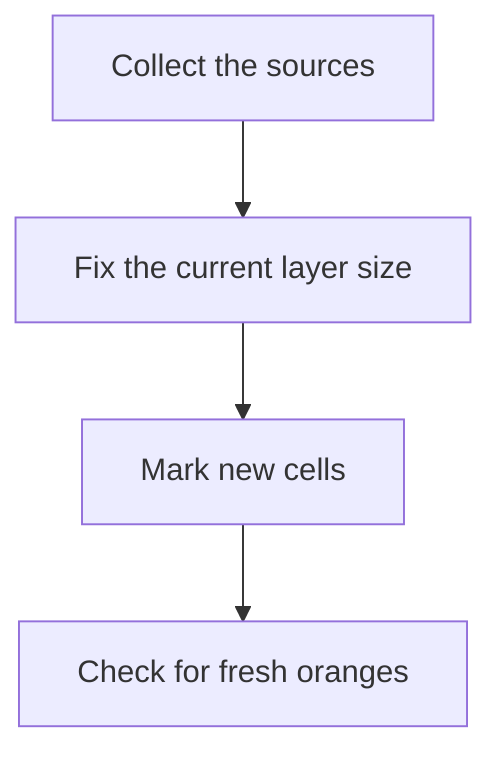

> [!tldr] Quick read
> - [[en/concepts/multi-source-bfs|Multi-source BFS]] starts all initially rotten oranges in layer 0. A fresh orange changes at the minute given by its shortest distance to a source through cells containing oranges.
> - Record the layer size before processing it. A newly rotten orange joins the next layer and starts spreading at the next minute.
> - [[en/concepts/mark-on-enqueue|Mark on enqueue]] so two sources that reach the same orange decrease the fresh count only once.
> - Return `-1` if the queue empties with fresh oranges remaining. If there are none at the start, the answer is `0`.

> [!info] Context
> This is LeetCode 994, part of [[en/posts/2026-11-26-neetcode-grid-traversal|station 1: Grid Traversal]] on **the NeetCode Line: Graphs**. I picture each orange as a position in a warehouse, with each horizontal or vertical step taking one minute. All I need is a way to read row and column coordinates.

> [!abstract]- Quick glossary for this post (click to open)
> - A [[en/concepts/grid-graph|grid graph]] treats any cell with an orange as a vertex and connects orange cells that share an edge.
> - A FIFO queue removes the cell added earliest.
> - A BFS layer groups cells that have the same shortest distance from the set of sources.
> - A cell's timestamp is the first minute its state changes.

## Picture it first: passing a message between counters

Several counters in a warehouse receive the same message when the doors open. Every minute, a counter with the message passes it to the counters right next to it. I want to know when the last counter receives it and whether any counters are cut off by empty space.

| Everyday life | Concept |
|---|---|
| Counters that get the message before opening | Sources in layer 0 |
| Passing a message between neighboring counters | One edge costs one minute |
| Log a counter as soon as it receives the message | Mark on enqueue |
| Counters that receive the message in the same minute | One BFS layer |
| A counter cut off from all senders by empty space | An unreachable vertex |



## The problem: count minutes at the farthest reached cell

The rectangular grid has 1 to 10 rows and 1 to 10 columns. A `0` is an empty cell, a `1` is a fresh orange, and a `2` is a rotten orange. At the end of each full minute, a fresh orange changes state if it shared an edge with a rotten orange at the start of that minute. Only horizontal or vertical neighbors that contain an orange are eligible. Return the minute at which all fresh oranges have changed, or `-1` if some will never change. See [the original LeetCode 994 problem](https://leetcode.com/problems/rotting-oranges/).

The example below has sources `(0,0)` and `(0,4)`. Coordinates start at 0.

```text
2 1 1 0 2
0 1 1 1 1
```

| Minute | Newly rotten cells |
|---|---|
| 0 | `(0,0)`, `(0,4)` are the two sources |
| 1 | `(0,1)`, `(1,4)` |
| 2 | `(0,2)`, `(1,1)`, `(1,3)` |
| 3 | `(1,2)` |

All three cells in minute 2 share an edge with `(1,2)`. The first discovery marks the cell for minute 3. The next two checks see that it has already been scheduled and skip it.

## How it works

<figure class="figure-map" style="--ar: 3 / 4">
<div class="frame"><iframe data-archify="../../diagrams/neetcode-rotting-oranges/worked-example.en.html" title="Both rotten oranges spread from minute zero" loading="lazy"></iframe></div>
<figcaption><span><b>Figure 1.</b> Both rotten oranges spread from minute zero.</span><a href="../diagrams/neetcode-rotting-oranges/worked-example.en.html" target="_blank" rel="noopener">Open full screen</a></figcaption>
</figure>

<details>
<summary>Read the steps</summary>
<ol>
<li>Seed both sources at minute zero. <code>(0,0), (0,4)</code></li>
<li>Both sources reach cells in minute one. <code>(0,1), (1,4)</code></li>
<li>Minute two reaches three new cells. <code>(0,2), (1,1), (1,3)</code></li>
<li>Three directions reach the same cell. <code>(1,2), d = 3</code></li>
<li>The final cell is enqueued once. <code>minutes = 3</code></li>
</ol>
</details>

### Simulate one minute at a time

I scan the entire grid for fresh oranges that have a rotten neighbor. During the scan, I collect the coordinates to change in a temporary list. After the scan, I change them all to `2` and increment the minute. If the list is empty with fresh oranges remaining, the result is `-1`.

The two-phase order is essential. In the row `[2,1,1]`, changing the second cell during the scan lets the third cell read its new value. The correct state at the end of minute 1 is `[2,2,1]`, and the last cell needs minute 2.

Let `R` be the number of rows, `C` the number of columns, and `P` the number of loop scans, including any final scan that finds no new cell. Time is `O(R·C·(1+P))` and the temporary list uses up to `O(R·C)` space. Each productive scan changes at least one cell, so the worst-case time bound is `O((R·C)²)`.

### Expand one layer at a time with multi-source BFS

1. Scan the grid once. Enqueue every `2` at minute 0 and count the remaining `1` cells.
2. Record the current layer size. Remove exactly that many cells and check each valid neighbor in the four directions.
3. When a `1` is found, change it to `2`, decrement the fresh count, and append it to the queue. After processing the layer, increment the minute if there is another layer.
4. When the queue empties, return the minutes if the fresh count is zero, or return `-1`.

At the start of each outer iteration, every unprocessed queue entry belongs to the same minute. Suppose the current layer is minute `t`. A fresh orange discovered here has a path of length `t+1` from a source. If there were a shorter path, the queue would have processed its predecessor in an earlier layer and marked this cell. The first discovery therefore gives the earliest time. Across sources, each cell gets the minimum distance to a source. The whole-grid result is the largest arrival time among initially fresh cells, or `-1` if any cell is never discovered. If the set of fresh cells starts empty, the result is 0.

A timestamped queue is equivalent. Store `(row, column, minute)` in each entry, with minute 0 at every source and the popped cell's minute plus 1 at each newly discovered neighbor. To return a map of arrival times, store timestamps in a separate matrix. The examples use layer boundaries to return the final minute.

BFS takes `O(R·C)` time and uses up to `O(R·C)` space. After the initial scan, each cell with an orange enters the queue at most once and each pop checks four directions. Both algorithms in the examples mutate the input grid. The tests copy each row so each run starts from the same state.

### Count work on a corridor

Use one row of 10 cells, with a rotten orange on the far left and nine fresh oranges. Both approaches return 9 minutes.

| Approach | Count | Work outside the count |
|---|---:|---|
| Simulation | 90 cell visits over 9 scans | The initial count over 10 cells |
| BFS | 10 queue removals | The initial scan of 10 cells and neighbor checks |

The measurements count cell visits during scanning and removals from the BFS queue. Each event can involve a different number of operations. The counts show how many repeat passes BFS avoids.

## Runnable example

- [TypeScript](../code/neetcode-rotting-oranges/rot-by-minute.ts) — run `node rot-by-minute.ts`
- [Python](../code/neetcode-rotting-oranges/rot_by_minute.py) — run `python3 rot_by_minute.py`
- [Go](../code/neetcode-rotting-oranges/rot_by_minute.go) — run `go run rot_by_minute.go`
- [Java](../code/neetcode-rotting-oranges/rot-by-minute.java) — run `java rot-by-minute.java`
- [JavaScript](../code/neetcode-rotting-oranges/rot-by-minute.js) — run `node rot-by-minute.js`
- [PHP](../code/neetcode-rotting-oranges/rot-by-minute.php) — run `php rot-by-minute.php`
- [Rust](../code/neetcode-rotting-oranges/rot_by_minute.rs) — run `rustc --edition 2021 -O rot_by_minute.rs && ./rot_by_minute`

```typescript
type Grid = number[][]
type Cell = [number, number]

const directions: Cell[] = [[-1, 0], [1, 0], [0, -1], [0, 1]]

function simulate(grid: Grid) {
  let fresh = grid.reduce((count, row) => count + row.filter(value => value === 1).length, 0)
  let minutes = 0
  let scans = 0

  while (fresh > 0) {
    const next: Cell[] = []
    for (let r = 0; r < grid.length; r++) {
      for (let c = 0; c < grid[0].length; c++) {
        scans++
        if (grid[r][c] === 1 && directions.some(([dr, dc]) => grid[r + dr]?.[c + dc] === 2)) {
          next.push([r, c])
        }
      }
    }
    if (next.length === 0) return { minutes: -1, scans }
    for (const [r, c] of next) grid[r][c] = 2
    fresh -= next.length
    minutes++
  }
  return { minutes, scans }
}

function spread(grid: Grid) {
  const queue: Cell[] = []
  let fresh = 0
  for (let r = 0; r < grid.length; r++) {
    for (let c = 0; c < grid[0].length; c++) {
      if (grid[r][c] === 2) queue.push([r, c])
      if (grid[r][c] === 1) fresh++
    }
  }

  let head = 0
  let minutes = 0
  while (head < queue.length) {
    const end = queue.length
    while (head < end) {
      const [r, c] = queue[head++]
      for (const [dr, dc] of directions) {
        const nr = r + dr
        const nc = c + dc
        if (grid[nr]?.[nc] !== 1) continue
        grid[nr][nc] = 2
        fresh--
        queue.push([nr, nc])
      }
    }
    if (queue.length > end) minutes++
  }
  return { minutes: fresh === 0 ? minutes : -1, pops: head }
}

const cases: [Grid, number][] = [
  [[[2, 1, 1, 0, 2], [0, 1, 1, 1, 1]], 3],
  [[[2, 1, 0, 1], [0, 1, 0, 1]], -1],
  [[[0, 2, 0]], 0],
  [[[1]], -1],
  [[[0]], 0],
  [[[2, 1, 2]], 1],
  [[[2, 1, 1, 1, 1, 1, 1, 1, 1, 1]], 9],
]
const clone = (grid: Grid) => grid.map(row => row.slice())

for (const [grid, expected] of cases) {
  if (simulate(clone(grid)).minutes !== expected || spread(clone(grid)).minutes !== expected) {
    throw new Error(`unexpected result for ${JSON.stringify(grid)}`)
  }
}

const [corridor] = cases[cases.length - 1]
const { scans } = simulate(clone(corridor))
const { pops } = spread(clone(corridor))
if (scans !== 90 || pops !== 10) throw new Error("unexpected operation counts")
console.log(`${cases.length}/${cases.length} ca đúng`)
console.log(`Quét: ${scans}; lấy khỏi hàng đợi: ${pops}`)
```
```python
from collections import deque

DIRECTIONS = ((-1, 0), (1, 0), (0, -1), (0, 1))


def simulate(grid):
    rows, cols = len(grid), len(grid[0])
    fresh = sum(row.count(1) for row in grid)
    minutes = scans = 0

    while fresh:
        upcoming = []
        for r in range(rows):
            for c in range(cols):
                scans += 1
                if grid[r][c] == 1 and any(
                    0 <= r + dr < rows
                    and 0 <= c + dc < cols
                    and grid[r + dr][c + dc] == 2
                    for dr, dc in DIRECTIONS
                ):
                    upcoming.append((r, c))
        if not upcoming:
            return -1, scans
        for r, c in upcoming:
            grid[r][c] = 2
        fresh -= len(upcoming)
        minutes += 1
    return minutes, scans


def spread(grid):
    rows, cols = len(grid), len(grid[0])
    queue = deque()
    fresh = 0
    for r in range(rows):
        for c in range(cols):
            if grid[r][c] == 2:
                queue.append((r, c))
            elif grid[r][c] == 1:
                fresh += 1

    minutes = pops = 0
    while queue:
        layer_size = len(queue)
        for _ in range(layer_size):
            r, c = queue.popleft()
            pops += 1
            for dr, dc in DIRECTIONS:
                nr, nc = r + dr, c + dc
                if 0 <= nr < rows and 0 <= nc < cols and grid[nr][nc] == 1:
                    grid[nr][nc] = 2
                    fresh -= 1
                    queue.append((nr, nc))
        if queue:
            minutes += 1
    return (minutes if fresh == 0 else -1), pops


def main():
    cases = [
        ([[2, 1, 1, 0, 2], [0, 1, 1, 1, 1]], 3),
        ([[2, 1, 0, 1], [0, 1, 0, 1]], -1),
        ([[0, 2, 0]], 0),
        ([[1]], -1),
        ([[0]], 0),
        ([[2, 1, 2]], 1),
        ([[2, 1, 1, 1, 1, 1, 1, 1, 1, 1]], 9),
    ]
    for grid, expected in cases:
        assert simulate([row[:] for row in grid])[0] == expected, grid
        assert spread([row[:] for row in grid])[0] == expected, grid

    corridor = cases[-1][0]
    _, scans = simulate([row[:] for row in corridor])
    _, pops = spread([row[:] for row in corridor])
    assert (scans, pops) == (90, 10)
    print(f"{len(cases)}/{len(cases)} ca đúng")
    print(f"Quét: {scans}; lấy khỏi hàng đợi: {pops}")


if __name__ == "__main__":
    main()
```
```go
package main

import "fmt"

type cell struct{ row, col int }

var directions = [...]cell{{-1, 0}, {1, 0}, {0, -1}, {0, 1}}

func inside(r, c, rows, cols int) bool {
	return r >= 0 && r < rows && c >= 0 && c < cols
}

func simulate(grid [][]int) (int, int) {
	rows, cols := len(grid), len(grid[0])
	fresh, minutes, scans := 0, 0, 0
	for _, row := range grid {
		for _, value := range row {
			if value == 1 {
				fresh++
			}
		}
	}

	for fresh > 0 {
		next := []cell{}
		for r, row := range grid {
			for c, value := range row {
				scans++
				if value != 1 {
					continue
				}
				for _, d := range directions {
					nr, nc := r+d.row, c+d.col
					if inside(nr, nc, rows, cols) && grid[nr][nc] == 2 {
						next = append(next, cell{r, c})
						break
					}
				}
			}
		}
		if len(next) == 0 {
			return -1, scans
		}
		for _, p := range next {
			grid[p.row][p.col] = 2
		}
		fresh -= len(next)
		minutes++
	}
	return minutes, scans
}

func spread(grid [][]int) (int, int) {
	rows, cols := len(grid), len(grid[0])
	queue := []cell{}
	fresh := 0
	for r, row := range grid {
		for c, value := range row {
			if value == 2 {
				queue = append(queue, cell{r, c})
			}
			if value == 1 {
				fresh++
			}
		}
	}

	head, minutes := 0, 0
	for head < len(queue) {
		end := len(queue)
		for head < end {
			p := queue[head]
			head++
			for _, d := range directions {
				nr, nc := p.row+d.row, p.col+d.col
				if !inside(nr, nc, rows, cols) || grid[nr][nc] != 1 {
					continue
				}
				grid[nr][nc] = 2
				fresh--
				queue = append(queue, cell{nr, nc})
			}
		}
		if len(queue) > end {
			minutes++
		}
	}
	if fresh > 0 {
		return -1, head
	}
	return minutes, head
}

func clone(grid [][]int) [][]int {
	copyRows := make([][]int, len(grid))
	for r, row := range grid {
		copyRows[r] = append([]int(nil), row...)
	}
	return copyRows
}

func main() {
	cases := []struct {
		grid [][]int
		want int
	}{
		{[][]int{{2, 1, 1, 0, 2}, {0, 1, 1, 1, 1}}, 3},
		{[][]int{{2, 1, 0, 1}, {0, 1, 0, 1}}, -1},
		{[][]int{{0, 2, 0}}, 0},
		{[][]int{{1}}, -1},
		{[][]int{{0}}, 0},
		{[][]int{{2, 1, 2}}, 1},
		{[][]int{{2, 1, 1, 1, 1, 1, 1, 1, 1, 1}}, 9},
	}
	for _, test := range cases {
		slow, _ := simulate(clone(test.grid))
		fast, _ := spread(clone(test.grid))
		if slow != test.want || fast != test.want {
			panic(fmt.Sprintf("unexpected result for %v", test.grid))
		}
	}

	corridor := cases[len(cases)-1].grid
	_, scans := simulate(clone(corridor))
	_, pops := spread(clone(corridor))
	if scans != 90 || pops != 10 {
		panic("unexpected operation counts")
	}
	fmt.Printf("%d/%d ca đúng\n", len(cases), len(cases))
	fmt.Printf("Quét: %d; lấy khỏi hàng đợi: %d\n", scans, pops)
}
```
```java
import java.util.ArrayDeque;
import java.util.ArrayList;
import java.util.Arrays;
import java.util.List;

class RotByMinute {
    record Cell(int row, int col) {}
    record Result(int minutes, int inspections) {}
    record Test(int[][] grid, int expected) {}

    static final int[][] DIRECTIONS = {{-1, 0}, {1, 0}, {0, -1}, {0, 1}};

    static boolean inside(int row, int col, int[][] grid) {
        return row >= 0 && row < grid.length && col >= 0 && col < grid[0].length;
    }

    static Result simulate(int[][] grid) {
        int fresh = 0, minutes = 0, scans = 0;
        for (int[] row : grid) {
            for (int value : row) {
                if (value == 1) fresh++;
            }
        }

        while (fresh > 0) {
            List<Cell> next = new ArrayList<>();
            for (int row = 0; row < grid.length; row++) {
                for (int col = 0; col < grid[0].length; col++) {
                    scans++;
                    if (grid[row][col] != 1) continue;
                    for (int[] d : DIRECTIONS) {
                        int nr = row + d[0], nc = col + d[1];
                        if (inside(nr, nc, grid) && grid[nr][nc] == 2) {
                            next.add(new Cell(row, col));
                            break;
                        }
                    }
                }
            }
            if (next.isEmpty()) return new Result(-1, scans);
            for (Cell p : next) grid[p.row()][p.col()] = 2;
            fresh -= next.size();
            minutes++;
        }
        return new Result(minutes, scans);
    }

    static Result spread(int[][] grid) {
        var queue = new ArrayDeque<Cell>();
        int fresh = 0;
        for (int row = 0; row < grid.length; row++) {
            for (int col = 0; col < grid[0].length; col++) {
                if (grid[row][col] == 2) queue.addLast(new Cell(row, col));
                if (grid[row][col] == 1) fresh++;
            }
        }

        int minutes = 0, pops = 0;
        while (!queue.isEmpty()) {
            int layerSize = queue.size();
            for (int i = 0; i < layerSize; i++) {
                Cell p = queue.removeFirst();
                pops++;
                for (int[] d : DIRECTIONS) {
                    int nr = p.row() + d[0], nc = p.col() + d[1];
                    if (!inside(nr, nc, grid) || grid[nr][nc] != 1) continue;
                    grid[nr][nc] = 2;
                    fresh--;
                    queue.addLast(new Cell(nr, nc));
                }
            }
            if (!queue.isEmpty()) minutes++;
        }
        return new Result(fresh == 0 ? minutes : -1, pops);
    }

    static int[][] copy(int[][] grid) {
        return Arrays.stream(grid).map(int[]::clone).toArray(int[][]::new);
    }

    public static void main(String[] args) {
        Test[] cases = {
            new Test(new int[][]{{2, 1, 1, 0, 2}, {0, 1, 1, 1, 1}}, 3),
            new Test(new int[][]{{2, 1, 0, 1}, {0, 1, 0, 1}}, -1),
            new Test(new int[][]{{0, 2, 0}}, 0),
            new Test(new int[][]{{1}}, -1),
            new Test(new int[][]{{0}}, 0),
            new Test(new int[][]{{2, 1, 2}}, 1),
            new Test(new int[][]{{2, 1, 1, 1, 1, 1, 1, 1, 1, 1}}, 9),
        };
        for (Test test : cases) {
            if (simulate(copy(test.grid())).minutes() != test.expected()
                || spread(copy(test.grid())).minutes() != test.expected()) {
                throw new AssertionError(Arrays.deepToString(test.grid()));
            }
        }

        int[][] corridor = cases[cases.length - 1].grid();
        int scans = simulate(copy(corridor)).inspections();
        int pops = spread(copy(corridor)).inspections();
        if (scans != 90 || pops != 10) throw new AssertionError("unexpected operation counts");
        System.out.printf("%d/%d ca đúng%n", cases.length, cases.length);
        System.out.printf("Quét: %d; lấy khỏi hàng đợi: %d%n", scans, pops);
    }
}
```
```javascript
const directions = [[-1, 0], [1, 0], [0, -1], [0, 1]]

function simulate(grid) {
  let fresh = grid.reduce((count, row) => count + row.filter(value => value === 1).length, 0)
  let minutes = 0
  let scans = 0

  while (fresh > 0) {
    const next = []
    for (let r = 0; r < grid.length; r++) {
      for (let c = 0; c < grid[0].length; c++) {
        scans++
        if (grid[r][c] === 1 && directions.some(([dr, dc]) => grid[r + dr]?.[c + dc] === 2)) {
          next.push([r, c])
        }
      }
    }
    if (next.length === 0) return { minutes: -1, scans }
    for (const [r, c] of next) grid[r][c] = 2
    fresh -= next.length
    minutes++
  }
  return { minutes, scans }
}

function spread(grid) {
  const queue = []
  let fresh = 0
  for (let r = 0; r < grid.length; r++) {
    for (let c = 0; c < grid[0].length; c++) {
      if (grid[r][c] === 2) queue.push([r, c])
      if (grid[r][c] === 1) fresh++
    }
  }

  let head = 0
  let minutes = 0
  while (head < queue.length) {
    const end = queue.length
    while (head < end) {
      const [r, c] = queue[head++]
      for (const [dr, dc] of directions) {
        const nr = r + dr
        const nc = c + dc
        if (grid[nr]?.[nc] !== 1) continue
        grid[nr][nc] = 2
        fresh--
        queue.push([nr, nc])
      }
    }
    if (queue.length > end) minutes++
  }
  return { minutes: fresh === 0 ? minutes : -1, pops: head }
}

const cases = [
  [[[2, 1, 1, 0, 2], [0, 1, 1, 1, 1]], 3],
  [[[2, 1, 0, 1], [0, 1, 0, 1]], -1],
  [[[0, 2, 0]], 0],
  [[[1]], -1],
  [[[0]], 0],
  [[[2, 1, 2]], 1],
  [[[2, 1, 1, 1, 1, 1, 1, 1, 1, 1]], 9],
]
const clone = (grid) => grid.map(row => row.slice())

for (const [grid, expected] of cases) {
  if (simulate(clone(grid)).minutes !== expected || spread(clone(grid)).minutes !== expected) {
    throw new Error(`unexpected result for ${JSON.stringify(grid)}`)
  }
}

const [corridor] = cases[cases.length - 1]
const { scans } = simulate(clone(corridor))
const { pops } = spread(clone(corridor))
if (scans !== 90 || pops !== 10) throw new Error("unexpected operation counts")
console.log(`${cases.length}/${cases.length} ca đúng`)
console.log(`Quét: ${scans}; lấy khỏi hàng đợi: ${pops}`)
```

```php
<?php
declare(strict_types=1);

const DIRECTIONS = [[-1, 0], [1, 0], [0, -1], [0, 1]];

function simulate(array $grid): array
{
    $fresh = 0;
    foreach ($grid as $row) {
        $fresh += count(array_keys($row, 1, true));
    }
    $minutes = 0;
    $scans = 0;

    while ($fresh > 0) {
        $next = [];
        foreach ($grid as $r => $row) {
            foreach ($row as $c => $value) {
                $scans++;
                if ($value !== 1) {
                    continue;
                }
                foreach (DIRECTIONS as [$dr, $dc]) {
                    if (($grid[$r + $dr][$c + $dc] ?? null) === 2) {
                        $next[] = [$r, $c];
                        break;
                    }
                }
            }
        }
        if (!$next) {
            return ['minutes' => -1, 'scans' => $scans];
        }
        foreach ($next as [$r, $c]) {
            $grid[$r][$c] = 2;
        }
        $fresh -= count($next);
        $minutes++;
    }
    return ['minutes' => $minutes, 'scans' => $scans];
}

function spread(array $grid): array
{
    $queue = [];
    $fresh = 0;
    foreach ($grid as $r => $row) {
        foreach ($row as $c => $value) {
            if ($value === 2) $queue[] = [$r, $c];
            if ($value === 1) $fresh++;
        }
    }

    $head = 0;
    $minutes = 0;
    while ($head < count($queue)) {
        $end = count($queue);
        while ($head < $end) {
            [$r, $c] = $queue[$head++];
            foreach (DIRECTIONS as [$dr, $dc]) {
                $nr = $r + $dr;
                $nc = $c + $dc;
                if (($grid[$nr][$nc] ?? null) !== 1) {
                    continue;
                }
                $grid[$nr][$nc] = 2;
                $fresh--;
                $queue[] = [$nr, $nc];
            }
        }
        if (count($queue) > $end) $minutes++;
    }
    return ['minutes' => $fresh === 0 ? $minutes : -1, 'pops' => $head];
}

$cases = [
    [[[2, 1, 1, 0, 2], [0, 1, 1, 1, 1]], 3],
    [[[2, 1, 0, 1], [0, 1, 0, 1]], -1],
    [[[0, 2, 0]], 0],
    [[[1]], -1],
    [[[0]], 0],
    [[[2, 1, 2]], 1],
    [[[2, 1, 1, 1, 1, 1, 1, 1, 1, 1]], 9],
];

foreach ($cases as [$grid, $expected]) {
    if (simulate($grid)['minutes'] !== $expected || spread($grid)['minutes'] !== $expected) {
        throw new RuntimeException('unexpected result for ' . json_encode($grid));
    }
}

[$corridor] = $cases[count($cases) - 1];
$scans = simulate($corridor)['scans'];
$pops = spread($corridor)['pops'];
if ($scans !== 90 || $pops !== 10) {
    throw new RuntimeException('unexpected operation counts');
}
$n = count($cases);
echo "{$n}/{$n} ca đúng\n";
echo "Quét: {$scans}; lấy khỏi hàng đợi: {$pops}\n";
```

```rust
use std::collections::VecDeque;

type Grid = Vec<Vec<u8>>;

const DIRECTIONS: [(i32, i32); 4] = [(-1, 0), (1, 0), (0, -1), (0, 1)];

fn at(grid: &Grid, r: i32, c: i32) -> Option<u8> {
    if r < 0 || c < 0 {
        return None;
    }
    grid.get(r as usize)?.get(c as usize).copied()
}

fn simulate(mut grid: Grid) -> (i32, usize) {
    let mut fresh = grid.iter().flatten().filter(|&&v| v == 1).count();
    let mut minutes = 0;
    let mut scans = 0;

    while fresh > 0 {
        let mut next = Vec::new();
        for r in 0..grid.len() {
            for c in 0..grid[0].len() {
                scans += 1;
                if grid[r][c] == 1
                    && DIRECTIONS.iter().any(|&(dr, dc)| at(&grid, r as i32 + dr, c as i32 + dc) == Some(2))
                {
                    next.push((r, c));
                }
            }
        }
        if next.is_empty() {
            return (-1, scans);
        }
        for &(r, c) in &next {
            grid[r][c] = 2;
        }
        fresh -= next.len();
        minutes += 1;
    }
    (minutes, scans)
}

fn spread(mut grid: Grid) -> (i32, usize) {
    let mut queue = VecDeque::new();
    let mut fresh = 0;
    for r in 0..grid.len() {
        for c in 0..grid[0].len() {
            if grid[r][c] == 2 { queue.push_back((r as i32, c as i32)); }
            if grid[r][c] == 1 { fresh += 1; }
        }
    }

    let mut pops = 0;
    let mut minutes = 0;
    while !queue.is_empty() {
        let mut rotted_this_minute = false;
        for _ in 0..queue.len() {
            let (r, c) = queue.pop_front().unwrap();
            pops += 1;
            for (dr, dc) in DIRECTIONS {
                let (nr, nc) = (r + dr, c + dc);
                if at(&grid, nr, nc) != Some(1) {
                    continue;
                }
                grid[nr as usize][nc as usize] = 2;
                fresh -= 1;
                rotted_this_minute = true;
                queue.push_back((nr, nc));
            }
        }
        if rotted_this_minute { minutes += 1; }
    }
    (if fresh == 0 { minutes } else { -1 }, pops)
}

fn main() {
    let cases: Vec<(Grid, i32)> = vec![
        (vec![vec![2, 1, 1, 0, 2], vec![0, 1, 1, 1, 1]], 3),
        (vec![vec![2, 1, 0, 1], vec![0, 1, 0, 1]], -1),
        (vec![vec![0, 2, 0]], 0),
        (vec![vec![1]], -1),
        (vec![vec![0]], 0),
        (vec![vec![2, 1, 2]], 1),
        (vec![vec![2, 1, 1, 1, 1, 1, 1, 1, 1, 1]], 9),
    ];

    for (grid, expected) in &cases {
        if simulate(grid.clone()).0 != *expected || spread(grid.clone()).0 != *expected {
            panic!("unexpected result for {:?}", grid);
        }
    }

    let corridor = &cases[cases.len() - 1].0;
    let (_, scans) = simulate(corridor.clone());
    let (_, pops) = spread(corridor.clone());
    if scans != 90 || pops != 10 {
        panic!("unexpected operation counts");
    }
    println!("{}/{} ca đúng", cases.len(), cases.len());
    println!("Quét: {}; lấy khỏi hàng đợi: {}", scans, pops);
}
```

All seven files print the same result:

```text
7/7 cases passed
Scanned: 90; removed from queue: 10
```

*(Output labels translated; the files themselves print Vietnamese.)*

## Misconceptions and common traps

- **Count a minute for the source layer or an empty next layer.** The sources are already rotten at minute 0. Increment the minute when processing this layer produces another layer. With `[0,2,0]`, the queue still contains one cell and the answer is 0.
- **Mark a cell at dequeue time.** In `[2,1,2]`, both sources see the middle cell in layer 0. Mark it at the first discovery so it enters the queue and decreases the fresh count only once.
- **The first route DFS finds is shortest.** DFS can visit a long detour before reaching a target. BFS's layer order establishes the earliest arrival when each edge costs one minute.
- **Run a separate BFS from every initially rotten orange.** This repeats work where several sources can reach the same area. Put all sources in layer 0 so the first discovery selects the earliest time.
- **Use a queue by repeatedly removing the first array item.** TypeScript and JavaScript advance a `head` index through the array. Go does the same with a slice. Python uses `deque.popleft()` and Java uses `ArrayDeque.removeFirst()`.
- **Copy just the outer array.** Both approaches write into cells. Copy each row if the caller needs the original input. Python accepts negative indices, so check both lower and upper bounds before reading a cell.
- **PHP: reading outside the grid with `??`.** `$grid[-1][0] ?? null` raises no error: a PHP array is a hash table, key `-1` is simply missing, and `??` returns `null`. Handy, but it also swallows a mistyped variable name. PHP arrays are passed by value, so `simulate($grid)` works on its own copy without copying each row as TypeScript does.
- **Rust: `VecDeque` or a `Vec` with an index.** The Rust version uses `VecDeque::pop_front` and counts layers with `for _ in 0..queue.len()`: `queue.len()` is read **once** when the `for` starts, so cells added during this layer do not leak into it. It reads a neighbor with `grid.get(r)?.get(c)` after ruling out negative indices, because casting `-1` to `usize` gives a huge number.

## Self-check questions

> [!question]- Why does `[2,1,2]` take one minute with two sources?
> Both sources start in layer 0. The middle cell is discovered in layer 1 and marked at the first discovery.

> [!question]- What does `[2,1,0,1]` return?
> The second cell changes after one minute. Empty space cuts off every route to the last cell, so the queue empties with fresh oranges remaining. Return `-1`.

> [!question]- Why can BFS update early while a full-grid scan has to wait?
> In BFS, the newly marked orange goes behind the current layer boundary and spreads in the next minute. During a full scan, a later read can see a newly changed neighbor and let it spread in the same minute.

> [!question]- How would I keep each cell's minute?
> Store the minute with its coordinates or in a distance matrix. Set each source to minute 0. On its first visit a fresh orange gets its predecessor's minute plus 1.

## References

- Problem and input constraints. [LeetCode 994 — Rotting Oranges](https://leetcode.com/problems/rotting-oranges/)
- Multi-source BFS with initial distances of 0. [Princeton Algorithms — BreadthFirstPaths](https://github.com/kevin-wayne/algs4/blob/master/src/main/java/edu/princeton/cs/algs4/BreadthFirstPaths.java)
- Why BFS discovers vertices by distance in an unweighted graph. [Cornell CS 2110 — Shortest Paths](https://www.cs.cornell.edu/courses/cs2110/2025fa/lectures/lec23/)
- Operations at both ends of the queue. [Python deque](https://docs.python.org/3/library/collections.html#collections.deque) · [Java ArrayDeque](https://docs.oracle.com/en/java/javase/25/docs/api/java.base/java/util/ArrayDeque.html)
