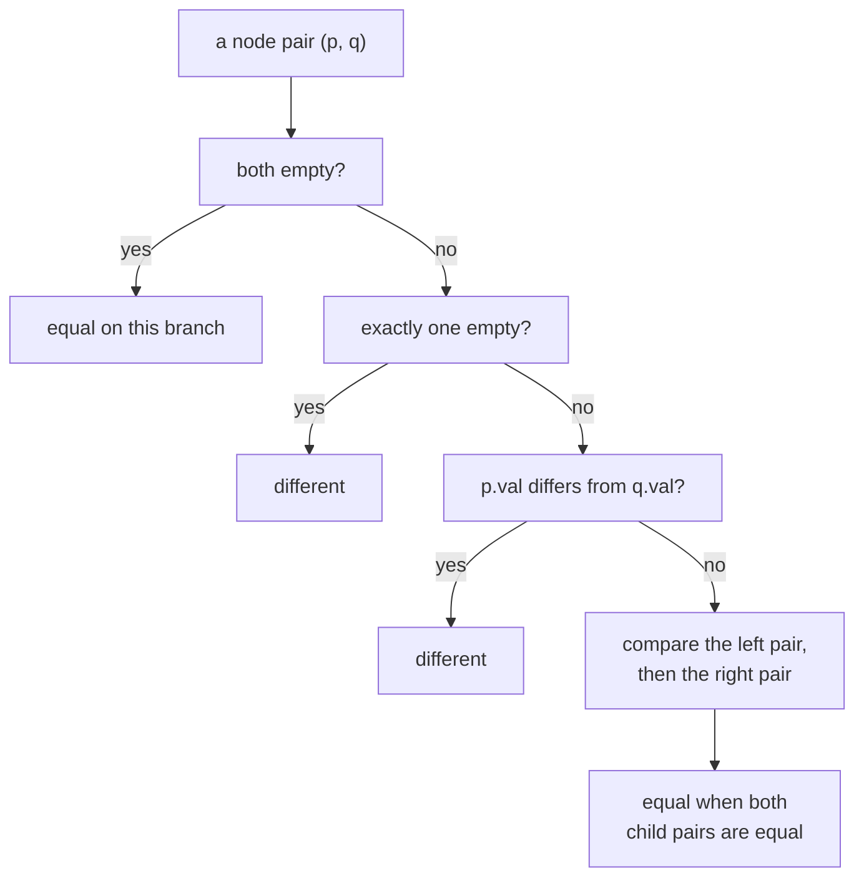
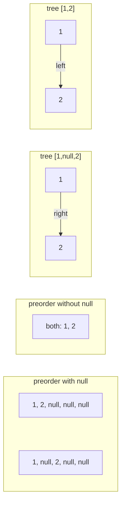

> [!tldr] Quick read
> - The problem: given two binary trees, return `true` when they are identical: the same shape and the same value at every position.
> - The standard solution is **parallel recursion**: walk both trees at once, comparing one pair of nodes at the same position per step. Three questions in order: both empty? one side empty? values differ? Then compare the left pair and the right pair. O(n) time, O(h) stack (h is the height).
> - As a loop, push **pairs** of nodes onto a stack or queue, not single nodes. The loop version handles a skewed tree of 10⁶ nodes in every language; the recursive one does not.
> - Measured on skewed trees: recursion stops at depth 996 in Python, 13,907 in Node, 29,459 in Java (main thread); Go still runs at 10⁷ because a goroutine stack grows up to 1 GB.
> - Traps that actually run: comparing preorder sequences while skipping empty slots (`[1,2]` and `[1,null,2]` both give `1,2`); forgetting the case where exactly one side is empty (TypeError, AttributeError, panic, NullPointerException); in Java, comparing two `Integer`s with `==` fails from the value 128 up.

> [!info] Context
> LeetCode problem 100 (Easy) of [[en/posts/2026-11-25-neetcode-tree-recursion|station 3: Tree Recursion]] on **the NeetCode Line: Linked Structures**. This is recursion over **two** trees at once: the same "handle the node, hand the rest to two child calls" template as [[en/problems/maximum-depth-of-binary-tree|Maximum Depth of Binary Tree]], but each call holds a pair of nodes. The tree comparison written here is reused unchanged in its station neighbour [[en/problems/subtree-of-another-tree|Subtree of Another Tree]]. Solutions come in TypeScript, Python, Go, Java and JavaScript. You only need to know what a binary tree is.

> [!abstract]- Quick glossary for this post (click to open)
> - **Binary tree**: each node has a value and at most two children, left and right. Left and right are different positions: a node with only a left child differs from a node with only a right child. See [[en/concepts/binary-tree|Binary Tree]].
> - **Empty slot (null)**: a position with no node. Two identical trees must be empty in the same positions.
> - **LeetCode level-order array**: how LeetCode writes a tree, reading level by level from left to right, with `null` for an empty slot. `[1,2]` is root 1 with left child 2; `[1,null,2]` is root 1 with right child 2.
> - **Call stack**: every unfinished function call takes one slot on the thread's stack. Recursion h levels deep needs h slots; when they run out, the program throws. See [[en/concepts/recursion-depth-limit|Recursion Depth Limit]].
> - **Preorder**: the walk order "node, then left subtree, then right subtree".
> - **Serialization**: writing a tree as a flat sequence (array or string) to compare or store it. The sequence only stands for the tree when it can be read back into exactly that tree. See [[en/concepts/key-serialization|Key Serialization]].
> - **n, h**: n is the number of nodes, h the height (number of levels) of the tree.

## Picture it first: checking two folder layouts

You have a root folder and a backup, and every folder holds at most two subfolders in fixed drawers: a left drawer and a right drawer. To know whether the backup is an exact copy, you open both at the same spot, compare the names, then open the left drawer of both together, check everything inside, come back, and open the right drawer of both. Wherever one side has a folder and the other is empty, they differ.

| Everyday life | Concept |
|---|---|
| Two folder layouts | two trees `p`, `q` |
| Opening both at the same spot | one call holding a pair of nodes `(p, q)` |
| Left drawer, right drawer | left child, right child |
| One side has a folder, the other is empty | exactly one node is `null`: different |
| Both are empty | both `null`: equal on this branch |
| A note of "drawer pairs still to check" | the stack of node pairs in the loop version |
| Copying only folder names, not which drawers are empty | serialization without `null`: two different trees give the same list |

Every pair of nodes goes down one ladder of questions:



## The problem

Given the roots of two binary trees `p` and `q`, each with 0 to 100 nodes and node values in [−10⁴, 10⁴], return `true` when the trees are identical: the same shape (nodes in the same positions) and the same value in every position. Original problem: [LeetCode 100](https://leetcode.com/problems/same-tree/).

I used to think it was enough to walk both trees in the same order, collect the values into two arrays and compare. It turns out two trees of different shapes can give the same sequence of values: `[1,2]` (2 is the left child) and `[1,null,2]` (2 is the right child) both have preorder `1, 2`. To compare by sequence, the sequence must record the empty slots too.

## How it works

<figure class="figure-map" style="--ar: 3 / 4">
<div class="frame"><iframe data-archify="../../diagrams/neetcode-same-tree/worked-example.en.html" title="Compare nodes at matching positions" loading="lazy"></iframe></div>
<figcaption><span><b>Figure 1.</b> Compare nodes at matching positions.</span><a href="../diagrams/neetcode-same-tree/worked-example.en.html" target="_blank" rel="noopener">Open full screen</a></figcaption>
</figure>

<details>
<summary>Read the steps</summary>
<ol>
<li>Both roots have value 6. <code>6 = 6</code></li>
<li>Both left children are 4. <code>4 = 4</code></li>
<li>One right child is 8 and the other is empty. <code>8 vs null</code></li>
<li>The shape differs, so return false. <code>false</code></li>
</ol>
</details>

### Approach 1: parallel recursion

Two trees are identical if and only if: both roots have the same value, both left subtrees are identical, and both right subtrees are identical. That definition calls itself on two smaller pairs, so writing it as recursion is all there is. The base case is when at least one side is empty: both empty means equal, one empty means different. The line `return p === q` covers both: when one of them is `null`, they are equal only if both are `null`.

```ts
// Approach 1: parallel recursion over two trees. O(n) time, O(h) call stack (h is the height).
function isSameRecursive(p: TreeNode | null, q: TreeNode | null): boolean {
  if (p === null || q === null) return p === q; // true only when both are null
  return p.val === q.val && isSameRecursive(p.left, q.left) && isSameRecursive(p.right, q.right);
}
```

Each node is visited at most once, and `&&` stops at the first differing pair, so the time is O(n) with n the size of the smaller tree. The memory is the recursion depth: O(log n) for a balanced tree, O(n) for a tree skewed entirely to one side.

### Approach 2: a stack of node pairs

To turn the recursion into a loop, what must be remembered is not "the next node" but "the next **pair** of nodes to compare". Each stack entry is a pair `(a, b)` at the same position. Pop a pair, run it down the same ladder of questions, then push the right pair and the left pair.

```ts
// Approach 2: a loop with a stack of node pairs (DFS). O(n) time, O(h) entries on the stack.
function isSameStack(p: TreeNode | null, q: TreeNode | null): boolean {
  const stack: [TreeNode | null, TreeNode | null][] = [[p, q]];
  while (stack.length > 0) {
    const [a, b] = stack.pop()!;
    if (a === null && b === null) continue;
    if (a === null || b === null || a.val !== b.val) return false;
    stack.push([a.right, b.right], [a.left, b.left]);
  }
  return true;
}
```

This stack lives on the program's heap, not on the call stack, so there is no depth limit other than the machine's memory.

### Approach 3: a queue of node pairs

Swap the stack for a queue and the comparison goes level by level (BFS). Still O(n) time; the memory is the widest level, O(n) for a full tree. Equally correct; the only difference is the order in which a difference is found: BFS finds differences on shallow levels first.

### Approach 4: serialization that records empty slots

Write each tree as a preorder sequence, recording `null` at every empty slot, then compare the two sequences. Written this way, each sequence belongs to exactly one tree, so the sequences are equal if and only if the trees are. O(n) time but O(n) extra memory, and both trees must be walked completely before comparing, even when the difference sits right at the root. It buys nothing here; it is worth knowing because [[en/problems/subtree-of-another-tree|Subtree of Another Tree]] uses exactly this idea to find a subtree by string search.

| Approach | Time | Extra memory | Notes |
|---|---|---|---|
| Parallel recursion | O(n) | O(h) call stack | shortest; depth limit depends on the language |
| Stack of node pairs | O(n) | O(h) | no depth limit |
| Queue of node pairs | O(n) | O(w), w the widest level | finds shallow differences first |
| Serialization with nulls | O(n) | O(n) | walks both trees fully before comparing |

### Three traps

**Comparing preorder while skipping empty slots.** The version `wrongPreorderNoNull` collects values in preorder, skips `null`, and compares the arrays. It fails 2/12 cases: `[1,2]` against `[1,null,2]`, and two skewed trees of 50 nodes all equal to 1 (one skewed left, one skewed right), both returning `true`. Adding inorder does not fix every case either; only recording empty slots makes the sequence read back into exactly one tree.



**Forgetting the case where exactly one side is empty.** Write `if (p === null && q === null) return true;` and then compare `p.val` with `q.val` right away: when only one side is empty, the program reads a property of `null`. All five languages fail the same 3/12 cases, each with its own error: TypeScript and JavaScript throw `TypeError`, Python `AttributeError`, Go panics, Java throws `NullPointerException`. All three cases have one tree shorter than the other, exactly the kind of bug that slips through when you only try two trees of the same shape.

**Java: comparing two `Integer`s with `==`.** LeetCode declares `int val`, so `==` is safe. But if the node holds an `Integer` (for example a hand-written `TreeNode<T>`), `==` compares two **objects**, not two values. `Integer.valueOf` (which Java calls when boxing) only reuses existing objects for values from −128 to 127, so the bug only shows with larger numbers. The Java file prints `127 == 127: true, 128 == 128: false`; the version `wrongBoxedEquals` fails exactly the two cases with values outside that range (1000, 2000 and −10000). Use `.equals` or compare `int`s.

### How deep can the recursion go

The problem caps the trees at 100 nodes, so every approach runs. But the same recursive function, given a long skewed tree, stops at very different depths. I had each file binary-search the largest depth at which the recursive version still runs on two identical left-skewed trees:

| Language | Recursive version runs up to | Where the limit comes from | How to go deeper |
|---|---|---|---|
| Python 3.12 | 996 levels | `sys.getrecursionlimit()` = 1000, minus a few levels of the program itself | `sys.setrecursionlimit(2_000_100)` runs 10⁶ levels |
| TypeScript, JavaScript (Node 24) | 13,905 and 13,907 levels | V8's default 984 KB stack (`--stack-size`) | write a loop |
| `JSON.stringify` (Node 24) | 4,456 levels | also recursive, with bigger frames | write a loop |
| Java 21 | 29,459 levels (main thread) | default `ThreadStackSize` of 1024 KB | `new Thread(null, r, "…", 512L << 20)` runs 10⁶ levels |
| Go 1.25 | still runs at 10⁷ levels (1.9 seconds) | a goroutine stack grows up to 1 GB (`debug.SetMaxStack`) | not needed |

What surprised me was Python: its limit of 1000 is the lowest, but once raised it ran 10⁶ levels without crashing. Since Python 3.11, a call from a Python function to a Python function no longer uses the C stack, so the limit is now just a counter. The file runs the test in a separate child process in case it crashes, and both depths 10⁵ and 10⁶ return `True` with exit code 0. The loop version needs none of these numbers: the stack of node pairs handles a skewed tree of 10⁶ nodes in all five languages.

### Measuring speed

Two identical trees of 10⁶ nodes (a binary search tree built from random mulberry32 keys, 49 levels high), median of 5 runs. This is the most expensive case because both trees must be walked completely:

| Language | Recursion | Stack of pairs | Queue of pairs | Serialization |
|---|---|---|---|---|
| TypeScript | 67 ms | 69 ms | 336 ms | 229 ms |
| Go | 76 ms | 89 ms | 224 ms | 265 ms |
| Java | 99 ms | 50 ms | 90 ms | 92 ms |
| Python (10⁵ nodes) | 28 ms | 34 ms | 54 ms | 49 ms |

- Recursion and the stack of pairs are on par: the same walk order, the only difference is where the "remaining work" is kept.
- The queue is clearly slower in TypeScript and Go: for a full tree the queue swells to hundreds of thousands of pairs, while the stack only holds about height × 2 pairs.
- Serialization must build two arrays of 2·10⁶ entries before comparing.
- The numbers vary by up to about 2× between runs (the same TypeScript file, in an earlier run, measured recursion at 26 ms and the queue at 158 ms); the ranking stays the same.

## Runnable example

[TypeScript](../code/neetcode-same-tree/same-tree.ts) · [Python](../code/neetcode-same-tree/same_tree.py) · [Go](../code/neetcode-same-tree/same_tree.go) · [Java](../code/neetcode-same-tree/same-tree.java) · [JavaScript](../code/neetcode-same-tree/same-tree.js)

Every file runs 12 shared cases: two identical trees, left child against right child, swapped values, two empty trees, one side empty, one node, values above 127, negative numbers, a full tree of 7 nodes, a different last leaf, left-skewed against right-skewed, and a left-skewed tree of 100 nodes. The TypeScript file also cross-checks 3,000 random tree pairs against an answer taken from nested JSON.

Parallel recursion:

```ts
// Approach 1: parallel recursion over two trees. O(n) time, O(h) call stack (h is the height).
function isSameRecursive(p: TreeNode | null, q: TreeNode | null): boolean {
  if (p === null || q === null) return p === q; // true only when both are null
  return p.val === q.val && isSameRecursive(p.left, q.left) && isSameRecursive(p.right, q.right);
}
```

```python
# Approach 1: parallel recursion. O(n) time, O(h) call stack.
def is_same_recursive(p, q):
    if p is None or q is None:
        return p is q  # true only when both are None
    return p.val == q.val and is_same_recursive(p.left, q.left) and is_same_recursive(p.right, q.right)
```

```go
// Approach 1: parallel recursion. O(n) time, O(h) call stack.
func isSameRecursive(p, q *TreeNode) bool {
	if p == nil || q == nil {
		return p == q // true only when both are nil
	}
	return p.Val == q.Val && isSameRecursive(p.Left, q.Left) && isSameRecursive(p.Right, q.Right)
}
```

```java
// Approach 1: parallel recursion. O(n) time, O(h) call stack.
static boolean isSameRecursive(TreeNode p, TreeNode q) {
    if (p == null || q == null) return p == q; // true only when both are null
    return p.val == q.val && isSameRecursive(p.left, q.left) && isSameRecursive(p.right, q.right);
}
```

```js
// Approach 1: parallel recursion. O(n) time, O(h) call stack.
function isSameRecursive(p, q) {
  if (p === null || q === null) return p === q; // true only when both are null
  return p.val === q.val && isSameRecursive(p.left, q.left) && isSameRecursive(p.right, q.right);
}
```


A stack of node pairs:

```ts
// Approach 2: a loop with a stack of node pairs (DFS). O(n) time, O(h) entries on the stack.
function isSameStack(p: TreeNode | null, q: TreeNode | null): boolean {
  const stack: [TreeNode | null, TreeNode | null][] = [[p, q]];
  while (stack.length > 0) {
    const [a, b] = stack.pop()!;
    if (a === null && b === null) continue;
    if (a === null || b === null || a.val !== b.val) return false;
    stack.push([a.right, b.right], [a.left, b.left]);
  }
  return true;
}
```

```python
# Approach 2: a stack of node pairs (DFS). Independent of the recursion limit.
def is_same_stack(p, q):
    stack = [(p, q)]
    while stack:
        a, b = stack.pop()
        if a is None and b is None:
            continue
        if a is None or b is None or a.val != b.val:
            return False
        stack.append((a.right, b.right))
        stack.append((a.left, b.left))
    return True
```

```go
type pair struct{ a, b *TreeNode }

// Approach 2: a stack of node pairs (DFS).
func isSameStack(p, q *TreeNode) bool {
	stack := []pair{{p, q}}
	for len(stack) > 0 {
		c := stack[len(stack)-1]
		stack = stack[:len(stack)-1]
		if c.a == nil && c.b == nil {
			continue
		}
		if c.a == nil || c.b == nil || c.a.Val != c.b.Val {
			return false
		}
		stack = append(stack, pair{c.a.Right, c.b.Right}, pair{c.a.Left, c.b.Left})
	}
	return true
}
```

```java
// Approach 2: a stack of node pairs (DFS). ArrayDeque rejects null, so each entry is a two-slot array.
static boolean isSameStack(TreeNode p, TreeNode q) {
    ArrayDeque<TreeNode[]> stack = new ArrayDeque<>();
    stack.push(new TreeNode[] {p, q});
    while (!stack.isEmpty()) {
        TreeNode[] c = stack.pop();
        TreeNode a = c[0], b = c[1];
        if (a == null && b == null) continue;
        if (a == null || b == null || a.val != b.val) return false;
        stack.push(new TreeNode[] {a.right, b.right});
        stack.push(new TreeNode[] {a.left, b.left});
    }
    return true;
}
```

```js
// Approach 2: a stack of node pairs (DFS).
function isSameStack(p, q) {
  const stack = [[p, q]];
  while (stack.length > 0) {
    const [a, b] = stack.pop();
    if (a === null && b === null) continue;
    if (a === null || b === null || a.val !== b.val) return false;
    stack.push([a.right, b.right], [a.left, b.left]);
  }
  return true;
}
```


Output of `node same-tree.ts`:

```text
isSameRecursive      12/12 cases correct
isSameStack          12/12 cases correct
isSameQueue          12/12 cases correct
isSameSerialize      12/12 cases correct
wrongPreorderNoNull  10/12 cases correct; wrong on left child vs right child → true, left-skewed vs right-skewed → true
wrongMissingOneNull  9/12 cases correct; wrong on left child vs right child → throws TypeError, one side empty → throws TypeError, left-skewed vs right-skewed → throws TypeError

random (146 equal pairs): isSameRecursive 3000/3000, isSameStack 3000/3000, isSameQueue 3000/3000, isSameSerialize 3000/3000

skewed tree of 10⁶ nodes, recursive: RangeError: Maximum call stack size exceeded
deepest depth the recursive version handles: 13905
isSameStack      skewed tree of 10⁶ nodes: true
isSameQueue      skewed tree of 10⁶ nodes: true
isSameSerialize  skewed tree of 10⁶ nodes: true

two identical trees of 10⁶ nodes, height 49, median of 5 runs (ms)
isSameRecursive     67.40
isSameStack         68.96
isSameQueue        336.06
isSameSerialize    229.44
```

*(Output labels translated; the files themselves print Vietnamese.)*

`python3 same_tree.py`:

```text
is_same_recursive        12/12 cases correct
is_same_stack            12/12 cases correct
is_same_queue            12/12 cases correct
is_same_serialize        12/12 cases correct
wrong_missing_one_none   9/12 cases correct; wrong on left child vs right child → throws AttributeError, one side empty → throws AttributeError, left-skewed vs right-skewed → throws AttributeError

default recursion limit: 1000
deepest depth the recursive version handles: 996
is_same_stack      skewed tree of 10⁶ nodes: True
is_same_queue      skewed tree of 10⁶ nodes: True
is_same_serialize  skewed tree of 10⁶ nodes: True
setrecursionlimit(2_000_100), skewed tree of 100000 nodes: exit code 0, True
setrecursionlimit(2_000_100), skewed tree of 1000000 nodes: exit code 0, True

two identical trees of 10⁵ nodes, median of 5 runs (ms)
is_same_recursive     28.46
is_same_stack         34.38
is_same_queue         54.04
is_same_serialize     49.20
```

`go run same_tree.go`:

```text
isSameRecursive    12/12 cases correct
isSameStack        12/12 cases correct
isSameQueue        12/12 cases correct
isSameSerialize    12/12 cases correct
wrongValBeforeNil  9/12 cases correct; wrong on left child vs right child → panic, one side empty → panic, left-skewed vs right-skewed → panic

skewed tree of 1000000 nodes, recursive: true, 119.4 ms
skewed tree of 10000000 nodes, recursive: true, 1916.2 ms
default stack limit: 1000000000 bytes

two identical trees of 10⁶ nodes, median of 5 runs (ms)
isSameRecursive     75.76
isSameStack         88.53
isSameQueue        223.98
isSameSerialize    265.20
```

`java same-tree.java`:

```text
isSameRecursive      12/12 cases correct
isSameStack          12/12 cases correct
isSameQueue          12/12 cases correct
isSameSerialize      12/12 cases correct
wrongBoxedEquals     10/12 cases correct; wrong on values above 127 → false, negative numbers → false
wrongMissingOneNull  9/12 cases correct; wrong on left child vs right child → throws NullPointerException, one side empty → throws NullPointerException, left-skewed vs right-skewed → throws NullPointerException

Integer 127 == 127: true, 128 == 128: false, 128 equals 128: true

deepest depth the recursive version handles (main thread): 29459
isSameStack skewed tree of 10⁶ nodes: true
thread with a 512 MB stack, recursion on a skewed tree of 10⁶ nodes: true

two identical trees of 10⁶ nodes, median of 5 runs (ms)
isSameRecursive     98.76
isSameStack         49.63
isSameQueue         89.77
isSameSerialize     92.32
```

`node same-tree.js`:

```text
isSameRecursive      12/12 cases correct
isSameStack          12/12 cases correct
isSameQueue          12/12 cases correct
isSameSerialize      12/12 cases correct
isSameJson           12/12 cases correct
wrongMissingOneNull  9/12 cases correct; wrong on left child vs right child → throws TypeError, one side empty → throws TypeError, left-skewed vs right-skewed → throws TypeError

isSameRecursive  deepest depth it handles: 13907
isSameJson       deepest depth it handles: 4456
isSameStack      skewed tree of 10⁶ nodes: true
```

## Misconceptions and common traps

- **"The same preorder sequence means the same tree."** Only when the sequence records empty slots. Without `null`, `[1,2]` and `[1,null,2]` both give `1, 2`.
- **"Checking that both are empty is enough."** There is still the case where exactly one side is empty. The line `if (p === null || q === null) return p === q` handles both in one line.
- **"Stack or queue, anything works as long as nodes go in one by one."** You must push **pairs** of nodes at the same position. Two separate queues for the two trees drift apart as soon as one tree is missing a node, because `null` is never queued.
- **"Recursion on a tree never overflows the stack."** True for a balanced tree (10⁶ nodes is only about 50 levels high). For a skewed tree the depth equals the node count: Python stops at 996, Node at about 13,900, Java at about 29,000.
- **Java: comparing `Integer` with `==`.** Correct from −128 to 127, wrong from 128 up. Use `int` or `.equals`.

## Self-check questions

> [!question]- Why does `return p === q` (when at least one side is `null`) cover both cases?
> If both are `null`, then `null === null` is `true`. If only one side is `null` and the other is a node, a node is never equal to `null`, so it returns `false`. This one line replaces two separate `if` statements.

> [!question]- If two trees have the same preorder **and** the same inorder (without nulls), are they surely identical?
> Only when all values are distinct: then preorder and inorder rebuild exactly one tree. With repeated values, no: two skewed trees of 50 nodes all equal to 1, one skewed left and one skewed right, have the same preorder and the same inorder (fifty 1s each) and still differ. Recording empty slots needs no condition at all.

> [!question]- The loop version pushes the right pair first and the left pair second. Is it wrong to swap them?
> No: every pair is still compared exactly once. The order only decides which pair is compared first, and so which difference is found first. Pushing right first makes the left pair come out first, matching the recursive version's order.

> [!question]- Does a tree of 10⁶ nodes risk a stack overflow with the recursive version?
> It depends on the height, not the node count. The binary search tree built from 10⁶ random keys in the measurement file is only 49 levels high, and recursion runs fine in every language. A skewed tree of 10⁶ nodes is 10⁶ levels high: only Go runs it without any tweaking.

> [!question]- In Java, if `TreeNode` declares `int val`, does `p.val == q.val` hit the 127 trap?
> No. The trap only happens when comparing two `Integer` **objects**. With `int`, `==` compares values. The trap appears when the value is boxed, for example in a generic `TreeNode<T>` or when values come from a `List<Integer>`.

## References

- [LeetCode 100: Same Tree](https://leetcode.com/problems/same-tree/) (original problem: each tree has 0 to 100 nodes, values in [−10⁴, 10⁴])
- [Python `sys.setrecursionlimit`](https://docs.python.org/3/library/sys.html#sys.setrecursionlimit) (the default limit and the warning about setting it too high)
- [What's New in Python 3.11: Inlined Python function calls](https://docs.python.org/3/whatsnew/3.11.html#inlined-python-function-calls) (Python function calls no longer consume C stack)
- [Java `Integer.valueOf(int)`](https://docs.oracle.com/en/java/javase/21/docs/api/java.base/java/lang/Integer.html#valueOf(int)) (always reuses objects for values from −128 to 127)
- [Go `runtime/debug.SetMaxStack`](https://pkg.go.dev/runtime/debug#SetMaxStack) (the per-goroutine stack limit, 1 GB by default on 64-bit systems)
- `node --v8-options` (the `--stack-size` entry, 984 KB by default) and `java -XX:+PrintFlagsFinal -version` (`ThreadStackSize = 1024`), run on my machine
