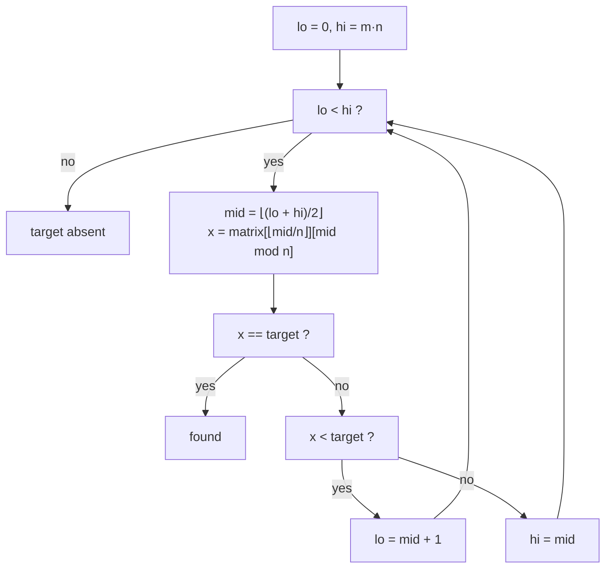

> [!tldr] Quick read
> - The problem: an m × n matrix, each row increasing, the first element of each row greater than the last element of the previous row. Is `target` in the matrix? Answer in O(log(m·n)).
> - Those two conditions mean that reading the matrix row by row gives **one increasing array** of length m·n. Flat index k maps to cell `(⌊k/n⌋, k mod n)`, where n is the number of **columns**. One [[en/concepts/binary-search|binary search]] over k does the job.
> - Another way: binary search for the row (the last row whose first element is ≤ target), then binary search inside it. Also O(log m + log n) = O(log(m·n)), and measured slightly faster because no step has to divide and take a remainder.
> - The **staircase** walk from the top-right corner is O(m + n): correct, but up to 500 times slower on a flat matrix. It belongs to [LeetCode 240](https://leetcode.com/problems/search-a-2d-matrix-ii/), where a row does **not** have to start above the previous one.
> - Two broken versions are run: picking the next row instead of the previous one (4/10 cases), and dividing the flat index by the number of rows instead of columns (right on square matrices, wrong when m ≠ n).

> [!info] Context
> LeetCode problem 74, on [[en/posts/2026-11-23-neetcode-binary-search|station 1: Binary Search on Arrays]] of **the NeetCode line: Search and Heaps**. It takes binary search on an array and applies it to a matrix with a single change of index. The solutions come in TypeScript, Python, Go, Java and JavaScript. All you need to know is loops, two-dimensional arrays and integer division.

> [!abstract]- Quick glossary for this post (click to open)
> - **Binary search**: on a sorted sequence, compare with the middle element and discard one half. Each step discards half, so n elements take about log₂ n steps. See [[en/concepts/binary-search|Binary Search]].
> - **Half-open interval `[lo, hi)`**: includes `lo`, excludes `hi`. The loop runs while `lo < hi` and is empty when `lo == hi`. See [[en/concepts/half-open-interval|Half-open Interval]].
> - **Row-major order**: read all of row 0, then row 1, … Cell `(r, c)` has flat index `r·n + c`.
> - **`⌊k/n⌋` and `k mod n`**: the quotient and remainder of k divided by n. Python's `divmod(k, n)` returns both.
> - **Loop invariant**: something true before every iteration, used to prove the loop correct. See [[en/concepts/loop-invariant|Loop Invariant]].

## Picture it first: a numbered filing cabinet

A filing cabinet has m drawers, each holding n folders, numbered in increasing order: drawer 0 holds numbers 1 to 7, drawer 1 starts at 10, and so on. You need folder 16.

| Everyday life | Concept |
|---|---|
| Open every drawer, flip through every folder | full scan, O(m·n) |
| Read the first label of each drawer to choose one, then open the middle of that drawer | two binary searches: find the row, then the column |
| Treat the whole cabinet as one continuous pile, numbered 0 to m·n − 1 | flat index k |
| Folder k sits in drawer ⌊k/n⌋, position k mod n inside it | `(⌊k/n⌋, k mod n)` |
| Picking the drawer **after** the right one | taking `lo` instead of `lo − 1` |
| Stand at a corner: too big, step left; too small, go down a drawer | the staircase walk, O(m + n) |



## The problem

**The problem (summarised in my own words):** given an m × n integer matrix `matrix` (1 ≤ m, n ≤ 100, values within ±10⁴). Each row is increasing, and the first element of each row is greater than the last element of the previous row. Return `true` if `target` is in the matrix. The solution must run in O(log(m·n)). Original problem: [LeetCode 74](https://leetcode.com/problems/search-a-2d-matrix/).

| `matrix` | `target` | Output |
|---|---|---|
| `[[1,3,5,7],[10,11,16,20],[23,30,34,60]]` | 3 | `true` |
| `[[1,3,5,7],[10,11,16,20],[23,30,34,60]]` | 13 | `false` |

I used to think a matrix needed its own "two-dimensional" binary search. It turns out that with the problem's two conditions, the matrix is just an increasing array cut into pieces of length n, and everything about binary search on an array carries over unchanged.

## How it works

### Approach 1, full scan: O(m·n)

Visit every cell. It uses no ordering at all. With m·n ≤ 10⁴ it still passes, but the problem asks for O(log(m·n)).

### Approach 2, two binary searches

**Step 1, find the row.** The row holding target (if any) is the **last row** whose first element is ≤ target. Binary search the first column with the half-open interval `[lo, hi)`: if `matrix[mid][0] ≤ target`, the right row is `mid` or later (`lo = mid + 1`); otherwise it is before `mid` (`hi = mid`). When the loop stops, `lo` is the **number** of rows whose first element is ≤ target, so the row we want is `lo − 1`. If `lo − 1 < 0`, target is smaller than every element.

**Step 2, search the row.** An ordinary binary search on row `lo − 1`.

The easy place to go wrong is step 1. Taking `lo` instead of `lo − 1` takes the **first row whose first element is > target**, the row right after the correct one. That broken version passes only 4/10 cases: it is only "right" when target was not in the matrix anyway.

### Approach 3, one binary search over the flat index

Reading row by row, cell `(r, c)` has index `k = r·n + c`. Conversely, `r = ⌊k/n⌋` and `c = k mod n`. Here n is the number of **columns**, because each row has n elements. Binary search `k ∈ [0, m·n)` as on an ordinary array, and convert `mid` into a cell whenever you read it.

Dividing by the number of rows m instead of the number of columns n is an easy mistake, because both are "the size". On a square matrix m = n, so the broken version is still right. On the 3 × 4 matrix of the example, `mid = 11` becomes row `⌊11/3⌋ = 3`, outside the matrix. The broken version passes 8/10 cases, failing only on the example's last element and on the single-column matrix.

### Approach 4, the staircase walk: O(m + n)

Stand at the top-right corner. If the current cell is greater than target, the whole column below it is greater too (columns increase): drop the column, step left. If it is smaller, the whole row to its left is smaller too: drop the row, step down. Each step drops one row or one column, so at most m + n steps.

This approach only needs every row and every column to increase. It does **not** use the condition "each row starts above the previous one", so it also solves [LeetCode 240](https://leetcode.com/problems/search-a-2d-matrix-ii/), where that condition is gone and the flat index is no longer increasing. On problem 74 it throws away information the problem gives you.

### Measured

TypeScript, value `2·k` in the cell with flat index k (so half the queries are absent), 10 000 random queries, median of 5 runs, ms:

| m × n | full scan | two binary searches | flat binary search | staircase |
|---|---|---|---|---|
| 100 × 100 | 56.1 | 0.99 | 1.53 | 1.62 |
| 1 000 × 1 000 | (not run) | 1.75 | 2.72 | 14.41 |
| 10 × 100 000 | (not run) | 1.51 | 2.72 | 800.49 |
| 100 000 × 10 | (not run) | 3.14 | 4.64 | 1 241.00 |

- At the problem's size (100 × 100), the last three approaches are nearly equal; the full scan is about 50 times slower.
- The staircase takes up to m + n steps per query. On the flat 10 × 100 000 matrix that is up to 100 010 steps against about 20 for binary search: about 530 times slower.
- Two binary searches are about 1.5 times faster than the flat one despite the same number of steps. Each step of the flat version computes `Math.floor(mid / n)` and `mid % n`, while the two-search version only reads the array.

### Under the hood of the five languages

| | Midpoint and division | Language-specific trap |
|---|---|---|
| TypeScript / JavaScript | `/` yields a float: needs `Math.floor(mid / n)`; `(lo + hi) >>> 1` | `>> 1` breaks from 2³¹: `3000000000 >> 1` gives `-647483648` |
| Python | `divmod(k, n)` returns quotient and remainder; ints do not overflow | `divmod(-7, 4)` is `(-2, 1)`: rounds down, unlike Go and Java |
| Go | `mid / n`, `mid % n` on `int` are integer division; `slices.BinarySearch` returns `(position, found)` | `-7 / 4` is `-1` (rounds toward zero); `sort.Search` needs a condition that goes false → true |
| Java | `(lo + hi) >>> 1`; `Arrays.binarySearch` | `(lo + hi) / 2` overflows when the sum exceeds 2³¹ − 1: gives `-397483648`; `binarySearch` returns `-(insertion point) - 1` when absent |

Midpoint overflow cannot happen in this problem (m·n ≤ 10⁴), but it is a famous bug: the binary search in Java's standard library had exactly this `(low + high) / 2` bug until 2006 (see References).

## Runnable example

[TypeScript](../code/neetcode-search-a-2d-matrix/search-2d-matrix.ts) · [Python](../code/neetcode-search-a-2d-matrix/search_2d_matrix.py) · [Go](../code/neetcode-search-a-2d-matrix/search_2d_matrix.go) · [Java](../code/neetcode-search-a-2d-matrix/search-2d-matrix.java) · [JavaScript](../code/neetcode-search-a-2d-matrix/search-2d-matrix.js)

Each file has the full scan, two binary searches, the flat binary search and the staircase, and runs 10 cases (including the first element of the last row, the very last element, a target smaller or larger than every element, and a one-cell, one-column and square matrix). Below are the two binary searches and the flat binary search.

```ts
// Approach 2, two binary searches: find the last row whose first element is ≤ target, then search inside that row.
function twoBinarySearch(matrix: number[][], target: number): boolean {
  let lo = 0, hi = matrix.length; // half-open [lo, hi): counts the rows whose first element is ≤ target
  while (lo < hi) {
    const mid = (lo + hi) >>> 1;
    if (matrix[mid][0] <= target) lo = mid + 1;
    else hi = mid;
  }
  const r = lo - 1; // the last row whose first element is ≤ target
  if (r < 0) return false; // target is smaller than every element
  const row = matrix[r];
  let a = 0, b = row.length;
  while (a < b) {
    const mid = (a + b) >>> 1;
    if (row[mid] < target) a = mid + 1;
    else b = mid;
  }
  return a < row.length && row[a] === target;
}

// Approach 3, one binary search over the flat index k ∈ [0, m·n): row = ⌊k/n⌋, column = k mod n (n is the number of COLUMNS).
function flatBinarySearch(matrix: number[][], target: number): boolean {
  const m = matrix.length, n = matrix[0].length;
  let lo = 0, hi = m * n;
  while (lo < hi) {
    const mid = (lo + hi) >>> 1;
    const x = matrix[Math.floor(mid / n)][mid % n];
    if (x === target) return true;
    if (x < target) lo = mid + 1;
    else hi = mid;
  }
  return false;
}
```

```python
def two_binary_search(matrix: list[list[int]], target: int) -> bool:
    # key= (Python 3.10+) compares by each row's first element without building an O(m) list of first elements
    r = bisect_right(matrix, target, key=lambda row: row[0]) - 1  # the last row whose first element is ≤ target
    if r < 0:
        return False
    row = matrix[r]
    c = bisect_left(row, target)
    return c < len(row) and row[c] == target

def flat_binary_search(matrix: list[list[int]], target: int) -> bool:
    m, n = len(matrix), len(matrix[0])
    lo, hi = 0, m * n
    while lo < hi:
        mid = (lo + hi) // 2  # Python ints do not overflow
        r, c = divmod(mid, n)  # row = mid // n, column = mid % n
        x = matrix[r][c]
        if x == target:
            return True
        if x < target:
            lo = mid + 1
        else:
            hi = mid
    return False
```

```go
func twoBinarySearch(matrix [][]int, target int) bool {
	// sort.Search returns the smallest index where the condition is true: the first row whose first element is > target
	r := sort.Search(len(matrix), func(i int) bool { return matrix[i][0] > target }) - 1
	if r < 0 {
		return false
	}
	_, found := slices.BinarySearch(matrix[r], target) // Go 1.21+: returns (insertion position, whether it was found)
	return found
}

func flatBinarySearch(matrix [][]int, target int) bool {
	m, n := len(matrix), len(matrix[0])
	lo, hi := 0, m*n
	for lo < hi {
		mid := int(uint(lo+hi) >> 1) // the sort.Search way: no overflow even when lo+hi exceeds MaxInt
		x := matrix[mid/n][mid%n] // int divided by int is integer division
		if x == target {
			return true
		}
		if x < target {
			lo = mid + 1
		} else {
			hi = mid
		}
	}
	return false
}
```

```java
static boolean twoBinarySearch(int[][] matrix, int target) {
    int lo = 0, hi = matrix.length;
    while (lo < hi) {
        int mid = (lo + hi) >>> 1;
        if (matrix[mid][0] <= target) lo = mid + 1; else hi = mid;
    }
    int r = lo - 1;
    if (r < 0) return false;
    // Arrays.binarySearch returns the index if found, otherwise -(insertion point) - 1: always negative
    return Arrays.binarySearch(matrix[r], target) >= 0;
}

static boolean flatBinarySearch(int[][] matrix, int target) {
    int m = matrix.length, n = matrix[0].length;
    int lo = 0, hi = m * n; // m·n ≤ 10⁴ per the problem; a very large matrix would need long
    while (lo < hi) {
        int mid = (lo + hi) >>> 1; // >>> is an unsigned shift: correct even when lo + hi overflows int
        int x = matrix[mid / n][mid % n];
        if (x == target) return true;
        if (x < target) lo = mid + 1; else hi = mid;
    }
    return false;
}
```

```js
function twoBinarySearch(matrix, target) {
  let lo = 0, hi = matrix.length;
  while (lo < hi) {
    const mid = (lo + hi) >>> 1;
    if (matrix[mid][0] <= target) lo = mid + 1;
    else hi = mid;
  }
  const r = lo - 1;
  if (r < 0) return false;
  const row = matrix[r];
  let a = 0, b = row.length;
  while (a < b) {
    const mid = (a + b) >>> 1;
    if (row[mid] < target) a = mid + 1;
    else b = mid;
  }
  return a < row.length && row[a] === target;
}

function flatBinarySearch(matrix, target) {
  const m = matrix.length, n = matrix[0].length;
  let lo = 0, hi = m * n;
  while (lo < hi) {
    const mid = (lo + hi) >>> 1; // >>> 1 is correct up to 2³²; >> 1 breaks from 2³¹ (turns negative)
    const x = matrix[Math.floor(mid / n)][mid % n]; // JS "/" yields a float: Math.floor is required
    if (x === target) return true;
    if (x < target) lo = mid + 1;
    else hi = mid;
  }
  return false;
}
```


The TypeScript file also runs the two broken versions, then measures:

```text
$ node search-2d-matrix.ts
linearScan        10/10 cases correct
twoBinarySearch   10/10 cases correct
flatBinarySearch  10/10 cases correct
staircase         10/10 cases correct
wrongRowPick      4/10 cases correct; wrong on: example → 3, example → 60 (last), example → 23 (first of last row), [[1]] → 1, one column [[1],[3]] → 3, square [[1,2],[3,4]] → 4
wrongFlatIndex    8/10 cases correct; wrong on: example → 60 (last), one column [[1],[3]] → 3

m × n          queries   full scan  two binary searches  flat binary search  staircase   (ms, median of 5 runs)
100 × 100         10000      56.1              0.99            1.53        1.62
1000 × 1000       10000         —              1.75            2.72       14.41
10 × 100000       10000         —              1.51            2.72      800.49
100000 × 10       10000         —              3.14            4.64     1241.00
```

*(Output labels translated; the files themselves print Vietnamese.)*

`wrongRowPick` is wrong on **every** case where target is present, and right on every case where it is absent: it always searches the row right after the correct one. `wrongFlatIndex` is right on the square matrix `[[1,2],[3,4]]` because there the number of rows equals the number of columns. Java also prints the overflowing midpoint computation:

```text
$ java search-2d-matrix.java
linearScan        10/10 cases correct
twoBinarySearch   10/10 cases correct
flatBinarySearch  10/10 cases correct
staircase         10/10 cases correct

lo = 1500000000, hi = 2000000000: (lo + hi) / 2 = -397483648, (lo + hi) >>> 1 = 1750000000, lo + (hi - lo) / 2 = 1750000000
Arrays.binarySearch([1, 3, 5, 7], 4) = -3
```

`-3` means "absent, insertion point 2" (`-(2) - 1`). Python, Go and JavaScript print `10/10` correct for all four approaches, plus one line about that language's division: Python `divmod(-7, 4) = (-2, 1)`, Go `-7 / 4 = -1, -7 % 4 = -3`, JavaScript `3000000000 >> 1 = -647483648, 3000000000 >>> 1 = 1500000000, 7 / 2 = 3.5`.

## Misconceptions and common traps

- **"A matrix needs a two-dimensional binary search."** Under problem 74's conditions, the matrix is an increasing array cut into pieces; a one-dimensional binary search over the flat index is enough.
- **Picking the wrong row.** The row holding target is the **last** row whose first element is ≤ target, that is `lo − 1` after the loop that counts "rows whose first element is ≤ target". Taking `lo` searches the next row.
- **Forgetting the case where target is smaller than everything.** Then `lo − 1 = −1`; reading `matrix[-1]` is an error (Java, Go) or silently reads the last row (Python, where negative indices count from the end).
- **Dividing the flat index by the number of rows.** Tests that only use square matrices cannot catch this.
- **Using the staircase for problem 74.** Correct but O(m + n); up to several hundred times slower on a flat matrix. Save it for LeetCode 240.
- **`(lo + hi) / 2` in Java or `>> 1` in JS.** Harmless here, but broken once indices pass 2³⁰ (Java) or 2³¹ (JS). Use `>>> 1` or `lo + (hi − lo) / 2`.
- **Python: building `[row[0] for row in matrix]` to feed `bisect`.** That step costs O(m) and ruins the O(log m) of finding the row. Since Python 3.10, `bisect_right(matrix, target, key=lambda row: row[0])` compares by the first element without building a list.

## Self-check questions

> [!question]- A 3 × 4 matrix. Which cell is flat index 7, and what is the flat index of cell (2, 1)?
> 7 = 1·4 + 3, so cell (1, 3). Cell (2, 1) has index 2·4 + 1 = 9.

> [!question]- In the row search, why does the `[lo, hi)` loop stop with `lo` equal to the number of rows whose first element is ≤ target?
> Invariant: every row before `lo` has a first element ≤ target, every row from `hi` on has a first element > target. The first column increases, so "≤ target" holds on a leading stretch and then fails for good. When `lo == hi`, `lo` is that boundary, which is the number of rows satisfying the condition.

> [!question]- Why must the staircase walk start at the top-right (or bottom-left) corner, not the top-left?
> At the top-left, both moves (right, down) increase the value, so when the cell is smaller than target you cannot tell which way to go. At the top-right, left decreases and down increases: each comparison picks exactly one direction and drops a whole row or column.

> [!question]- Change the problem to LeetCode 240: rows increase, columns increase, but a row need not start above the previous one. Is the flat binary search still correct?
> No: reading row by row no longer gives an increasing array, so comparing with the middle element does not tell you which half holds target. The staircase is still correct, because it only uses the order within each row and each column.

## References

- [LeetCode 74: Search a 2D Matrix](https://leetcode.com/problems/search-a-2d-matrix/) (original problem) and [LeetCode 240: Search a 2D Matrix II](https://leetcode.com/problems/search-a-2d-matrix-ii/) (the version without the condition between rows)
- Joshua Bloch, [Extra, Extra - Read All About It: Nearly All Binary Searches and Mergesorts are Broken](https://research.google/blog/extra-extra-read-all-about-it-nearly-all-binary-searches-and-mergesorts-are-broken/), Google Research Blog, 2006 (the `(low + high) / 2` overflow)
- [Python: the `bisect` module](https://docs.python.org/3/library/bisect.html) and [built-in `divmod`](https://docs.python.org/3/library/functions.html#divmod)
- [Go: `sort.Search`](https://pkg.go.dev/sort#Search) and [`slices.BinarySearch`](https://pkg.go.dev/slices#BinarySearch); [Go spec: Integer operators](https://go.dev/ref/spec#Integer_operators) (division rounds toward zero)
- [Java 21 `Arrays.binarySearch(int[], int)`](https://docs.oracle.com/en/java/javase/21/docs/api/java.base/java/util/Arrays.html#binarySearch(int%5B%5D,int)) (the return value when not found)
- [MDN: Unsigned right shift (`>>>`)](https://developer.mozilla.org/en-US/docs/Web/JavaScript/Reference/Operators/Unsigned_right_shift)
