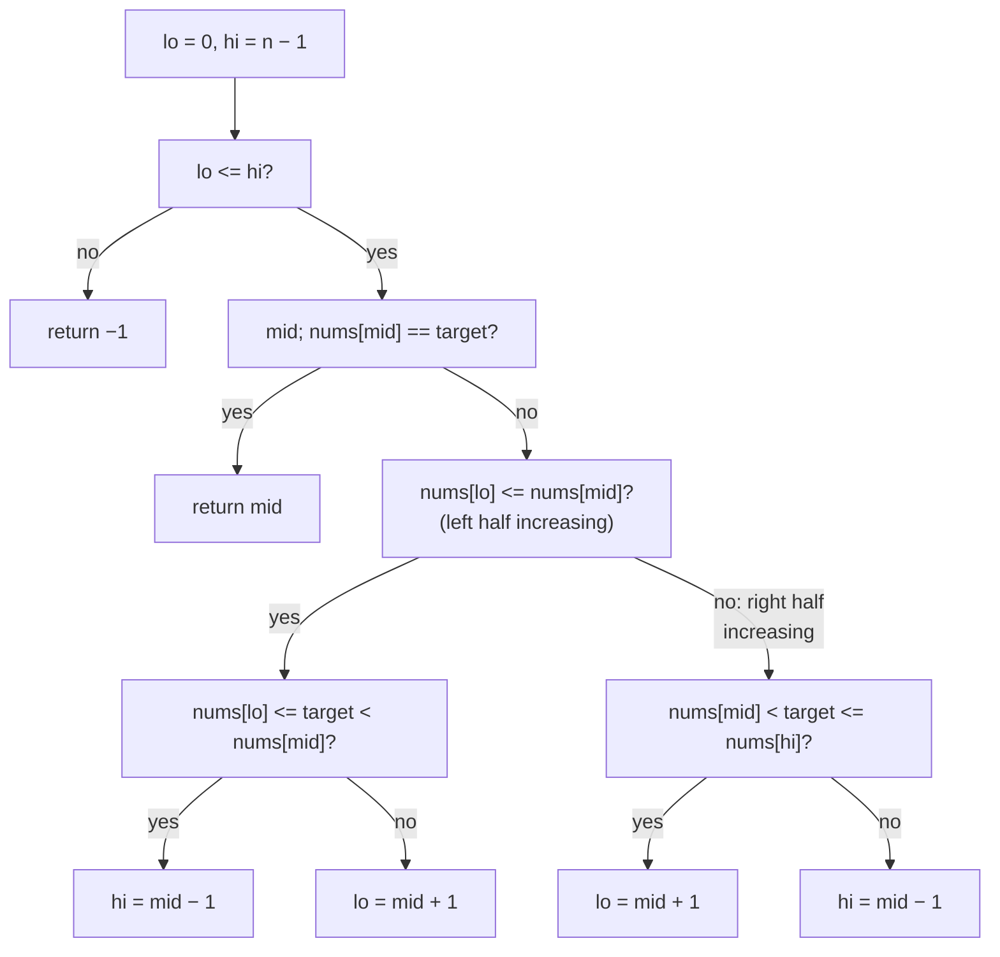

> [!tldr] Quick read
> - The problem: an increasing array of distinct numbers has been **rotated**. Return the index of `target`, or −1 if absent, in O(log n).
> - The key observation: cut a rotated array at any mid and **at least one half**, `[lo, mid]` or `[mid, hi]`, is fully increasing. For that half, "does target lie between its two ends?" tells you which half to drop.
> - Two passes: use the [[en/problems/find-minimum-in-rotated-sorted-array|Find Minimum]] solution to find the break, then a plain [[en/concepts/binary-search|binary search]] on the run holding target. Easier to get right, about 2× slower.
> - Trap: testing "left half is increasing" with `nums[lo] < nums[mid]` instead of `<=`. With two cells left, `lo == mid`, and searching `[3, 1]` for `1` returns −1.
> - Measured: 10⁷ elements, `indexOf` 8 135 µs, one pass 0.040 µs, two passes 0.080 µs. With duplicates (LeetCode 81): 10 016 steps at n = 10⁵.

> [!info] Context
> LeetCode problem 33, the last problem of [[en/posts/2026-11-23-neetcode-binary-search|station 1: Binary Search on Arrays]] on **the NeetCode Line: Search and Heaps**. It joins the two before it: [[en/problems/binary-search|Binary Search]] (find a number in an increasing array) and [[en/problems/find-minimum-in-rotated-sorted-array|Find Minimum in Rotated Sorted Array]] (find the break). The solutions come in TypeScript, Python, Go, Java and JavaScript. All you need to know is loops and arrays.

> [!abstract]- Quick glossary for this post (click to open)
> - **Binary search**: each step looks at the middle cell and drops the half that cannot hold the answer. See [[en/concepts/binary-search|Binary Search]].
> - **Rotated sorted array**: an increasing array cut at one point, with the front part moved to the back. See [[en/concepts/rotated-sorted-array|Rotated Sorted Array]].
> - **Pivot (the break)**: the index of the minimum, where the second run starts.
> - **Loop invariant**: what holds at the start of every iteration. Here: "if target is in the array, it lies in `[lo, hi]`". See [[en/concepts/loop-invariant|Loop Invariant]].
> - **Half-open interval**: `[a, b)` includes a but not b; Python's `bisect` and Go's `sort.Search` work this way. See [[en/concepts/half-open-interval|Half-open Interval]].

## Picture it first: finding a page in a misbound notebook

A notebook has increasing page numbers, but the binder cut it wrong: the back part got bound in front. Opening from the start, you see pages 40, 50, 60, 70, then 0, 10, 20. You need page 10 without turning every page.

| Everyday life | Concept |
|---|---|
| The misbound notebook | a rotated array |
| Opening the middle of the stack still in doubt | `mid` |
| Looking at the first page and the middle page: if the numbers rise evenly, the left stack is "intact" | `nums[lo] <= nums[mid]`: the left half is increasing |
| Otherwise the right stack is "intact" | the right half `[mid, hi]` is increasing |
| The page you want is between the first and last number of the intact stack: only search that stack | narrow to the sorted half |
| It is not in there: it must be in the other stack, even though that stack is misbound | narrow to the other half |



## The problem

**The problem (in my own words):** given an array `nums` of n **distinct** integers (1 ≤ n ≤ 5 000), originally increasing and possibly rotated at some index k, and a number `target`, return the index of `target` in `nums`, or −1 if it is absent. The algorithm must be O(log n). Original: [LeetCode 33](https://leetcode.com/problems/search-in-rotated-sorted-array/).

| Input | Output |
|---|---|
| `nums = [4, 5, 6, 7, 0, 1, 2], target = 0` | `4` |
| `nums = [4, 5, 6, 7, 0, 1, 2], target = 3` | `-1` |
| `nums = [1], target = 0` | `-1` |
| `nums = [3, 1], target = 1` | `1` |

I used to think you had to know the break before you could search. It turns out you don't: at each step you only need to know that **some half** is sorted. The sorted half gives a question, "is target in this range?", that can be answered for sure; the other half needs no question, only elimination.

## How it works

<figure class="figure-map" style="--ar: 3 / 4">
<div class="frame"><iframe data-archify="../../diagrams/neetcode-search-in-rotated-sorted-array/worked-example.en.html" title="Use the sorted half to locate the target" loading="lazy"></iframe></div>
<figcaption><span><b>Figure 1.</b> Use the sorted half to locate the target.</span><a href="../diagrams/neetcode-search-in-rotated-sorted-array/worked-example.en.html" target="_blank" rel="noopener">Open full screen</a></figcaption>
</figure>

<details>
<summary>Read the steps</summary>
<ol>
<li>Examine the midpoint. <code>[9, 12, 17, 2, 5, 7], target = 5</code></li>
<li>The left half from 9 to 17 is sorted. <code>mid = 2, value = 17</code></li>
<li>Target 5 lies outside that half. <code>lo = 3, hi = 5</code></li>
<li>The new midpoint is the target. <code>mid = 4</code></li>
</ol>
</details>

### Approach 1, scan: O(n)

`indexOf`, `slices.Index`, or a `for` loop. Correct, but it uses nothing of the array being almost sorted.

### Approach 2, one pass

Why is one half always increasing? A rotated array has only **one** drop. That drop lies in `[lo, mid]` or in `[mid, hi]`, never in both, so the half without it is fully increasing. The test `nums[lo] <= nums[mid]` says whether the left half is intact:

| Intact half | target in the intact half | Step |
|---|---|---|
| left (`nums[lo] <= nums[mid]`) | `nums[lo] <= target < nums[mid]` | `hi = mid − 1` |
| left | no | `lo = mid + 1` |
| right (otherwise) | `nums[mid] < target <= nums[hi]` | `lo = mid + 1` |
| right | no | `hi = mid − 1` |

The ends of the ranges are not symmetric: `nums[mid]` was already compared with `==` at the top of the loop, so it is the **open** end of both ranges; `nums[lo]` and `nums[hi]` are **closed** ends because target can sit right there.

### The = in `nums[lo] <= nums[mid]`

With two cells left, `mid` rounds down so `mid == lo`, and `nums[lo] == nums[mid]` (the same cell). The left half `[lo, mid]` has one cell, so it is "increasing" trivially. Write `<` and the test says "no", the code assumes the right half is the intact one and checks `nums[mid] < target <= nums[hi]` on a range that contains the drop. For `[3, 1]`, target 1: `3 < 1` is false, so `hi = mid − 1 = −1`, the loop ends and returns −1 although 1 is at index 1. The bug only appears when the remaining range has exactly two cells, **is rotated**, and target is in the second cell, so a few hand-written tests on long arrays easily miss it. The TypeScript file runs the wrong version: `8/9 ca đúng` ("8/9 cases passed"), failing exactly on `[3, 1]`.

### Approach 3, two passes: find the break, then a plain binary search

Pass one is the [[en/problems/find-minimum-in-rotated-sorted-array|Find Minimum]] solution, returning the index `pivot` of the minimum. The two runs `[0, pivot − 1]` and `[pivot, n − 1]` are both increasing. If `nums[pivot] <= target <= nums[n − 1]`, search the second run, otherwise the first. Pass two is a plain binary search, so the standard library works: Python's `bisect_left`, Go's `sort.SearchInts`, Java's `Arrays.binarySearch(a, from, to, key)`. Each pass is O(log n), so the total is still O(log n). Fewer branches, easier to prove correct, at the cost of twice the steps.

### Checking every small case

Hand-written tests easily miss a case like `[3, 1]`. The TypeScript file tries **every** rotation of `0..n−1` for n from 1 to 12 and every target from −1 to n, then compares both approaches with `indexOf`: 806 tuples, 0 mismatches. The same loop catches the `<` version on 18 tuples: only 2 %, rare enough to slip past a few hand-written tests, but not past the exhaustive check.

### With duplicates: LeetCode 81

If duplicates are allowed, `nums[lo] == nums[mid] == nums[hi]` cannot tell which half is intact: `[1, 1, 1, 0, 1]` and `[1, 0, 1, 1, 1]` look identical at those three cells. All you can do is drop both ends (`lo++`, `hi--`), and the worst case becomes O(n). Problem 81 also only asks whether target exists, because with duplicates "the index of target" is no longer unique.

### Measurements

TypeScript, target = −1 (absent, so every approach goes all the way), median of 7 runs:

| n | `indexOf` (µs) | one pass (µs) | two passes (µs) |
|---|---|---|---|
| 1 000 | 0.88 | 0.020 | 0.033 |
| 100 000 | 75.25 | 0.028 | 0.051 |
| 1 000 000 | 754.54 | 0.036 | 0.061 |
| 10 000 000 | 8 135.40 | 0.040 | 0.080 |

Two passes are about 1.7 to 2 times slower than one pass, matching twice the steps. Both are still a hundred thousand times faster than `indexOf` at 10⁷ elements.

Duplicates (the LeetCode 81 version, target 2 absent):

| n | all 1s except one 0 | no duplicates |
|---|---|---|
| 1 000 | 109 steps | 10 steps |
| 10 000 | 1 012 steps | 14 steps |
| 100 000 | 10 016 steps | 17 steps |

### Under the hood in seven languages

| | Built-in binary search | Language-specific trap |
|---|---|---|
| TypeScript / JavaScript | none in the standard library | `lo + ((hi - lo) >> 1)` coerces to int32: correct for every real array index, wrong if reused on a value range above 2³¹ |
| Python | `bisect_left(a, x, lo, hi)` | `hi` is the **open** end; `nums[lo] <= target < nums[mid]` works because Python chains comparisons |
| Go | `sort.Search(n, f)`, `sort.SearchInts`, `slices.BinarySearch` | `sort.Search` returns `n` when no cell satisfies `f`: check `i < n` before reading `nums[i]`. Slicing `nums[a:b]` does not copy, but the returned index counts from a |
| Java | `Arrays.binarySearch(a, from, to, key)` | when absent it returns `−(insertion point) − 1`, not −1: `binarySearch([1, 3, 5], 4)` gives `-3`. Check `>= 0`. The `to` end is open |
| PHP | none; `array_search` is a linear scan | `array_search` returns `false` when missing, not `-1`; writing `if (!array_search(...))` also misfires when the value is found at index 0. Pass `true` as the third argument to compare with `===` |
| Rust | `slice::binary_search` on a subslice | slicing `&nums[pivot..]` and searching returns an index relative to the subslice: add `pivot` back. The closed interval's `hi = mid - 1` reaches −1, so the one-pass version keeps indices in `i64` |

## Runnable example

[TypeScript](../code/neetcode-search-in-rotated-sorted-array/search-rotated.ts) · [Python](../code/neetcode-search-in-rotated-sorted-array/search_rotated.py) · [Go](../code/neetcode-search-in-rotated-sorted-array/search_rotated.go) · [Java](../code/neetcode-search-in-rotated-sorted-array/search-rotated.java) · [JavaScript](../code/neetcode-search-in-rotated-sorted-array/search-rotated.js) · [PHP](../code/neetcode-search-in-rotated-sorted-array/search-rotated.php) · [Rust](../code/neetcode-search-in-rotated-sorted-array/search_rotated.rs)

Each file has the scan, one pass and two passes, run on 9 cases. The TypeScript file adds the wrong version, the duplicates version, the exhaustive small-case check and the measurements. Below are the one-pass and two-pass approaches.

```ts
// One pass: at every step at least one half, [lo, mid] or [mid, hi], is sorted. Ask whether target lies in that half.
function onePass(nums: number[], target: number): number {
  let lo = 0, hi = nums.length - 1;
  while (lo <= hi) {
    const mid = lo + ((hi - lo) >> 1);
    if (nums[mid] === target) return mid;
    if (nums[lo] <= nums[mid]) {
      // left half [lo, mid] is increasing (the = is needed for lo == mid)
      if (nums[lo] <= target && target < nums[mid]) hi = mid - 1;
      else lo = mid + 1;
    } else {
      // right half [mid, hi] is increasing
      if (nums[mid] < target && target <= nums[hi]) lo = mid + 1;
      else hi = mid - 1;
    }
  }
  return -1;
}

// Two passes: find the break (index of the min, as in problem 153), then a plain binary search on the half holding target.
function pivotThenSearch(nums: number[], target: number): number {
  let lo = 0, hi = nums.length - 1;
  while (lo < hi) {
    const mid = lo + ((hi - lo) >> 1);
    if (nums[mid] > nums[hi]) lo = mid + 1;
    else hi = mid;
  }
  const pivot = lo; // nums[pivot..] and nums[..pivot-1] are both increasing
  const [a, b] = target >= nums[pivot] && target <= nums[nums.length - 1] ? [pivot, nums.length - 1] : [0, pivot - 1];
  return binarySearch(nums, target, a, b);
}

function binarySearch(nums: number[], target: number, lo: number, hi: number): number {
  while (lo <= hi) {
    const mid = lo + ((hi - lo) >> 1);
    if (nums[mid] === target) return mid;
    if (nums[mid] < target) lo = mid + 1;
    else hi = mid - 1;
  }
  return -1;
}
```

```python
def one_pass(nums: list[int], target: int) -> int:
    lo, hi = 0, len(nums) - 1
    while lo <= hi:
        mid = (lo + hi) // 2
        if nums[mid] == target:
            return mid
        if nums[lo] <= nums[mid]:  # left half is increasing
            if nums[lo] <= target < nums[mid]:  # Python allows chained comparisons: a <= x < b
                hi = mid - 1
            else:
                lo = mid + 1
        else:  # right half is increasing
            if nums[mid] < target <= nums[hi]:
                lo = mid + 1
            else:
                hi = mid - 1
    return -1

def pivot_then_search(nums: list[int], target: int) -> int:
    lo, hi = 0, len(nums) - 1
    while lo < hi:
        mid = (lo + hi) // 2
        if nums[mid] > nums[hi]:
            lo = mid + 1
        else:
            hi = mid
    pivot = lo
    a, b = (pivot, len(nums)) if nums[pivot] <= target <= nums[-1] else (0, pivot)
    i = bisect_left(nums, target, a, b)  # bisect takes lo, hi: search a range without slicing the list
    return i if i < b and nums[i] == target else -1
```

```go
func onePass(nums []int, target int) int {
	lo, hi := 0, len(nums)-1
	for lo <= hi {
		mid := lo + (hi-lo)/2
		if nums[mid] == target {
			return mid
		}
		if nums[lo] <= nums[mid] {
			if nums[lo] <= target && target < nums[mid] {
				hi = mid - 1
			} else {
				lo = mid + 1
			}
		} else {
			if nums[mid] < target && target <= nums[hi] {
				lo = mid + 1
			} else {
				hi = mid - 1
			}
		}
	}
	return -1
}

func pivotThenSearch(nums []int, target int) int {
	n := len(nums)
	pivot := sort.Search(n, func(i int) bool { return nums[i] < nums[0] }) // first index smaller than nums[0]; = n if not rotated
	a, b := 0, pivot
	if pivot < n && target < nums[0] {
		a, b = pivot, n
	}
	i := a + sort.SearchInts(nums[a:b], target) // nums[a:b] is a sub-slice, no copy
	if i < b && nums[i] == target {
		return i
	}
	return -1
}
```

```java
static int onePass(int[] nums, int target) {
    int lo = 0, hi = nums.length - 1;
    while (lo <= hi) {
        int mid = (lo + hi) >>> 1;
        if (nums[mid] == target) return mid;
        if (nums[lo] <= nums[mid]) {
            if (nums[lo] <= target && target < nums[mid]) hi = mid - 1;
            else lo = mid + 1;
        } else {
            if (nums[mid] < target && target <= nums[hi]) lo = mid + 1;
            else hi = mid - 1;
        }
    }
    return -1;
}

static int pivotThenSearch(int[] nums, int target) {
    int lo = 0, hi = nums.length - 1;
    while (lo < hi) {
        int mid = (lo + hi) >>> 1;
        if (nums[mid] > nums[hi]) lo = mid + 1;
        else hi = mid;
    }
    int pivot = lo, n = nums.length;
    int a = 0, b = pivot;
    if (target >= nums[pivot] && target <= nums[n - 1]) { a = pivot; b = n; }
    // Arrays.binarySearch returns -(insertion point) - 1 when absent: check >= 0, do not compare with -1
    int i = Arrays.binarySearch(nums, a, b, target);
    return i >= 0 ? i : -1;
}
```

```js
function onePass(nums, target) {
  let lo = 0, hi = nums.length - 1;
  while (lo <= hi) {
    const mid = Math.floor((lo + hi) / 2);
    if (nums[mid] === target) return mid;
    if (nums[lo] <= nums[mid]) {
      if (nums[lo] <= target && target < nums[mid]) hi = mid - 1;
      else lo = mid + 1;
    } else {
      if (nums[mid] < target && target <= nums[hi]) lo = mid + 1;
      else hi = mid - 1;
    }
  }
  return -1;
}

function pivotThenSearch(nums, target) {
  let lo = 0, hi = nums.length - 1;
  while (lo < hi) {
    const mid = Math.floor((lo + hi) / 2);
    if (nums[mid] > nums[hi]) lo = mid + 1;
    else hi = mid;
  }
  const pivot = lo;
  let [a, b] = target >= nums[pivot] && target <= nums[nums.length - 1] ? [pivot, nums.length - 1] : [0, pivot - 1];
  while (a <= b) {
    const mid = Math.floor((a + b) / 2);
    if (nums[mid] === target) return mid;
    if (nums[mid] < target) a = mid + 1;
    else b = mid - 1;
  }
  return -1;
}
```

```php
// One-pass approach: at every step, at least one half [lo, mid] or [mid, hi] is sorted. Ask whether target lies in that half.
function onePass(array $nums, int $target): int
{
    $lo = 0;
    $hi = count($nums) - 1;
    while ($lo <= $hi) {
        $mid = ($lo + $hi) >> 1;
        if ($nums[$mid] === $target) return $mid;
        if ($nums[$lo] <= $nums[$mid]) { // left half is increasing (the = is needed for lo == mid)
            if ($nums[$lo] <= $target && $target < $nums[$mid]) $hi = $mid - 1;
            else $lo = $mid + 1;
        } else { // right half is increasing
            if ($nums[$mid] < $target && $target <= $nums[$hi]) $lo = $mid + 1;
            else $hi = $mid - 1;
        }
    }
    return -1;
}

// Two-pass approach: find the break point (index of the minimum, as in problem 153), then a plain binary search on the half that holds target.
function pivotThenSearch(array $nums, int $target): int
{
    $n = count($nums);
    $lo = 0;
    $hi = $n - 1;
    while ($lo < $hi) {
        $mid = ($lo + $hi) >> 1;
        if ($nums[$mid] > $nums[$hi]) $lo = $mid + 1;
        else $hi = $mid;
    }
    $pivot = $lo; // nums[pivot..] and nums[..pivot-1] are both increasing
    [$a, $b] = $target >= $nums[$pivot] && $target <= $nums[$n - 1] ? [$pivot, $n - 1] : [0, $pivot - 1];
    return binarySearch($nums, $target, $a, $b);
}

function binarySearch(array $nums, int $target, int $lo, int $hi): int
{
    while ($lo <= $hi) {
        $mid = ($lo + $hi) >> 1;
        if ($nums[$mid] === $target) return $mid;
        if ($nums[$mid] < $target) $lo = $mid + 1;
        else $hi = $mid - 1;
    }
    return -1;
}
```

```rust
// One-pass approach: at every step, at least one half [lo, mid] or [mid, hi] is sorted.
// The closed interval needs hi = mid - 1, which can reach -1, so indices stay in i64.
fn one_pass(nums: &[i32], target: i32) -> i32 {
    let (mut lo, mut hi) = (0i64, nums.len() as i64 - 1);
    while lo <= hi {
        let mid = lo + (hi - lo) / 2;
        let (l, m, h) = (nums[lo as usize], nums[mid as usize], nums[hi as usize]);
        if m == target {
            return mid as i32;
        }
        if l <= m {
            // left half [lo, mid] is increasing (the = is needed for lo == mid)
            if l <= target && target < m { hi = mid - 1 } else { lo = mid + 1 }
        } else {
            // right half [mid, hi] is increasing
            if m < target && target <= h { lo = mid + 1 } else { hi = mid - 1 }
        }
    }
    -1
}

// Two-pass approach: find the break point (index of the minimum, as in problem 153), then binary_search on the half that holds target.
fn pivot_then_search(nums: &[i32], target: i32) -> i32 {
    let (mut lo, mut hi) = (0, nums.len() - 1);
    while lo < hi {
        let mid = lo + (hi - lo) / 2;
        if nums[mid] > nums[hi] { lo = mid + 1 } else { hi = mid }
    }
    let pivot = lo; // nums[pivot..] and nums[..pivot] are both increasing
    // Slice instead of passing two bounds: the left half is nums[..pivot], empty when pivot = 0.
    let (offset, half) = if target >= nums[pivot] && target <= nums[nums.len() - 1] {
        (pivot, &nums[pivot..])
    } else {
        (0, &nums[..pivot])
    };
    match half.binary_search(&target) {
        Ok(i) => (offset + i) as i32, // an index within the subslice needs the offset added back
        Err(_) => -1,
    }
}
```

Output of the TypeScript file:

```text
linearScan       9/9 cases passed
onePass          9/9 cases passed
pivotThenSearch  9/9 cases passed
wrongStrict      8/9 cases passed; wrong on [3,1] t=1 → -1

checked against indexOf: 806 (array, target) tuples, 0 mismatched; the wrong wrongStrict mismatches 18 tuples

n          indexOf (µs)   one pass (µs)   two passes (µs)   target = -1 (absent)
1000               0.88           0.020           0.033
100000            75.25           0.028           0.051
1000000          754.54           0.036           0.061
10000000        8135.40           0.040           0.080

LeetCode 81, steps when target is absent
n = 1000    all 1s except one 0:    109 steps;  no duplicates: 10 steps
n = 10000   all 1s except one 0:   1012 steps;  no duplicates: 14 steps
n = 100000  all 1s except one 0:  10016 steps;  no duplicates: 17 steps
```

*(Output labels translated; the files themselves print Vietnamese.)*

The Java file also prints what `Arrays.binarySearch` returns when the key is absent:

```text
linearScan       9/9 cases passed
onePass          9/9 cases passed
pivotThenSearch  9/9 cases passed

Arrays.binarySearch([1, 3, 5], 4) = -3
```

Python, Go and JavaScript print `9/9 ca đúng` ("9/9 cases passed") for all three approaches.

PHP (`php search-rotated.php`) and Rust (`rustc --edition 2021 -O search_rotated.rs`) also run the broken version, the exhaustive small-case check and the duplicates version: `9/9` for the three correct approaches, `8/9` for `wrongStrict` (wrong on `[3,1] t=1`), 0 of 806 pairs off (18 for the broken one), and 109 / 1 012 / 10 016 steps for LeetCode 81, matching TypeScript.

## Misconceptions and common traps

- **"You must find the break first."** Not required: one pass only needs to know which half is intact at each step. Finding the break first (two passes) is the easier-to-get-right option, not a requirement.
- **`nums[lo] < nums[mid]` instead of `<=`.** Wrong with two cells left and `lo == mid`. The smallest failing case: `[3, 1]`, target 1.
- **Wrong range ends.** `nums[lo] <= target < nums[mid]`: mid was compared separately, so it is the open end; lo is a closed end. Turning the `<=` at lo into `<` misses a target sitting exactly at `nums[lo]`.
- **Asking about the unsorted half.** "target > nums[mid]" means nothing if the right half contains the drop. Always ask about the sorted half and deduce the other by elimination.
- **Java: comparing the result of `Arrays.binarySearch` with −1.** It returns `−(insertion point) − 1`, so −1 only means "the insertion point is 0". Check `>= 0`.
- **Reusing the solution on an array with duplicates.** You must add the `lo++, hi--` branch when three cells are equal, and accept O(n) in the worst case.
- **PHP: `array_search` as the reference.** It returns `false` when missing and `0` when found at the front; a loose `== -1` or `!` gets both wrong. The sample file turns `false` into `-1` with `=== false`.
- **Rust: forgetting to add the `offset` after searching a subslice.** `nums[pivot..].binary_search(&t)` returns an index within the subslice; returning it directly is wrong whenever the target is in the right half. With `pivot = 0` the left half `&nums[..0]` is empty, not a panic.

## Self-check questions

> [!question]- Run one pass on `[6, 7, 1, 2, 3, 4, 5]`, target 6. Write down lo, hi, mid at each step.
> lo = 0, hi = 6, mid = 3: `nums[3] = 2`. `6 <= 2`? no, so the right half is intact; `2 < 6 <= 5`? no, `hi = 2`. lo = 0, hi = 2, mid = 1: `nums[1] = 7`. `6 <= 7`, the left half is intact; `6 <= 6 < 7`, `hi = 0`. lo = hi = 0, mid = 0: `nums[0] = 6`, return 0.

> [!question]- Why, in a rotated array, is at least one of the halves `[lo, mid]`, `[mid, hi]` always increasing?
> A range `[lo, hi]` of a rotated array has at most one drop. That drop lies in only one half, so the other half has no drop at all, which means it is increasing.

> [!question]- In two passes, if the array is not rotated, what is pivot and is the code still correct?
> Pivot = 0 (the minimum is first). The second run is the whole array `[0, n − 1]` and the first run is empty. The test `nums[0] <= target <= nums[n − 1]` picks the whole array; a target outside that range goes to the empty first run, which returns −1.

> [!question]- With duplicates, why does `[1, 1, 1, 0, 1]` force dropping one cell at a time?
> lo = 0, mid = 2, hi = 4 are all 1. The 0 could be left of mid (as in `[1, 0, 1, 1, 1]`) or right of it (as here); the three visible cells cannot tell them apart. Dropping `lo` and `hi` is safe because their value is still present at mid.

## References

- [LeetCode 33: Search in Rotated Sorted Array](https://leetcode.com/problems/search-in-rotated-sorted-array/) (original problem)
- [LeetCode 81: Search in Rotated Sorted Array II](https://leetcode.com/problems/search-in-rotated-sorted-array-ii/) (the duplicates version)
- [Python `bisect`](https://docs.python.org/3/library/bisect.html) (`bisect_left` with `lo`, `hi`)
- [Java 21 `Arrays.binarySearch(int[], int, int, int)`](https://docs.oracle.com/en/java/javase/21/docs/api/java.base/java/util/Arrays.html#binarySearch(int%5B%5D,int,int,int)) (return value when absent)
- [Go `sort.Search`](https://pkg.go.dev/sort#Search) (returns n when no cell satisfies)
