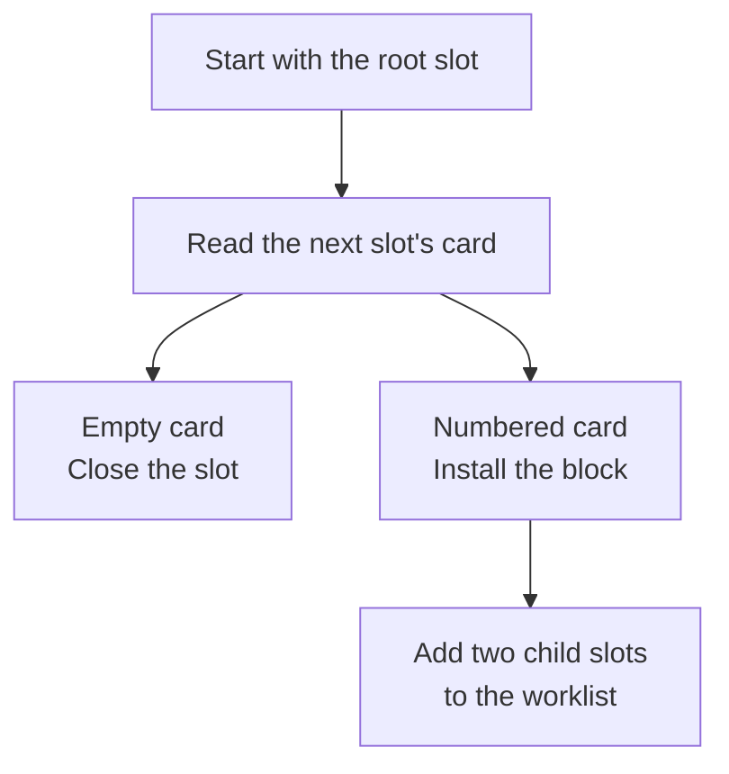
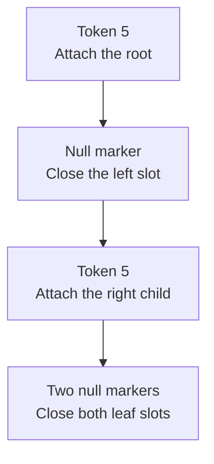

> [!tldr] Quick read
> - [[en/concepts/tree-serialization|Tree serialization]] must preserve values and the positions of left and right children. Two different trees can produce the same sequence of values.
> - Write `#` at each empty position, including an empty root. Each token fills exactly one pending slot. An integer adds two child slots, while `#` closes the current slot.
> - Preorder uses a stack. Level order uses a queue. Both take time linear in the string length. The tree's shape determines which worklist grows larger.
> - Both iterative approaches pass 10,000-node chain tests. The reader rejects invalid tokens, truncated strings, and trailing tokens.

> [!info] Context
> LeetCode 297 (Hard) belongs to [[en/posts/2026-11-26-neetcode-tree-reconstruction|station 6: Building and Serializing Trees]] on **the NeetCode line: Linked Structures**. In [[en/problems/construct-binary-tree-from-preorder-and-inorder-traversal|LC-0105]], I used two traversal orders and distinct values to recover subtree boundaries. This problem lets me design the data I send, so I can record the tree's shape directly, even when nodes share a value. You only need to know what a binary tree is and how to add and remove items from a list.

> [!abstract]- Quick glossary for this post (click to open)
> - A **codec** pairs a writer with a reader that follows the same rules.
> - A **token** is one field after splitting the string on commas. Each field is an integer or `#`.
> - A **[[en/concepts/null-marker|null marker]]** explicitly records that a child position holds no node.
> - A **pending slot** is a position awaiting a token. It starts with the root, then refers to the left or right child of a node already read.
> - **[[en/concepts/pre-order-traversal|Preorder traversal]]** goes node, left subtree, right subtree. **[[en/concepts/breadth-first-search|Level-order traversal]]** (BFS) finishes each level from left to right before moving to the next.

## Picture it first: mailing assembly instructions for a shelf

I'm packing a shelf system in which each block has two slots, one left and one right. The recipient keeps a list of unfilled slots. When a card names a block, they install it in the next slot and add its two child slots to the list. When the card says empty, they leave the slot empty and cross it off. The two sides can assemble one branch at a time or one level at a time, as long as both follow the same order.

| Everyday life | Concept |
|---|---|
| Card naming a block | integer token |
| Empty card | null marker `#` |
| Slot awaiting assembly | pending slot |
| Finish the left slot and everything below it | preorder with a stack |
| Finish all slots on a level | level order with a queue |
| Cards remain after all slots are filled | trailing tokens |



## The problem: a list of values loses the shape

Given a binary tree with 0 to 10,000 nodes, each with an integer value in [−1000, 1000], write one function that encodes it as a string and another that restores the same values in the same left and right positions. The pair can choose its own format. [LeetCode 297 problem statement](https://leetcode.com/problems/serialize-and-deserialize-binary-tree/)

I used to think writing preorder was enough. Try a root 5 with a **left child** 5 and a root 5 with a **right child** 5. Skipping empty positions writes `5,5` for both. With a marker for every empty position, the preorder strings are `5,5,#,#,#` and `5,#,5,#,#` respectively. The reader can distinguish them at the second token.

## How it works

### One slot rule for both orders

Start with a pending slot for the root. Take a slot in the chosen order, read one token, and apply the corresponding rule.

| Token | What goes in the slot | Change in pending slots |
|---|---|---|
| Integer | Make a node, then add its left and right slots | +1 |
| `#` | Leave the slot empty | −1 |

The reader and writer always agree on the next pending position. This holds initially for the root. After each token, both sides remove one slot and both add two child slots if the token is an integer, so they still agree at the next step. For a tree with `n` nodes, the writer produces exactly `2n + 1` tokens, one for the root slot and two for each real node's child slots. There are `n + 1` markers. The length is only a quick check. The reader still needs to reject a token that arrives after the worklist is empty and detect pending slots when the string ends.

### Approach 1 — Preorder with a stack

A stack takes the most recently added item. Push the **right slot first**, then the **left slot**, so the left slot comes out first. The left subtree's slots go on after the right slot, so the whole left branch finishes before the reader returns to the right. In a recursive version, calls to the left and right subtree establish this order. The iterative version keeps pending slots in program-managed memory and avoids deep recursion on skewed trees.

On a tree with root 5 and just a right child 5, the preorder reader takes these steps.



### Approach 2 — Level order with a queue

A queue takes the item that has waited the longest. Add the **left slot first**, then the **right slot**. When processing a slot, all remaining slots on its level stand ahead of the two new child slots. This finishes each level before moving to the next.

For example, root 8 has children −4 and 8. Node −4 has only a right child 0, and node 8 on the right has two children, −1000 and 1000. Both encodings preserve all empty slots, but the token orders differ.

| Order | Encoded string |
|---|---|
| Preorder | `8,-4,#,0,#,#,8,-1000,#,#,1000,#,#` |
| Level order | `8,-4,8,#,0,-1000,1000,#,#,#,#,#,#` |

### Cost and measured pending slots

Let `L` be the string length, `h` the number of levels, and `w` the largest number of real nodes on one level. Writing and reading both take O(L) time, or O(n + 1) given the problem's bounded values. The preorder stack has O(h + 1) pending slots because each level can leave one sibling branch waiting along with the next slot. The queue has O(w + 1) slots because it only keeps positions from the current level and the next. The examples read with `split` and keep the whole string when writing, so total memory also includes O(L) for strings and tokens. The restored tree adds O(n) nodes.

I measured the largest worklist in the Python writer by recording `len(pending)` at initialization and after each pair of children was added. This counts pending positions and excludes bytes, token buffers, and the input tree.

| Tree shape | Tokens | Preorder stack | Level-order queue |
|---|---:|---:|---:|
| Perfect tree, 12 levels, 4,095 nodes | 8,191 | 13 | 4,096 |
| Left-skewed chain, 10,000 nodes | 20,001 | 10,001 | 3 |
| Right-skewed chain, 10,000 nodes | 20,001 | 2 | 2 |

On the left chain, each step down leaves one right slot waiting. On the right chain, each empty left slot is taken immediately before moving down. The two trees have the same height, yet the stack holds very different numbers of slots.

## Runnable example

Each file runs both orders on 12 cases. Five small cases check exact encodings and restored structure, two check every node of left- and right-skewed 10,000-node chains, and five verify that the reader rejects malformed input. Run from `content/code/neetcode-serialize-and-deserialize-binary-tree/`.

[Download TypeScript](../code/neetcode-serialize-and-deserialize-binary-tree/binary-tree-codec.ts) · [Python](../code/neetcode-serialize-and-deserialize-binary-tree/binary-tree-codec.py) · [Go](../code/neetcode-serialize-and-deserialize-binary-tree/binary-tree-codec.go) · [Java](../code/neetcode-serialize-and-deserialize-binary-tree/binary-tree-codec.java) · [JavaScript](../code/neetcode-serialize-and-deserialize-binary-tree/binary-tree-codec.js)

```ts
import assert from "node:assert/strict"

class TreeNode {
  value: number
  left: TreeNode | null
  right: TreeNode | null

  constructor(value: number, left: TreeNode | null = null, right: TreeNode | null = null) {
    this.value = value
    this.left = left
    this.right = right
  }
}

class Pending<T> {
  private head = 0
  private items: T[]
  private byLevel: boolean

  constructor(items: T[], byLevel: boolean) {
    this.items = items
    this.byLevel = byLevel
  }

  get size() {
    return this.items.length - this.head
  }

  take(): T {
    if (!this.byLevel) return this.items.pop()!
    const item = this.items[this.head++]!
    if (2 * this.head >= this.items.length) {
      this.items = this.items.slice(this.head)
      this.head = 0
    }
    return item
  }

  addChildren(left: T, right: T) {
    if (this.byLevel) this.items.push(left, right)
    else this.items.push(right, left)
  }
}

function serialize(root: TreeNode | null, byLevel = false): string {
  const pending = new Pending([root], byLevel)
  const tokens: string[] = []
  while (pending.size > 0) {
    const node = pending.take()
    tokens.push(node === null ? "#" : String(node.value))
    if (node !== null) pending.addChildren(node.left, node.right)
  }
  return tokens.join(",")
}

type Slot = { parent: TreeNode; side: "left" | "right" }

function deserialize(wire: string, byLevel = false): TreeNode | null {
  const holder = new TreeNode(0)
  const pending = new Pending<Slot>([{ parent: holder, side: "left" }], byLevel)
  for (const token of wire.split(",")) {
    if (pending.size === 0) throw new Error("extra token")
    const { parent, side } = pending.take()
    if (token === "#") continue
    const value = Number(token)
    if (!Number.isInteger(value) || Math.abs(value) > 1000 || String(value) !== token) {
      throw new Error("invalid token")
    }
    const node = new TreeNode(value)
    parent[side] = node
    pending.addChildren({ parent: node, side: "left" }, { parent: node, side: "right" })
  }
  if (pending.size !== 0) throw new Error("missing token")
  return holder.left
}

const leaf = new TreeNode(5)
const examples = [
  [null, "#", "#"],
  [new TreeNode(0), "0,#,#", "0,#,#"],
  [new TreeNode(5, leaf), "5,5,#,#,#", "5,5,#,#,#"],
  [new TreeNode(5, null, leaf), "5,#,5,#,#", "5,#,5,#,#"],
  [
    new TreeNode(8, new TreeNode(-4, null, new TreeNode(0)), new TreeNode(8, new TreeNode(-1000), new TreeNode(1000))),
    "8,-4,#,0,#,#,8,-1000,#,#,1000,#,#",
    "8,-4,8,#,0,-1000,1000,#,#,#,#,#,#",
  ],
] as const
const invalid = ["", "1,#", "#,", "1x,#,#", "1001,#,#"]

for (const byLevel of [false, true]) {
  for (const [tree, preorder, level] of examples) {
    const wire = byLevel ? level : preorder
    assert.equal(serialize(tree, byLevel), wire)
    assert.deepEqual(deserialize(wire, byLevel), tree)
  }
  for (const side of ["left", "right"] as const) {
    const other = side === "left" ? "right" : "left"
    let chain: TreeNode | null = null
    for (let i = 9999; i >= 0; i--) {
      const node = new TreeNode(i % 11 - 5)
      node[side] = chain
      chain = node
    }
    const wire = serialize(chain, byLevel)
    assert.equal(wire.split(",").length, 20_001)
    let restored = deserialize(wire, byLevel)
    for (let i = 0; i < 10_000; i++) {
      assert(restored !== null)
      assert.equal(restored.value, i % 11 - 5)
      assert.equal(restored[other], null)
      restored = restored[side]
    }
    assert.equal(restored, null)
  }
  for (const wire of invalid) assert.throws(() => deserialize(wire, byLevel))
}
console.log(`${examples.length + 2 + invalid.length}/12 ca đúng`)
```
```python
from collections import deque
from dataclasses import dataclass


@dataclass
class TreeNode:
    value: int
    left: "TreeNode | None" = None
    right: "TreeNode | None" = None


def add_children(pending, left, right, by_level):
    pending.extend((left, right) if by_level else (right, left))


def serialize(root, by_level=False):
    pending = deque([root])
    take = pending.popleft if by_level else pending.pop
    tokens = []
    while pending:
        node = take()
        if node is None:
            tokens.append("#")
        else:
            tokens.append(str(node.value))
            add_children(pending, node.left, node.right, by_level)
    return ",".join(tokens)


def deserialize(wire, by_level=False):
    holder = TreeNode(0)
    pending = deque([(holder, "left")])
    take = pending.popleft if by_level else pending.pop
    for token in wire.split(","):
        if not pending:
            raise ValueError("extra token")
        parent, side = take()
        if token == "#":
            continue
        value = int(token)
        if abs(value) > 1000 or str(value) != token:
            raise ValueError("invalid token")
        node = TreeNode(value)
        setattr(parent, side, node)
        add_children(pending, (node, "left"), (node, "right"), by_level)
    if pending:
        raise ValueError("missing token")
    return holder.left


leaf = TreeNode(5)
examples = [
    (None, "#", "#"),
    (TreeNode(0), "0,#,#", "0,#,#"),
    (TreeNode(5, leaf), "5,5,#,#,#", "5,5,#,#,#"),
    (TreeNode(5, None, leaf), "5,#,5,#,#", "5,#,5,#,#"),
    (
        TreeNode(8, TreeNode(-4, None, TreeNode(0)), TreeNode(8, TreeNode(-1000), TreeNode(1000))),
        "8,-4,#,0,#,#,8,-1000,#,#,1000,#,#",
        "8,-4,8,#,0,-1000,1000,#,#,#,#,#,#",
    ),
]
invalid = ["", "1,#", "#,", "1x,#,#", "1001,#,#"]

for by_level in (False, True):
    for tree, preorder, level in examples:
        wire = level if by_level else preorder
        assert serialize(tree, by_level) == wire
        assert deserialize(wire, by_level) == tree
    for side, other in (("left", "right"), ("right", "left")):
        chain = None
        for i in reversed(range(10_000)):
            node = TreeNode(i % 11 - 5)
            setattr(node, side, chain)
            chain = node
        wire = serialize(chain, by_level)
        assert len(wire.split(",")) == 20_001
        restored = deserialize(wire, by_level)
        for i in range(10_000):
            assert restored.value == i % 11 - 5
            assert getattr(restored, other) is None
            restored = getattr(restored, side)
        assert restored is None
    for wire in invalid:
        try:
            deserialize(wire, by_level)
        except ValueError:
            continue
        raise AssertionError("accepted invalid wire")
print(f"{len(examples) + 2 + len(invalid)}/12 ca đúng")
```
```go
package main

import (
	"container/list"
	"fmt"
	"strconv"
	"strings"
)

type node struct {
	value       int
	left, right *node
}

type pending[T any] struct {
	items   list.List
	byLevel bool
}

func (p *pending[T]) take() T {
	next := p.items.Back()
	if p.byLevel {
		next = p.items.Front()
	}
	return p.items.Remove(next).(T)
}

func (p *pending[T]) addChildren(left, right T) {
	if p.byLevel {
		p.items.PushBack(left)
		p.items.PushBack(right)
	} else {
		p.items.PushBack(right)
		p.items.PushBack(left)
	}
}

func serialize(root *node, byLevel bool) string {
	work := pending[*node]{byLevel: byLevel}
	work.items.PushBack(root)
	tokens := []string{}
	for work.items.Len() > 0 {
		current := work.take()
		if current == nil {
			tokens = append(tokens, "#")
		} else {
			tokens = append(tokens, strconv.Itoa(current.value))
			work.addChildren(current.left, current.right)
		}
	}
	return strings.Join(tokens, ",")
}

func deserialize(wire string, byLevel bool) (*node, error) {
	var root *node
	work := pending[**node]{byLevel: byLevel}
	work.items.PushBack(&root)
	for _, token := range strings.Split(wire, ",") {
		if work.items.Len() == 0 {
			return nil, fmt.Errorf("extra token")
		}
		slot := work.take()
		if token == "#" {
			continue
		}
		value, err := strconv.Atoi(token)
		if err != nil || value < -1000 || value > 1000 || strconv.Itoa(value) != token {
			return nil, fmt.Errorf("invalid token")
		}
		current := &node{value: value}
		*slot = current
		work.addChildren(&current.left, &current.right)
	}
	if work.items.Len() != 0 {
		return nil, fmt.Errorf("missing token")
	}
	return root, nil
}

func equalSmall(a, b *node) bool {
	if a == nil || b == nil {
		return a == b
	}
	return a.value == b.value && equalSmall(a.left, b.left) && equalSmall(a.right, b.right)
}

func check(ok bool) {
	if !ok {
		panic("test failed")
	}
}

func main() {
	leaf := &node{value: 5}
	examples := []struct {
		tree            *node
		preorder, level string
	}{
		{nil, "#", "#"},
		{&node{value: 0}, "0,#,#", "0,#,#"},
		{&node{value: 5, left: leaf}, "5,5,#,#,#", "5,5,#,#,#"},
		{&node{value: 5, right: leaf}, "5,#,5,#,#", "5,#,5,#,#"},
		{
			&node{8, &node{value: -4, right: &node{value: 0}}, &node{8, &node{value: -1000}, &node{value: 1000}}},
			"8,-4,#,0,#,#,8,-1000,#,#,1000,#,#",
			"8,-4,8,#,0,-1000,1000,#,#,#,#,#,#",
		},
	}
	invalid := []string{"", "1,#", "#,", "1x,#,#", "1001,#,#"}

	for _, byLevel := range []bool{false, true} {
		for _, ex := range examples {
			wire := ex.preorder
			if byLevel {
				wire = ex.level
			}
			check(serialize(ex.tree, byLevel) == wire)
			restored, err := deserialize(wire, byLevel)
			check(err == nil && equalSmall(restored, ex.tree))
		}
		for _, left := range []bool{false, true} {
			var chain *node
			for i := 9999; i >= 0; i-- {
				if left {
					chain = &node{value: i%11 - 5, left: chain}
				} else {
					chain = &node{value: i%11 - 5, right: chain}
				}
			}
			wire := serialize(chain, byLevel)
			check(strings.Count(wire, ",") == 20_000)
			restored, err := deserialize(wire, byLevel)
			check(err == nil)
			for i := 0; i < 10_000; i++ {
				check(restored != nil && restored.value == i%11-5)
				if left {
					check(restored.right == nil)
					restored = restored.left
				} else {
					check(restored.left == nil)
					restored = restored.right
				}
			}
			check(restored == nil)
		}
		for _, wire := range invalid {
			_, err := deserialize(wire, byLevel)
			check(err != nil)
		}
	}
	fmt.Printf("%d/12 ca đúng\n", len(examples)+2+len(invalid))
}
```
```java
import java.util.LinkedList;

class BinaryTreeCodec {
    static class Node {
        final int value;
        Node left;
        Node right;

        Node(int value) {
            this(value, null, null);
        }

        Node(int value, Node left, Node right) {
            this.value = value;
            this.left = left;
            this.right = right;
        }
    }

    static class Pending<T> {
        final LinkedList<T> items = new LinkedList<>();
        final boolean byLevel;

        Pending(T root, boolean byLevel) {
            items.add(root);
            this.byLevel = byLevel;
        }

        T take() {
            return byLevel ? items.removeFirst() : items.removeLast();
        }

        void addChildren(T left, T right) {
            items.add(byLevel ? left : right);
            items.add(byLevel ? right : left);
        }
    }

    static String serialize(Node root, boolean byLevel) {
        var pending = new Pending<>(root, byLevel);
        var tokens = new StringBuilder();
        while (!pending.items.isEmpty()) {
            var node = pending.take();
            if (!tokens.isEmpty()) tokens.append(',');
            if (node == null) {
                tokens.append('#');
            } else {
                tokens.append(node.value);
                pending.addChildren(node.left, node.right);
            }
        }
        return tokens.toString();
    }

    record Slot(Node parent, boolean left) {}

    static Node deserialize(String wire, boolean byLevel) {
        var holder = new Node(0);
        var pending = new Pending<>(new Slot(holder, true), byLevel);
        for (String token : wire.split(",", -1)) {
            if (pending.items.isEmpty()) throw new IllegalArgumentException("extra token");
            var slot = pending.take();
            if (token.equals("#")) continue;
            int value = Integer.parseInt(token);
            if (value < -1000 || value > 1000 || !Integer.toString(value).equals(token)) {
                throw new IllegalArgumentException("invalid token");
            }
            var node = new Node(value);
            if (slot.left()) slot.parent().left = node;
            else slot.parent().right = node;
            pending.addChildren(new Slot(node, true), new Slot(node, false));
        }
        if (!pending.items.isEmpty()) throw new IllegalArgumentException("missing token");
        return holder.left;
    }

    record Example(Node tree, String preorder, String level) {}

    static boolean equalSmall(Node a, Node b) {
        if (a == null || b == null) return a == b;
        return a.value == b.value && equalSmall(a.left, b.left) && equalSmall(a.right, b.right);
    }

    static void check(boolean ok) {
        if (!ok) throw new AssertionError("test failed");
    }

    public static void main(String[] args) {
        var leaf = new Node(5);
        var examples = new Example[] {
            new Example(null, "#", "#"),
            new Example(new Node(0), "0,#,#", "0,#,#"),
            new Example(new Node(5, leaf, null), "5,5,#,#,#", "5,5,#,#,#"),
            new Example(new Node(5, null, leaf), "5,#,5,#,#", "5,#,5,#,#"),
            new Example(
                new Node(8, new Node(-4, null, new Node(0)), new Node(8, new Node(-1000), new Node(1000))),
                "8,-4,#,0,#,#,8,-1000,#,#,1000,#,#",
                "8,-4,8,#,0,-1000,1000,#,#,#,#,#,#"
            )
        };
        var invalid = new String[] {"", "1,#", "#,", "1x,#,#", "1001,#,#"};

        for (boolean byLevel : new boolean[] {false, true}) {
            for (var ex : examples) {
                String wire = byLevel ? ex.level() : ex.preorder();
                check(serialize(ex.tree(), byLevel).equals(wire));
                check(equalSmall(deserialize(wire, byLevel), ex.tree()));
            }
            for (boolean left : new boolean[] {false, true}) {
                Node chain = null;
                for (int i = 9999; i >= 0; i--) {
                    int value = i % 11 - 5;
                    chain = left ? new Node(value, chain, null) : new Node(value, null, chain);
                }
                String wire = serialize(chain, byLevel);
                check(wire.split(",", -1).length == 20_001);
                Node restored = deserialize(wire, byLevel);
                for (int i = 0; i < 10_000; i++) {
                    check(restored != null && restored.value == i % 11 - 5);
                    check((left ? restored.right : restored.left) == null);
                    restored = left ? restored.left : restored.right;
                }
                check(restored == null);
            }
            for (String wire : invalid) {
                try {
                    deserialize(wire, byLevel);
                } catch (IllegalArgumentException ex) {
                    continue;
                }
                throw new AssertionError("accepted invalid wire");
            }
        }
        System.out.printf("%d/12 ca đúng%n", examples.length + 2 + invalid.length);
    }
}
```
```js
import assert from "node:assert/strict"

class TreeNode {
  constructor(value, left = null, right = null) {
    this.value = value
    this.left = left
    this.right = right
  }
}

class Pending {
  head = 0

  constructor(items, byLevel) {
    this.items = items
    this.byLevel = byLevel
  }

  get size() {
    return this.items.length - this.head
  }

  take() {
    if (!this.byLevel) return this.items.pop()
    const item = this.items[this.head++]
    if (2 * this.head >= this.items.length) {
      this.items = this.items.slice(this.head)
      this.head = 0
    }
    return item
  }

  addChildren(left, right) {
    if (this.byLevel) this.items.push(left, right)
    else this.items.push(right, left)
  }
}

function serialize(root, byLevel = false) {
  const pending = new Pending([root], byLevel)
  const tokens = []
  while (pending.size > 0) {
    const node = pending.take()
    tokens.push(node === null ? "#" : String(node.value))
    if (node !== null) pending.addChildren(node.left, node.right)
  }
  return tokens.join(",")
}

function deserialize(wire, byLevel = false) {
  const holder = new TreeNode(0)
  const pending = new Pending([{ parent: holder, side: "left" }], byLevel)
  for (const token of wire.split(",")) {
    if (pending.size === 0) throw new Error("extra token")
    const { parent, side } = pending.take()
    if (token === "#") continue
    const value = Number(token)
    if (!Number.isInteger(value) || Math.abs(value) > 1000 || String(value) !== token) {
      throw new Error("invalid token")
    }
    const node = new TreeNode(value)
    parent[side] = node
    pending.addChildren({ parent: node, side: "left" }, { parent: node, side: "right" })
  }
  if (pending.size !== 0) throw new Error("missing token")
  return holder.left
}

const leaf = new TreeNode(5)
const examples = [
  [null, "#", "#"],
  [new TreeNode(0), "0,#,#", "0,#,#"],
  [new TreeNode(5, leaf), "5,5,#,#,#", "5,5,#,#,#"],
  [new TreeNode(5, null, leaf), "5,#,5,#,#", "5,#,5,#,#"],
  [
    new TreeNode(8, new TreeNode(-4, null, new TreeNode(0)), new TreeNode(8, new TreeNode(-1000), new TreeNode(1000))),
    "8,-4,#,0,#,#,8,-1000,#,#,1000,#,#",
    "8,-4,8,#,0,-1000,1000,#,#,#,#,#,#",
  ],
]
const invalid = ["", "1,#", "#,", "1x,#,#", "1001,#,#"]

for (const byLevel of [false, true]) {
  for (const [tree, preorder, level] of examples) {
    const wire = byLevel ? level : preorder
    assert.equal(serialize(tree, byLevel), wire)
    assert.deepEqual(deserialize(wire, byLevel), tree)
  }
  for (const side of ["left", "right"]) {
    const other = side === "left" ? "right" : "left"
    let chain = null
    for (let i = 9999; i >= 0; i--) {
      const node = new TreeNode(i % 11 - 5)
      node[side] = chain
      chain = node
    }
    const wire = serialize(chain, byLevel)
    assert.equal(wire.split(",").length, 20_001)
    let restored = deserialize(wire, byLevel)
    for (let i = 0; i < 10_000; i++) {
      assert(restored !== null)
      assert.equal(restored.value, i % 11 - 5)
      assert.equal(restored[other], null)
      restored = restored[side]
    }
    assert.equal(restored, null)
  }
  for (const wire of invalid) assert.throws(() => deserialize(wire, byLevel))
}
console.log(`${examples.length + 2 + invalid.length}/12 ca đúng`)
```

```text
$ node binary-tree-codec.ts
12/12 cases passed
$ python3 binary-tree-codec.py
12/12 cases passed
$ go run binary-tree-codec.go
12/12 cases passed
$ java binary-tree-codec.java
12/12 cases passed
$ node binary-tree-codec.js
12/12 cases passed
```

*(Output labels translated; the files themselves print Vietnamese.)*

## Misconceptions and common traps

- **Mixing orders between writer and reader.** `1,2,#,#,3,#,#` is valid for both readers. Preorder puts 3 to the right of 1. Level order puts 3 to the right of 2. If a system stores both formats, save a format name or version so it can select the right reader.
- **Using a valid value as the marker.** `0` and negative numbers are valid. Keep `#` outside the value alphabet and use commas to separate multidigit numbers.
- **Removing the first element by shifting the array.** Python uses `deque.popleft()`. TypeScript and JavaScript advance a head index. After at least half of the array has been consumed, the code copies the remaining suffix. The consumed positions pay for the copy, so each removal costs O(1) amortized.
- **Putting an empty value into the wrong Java collection.** `ArrayDeque` forbids `null`. The file uses `LinkedList` so the worklist can store empty positions. When splitting the string, `split(",", -1)` preserves trailing empty tokens and exposes an extra comma.
- **Assuming recursion works at any depth.** The input may be a 10,000-node chain. Python has a [[en/concepts/recursion-depth-limit|recursion depth limit]]. The iterative approaches test both skew directions and still keep a worklist whose size depends on the shape.

## Self-check questions

> [!question]- Why do `5,5,#,#,#` and `5,#,5,#,#` distinguish trees with the same value order?
> The preorder reader reads the left slot right after the root. In the first string, it receives 5. In the second, it receives a null marker.

> [!question]- What state does the string `6,#` leave the reader in?
> Token 6 opens two child slots. The null marker closes the left one and leaves the right one awaiting a token. The reader reports a missing token.

> [!question]- What can a round-trip-only test miss if I only compare re-encoded strings?
> If both functions swap left and right, a write followed by a read can cancel out the mistake. Compare an asymmetric tree against its expected wire string and inspect the decoded structure directly.

> [!question]- When can the queue be smaller than the stack even though both writers produce the same number of tokens?
> On a left-skewed chain, the queue holds one level and at most a few temporary positions. The stack holds the pending right slot for every ancestor it has passed.

## References

- [LeetCode 297 — Serialize and Deserialize Binary Tree](https://leetcode.com/problems/serialize-and-deserialize-binary-tree/) — input and output contract.
- [OpenDSA — Sequential Tree Representations](https://opendsa-server.cs.vt.edu/ODSA/Books/cnu/cpsc270/spring-2025/TR_930Siochi11Conner/html/SequentialRep.html) — preorder tree representation with null markers.
- [Python — Recursion limit](https://docs.python.org/3/library/sys.html#sys.getrecursionlimit) and [deque](https://docs.python.org/3/library/collections.html#collections.deque) — call-stack limits and operations at both ends of a queue.
- [Java — LinkedList](https://docs.oracle.com/en/java/javase/21/docs/api/java.base/java/util/LinkedList.html) and [ArrayDeque](https://docs.oracle.com/en/java/javase/21/docs/api/java.base/java/util/ArrayDeque.html) — rules for storing `null`.
