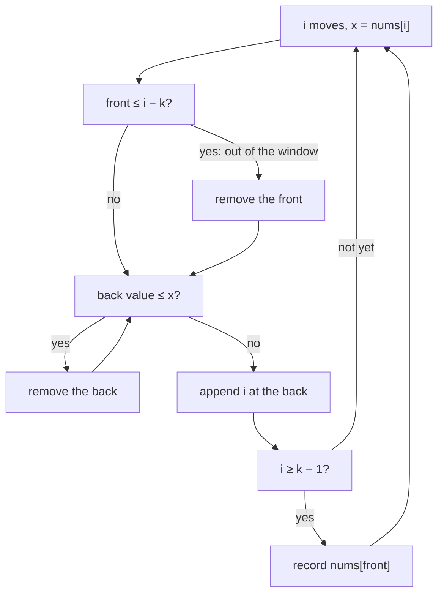

> [!tldr] Quick read
> - The problem: an array `nums` and a number k; return the max of **every** window of length k (`[1, 3, −1, −3, 5, 3, 6, 7]`, k = 3 → `[3, 3, 5, 5, 6, 7]`).
> - Keeping one "running max" is wrong: when the max slides out of the window, there is no way to know the **next** max (5/7 cases).
> - A [[en/concepts/monotonic-deque|monotonic deque]] keeps the **indices that could still become the max**, values decreasing. A new element evicts every element at the back that is not greater than it; the front is the max.
> - A `while` nested in a `for`, but each index enters the deque once and leaves at most once: O(n) in total ([[en/concepts/aggregate-analysis|aggregate analysis]]).
> - JS has no deque: removing the front with `shift()` moves the whole array. With k = 10⁵ on a decreasing array, the `shift()` version takes 1 223 ms, the version with a `head` index 1.4 ms.

> [!info] Context
> LeetCode problem 239, part of [[en/posts/2026-11-23-neetcode-sliding-window|station 5: Sliding Window]] on **the NeetCode line: Arrays and Strings**. The station's other problems remember one number or a count table; this one needs a new structure, the monotonic deque, which comes back at the monotonic stack station. The solutions come in TypeScript, Python, Go, Java and JavaScript. Read [[en/problems/trapping-rain-water|Trapping Rain Water]] (prefix and suffix maxima) first.

> [!abstract]- Quick glossary for this post (click to open)
> - **Fixed-size window**: always exactly k long, sliding right one slot per step. See [[en/concepts/fixed-size-window|Fixed-size Window]].
> - **Deque (double-ended queue)**: add and remove at **both ends** in O(1).
> - **Monotonic**: always increasing or always decreasing. Here the values at the indices in the deque decrease from front to back.
> - **Prefix and suffix maximum**: the max of a block from its start (or up to its end). See [[en/concepts/prefix-maximum|Prefix Maximum]].
> - **Aggregate analysis**: counting the total number of operations over the whole algorithm. See [[en/concepts/aggregate-analysis|Aggregate Analysis]].

## Picture it first: a queue of candidates for "tallest person"

A line of people walks through a doorway k people wide. At every moment you need to know who is tallest **inside the doorway**. You keep a list of candidates. When a taller newcomer walks in, every shorter candidate standing **ahead** of them can never be the tallest again: they will leave the doorway sooner and they are shorter. They are struck off the list.

| Everyday life | Concept |
|---|---|
| A doorway k people wide | a fixed window of length k |
| The candidate list, tallest at the front | a deque of indices, values decreasing |
| A taller newcomer: strike every shorter candidate off the back of the list | `pop` at the back while `nums[back] ≤ nums[i]` |
| The candidate at the front has left the doorway: strike them | remove the front when its index ≤ i − k |
| The person at the front of the list | the max of the window |
| Each person joins the list once and is struck off at most once | O(n) in total |



## The problem

**The problem (in my own words):** given an integer array `nums` (1 ≤ n ≤ 10⁵, values ±10⁴) and k (1 ≤ k ≤ n). A window of length k slides from left to right one slot at a time; return the max at each window position, n − k + 1 numbers in all. Original: [LeetCode 239](https://leetcode.com/problems/sliding-window-maximum/).

| nums | k | Output |
|---|---|---|
| `[1, 3, −1, −3, 5, 3, 6, 7]` | 3 | `[3, 3, 5, 5, 6, 7]` |
| `[9, 8, 7, 6, 5]` | 2 | `[9, 8, 7, 6]` |
| `[1]` | 1 | `[1]` |

I used to think you just keep one max variable, the way [[en/problems/best-time-to-buy-and-sell-stock|Best Time to Buy and Sell Stock]] keeps the lowest price. The difference: that problem only adds elements, never removes them. Here elements leave the window, and when the leaving element is the max, a single variable cannot know who the next max is.

## How it works

### Approach 1, brute force: O(n·k)

Find the max of each window from scratch. Fast enough for small k; O(n²) for k around n/2.

### The wrong version, one running max

`m = max(m, nums[i])` and record m. For `[9, 8, 7, 6, 5]`, k = 2, it gives `[9, 9, 9, 9]` because the 9 left the window long ago but is still kept. Max can't be "undone" like a sum: removing an element from a sum means subtracting it, removing the max from a max tells you nothing about what remains.

### Approach 2, blocks with prefix and suffix maxima: O(n)

Split the array into blocks of length k. Compute `pre[i]` = max from the start of i's block up to i, and `suf[i]` = max from i to the end of i's block. Every window `[i, i + k − 1]` either matches exactly one block or crosses exactly one block boundary: the left part is the tail of one block (`suf[i]`), the right part the head of the next (`pre[i + k − 1]`). The answer is `max(suf[i], pre[i + k − 1])`.

This is the prefix-suffix idea of [[en/posts/2026-11-23-neetcode-prefix-suffix-encoding|station 3]] applied to max. No data structure needed, but it costs two helper arrays.

### Approach 3, the monotonic deque: O(n), one index array

The deque holds **indices**, not values, because you must know when an element leaves the window. At each step i:
1. if the index at the front is ≤ i − k, it has left the window: remove the front;
2. while the value at the back is ≤ `nums[i]`, remove the back: that element leaves the window before i and is not greater than i, so it can never be the max again;
3. append i at the back;
4. from i = k − 1 on, record `nums[front]`.

Invariant: the values at the indices in the deque **decrease**, and every index is inside the window. So the front is the max.

| i | x | removed from back | deque (index: value) | record |
|---|---|---|---|---|
| 0 | 1 | | 0:1 | |
| 1 | 3 | 0:1 | 1:3 | |
| 2 | −1 | | 1:3, 2:−1 | 3 |
| 3 | −3 | | 1:3, 2:−1, 3:−3 | 3 |
| 4 | 5 | 3, 2 (and front 1 has left) | 4:5 | 5 |
| 5 | 3 | | 4:5, 5:3 | 5 |
| 6 | 6 | 5, 4 | 6:6 | 6 |
| 7 | 7 | 6 | 7:7 | 7 |

### Why the total is O(n) despite the `while` loop

Each index is **added** to the deque exactly once and **removed** at most once, at the front or at the back. Each iteration of the `while` loop removes one index, so over the whole algorithm the `while` loop runs at most n times in total. Add n insertions and at most n front removals, and the total is ≤ 3n operations: O(n). A single step can cost up to k operations (the new element is greater than the whole deque), but those steps are "prepaid" by the cheap ones.

The argument assumes each operation at either end is O(1). If removing the front costs O(deque length), as with a JS array's `shift()` or a Python list's `pop(0)`, the total becomes O(n·k).

### Measured

TypeScript, median of 3 runs. A **decreasing** array is the worst case for the deque: nothing is evicted at the back, the deque is exactly k long, and every step removes the front.

| n | k | data | brute force | blocks | deque, `head` | deque, `shift()` |
|---|---|---|---|---|---|---|
| 10⁵ | 1 000 | decreasing | 47.9 ms | 3.5 ms | 1.7 ms | 5.5 ms |
| 10⁵ | 1 000 | random | 61.8 ms | 8.4 ms | 1.8 ms | 2.0 ms |
| 2·10⁵ | 10⁵ | decreasing | (not run) | 6.6 ms | 1.4 ms | 1 223.1 ms |
| 2·10⁵ | 10⁵ | random | (not run) | 4.4 ms | 1.6 ms | 2.4 ms |

On random data the deque stays short (large elements evict almost everything), so `shift()` stays hidden. On a decreasing array with a large k it is almost 900 times slower. A separate test shows V8 makes `shift()` almost free on small arrays, but on a large array of about 10⁵ elements it moves everything: 10⁵ `shift()` calls on a 10⁵-element array take 560 ms. Python shows the same thing with `list.pop(0)`:

| n = 2·10⁵, k = 10⁵, decreasing | ms |
|---|---|
| blocks | 54.2 |
| `collections.deque` | 19.6 |
| `list.pop(0)` | 1 141.9 |

### Under the hood of the five languages

| | Deque | Language-specific trap |
|---|---|---|
| TypeScript / JavaScript | none built in: an index array + a `head` variable | `shift()` is O(n) on large arrays; `Math.max(...arr)` throws `RangeError` when the array is too long |
| Python | `collections.deque`, `popleft()` O(1) | `list.pop(0)` is O(n) |
| Go | a slice + a `head` index | `q = q[1:]` is O(1) too, but the old backing array stays in memory until the slice is reallocated |
| Java | `ArrayDeque<Integer>` | `Stack` is synchronized and slow, `LinkedList` allocates a node per element; indices get boxed into `Integer` |

## Runnable example

[TypeScript](../code/neetcode-sliding-window-maximum/sliding-window-max.ts) · [Python](../code/neetcode-sliding-window-maximum/sliding_window_max.py) · [Go](../code/neetcode-sliding-window-maximum/sliding_window_max.go) · [Java](../code/neetcode-sliding-window-maximum/sliding-window-max.java) · [JavaScript](../code/neetcode-sliding-window-maximum/sliding-window-max.js)

Each file has the brute force, blocks and the monotonic deque, and runs 7 cases including a decreasing array, equal values and k = n. Below are blocks and the monotonic deque.

```ts
// Approach 2, blocks of k: prefix max within a block and suffix max within a block. Window [i, i+k-1] crosses exactly one block boundary.
function blocks(nums: number[], k: number): number[] {
  const n = nums.length;
  const pre = new Array(n), suf = new Array(n);
  for (let i = 0; i < n; i++) pre[i] = i % k === 0 ? nums[i] : Math.max(pre[i - 1], nums[i]);
  for (let i = n - 1; i >= 0; i--) suf[i] = i === n - 1 || (i + 1) % k === 0 ? nums[i] : Math.max(suf[i + 1], nums[i]);
  const out: number[] = [];
  for (let i = 0; i + k <= n; i++) out.push(Math.max(suf[i], pre[i + k - 1]));
  return out;
}

// Approach 3, monotonic deque: an index array + a head variable instead of shift(). Values at the indices decrease from head.
function monotonicDeque(nums: number[], k: number): number[] {
  const q = new Int32Array(nums.length); // indices; q[head..tail-1] is the queue
  let head = 0, tail = 0;
  const out: number[] = [];
  for (let i = 0; i < nums.length; i++) {
    if (head < tail && q[head] <= i - k) head++; // the front has slid out of the window
    while (head < tail && nums[q[tail - 1]] <= nums[i]) tail--; // drop every element not greater than the new one
    q[tail++] = i;
    if (i >= k - 1) out.push(nums[q[head]]);
  }
  return out;
}
```

```python
def blocks(nums: list[int], k: int) -> list[int]:
    n = len(nums)
    pre, suf = nums[:], nums[:]
    for i in range(1, n):
        if i % k:
            pre[i] = max(pre[i - 1], nums[i])
    for i in range(n - 2, -1, -1):
        if (i + 1) % k:
            suf[i] = max(suf[i + 1], nums[i])
    return [max(suf[i], pre[i + k - 1]) for i in range(n - k + 1)]

def monotonic_deque(nums: list[int], k: int) -> list[int]:
    q: deque[int] = deque()  # indices; popleft() is O(1)
    out = []
    for i, x in enumerate(nums):
        if q and q[0] <= i - k:
            q.popleft()
        while q and nums[q[-1]] <= x:
            q.pop()
        q.append(i)
        if i >= k - 1:
            out.append(nums[q[0]])
    return out
```

```go
func blocks(nums []int, k int) []int {
	n := len(nums)
	pre, suf := slices.Clone(nums), slices.Clone(nums)
	for i := 1; i < n; i++ {
		if i%k != 0 {
			pre[i] = max(pre[i-1], nums[i])
		}
	}
	for i := n - 2; i >= 0; i-- {
		if (i+1)%k != 0 {
			suf[i] = max(suf[i+1], nums[i])
		}
	}
	out := make([]int, 0, n-k+1)
	for i := 0; i+k <= n; i++ {
		out = append(out, max(suf[i], pre[i+k-1]))
	}
	return out
}

func monotonicDeque(nums []int, k int) []int {
	// slice + head index: q[head:] is the queue. Writing q = q[1:] is O(1) too, but the old backing array stays in memory.
	q := make([]int, 0, len(nums))
	head := 0
	out := make([]int, 0, len(nums)-k+1)
	for i, x := range nums {
		if head < len(q) && q[head] <= i-k {
			head++
		}
		for len(q) > head && nums[q[len(q)-1]] <= x {
			q = q[:len(q)-1]
		}
		q = append(q, i)
		if i >= k-1 {
			out = append(out, nums[q[head]])
		}
	}
	return out
}
```

```java
static int[] blocks(int[] nums, int k) {
    int n = nums.length;
    int[] pre = nums.clone(), suf = nums.clone(), out = new int[n - k + 1];
    for (int i = 1; i < n; i++) if (i % k != 0) pre[i] = Math.max(pre[i - 1], nums[i]);
    for (int i = n - 2; i >= 0; i--) if ((i + 1) % k != 0) suf[i] = Math.max(suf[i + 1], nums[i]);
    for (int i = 0; i + k <= n; i++) out[i] = Math.max(suf[i], pre[i + k - 1]);
    return out;
}

static int[] monotonicDeque(int[] nums, int k) {
    // ArrayDeque: O(1) add and remove at both ends. Avoid Stack and LinkedList: Stack is synchronized, LinkedList allocates a node per element.
    Deque<Integer> q = new ArrayDeque<>();
    int[] out = new int[nums.length - k + 1];
    for (int i = 0; i < nums.length; i++) {
        if (!q.isEmpty() && q.peekFirst() <= i - k) q.pollFirst();
        while (!q.isEmpty() && nums[q.peekLast()] <= nums[i]) q.pollLast();
        q.offerLast(i);
        if (i >= k - 1) out[i - k + 1] = nums[q.peekFirst()];
    }
    return out;
}
```

```js
function blocks(nums, k) {
  const n = nums.length;
  const pre = nums.slice(), suf = nums.slice();
  for (let i = 1; i < n; i++) if (i % k) pre[i] = Math.max(pre[i - 1], nums[i]);
  for (let i = n - 2; i >= 0; i--) if ((i + 1) % k) suf[i] = Math.max(suf[i + 1], nums[i]);
  const out = [];
  for (let i = 0; i + k <= n; i++) out.push(Math.max(suf[i], pre[i + k - 1]));
  return out;
}

function monotonicDeque(nums, k) {
  const q = new Int32Array(nums.length); // JS has no built-in deque: an array + head instead of shift()
  let head = 0, tail = 0;
  const out = [];
  for (let i = 0; i < nums.length; i++) {
    if (head < tail && q[head] <= i - k) head++;
    while (head < tail && nums[q[tail - 1]] <= nums[i]) tail--;
    q[tail++] = i;
    if (i >= k - 1) out.push(nums[q[head]]);
  }
  return out;
}
```


The TypeScript file also runs the running-max version and the `shift()` version, then measures:

```text
$ node sliding-window-max.ts
bruteForce      7/7 cases passed
runningMaxOnly  5/7 cases passed; wrong on [9,8,7,6,5] k=2 → [9,9,9,9] [5,1,2,3] k=2 → [5,5,5]
blocks          7/7 cases passed
monotonicDeque  7/7 cases passed
monotonicShift  7/7 cases passed

n        k        data        brute     blocks  deque (head)      deque (shift)      (ms, median of 3 runs)
100000   1000     decreasing      47.9    3.5               1.7                5.5
100000   1000     random          61.8    8.4               1.8                2.0
200000   100000   decreasing         —    6.6               1.4             1223.1
200000   100000   random             —    4.4               1.6                2.4
```

*(Output labels translated; the files themselves print Vietnamese.)*

The Python file compares `deque` with `list.pop(0)`:

```text
$ python3 sliding_window_max.py
brute_force      7/7 cases passed
blocks           7/7 cases passed
monotonic_deque  7/7 cases passed
monotonic_list   7/7 cases passed

n = 200000, k = 100000, decreasing array (ms, single run)
blocks               54.2
monotonic_deque      19.6
monotonic_list     1141.9
```

Go, Java and JavaScript print `7/7 ca đúng` ("7/7 cases passed") for all three approaches.

## Misconceptions and common traps

- **Keeping one running max.** Right while elements are only added; wrong as soon as the max slides out.
- **Storing values instead of indices in the deque.** You can no longer tell whether the front has left the window. Store indices and read values through `nums[i]`.
- **Evicting with `<` instead of `≤`.** Still correct, but the deque keeps equal values and grows longer than needed. What matters is that the front removal uses the index, not a value comparison.
- **`shift()` or `pop(0)` to remove the front.** The result is right and small tests run fast, but the worst case becomes O(n·k).
- **"A `while` nested in a `for` is O(n·k)."** Count the total removals: each index is removed at most once.
- **Using a heap.** A max-heap with "lazy deletion" (drop the top when its index is outside) also works, in O(n log n). The monotonic deque is faster and simpler.

## Self-check questions

> [!question]- Why can an element at the back with a value ≤ the new element be removed right away?
> It stands before the new element, so it leaves the window **sooner**, and it isn't greater. In every window that still contains it, the new element is there too and is at least as large, so it can never be the only max.

> [!question]- Prove that the total number of iterations of the `while` loop (removing from the back) is at most n.
> Each iteration removes one index from the deque. Each index is added only once, so it is removed at most once. There are n indices, so the total number of removals is ≤ n.

> [!question]- On an increasing array, how long is the deque at each step? On a decreasing array?
> Increasing: each new element evicts everything, the deque is always 1 long. Decreasing: nothing is evicted, the deque reaches k, and every step removes one element at the front. That is the case that exposes the O(k) cost of `shift()`.

> [!question]- In the block approach, why can't the window `[i, i + k − 1]` cross two block boundaries?
> Two consecutive boundaries are exactly k apart. A range of length k contains at most one boundary inside it.

## References

- [LeetCode 239: Sliding Window Maximum](https://leetcode.com/problems/sliding-window-maximum/) (the original problem)
- [Python: `collections.deque`](https://docs.python.org/3/library/collections.html#collections.deque) (O(1) at both ends; `list.pop(0)` has to move data)
- [Java 21: `ArrayDeque`](https://docs.oracle.com/en/java/javase/21/docs/api/java.base/java/util/ArrayDeque.html) (faster than `Stack` as a stack and faster than `LinkedList` as a queue)
- [ECMAScript 2025: `Array.prototype.shift`](https://tc39.es/ecma262/2025/#sec-array.prototype.shift) (specified as moving each element down one index)
- [Go spec: Slice expressions](https://go.dev/ref/spec#Slice_expressions) (a subslice shares the backing array)
- Cormen, Leiserson, Rivest, Stein, *Introduction to Algorithms*, chapter "Amortized Analysis" (the aggregate method)
