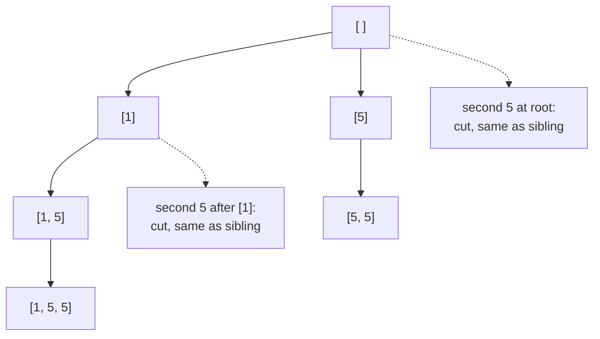

> [!tldr] Quick read
> - The array has repeated values, so the take-or-skip tree from [[en/problems/subsets|Subsets]] produces duplicates: `[5, 5, 1]` yields `[5, 1]` twice.
> - Sort first so equal values sit next to each other. On each level of the [[en/concepts/start-index|start-index]] tree, try only the first element of each group of equal values: skip `nums[i]` when `i > start` and `nums[i] == nums[i - 1]`.
> - The condition is `i > start`, not `i > 0`. [[en/concepts/duplicate-skipping|Duplicate skipping]] applies only between sibling branches; going deeper may still take another copy, so `[5, 5]` is still there.
> - Generating all 2ⁿ subsets and filtering with a Set also works, but it pays for the duplicate branches too. With five 4s and five 9s, the Set version generates 1,024 subsets to keep 36.

> [!info] Context
> This is LeetCode problem 90 at [[en/posts/2026-11-28-neetcode-subsets-combinations|station MISC-01: Backtracking: Subsets and Combinations]] on **the NeetCode Line: Mixed Techniques**. I picture a bag of marbles with a few of the same color, and I want to list every distinct handful I could draw. Read [[en/problems/subsets|Subsets]] first; this problem adds one line to that solution.

> [!abstract]- Quick glossary for this post (click to open)
> - A multiset is a set that allows repeated elements. `[5, 5, 1]` has two 5s.
> - Two subsets count as the same when they hold the same values the same number of times, whichever positions they came from.
> - A level of the tree is the set of choices that share one parent node, that is, the loop iterations of one `walk(start)` call.
> - [[en/concepts/backtracking|Backtracking]] adds an element to `path`, goes deeper, then removes it to try another element.

## Picture it first: drawing marbles from a bag with matching colors

The bag holds two red marbles and one blue. The two reds look identical. The handful "one red, one blue" is one handful whichever red you grabbed. The handful "two reds" is real and must be counted. In total there are 3 × 2 = 6 handfuls: 0, 1 or 2 reds, and 0 or 1 blue.

| Everyday life | Concept |
|---|---|
| A bag with same-colored marbles | Array `nums` with repeated values |
| Sorting the marbles by color before drawing | Sorting `nums` |
| One handful | One subset |
| Two ways of drawing that give the same handful | Two branches producing the same subset |
| On each turn, try each color only once | Skip `nums[i]` when `i > start` and it equals the previous element |
| Drawing a second red after the first | Going deeper may still take the next copy |
| Counting by color: 0..2 red, 0..1 blue | Counting by group, used as a cross-check |

For `[5, 5, 1]` sorted into `[1, 5, 5]`, the start-index tree keeps only six nodes. The second branch starting with `5` at the root is cut, because it is a sibling of the first `5` branch:



## The problem: distinct subsets of an array with repeats

You get an array `nums` of length 1–10, each value between −10 and 10, and values may repeat. Return every distinct subset of `nums`, in any order. Two subsets holding the same values the same number of times may appear only once. For example, `[0, -1, 0]` has six distinct subsets: `[]`, `[-1]`, `[-1, 0]`, `[-1, 0, 0]`, `[0]` and `[0, 0]`. [Original LeetCode 90](https://leetcode.com/problems/subsets-ii/)

The first idea I had was to run the Subsets solution and remove duplicates with a Set. That is correct, but it still walks all 2ⁿ branches before throwing most of them away. The real question of the problem is: can you avoid ever generating a duplicate?

## How it works

### Why duplicates appear

The start-index tree tries each `nums[i]` in turn as the next element. If `nums[i]` and `nums[j]` are equal and are both choices of the same node, the subtrees after them produce the same subsets. In `[1, 5, 5]`, the root tries the `5` at index 1 and the `5` at index 2. The subtree of the second `5` is just a part of the subtree of the first one, so every subset it produces already exists.

### Sort, then skip duplicates on the same level

Sorting puts equal values next to each other. In the loop of `walk(start)`, I skip `nums[i]` when `i > start` and `nums[i] == nums[i - 1]`. The condition `i > start` means `nums[i - 1]` was also a choice of this very loop, a sibling that has already been tried. When `i == start`, `nums[i - 1]` is already in `path` from the level above; taking `nums[i]` takes the second copy, a new subset such as `[5, 5]`.

Each distinct subset has exactly one spelling in sorted order that uses the earliest copies of each value. The condition keeps that spelling and cuts every other one, so each node of the pruned tree is a distinct subset and vice versa. The node count equals the number of distinct subsets: the product of (count + 1) over all values.

### Skipping in the wrong place

Writing `i > 0` instead of `i > start` also cuts the first choice of a level when it equals the element before it, even though that element is sitting in `path`. With `[5, 5, 1]`, the `[5]` branch never grows into `[5, 5]`, and the result has 4 subsets instead of 6.

### Filtering afterwards with a Set

Sort `nums`, generate all 2ⁿ subsets with a mask, then put each subset's key into a Set. Sorting is required: without it `[5, 1]` and `[1, 5]` give two different keys. This costs O(n·2ⁿ) no matter how many distinct subsets there are.

| Approach | Time | Subsets generated | Note |
|---|---|---|---|
| Sort, skip same-level duplicates | O(n log n + n·k) | k, the number of distinct subsets | Never generates a duplicate |
| Generate all, filter with a Set | O(n·2ⁿ) | 2ⁿ | Needs a key from the sorted subset |
| Count by group | O(n·k) | k | Each value taken 0..c times; used as a cross-check |

In the worst case all values are distinct, k = 2ⁿ, and the three approaches cost the same. The gap only shows when values repeat a lot.

## Runnable example

[TypeScript](../code/neetcode-subsets-ii/multiset.ts) · [Python](../code/neetcode-subsets-ii/multiset.py) · [Go](../code/neetcode-subsets-ii/multiset.go) · [Java](../code/neetcode-subsets-ii/multiset.java) · [JavaScript](../code/neetcode-subsets-ii/multiset.js) · [PHP](../code/neetcode-subsets-ii/multiset.php) · [Rust](../code/neetcode-subsets-ii/multiset.rs)

```ts
// Main approach: sort, then on each level use only the first element of each group of equal values
function subsetsWithDup(nums: number[], counter = { calls: 0 }): number[][] {
    const sorted = [...nums].sort((a, b) => a - b)
    const result: number[][] = []
    const path: number[] = []
    const walk = (start: number) => {
        counter.calls++
        result.push([...path])
        for (let i = start; i < sorted.length; i++) {
            // i > start: same level, this value was already tried by an earlier sibling
            if (i > start && sorted[i] === sorted[i - 1]) continue
            path.push(sorted[i])
            walk(i + 1)
            path.pop()
        }
    }
    walk(0)
    return result
}
```

```python
# Main approach: sort, then on each level use only the first element of each group of equal values
def subsets_with_dup(nums, counter=None):
    nums = sorted(nums)
    result, path = [], []

    def walk(start):
        if counter is not None:
            counter["calls"] += 1
        result.append(path[:])
        for i in range(start, len(nums)):
            # i > start: same level, this value was already tried by an earlier sibling
            if i > start and nums[i] == nums[i - 1]:
                continue
            path.append(nums[i])
            walk(i + 1)
            path.pop()

    walk(0)
    return result
```

```go
// Main approach: sort, then on each level use only the first element of each group of equal values
func subsetsWithDup(nums []int, calls *int) [][]int {
	sorted := slices.Clone(nums)
	slices.Sort(sorted)
	result := [][]int{}
	path := []int{}
	var walk func(start int)
	walk = func(start int) {
		*calls++
		result = append(result, slices.Clone(path))
		for i := start; i < len(sorted); i++ {
			// i > start: same level, this value was already tried by an earlier sibling
			if i > start && sorted[i] == sorted[i-1] {
				continue
			}
			path = append(path, sorted[i])
			walk(i + 1)
			path = path[:len(path)-1]
		}
	}
	walk(0)
	return result
}
```

```java
// Main approach: sort, then on each level use only the first element of each group of equal values
static List<List<Integer>> subsetsWithDup(int[] nums) {
    int[] sorted = nums.clone();
    Arrays.sort(sorted);
    List<List<Integer>> result = new ArrayList<>();
    walk(sorted, 0, new ArrayList<>(), result);
    return result;
}

static void walk(int[] sorted, int start, List<Integer> path, List<List<Integer>> result) {
    calls++;
    result.add(new ArrayList<>(path));
    for (int i = start; i < sorted.length; i++) {
        // i > start: same level, this value was already tried by an earlier sibling
        if (i > start && sorted[i] == sorted[i - 1]) continue;
        path.add(sorted[i]);
        walk(sorted, i + 1, path, result);
        path.remove(path.size() - 1);
    }
}
```

```js
// Main approach: sort, then on each level use only the first element of each group of equal values
function subsetsWithDup(nums, counter = { calls: 0 }) {
    const sorted = [...nums].sort((a, b) => a - b)
    const result= []
    const path= []
    const walk = (start) => {
        counter.calls++
        result.push([...path])
        for (let i = start; i < sorted.length; i++) {
            // i > start: same level, this value was already tried by an earlier sibling
            if (i > start && sorted[i] === sorted[i - 1]) continue
            path.push(sorted[i])
            walk(i + 1)
            path.pop()
        }
    }
    walk(0)
    return result
}
```

```php
// Main approach: sort, then on each level use only the first element of each group of equal values
function subsetsWithDup(array $nums): array {
    global $calls;
    sort($nums);
    $result = [];
    $path = [];
    $walk = function (int $start) use (&$walk, &$result, &$path, &$calls, $nums) {
        $calls++;
        $result[] = $path;
        for ($i = $start; $i < count($nums); $i++) {
            // i > start: same level, this value was already tried by an earlier sibling
            if ($i > $start && $nums[$i] === $nums[$i - 1]) continue;
            $path[] = $nums[$i];
            $walk($i + 1);
            array_pop($path);
        }
    };
    $walk(0);
    return $result;
}
```

```rust
// Main approach: sort, then on each level use only the first element of each group of equal values
fn subsets_with_dup(nums: &[i32], calls: &mut usize) -> Vec<Vec<i32>> {
    fn walk(sorted: &[i32], start: usize, path: &mut Vec<i32>, result: &mut Vec<Vec<i32>>, calls: &mut usize) {
        *calls += 1;
        result.push(path.clone());
        for i in start..sorted.len() {
            // i > start: same level, this value was already tried by an earlier sibling
            if i > start && sorted[i] == sorted[i - 1] {
                continue;
            }
            path.push(sorted[i]);
            walk(sorted, i + 1, path, result, calls);
            path.pop();
        }
    }
    let mut sorted = nums.to_vec();
    sorted.sort();
    let mut result = Vec::new();
    walk(&sorted, 0, &mut Vec::new(), &mut result, calls);
    result
}
```

The tabs show the sort-and-skip-same-level approach; the line that increments `calls` is only there for the measurement. The downloadable file also has the wrong-place skip, the Set filter and the count-by-group approach. The eight test cases include two equal numbers, four equal numbers, a repeated 0 around a negative number, ten identical numbers (11 subsets) and ten distinct numbers (1,024 subsets). Both the same-level skip and the Set filter must match the count-by-group result, with no subset repeated.

The second line cross-checks every array of length 0–5 with values in {1, 2, 3}: 364 arrays. The last two lines are measurements: the wrong-place skip on `[5, 5, 1]`, and how many subsets each approach generates for five 4s and five 9s.

```text
8/8 cases passed
364/364 cases passed (cross-check against counting by group)
Skipping duplicates everywhere with [5,5,1]: 4 subsets, correct is 6
[4×5, 9×5]: Set generates 1024 subsets to keep 36, same-level pruning generates 36
```

*(Output labels translated; the files themselves print Vietnamese.)*

36 = (5 + 1) × (5 + 1): each subset picks 0..5 fours and 0..5 nines. The pruned tree visits exactly 36 nodes, not one more.

## Misconceptions and common traps

- Forgetting to sort. The check `nums[i] == nums[i - 1]` only catches duplicates when equal values sit next to each other. In an unsorted `[5, 1, 5]`, the two 5s are not adjacent and the subset `[5]` is generated twice.
- Writing `i > 0` instead of `i > start`. The result loses every subset that holds two copies of the same value, as in the `[5, 5, 1]` example above.
- Filtering with a Set without sorting each subset. `[5, 1]` and `[1, 5]` give two different keys.
- JavaScript, TypeScript: `new Set()` compares arrays by reference, so you need a string key such as `subset.join(',')`. Java is different: `List.equals` compares contents, so a `HashSet<List<Integer>>` removes duplicates directly. Python needs a `tuple`, because a `list` is not hashable. Rust can use a `HashSet<Vec<i32>>`.
- Java, Go: the equal values are `int`, so comparing with `==` is safe. If you switch to `Integer` in Java, `==` compares references and only happens to work for numbers from −128 to 127 thanks to the `Integer.valueOf` cache; use `equals`.
- PHP: the closure must capture `$path` by reference, `use (&$path)`. Writing `use ($path)` gives each call the copy made when the closure was created, which is always the empty array: with `[1, 2, 3]`, the result is 8 empty arrays.

## Self-check questions

> [!question]- Why does `[4, 4, 4, 4]` have only 5 distinct subsets?
> All elements are equal, so a subset is identified only by how many 4s it holds: 0, 1, 2, 3 or 4.

> [!question]- In `walk(start)`, when `i == start` and `nums[i] == nums[i - 1]`, why not skip?
> `nums[i - 1]` is not a sibling but an element already in `path` from the level above. Taking `nums[i]` adds the second copy, which is a new subset.

> [!question]- Does the Set version need to sort `nums`?
> Yes, or it must sort each subset before taking its key. Otherwise the same subset written in two orders gives two different keys.

> [!question]- For an array of 10 distinct values, is the same-level skip faster than Subsets?
> No. No pair is equal, so no branch is cut, and the tree still has 1,024 nodes. It only adds the O(n log n) cost of sorting.

## References

- [LeetCode 90](https://leetcode.com/problems/subsets-ii/)
- [Jeff Erickson, Algorithms, chapter 2: backtracking](https://jeffe.cs.illinois.edu/teaching/algorithms/book/02-backtracking.pdf)
- [Python collections.Counter](https://docs.python.org/3/library/collections.html#collections.Counter) · [Java List.equals](https://docs.oracle.com/en/java/javase/21/docs/api/java.base/java/util/List.html#equals(java.lang.Object)) · [PHP array_count_values](https://www.php.net/manual/en/function.array-count-values.php)
