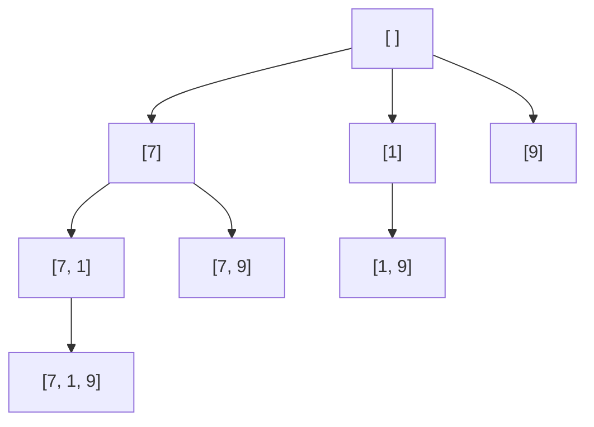

> [!tldr] Quick read
> - n distinct elements give exactly 2ⁿ subsets, because each element has two fates: taken or skipped.
> - Draw those two fates as a [[en/concepts/choice-tree|choice tree]]; every path from the root to a leaf is one subset. Walk the tree with [[en/concepts/backtracking|backtracking]]: add, go deeper, then remove.
> - A tighter version uses a [[en/concepts/start-index|start index]]: every node of the tree is already a subset, and you only add elements that come after the one added last.
> - Every approach costs O(n·2ⁿ), since the output alone is that long. The real trap is elsewhere: storing `path` in the result without copying it.

> [!info] Context
> This is LeetCode problem 78 at [[en/posts/2026-11-28-neetcode-subsets-combinations|station MISC-01: Backtracking: Subsets and Combinations]] on **the NeetCode Line: Mixed Techniques**. I picture a pizza counter where you can pick any toppings you like, and I want to print every pizza you could order. You only need arrays, loops and recursive functions.

> [!abstract]- Quick glossary for this post (click to open)
> - A subset is a choice of some elements, with no regard to order. `[7, 1]` and `[1, 7]` are the same subset. The empty set is a subset too.
> - `path` is the list of elements chosen on the path being walked. Every recursive call shares the same `path`.
> - A mask is an integer whose bit i says whether element i is taken. `1 << n` equals 2ⁿ.
> - A reference is when several variables point at the same array. A change made through one of them is visible through the others.

## Picture it first: ordering pizza with every topping combination

The counter has three toppings: mushroom, olive, chili. For each topping I answer only "yes" or "no". Three questions with two answers each give 2 × 2 × 2 = 8 pizzas, including the plain one with no topping. Nobody treats "mushroom then olive" as different from "olive then mushroom": on the pizza they are the same.

| Everyday life | Concept |
|---|---|
| The counter's topping list | Array `nums`, all values distinct |
| One pizza | One subset |
| The plain pizza | The empty set `[]` |
| Asking about each topping in turn | The take-or-skip tree, n levels deep |
| The order slip being filled in | `path` |
| Photocopying the slip before writing more on it | Copying `path` before storing it |
| Only asking about toppings after the one just chosen | Start index `start` |

For `nums = [7, 1, 9]`, the start-index tree looks like this. Each box is a subset that is recorded as soon as the walk reaches it, so the tree has exactly 8 boxes.



## The problem: print every subset of an array

You get an array `nums` of length 1–10 whose values are pairwise distinct, each between −10 and 10. Return every subset of `nums`, in any order, but no subset may appear twice. For example, `[4, -2]` has four subsets: `[]`, `[4]`, `[-2]` and `[4, -2]`. [Original LeetCode 78](https://leetcode.com/problems/subsets/)

I used to think this was a "generate combinations" problem that needed some formula. It turns out it is a walk over a tree with 2ⁿ leaves, and the hard part is walking it without generating duplicates and without corrupting results already stored.

## How it works

### The take-or-skip tree

Standing at element i, I branch two ways: add `nums[i]` to `path` and continue, or leave it out and continue. When i reaches n, every element has its fate, `path` is a complete subset, and it is stored in the result. The tree has n levels and 2ⁿ leaves, so there are exactly 2ⁿ subsets, and none repeat because two different leaves differ in at least one yes/no answer.

After the "take" branch returns, the element just added must be popped, so the "skip" branch sees `path` as it was before. That is the undo step of backtracking.

### Start index: every node is a subset

The second approach stores `path` as soon as it enters a node, then tries adding each element from `start` onward. After adding `nums[i]`, the child call may only look from `i + 1`. That keeps the elements in `path` in index order, so `[7, 1]` is produced and `[1, 7]` never is. This is the tree drawn above, and it is the form that sibling problems such as Combination Sum and Subsets II reuse.

### Mask and doubling

Two non-recursive approaches give the same result:

- **Mask:** count `mask` from 0 to 2ⁿ − 1. Bit i equal to 1 means take `nums[i]`. Each integer is one subset, and 2ⁿ different integers give 2ⁿ different subsets. It suits small n, because `1 << n` must fit the integer type.
- **Doubling:** start with `[[]]`. For each element x, copy every subset you have, add x to the copy and append it. After the first element there are 2 subsets, after the second 4, after n elements 2ⁿ.

| Approach | Time | Extra memory beyond the output | Note |
|---|---|---|---|
| Take or skip | O(n·2ⁿ) | O(n) stack | Stores only at leaves |
| Start index | O(n·2ⁿ) | O(n) stack | Stores at every node |
| Mask | O(n·2ⁿ) | O(1) | n must be smaller than the integer's bit width |
| Doubling | O(n·2ⁿ) | O(1) | The old subset must be copied before adding x |

The factor n in O(n·2ⁿ) comes from copying: each subset is up to n elements long. Nothing can be faster, because the output itself has total length n·2ⁿ⁻¹.

### Storing without copying

Every call shares one `path`. If you store `path` itself instead of a copy, then in TypeScript, JavaScript, Python and Java the result holds the same array 8 times. That array keeps being pushed and popped, and when the recursion ends it is empty. Go, PHP and Rust behave differently, as the table in the runnable example shows.

Go deserves its own note. A slice is a pointer to a backing array plus a length and a capacity. Storing `path` stores a copy of those three values, not of the data. The stored slices keep the length they had when stored, but they all look at one backing array whose last write left `3, 3, 3`. The result becomes `[] [3] [3 3] [3 3 3] [3 3] [3] [3 3] [3]`, of which only `[]` and `[3]` are right, by accident.

## Runnable example

[TypeScript](../code/neetcode-subsets/powerset.ts) · [Python](../code/neetcode-subsets/powerset.py) · [Go](../code/neetcode-subsets/powerset.go) · [Java](../code/neetcode-subsets/powerset.java) · [JavaScript](../code/neetcode-subsets/powerset.js) · [PHP](../code/neetcode-subsets/powerset.php) · [Rust](../code/neetcode-subsets/powerset.rs)

```ts
// Approach 2: start index, every node of the tree is a subset
function subsetsStart(nums: number[]): number[][] {
    const result: number[][] = []
    const path: number[] = []
    const walk = (start: number) => {
        result.push([...path])
        for (let i = start; i < nums.length; i++) {
            path.push(nums[i])
            walk(i + 1) // only elements after i, so [a, b] never gets a twin [b, a]
            path.pop()
        }
    }
    walk(0)
    return result
}
```

```python
# Approach 2: start index, every node of the tree is a subset
def subsets_start(nums):
    result, path = [], []

    def walk(start):
        result.append(path[:])
        for i in range(start, len(nums)):
            path.append(nums[i])
            walk(i + 1)  # only elements after i, so [a, b] never gets a twin [b, a]
            path.pop()

    walk(0)
    return result
```

```go
// Approach 2: start index, every node of the tree is a subset
func subsetsStart(nums []int) [][]int {
	result := [][]int{}
	path := []int{}
	var walk func(start int)
	walk = func(start int) {
		result = append(result, slices.Clone(path))
		for i := start; i < len(nums); i++ {
			path = append(path, nums[i])
			walk(i + 1) // only elements after i, so [a, b] never gets a twin [b, a]
			path = path[:len(path)-1]
		}
	}
	walk(0)
	return result
}
```

```java
// Approach 2: start index, every node of the tree is a subset
static List<List<Integer>> subsetsStart(int[] nums) {
    List<List<Integer>> result = new ArrayList<>();
    fromStart(nums, 0, new ArrayList<>(), result);
    return result;
}

static void fromStart(int[] nums, int start, List<Integer> path, List<List<Integer>> result) {
    result.add(new ArrayList<>(path));
    for (int i = start; i < nums.length; i++) {
        path.add(nums[i]);
        fromStart(nums, i + 1, path, result); // only elements after i, so [a, b] never gets a twin [b, a]
        path.remove(path.size() - 1);
    }
}
```

```js
// Approach 2: start index, every node of the tree is a subset
function subsetsStart(nums) {
    const result= []
    const path= []
    const walk = (start) => {
        result.push([...path])
        for (let i = start; i < nums.length; i++) {
            path.push(nums[i])
            walk(i + 1) // only elements after i, so [a, b] never gets a twin [b, a]
            path.pop()
        }
    }
    walk(0)
    return result
}
```

```php
// Approach 2: start index, every node of the tree is a subset
function subsetsStart(array $nums): array {
    $result = [];
    $path = [];
    $walk = function (int $start) use (&$walk, &$result, &$path, $nums) {
        $result[] = $path;
        for ($i = $start; $i < count($nums); $i++) {
            $path[] = $nums[$i];
            $walk($i + 1); // only elements after i, so [a, b] never gets a twin [b, a]
            array_pop($path);
        }
    };
    $walk(0);
    return $result;
}
```

```rust
// Approach 2: start index, every node of the tree is a subset
fn subsets_start(nums: &[i32]) -> Vec<Vec<i32>> {
    fn walk(nums: &[i32], start: usize, path: &mut Vec<i32>, result: &mut Vec<Vec<i32>>) {
        result.push(path.clone());
        for i in start..nums.len() {
            path.push(nums[i]);
            walk(nums, i + 1, path, result); // only elements after i, so [a, b] never gets a twin [b, a]
            path.pop();
        }
    }
    let mut result = Vec::new();
    walk(nums, 0, &mut Vec::new(), &mut result);
    result
}
```

The tabs show the start-index approach. The downloadable file has all four. The seven test cases include a one-element array, negative numbers, and a ten-element array with 1,024 subsets. Every approach must give exactly 2ⁿ subsets, none repeated, matching the hand-written answer when there is one and matching the mask approach.

The second line cross-checks all four approaches on every array of distinct values drawn from {−2, −1, 0, 1, 2}, of length 0–4, in every order: 206 arrays. The last line runs the version that forgets to copy on `[1, 2, 3]` and counts how many of the 8 correct subsets appear in its result.

```text
7/7 cases passed
206/206 cases passed (cross-check of four approaches)
Forgot to copy path with [1,2,3]: 1/8 correct subsets
```

*(Output labels translated; the files themselves print Vietnamese.)*

The last line differs between languages, and that is exactly the point:

| Language | Last line | Why |
|---|---|---|
| TypeScript, JavaScript, Python, Java | 1/8 | Eight references to one array, empty at the end |
| Go | 2/8 | Eight slices share the backing array `3, 3, 3`; only `[]` and `[3]` are right by accident |
| PHP | 8/8 | PHP arrays are copied on assignment, so the "forgot to copy" version is still correct |
| Rust | not printed | The buggy version does not compile; see the traps |

## Misconceptions and common traps

- Thinking you need to sort or deduplicate. The values are already distinct, so the take-or-skip tree never produces two equal subsets. Deduplication is needed only when the array has repeated values, as in [[en/problems/subsets-ii|Subsets II]].
- In the start-index approach, recursing with `start + 1` instead of `i + 1`. Elements before `nums[i]` can then be added after it, producing both `[7, 1]` and `[1, 7]`.
- Forgetting to `pop` after going deeper. The next branch then sees a `path` longer than it should be.
- TypeScript, JavaScript: use `[...path]` or `path.slice()`. Python: `path[:]` or `list(path)`. Java: `new ArrayList<>(path)`.
- Go: use `slices.Clone(path)` or `append([]int(nil), path...)`. Doubling has one more trap: `append(result[k], x)` can write straight into the backing array of `result[k]` when that slice has spare capacity, corrupting a subset already stored. The file copies `result[k]` before adding.
- PHP: arrays are copied on assignment (copy-on-write), so `$result[] = $path` is safe. Capturing `$path` into the closure by reference, `&$path`, is right, but never store `&$path` in the result.
- Rust: `result.push(*path)` fails with E0507, because you cannot move ownership out of a reference. Storing `&path` and then calling `path.push(...)` fails with E0502, because it borrows for reading and for writing at once. The compiler forces `path.clone()`.

## Self-check questions

> [!question]- How many subsets does a 10-element array have, and why is the time O(n·2ⁿ) rather than O(2ⁿ)?
> 2¹⁰ = 1,024 subsets. Each one has to be copied into the result, and a subset is up to n elements long, so the total copying work is O(n·2ⁿ).

> [!question]- In the start-index approach, why store `path` when entering a node instead of waiting for a leaf?
> Each node corresponds to a different subset: the path from the root to it picks elements in increasing index order. The empty set is the root, the full set is the deepest node. Storing only at leaves would miss the shorter subsets.

> [!question]- What goes wrong if `walk(i + 1)` becomes `walk(start + 1)`?
> The child call can go back and add elements that come before `nums[i]`, so the same subset appears in several orders, for example both `[7, 1]` and `[1, 7]`.

> [!question]- Why does Go's forgot-to-copy version not end up all empty like JavaScript's?
> Each stored slice keeps the length it had when stored, but they all point at one backing array. That array finally holds `3, 3, 3`, so a slice of length 2 reads `[3 3]`.

## References

- [LeetCode 78](https://leetcode.com/problems/subsets/)
- [Jeff Erickson, Algorithms, chapter 2: backtracking](https://jeffe.cs.illinois.edu/teaching/algorithms/book/02-backtracking.pdf)
- [Go blog, Go Slices: usage and internals](https://go.dev/blog/slices-intro) · [Go slices.Clone](https://pkg.go.dev/slices#Clone)
- [PHP manual, Arrays](https://www.php.net/manual/en/language.types.array.php) · [Rust E0502](https://doc.rust-lang.org/error_codes/E0502.html)
