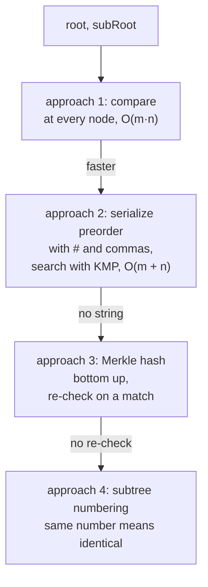

> [!tldr] Quick read
> - The problem: given a tree `root` (up to 2000 nodes) and a tree `subRoot` (up to 1000 nodes), return `true` when some node of `root` starts a subtree (that node and all its descendants) identical to `subRoot`.
> - The standard solution: at every node of `root`, call the two-tree comparison from [[en/problems/same-tree|Same Tree]]. O(m·n) in the worst case (m, n the node counts of the two trees), yet within the problem's limits it still takes only tens of milliseconds.
> - Three O(m + n) approaches: **serialize** both trees (recording empty slots, with a delimiter before every value) and search with KMP; a **Merkle hash** (a node's hash computed from its children's hashes), re-checked for real on a match; **subtree numbering**, where every distinct subtree gets its own number and nothing ever collides.
> - Measured on a bad input (two skewed trees of all 1s, differing at the bottom): at 20,000 and 10,000 nodes, comparing at every node takes 5.3 seconds, V8's `includes` 170 ms and Java's `contains` 115 ms (both grow quadratically), and KMP only 1.9 ms. Python's `in` and Go's `strings.Contains` stay linear.
> - Traps that actually run: dropping empty slots when serializing; a delimiter only after each value (`"12,#,#,"` contains `"2,#,#,"`); a weak hash without a re-check (Java's `Objects.hash` gives `[1,1]` and `[1,null,961]` the same 984064); the recursive version in Python throws `RecursionError` on a skewed tree of 2000 nodes, still within the problem's limits.

> [!info] Context
> LeetCode problem 572 (Easy) of [[en/posts/2026-11-25-neetcode-tree-recursion|station 3: Tree Recursion]] on **the NeetCode Line: Linked Structures**. It builds on [[en/problems/same-tree|Same Tree]]: the same two-tree comparison, called at every node of the big tree. The optimizations reach into two other topics: substring search (turning a tree into a string the way [[en/problems/encode-and-decode-strings|Encode and Decode Strings]] turns a list into one) and subtree hashing (the same bottom-up computation as [[en/problems/diameter-of-binary-tree|Diameter of Binary Tree]]). Solutions come in TypeScript, Python, Go, Java and JavaScript. You need binary trees and the Same Tree page.

> [!abstract]- Quick glossary for this post (click to open)
> - **Subtree**: a node together with **all** its descendants. Matching only the top part is not enough: if the matching node in `root` has an extra child, it does not count. See [[en/concepts/binary-tree|Binary Tree]].
> - **m, n**: m is the number of nodes in `root`, n the number in `subRoot`.
> - **Serialization**: writing a tree as a flat string or array. Here in preorder, recording empty slots. See [[en/concepts/key-serialization|Key Serialization]].
> - **Delimiter**: a character separating two adjacent values, like a comma. Put it in the wrong place and one value can "stick" to another. See [[en/concepts/delimiter-collision|Delimiter Collision]].
> - **KMP (Knuth–Morris–Pratt)**: an algorithm that finds a pattern inside a long sequence without ever stepping back in the long sequence, so O(length of both) in every case.
> - **Merkle hash**: a node's hash is computed from its value and its two children's hashes, so a whole subtree folds into one number. See [[en/concepts/tree-hashing|Tree Hashing]].
> - **Hash collision**: two different trees with the same hash. See [[en/concepts/hash-collision|Hash Collision]].
> - **Post-order traversal**: handle both children first, then the parent. Hashing and subtree numbering both need this order. See [[en/concepts/post-order-traversal|Post-order Traversal]].

## Picture it first: finding a bonsai branch in a whole garden

You hold a photo of a bonsai branch (`subRoot`) and search a garden (`root`) for a branch exactly like it: the same forks, every leaf the same, and the branch must not grow anything the photo does not show.

| Everyday life | Concept |
|---|---|
| The photo of the sample branch | `subRoot` |
| Standing at every fork in the garden, comparing with the photo | comparing at every node: O(m·n) |
| A branch like the photo but with one extra twig | a subtree with an extra node: does not count |
| Describing each branch as a line of text and searching the text | serialize, then search the string |
| The description also says "no twig here" | recording empty slots (`#`) |
| A code tag on each branch, computed from its two sub-branches' tags | Merkle hash |
| Two different branches with the same tag | a collision: must be checked again by eye |
| A register giving each distinct branch shape a serial number | subtree numbering: never collides |



## The problem

Given the roots of two binary trees `root` (1 to 2000 nodes) and `subRoot` (1 to 1000 nodes), with values in [−10⁴, 10⁴], return `true` when `root` has a node whose subtree is identical to `subRoot`, in both shape and values. `root` also counts as a subtree of itself. Original problem: [LeetCode 572](https://leetcode.com/problems/subtree-of-another-tree/).

The easy part to misread is the word "subtree". I used to think it was enough to find the nodes of `subRoot` sitting together inside `root`. It turns out a subtree takes the node **with all its descendants**: `root = [7,8,9,4,5]` contains `[8,4,5]`, but if node 5 in `root` has one more child (`[7,8,9,4,5,null,null,null,null,6]`) it no longer does.

## How it works

<figure class="figure-map" style="--ar: 3 / 4">
<div class="frame"><iframe data-archify="../../diagrams/neetcode-subtree-of-another-tree/worked-example.en.html" title="Find a candidate root and compare the whole shape" loading="lazy"></iframe></div>
<figcaption><span><b>Figure 1.</b> Find a candidate root and compare the whole shape.</span><a href="../diagrams/neetcode-subtree-of-another-tree/worked-example.en.html" target="_blank" rel="noopener">Open full screen</a></figcaption>
</figure>

<details>
<summary>Read the steps</summary>
<ol>
<li>Look for nodes with the pattern root&#x27;s value. <code>pattern = 4 → left 2</code></li>
<li>The first 4 has a right child 2. <code>left = null, right = 2</code></li>
<li>The second 4 has a left child 2. <code>left = 2, right = null</code></li>
<li>The second candidate matches the shape. <code>true</code></li>
</ol>
</details>

### Approach 1: compare at every node

A subtree identical to `subRoot` either starts right at the root, or lies in the left branch, or lies in the right branch. Those three possibilities turn straight into recursion, reusing the comparison from problem 100:

```ts
// Approach 1 (the familiar recursive form): the subtree starts at the root, or lies in the left branch, or the right branch.
function isSameRec(p: TreeNode | null, q: TreeNode | null): boolean {
  if (p === null || q === null) return p === q;
  return p.val === q.val && isSameRec(p.left, q.left) && isSameRec(p.right, q.right);
}
function isSubtreeRecursive(root: TreeNode | null, sub: TreeNode | null): boolean {
  if (root === null) return sub === null;
  return isSameRec(root, sub) || isSubtreeRecursive(root.left, sub) || isSubtreeRecursive(root.right, sub);
}
```

Usually each comparison stops very early (the root values differ right away). The bad case is when many nodes of `root` match almost all of `subRoot` and only differ at the end: each node costs up to n steps, O(m·n) in total. The worst input I use for measuring: `root` is a left-skewed tree of m nodes all equal to 1, `subRoot` is a left-skewed tree of n nodes all equal to 1 except the bottom node, which is 2. At every node of `root`, the comparison walks down n levels before meeting the 2.

The recursive version has one more problem of its own in Python: a skewed tree of 2000 nodes (still within the problem's limits) needs a recursion depth of about 2000, over the default limit of 1000. The Python version throws `RecursionError` on both skewed 2000-node cases. I could not check whether LeetCode raises this limit in its judging environment, so every file also has a loop version (`isSubtreeNaive`): walk every node of `root` with a stack, comparing with the loop version of `isSame`.

### Approach 2: serialize, then search the string

Write each tree as a preorder string, one item `,value` per node and one item `,#` per empty slot. Then the subtree starting at a node of `root` is a **contiguous piece** of `root`'s string (preorder writes out one whole subtree before moving on), and that piece equals `subRoot`'s string if and only if the two trees are identical. The tree problem becomes a substring problem.

```ts
// Serialize in preorder to a string: each node ",value", each empty slot ",#". The comma comes BEFORE every item.
function serializeString(root: TreeNode | null): string {
  const parts: string[] = [];
  const stack: (TreeNode | null)[] = [root];
  while (stack.length > 0) {
    const n = stack.pop()!;
    if (n === null) { parts.push(",#"); continue; }
    parts.push("," + n.val);
    stack.push(n.right, n.left);
  }
  return parts.join("");
}

// Approach 2a: serialize, then search with the built-in includes.
function isSubtreeString(root: TreeNode | null, sub: TreeNode | null): boolean {
  return serializeString(root).includes(serializeString(sub));
}
```

Two details decide right from wrong:
- **Record empty slots.** Without `#`, `[8,4,5]` matches in the middle of the sequence `7,8,4,5,6,9` even though node 5 has an extra child 6. The version `wrongNoNullMarkers` fails 3/14 cases, all three returning `true` instead of `false`.
- **The delimiter goes before every value.** With the comma only after, the string for `[12]` is `"12,#,#,"` and contains the string for `[2]`, `"2,#,#,"`; likewise `[-3]` contains `[3]`. With the comma in front, `",2"` cannot start in the middle of `",12"`. The version `wrongNoLeadingDelimiter` fails exactly those two cases.

And what does the search? Each language's built-in function promises nothing like O(m + n). The worst input above is exactly the kind that hurts a naive search: the pattern is `,1,1,…,1,2,#,…`, and at every position of the long string it matches almost all the 1s before failing at the 2. Measured (table under Measuring), V8's `includes` and Java's `String.contains` grow about 45 to 110 times when the size grows 10 times, that is quadratically. Python's `in` and Go's `strings.Contains`, from size 20,000 up, grow only about 6 to 13 times for every 10 times the size, that is linearly.

To be sure of O(m + n) in every language, search with **KMP** yourself. Serialize into an array of numbers (an empty slot is a number outside the value range) instead of a string, and the delimiter problem disappears: each value is its own cell.

```ts
// KMP: find the pattern pat in text, O(|text| + |pat|) in every case.
function kmpContains(text: number[], pat: number[]): boolean {
  const fail = new Int32Array(pat.length); // fail[i]: length of the longest prefix that is also a suffix of pat[0..i]
  for (let i = 1, k = 0; i < pat.length; i++) {
    while (k > 0 && pat[i] !== pat[k]) k = fail[k - 1];
    if (pat[i] === pat[k]) k++;
    fail[i] = k;
  }
  for (let i = 0, k = 0; i < text.length; i++) {
    while (k > 0 && text[i] !== pat[k]) k = fail[k - 1];
    if (text[i] === pat[k]) k++;
    if (k === pat.length) return true;
  }
  return false;
}
```

The idea of KMP: when the pattern fails at position k, the part just matched is exactly `pat[0..k-1]`, so there is no need to step back in `text`. The `fail` table says how much of the end of the matched piece still overlaps the start of the pattern, and the search continues from there. Every element of `text` is read exactly once.

### Approach 3: Merkle hash, re-check on a match

Compute a hash for every subtree, bottom up: a node's hash mixes the node's value with the hashes of its left and right children. Two identical trees surely share a hash. Then it only remains to find a node of `root` whose hash equals `subRoot`'s.

```ts
// MurmurHash3's finalizer (fmix32): a permutation of the 2³² values, so two different inputs always give different outputs.
function fmix32(h: number): number {
  h ^= h >>> 16;
  h = Math.imul(h, 0x85ebca6b);
  h ^= h >>> 13;
  h = Math.imul(h, 0xc2b2ae35);
  return (h ^ (h >>> 16)) >>> 0;
}
const NULL_HASH = 0x165667b1;
// 32-bit Merkle hash: from the node's value and its two children's hashes. Left and right use different multipliers, so swapping them changes the hash.
function nodeHash(val: number, hl: number, hr: number): number {
  return fmix32(Math.imul(hl, 0x9e3779b1) ^ Math.imul(hr ^ 0x85ebca6b, 0xc2b2ae35) ^ ((val + 0x27d4eb2f) | 0));
}

// Approach 3: Merkle hash. On a hash match, compare for real with isSame, because two different trees can still share a hash.
function isSubtreeHash(root: TreeNode | null, sub: TreeNode | null): boolean {
  if (sub === null) return true;
  const target = subtreeHashes(sub, nodeHash, NULL_HASH).get(sub)!;
  for (const [node, h] of subtreeHashes(root, nodeHash, NULL_HASH)) if (h === target && isSame(node, sub)) return true;
  return false;
}
```

The converse does not hold: the same hash does not guarantee the same tree. A 32-bit hash has only about 4.3 billion values, so with D distinct subtrees the expected number of colliding pairs is about D²/2³³. The TypeScript file counts for real on a random tree of 10⁶ nodes with 637,975 distinct subtrees: theory says about 47 pairs, and it measured 49 hash values shared by two different subtrees. That is why a hash match must call `isSame` to confirm. The re-check keeps the expected O(m + n): false matches are rare, and a true match returns `true` at once.

The mixing function matters too. The same formula mixed with mulberry32's mixer (it multiplies by `1 | a`, which depends on the input itself, so it is not a permutation) gave 156 shared values, three times the theory. A weak hash like "sum of values" collides on tiny cases: the version `wrongWeakHash` without a re-check fails 3/14 cases, including `[1,2]` against `[1,null,2]` (both sum to 3). Java's `Objects.hash` is weak as well: it is a base-31 polynomial, linear in each argument, so I solved for a colliding pair by hand: `[1,1]` and `[1,null,961]` both give 984064.

### Approach 4: subtree numbering

Drop the hash and use a table instead: each triple `(value, left child's number, right child's number)` not seen before gets a new number. Two subtrees get the same number if and only if they are identical (by induction from the leaves up), so nothing collides and nothing needs re-checking. Only the subtrees of `subRoot` need numbers (n entries); a node of `root` not in the table gets −1, and its parent cannot be in it either. Expected O(m + n), depending on the language's hash table.

In Python the tuple `(val, id_left, id_right)` is a `dict` key directly; Go uses a `struct`, Java a `record`; TypeScript and JavaScript join it into the string `"value,left number,right number"` because `Map` compares object keys by identity.

| Approach | Time | Extra memory | Notes |
|---|---|---|---|
| Compare at every node | O(m·n) worst case | O(h) | shortest; fast enough within the problem's limits |
| String + built-in search | O(m + n) to O(m·n), by language | O(m + n) | must record `#` and put the delimiter in front |
| Array + KMP | O(m + n) | O(m + n) | surely linear |
| Merkle hash | expected O(m + n) | O(m + n) | a hash match must be re-checked |
| Subtree numbering | expected O(m + n) | O(m + n) | no collisions, no re-check |

### Measuring

The bad input for comparing at every node: `root` skewed with m nodes all equal to 1, `subRoot` skewed with n nodes all equal to 1 except the bottom, which is 2 (answer `false`). Median of 5 runs (3 at the largest size). An empty cell means that approach was skipped at that size because it is too slow.

| Language | m / n | Every node | Built-in search | KMP | Hash | Numbering |
|---|---|---|---|---|---|---|
| TypeScript | 2,000 / 1,000 | 27 ms | 1.6 ms | 0.10 ms | 0.52 ms | 0.43 ms |
| TypeScript | 20,000 / 10,000 | 5,338 ms | 170 ms | 1.9 ms | 5.4 ms | 6.7 ms |
| TypeScript | 2·10⁶ / 10⁶ | | | 304 ms | 1,192 ms | 2,382 ms |
| Java | 20,000 / 10,000 | 2,701 ms | 115 ms | 1.6 ms | 5.5 ms | 5.6 ms |
| Java | 2·10⁶ / 10⁶ | | | 145 ms | 933 ms | 1,163 ms |
| Go | 20,000 / 10,000 | | 3.2 ms | 5.4 ms | 8.7 ms | 15 ms |
| Go | 2·10⁶ / 10⁶ | | 245 ms | 474 ms | 946 ms | 1,399 ms |
| Python | 20,000 / 10,000 | | 6.4 ms | 8.5 ms | 33 ms | 12 ms |
| Python | 2·10⁶ / 10⁶ | | 737 ms | 896 ms | 3,757 ms | 1,632 ms |

- Comparing at every node: TypeScript takes 27 ms at the problem's size and 5.3 seconds at 10 times that size (about 200 times longer), the shape of O(m·n). Go took about 17 seconds at size 20,000 in a trial run, so the Go file runs this approach only at the small size.
- `includes` (V8) and `contains` (Java) grow quadratically on this input; `in` (Python) and `Contains` (Go) are linear and as fast as or faster than a hand-written KMP, because they run as machine code.
- KMP is cheapest in TypeScript and Java because it only reads arrays of numbers. Hashing and numbering are slower because every node writes into a hash table (a `Map` keyed by node), and numbering also builds a string key.
- The machine was running other work at the same time; the numbers vary by up to about 2× between runs (an earlier TypeScript run: every node 3,429 ms, `includes` 83 ms, KMP 0.86 ms); the ranking stays the same.

## Runnable example

[TypeScript](../code/neetcode-subtree-of-another-tree/subtree.ts) · [Python](../code/neetcode-subtree-of-another-tree/subtree.py) · [Go](../code/neetcode-subtree-of-another-tree/subtree.go) · [Java](../code/neetcode-subtree-of-another-tree/subtree.java) · [JavaScript](../code/neetcode-subtree-of-another-tree/subtree.js)

Every file runs 14 shared cases: a match in the left branch, node 5 with an extra child, `12` and `2`, `-3` and `3`, the whole tree, a leaf as sub, a leaf against a node with children, repeated values, left against right, the same sum of values, negative numbers, the `Objects.hash` colliding pair, skewed trees of 2000 and 1000 nodes, and the same pair differing at the bottom. The TypeScript file also cross-checks 3,000 random pairs (half the time `subRoot` is copied from a subtree of `root`) against an answer taken from the JSON set of every subtree.

Comparing at every node, recursive form:

```ts
// Approach 1 (the familiar recursive form): the subtree starts at the root, or lies in the left branch, or the right branch.
function isSameRec(p: TreeNode | null, q: TreeNode | null): boolean {
  if (p === null || q === null) return p === q;
  return p.val === q.val && isSameRec(p.left, q.left) && isSameRec(p.right, q.right);
}
function isSubtreeRecursive(root: TreeNode | null, sub: TreeNode | null): boolean {
  if (root === null) return sub === null;
  return isSameRec(root, sub) || isSubtreeRecursive(root.left, sub) || isSubtreeRecursive(root.right, sub);
}
```

```python
# Approach 1 (the familiar recursive form). A skewed tree of 2000 nodes already exceeds Python's default recursion limit of 1000.
def is_same_rec(p, q):
    if p is None or q is None:
        return p is q
    return p.val == q.val and is_same_rec(p.left, q.left) and is_same_rec(p.right, q.right)


def is_subtree_recursive(root, sub):
    if root is None:
        return sub is None
    return is_same_rec(root, sub) or is_subtree_recursive(root.left, sub) or is_subtree_recursive(root.right, sub)
```

```go
// Approach 1 (the familiar recursive form).
func isSameRec(p, q *TreeNode) bool {
	if p == nil || q == nil {
		return p == q
	}
	return p.Val == q.Val && isSameRec(p.Left, q.Left) && isSameRec(p.Right, q.Right)
}

func isSubtreeRecursive(root, sub *TreeNode) bool {
	if root == nil {
		return sub == nil
	}
	return isSameRec(root, sub) || isSubtreeRecursive(root.Left, sub) || isSubtreeRecursive(root.Right, sub)
}
```

```java
// Approach 1 (the familiar recursive form).
static boolean isSameRec(TreeNode p, TreeNode q) {
    if (p == null || q == null) return p == q;
    return p.val == q.val && isSameRec(p.left, q.left) && isSameRec(p.right, q.right);
}
static boolean isSubtreeRecursive(TreeNode root, TreeNode sub) {
    if (root == null) return sub == null;
    return isSameRec(root, sub) || isSubtreeRecursive(root.left, sub) || isSubtreeRecursive(root.right, sub);
}
```

```js
// Approach 1 (the familiar recursive form).
function isSameRec(p, q) {
  if (p === null || q === null) return p === q;
  return p.val === q.val && isSameRec(p.left, q.left) && isSameRec(p.right, q.right);
}
function isSubtreeRecursive(root, sub) {
  if (root === null) return sub === null;
  return isSameRec(root, sub) || isSubtreeRecursive(root.left, sub) || isSubtreeRecursive(root.right, sub);
}
```


Subtree numbering (`preorderNodes` returns every node in preorder using a stack; walking that list backwards always finishes the children before the parent):

```ts
// Approach 4: subtree numbering. Each distinct triple (value, left child's number, right child's number) gets its own number,
// so two trees share a number if and only if they are identical: no collisions. Only the subtrees of sub need numbers.
function isSubtreeIds(root: TreeNode | null, sub: TreeNode | null): boolean {
  if (sub === null) return true;
  const ids = new Map<string, number>();
  const idOf = new Map<TreeNode, number>();
  const subNodes = preorderNodes(sub);
  for (let i = subNodes.length - 1; i >= 0; i--) {
    const n = subNodes[i];
    const key = `${n.val},${n.left ? idOf.get(n.left) : 0},${n.right ? idOf.get(n.right) : 0}`;
    if (!ids.has(key)) ids.set(key, ids.size + 1);
    idOf.set(n, ids.get(key)!);
  }
  const target = idOf.get(sub)!;
  const rootNodes = preorderNodes(root);
  for (let i = rootNodes.length - 1; i >= 0; i--) {
    const n = rootNodes[i];
    const l = n.left ? idOf.get(n.left)! : 0, r = n.right ? idOf.get(n.right)! : 0;
    // a child not in sub (number -1) means the parent cannot be in it either
    const id = l < 0 || r < 0 ? -1 : (ids.get(`${n.val},${l},${r}`) ?? -1);
    if (id === target) return true;
    idOf.set(n, id);
  }
  return false;
}
```

```python
# Approach 4: subtree numbering. The key is the tuple (value, left number, right number): two trees share a number if and only if they are identical.
def is_subtree_ids(root, sub):
    if sub is None:
        return True
    ids, id_of = {}, {None: 0}
    for n in reversed(preorder_nodes(sub)):
        id_of[n] = ids.setdefault((n.val, id_of[n.left], id_of[n.right]), len(ids) + 1)
    target = id_of[sub]
    for n in reversed(preorder_nodes(root)):
        id_of[n] = ids.get((n.val, id_of[n.left], id_of[n.right]), -1)  # -1: not in sub
        if id_of[n] == target:
            return True
    return False
```

```go
type triple struct{ val, l, r int }

// Approach 4: subtree numbering. The key is a struct (value, left number, right number), used directly as a map key.
func isSubtreeIds(root, sub *TreeNode) bool {
	if sub == nil {
		return true
	}
	ids := map[triple]int{}
	idOf := map[*TreeNode]int{nil: 0}
	subNodes := preorderNodes(sub)
	for i := len(subNodes) - 1; i >= 0; i-- {
		n := subNodes[i]
		k := triple{n.Val, idOf[n.Left], idOf[n.Right]}
		if _, ok := ids[k]; !ok {
			ids[k] = len(ids) + 1
		}
		idOf[n] = ids[k]
	}
	target := idOf[sub]
	rootNodes := preorderNodes(root)
	for i := len(rootNodes) - 1; i >= 0; i-- {
		n := rootNodes[i]
		id, ok := ids[triple{n.Val, idOf[n.Left], idOf[n.Right]}]
		if !ok {
			id = -1 // not in sub
		}
		if id == target {
			return true
		}
		idOf[n] = id
	}
	return false
}
```

```java
record Triple(int val, int l, int r) {}

// Approach 4: subtree numbering. A record Triple comes with equals and hashCode, so it is a HashMap key as is.
static boolean isSubtreeIds(TreeNode root, TreeNode sub) {
    if (sub == null) return true;
    HashMap<Triple, Integer> ids = new HashMap<>();
    IdentityHashMap<TreeNode, Integer> idOf = new IdentityHashMap<>();
    List<TreeNode> subNodes = preorderNodes(sub);
    for (int i = subNodes.size() - 1; i >= 0; i--) {
        TreeNode n = subNodes.get(i);
        Triple k = new Triple(n.val, n.left == null ? 0 : idOf.get(n.left), n.right == null ? 0 : idOf.get(n.right));
        idOf.put(n, ids.computeIfAbsent(k, x -> ids.size() + 1));
    }
    int target = idOf.get(sub);
    List<TreeNode> rootNodes = preorderNodes(root);
    for (int i = rootNodes.size() - 1; i >= 0; i--) {
        TreeNode n = rootNodes.get(i);
        int l = n.left == null ? 0 : idOf.get(n.left), r = n.right == null ? 0 : idOf.get(n.right);
        int id = l < 0 || r < 0 ? -1 : ids.getOrDefault(new Triple(n.val, l, r), -1);
        if (id == target) return true;
        idOf.put(n, id);
    }
    return false;
}
```

```js
// Approach 4: subtree numbering, with the string key "value,left number,right number".
function isSubtreeIds(root, sub) {
  if (sub === null) return true;
  const ids = new Map();
  const idOf = new Map();
  const subNodes = preorderNodes(sub);
  for (let i = subNodes.length - 1; i >= 0; i--) {
    const n = subNodes[i];
    const key = `${n.val},${n.left ? idOf.get(n.left) : 0},${n.right ? idOf.get(n.right) : 0}`;
    if (!ids.has(key)) ids.set(key, ids.size + 1);
    idOf.set(n, ids.get(key));
  }
  const target = idOf.get(sub);
  const rootNodes = preorderNodes(root);
  for (let i = rootNodes.length - 1; i >= 0; i--) {
    const n = rootNodes[i];
    const l = n.left ? idOf.get(n.left) : 0, r = n.right ? idOf.get(n.right) : 0;
    const id = l < 0 || r < 0 ? -1 : (ids.get(`${n.val},${l},${r}`) ?? -1);
    if (id === target) return true;
    idOf.set(n, id);
  }
  return false;
}
```


Output of `node subtree.ts`:

```text
isSubtreeRecursive       14/14 cases correct
isSubtreeNaive           14/14 cases correct
isSubtreeString          14/14 cases correct
isSubtreeKmp             14/14 cases correct
isSubtreeHash            14/14 cases correct
isSubtreeIds             14/14 cases correct
wrongNoNullMarkers       11/14 cases correct; wrong on node 5 with an extra child → true, leaf vs node with children → true, left vs right → true
wrongNoLeadingDelimiter  12/14 cases correct; wrong on 12 and 2 → true, -3 and 3 → true
wrongWeakHash            11/14 cases correct; wrong on left vs right → true, same sum of values → true, skewed, different bottom → true

random (1756 pairs contained): isSubtreeRecursive 3000/3000, isSubtreeNaive 3000/3000, isSubtreeString 3000/3000, isSubtreeKmp 3000/3000, isSubtreeHash 3000/3000, isSubtreeIds 3000/3000

1000000 nodes, 637975 distinct subtrees; theory for a random 32-bit hash ≈ 47.4 colliding pairs
  fmix32                 49 hash values shared by ≥ 2 different subtrees
  mulberry32's mix32     156 hash values shared by ≥ 2 different subtrees

root skewed with m nodes, sub skewed with n nodes differing at the bottom, median of 5 runs (ms)
m         n         every node includes      KMP     hash  numbering
2000      1000        27.38     1.58     0.10     0.52     0.43
20000     10000     5337.91   169.86     1.93     5.44     6.71
200000    100000                        35.26    84.90   135.06
2000000   1000000                      303.52  1192.08  2381.91
```

*(Output labels translated; the files themselves print Vietnamese.)*

`python3 subtree.py`:

```text
is_subtree_recursive        12/14 cases correct; wrong on skewed 2000 and 1000 → throws RecursionError, skewed, different bottom → throws RecursionError
is_subtree_naive            14/14 cases correct
is_subtree_string           14/14 cases correct
is_subtree_kmp              14/14 cases correct
is_subtree_hash             14/14 cases correct
is_subtree_ids              14/14 cases correct
wrong_no_leading_delimiter  12/14 cases correct; wrong on 12 and 2 → True, -3 and 3 → True

root skewed with m nodes, sub skewed with n nodes differing at the bottom, median of 5 runs (ms)
m         n         every node       in      KMP     hash  numbering
2000      1000       204.19     0.62     0.83     3.27     0.99
20000     10000                 6.43     8.48    33.45    11.59
200000    100000               75.29    88.86   357.45   129.80
2000000   1000000             736.98   895.86  3756.98  1631.58
```

`go run subtree.go`:

```text
isSubtreeRecursive  14/14 cases correct
isSubtreeNaive      14/14 cases correct
isSubtreeString     14/14 cases correct
isSubtreeKmp        14/14 cases correct
isSubtreeHash       14/14 cases correct
isSubtreeIds        14/14 cases correct
wrongNoNullMarkers  11/14 cases correct; wrong on node 5 with an extra child → true, leaf vs node with children → true, left vs right → true

root skewed with m nodes, sub skewed with n nodes differing at the bottom, median of 5 runs (ms)
m         n         every node Contains      KMP     hash  numbering
2000      1000        37.45     0.11     0.14     0.63     1.03
20000     10000                 3.22     5.40     8.65    14.82
200000    100000               42.65    71.59    68.66   137.51
2000000   1000000             245.20   473.89   946.29  1399.12
```

`java subtree.java`:

```text
isSubtreeRecursive  14/14 cases correct
isSubtreeNaive      14/14 cases correct
isSubtreeString     14/14 cases correct
isSubtreeKmp        14/14 cases correct
isSubtreeHash       14/14 cases correct
isSubtreeIds        14/14 cases correct
wrongObjectsHash    13/14 cases correct; wrong on Objects.hash collision → true

Objects.hash: [1,1] → 984064, [1,null,961] → 984064

root skewed with m nodes, sub skewed with n nodes differing at the bottom, median of 5 runs (ms)
m         n         every node contains      KMP     hash  numbering
2000      1000        45.87     2.43     1.21     1.84     1.62
20000     10000     2700.93   114.82     1.61     5.45     5.55
200000    100000                         8.50    59.06    54.58
2000000   1000000                      144.81   932.93  1163.43
```

`node subtree.js`:

```text
isSubtreeRecursive       14/14 cases correct
isSubtreeNaive           14/14 cases correct
isSubtreeString          14/14 cases correct
isSubtreeKmp             14/14 cases correct
isSubtreeHash            14/14 cases correct
isSubtreeIds             14/14 cases correct
isSubtreeJson            14/14 cases correct
wrongNoLeadingDelimiter  12/14 cases correct; wrong on 12 and 2 → true, -3 and 3 → true
skewed tree of 4000 nodes: isSubtreeJson → true, isSubtreeKmp → true
skewed tree of 10000 nodes: isSubtreeJson → throws RangeError, isSubtreeKmp → true
```

The JavaScript file adds the shortcut `JSON.stringify(root).includes(JSON.stringify(sub))`. It is correct, because JSON has braces and writes `null` for every empty slot, but `JSON.stringify` walks the tree recursively (it stops at about 4,456 levels, measured in [[en/problems/same-tree|Same Tree]]) and `includes` can still be quadratic.

## Misconceptions and common traps

- **"Finding the nodes of `subRoot` together inside `root` is enough."** A subtree includes every descendant: if the matching node in `root` has an extra child, it does not count.
- **Serializing without empty slots.** A value sequence without `#` cannot tell shapes apart; it even fails the "node 5 with an extra child" case.
- **A delimiter only after each value.** `"12,#,#,"` contains `"2,#,#,"`, `"-3,#,#,"` contains `"3,#,#,"`. Put the delimiter before every value, or serialize into an array of numbers.
- **"`includes` or `contains` is O(m + n)."** No such promise: on a bad input, V8 and Java grow quadratically. If you need guaranteed linear time, use KMP.
- **The same hash means the same tree.** A 32-bit hash over 10⁶ nodes already had about 49 real collisions; weak hashes (sum of values, `Objects.hash`) collide on tiny cases. Always re-check, or number the subtrees.
- **Python and skewed trees.** The recursive version throws `RecursionError` on a skewed tree of 2000 nodes, still within the problem's limits.

## Self-check questions

> [!question]- Why does preorder with empty slots turn "subtree" into "substring"?
> Preorder writes a node, then its whole left subtree, then its whole right subtree, and only then moves on. So what is written for the subtree starting at a node is one contiguous piece. With empty slots recorded, that piece determines exactly one tree, so the piece equals `subRoot`'s string if and only if the subtree is identical to `subRoot`.

> [!question]- With the comma **after** every item, where does it go wrong, and why is putting it **before** correct?
> After: the pattern `"2,#,#,"` can start in the middle of a number such as `"12,#,#,"`, because nothing marks where a value begins. Before: the pattern starts with a comma, and commas only appear at the start of each item, so every match starts exactly at the start of an item. The pattern's last item is always `,#`, so there is no extra match at the end either.

> [!question]- A Merkle hash match must be re-checked. Does that lose O(m + n)?
> Not in the usual case: a re-check after a true match returns `true` at once, and false matches are rare (about D²/2³³ pairs with a good 32-bit hash). But if an attacker can pick colliding inputs, or the hash is weak, the re-check may run at very many nodes and fall back to O(m·n). Subtree numbering avoids this.

> [!question]- Why does subtree numbering only need numbers for the subtrees of `subRoot`, not of `root`?
> We only ask whether a node of `root` is identical to **some** subtree of `subRoot`. A node of `root` whose triple `(value, left number, right number)` is not in the table matches no subtree of `subRoot`, so marking it −1 is enough, and none of its ancestors can match either. The table has only n entries.

> [!question]- Within the problem's limits (2000 and 1000 nodes), which approach should you submit?
> Comparing at every node is enough: the problem's worst input is only about 1.5·10⁶ steps, measured at 27 ms in TypeScript and 46 ms in Java. In Python use the loop version, or raise the recursion limit, because a skewed tree of 2000 nodes exceeds the limit of 1000. The O(m + n) approaches are worth learning because they are how you find duplicate subtrees in a really large tree (for example, duplicate code in a syntax tree).

## References

- [LeetCode 572: Subtree of Another Tree](https://leetcode.com/problems/subtree-of-another-tree/) (original problem: `root` has 1 to 2000 nodes, `subRoot` 1 to 1000 nodes, values in [−10⁴, 10⁴])
- [Knuth–Morris–Pratt algorithm](https://en.wikipedia.org/wiki/Knuth%E2%80%93Morris%E2%80%93Pratt_algorithm) (the failure table and why the long string is never re-read)
- [Merkle tree](https://en.wikipedia.org/wiki/Merkle_tree) (a node's hash computed from its children's hashes)
- [MurmurHash3, the `fmix32` function](https://github.com/aappleby/smhasher/blob/master/src/MurmurHash3.cpp) (the finalizer used for the Merkle hash here)
- [Java `Objects.hash`](https://docs.oracle.com/en/java/javase/21/docs/api/java.base/java/util/Objects.html#hash(java.lang.Object...)) (computed like `Arrays.hashCode`: a base-31 polynomial)
- Knuth, Morris, Pratt, "Fast Pattern Matching in Strings", *SIAM Journal on Computing* 6(2), 1977
