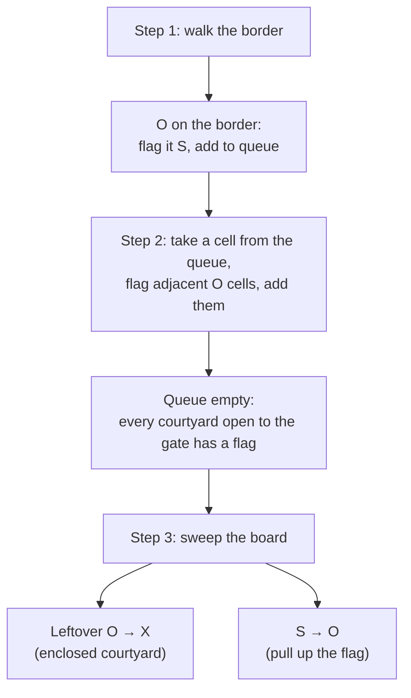
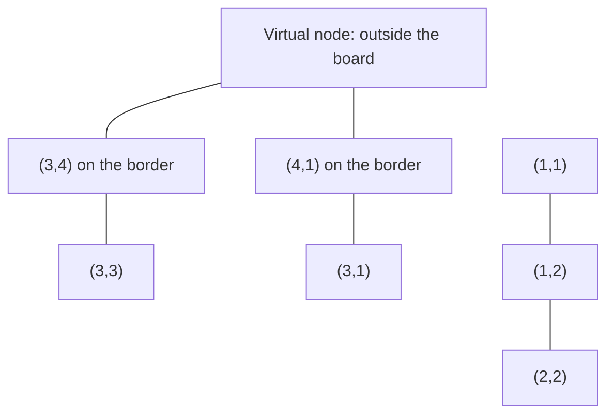

> [!tldr] Quick read
> - A **region** is a group of `O` cells joined through horizontal or vertical sides. A region is **surrounded** when none of its cells lies on the board's border. The task is to turn every surrounded region into `X`, directly on the input board.
> - Asking "is this region surrounded?" region by region means walking the whole region before you know. The reverse question is easier: **which cells can reach the border?** That is the idea of [[en/concepts/reverse-reachability|reverse reachability]].
> - The approach to use has three steps: mark every `O` on the border as `S`, spread `S` inward with BFS, then sweep once: leftover `O` becomes `X`, `S` goes back to `O`. Time `O(mn)`.
> - The biggest trap is **flipping cells during the search**: by the time you find out the region touches the border, some cells are already flipped. That wrong version passes only 2/10 cases.
> - Recursive DFS on a `200 × 200` board full of `O` goes tens of thousands of calls deep, so it overflows the stack in TypeScript, JavaScript, Python and Java. Go survives.

> [!info] Context
> LeetCode 130 (Medium) belongs to [[en/posts/2026-11-26-neetcode-graph-bfs|station 2: Graph Traversal and BFS]] on **the NeetCode Line: Graphs**. It reuses the exact flood fill from [[en/problems/number-of-islands|Number of Islands]] but changes the question: instead of counting islands, I need to know which ones touch the edge. You only need loops, 2D arrays and queues. Every other term is explained right below.

> [!abstract]- Quick glossary for this post (click to open)
> - **Board**: a grid of `m` rows and `n` columns where each cell is the character `'X'` or `'O'`. Coordinates `(row, col)` start at 0.
> - **Border**: the cells in the first row, last row, first column or last column.
> - **Adjacent**: two cells that share a side (up, down, left, right). Sharing only a corner does not count.
> - **Region**: a [[en/concepts/connected-component|connected component]] of `O` cells, that is, a group of `O` cells you can walk between using adjacent steps.
> - [[en/concepts/grid-graph|Grid graph]]: treat each cell as a vertex and each pair of adjacent cells as an edge.
> - [[en/concepts/flood-fill|Flood fill]]: start at one cell and spread to every adjacent cell of the same kind until the region is done.
> - [[en/concepts/breadth-first-search|BFS]]: visits layer by layer with a queue (first in, first out). **DFS**: goes deep down one branch first, with a stack or recursion.
> - [[en/concepts/multi-source-bfs|Multi-source BFS]]: put many starting cells in the queue at once instead of running a separate BFS for each.
> - **In place**: the function returns nothing and must modify the very array the caller passed in.
> - **Union-Find**: a structure that groups elements and answers "are these two in the same group?" quickly. Station 4 of this line covers it in depth.

## Picture it first: a castle with walls and courtyards

Picture the board as the floor plan of a castle seen from above. An `X` cell is a **wall**. An `O` cell is an **open courtyard**. The edge of the plan is the **castle gate**: a courtyard that touches the edge can be reached from outside.

The king orders: any courtyard enclosed by walls, with no way out to the gate, gets **filled in** (turned into `X`).

The soldiers can do this two ways. The clumsy way: stand in each courtyard and try to walk out. The smart way: stand **outside the gate**, walk into every courtyard they can reach and **plant a flag** there. A courtyard without a flag is certainly enclosed. At the end, fill the flagless courtyards, then pull up the flags.

| Everyday life | Concept |
|---|---|
| Wall | An `X` cell |
| Open courtyard | An `O` cell |
| One stretch of connected courtyards | A region: a connected component of `O` cells |
| Courtyard at the edge of the plan | An `O` cell on the border |
| Soldiers walking in from the gate, planting flags | [[en/concepts/reverse-reachability\|Reverse reachability]]: [[en/concepts/multi-source-bfs\|multi-source BFS]] from the border, marking `S` |
| Courtyard with no flag | A surrounded region, turned into `X` |
| Pulling up the flags | Turning `S` back into `O` |
| Filling a courtyard while still trying to walk out | The "flip during the search" trap |



## The problem: which regions are surrounded?

The input is an `m × n` board of `'X'` and `'O'` characters, with `1 ≤ m, n ≤ 200`. A region of `O` cells is surrounded when none of its cells lies on the border. Turn every cell of every surrounded region into `'X'`. The function returns nothing: it must modify the board it was given. [Problem LC-0130](https://leetcode.com/problems/surrounded-regions/)

I used to think the rule was "every `O` not on the border becomes `X`". That is wrong, because a cell in the middle of the board can still reach the border through a chain of other `O` cells. Take this `5 × 5` board:

```text
      col 0 1 2 3 4
row 0     X X X X X
row 1     X O O X X
row 2     X X O X X
row 3     X O X O O
row 4     X O X X X
```

There are three regions of `O` cells:

| Region | Cells | Any cell on the border? | Result |
|---|---|---|---|
| A | `(1,1)`, `(1,2)`, `(2,2)` | No | Surrounded, becomes `X` |
| B | `(3,1)`, `(4,1)` | Yes: `(4,1)` is in the last row | Unchanged |
| C | `(3,3)`, `(3,4)` | Yes: `(3,4)` is in the last column | Unchanged |

Cells `(3,1)` and `(3,3)` are both inside, yet they stay because they share a region with a border cell. The board after processing:

```text
X X X X X
X X X X X
X X X X X
X O X O O
X O X X X
```

## How it works

<figure class="figure-map" style="--ar: 3 / 4">
<div class="frame"><iframe data-archify="../../diagrams/neetcode-surrounded-regions/worked-example.en.html" title="Find captured regions by working inward from the border" loading="lazy"></iframe></div>
<figcaption><span><b>Figure 1.</b> On the 5 × 5 board above, only two border cells are starting points; the flags spread to exactly four cells, and the other three get filled.</span><a href="../diagrams/neetcode-surrounded-regions/worked-example.en.html" target="_blank" rel="noopener">Open full screen</a></figcaption>
</figure>

<details>
<summary>Read the steps</summary>
<ol>
<li>Walk the border, find O on the edge. <code>(3,4), (4,1) → S</code></li>
<li>Put both edge cells in the queue. <code>queue: (3,4), (4,1)</code></li>
<li>Take (3,4), spread to the next O. <code>(3,3) → S</code></li>
<li>Take (4,1), spread to the next O. <code>(3,1) → S</code></li>
<li>Take (3,3), (3,1): no O left nearby. <code>queue empty</code></li>
<li>Final sweep: remaining O is captured. <code>(1,1), (1,2), (2,2) → X</code></li>
<li>Turn S back into O, done. <code>4 cells S → O</code></li>
</ol>
</details>

### Why working backwards is easier

The question "is this region surrounded?" has an awkward side. To answer **no**, one border cell is enough. To answer **yes**, you must walk the entire region before you can be sure. If you flip cells as you walk, you will flip regions that turn out to touch the border.

Turning the question into "which cells can reach the border?" makes everything simpler. The `O` cells on the border are certainly kept. From them, every adjacent `O` is kept too, and so on inward. Each cell is marked **exactly once**, and no cell has to wait for a whole region to finish. This is [[en/concepts/reverse-reachability|reverse reachability]]: instead of asking from every cell "can I reach the target?", start from the target and ask "which cells can the target reach?".

The first three approaches below are all correct. They differ in how much work they repeat.

### Approach 0 — brute force: ask about each cell separately

For each `O` cell, run a fresh BFS from it. If the BFS reaches the border, keep the cell; otherwise add it to a to-flip list. Flip only after every cell has been checked, so later searches still read the original board.

This is correct but slow. A surrounded region of `k` cells is walked `k` times, `k` cells each time: `k²` visits. A `90 × 90` board with an `X` border and an all-`O` interior has one region of `88 × 88 = 7,744` cells, so it costs `7,744² ≈ 6·10⁷` visits. Worst-case time is `O((mn)²)`.

### Approach 1 — fill one region at a time, flip when done

Fix the waste in approach 0: walk **each region once**. Scan the board row by row. At an unvisited `O`, BFS collects the whole region into a list while keeping a flag "does the region touch the border?". Only after the region is done do you decide: if it never touched the border, flip the whole list to `X`.

Each cell enters the queue exactly once, so the time is `O(mn)`. The price is a `seen` array of size `m × n` plus the list of the current region's cells.

### Approach 2 — work inward from the border with BFS (use this one)

This is the approach in Figure 1, and the one I submit:

1. **Seed.** Walk all four sides of the board. Each `O` on the border is changed to `'S'` (safe) and added to the queue. The queue now holds many starting cells at once: that is [[en/concepts/multi-source-bfs|multi-source BFS]].
2. **Spread.** Take cells from the queue one by one. Any adjacent cell that is still `'O'` becomes `'S'` the moment it is added to the queue. Marking on add keeps a cell from being added twice.
3. **Finish.** Sweep the whole board once: a leftover `'O'` cannot reach the border, so it becomes `'X'`. An `'S'` goes back to `'O'`.

On the example board:

| Step | Cell taken | Adjacent cells flagged `S` | Queue after this step |
|---|---|---|---|
| Seed | | `(3,4)`, `(4,1)` | `(3,4)`, `(4,1)` |
| 1 | `(3,4)` | `(3,3)` | `(4,1)`, `(3,3)` |
| 2 | `(4,1)` | `(3,1)` | `(3,3)`, `(3,1)` |
| 3 | `(3,3)` | none | `(3,1)` |
| 4 | `(3,1)` | none | empty |

The final sweep finds the three `O` cells of region A, turns them into `X`, then turns the four `S` cells back into `O`. The result matches the board in the problem section.

This approach needs no separate `seen` array: the `'S'` on the board is the visited mark. Time `O(mn)`. Extra memory is the queue, at worst `O(mn)` when the whole board is `O`.

### Approaches 3 and 4 — same idea, spread with DFS

Replace the queue with a stack (iterative DFS) or with recursion (recursive DFS) and the answer is still right, because the spreading step only needs to visit every reachable cell, in any order.

Recursion is the shortest to write but has a trap. On a `200 × 200` board full of `O`, DFS from `(0,0)` with the order up, down, left, right goes all the way down column 0, over to column 1 and up, over to column 2 and down... like a snake. That path is 40,000 cells long, and each cell is a call still open on the stack. This is the [[en/concepts/recursion-depth-limit|recursion depth limit]]:

| Language | Recursive DFS on a `200 × 200` board full of `O` |
|---|---|
| TypeScript, JavaScript | `RangeError` (out of stack) |
| Python | `RecursionError` (default limit about 1,000 calls) |
| Java | `StackOverflowError` |
| Go | Correct: a goroutine's stack grows on demand, up to 1 GB |

Iterative DFS with a stack you manage yourself avoids this in every language.

### Approach 5 — Union-Find with a virtual "border" node

Another way to look at it: add a **virtual node** that stands for "outside the board". Connect every `O` on the border to the virtual node. Connect every `O` to the adjacent `O` on its right and below. Afterwards, any `O` that is **not** in the same group as the virtual node is surrounded.



The three cells `(1,1)`, `(1,2)`, `(2,2)` form a group of their own with no path to the virtual node, so they get flipped. Union-Find runs in near `O(mn)` and needs no queue, but you have to write the two extra functions `find` and `union`. Station 4 of [[en/series/neetcode-grph|the Graphs line]] covers the structure in depth; for this problem, BFS from the border is shorter and easier to read.

### The approaches at a glance

| Approach | Time | Extra memory | Notes |
|---|---|---|---|
| 0. Brute force per cell | `O((mn)²)` | `O(mn)` | Correct but far too slow at `200 × 200` |
| 1. Fill one region at a time | `O(mn)` | `O(mn)` | Needs a `seen` array and a region list |
| 2. BFS from the border | `O(mn)` | `O(mn)` queue | Use this: short, no recursion |
| 3. Recursive DFS from the border | `O(mn)` | `O(mn)` call stack | Overflows the stack in 4 of 5 languages |
| 4. Iterative DFS from the border | `O(mn)` | `O(mn)` stack | Equivalent to approach 2 |
| 5. Union-Find, virtual node | near `O(mn)` | `O(mn)` | Longer to write, useful when the board changes over time |

### Measurement: brute force against region fill

I ran approaches 0 and 1 on a board with an `X` border and an all-`O` interior. The whole interior is one surrounded region, so both approaches must walk all of it. The brute-force visit count is an exact count that does not depend on the machine. The times change with the machine and from run to run, so read only the ratios.

| Board | Brute-force visits | Brute force (TS) | Region fill (TS) |
|---|---:|---:|---:|
| `30 × 30` | 614,656 | 16.4 ms | 0.03 ms |
| `60 × 60` | 11,316,496 | 289.1 ms | 0.11 ms |
| `90 × 90` | 59,969,536 | 1,548.7 ms | 0.24 ms |

Tripling the board side (30 → 90) makes brute force about 94 times slower, right on the `O((mn)²)` beat: 9 times the cells, squared to 81. Region fill gets only about 8 times slower, in line with the number of cells. At the `200 × 200` limit, brute force needs about `1.5·10⁹` visits. That is why the files run it only on the 8 small cases.

## Runnable example

Each file runs all six correct approaches and the three wrong versions on 10 shared cases: the example board, a single `O`, a single `X`, a `3 × 3` board full of `O`, a ring of `X` around one cell, a single row `OXO`, two cells that touch only at a corner, a winding path out to the border, a `200 × 200` board full of `O`, and a `200 × 200` board with an `X` border and an all-`O` interior. Then the file cross-checks the five correct approaches against brute force on 2,000 random boards up to `8 × 8`, and takes the measurement above. The snippets below are approach 2 from each file.

[TypeScript](../code/neetcode-surrounded-regions/surrounded.ts) · [Python](../code/neetcode-surrounded-regions/surrounded.py) · [Go](../code/neetcode-surrounded-regions/surrounded.go) · [Java](../code/neetcode-surrounded-regions/surrounded.java) · [JavaScript](../code/neetcode-surrounded-regions/surrounded.js)

```ts
const DIRS = [[-1, 0], [1, 0], [0, -1], [0, 1]]

// Approach 2 (use this): work inward from the border. Every O on the border enters the queue at once
// and is marked safe as 'S'. BFS spreads 'S' inward. Finally, one sweep:
// leftover O is surrounded so it becomes X, S goes back to O.
function borderBfs(board: Board): void {
  const m = board.length, n = board[0].length
  const queue: number[] = []
  const seed = (r: number, c: number) => {
    if (board[r][c] === 'O') { board[r][c] = 'S'; queue.push(r * n + c) }
  }
  for (let r = 0; r < m; r++) { seed(r, 0); seed(r, n - 1) }
  for (let c = 0; c < n; c++) { seed(0, c); seed(m - 1, c) }
  for (let head = 0; head < queue.length; head++) {
    const cr = Math.floor(queue[head] / n), cc = queue[head] % n
    for (const [dr, dc] of DIRS) {
      const nr = cr + dr, nc = cc + dc
      if (nr < 0 || nr >= m || nc < 0 || nc >= n || board[nr][nc] !== 'O') continue
      board[nr][nc] = 'S'
      queue.push(nr * n + nc)
    }
  }
  finish(board)
}

function finish(board: Board): void {
  for (const row of board) {
    for (let c = 0; c < row.length; c++) row[c] = row[c] === 'O' ? 'X' : row[c] === 'S' ? 'O' : row[c]
  }
}
```
```python
DIRS = ((-1, 0), (1, 0), (0, -1), (0, 1))

def finish(board):
    for row in board:
        for c, ch in enumerate(row):
            row[c] = 'X' if ch == 'O' else 'O' if ch == 'S' else ch


def border_cells(m, n):
    for r in range(m):
        yield r, 0
        yield r, n - 1
    for c in range(n):
        yield 0, c
        yield m - 1, c


# Approach 2 (use this): work inward from the border. Every O on the border enters the queue at once
# and is marked safe as 'S'. BFS spreads 'S' inward. Finally, one sweep:
# leftover O is surrounded so it becomes X, S goes back to O.
def border_bfs(board):
    m, n = len(board), len(board[0])
    queue = deque()
    for r, c in border_cells(m, n):
        if board[r][c] == 'O':
            board[r][c] = 'S'
            queue.append((r, c))
    while queue:
        cr, cc = queue.popleft()
        for dr, dc in DIRS:
            nr, nc = cr + dr, cc + dc
            if 0 <= nr < m and 0 <= nc < n and board[nr][nc] == 'O':
                board[nr][nc] = 'S'
                queue.append((nr, nc))
    finish(board)
```
```go
var dirs = [4][2]int{{-1, 0}, {1, 0}, {0, -1}, {0, 1}}

func finish(board Board) {
	for _, row := range board {
		for c, ch := range row {
			if ch == 'O' {
				row[c] = 'X'
			} else if ch == 'S' {
				row[c] = 'O'
			}
		}
	}
}

func borderCells(m, n int, visit func(r, c int)) {
	for r := 0; r < m; r++ {
		visit(r, 0)
		visit(r, n-1)
	}
	for c := 0; c < n; c++ {
		visit(0, c)
		visit(m-1, c)
	}
}

// Approach 2 (use this): work inward from the border with multi-source BFS, marking safe cells 'S'.
func borderBfs(board Board) {
	m, n := len(board), len(board[0])
	var queue []int
	borderCells(m, n, func(r, c int) {
		if board[r][c] == 'O' {
			board[r][c] = 'S'
			queue = append(queue, r*n+c)
		}
	})
	for head := 0; head < len(queue); head++ {
		cr, cc := queue[head]/n, queue[head]%n
		for _, d := range dirs {
			nr, nc := cr+d[0], cc+d[1]
			if nr < 0 || nr >= m || nc < 0 || nc >= n || board[nr][nc] != 'O' {
				continue
			}
			board[nr][nc] = 'S'
			queue = append(queue, nr*n+nc)
		}
	}
	finish(board)
}
```
```java
    static final int[][] DIRS = {{-1, 0}, {1, 0}, {0, -1}, {0, 1}};

    static void finish(char[][] board) {
        for (char[] row : board)
            for (int c = 0; c < row.length; c++)
                row[c] = row[c] == 'O' ? 'X' : row[c] == 'S' ? 'O' : row[c];
    }

    static void borderCells(int m, int n, Consumer<int[]> visit) {
        for (int r = 0; r < m; r++) { visit.accept(new int[]{r, 0}); visit.accept(new int[]{r, n - 1}); }
        for (int c = 0; c < n; c++) { visit.accept(new int[]{0, c}); visit.accept(new int[]{m - 1, c}); }
    }

    // Approach 2 (use this): work inward from the border with multi-source BFS, marking safe cells 'S'.
    static void borderBfs(char[][] board) {
        int m = board.length, n = board[0].length;
        ArrayDeque<Integer> queue = new ArrayDeque<>();
        borderCells(m, n, p -> {
            if (board[p[0]][p[1]] == 'O') { board[p[0]][p[1]] = 'S'; queue.addLast(p[0] * n + p[1]); }
        });
        while (!queue.isEmpty()) {
            int id = queue.removeFirst(), cr = id / n, cc = id % n;
            for (int[] d : DIRS) {
                int nr = cr + d[0], nc = cc + d[1];
                if (nr < 0 || nr >= m || nc < 0 || nc >= n || board[nr][nc] != 'O') continue;
                board[nr][nc] = 'S';
                queue.addLast(nr * n + nc);
            }
        }
        finish(board);
    }
```
```js
const DIRS = [[-1, 0], [1, 0], [0, -1], [0, 1]];

// Approach 2 (use this): work inward from the border. Every O on the border enters the queue at once
// and is marked safe as 'S'. BFS spreads 'S' inward. Finally, one sweep:
// leftover O is surrounded so it becomes X, S goes back to O.
function borderBfs(board) {
    const m = board.length, n = board[0].length;
    const queue = [];
    const seed = (r, c) => {
        if (board[r][c] === 'O') {
            board[r][c] = 'S';
            queue.push(r * n + c);
        }
    };
    for (let r = 0; r < m; r++) {
        seed(r, 0);
        seed(r, n - 1);
    }
    for (let c = 0; c < n; c++) {
        seed(0, c);
        seed(m - 1, c);
    }
    for (let head = 0; head < queue.length; head++) {
        const cr = Math.floor(queue[head] / n), cc = queue[head] % n;
        for (const [dr, dc] of DIRS) {
            const nr = cr + dr, nc = cc + dc;
            if (nr < 0 || nr >= m || nc < 0 || nc >= n || board[nr][nc] !== 'O')
                continue;
            board[nr][nc] = 'S';
            queue.push(nr * n + nc);
        }
    }
    finish(board);
}
function finish(board) {
    for (const row of board) {
        for (let c = 0; c < row.length; c++)
            row[c] = row[c] === 'O' ? 'X' : row[c] === 'S' ? 'O' : row[c];
    }
}
```

Output of `node surrounded.ts`:

```text
bruteForcePerCell      8/8 cases passed (small cases only)
regionFill             10/10 cases passed
borderBfs              10/10 cases passed
borderDfsRecursive     9/10 cases passed; wrong on 200×200 all O → throws RangeError
borderDfsIterative     10/10 cases passed
unionFind              10/10 cases passed
wrongNotOnBorder       6/10 cases passed; wrong on 5×5 example above, 3×3 all O, winding path to the border, 200×200 all O
wrongFlipDuringSearch  2/10 cases passed; wrong on 5×5 example above, single O, 3×3 all O, single row OXO, diagonal touch is not a connection, winding path to the border, 200×200 all O, 200×200 X border, all O inside → throws RangeError
wrongNewBoard          6/10 cases passed; wrong on 5×5 example above, X ring around one O, diagonal touch is not a connection, 200×200 X border, all O inside
random cross-check: 2000/2000 boards, all five correct approaches match brute force
30×30: brute force 614656 visits, 16.4 ms; region fill 0.03 ms
60×60: brute force 11316496 visits, 289.1 ms; region fill 0.11 ms
90×90: brute force 59969536 visits, 1548.7 ms; region fill 0.24 ms
```

*(Output labels translated; the files themselves print Vietnamese.)*

The other four files give the same pass/fail results, with two exceptions:
- **Go:** `borderDfsRecursive` passes all 10/10, because the goroutine stack grows. The wrong `wrongFlipDuringSearch` does not overflow either, so it also gets the `200 × 200` X-border case right (3/10 instead of 2/10). In that case every inside cell is surrounded, so flipping right away happens to give the correct answer.
- **Python:** prints one extra line for a Python-only trap: `bảng là list[str]: ném TypeError ('str' object does not support item assignment)` ("board is a list[str]: throws TypeError"). Python measures smaller boards (20, 30, 40) because it is slower: `40 × 40` costs 2,085,136 visits, about 1,068 ms for brute force and 0.54 ms for region fill.

## Misconceptions and common traps

- **"Every `O` not on the border gets flipped."** This ignores that an inside cell can reach the border through other cells. `wrongNotOnBorder` fails 4/10 cases, including the example board (cells `(3,1)` and `(3,3)` get flipped by mistake).
- **Flipping cells during the search.** `wrongFlipDuringSearch` flips a cell to `X` to mark it visited, then finds out the region touches the border: the flipped cells cannot come back. Worse, `a && b && c && d` stops as soon as one part returns `false`, so the rest of the region is never visited. This version passes 2/10 cases (3/10 in Go). The fix: use a separate temporary mark (`S`), or collect the whole region before deciding.
- **Building a new board and reassigning the parameter.** `board = board.map(...)` (or `board = [row[:] ...]`, `board = copy(board)`) changes only a local variable; the caller keeps the old board. `wrongNewBoard` solves the copy correctly but fails 4/10 cases, exactly the ones with cells to flip. The problem requires an **in-place** change.
- **Treating two cells that touch at a corner as connected.** Only the four directions up, down, left, right count. In the "diagonal touch" case, cells `(1,1)` and `(2,2)` touch the border cell `(0,0)` only at corners, so they are still surrounded.
- **Forgetting to pull up the flags.** If you don't turn `S` back into `O`, the result has stray `S` characters.
- **Recursive DFS on a large board.** It overflows the stack in TypeScript, JavaScript, Python and Java, as the table above shows. Use BFS or iterative DFS.
- **Python: rows as strings.** If the board is a `list[str]`, `board[r][c] = 'X'` throws `TypeError`, because strings cannot be modified. LeetCode passes a `list[list[str]]`; when you write your own test cases, remember `list(row)`.
- **TypeScript/JavaScript: rows as strings.** Assigning `board[r][c] = 'X'` to a string **raises no error at all** in a file that is not in strict mode (I tried it: the string `'XOX'` stays `'XOX'`). In strict mode it throws `TypeError: Cannot assign to read only property`. The board must be an array of character arrays.
- **Java: comparing `char` with `String`.** Writing `board[r][c] == "O"` (double quotes) is a compile error, `bad operand types for binary operator '=='`. Use `'O'` (single quotes).
- **Go and Java: shallow board copies.** `copy(dst, board)` in Go or `board.clone()` in Java copies only the outer array; the rows are still shared. When you need a copy to experiment on, copy row by row like the `clone`/`copy` helpers in the files.

## Self-check questions

> [!question]- The board is a single row, for example `O X O O X O`. Does any cell get flipped?
> No. With a single row (or column), every cell is on the border, so no region is surrounded.

> [!question]- Why mark a cell `S` when it is added to the queue instead of when it is taken out?
> A cell can be adjacent to two flagged cells. If you wait until it is taken out, both neighbors see it as still `O` and add it to the queue twice. Marking on add blocks the second one.

> [!question]- Cell `(2,2)` sits in the middle of the board but has a path of `O` cells leading to the last column. Does approach 2 keep it?
> Yes. BFS starts from the `O` in the last column, spreads back along that path and flags `(2,2)` with `S`. The final sweep turns it back into `O`.

> [!question]- If extra memory were free, why still avoid brute force?
> The problem is time, not memory: every cell of a large region walks the whole region again, so it costs `O((mn)²)`. At `200 × 200` that is about `1.5·10⁹` visits.

## References

- [LeetCode · Surrounded Regions](https://leetcode.com/problems/surrounded-regions/) — the problem and its limit `1 ≤ m, n ≤ 200` (checked on 2026-11-26).
- [Princeton · Breadth-first paths](https://github.com/kevin-wayne/algs4/blob/master/src/main/java/edu/princeton/cs/algs4/BreadthFirstPaths.java) — multi-source BFS and marking before adding to the queue.
- [Princeton · Weighted quick-union](https://github.com/kevin-wayne/algs4/blob/master/src/main/java/edu/princeton/cs/algs4/WeightedQuickUnionUF.java) — Union-Find with union by size.
- [Python · Recursion limit](https://docs.python.org/3/library/sys.html#sys.getrecursionlimit), [Go · SetMaxStack](https://pkg.go.dev/runtime/debug#SetMaxStack) (goroutine stacks up to 1 GB on 64-bit machines), [Java · ArrayDeque](https://docs.oracle.com/en/java/javase/21/docs/api/java.base/java/util/ArrayDeque.html).
