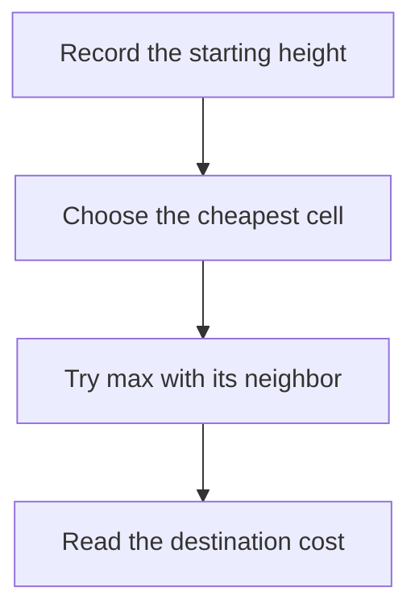

> [!tldr] Quick read
> - A route costs its greatest elevation, including the starting and ending cells.
> - A [[en/concepts/minimax-path|minimax path]] chooses the route with the smallest value of that maximum.
> - Dijkstra can still finalize the cheapest entry because extending a route with `max` leaves its cost alone or raises it.

> [!info] Context
> LeetCode 778, at [[en/posts/2026-11-27-neetcode-shortest-path|station 5: Shortest Paths]] on the NeetCode Graphs line. Loops and arrays are enough to get started.

> [!abstract]- Quick glossary for this post (click to open)
> - A threshold `t` opens every cell with elevation at most `t`.
> - Edges join cells sharing a side, so there are four directions.
> - [[en/concepts/breadth-first-search|BFS]] tests whether the open cells contain a route at a given threshold.

## Picture it first: a route over stone ledges

I want to paddle through a field of stones. One route crosses a ledge of height 8. A longer route only reaches a height of 4. The longer route opens earlier because the water only has to rise to 4.

| Everyday life | Concept |
| --- | --- |
| Ledge height | Cell value |
| Highest ledge on a route | Minimax route cost |
| First level that allows a route | Best cost to the destination |



## The problem: the first water level that opens the route

An n × n grid with `1 ≤ n ≤ 50` contains different heights from 0 to n²−1. At level `t`, you can only cross cells of height at most `t`, and can move in four directions. Find the smallest `t` allowing travel from the upper-left corner to the lower-right corner.

## How it works

### Thresholds and routes

In `[[0,8,7],[1,6,5],[2,3,4]]`, going down the left side and across the bottom costs 4. A lower level cannot open the destination of height 4, so 4 is optimal.

A direct method tests thresholds from low to high using BFS. There are at most n² tests, each O(n²), giving O(n⁴) time and O(n²) space. Once a level works, every higher one works. Binary searching over thresholds cuts the number of BFS runs to O(log n), giving O(n² log(n + 1)) time.

### Replace addition with max

I number a cell `row * n + col` and create edges into neighbors weighted by their elevations. A route starts with `grid[0][0]`. Extending a cost `d` into a cell of height `h` gives `max(d, h)`.

The `max` operation does not lower route costs, and it preserves the order of two old costs when both are extended into the same cell. If there were a better route to a cell about to be finalized, the first unfinalized cell of that route would have a smaller value. The heap would pop it first.

The code builds an explicit adjacency list so it can reuse the [[en/concepts/dijkstra|Dijkstra loop]]. There are n² vertices and at most 4n² edges, for O(n² log(n + 1)) time and O(n²) space. An implicit grid generates the same four moves without storing edges. TypeScript cross-checks binary-search BFS on 200 small permutations.

## Runnable example

[TypeScript](../code/neetcode-swim-in-rising-water/water-level.ts) · [Python](../code/neetcode-swim-in-rising-water/water_level.py) · [Go](../code/neetcode-swim-in-rising-water/water_level.go) · [Java](../code/neetcode-swim-in-rising-water/water-level.java) · [JavaScript](../code/neetcode-swim-in-rising-water/water-level.js) · [PHP](../code/neetcode-swim-in-rising-water/water-level.php) · [Rust](../code/neetcode-swim-in-rising-water/water_level.rs)

The tabs show the central function. The standalone files also run the comparison methods on the small cases. The TypeScript file adds randomized comparisons.

```ts
function swimTime(grid: number[][]): number {
  const n = grid.length
  const graph = Array.from({ length: n * n }, (): Neighbor[] => [])
  const directions = [[-1, 0], [1, 0], [0, -1], [0, 1]]
  for (let row = 0; row < n; row++) {
    for (let col = 0; col < n; col++) {
      for (const [dr, dc] of directions) {
        const r = row + dr
        const c = col + dc
        if (0 <= r && r < n && 0 <= c && c < n) graph[row * n + col].push([r * n + c, grid[r][c]])
      }
    }
  }
  return leastCosts(graph, 0, grid[0][0], Math.max)[n * n - 1]
}
```

```python
def swim_time(grid):
    n = len(grid)
    graph = [[] for _ in range(n * n)]
    for row in range(n):
        for col in range(n):
            for dr, dc in ((-1, 0), (1, 0), (0, -1), (0, 1)):
                r, c = row + dr, col + dc
                if 0 <= r < n and 0 <= c < n:
                    graph[row * n + col].append((r * n + c, grid[r][c]))
    return least_costs(graph, 0, grid[0][0], max)[-1]
```

```go
func swimTime(grid [][]int) int {
	n := len(grid)
	graph := make([][]neighbor, n*n)
	directions := [][2]int{{-1, 0}, {1, 0}, {0, -1}, {0, 1}}
	for row := range grid {
		for col := range grid[row] {
			for _, delta := range directions {
				r, c := row+delta[0], col+delta[1]
				if r >= 0 && r < n && c >= 0 && c < n {
					from := row*n + col
					graph[from] = append(graph[from], neighbor{r*n + c, grid[r][c]})
				}
			}
		}
	}
	return leastCosts(graph, 0, grid[0][0], func(a, b int) int { return max(a, b) })[n*n-1]
}
```

```java
static int swimTime(int[][] grid) {
    int n = grid.length;
    var graph = emptyGraph(n * n);
    int[][] directions = {{-1, 0}, {1, 0}, {0, -1}, {0, 1}};
    for (int row = 0; row < n; row++) {
        for (int col = 0; col < n; col++) {
            for (int[] delta : directions) {
                int r = row + delta[0], c = col + delta[1];
                if (0 <= r && r < n && 0 <= c && c < n) {
                    graph.get(row * n + col).add(new int[]{r * n + c, grid[r][c]});
                }
            }
        }
    }
    return leastCosts(graph, 0, grid[0][0], Math::max)[n * n - 1];
}
```

```js
function swimTime(grid) {
  const n = grid.length
  const graph = Array.from({ length: n * n }, () => [])
  const directions = [[-1, 0], [1, 0], [0, -1], [0, 1]]
  for (let row = 0; row < n; row++) {
    for (let col = 0; col < n; col++) {
      for (const [dr, dc] of directions) {
        const r = row + dr
        const c = col + dc
        if (0 <= r && r < n && 0 <= c && c < n) graph[row * n + col].push([r * n + c, grid[r][c]])
      }
    }
  }
  return leastCosts(graph, 0, grid[0][0], Math.max)[n * n - 1]
}
```

```php
function swimTime(array $grid): int {
    $n = count($grid);
    $graph = array_fill(0, $n * $n, []);
    $directions = [[-1, 0], [1, 0], [0, -1], [0, 1]];
    for ($row = 0; $row < $n; $row++) {
        for ($col = 0; $col < $n; $col++) {
            foreach ($directions as [$dr, $dc]) {
                $r = $row + $dr;
                $c = $col + $dc;
                if (0 <= $r && $r < $n && 0 <= $c && $c < $n) {
                    $graph[$row * $n + $col][] = [$r * $n + $c, $grid[$r][$c]];
                }
            }
        }
    }
    return leastCosts($graph, 0, $grid[0][0], 'max')[$n * $n - 1];
}
```

```rust
fn swim_time(grid: &[&[i32]]) -> i32 {
    let n = grid.len();
    let mut graph = vec![Vec::new(); n * n];
    let directions = [(-1, 0), (1, 0), (0, -1), (0, 1)];
    for row in 0..n {
        for col in 0..n {
            for (dr, dc) in directions {
                let r = row.wrapping_add_signed(dr);
                let c = col.wrapping_add_signed(dc);
                if r < n && c < n {
                    graph[row * n + col].push((r * n + c, grid[r][c]));
                }
            }
        }
    }
    least_costs(&graph, 0, grid[0][0], i32::max)[n * n - 1]
}
```

```text
5/5 cases passed
200/200 cross-checks passed
```

*(Output labels translated; the files themselves print Vietnamese.)*

## Misconceptions and common traps

- **Add the elevations along a route.** Water only has to clear the highest ledge.
- **Initialize the source cost to 0.** The source can be the highest cell. For example, `[[3,0],[2,1]]` has answer 3.
- **Optimize for the number of moves.** The condition for opening a route does not count moves.
- **Subtract 1 from an unsigned boundary index.** The Rust code uses `wrapping_add_signed` and checks upper bounds before indexing.

## Self-check questions

> [!question]- Two routes both cost 4, but one is twice as long. Does the answer change?
> No. Both routes open at level 4.

> [!question]- Does a one-cell grid require a BFS?
> Its first cell is also its last. Return its elevation.

## References

- [LeetCode 778 · Swim in Rising Water](https://leetcode.com/problems/swim-in-rising-water/)
- [Dijkstra (1959)](https://doi.org/10.1007/BF01386390)
