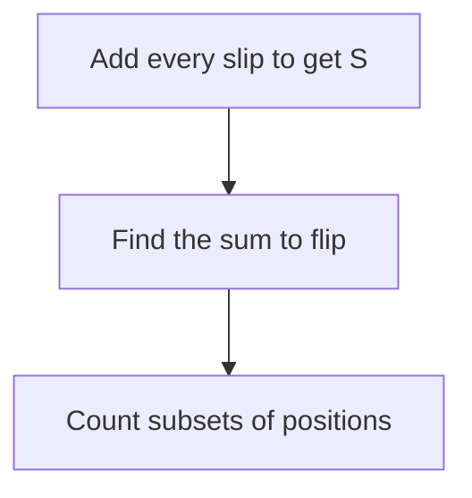

> [!tldr] Quick read
> - Choose which positions get a minus sign. If S is the total and N is the sum of those positions, the expression evaluates to S − 2N.
> - Count subsets with N = (S − target)/2. The result is zero if the target is outside [−S, S] or S − target is odd.
> - Sweep sums downward because each position can be chosen at most once. Each zero doubles the count at every sum.

> [!info] Context
> This is LeetCode 494 at [[en/posts/2026-11-27-neetcode-knapsack|station DP-03: Knapsack and Coin Change]] on **the NeetCode Line: Dynamic Programming**. I picture an inventory adjustment sheet, with each slip adding or removing a quantity. All you need is addition and loops.

> [!abstract]- Quick glossary for this post (click to open)
> - The [[en/concepts/signed-subset-sum|signed subset-sum reduction]] turns signs at positions into a choice of positions.
> - [[en/concepts/zero-one-knapsack|0/1 Knapsack]] lets me take or skip each position.
> - [[en/concepts/knapsack-update-order|Update order]] decides whether the source cell belongs to the previous row or the row being written.

## Picture it first: slips for adding or removing stock

A warehouse has slips for 1, 2, and 5 units. Mark every slip as an addition and the ledger increases by 8. Changing slip 2 to a subtraction drops the total by 4 units, from 8 to 4. Once I choose which slips to change, the remaining signs are determined.

| Everyday life | Concept |
|---|---|
| Total treating every slip as an addition | S |
| List of slips whose signs change | A subset of positions |
| Slip x changes from addition to subtraction | Total drops by 2x |
| A zero slip accepts either sign | Two choices at the same sum |



## The problem: count signs at individual positions

The array contains 1 to 20 nonnegative integers, each at most 1,000, with a total at most 1,000. The target is between −1,000 and 1,000. Every position must receive one sign. Two assignments count separately even if they differ only at a zero-valued position. For example, `[1,2,5]` has one assignment to reach 4, `+1−2+5`. [Original LeetCode 494 problem](https://leetcode.com/problems/target-sum/)

## How it works

### Try both signs and merge branches with the same sum

Brute force chooses a sign at each position and checks the total at each leaf. There are 2ⁿ leaves, giving O(2ⁿ) time and O(n) stack space. To share work, maintain `ways[s]`, the number of assignments reaching signed sum s after a prefix. For the next value x, each assignment at s contributes to `s+x` and `s−x` in **a fresh row**. When x = 0 both transitions land in one cell, so add both contributions. A map stores only reachable sums. Let S be the array total and Sᵢ the total of prefix i. Layer i has at most 2Sᵢ + 1 keys. The worst-case bounds are O(n(S+1)) expected time with hashing and O(S+1) space.

### Reduce the goal and roll the row

Let P and N be the sums of positive and negative positions. Then P + N = S and P − N = target, so N = (S − target)/2. Each subset of positions with sum N uniquely determines an assignment. The range and parity checks are necessary conditions. The table may still return zero.

Initialize `ways[0] = 1` for the empty subset. Before processing x, cell s counts subsets from the processed prefix. After x, the new count at s equals the old count at s plus the old count at s − x. For x > 0, sweeping downward keeps the smaller cell in the previous row. For x = 0, the right-hand side reads the old count at s and doubles it with one addition. The two zeroes before `[2,3]` raise the count for target 1 from 1 to 4.

Let W be the required subset sum. The rolling table uses O(n(W+1)) time and O(W+1) space. Time depends on the numeric value of W, making this bound pseudopolynomial. No count exceeds 2²⁰ under the problem limits.

## Runnable example

[TypeScript](../code/neetcode-target-sum/signs.ts) · [Python](../code/neetcode-target-sum/signs.py) · [Go](../code/neetcode-target-sum/signs.go) · [Java](../code/neetcode-target-sum/signs.java) · [JavaScript](../code/neetcode-target-sum/signs.js) · [PHP](../code/neetcode-target-sum/signs.php) · [Rust](../code/neetcode-target-sum/signs.rs)

```ts
function countBySubset(nums: number[], target: number) {
    const sum = nums.reduce((a, b) => a+b, 0)
    const twice = sum-target
    if (Math.abs(target) > sum || twice % 2 !== 0) return 0
    const goal = twice/2
    const ways = Array(goal+1).fill(0)
    ways[0] = 1
    for (const x of nums) {
        for (let s = goal; s >= x; s--) {
            ways[s] += ways[s-x]
        }
    }
    return ways[goal]
}
```

```python
def count_by_subset(nums, target):
    total = sum(nums)
    twice = total - target
    if abs(target) > total or twice % 2:
        return 0
    goal = twice // 2
    ways = [1] + [0] * goal
    for x in nums:
        for s in range(goal, x-1, -1):
            ways[s] += ways[s-x]
    return ways[goal]
```

```go
func countBySubset(nums []int, target int) int {
	sum := 0
	for _, x := range nums {
		sum += x
	}
	twice := sum - target
	if target > sum || target < -sum || twice%2 != 0 {
		return 0
	}
	goal := twice / 2
	ways := make([]int, goal+1)
	ways[0] = 1
	for _, x := range nums {
		for s := goal; s >= x; s-- {
			ways[s] += ways[s-x]
		}
	}
	return ways[goal]
}
```

```java
static int countBySubset(int[] nums, int target) {
    int sum = Arrays.stream(nums).sum();
    int twice = sum-target;
    if (Math.abs(target)>sum || twice%2!=0) return 0;
    int goal = twice/2;
    int[] ways = new int[goal+1];
    ways[0] = 1;
    for (int x : nums) {
        for (int s=goal;s>=x;s--) ways[s] += ways[s-x];
    }
    return ways[goal];
}
```

```js
function countBySubset(nums, target) {
    const sum = nums.reduce((a, b) => a+b, 0)
    const twice = sum-target
    if (Math.abs(target) > sum || twice % 2 !== 0) return 0
    const goal = twice/2
    const ways = Array(goal+1).fill(0)
    ways[0] = 1
    for (const x of nums) {
        for (let s = goal; s >= x; s--) {
            ways[s] += ways[s-x]
        }
    }
    return ways[goal]
}
```

```php
function countBySubset(array $nums, int $target): int {
    $sum = array_sum($nums);
    $twice = $sum - $target;
    if (abs($target) > $sum || $twice % 2 !== 0) return 0;
    $goal = intdiv($twice, 2);
    $ways = array_fill(0, $goal+1, 0);
    $ways[0] = 1;
    foreach ($nums as $x) {
        for ($s=$goal; $s >= $x; $s--) $ways[$s] += $ways[$s-$x];
    }
    return $ways[$goal];
}
```

```rust
fn count_by_subset(nums: &[i32], target: i32) -> i32 {
    let sum: i32 = nums.iter().sum();
    let twice = sum - target;
    if target.abs() > sum || twice % 2 != 0 {
        return 0;
    }
    let goal = (twice / 2) as usize;
    let mut ways = vec![0; goal + 1];
    ways[0] = 1;
    for &x in nums {
        let x = x as usize;
        for s in (x..=goal).rev() {
            ways[s] += ways[s - x];
        }
    }
    ways[goal]
}
```

The tabs show subset counting. The downloads also contain a map over signed sums and brute force. All three agree on cases with at most 16 elements. Both DP versions also check 20 zeroes. The Node.js files count decision-tree leaves and table updates for 16 ones and target zero. These counts measure different operations, so they do not establish a wall-clock ratio.

```text
11/11 cases passed
16 ones: 65536 leaves, 128 cell updates
```

*(Output labels translated; the files themselves print Vietnamese.)*

## Misconceptions and common traps

- A set of values loses duplicate positions. With four 3s and target zero, there are six pairs of positions that can receive minus signs.
- Skipping x = 0 loses half the assignments for each zero. Rust uses a reversed range that includes 0, so it never needs to subtract from a zero `usize`.
- Converting to an index or using integer division before the range and parity checks may round an invalid goal. Python uses `//` and PHP uses `intdiv` after both checks.

## Self-check questions

> [!question]- Why does flipping one sign reduce the sum by 2x?
> The slip originally contributed +x and now contributes −x. The difference is −2x.

> [!question]- Why do I need a fresh row for the map?
> Both destinations must come from the same layer. Writing into the map being read could introduce x into a branch again.

> [!question]- How many assignments target zero with two zeroes?
> Four. Each position independently accepts two signs.

## References

- [LeetCode 494](https://leetcode.com/problems/target-sum/)
- [MIT 6.006 on subset sum and pseudopolynomial time](https://ocw.mit.edu/courses/6-006-introduction-to-algorithms-spring-2020/resources/lecture-18-dynamic-programming-part-4-rods-subset-sum-pseudopolynomial/)
