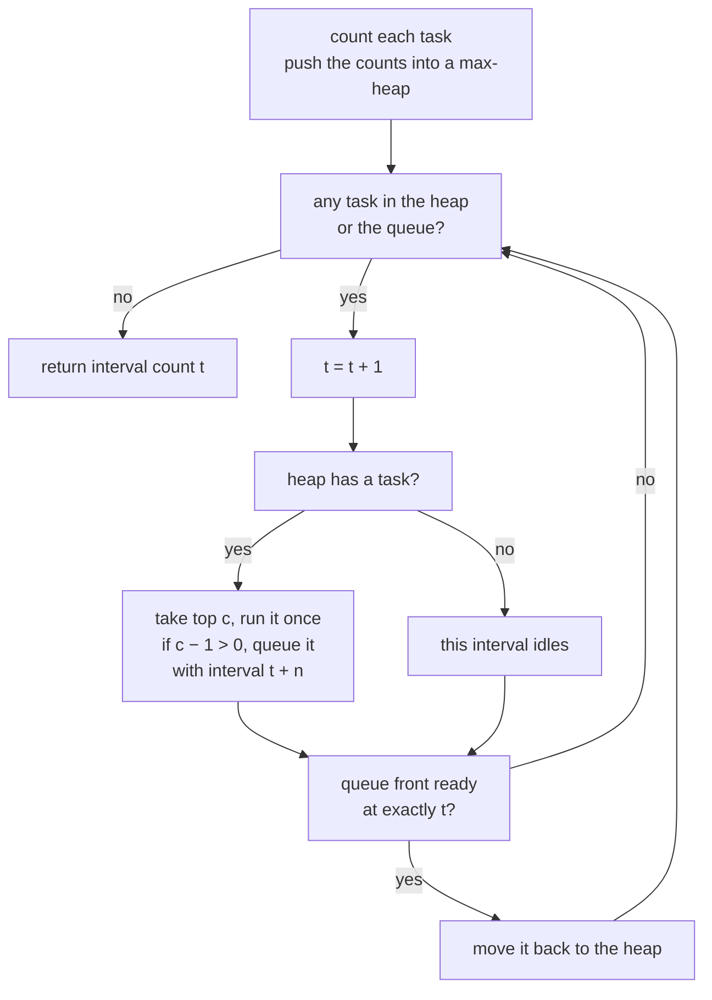

> [!tldr] Quick read
> - Problem: tasks are letters `A`..`Z`; each CPU interval runs one task or sits idle, and two runs of the same task must be at least n intervals apart. Return the fewest intervals that run everything.
> - Simulation: each interval, run the ready task with the **most runs left** (a [[en/concepts/heap|max-heap]]); the task just run goes into a **cooldown queue** until interval `t + n`. O(intervals · log 26).
> - [[en/concepts/idle-slot-counting|The frame formula]]: let f be the count of the most frequent task and k the number of tasks that reach f. The answer is `max(task count, (f − 1)(n + 1) + k)`. This page proves both directions and checks against exhaustive search: 1,500/1,500 small inputs agree.
> - Building the real schedule from frames only works when the remaining tasks are spread in **descending** order of count; ascending order breaks the cooldown in 42/1,500 schedules, for example `AAABBC`, n = 2.
> - Three wrong versions actually run: forgetting the `max` with the task count (6/10), a last frame of always 1 slot (8/10), running the first ready task alphabetically instead of the one with most runs left (8/10).

> [!info] Context
> LeetCode problem 621 on [[en/posts/2026-11-24-neetcode-two-heaps|station 4: Two Heaps and Scheduling]] of **The NeetCode Line: Search and Heaps**. The previous problem at station 3, [[en/problems/last-stone-weight|Last Stone Weight]], used a max-heap to take the largest element again and again; here the heap gets a companion queue, and the fastest solution needs no heap at all. The solution comes in TypeScript, Python, Go, Java and JavaScript. You only need arrays, loops and frequency counting.

> [!abstract]- Quick glossary for this post (click to open)
> - **Interval**: one CPU time unit; each interval runs exactly one task or idles.
> - **Idle**: an interval that runs nothing because every remaining task is cooling down.
> - **Cooldown n**: between two runs of the same task there must be at least n other intervals, so the two runs are at least n + 1 intervals apart.
> - **Max-heap**: a binary tree in an array with the largest element always at the top; taking the top and adding cost O(log n). See [[en/concepts/heap|Heap]].
> - **Queue**: first in, first out; here it holds the cooling tasks in the order they become ready.
> - **Frequency counting**: a 26-slot array counting each letter, as in [[en/concepts/frequency-counting|Frequency Counting]] and [[en/concepts/counting-array|Counting Array]].

## Picture it first: a gym plan where each muscle group rests n sets

Your evening plan: chest 3 sets, back 3 sets, legs 1 set. The coach's rule: after a muscle group trains, it rests n sets before it can train again. Each set you train a rested group, or sit and drink water if every group is resting. To go home early you always pick the group with **the most sets left**: that group is the bottleneck, and pushing it to the end leaves the end of the session full of waiting.

| Everyday life | Concept |
|---|---|
| Muscle group (chest, back, legs) | task type `A`..`Z` |
| Sets each group must train | how many times each task appears |
| One set | one interval |
| Sitting and drinking water | an idle interval |
| A group must rest n sets | cooldown n |
| Board of "rested groups, most sets left on top" | max-heap of remaining counts |
| List of resting groups, first to recover at the front | cooldown queue |
| Splitting the session into rounds of n + 1 sets, each opened by the biggest group | frames in the formula |



## The problem

Without a cooldown (n = 0) the answer is simply the task count. The cooldown creates idle intervals, and the real question is: **how few idle intervals** are unavoidable? The order decides that. With `ABBB`, n = 1, running `A` first gives `A B _ B _ B`, 6 intervals; running `B` first gives `B A B _ B`, 5 intervals. Trying every order explodes combinatorially, so we need a selection rule and a reason to trust that it is optimal.

## How it works

<figure class="figure-map" style="--ar: 3 / 4">
<div class="frame"><iframe data-archify="../../diagrams/neetcode-task-scheduler/worked-example.en.html" title="Reserve space between identical tasks" loading="lazy"></iframe></div>
<figcaption><span><b>Figure 1.</b> Reserve space between identical tasks.</span><a href="../diagrams/neetcode-task-scheduler/worked-example.en.html" target="_blank" rel="noopener">Open full screen</a></figcaption>
</figure>

<details>
<summary>Read the steps</summary>
<ol>
<li>Task A appears most often. <code>A × 3, B × 2, cooldown = 2</code></li>
<li>Build two blocks before the final A. <code>A _ _ / A _ _ / A</code></li>
<li>Place B in two different blocks. <code>A B _ / A B _ / A</code></li>
<li>The schedule takes seven slots. <code>7 = (3 - 1) × 3 + 1</code></li>
</ol>
</details>

### Approach 1: simulate with a max-heap and a cooldown queue

The greedy rule: **each interval, run the ready task with the most runs left**. We do not need task names, only the remaining counts, so the heap holds at most 26 numbers. A task just run cannot run again yet, so instead of going straight back to the heap it enters the queue with interval `t + n`; at the end of that interval it returns to the heap and can run again from interval `t + n + 1`.

```ts
// Simulate interval by interval: the heap holds the remaining counts of ready tasks,
// the queue holds [remaining count, interval it can run again] of cooling tasks.
function simulateHeap(tasks: string[], n: number): number {
  const heap = new MaxHeap();
  for (const c of countTasks(tasks)) if (c > 0) heap.push(c);
  const queue: [number, number][] = [];
  let head = 0, time = 0;
  while (heap.size > 0 || head < queue.length) {
    time++;
    if (heap.size > 0) {
      const c = heap.pop() - 1; // run the task with the most runs left
      if (c > 0) queue.push([c, time + n]);
    } // heap empty: this interval idles
    if (head < queue.length && queue[head][1] === time) heap.push(queue[head++][0]);
  }
  return time;
}
```


Tracing the problem's example `AAABBB`, n = 2 by hand:

| Interval | Heap before | Run | Queue after the interval | Back to heap at the end |
|---|---|---|---|---|
| 1 | 3, 3 | 3 → 2 | (2, interval 3) | |
| 2 | 3 | 3 → 2 | (2, 3), (2, 4) | |
| 3 | empty | idle | (2, 4) | 2 |
| 4 | 2 | 2 → 1 | (1, 6) | 2 |
| 5 | 2 | 2 → 1 | (1, 6), (1, 7) | |
| 6 | empty | idle | (1, 7) | 1 |
| 7 | 1 | 1 → 0 | | 1 |
| 8 | 1 | 1 → 0 | | |

8 intervals, schedule `A B _ A B _ A B`. The queue is always in ready order because each interval adds at most one task, with increasing ready intervals, so only the front needs checking.

Cost: each busy interval costs O(log 26) for the heap, each idle one O(1). The loop count equals **the answer**, not the task count. The answer can be far larger than the task count: 10⁵ tasks over only two letters, n = 100, need 5,082,523 intervals. When the heap is empty, the whole idle stretch until the queue front is ready can be added at once:

```ts
// As above, but when the heap is empty, jump straight to the interval where the queue front cools down,
// instead of counting idle intervals one by one. The loop count drops to the task count.
function simulateJump(tasks: string[], n: number): number {
  const heap = new MaxHeap();
  for (const c of countTasks(tasks)) if (c > 0) heap.push(c);
  const queue: [number, number][] = [];
  let head = 0, time = 0;
  while (heap.size > 0 || head < queue.length) {
    if (heap.size === 0) { // every interval up to queue[head][1] idles: add the whole stretch at once
      time = queue[head][1];
      heap.push(queue[head++][0]);
    }
    time++;
    const c = heap.pop() - 1;
    if (c > 0) queue.push([c, time + n]);
    if (head < queue.length && queue[head][1] === time) heap.push(queue[head++][0]);
  }
  return time;
}
```


This jumping version loops exactly once per task, O(task count · log 26).

**Why pick the task with the most runs left?** The most frequent task is the bottleneck: its runs have to span at least `(f − 1)(n + 1) + 1` intervals no matter what. Running it late only pushes that span further out. The wrong version `wrongAnyAvailable` picks the first ready task alphabetically: on `ABBB`, n = 1, it runs `A` first and gets 6 instead of 5. The proof below makes this argument rigorous by showing a schedule that reaches the lower bound exactly.

### Approach 2: the frame formula, and why it is right

Let f be the count of the most frequent task and k the number of tasks with f runs. For `AAABBB`, f = 3 and k = 2.

```text
answer = max(task count, (f − 1) · (n + 1) + k)
```

```ts
// Frame formula: f = count of the most frequent task, k = number of tasks that reach f.
// (f − 1) frames of length n + 1, plus a last frame of k slots; with more tasks than free slots, no interval idles.
function formula(tasks: string[], n: number): number {
  const cnt = countTasks(tasks);
  const f = Math.max(...cnt);
  const k = cnt.filter((c) => c === f).length;
  return Math.max(tasks.length, (f - 1) * (n + 1) + k);
}
```


**First lower bound: never fewer than the task count.** Each interval runs at most one task.

**Second lower bound: never fewer than (f − 1)(n + 1) + k.** Take a task X with f runs. Two consecutive runs of X are at least n + 1 intervals apart, so from the first to the last run of X there are at least (f − 1)(n + 1) intervals, and the last run of X falls at interval (f − 1)(n + 1) + 1 or later. That holds for **all k** tasks that reach f. The last runs of these k tasks sit in k different intervals, all at (f − 1)(n + 1) + 1 or later, so the latest of them is at least (f − 1)(n + 1) + k.

**Upper bound: there is always a schedule reaching exactly the larger of the two bounds.** Build the schedule from **frames**:

1. Make f frames. Each frame opens with the k tasks that reach f, in the same order. The first f − 1 frames have a nominal length of n + 1; the last frame holds only those k tasks.
2. Spread the remaining tasks (each with fewer than f runs) over the first f − 1 frames **by column**: the first run goes into frame 1, the second into frame 2, …, and after frame f − 1 wrap back to frame 1 in the next column. Tasks are taken in **descending** order of count.
3. A frame shorter than n + 1 gets idle intervals for the gap. A frame that grows longer simply stays longer.

This schedule is valid:
- **A task that reaches f** sits at the same position in every frame, and each frame is at least n + 1 long, so its consecutive runs are at least n + 1 apart.
- **A task with c < f runs** takes c consecutive slots in column order. There are f − 1 frames and c ≤ f − 1, so no frame holds it twice. If it stays within one column, consecutive runs sit in adjacent frames at the same column, exactly one frame length apart, at least n + 1.
- **When it wraps into the next column:** its last runs in column j start at frame r, its first runs in column j + 1 stop at frame s. The two closest runs are in frame s (column j + 1) and frame r (column j), about (r − s)(n + 1) − 1 intervals apart. Because tasks are taken in **descending** order, the tasks with f − 1 runs come first and each fills a whole column from frame 1; every task that wraps has c ≤ f − 2, which forces r ≥ s + 2. The gap is therefore at least 2(n + 1) − 1 ≥ n + 1.

Length of the schedule:
- If no frame grows, the schedule is exactly (f − 1)(n + 1) + k long, the second lower bound.
- If some frame grows, the tasks have already filled every nominal slot. Every frame is then full, there is no idle interval, and the schedule is exactly the task count long.
- Both cases equal the larger of the two lower bounds, so the formula is the optimal answer. ∎

`frameSchedule` in the TypeScript file builds exactly this schedule, and `isValid` checks it:

```ts
// Build the real schedule exactly as in the proof: each frame opens with the tasks that reach f,
// the remaining tasks (in DESCENDING order of count) are spread by column over the first f − 1 frames.
function frameSchedule(tasks: string[], n: number, ascending = false): string[] {
  const cnt = countTasks(tasks);
  const f = Math.max(...cnt);
  const letters = [...Array(26).keys()].filter((i) => cnt[i] > 0).map((i) => String.fromCharCode(65 + i));
  const top = letters.filter((c) => cnt[c.charCodeAt(0) - 65] === f);
  const rest = letters.filter((c) => cnt[c.charCodeAt(0) - 65] < f)
    .sort((a, b) => (cnt[b.charCodeAt(0) - 65] - cnt[a.charCodeAt(0) - 65]) * (ascending ? -1 : 1));
  const frames: string[][] = Array.from({ length: f }, () => [...top]);
  let p = 0;
  for (const c of rest) {
    for (let r = 0; r < cnt[c.charCodeAt(0) - 65]; r++) frames[p++ % (f - 1)].push(c); // go down the column
  }
  const out: string[] = [];
  frames.forEach((fr, i) => {
    out.push(...fr);
    if (i < f - 1) for (let s = fr.length; s < n + 1; s++) out.push("idle"); // pad a short frame with idle intervals
  });
  return out;
}
```


```text
frame schedule for AAAAAABCDEFG, n=2 (16 intervals):
  A B G A C idle A D idle A E idle A F idle A
```

*(Output labels translated; the files themselves print Vietnamese.)*

Here f = 6, there are 5 leading frames of length 3 and a last frame holding just `A`. The six other tasks fill only 6 of the 10 free slots, leaving 4 idle intervals: 16 = 5 · 3 + 1.

### The fill order is not a cosmetic detail

The "descending" step in the proof is easy to dismiss as tidiness. The TypeScript file runs the same construction with **ascending** order on 1,500 small random inputs:

```text
frame schedule, tasks in descending order: valid and shortest on 1500/1500
frame schedule, tasks in ASCENDING order: valid and shortest on 1458/1500
AAABBC, n=2, ascending: A C B A B idle A → valid? false
AAABBC, n=2, descending: A B C A B idle A → valid? true
```

*(Output labels translated; the files themselves print Vietnamese.)*

With `AAABBC`, n = 2: in ascending order `C` (1 run) goes into frame 1, then `B` (2 runs) fills frame 2 and wraps back to frame 1. The two `B`s land at intervals 3 and 5, 2 apart, less than n + 1 = 3. That is exactly the case r = s + 1 that the proof rules out with descending order. The length is still 7; only the schedule is wrong, so counting with the formula is unaffected. The trap bites when you need to **print** the schedule.

### Checking against exhaustive search

A proof on paper can miss a case, so the TypeScript file also has `bruteForce`: a breadth-first search (BFS) over the state "how many runs each task has left, how many intervals it still has to cool down". Each step either idles or runs a task that has cooled down. The number of steps to the "no tasks left" state is the true optimum. On 1,500 random inputs of up to 9 tasks, 4 letters, n ≤ 3, all three approaches (interval-by-interval heap, jumping heap, formula) agree with the exhaustive search on 1,500/1,500 inputs. On 300 more large inputs of up to 2,000 tasks, n ≤ 100, the three approaches agree and the frame schedule is valid on 300/300.

### Three wrong versions

**Forgetting the `max` with the task count.** The frame formula undercounts when there are more tasks than free slots, because then the frames grow:

```ts
// WRONG: forgets the max with the task count: with more tasks than free slots, the frame formula undercounts.
function wrongNoMax(tasks: string[], n: number): number {
  const cnt = countTasks(tasks);
  const f = Math.max(...cnt);
  const k = cnt.filter((c) => c === f).length;
  return (f - 1) * (n + 1) + k;
}
```


It fails 4/10 cases, including the problem's example 2 `ACABDB`, n = 1: the frames give 4, but there are 6 tasks. The case `AABBCCDD`, n = 1 is the same: 4 tasks reach f = 2 and fill the frames, the answer is the 8 tasks with no idle interval.

**A last frame of always 1 slot.** Forgetting that k tasks can share the top count f:

```ts
// WRONG: the last frame always has 1 slot, forgetting that several tasks can reach f.
function wrongCountMax(tasks: string[], n: number): number {
  const cnt = countTasks(tasks);
  const f = Math.max(...cnt);
  return Math.max(tasks.length, (f - 1) * (n + 1) + 1);
}
```


`AAABBB`, n = 2 gives 7 instead of 8. The problem's examples 1 and 3 both catch this bug.

**Running the first ready task, not the one with most runs left.** It still respects the cooldown, but picks the wrong task:

```ts
// WRONG: each interval runs the first ready task alphabetically, not the one with the most runs left.
function wrongAnyAvailable(tasks: string[], n: number): number {
  const cnt = countTasks(tasks);
  const ready = new Array(26).fill(1);
  let left = tasks.length, time = 0;
  while (left > 0) {
    time++;
    const i = cnt.findIndex((c, j) => c > 0 && ready[j] <= time);
    if (i >= 0) { cnt[i]--; ready[i] = time + n + 1; left--; }
  }
  return time;
}
```


`ABBB`, n = 1 gives 6 instead of 5; `AAABBBCCCDDE`, n = 2 gives 13 instead of 12. The problem's examples all pass, because their tasks have equal counts.

### Under the hood in five languages

| | Max-heap | Cooldown queue | Specific trap |
|---|---|---|---|
| TypeScript / JavaScript | hand-written (about 30 lines); with 26 counts, re-sorting each round is enough | array + a `head` index (avoids `shift()` moving the array) | `sort()` without a comparator compares counts as strings: `[10, 3, 2]` becomes `"3" > "2" > "10"` |
| Python | `heapq` is a min-heap, store `-c` | `collections.deque`, `popleft()` O(1) | forget to negate and the task with the **fewest** runs left goes first: 6/10 cases |
| Go | `container/heap`, `Less` returns `h[i] > h[j]` | a slice, cut with `queue[1:]` | LeetCode passes `tasks []byte`, `t - 'A'` is the index; call `heap.Pop(&h)`, not `h.Pop()`; the built-in `max` exists since Go 1.21 |
| Java | `new PriorityQueue<>(Collections.reverseOrder())` | `ArrayDeque<int[]>` | without a comparator `PriorityQueue` is a min-heap: 6/10 cases |

The JavaScript trap actually runs in [the JS file](../code/neetcode-task-scheduler/task-scheduler.js): the "sort each round" version using `cnt.sort().reverse()` fails on `AAAAAAAAAABBBCC`, n = 1, giving 21 instead of 19. The count 10 sorts after 3 and 2, so the most frequent task is left to the end.

### Measurements

TypeScript, random letters (mulberry32 generator), median of 5 runs:

| Tasks | Letters | n | Answer | Heap per interval | Jumping heap | Formula |
|---|---|---|---|---|---|---|
| 10⁴ | 26 | 2 | 10,000 | 0.31 ms | 0.29 ms | 0.02 ms |
| 10⁴ | 26 | 100 | 44,340 | 0.20 ms | 0.13 ms | 0.02 ms |
| 10⁵ | 26 | 100 | 399,355 | 4.02 ms | 3.10 ms | 0.20 ms |
| 10⁵ | 2 | 100 | 5,082,523 | 14.5 ms | 2.05 ms | 0.20 ms |
| 10⁵ | 26 | 10,000 (outside the problem's limits) | 39,713,972 | 90.1 ms | 2.15 ms | 0.20 ms |
| 10⁶ | 26 | 100 | 3,918,397 | 72.3 ms | 64.5 ms | 1.99 ms |

- The formula is a single counting pass, 15 to 450 times faster than the heap.
- The per-interval heap slows down with **the answer**: with two letters or a large n most intervals are idle, and the jumping version skips them. At n = 10,000 the per-interval heap takes 90.1 ms, the jumping one 2.15 ms.
- The problem caps tasks at 10⁴ and n at 100, so every approach runs under 1 ms on LeetCode.

JavaScript, comparing the hand-written heap with sorting the 26 counts every round of n + 1 intervals:

| Tasks | n | Heap | Sort each round | Formula |
|---|---|---|---|---|
| 10⁴ | 2 | 0.65 ms | 2.40 ms | 0.02 ms |
| 10⁵ | 2 | 11.06 ms | 22.50 ms | 0.20 ms |
| 10⁵ | 100 | 2.66 ms | 1.46 ms | 0.21 ms |
| 10⁶ | 100 | 61.89 ms | 14.63 ms | 1.95 ms |

Sorting each round wins when n is large: each round runs all 26 tasks for one sort. It loses when n is small: each round runs only 3 tasks yet still sorts all 26 counts. With 26 task types both are fine. When the number of task types m is large, re-sorting each round costs O(m log m) to run only n + 1 tasks, while the heap costs O(log m) per interval.

Other languages (10⁶ tasks, n = 100): Python heap + deque 326.3 ms, formula 30.56 ms; Go heap 43.80 ms, formula 0.57 ms; Java heap 25.41 ms, formula 0.55 ms. Python's formula spends its 30.56 ms almost entirely in `Counter` counting 10⁶ strings, and is still 10 times faster than the heap.

## Runnable example

[TypeScript](../code/neetcode-task-scheduler/task-scheduler.ts) · [Python](../code/neetcode-task-scheduler/task_scheduler.py) · [Go](../code/neetcode-task-scheduler/task_scheduler.go) · [Java](../code/neetcode-task-scheduler/task-scheduler.java) · [JavaScript](../code/neetcode-task-scheduler/task-scheduler.js) · [PHP](../code/neetcode-task-scheduler/task-scheduler.php) · [Rust](../code/neetcode-task-scheduler/task_scheduler.rs)

Each of the original five files runs 10 shared cases: the problem's three examples, n = 0, a single task with n = 100, `AAAAAABCDEFG` (many idle intervals), `ABBB` (catches picking the wrong task), `AABBCCDD` and `AAABBBCCCDDE` (the task count beats the frame formula), and `AAAB` with n = 3. The JavaScript file adds `AAAAAAAAAABBBCC` to catch the `sort()` bug.

Simulation with a heap and a cooldown queue:

```ts
// Simulate interval by interval: the heap holds the remaining counts of ready tasks,
// the queue holds [remaining count, interval it can run again] of cooling tasks.
function simulateHeap(tasks: string[], n: number): number {
  const heap = new MaxHeap();
  for (const c of countTasks(tasks)) if (c > 0) heap.push(c);
  const queue: [number, number][] = [];
  let head = 0, time = 0;
  while (heap.size > 0 || head < queue.length) {
    time++;
    if (heap.size > 0) {
      const c = heap.pop() - 1; // run the task with the most runs left
      if (c > 0) queue.push([c, time + n]);
    } // heap empty: this interval idles
    if (head < queue.length && queue[head][1] === time) heap.push(queue[head++][0]);
  }
  return time;
}
```

```python
# heapq is a min-heap only: store -c so the task with the most runs left sits at the top.
# the deque holds (remaining count, interval it can run again) of cooling tasks.
def least_interval_heap(tasks, n):
    heap = [-c for c in Counter(tasks).values()]
    heapq.heapify(heap)
    cooling = deque()
    t = 0
    while heap or cooling:
        t += 1
        if heap:
            c = heapq.heappop(heap) + 1  # one run fewer (negative numbers, so add 1)
            if c < 0:
                cooling.append((c, t + n))
        if cooling and cooling[0][1] == t:
            heapq.heappush(heap, cooling.popleft()[0])
    return t
```

```go
// LeetCode passes tasks as []byte; t - 'A' is the index 0..25.
func leastIntervalHeap(tasks []byte, n int) int {
	var cnt [26]int
	for _, t := range tasks {
		cnt[t-'A']++
	}
	h := maxHeap{}
	for _, c := range cnt {
		if c > 0 {
			h = append(h, c)
		}
	}
	heap.Init(&h)
	var queue []cooling
	t := 0
	for h.Len() > 0 || len(queue) > 0 {
		t++
		if h.Len() > 0 {
			c := heap.Pop(&h).(int) - 1
			if c > 0 {
				queue = append(queue, cooling{c, t + n})
			}
		}
		if len(queue) > 0 && queue[0].ready == t {
			heap.Push(&h, queue[0].c)
			queue = queue[1:]
		}
	}
	return t
}
```

```java
// PriorityQueue is a min-heap; Collections.reverseOrder() puts the largest remaining count on top.
// The cooldown queue holds int[]{remaining count, interval it can run again}.
static int leastIntervalHeap(char[] tasks, int n) {
    int[] cnt = new int[26];
    for (char t : tasks) cnt[t - 'A']++;
    PriorityQueue<Integer> pq = new PriorityQueue<>(Collections.reverseOrder());
    for (int c : cnt) if (c > 0) pq.add(c);
    ArrayDeque<int[]> cooling = new ArrayDeque<>();
    int time = 0;
    while (!pq.isEmpty() || !cooling.isEmpty()) {
        time++;
        if (!pq.isEmpty()) {
            int c = pq.poll() - 1;
            if (c > 0) cooling.add(new int[]{c, time + n});
        }
        if (!cooling.isEmpty() && cooling.peek()[1] == time) pq.add(cooling.poll()[0]);
    }
    return time;
}
```

```js
function heapSim(tasks, n) {
  const heap = new MaxHeap();
  for (const c of countTasks(tasks)) if (c > 0) heap.push(c);
  const queue = [];
  let head = 0, time = 0;
  while (heap.size > 0 || head < queue.length) {
    time++;
    if (heap.size > 0) {
      const c = heap.pop() - 1;
      if (c > 0) queue.push([c, time + n]);
    }
    if (head < queue.length && queue[head][1] === time) heap.push(queue[head++][0]);
  }
  return time;
}
```


The frame formula:

```ts
// Frame formula: f = count of the most frequent task, k = number of tasks that reach f.
// (f − 1) frames of length n + 1, plus a last frame of k slots; with more tasks than free slots, no interval idles.
function formula(tasks: string[], n: number): number {
  const cnt = countTasks(tasks);
  const f = Math.max(...cnt);
  const k = cnt.filter((c) => c === f).length;
  return Math.max(tasks.length, (f - 1) * (n + 1) + k);
}
```

```python
# Frame formula: (f - 1) frames of length n + 1, plus the k tasks that reach f; never fewer than the task count.
def least_interval_formula(tasks, n):
    cnt = Counter(tasks)
    f = max(cnt.values())
    k = sum(1 for c in cnt.values() if c == f)
    return max(len(tasks), (f - 1) * (n + 1) + k)
```

```go
// Frame formula: max(task count, (f - 1)(n + 1) + k).
func leastIntervalFormula(tasks []byte, n int) int {
	var cnt [26]int
	f := 0
	for _, t := range tasks {
		cnt[t-'A']++
		f = max(f, cnt[t-'A'])
	}
	k := 0
	for _, c := range cnt {
		if c == f {
			k++
		}
	}
	return max(len(tasks), (f-1)*(n+1)+k)
}
```

```java
// Frame formula: max(task count, (f - 1)(n + 1) + k).
static int leastIntervalFormula(char[] tasks, int n) {
    int[] cnt = new int[26];
    int f = 0;
    for (char t : tasks) f = Math.max(f, ++cnt[t - 'A']);
    int k = 0;
    for (int c : cnt) if (c == f) k++;
    return Math.max(tasks.length, (f - 1) * (n + 1) + k);
}
```

```js
function formula(tasks, n) {
  const cnt = countTasks(tasks);
  const f = Math.max(...cnt);
  const k = cnt.filter((c) => c === f).length;
  return Math.max(tasks.length, (f - 1) * (n + 1) + k);
}
```

```php
<?php
declare(strict_types=1);

function leastInterval(array $tasks, int $cooldown): int
{
    if ($tasks === []) {
        return 0;
    }
    $counts = array_count_values($tasks);
    $most = max($counts);
    $leaders = 0;
    foreach ($counts as $count) {
        if ($count === $most) {
            $leaders++;
        }
    }
    return max(count($tasks), ($most - 1) * ($cooldown + 1) + $leaders);
}
```

```rust
fn least_interval(tasks: &[u8], cooldown: usize) -> usize {
    if tasks.is_empty() {
        return 0;
    }
    let mut counts = [0; 26];
    for &task in tasks {
        counts[usize::from(task - b'A')] += 1;
    }
    let most = *counts.iter().max().unwrap();
    let leaders = counts.iter().filter(|&&count| count == most).count();
    tasks.len().max((most - 1) * (cooldown + 1) + leaders)
}
```


Output of `node task-scheduler.ts`:

```text
simulateHeap      10/10 cases correct
simulateJump      10/10 cases correct
formula           10/10 cases correct
frameSchedule     10/10 cases correct
bruteForce        10/10 cases correct
wrongNoMax        6/10 cases correct; wrong on ACABDB n=1 → 4, AAABBB n=0 → 4, AABBCCDD n=1 → 6, AAABBBCCCDDE n=2 → 9
wrongCountMax     8/10 cases correct; wrong on AAABBB n=2 → 7, AAABBB n=3 → 9
wrongAnyAvailable 8/10 cases correct; wrong on ABBB n=1 → 6, AAABBBCCCDDE n=2 → 13

frame schedule for AAAAAABCDEFG, n=2 (16 intervals):
  A B G A C idle A D idle A E idle A F idle A

exhaustive search vs the 3 approaches: agree on 1500/1500 small inputs
frame schedule, tasks in descending order: valid and shortest on 1500/1500
frame schedule, tasks in ASCENDING order: valid and shortest on 1458/1500
AAABBC, n=2, ascending: A C B A B idle A → valid? false
AAABBC, n=2, descending: A B C A B idle A → valid? true
large inputs (up to 2000 tasks, n ≤ 100): agree and valid on 300/300

tasks     let. n       answer   heap/interval   jump heap   formula
10000     26   2           10000         0.31 ms     0.29 ms     0.02 ms
10000     26   100         44340         0.20 ms     0.13 ms     0.02 ms
100000    26   100        399355         4.02 ms     3.10 ms     0.20 ms
100000    2    100       5082523         14.5 ms     2.05 ms     0.20 ms
100000    26   10000    39713972         90.1 ms     2.15 ms     0.20 ms
1000000   26   100       3918397         72.3 ms     64.5 ms     1.99 ms
```

`python3 task_scheduler.py`:

```text
least_interval_heap     10/10 cases correct
least_interval_formula  10/10 cases correct
forgot_negate           6/10 cases correct; wrong on AAAAAABCDEFG n=2 → 22, ABBB n=1 → 6, AAABBBCCCDDE n=2 → 14, AAAB n=3 → 10

random: heap and formula agree on 300/300 inputs

tasks     n      heap + deque   formula
10000     2             2.3 ms     0.28 ms
100000    100          33.9 ms     3.05 ms
1000000   100         326.3 ms    30.56 ms
```

`go run task_scheduler.go`:

```text
leastIntervalHeap     10/10 cases correct
leastIntervalFormula  10/10 cases correct
leastIntervalRounds   10/10 cases correct

random: the three approaches agree on 300/300 inputs

tasks     n      heap        by round    formula
10000     2         0.45 ms     1.07 ms     0.01 ms
100000    100       3.99 ms     0.61 ms     0.06 ms
1000000   100      43.80 ms     6.44 ms     0.57 ms
```

`java task-scheduler.java`:

```text
leastIntervalHeap     10/10 cases correct
leastIntervalFormula  10/10 cases correct
minHeapDefault        6/10 cases correct; wrong on AAAAAABCDEFG n=2 → 22, ABBB n=1 → 6, AAABBBCCCDDE n=2 → 14, AAAB n=3 → 10

random: heap and formula agree on 300/300 inputs

tasks     n      heap        formula
10000     2         0.22 ms     0.01 ms
100000    100       1.58 ms     0.06 ms
1000000   100      25.41 ms     0.55 ms
```

`node task-scheduler.js`:

```text
heapSim          11/11 cases correct
roundsSort       11/11 cases correct
formula          11/11 cases correct
wrongDefaultSort 10/11 cases correct; wrong on AAAAAAAAAABBBCC n=1 → 21

random: the three approaches agree on 300/300 inputs

tasks     n      heap       sort/round    formula
10000     2         0.65 ms       2.40 ms    0.02 ms
100000    2        11.06 ms      22.50 ms    0.20 ms
100000    100       2.66 ms       1.46 ms    0.21 ms
1000000   100      61.89 ms      14.63 ms    1.95 ms
```

*(Output labels translated; the files themselves print Vietnamese.)*

The two added versions use the frame formula. Rust uses 26 counters for the ASCII bytes `A` through `Z`. PHP prints `10/10 ca đúng` and Rust prints `10/10 ca đúng`.

## Misconceptions and common traps

- **"You have to simulate to get the answer."** The question only asks for the **number** of intervals; one counting pass and the formula are enough. Simulation is only needed to print the schedule, and the frame construction can print it too.
- **"The frame formula is always right."** Only while there are free slots. With more tasks than free slots there is no idle interval and the answer is the task count: always take the `max`.
- **"The last frame has 1 slot."** It has k slots, k being the number of tasks that share the top count f.
- **"Any greedy works as long as it respects the cooldown."** It has to pick the task with the most runs left; picking alphabetically fails on `ABBB`, n = 1.
- **"Cooldown n means two runs are n intervals apart."** They are **at least n + 1** apart, with at least n other intervals in between. Get this wrong and queued tasks return to the heap one interval early.
- **Building the frame schedule in any order.** Spread tasks in descending order of count; ascending order produces schedules that break the cooldown even though the length is right.
- **Simulating interval by interval with a huge n.** The loop count equals the answer, not the task count; add the whole idle stretch at once when the heap is empty.

## Self-check questions

> [!question]- For `AAAABBBB`, n = 3, what is the answer? What does the schedule look like?
> f = 4, k = 2: (4 − 1) · 4 + 2 = 14, more than the 8 tasks, so the answer is 14. Schedule: `A B _ _ A B _ _ A B _ _ A B`.

> [!question]- When is the answer exactly the task count?
> When (f − 1)(n + 1) + k ≤ the task count, that is, the other tasks are enough to fill every free slot in the frames. Then there is no idle interval. A special case: n = 0.

> [!question]- Why does the heap in the simulation hold only counts and not task names?
> The question only asks for the number of intervals. Two tasks with the same remaining count and the same cooldown state are interchangeable, so names do not change the answer. To print the schedule, store the name in each heap entry too.

> [!question]- How many loop iterations does the per-interval simulation take in the worst case within the problem's limits?
> The loop count equals the answer. The worst case is 10⁴ copies of one task with n = 100: (10⁴ − 1) · 101 + 1 = 1,009,900 iterations, mostly O(1) idle intervals. The jumping version loops only 10⁴ times.

> [!question]- In the proof, why does a task with c < f runs never sit twice in the same frame?
> It takes c consecutive slots in column order, and each column passes through f − 1 frames. To sit twice in one frame it would have to go around all f − 1 frames and one more slot, so c ≥ f. That contradicts c < f.

## References

- [LeetCode 621: Task Scheduler](https://leetcode.com/problems/task-scheduler/) (original problem: 1 ≤ task count ≤ 10⁴, 0 ≤ n ≤ 100, tasks are uppercase letters)
- [Python `heapq`](https://docs.python.org/3/library/heapq.html) (a min-heap on a list) and [`collections.deque`](https://docs.python.org/3/library/collections.html#collections.deque) (O(1) appends and pops at both ends)
- [Go `container/heap`](https://pkg.go.dev/container/heap) (heap.Interface; call `heap.Push` and `heap.Pop`)
- [Java `PriorityQueue`](https://docs.oracle.com/en/java/javase/21/docs/api/java.base/java/util/PriorityQueue.html) (a min-heap by natural order or a comparator) and [`Collections.reverseOrder`](https://docs.oracle.com/en/java/javase/21/docs/api/java.base/java/util/Collections.html#reverseOrder())
- [ECMAScript: `Array.prototype.sort`](https://tc39.es/ecma262/#sec-array.prototype.sort) (without a comparator it compares strings)
- Cormen, Leiserson, Rivest, Stein, *Introduction to Algorithms*, 3rd edition, chapter 6 (priority queues) and chapter 16 (greedy algorithms: proof by a lower bound and a solution that reaches it)
