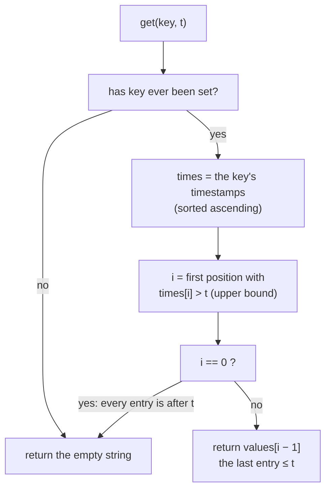

> [!tldr] Quick read
> - The problem: design `TimeMap` with `set(key, value, timestamp)` and `get(key, timestamp)`. `get` returns the `value` of the `set` call with the **largest timestamp that is still ≤** the one asked; if there is none, it returns the empty string `""`.
> - The problem promises that `set` timestamps are **increasing**. So each key needs only a timestamp array appended at the end: the array sorts itself, and `set` is O(1).
> - `get` is one [[en/concepts/binary-search|binary search]] for the **upper bound**: the first position with timestamp > t, then one step back. That is "the last entry ≤ t". O(log k), with k the number of sets for that key.
> - Three broken versions are run: using the [[en/concepts/lower-bound|lower bound]] instead of the upper bound returns **a value from the future** (2/8 cases); Python's `bisect_right(pairs, (t,))` skips the entry equal to t (4/8 cases); a JS plain object `{}` as the store throws `TypeError` on the key `"constructor"`.
> - If timestamps do **not** increase, inserting in place costs O(k) per set: 10⁵ sets in random order take 290 ms against 0.9 ms for plain appends. Then a balanced tree (Java's `TreeMap`) earns its place.

> [!info] Context
> LeetCode problem 981, part of [[en/posts/2026-11-23-neetcode-binary-search-answer|station 2: Binary Search on the Answer]] on **the NeetCode Line: Search and Heaps**. It is a *design* problem: not a single function but a class with two operations, which LeetCode calls in any interleaving. The binary search is exactly the one from [[en/problems/binary-search|Binary Search]] at [[en/posts/2026-11-23-neetcode-binary-search|station 1]]; what is new is picking the right bound and organising the data so the array always stays sorted. The solutions come in TypeScript, Python, Go, Java and JavaScript. All you need is arrays, loops and a hash map.

> [!abstract]- Quick glossary for this post (click to open)
> - **Hash map**: a structure that looks up `key → value` in O(1) on average. Here it looks up `key → that key's history`. See [[en/concepts/hash-map|Hash Map]].
> - **Timestamp**: a number marking a point in time. The problem uses integers from 1 to 10⁷; it does not matter whether they are seconds or milliseconds.
> - **Lower bound, upper bound**: in a sorted array, the lower bound is the first position ≥ t and the upper bound is the first position > t. See [[en/concepts/lower-bound|Lower Bound]].
> - **Half-open range `[lo, hi)`**: includes `lo`, excludes `hi`; the loop runs while `lo < hi`. See [[en/concepts/half-open-interval|Half-open Interval]].
> - **Design problem**: the problem gives a class name and its methods; you choose how to store the data so every operation is fast enough.

## Picture it first: a fuel price board

Fuel prices do not change every day. Each time they change, the station writes a line: *day 1: 20 thousand, day 4: 22 thousand, day 11: 21 thousand*. Someone asks "what did I pay per litre on day 7?". The answer is the price from the **latest change no later than day 7**, which is day 4.

| Everyday | Concept |
|---|---|
| Each fuel type has its own board | hash map `key → history` |
| Lines are written in date order; a new line always goes at the bottom | increasing timestamps, `set` only appends |
| "What was the price on day 7?" | `get(key, 7)` |
| The latest change no later than day 7 | the last entry ≤ t, i.e. upper bound − 1 |
| Look in the middle of the board, see whether that date is before or after day 7, drop the other half | [[en/concepts/binary-search\|binary search]] |
| Asking about day 0, before the first change | no price yet: return `""` |
| Reading the change **after** day 7 by mistake | lower bound: a value from the future |



## The problem

**The problem (in my own words):** implement the class `TimeMap`:

- `set(key, value, timestamp)`: store `value` for `key` at time `timestamp`.
- `get(key, timestamp)`: return the `value` of the call `set(key, …, t_prev)` with the largest `t_prev ≤ timestamp`. If there is no such call, return `""`.

Constraints: keys and values are lowercase letters and digits, 1 to 100 characters long; timestamps run from 1 to 10⁷; **every `set` timestamp is strictly increasing**; at most 2·10⁵ calls to `set` and `get` in total. Original problem: [LeetCode 981](https://leetcode.com/problems/time-based-key-value-store/).

| Call | Result |
|---|---|
| `set("foo", "bar", 1)` | |
| `get("foo", 1)` | `"bar"` |
| `get("foo", 3)` | `"bar"`: nothing has been set after 1, so the value is still `"bar"` |
| `set("foo", "bar2", 4)` | |
| `get("foo", 4)` | `"bar2"` |
| `get("foo", 5)` | `"bar2"` |

I used to think `get` had to find a timestamp **equal** to t, as in [[en/problems/binary-search|Binary Search]]. It turns out most queries fall **between** two entries, and the right question is "the last entry not past t". That is a question about a **boundary**, not about presence: all entries ≤ t form a leading block, entries > t form the rest, and I need the last cell of the leading block.

## How it works

<figure class="figure-map" style="--ar: 3 / 4">
<div class="frame"><iframe data-archify="../../diagrams/neetcode-time-based-key-value-store/worked-example.en.html" title="Find the last version at or before t" loading="lazy"></iframe></div>
<figcaption><span><b>Figure 1.</b> Find the last version at or before t.</span><a href="../diagrams/neetcode-time-based-key-value-store/worked-example.en.html" target="_blank" rel="noopener">Open full screen</a></figcaption>
</figure>

<details>
<summary>Read the steps</summary>
<ol>
<li>Writes are ordered by timestamp. <code>1 → red, 4 → blue, 8 → green</code></li>
<li>Query at timestamp 6. <code>t = 6</code></li>
<li>Timestamp 4 qualifies, search farther right. <code>4 ≤ 6</code></li>
<li>Timestamp 8 is beyond the query. <code>8 &gt; 6</code></li>
<li>Return the value at timestamp 4. <code>blue</code></li>
</ol>
</details>

### The data: one hash map, one sorted history per key

Each key keeps two parallel arrays, `times` and `values`, sharing the index. Because the problem promises strictly increasing timestamps **across all sets** (so also within each key), `set` only appends to the end of both arrays and `times` stays sorted by itself. No re-sorting, no inserting in the middle.

### Approach 1, scan backwards: O(k) per get

Walk `times` from the end towards the start and stop at the first entry ≤ t. Correct, but if a key has 10⁵ versions and queries land at random, it walks back half the array on average.

### Approach 2, binary search for the upper bound: O(log k) per get

On the [[en/concepts/half-open-interval|half-open range]] `[lo, hi) = [0, k)`: if `times[mid] ≤ t` the boundary is after `mid` (`lo = mid + 1`), otherwise it is at `mid` or before (`hi = mid`). The [[en/concepts/loop-invariant|invariant]]: every cell before `lo` has timestamp ≤ t, every cell from `hi` on has timestamp > t. When `lo == hi`, `lo` is exactly the **number** of entries ≤ t, and the last entry ≤ t is `lo − 1`. If `lo == 0`, every entry is after t: return `""`.

This is Python's `bisect_right(times, t) − 1`, Go's `sort.Search(k, func(i) bool { return times[i] > t }) − 1`, and `floorEntry(t)` on Java's `TreeMap`.

### Broken version 1: the lower bound instead of the upper bound

The lower bound is the first position **≥ t**. When t equals an entry exactly, it points at that entry and the answer is right. But when t falls between two entries, it points at the entry **after** t: `get("a", 15)` with entries 10 and 20 returns the value written at 20, a value that did not exist yet at time 15. This version passes 2/8 cases; it is right only in the two cases where every query hits an entry exactly or the key does not exist.

That is why this problem needs the **upper** bound: the question is "the last entry ≤ t", the cell just before the boundary between the "≤ t" block and the "> t" block.

### Broken version 2: Python compares tuples

If each key keeps a list of `(timestamp, value)` pairs, the natural call is `bisect_right(pairs, (t,))`. But Python compares tuples element by element, and a shorter tuple sorts first when the leading elements are equal: `(5,) < (5, "v")`. So `bisect_right` stops **before** the entry whose timestamp equals t, and `get` returns the entry before it. This version passes 4/8 cases and fails exactly on the queries that hit an entry. Since Python 3.10, `bisect_right(pairs, t, key=lambda p: p[0])` compares by timestamp and is correct.

### Broken version 3: a JS plain object as the store

`const store = {}` and then `store[key]` looks like a `Map`. But a plain object inherits from `Object.prototype`, so `store["constructor"]` is already the `Object` function before you set anything. Keys in this problem are lowercase letters and digits, so `"constructor"` is a valid key: `get` reads `h.times.length` on a function and throws `TypeError`. A `Map` has no such problem.

### When timestamps do not increase

The problem promises increasing timestamps, so appending is enough. Drop that promise (say, data arriving late from several machines) and `set` must insert in place: binary search finds the spot in O(log k), but shifting the later elements is O(k). For 10⁵ sets in random order, inserting with `splice` takes 290 ms; appending in increasing order takes 0.9 ms. That is when a balanced tree such as `TreeMap` (a red-black tree, O(log k) for both `put` and `floorEntry`) becomes the right choice.

### Beyond LeetCode: multi-version stores

The idea "keep every version over time, read the latest one no later than a given time" shows up in real systems. Google's Bigtable keeps several versions of each cell, indexed by timestamp, with the newest version stored first ([OSDI 2006 paper](https://research.google.com/archive/bigtable-osdi06.pdf), section 2). Postgres uses [[en/concepts/mvcc|MVCC]]: each `UPDATE` creates a new row version, and each transaction reads the version it is allowed to see. Postgres decides "allowed to see" by transaction ids (`xmin`, `xmax`), not by a binary search over a timestamp array, so this is the same idea, not the same implementation.

### Measured

TypeScript, one key with k entries (timestamps 2, 4, 6, …), 10⁵ `get` calls, median of 5 runs, ms. Two kinds of query: t at random over the whole history, and t "recent" (within the last 10 entries).

| k | scan back, random t | binary search, random t | scan back, recent t | binary search, recent t |
|---|---|---|---|---|
| 100 | 4.58 | 4.52 | 2.70 | 3.47 |
| 1 000 | 22.08 | 5.49 | 2.76 | 3.71 |
| 10 000 | 196.44 | 7.46 | 2.86 | 3.96 |
| 100 000 | (not run) | 10.94 | 3.34 | 4.26 |

- With random t, the backward scan grows with k (about 9 times from k = 1 000 to 10 000), while binary search only grows from 4.5 to 10.9 ms as k grows 1 000-fold.
- With recent t, the backward scan is **faster** than binary search, because it stops after a few steps. If an application almost always asks for the latest version, scanning back is a reasonable choice; its worst case is still O(k).
- Changing the order of sets (above): 10⁵ in-place inserts take 290.51 ms, appends take 0.88 ms.

Java, one key, 10⁶ sets then 10⁶ random gets, median of 5: `TreeMap` takes about 98 ms to set and 400 ms to get; two self-growing `int[]`/`String[]` arrays take 26 ms and 129 ms. The arrays are about 3 times faster at both: `TreeMap` boxes every timestamp as an `Integer` and walks tree nodes scattered in memory, while an `int[]` is contiguous. Python, 10⁵ gets over 10⁵ entries: `bisect_right` over a timestamp list takes 38 ms, `bisect_right(..., key=)` over a list of pairs takes 88 ms, because the `key` function is a Python call at every comparison.

### Under the hood of the five languages

| | Built-in binary search | Language-specific trap |
|---|---|---|
| TypeScript / JavaScript | none: write it, `(lo + hi) >>> 1` | a plain object `{}` as the store: the key `"constructor"` throws `TypeError`; use `Map` |
| Python | `bisect_right(times, t)`; `key=` since 3.10 | `bisect_right(pairs, (t,))` skips the entry equal to t (4/8 cases); merely **reading** `defaultdict[key]` creates an empty key |
| Go | `sort.Search(n, pred)`: the smallest index where `pred` holds; `pred` must go false then true | `m[key].times = …` on a `map[string]history` is the compile error "cannot assign to struct field … in map": use `map[string]*history`; a missing key gives `nil` |
| Java | `TreeMap.floorEntry(t)`, `Collections.binarySearch` | `floorEntry` returns `null` when every entry is after t; `Collections.binarySearch([10, 20], 15)` returns `-2`, i.e. `-(insertion point) − 1`; `TreeMap` is about 3 times slower than an `int[]` |

## Runnable example

[TypeScript](../code/neetcode-time-based-key-value-store/time-map.ts) · [Python](../code/neetcode-time-based-key-value-store/time_map.py) · [Go](../code/neetcode-time-based-key-value-store/time_map.go) · [Java](../code/neetcode-time-based-key-value-store/time-map.java) · [JavaScript](../code/neetcode-time-based-key-value-store/time-map.js)

Each file runs 8 cases (9 in JavaScript): the problem's example, a key never set, t before the first entry, t between two entries, t after the last entry, two interleaved keys, t equal to a middle entry, and timestamp 10⁷. The JavaScript file adds the key `"constructor"`. Below is the main solution in each language.

```ts
// Approach 2, binary search: find the first position with timestamp > t (upper bound), step back one. O(log k) per get.
class BinaryTimeMap implements TimeMapLike {
  protected store = new Map<string, { times: number[]; values: string[] }>();
  set(key: string, value: string, timestamp: number): void {
    let h = this.store.get(key);
    if (!h) this.store.set(key, (h = { times: [], values: [] }));
    h.times.push(timestamp);
    h.values.push(value);
  }
  get(key: string, timestamp: number): string {
    const h = this.store.get(key);
    if (!h) return "";
    let lo = 0, hi = h.times.length; // half-open [lo, hi): counts the entries ≤ timestamp
    while (lo < hi) {
      const mid = (lo + hi) >>> 1;
      if (h.times[mid] <= timestamp) lo = mid + 1;
      else hi = mid;
    }
    return lo === 0 ? "" : h.values[lo - 1]; // lo − 1 is the last entry ≤ timestamp
  }
}
```

```python
class TimeMap:
    """Two parallel lists per key: times stays sorted (the problem promises increasing timestamps), values share the index."""

    def __init__(self):
        self.times = defaultdict(list)
        self.values = defaultdict(list)

    def set(self, key: str, value: str, timestamp: int) -> None:
        self.times[key].append(timestamp)
        self.values[key].append(value)

    def get(self, key: str, timestamp: int) -> str:
        if key not in self.times:  # don't read self.times[key]: defaultdict would create an empty key
            return ""
        i = bisect_right(self.times[key], timestamp)  # number of entries ≤ timestamp
        return self.values[key][i - 1] if i else ""
```

```go
type history struct {
	times  []int
	values []string
}

// The map points to *history: m.store[key].times = … on a map[string]history is a compile error
// ("cannot assign to struct field … in map"), because a map value is not addressable.
type TimeMap struct {
	store map[string]*history
}

func Constructor() TimeMap { return TimeMap{store: map[string]*history{}} }

func (m *TimeMap) Set(key, value string, timestamp int) {
	h := m.store[key]
	if h == nil {
		h = &history{}
		m.store[key] = h
	}
	h.times = append(h.times, timestamp) // the problem promises increasing timestamps: append keeps the slice sorted
	h.values = append(h.values, value)
}

func (m *TimeMap) Get(key string, timestamp int) string {
	h := m.store[key]
	if h == nil {
		return ""
	}
	// sort.Search returns the smallest index where the condition holds: the first entry > timestamp
	i := sort.Search(len(h.times), func(i int) bool { return h.times[i] > timestamp })
	if i == 0 {
		return ""
	}
	return h.values[i-1]
}
```

```java
// Approach 1, TreeMap: floorEntry(t) returns the largest entry ≤ t, or null. O(log k) per set and get.
static class TreeTimeMap implements TimeMapLike {
    private final Map<String, TreeMap<Integer, String>> store = new HashMap<>();
    public void set(String key, String value, int timestamp) {
        store.computeIfAbsent(key, k -> new TreeMap<>()).put(timestamp, value);
    }
    public String get(String key, int timestamp) {
        TreeMap<Integer, String> h = store.get(key);
        if (h == null) return "";
        Map.Entry<Integer, String> e = h.floorEntry(timestamp);
        return e == null ? "" : e.getValue();
    }
}
```

```js
// Use a Map, not a plain object: keys are lowercase letters and digits, so "constructor" is a valid key.
class TimeMap {
  constructor() { this.store = new Map(); }
  set(key, value, timestamp) {
    let h = this.store.get(key);
    if (!h) this.store.set(key, (h = { times: [], values: [] }));
    h.times.push(timestamp); // the problem promises increasing timestamps: push keeps the array sorted
    h.values.push(value);
  }
  get(key, timestamp) {
    const h = this.store.get(key);
    if (!h) return "";
    let lo = 0, hi = h.times.length; // half-open [lo, hi): counts the entries ≤ timestamp
    while (lo < hi) {
      const mid = (lo + hi) >>> 1;
      if (h.times[mid] <= timestamp) lo = mid + 1;
      else hi = mid;
    }
    return lo === 0 ? "" : h.values[lo - 1];
  }
}
```


The lower-bound version (TypeScript) and the tuple version (Python), both wrong:

```ts
// WRONG: uses the lower bound (first entry ≥ t). Right when t hits an entry exactly, but when t falls between two entries it returns the LATER one, a value "from the future".
class LowerBoundTimeMap extends BinaryTimeMap {
  override get(key: string, timestamp: number): string {
    const h = this.store.get(key);
    if (!h) return "";
    let lo = 0, hi = h.times.length;
    while (lo < hi) {
      const mid = (lo + hi) >>> 1;
      if (h.times[mid] < timestamp) lo = mid + 1;
      else hi = mid;
    }
    return lo === h.times.length ? "" : h.values[lo];
  }
}
```

```python
class TupleTimeMap(KeyTimeMap):
    """WRONG: compares whole tuples against (timestamp,). A shorter tuple sorts first, so (5,) < (5, "v") and the entry equal to t is skipped."""

    def get(self, key: str, timestamp: int) -> str:
        pairs = self.store.get(key, [])
        i = bisect_right(pairs, (timestamp,))
        return pairs[i - 1][1] if i else ""
```


The TypeScript file runs four approaches, then measures:

```text
$ node time-map.ts
LinearTimeMap      8/8 cases correct
BinaryTimeMap      8/8 cases correct
LowerBoundTimeMap  2/8 cases correct; wrong on: problem example → ["bar", "", "bar2", ""]; t before first entry → ["v", "v"]; t between two entries → ["v2"]; t after last entry → [""]; two interleaved keys → ["", "a2", "b1"]; timestamp 10⁷ → ["hi", "hi"]
NullTimeMap        5/8 cases correct; wrong on: key never set → [null]; t before first entry → [null, "v"]; two interleaved keys → ["b1", "a1", null]

k entries   scan back, random t     binary, random t        scan back, recent t  binary, recent t     (ms for 10⁵ gets, median of 5)
100                           4.58                    4.52                 2.70                 3.47
1000                         22.08                    5.49                 2.76                 3.71
10000                       196.44                    7.46                 2.86                 3.96
100000                           —                   10.94                 3.34                 4.26

n sets       append, increasing   in-place insert, random order   (ms, median of 5)
10000                  0.03                              2.56
100000                 0.88                            290.51
```

*(Output labels translated; the files themselves print Vietnamese.)*

In the "t before first entry" case, `LowerBoundTimeMap` returns `"v"` for `get("a", 4)` even though `"v"` was only written at 5. In the "t after last entry" case, the lower bound falls off the end of the array and returns `""` instead of the latest value. `NullTimeMap` returns `null` instead of `""`: LeetCode compares against the empty string, so that is a wrong answer too.

```text
$ python3 time_map.py
TimeMap        8/8 cases correct
KeyTimeMap     8/8 cases correct
TupleTimeMap   4/8 cases correct; wrong on: problem example → ['', 'bar', 'bar', 'bar2']; t before first entry → ['', '']; t equal to a middle entry → ['1']; timestamp 10⁷ → ['lo', 'lo']

defaultdict after one read of d['not there']: {'not there': []}
TimeMap        10⁵ gets over 10⁵ entries: 38.0 ms (median of 5)
KeyTimeMap     10⁵ gets over 10⁵ entries: 88.1 ms (median of 5)
```

```text
$ java time-map.java
TreeTimeMap   8/8 cases correct
ArrayTimeMap  8/8 cases correct

floorEntry(15) = 10=v1, floorEntry(5) = null, ceilingEntry(15) = 20=v2
Collections.binarySearch([10, 20], 15) = -2
TreeTimeMap   10⁶ sets:   98.1 ms, 10⁶ gets:  400.3 ms (median of 5)
ArrayTimeMap  10⁶ sets:   25.8 ms, 10⁶ gets:  129.1 ms (median of 5)
```

```text
$ node time-map.js
TimeMap        9/9 cases correct
ObjectTimeMap  8/9 cases correct; wrong on: key "constructor" → [get throws TypeError, set throws TypeError, get throws TypeError]

({})["constructor"] = function Object() { [native code] }
new Map().get("constructor") = undefined
```

Go prints `TimeMap  8/8 cases correct` and `map[string]*history{}["x"] == nil: true`. The compile error of the `map[string]history` version was tried separately with Go 1.25: `cannot assign to struct field m["k"].times in map`.

## Misconceptions and common traps

- **"Find the timestamp equal to t."** Most queries fall between two entries. The right question is the last entry ≤ t.
- **Using the lower bound.** It returns the entry after t: a value that did not exist yet at the time asked. Remember: "last ≤ t" = upper bound − 1.
- **Forgetting the case where every entry is after t.** When the upper bound is 0, `values[-1]` is an error (Go, Java), the last element (Python) or `undefined` (JS). Return `""`.
- **Returning `null`/`None` instead of `""`.** The problem asks for the empty string.
- **Re-sorting the array after every set.** Not needed: the problem promises increasing timestamps, so appending keeps the array sorted. Re-sorting each time makes `set` at least O(k).
- **Python: reading a `defaultdict` to check for a key.** `self.times[key]` creates an empty key even on a read; use `key in self.times` or `dict.get`.
- **JS: a plain object as the store.** Keys like `"constructor"`, `"toString"` and `"__proto__"` already exist or mean something special. Use `Map`.
- **Go: a map of structs.** You cannot assign to a field of a map value; keep a pointer.

## Self-check questions

> [!question]- A key has entries 10, 20, 30. What are the lower and upper bounds of t = 20 and t = 25, and which entry does `get` return?
> t = 20: lower bound 1, upper bound 2, `get` returns index 2 − 1 = 1 (timestamp 20). t = 25: lower and upper bound are both 2, `get` returns index 1 (timestamp 20). The lower bound matches the answer only when t equals an entry; for t = 25 it points at entry 30, a value from the future.

> [!question]- Why does `bisect_right(pairs, (t,))` skip the entry whose timestamp is exactly t?
> Python compares tuples element by element; when the leading elements are equal, the shorter tuple is smaller: `(t,) < (t, value)`. So every pair with timestamp t counts as greater than `(t,)`, and `bisect_right` returns the position before them. Fix it with `key=lambda p: p[0]`, or keep a separate timestamp list.

> [!question]- The problem drops its promise of increasing timestamps. What do you change, and what do `set` and `get` cost?
> With an array: binary search finds the insertion point in O(log k) but shifting elements is O(k), so `set` is O(k) (10⁵ of them take 290 ms against 0.9 ms). With a balanced tree such as `TreeMap`: `put` and `floorEntry` are both O(log k). `get` is still "the largest entry ≤ t" either way.

> [!question]- Your application almost only asks for the latest version. Scan back or binary search?
> The measurement shows the backward scan is faster when t is within the last few entries (3.3 ms against 4.3 ms for 10⁵ gets at k = 10⁵), because it stops after a few steps. But it is still O(k) when a query reaches far into the past. A safe choice is to check the last entry first (O(1)) and only then binary search.

> [!question]- Why does `const store = {}` break the JS solution on the key `"constructor"`, while `new Map()` does not?
> A plain object inherits properties from `Object.prototype`, so `store["constructor"]` is already the `Object` function before anything is set; the code treats it as a history and reads `.times.length` on a function. A `Map` holds only what you `set`, so `map.get("constructor")` is `undefined`.

## References

- [LeetCode 981: Time Based Key-Value Store](https://leetcode.com/problems/time-based-key-value-store/) (original problem)
- [Python: the `bisect` module](https://docs.python.org/3/library/bisect.html) (`bisect_right`, the `key` parameter since 3.10) and [Comparing sequences](https://docs.python.org/3/tutorial/datastructures.html#comparing-sequences-and-other-types) (a shorter tuple sorts first)
- [Go: `sort.Search`](https://pkg.go.dev/sort#Search) and [Go spec: Assignment statements](https://go.dev/ref/spec#Assignment_statements) (the left side must be addressable or a map index expression)
- [Java 21 `TreeMap.floorEntry`](https://docs.oracle.com/en/java/javase/21/docs/api/java.base/java/util/TreeMap.html#floorEntry(K)) and [`Collections.binarySearch`](https://docs.oracle.com/en/java/javase/21/docs/api/java.base/java/util/Collections.html#binarySearch(java.util.List,T))
- [MDN: `Map` compared with `Object`](https://developer.mozilla.org/en-US/docs/Web/JavaScript/Reference/Global_Objects/Map#objects_vs._maps) (an object has default keys from its prototype)
- Fay Chang et al., [Bigtable: A Distributed Storage System for Structured Data](https://research.google.com/archive/bigtable-osdi06.pdf), OSDI 2006 (several versions per cell, indexed by timestamp)
- [PostgreSQL: Concurrency Control, Introduction](https://www.postgresql.org/docs/current/mvcc-intro.html) (MVCC)
