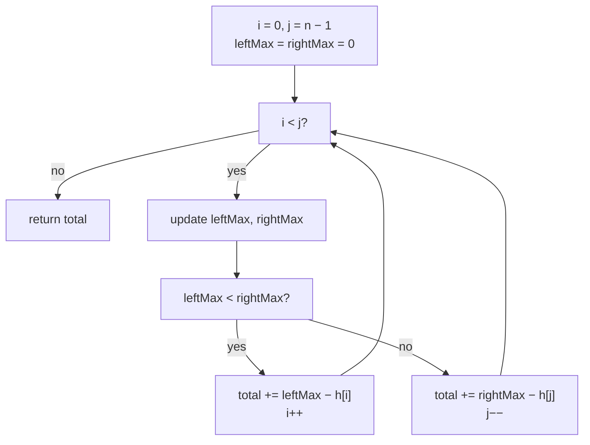

> [!tldr] Quick read
> - The problem: walls of height `h[i]`, width 1. After the rain, how many cells of water are trapped?
> - Water above wall i = `min(L[i], R[i]) − h[i]`, where `L[i]` is the tallest wall from 0 to i and `R[i]` the tallest from i to the end (both include wall i, so the result is never negative).
> - [[en/concepts/prefix-maximum|Prefix maximum]] and suffix maximum compute `L` and `R` in two passes: O(n) time, O(n) memory. Same idea as the prefix and suffix products of [[en/problems/product-of-array-except-self|station 3]].
> - [[en/concepts/two-pointers|Two pointers]] remove both arrays: whichever side has the smaller max already knows its water level for sure. O(1) memory.
> - Measured at n = 10⁶: two arrays 18.4 ms, monotonic stack 12.9 ms, two pointers 3.8 ms.

> [!info] Context
> LeetCode problem 42, the hardest problem of [[en/posts/2026-11-23-neetcode-two-pointers|station 4: Two Pointers]] on **the NeetCode line: Arrays and Strings**. This page builds on [[en/problems/container-with-most-water|Container With Most Water]] (same station) and the prefix/suffix idea of [[en/problems/product-of-array-except-self|Product of Array Except Self]]. The solutions come in TypeScript, Python, Go, Java and JavaScript.

> [!abstract]- Quick glossary for this post (click to open)
> - **Prefix maximum**: `L[i] = max(h[0..i])`, the largest value from the start up to i. **Suffix maximum**: `R[i] = max(h[i..n−1])`.
> - **Water level**: the height of the water surface above wall i, equal to `min(L[i], R[i])`. Water spills over the lower bank.
> - **Stack**: last in, first out. **Monotonic stack**: a stack that always keeps its elements in one increasing or decreasing order. Station 7 of this line is devoted to it.
> - **Invariant**: something true at every loop iteration, used to prove an algorithm correct.

## Picture it first: terraced fields after the rain

A row of fields has banks of different heights. When rain falls, the water in each field rises until it spills over the **lower** of the two highest banks on either side. To know how deep field i floods, you only need the highest bank to its left and the highest bank to its right.

| Everyday life | Concept |
|---|---|
| The highest bank to the left of field i | `L[i]`, prefix maximum |
| The highest bank to the right of field i | `R[i]`, suffix maximum |
| Water spills over the lower of those two banks | water level `min(L[i], R[i])` |
| Water depth = water level minus the field's floor | `min(L[i], R[i]) − h[i]` |
| One person walks from the left noting the highest bank seen, another does the same from the right | two passes, prefix and suffix |
| Whoever sees the lower bank already knows the water level on their side | two pointers |



## The problem

**The problem (in my own words):** given an array `height` (1 ≤ n ≤ 2·10⁴, each value 0..10⁵) of walls of width 1, compute the total water trapped after rain. Original: [LeetCode 42](https://leetcode.com/problems/trapping-rain-water/).

| Input | Output |
|---|---|
| `[0, 1, 0, 2, 1, 0, 1, 3, 2, 1, 2, 1]` | 6 |
| `[4, 2, 0, 3, 2, 5]` | 9 |
| `[1, 2, 3, 4]` | 0 (all water runs off to the left) |

I used to think you had to find each "pool" (from a left bank to a right bank) and compute its volume. It turns out you don't: counting **wall by wall**, each wall depends on only two numbers.

## How it works

<figure class="figure-map" style="--ar: 3 / 4">
<div class="frame"><iframe data-archify="../../diagrams/neetcode-trapping-rain-water/worked-example.en.html" title="Settle water from the lower side" loading="lazy"></iframe></div>
<figcaption><span><b>Figure 1.</b> Settle water from the lower side.</span><a href="../diagrams/neetcode-trapping-rain-water/worked-example.en.html" target="_blank" rel="noopener">Open full screen</a></figcaption>
</figure>

<details>
<summary>Read the steps</summary>
<ol>
<li>Start with left wall 3 and right wall 4. <code>[3, 0, 2, 4]</code></li>
<li>The zero-height cell holds 3 units. <code>3 - 0 = 3</code></li>
<li>The height-2 cell holds one more unit. <code>3 - 2 = 1</code></li>
<li>Add water from the settled cells. <code>3 + 1 = 4</code></li>
</ol>
</details>

### The per-wall formula

Water above wall i is held in by the highest bank to the left and the highest bank to the right; the surface sits at the lower of those two. Including wall i itself in both maxima gives `min(L[i], R[i]) ≥ h[i]`, so the water is never negative and no `max(0, …)` is needed.

| i | 0 | 1 | 2 | 3 | 4 | 5 |
|---|---|---|---|---|---|---|
| `h` | 4 | 2 | 0 | 3 | 2 | 5 |
| `L` (max from the left) | 4 | 4 | 4 | 4 | 4 | 5 |
| `R` (max from the right) | 5 | 5 | 5 | 5 | 5 | 5 |
| water `min(L, R) − h` | 0 | 2 | 4 | 1 | 2 | 0 |

Total 9.

### Four approaches

| Approach | Time | Extra memory |
|---|---|---|
| brute force: for each i, scan both sides for the max | O(n²) | O(1) |
| two arrays, prefix maximum and suffix maximum | O(n) | O(n) |
| two pointers | O(n) | O(1) |
| monotonic stack: fill water in horizontal layers | O(n) | O(n) |

### Why two pointers work

Keep `leftMax = max(h[0..i])` and `rightMax = max(h[j..n−1])`. Suppose `leftMax < rightMax`:
- `R[i]` (the true max of every wall from i to the end) ≥ `rightMax`, because the range `[i, n)` contains the range `[j, n)`.
- So `R[i] ≥ rightMax > leftMax = L[i]`, and `min(L[i], R[i]) = L[i] = leftMax`.

The water level at i is known for sure without knowing `R[i]` exactly. Add `leftMax − h[i]` and move i. The opposite case is symmetric for j. It is the same kind of argument as [[en/problems/container-with-most-water|Container With Most Water]]: the lower side decides, and the higher side only needs to be "tall enough".

### Measured

TypeScript, random heights 0..10⁵, median:

| n | brute force | prefix maximum | two pointers | stack |
|---|---|---|---|---|
| 5 000 | 10.8 ms | 0.49 ms | 0.06 ms | 0.11 ms |
| 10 000 | 42.5 ms | 0.23 ms | 0.12 ms | 0.21 ms |
| 20 000 | 170.6 ms | 0.60 ms | 0.03 ms | 0.17 ms |
| 10⁶ | (not run) | 18.41 ms | 3.76 ms | 12.87 ms |

The three O(n) approaches differ by up to 5 times: the two arrays must allocate and write 2n numbers, the stack pushes and pops every index, and two pointers only read the original array.

### Under the hood of the five languages

| | Shortest prefix maximum | Language-specific trap |
|---|---|---|
| TypeScript / JavaScript | a loop | `Math.max(...h.slice(0, i))` inside a loop is O(n²) and can overflow the stack on large arrays |
| Python | `list(accumulate(h, max))` | `max(h[:i + 1])` inside a loop is O(n²) and copies the array every time |
| Go | a loop with built-in `max` | empty input: `h[0]` panics, so check `len(h) == 0` first |
| Java | a loop | use `ArrayDeque` for the stack, not the old `Stack` class |

## Runnable example

[TypeScript](../code/neetcode-trapping-rain-water/trapping-rain-water.ts) · [Python](../code/neetcode-trapping-rain-water/trapping_rain_water.py) · [Go](../code/neetcode-trapping-rain-water/trapping_rain_water.go) · [Java](../code/neetcode-trapping-rain-water/trapping-rain-water.java) · [JavaScript](../code/neetcode-trapping-rain-water/trapping-rain-water.js) · [PHP](../code/neetcode-trapping-rain-water/trapping-rain-water.php) · [Rust](../code/neetcode-trapping-rain-water/trapping_rain_water.rs)

Each of the original five files has all four approaches and runs 8 cases, including an empty array, a single wall, an ascending row and a descending row. Below are prefix maximum and two pointers.

```ts
// Two arrays, prefix max and suffix max: O(n) time, O(n) memory.
function prefixMax(h: number[]): number {
  const n = h.length;
  if (n === 0) return 0;
  const left = new Array(n), right = new Array(n);
  left[0] = h[0];
  for (let i = 1; i < n; i++) left[i] = Math.max(left[i - 1], h[i]);
  right[n - 1] = h[n - 1];
  for (let i = n - 2; i >= 0; i--) right[i] = Math.max(right[i + 1], h[i]);
  let total = 0;
  for (let i = 0; i < n; i++) total += Math.min(left[i], right[i]) - h[i];
  return total;
}

// Two pointers: O(1) memory. Whichever side has the smaller max already knows its water for sure.
function twoPointers(h: number[]): number {
  let i = 0, j = h.length - 1, leftMax = 0, rightMax = 0, total = 0;
  while (i < j) {
    leftMax = Math.max(leftMax, h[i]);
    rightMax = Math.max(rightMax, h[j]);
    if (leftMax < rightMax) {
      total += leftMax - h[i]; // the right side has a wall ≥ rightMax > leftMax, so leftMax is the water level at i
      i++;
    } else {
      total += rightMax - h[j];
      j--;
    }
  }
  return total;
}
```

```python
def prefix_max(h: list[int]) -> int:
    left = list(accumulate(h, max))  # accumulate with max: a prefix max in one line
    right = list(accumulate(reversed(h), max))[::-1]
    return sum(min(l, r) - x for l, r, x in zip(left, right, h))

def two_pointers(h: list[int]) -> int:
    i, j, left_max, right_max, total = 0, len(h) - 1, 0, 0, 0
    while i < j:
        left_max, right_max = max(left_max, h[i]), max(right_max, h[j])
        if left_max < right_max:
            total += left_max - h[i]
            i += 1
        else:
            total += right_max - h[j]
            j -= 1
    return total
```

```go
func prefixMax(h []int) int {
	n := len(h)
	if n == 0 {
		return 0 // h[0] on an empty slice panics: index out of range
	}
	left, right := make([]int, n), make([]int, n)
	left[0], right[n-1] = h[0], h[n-1]
	for i := 1; i < n; i++ {
		left[i] = max(left[i-1], h[i])
	}
	for i := n - 2; i >= 0; i-- {
		right[i] = max(right[i+1], h[i])
	}
	total := 0
	for i := range h {
		total += min(left[i], right[i]) - h[i]
	}
	return total
}

func twoPointers(h []int) int {
	i, j, leftMax, rightMax, total := 0, len(h)-1, 0, 0, 0
	for i < j {
		leftMax, rightMax = max(leftMax, h[i]), max(rightMax, h[j])
		if leftMax < rightMax {
			total += leftMax - h[i]
			i++
		} else {
			total += rightMax - h[j]
			j--
		}
	}
	return total
}
```

```java
static int prefixMax(int[] h) {
    int n = h.length;
    if (n == 0) return 0;
    int[] left = new int[n], right = new int[n];
    left[0] = h[0]; right[n - 1] = h[n - 1];
    for (int i = 1; i < n; i++) left[i] = Math.max(left[i - 1], h[i]);
    for (int i = n - 2; i >= 0; i--) right[i] = Math.max(right[i + 1], h[i]);
    int total = 0;
    for (int i = 0; i < n; i++) total += Math.min(left[i], right[i]) - h[i];
    return total;
}

static int twoPointers(int[] h) {
    int i = 0, j = h.length - 1, leftMax = 0, rightMax = 0, total = 0;
    while (i < j) {
        leftMax = Math.max(leftMax, h[i]);
        rightMax = Math.max(rightMax, h[j]);
        if (leftMax < rightMax) total += leftMax - h[i++];
        else total += rightMax - h[j--];
    }
    return total;
}
```

```js
function prefixMax(h) {
  const n = h.length;
  if (n === 0) return 0;
  const left = new Array(n), right = new Array(n);
  left[0] = h[0];
  for (let i = 1; i < n; i++) left[i] = Math.max(left[i - 1], h[i]);
  right[n - 1] = h[n - 1];
  for (let i = n - 2; i >= 0; i--) right[i] = Math.max(right[i + 1], h[i]);
  let total = 0;
  for (let i = 0; i < n; i++) total += Math.min(left[i], right[i]) - h[i];
  return total;
}

function twoPointers(h) {
  let i = 0, j = h.length - 1, leftMax = 0, rightMax = 0, total = 0;
  while (i < j) {
    leftMax = Math.max(leftMax, h[i]);
    rightMax = Math.max(rightMax, h[j]);
    if (leftMax < rightMax) total += leftMax - h[i++];
    else total += rightMax - h[j--];
  }
  return total;
}
```

```php
<?php
declare(strict_types=1);

function trap(array $height): int {
    $left = 0;
    $right = count($height) - 1;
    $leftMax = $rightMax = $water = 0;
    while ($left <= $right) {
        if ($leftMax <= $rightMax) {
            $leftMax = max($leftMax, $height[$left]);
            $water += $leftMax - $height[$left++];
        } else {
            $rightMax = max($rightMax, $height[$right]);
            $water += $rightMax - $height[$right--];
        }
    }
    return $water;
}
```

```rust
fn trap(height: &[i32]) -> i32 {
    let (mut left, mut right) = (0, height.len()); // [left, right)
    let (mut left_max, mut right_max, mut water) = (0, 0, 0);
    while left < right {
        if left_max <= right_max {
            left_max = left_max.max(height[left]);
            water += left_max - height[left];
            left += 1;
        } else {
            right -= 1;
            right_max = right_max.max(height[right]);
            water += right_max - height[right];
        }
    }
    water
}
```


The TypeScript file also runs a wrong version, then measures:

```text
$ node trapping-rain-water.ts
bruteForce       8/8 cases passed
prefixMax        8/8 cases passed
twoPointers      8/8 cases passed
monotonicStack   8/8 cases passed
exclusiveNoClamp 5/8 cases passed; wrong on [0,1,0,2,1,0,1,3,2,1,2,1] → 2 (expected 6) [1,2,3,4] → -2 (expected 0) [5,4,1,2] → -1 (expected 1)

n          brute   prefix max  two pointers  stack   (ms, median; heights 0..10⁵)
5000          10.8         0.49         0.06      0.11
10000         42.5         0.23         0.12      0.21
20000        170.6         0.60         0.03      0.17
1000000          —        18.41         3.76     12.87
```

*(Output labels translated; the files themselves print Vietnamese.)*

The wrong version computes the side maxima **without** wall i and forgets to clamp at 0: a wall taller than everything on both sides yields negative water, and the negatives are subtracted from the total. Python, Go, Java and JavaScript print `8/8 ca đúng` ("8/8 cases passed") for all four approaches.

The added versions use two pointers. The exclusive right bound in Rust makes an empty slice exit immediately. PHP `5/5 ca đúng` · Rust `5/5 ca đúng`.

## Misconceptions and common traps

- **Side maxima that exclude wall i, without `max(0, …)`.** Negative water (measured above). Including wall i in the maxima is the simplest way to avoid clamping.
- **Two pointers comparing `h[i] < h[j]` instead of `leftMax < rightMax`.** For this problem, comparing `h[i]`, `h[j]` also works if the maxima are updated in the right place, but the argument must be rewritten; comparing the two maxima lets the argument above apply directly.
- **Computing the max with a built-in inside the loop.** `max(h[:i + 1])` or `Math.max(...h.slice(0, i))` turns O(n) into O(n²).
- **Finding pools one by one.** It can be done but is easy to get wrong with nested pools; counting per wall has no notion of a pool.
- **Confusing it with Container With Most Water.** That problem picks two walls and ignores the middle; this one adds up the water above every wall.

## Self-check questions

> [!question]- Compute the water for `[3, 0, 0, 2, 0, 4]`.
> `L = [3,3,3,3,3,4]`, `R = [4,4,4,4,4,4]`, water level `[3,3,3,3,3,4]`, water `[0,3,3,1,3,0]`, total 10.

> [!question]- With two pointers, when `leftMax < rightMax`, why don't you need the exact `R[i]`?
> Because `R[i] ≥ rightMax > leftMax`. The water level is `min(L[i], R[i]) = leftMax`, however large `R[i]` is.

> [!question]- Why does the ascending array `[1, 2, 3, 4]` hold no water?
> For every i, `L[i] = h[i]` (wall i is the tallest so far), so `min(L[i], R[i]) − h[i] = 0`.

> [!question]- Can the 2D version of this problem (LeetCode 407, water on a grid) use two pointers?
> No: a cell has four directions for water to escape, so there is no "left" and "right" any more. The standard approach works inward from the border with a heap, always processing the lowest border cell first, in the same spirit of "the lower side decides".

## References

- [LeetCode 42: Trapping Rain Water](https://leetcode.com/problems/trapping-rain-water/) (the original problem)
- [Python: `itertools.accumulate`](https://docs.python.org/3/library/itertools.html#itertools.accumulate) (with `func=max` for a prefix maximum)
- [Java 21 `ArrayDeque`](https://docs.oracle.com/en/java/javase/21/docs/api/java.base/java/util/ArrayDeque.html) (recommended over `Stack`)
- [LeetCode 407: Trapping Rain Water II](https://leetcode.com/problems/trapping-rain-water-ii/) (the 2D grid version)
