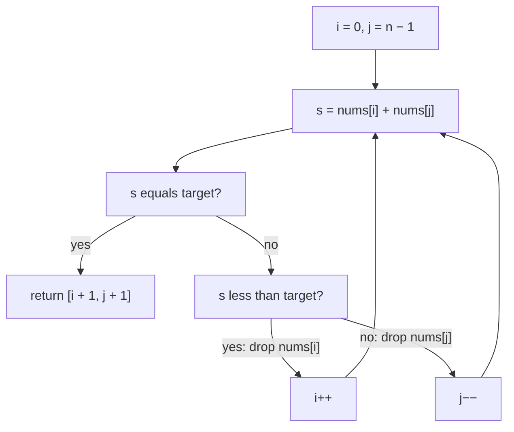

> [!tldr] Quick read
> - The problem: an **ascending** array; find two numbers summing to `target` and return their indices **counting from 1**. There is exactly one answer; only O(1) extra memory is allowed.
> - [[en/concepts/two-pointers|Two pointers]]: `i` at the start, `j` at the end. Sum too small, increase `i`; too big, decrease `j`. Each step drops one number for good: O(n), O(1) memory.
> - Why dropping is safe: if `nums[i] + nums[j]` is still too small, `nums[i]` plus the **largest remaining** number is too small too, so `nums[i]` belongs to no pair. This is [[en/concepts/search-space-pruning|search space pruning]].
> - The hash map from [[en/problems/two-sum|Two Sum]] still works but costs O(n) memory and is slower: measured at n = 10⁶, 99.8 ms against 1.2 ms.
> - Trap: a binary search over the **whole** array can pair a number with itself (`[3, 3]` → `[1, 1]`).

> [!info] Context
> LeetCode problem 167, the anchor problem of [[en/posts/2026-11-23-neetcode-two-pointers|station 4: Two Pointers]] on **the NeetCode line: Arrays and Strings**. Its sibling [[en/problems/two-sum|Two Sum]] (station 1) has an unsorted array and so uses a hash map; here the order is already given and we make use of it. The solutions come in TypeScript, Python, Go, Java and JavaScript.

> [!abstract]- Quick glossary for this post (click to open)
> - **Non-decreasing array**: each element is not smaller than the one before; duplicates are allowed.
> - **1-indexed**: the first element is number 1, not 0. Return `[i + 1, j + 1]`.
> - **Binary search**: search a sorted array by discarding half each time: O(log n).
> - **Complement**: `target − x`, the number needed to pair with x. See [[en/concepts/complement-lookup|Complement Lookup]].

## Picture it first: two people loading a scale

A warehouse stores crates sorted from light to heavy. You need exactly two crates whose total weight equals the scale's limit. One person stands at the light end, one at the heavy end, and each puts the crate in front of them on the scale.

| Everyday life | Concept |
|---|---|
| Crates lined up from light to heavy | ascending array |
| The person at the light end, the person at the heavy end | pointer `i`, pointer `j` |
| Scale reads too little: the light crate is too light even with the heaviest remaining | increase `i`, drop `nums[i]` |
| Scale reads too much: the heavy crate is too heavy even with the lightest remaining | decrease `j`, drop `nums[j]` |
| Scale reads just right | return `[i + 1, j + 1]` |
| Every weighing removes one crate for good | at most n − 1 steps |



## The problem

**The problem (in my own words):** given an ascending array `numbers` (2 ≤ n ≤ 3·10⁴, values in −1000..1000) and a `target`, find two different positions `i < j` with `numbers[i] + numbers[j] = target` and return `[i + 1, j + 1]`. There is exactly one answer. Only constant extra memory is allowed. Original: [LeetCode 167](https://leetcode.com/problems/two-sum-ii-input-array-is-sorted/).

| Input | target | Output |
|---|---|---|
| `[2, 7, 11, 15]` | 9 | `[1, 2]` |
| `[2, 3, 4]` | 6 | `[1, 3]` |
| `[-1, 0]` | −1 | `[1, 2]` |

I used to think "Two Sum already has a hash map solution, just reuse it". It does run, but the problem forbids O(n) memory, and a hash map throws away the most valuable information there is: the array is sorted.

## How it works

<figure class="figure-map" style="--ar: 3 / 4">
<div class="frame"><iframe data-archify="../../diagrams/neetcode-two-sum-ii-input-array-is-sorted/worked-example.en.html" title="Move the correct endpoint based on the sum" loading="lazy"></iframe></div>
<figcaption><span><b>Figure 1.</b> Move the correct endpoint based on the sum.</span><a href="../diagrams/neetcode-two-sum-ii-input-array-is-sorted/worked-example.en.html" target="_blank" rel="noopener">Open full screen</a></figcaption>
</figure>

<details>
<summary>Read the steps</summary>
<ol>
<li>Compare the outer sum with 11. <code>[1, 4, 7, 9], 1 + 9 = 10</code></li>
<li>The sum is too small, move left up. <code>4 + 9 = 13</code></li>
<li>The sum is too large, move right down. <code>4 + 7 = 11</code></li>
<li>Return one-based positions. <code>[2, 3]</code></li>
</ol>
</details>

### Four approaches, by memory and time

| Approach | Time | Extra memory | Uses the order? |
|---|---|---|---|
| brute force over every pair | O(n²) | O(1) | no |
| for each `i`, binary-search the complement **to the right of** `i` | O(n log n) | O(1) | partly |
| one-pass hash map (station 1) | O(n) | O(n) | no |
| two pointers | O(n) | O(1) | fully |

### Why two pointers never miss a pair

Keep one invariant: **if the answer exists, it lies within `[i, j]`.** At the start the range is the whole array, so it holds. At each step:

- If `nums[i] + nums[j] < target`: for every `k` in `(i, j]`, `nums[k] ≤ nums[j]`, so `nums[i] + nums[k] < target`. `nums[i]` pairs with nobody in the range; dropping it keeps the invariant.
- If the sum is bigger than the target: by the symmetric argument, `nums[j]` pairs with nobody; drop it.

Each step shrinks the range by one element, so within n − 1 steps it either finds the pair or the range is empty. This is [[en/concepts/search-space-pruning|search space pruning]]: instead of examining pairs one by one, each step removes a whole **row** of pairs from the n × n table.

### Measured

TypeScript, the array `0, 1, …, n − 1` with target equal to the sum of the two largest numbers, so the answer pair sits at the end (the worst case for all four approaches). Median:

| n | brute force | binary search | hash map | two pointers |
|---|---|---|---|---|
| 5 000 | 6.0 ms | 0.11 ms | 0.37 ms | 0.08 ms |
| 10 000 | 23.1 ms | 0.18 ms | 0.65 ms | 0.01 ms |
| 20 000 | 92.7 ms | 0.21 ms | 1.53 ms | 0.03 ms |
| 10⁶ | (not run) | 15.92 ms | 99.75 ms | 1.20 ms |

The hash map is the slowest of the three fast approaches even though it is O(n) like two pointers: every step hashes and writes into the table, and the table also has to grow several times. Two pointers only read the array in order, which the CPU cache handles very well.

### Under the hood of the seven languages

| | Built-in binary search | Language-specific trap |
|---|---|---|
| TypeScript / JavaScript | none; write your own | `(lo + hi) >>> 1` halves to an integer |
| Python | `bisect_left(a, x, lo)` | you must pass `lo = i + 1`, or it searches left of i too |
| Go | `sort.SearchInts(rest, x)` on a sub-slice | the returned index counts from the start of the sub-slice; add back `i + 1` |
| Java | `Arrays.binarySearch(a, from, to, x)` | not found returns a **negative** number, not −1; with duplicates, which position it returns is unspecified |
| PHP | none; write it yourself | `($lo + $hi) / 2` is a **float** when the sum is odd; use `intdiv` |
| Rust | `slice.binary_search(&x)` on `nums[i + 1..]` | returns a `Result`: `Ok(k)` with `k` counted from the subslice start; with duplicates, which position it returns is unspecified |

## Runnable example

[TypeScript](../code/neetcode-two-sum-ii-input-array-is-sorted/two-sum-ii.ts) · [Python](../code/neetcode-two-sum-ii-input-array-is-sorted/two_sum_ii.py) · [Go](../code/neetcode-two-sum-ii-input-array-is-sorted/two_sum_ii.go) · [Java](../code/neetcode-two-sum-ii-input-array-is-sorted/two-sum-ii.java) · [JavaScript](../code/neetcode-two-sum-ii-input-array-is-sorted/two-sum-ii.js) · [PHP](../code/neetcode-two-sum-ii-input-array-is-sorted/two-sum-ii.php) · [Rust](../code/neetcode-two-sum-ii-input-array-is-sorted/two_sum_ii.rs)

Each file has all four approaches and runs 6 cases, including negatives and duplicates. Below are binary search and two pointers.

```ts
// For each nums[i], binary-search the complement in the part TO THE RIGHT of i. O(n log n), O(1) memory.
function binarySearch(nums: number[], target: number): number[] {
  for (let i = 0; i < nums.length; i++) {
    let lo = i + 1, hi = nums.length - 1;
    const want = target - nums[i];
    while (lo <= hi) {
      const mid = (lo + hi) >>> 1;
      if (nums[mid] === want) return [i + 1, mid + 1];
      if (nums[mid] < want) lo = mid + 1; else hi = mid - 1;
    }
  }
  return [];
}

// Two pointers: sum too small, move left up; too big, move right down. O(n), O(1) memory.
function twoPointers(nums: number[], target: number): number[] {
  let i = 0, j = nums.length - 1;
  while (i < j) {
    const sum = nums[i] + nums[j];
    if (sum === target) return [i + 1, j + 1];
    if (sum < target) i++; // nums[i] plus the LARGEST remaining is still too small: nums[i] is in no pair
    else j--; // nums[j] plus the SMALLEST remaining is still too big: nums[j] is in no pair
  }
  return [];
}
```

```python
def binary_search(nums: list[int], target: int) -> list[int]:
    for i, x in enumerate(nums):
        j = bisect_left(nums, target - x, i + 1)  # lo = i + 1: search only to the right of i
        if j < len(nums) and nums[j] == target - x:
            return [i + 1, j + 1]
    return []

def two_pointers(nums: list[int], target: int) -> list[int]:
    i, j = 0, len(nums) - 1
    while i < j:
        s = nums[i] + nums[j]
        if s == target:
            return [i + 1, j + 1]
        if s < target:
            i += 1
        else:
            j -= 1
    return []
```

```go
func binarySearch(nums []int, target int) []int {
	for i, x := range nums {
		rest := nums[i+1:] // the sub-slice shares the original array, no copy
		k := sort.SearchInts(rest, target-x)
		if k < len(rest) && rest[k] == target-x {
			return []int{i + 1, i + 2 + k}
		}
	}
	return nil
}

func twoPointers(nums []int, target int) []int {
	for i, j := 0, len(nums)-1; i < j; {
		switch s := nums[i] + nums[j]; {
		case s == target:
			return []int{i + 1, j + 1}
		case s < target:
			i++
		default:
			j--
		}
	}
	return nil
}
```

```java
static int[] binarySearch(int[] nums, int target) {
    for (int i = 0; i < nums.length; i++) {
        // range [i + 1, n): never pair nums[i] with itself. Returns a negative number if not found.
        int j = Arrays.binarySearch(nums, i + 1, nums.length, target - nums[i]);
        if (j >= 0) return new int[] {i + 1, j + 1};
    }
    return new int[0];
}

static int[] twoPointers(int[] nums, int target) {
    int i = 0, j = nums.length - 1;
    while (i < j) {
        int sum = nums[i] + nums[j];
        if (sum == target) return new int[] {i + 1, j + 1};
        if (sum < target) i++; else j--;
    }
    return new int[0];
}
```

```js
function binarySearch(nums, target) {
  for (let i = 0; i < nums.length; i++) {
    let lo = i + 1, hi = nums.length - 1;
    const want = target - nums[i];
    while (lo <= hi) {
      const mid = (lo + hi) >>> 1; // >>> 1: halve to an integer, not a float
      if (nums[mid] === want) return [i + 1, mid + 1];
      if (nums[mid] < want) lo = mid + 1; else hi = mid - 1;
    }
  }
  return [];
}

function twoPointers(nums, target) {
  let i = 0, j = nums.length - 1;
  while (i < j) {
    const sum = nums[i] + nums[j];
    if (sum === target) return [i + 1, j + 1];
    if (sum < target) i++; else j--;
  }
  return [];
}
```

```php
// For each nums[i], binary-search its complement in the part RIGHT of i. O(n log n), O(1) memory.
function binarySearch(array $nums, int $target): array {
    $n = count($nums);
    for ($i = 0; $i < $n; $i++) {
        $lo = $i + 1; $hi = $n - 1;
        $want = $target - $nums[$i];
        while ($lo <= $hi) {
            $mid = intdiv($lo + $hi, 2); // ($lo + $hi) / 2 gives a float when the sum is odd
            if ($nums[$mid] === $want) return [$i + 1, $mid + 1];
            if ($nums[$mid] < $want) $lo = $mid + 1; else $hi = $mid - 1;
        }
    }
    return [];
}
// Two pointers: sum too small, move left up; too big, move right down. O(n), O(1) memory.
function twoPointers(array $nums, int $target): array {
    $i = 0; $j = count($nums) - 1;
    while ($i < $j) {
        $sum = $nums[$i] + $nums[$j];
        if ($sum === $target) return [$i + 1, $j + 1];
        if ($sum < $target) $i++; // nums[i] plus the LARGEST number left is still short
        else $j--;                // nums[j] plus the SMALLEST number left is still too big
    }
    return [];
}
```

```rust
// For each nums[i], binary-search its complement in the part RIGHT of i. O(n log n), O(1) memory.
// the built-in binary_search on the subslice nums[i + 1..]; the index it returns counts from the subslice start.
fn binary_search(nums: &[i32], target: i32) -> Vec<i32> {
    for i in 0..nums.len() {
        if let Ok(k) = nums[i + 1..].binary_search(&(target - nums[i])) {
            return vec![i as i32 + 1, (i + 1 + k) as i32 + 1];
        }
    }
    vec![]
}
// Two pointers: sum too small, move left up; too big, move right down. O(n), O(1) memory.
fn two_pointers(nums: &[i32], target: i32) -> Vec<i32> {
    let (mut i, mut j) = (0, nums.len() - 1);
    while i < j {
        let sum = nums[i] + nums[j];
        if sum == target {
            return vec![i as i32 + 1, j as i32 + 1];
        }
        if sum < target {
            i += 1; // nums[i] plus the LARGEST number left is still short
        } else {
            j -= 1; // nums[j] plus the SMALLEST number left is still too big
        }
    }
    vec![]
}
```


```text
$ node two-sum-ii.ts
bruteForce             6/6 cases passed
binarySearch           6/6 cases passed
hashMap                6/6 cases passed
twoPointers            6/6 cases passed
binarySearchWholeArray 4/6 cases passed; wrong on [3,3], 6 → [1,1] [1,2,3,4,4,9,56,90], 8 → [4,4]

n          brute   binary search  hash map  two pointers   (ms, median)
5000           6.0          0.11      0.37         0.08
10000         23.1          0.18      0.65         0.01
20000         92.7          0.21      1.53         0.03
1000000          —         15.92     99.75         1.20
```

*(Output labels translated; the files themselves print Vietnamese.)*

The whole-array binary search finds the complement 3 of the number 3 **at its own position** and returns `[1, 1]`. Only a case with two equal numbers each equal to `target / 2` exposes this bug. Python, Go, Java and JavaScript print `6/6 ca đúng` ("6/6 cases passed") for all four approaches. PHP and Rust also print `6/6 ca đúng` for the four approaches, and the whole-array search prints `4/6 ca đúng` ("4/6 cases passed") with the same two failing cases as TypeScript.

## Misconceptions and common traps

- **Returning 0-based indices.** The problem counts from 1.
- **Searching for the complement over the whole array.** Search in `(i, n)`; otherwise a number gets paired with itself.
- **Moving both pointers when the sum is wrong.** Move only the side you have evidence against: too small means `i`, too big means `j`. Moving both can skip the pair `(i, j − 1)`.
- **"O(n) is O(n)."** The hash map and two pointers are both O(n) but differ by 80 times at 10⁶ elements.
- **Worrying about overflow when adding.** Not with limits of ±1000. In other problems with values up to 2³¹, `nums[i] + nums[j]` overflows a 32-bit `int` in Java and Go; then compare `nums[i] < target − nums[j]` or use `long`.
- **PHP: halving with `/`.** `($lo + $hi) / 2` returns a `float` when the sum is odd (`7 / 2 = 3.5`), and `$nums[3.5]` is truncated to index 3 with a "Deprecated: implicit conversion" warning since PHP 8.1. Use `intdiv($lo + $hi, 2)`.
- **Rust: forgetting that `binary_search` returns an index into the subslice.** `nums[i + 1..].binary_search(&want)` returns `Ok(k)` counted from `i + 1`, so the real index is `i + 1 + k`. Also, `nums.len() - 1` on a `usize` underflows for an empty array; the problem promises at least two elements.

## Self-check questions

> [!question]- Array `[1, 2, 5, 9]`, target 11. Write out the two-pointer steps.
> 1 + 9 = 10 < 11: increase i. 2 + 9 = 11: return `[2, 4]`.

> [!question]- What is the two-pointer invariant, and why doesn't dropping `nums[i]` when the sum is below the target break it?
> "If there is an answer, it lies within `[i, j]`." When `nums[i] + nums[j] < target`, every `nums[k]` in the range is ≤ `nums[j]`, so `nums[i]` plus anyone is too small. It is not part of the answer.

> [!question]- If the array were unsorted, should you sort and use two pointers, or use a hash map?
> [[en/problems/two-sum|Two Sum]] needs the original indices, so sorting has to carry the indices along and costs O(n log n). A hash map in O(n) time is enough. Sorting plus two pointers only wins when memory is the main constraint.

> [!question]- The problem changes: count the **number of pairs** that sum to the target, with duplicates. What must two pointers change?
> When the sum hits the target: if `nums[i] = nums[j]`, every pair in the range works, so add `C(j − i + 1, 2)` and stop. Otherwise count the run length `a` of `nums[i]` and `b` of `nums[j]`, add `a · b`, and jump past both groups.

## References

- [LeetCode 167: Two Sum II - Input Array Is Sorted](https://leetcode.com/problems/two-sum-ii-input-array-is-sorted/) (the original problem)
- [Python: `bisect`](https://docs.python.org/3/library/bisect.html) (`bisect_left(a, x, lo, hi)`)
- [Java 21 `Arrays.binarySearch(int[], int, int, int)`](https://docs.oracle.com/en/java/javase/21/docs/api/java.base/java/util/Arrays.html#binarySearch(int%5B%5D,int,int,int)) (returns `-(insertion point) − 1` when not found; position unspecified with duplicates)
- [Go: `sort.SearchInts`](https://pkg.go.dev/sort#SearchInts)
