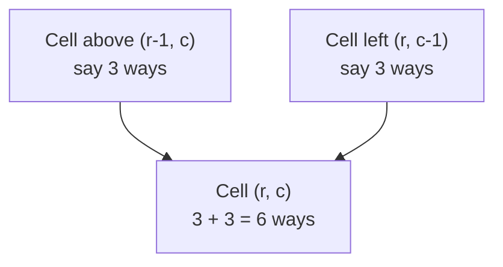
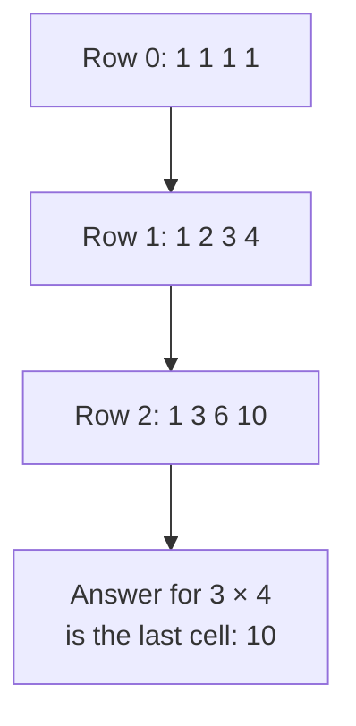

> [!tldr] Quick read
> - Every path to cell (r, c) passes through the cell directly above it or the cell directly to its left, and those two groups of paths do not overlap. So `ways[r][c] = ways[r-1][c] + ways[r][c-1]`.
> - The first row and the first column are all 1: the only way there is to go straight.
> - Each cell needs only the row above and the cell to its left, so one array of length n is enough ([[en/concepts/rolling-state|Rolling State]]): sweep left to right and accumulate.
> - Every path has exactly m − 1 down moves and n − 1 right moves, so the answer is the binomial coefficient C(m + n − 2, m − 1). Multiply, then divide right away at each step so nothing overflows.

> [!info] Context
> This is LeetCode 62 at [[en/posts/2026-11-27-neetcode-grid-two-strings|station DP-05: Grids and Two Strings]] on **the NeetCode Line: Dynamic Programming**. I picture a neighborhood laid out as a grid and a courier who may only head east or south. All you need is 2-D arrays and nested loops.

> [!abstract]- Quick glossary for this post (click to open)
> - An m × n grid has m rows and n columns. Cell (r, c) sits in row r, column c, counting from 0.
> - [[en/concepts/grid-path-dp|Grid Path DP]] assigns one value to each cell and computes it from the cells that can step into it.
> - A [[en/concepts/dp-state|DP state]] specifies what one cell of the table stores.
> - A [[en/concepts/recurrence-relation|recurrence relation]] says which cells are used to compute the current one.
> - [[en/concepts/memoization|Memoization]] saves the answer the first time a state is queried.
> - The binomial coefficient C(N, k) is the number of ways to choose k positions out of N, ignoring the order of choice.

## Picture it first: a courier on a grid of city blocks

The warehouse is at the northwest corner and the customer at the southeast corner. Each move, the courier goes one block east or one block south. Standing at any intersection, I ask: where did the last move come from? Only two options: the intersection to the north, or the one to the west. So the number of routes here is the sum of the routes to those two intersections.

| Everyday life | Concept |
|---|---|
| The intersection at row r, column c | Grid cell (r, c) |
| The number of distinct routes to that intersection | `ways[r][c]` |
| Arriving from the north or from the west | The cell above `(r-1, c)` and the cell on the left `(r, c-1)` |
| The north or west edge street | The first row and first column, 1 way per cell |
| Writing numbers on a one-row board and overwriting it on the next row | One array of length n reused for every row |
| A schedule made of "east" and "south" moves | A string of m − 1 D's (down) and n − 1 R's (right) |



## The problem: count routes that only move right and down

There is a grid with m rows and n columns, with 1 ≤ m, n ≤ 100. A robot stands in the top-left cell and must reach the bottom-right cell. Each step it moves one cell right or one cell down. Return the number of distinct paths. The answer is guaranteed not to exceed 2·10⁹. For example, a 3 × 3 grid has 6 paths, and a 1 × n grid has just 1. [Original LeetCode 62 problem](https://leetcode.com/problems/unique-paths/)

I used to think I had to list every path and then count them. It turns out I only need the count, not what the paths look like. Counts can be added; listings can't.

## How it works

### Brute force and memoizing by cell

The function `walk(r, c)` returns the number of paths from (r, c) to the goal. At the goal it returns 1. Elsewhere it adds the paths after moving right and after moving down, skipping any move that leaves the grid. Each leaf of the call tree is one complete path. Each cell is called once for every path from the start to it, so there are exactly C(m + n, m) − 1 calls in total, which grows exponentially. A 10 × 10 grid has 48,620 paths and costs 184,755 calls.

Many branches come back to the same cell. Moving right from (1, 0) or down from (0, 1) both reach (1, 1), and from there the number of paths to the goal does not depend on how I got to (1, 1). Storing `walk(r, c)` per cell computes each cell once. The memoized version also stops early on the last row and the last column, since from there the only way is straight ahead. Time and memory are O(m·n). The 10 × 10 grid needs only 163 calls.

### Filling the table from the top-left corner

Flip the question: `ways[r][c]` is the number of paths from the start to (r, c). The last move into (r, c) comes from the cell above or the cell on the left. The two groups share no path, because their last moves differ, and together they cover every path. So `ways[r][c] = ways[r-1][c] + ways[r][c-1]`.

A cell in row 0 can only be reached by going straight right, and a cell in column 0 only by going straight down, so both are 1. Sweeping rows top to bottom, and columns left to right within each row, guarantees that both the cell above and the cell on the left already have values when they are needed. Time O(m·n), memory O(m·n).



### One row is enough

Cell (r, c) reads only the row directly above and the cell to its left in the same row. I keep one array `row` of length n. Before the update, `row[c]` still holds the value from the row above. `row[c-1]` has just been updated to the current row's value. So `row[c] += row[c-1]` is exactly "above + left". Time stays O(m·n), memory drops to O(n). The grid is symmetric, so n can be the smaller dimension.

### The combinatorial formula

Every path has exactly m − 1 down moves and n − 1 right moves, m + n − 2 moves in total. A path is fully determined once you know which moves are the down moves. So the answer is C(m + n − 2, m − 1).

Computing `100!` and then dividing overflows every 64-bit integer type. Instead, with k = min(m, n) − 1, I multiply step by step: `result = result * (N − k + i) / i` for i = 1…k. After step i, `result` equals C(N − k + i, i), an integer, so the division is always exact. The largest intermediate value is the answer times a number no larger than 198, so below 4·10¹¹: it fits in 64 bits and stays exact in a JavaScript `number` (below 2⁵³). Time O(min(m, n)), memory O(1).

| Approach | Time | Extra memory |
|---|---|---|
| Brute force | O(C(m + n, m)), exponential | O(m + n) stack |
| Memoized by cell | O(m·n) | O(m·n) |
| Full table | O(m·n) | O(m·n) |
| One row | O(m·n) | O(min(m, n)) |
| Combinatorics | O(min(m, n)) | O(1) |

## Runnable example

[TypeScript](../code/neetcode-unique-paths/paths.ts) · [Python](../code/neetcode-unique-paths/paths.py) · [Go](../code/neetcode-unique-paths/paths.go) · [Java](../code/neetcode-unique-paths/paths.java) · [JavaScript](../code/neetcode-unique-paths/paths.js) · [PHP](../code/neetcode-unique-paths/paths.php) · [Rust](../code/neetcode-unique-paths/paths.rs)

```ts
function pathsRow(m: number, n: number): number {
    const row = Array(n).fill(1)
    for (let r = 1; r < m; r++) {
        for (let c = 1; c < n; c++) row[c] += row[c - 1]
    }
    return row[n - 1]
}
```

```python
def paths_row(m, n):
    row = [1] * n
    for _ in range(1, m):
        for c in range(1, n):
            row[c] += row[c - 1]
    return row[n - 1]
```

```go
func pathsRow(m, n int) int {
	row := make([]int, n)
	for c := range row {
		row[c] = 1
	}
	for r := 1; r < m; r++ {
		for c := 1; c < n; c++ {
			row[c] += row[c-1]
		}
	}
	return row[n-1]
}
```

```java
static int pathsRow(int m, int n) {
    int[] row = new int[n];
    java.util.Arrays.fill(row, 1);
    for (int r = 1; r < m; r++) {
        for (int c = 1; c < n; c++) row[c] += row[c - 1];
    }
    return row[n - 1];
}
```

```js
function pathsRow(m, n) {
    const row = Array(n).fill(1)
    for (let r = 1; r < m; r++) {
        for (let c = 1; c < n; c++) row[c] += row[c - 1]
    }
    return row[n - 1]
}
```

```php
function pathsRow(int $m, int $n): int {
    $row = array_fill(0, $n, 1);
    for ($r = 1; $r < $m; $r++) {
        for ($c = 1; $c < $n; $c++) $row[$c] += $row[$c - 1];
    }
    return $row[$n - 1];
}
```

```rust
fn paths_row(m: usize, n: usize) -> u64 {
    let mut row = vec![1u64; n];
    for _ in 1..m {
        for c in 1..n {
            row[c] += row[c - 1];
        }
    }
    row[n - 1]
}
```

The tabs excerpt the one-row version. The downloadable files also contain the brute force, the memoized version, the full table and the combinatorial formula. The first line is 7 cases with known answers, including a 1 × 1 grid, a single-row grid and a 23 × 12 grid. The second line checks all five approaches against the brute force on every grid from 1 × 1 to 8 × 8. The third line builds a capped Pascal triangle for every m, n from 1 to 100, then compares the three non-recursive approaches on every grid whose answer does not exceed 2·10⁹. The last line counts how many times the function is entered, not running time.

```text
7/7 cases passed
64/64 cases passed (checked against brute force, grids up to 8×8)
1773/1773 cases passed (every 1..100 grid with an answer ≤ 2·10⁹)
10×10 grid: brute force 184755 calls, memo 163 calls
```

*(Output labels translated; the files themselves print Vietnamese.)*

## Misconceptions and common traps

- Setting the first row and first column to 0. Then the whole table is zero. An edge cell has exactly one path, not none.
- Thinking the one-row version must sweep right to left like [[en/concepts/knapsack-update-order|0/1 knapsack]]. Here I need the left cell **of the new row**, so the sweep must go left to right. Sweeping backward adds the left cell of the old row.
- Computing the binomial with factorials. `100!` has 158 digits. Dividing first and multiplying after is also wrong, because `result / i` is not always exact. Multiplying first and dividing right away at each step keeps every division exact.
- Java: an `int` holds the answer (2·10⁹ < 2³¹ − 1), but the product `result * (N − k + i)` in the formula does not, so the intermediate variable must be a `long`. Go uses a 64-bit `int` on 64-bit machines, and Rust uses `u64`.
- Python: `/` returns a `float`. Use `//`. The standard library already has `math.comb(m + n - 2, m - 1)`.
- PHP: `/` returns a `float` even when the division is exact. `intdiv` keeps the `int` type, so a strict `===` comparison with an integer works.
- JavaScript and TypeScript: `/` is always floating-point division, but because intermediates stay below 2⁵³ and divide exactly, the result is still exact. A full table for a 100 × 100 grid exceeds 2⁵³ in the middle cells and loses precision. The problem only asks about grids whose answer is ≤ 2·10⁹, so every cell on the way to the goal is smaller than the answer.

## Self-check questions

> [!question]- Why can I add the cell above to the cell on the left without double counting?
> The two groups of paths differ in their last move: one moves down, the other moves right. No path belongs to both, and every path to that cell belongs to one of them.

> [!question]- The one-row version sweeps c from left to right. What goes wrong if it sweeps right to left?
> `row[c-1]` then still holds the value from the row above, so cell (r, c) adds the upper-left diagonal cell instead of the left cell.

> [!question]- How many paths does a 3 × 7 grid have, using the formula?
> There are 2 down moves and 6 right moves, 8 moves in total. C(8, 2) = 28.

> [!question]- If some cells are blocked, how does the table change?
> A blocked cell has 0 paths. The first row and first column are no longer all 1: after the first obstacle, the later edge cells become 0. The combinatorial formula no longer applies.

## References

- [LeetCode 62](https://leetcode.com/problems/unique-paths/)
- [Lattice path (Wikipedia)](https://en.wikipedia.org/wiki/Lattice_path)
- [Python math.comb](https://docs.python.org/3/library/math.html#math.comb) · [PHP intdiv](https://www.php.net/manual/en/function.intdiv.php) · [Java SE 21, integer types and overflow](https://docs.oracle.com/javase/specs/jls/se21/html/jls-4.html#jls-4.2.2)
