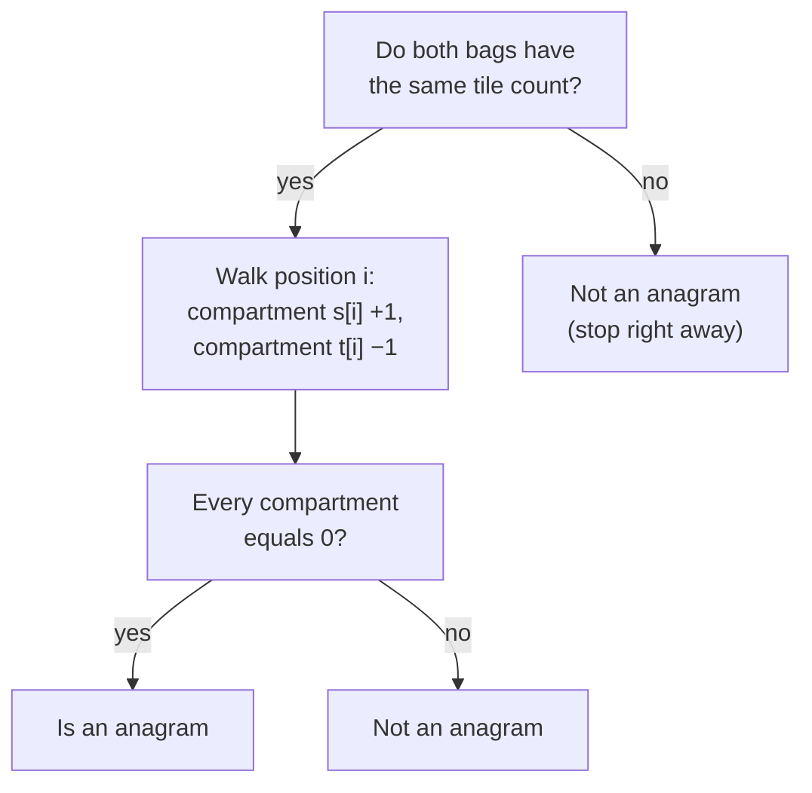

> [!tldr] Quick read
> - The problem: `s` and `t` are anagrams when rearranging the letters of `s` gives `t`. In other words: same letters, same counts.
> - Sort both strings, then compare: O(n log n). Correct and short, but the slowest: 201 ms with two strings of a million letters.
> - [[en/concepts/frequency-counting|Frequency counting]] with a [[en/concepts/counting-array|26-slot array]]: add for `s`, subtract for `t`, and at the end every slot must be 0. O(n) time, O(1) space, 3.4 ms.
> - When the alphabet is not fixed (Unicode), count with a [[en/concepts/hash-map|hash map]] keyed by **code point**, after [[en/concepts/unicode-normalization|Unicode normalization]].
> - The trap: `split('')` in JS and `char[]` in Java split by UTF-16 units, so they treat "😀🌃" and "🜃🈀" as anagrams. Python and Go do not make this mistake.

> [!info] Context
> LeetCode problem 242, part of [[en/posts/2026-11-22-neetcode-counting-keys|station 2: Canonical Keys and Counting]] on **the NeetCode line: Arrays and Strings**. Contains Duplicate asked "have I seen it?"; this problem asks "seen it **how many times**?". The solutions come in TypeScript, JavaScript, Python, Go and Java. All you need to know is loops and arrays.

> [!abstract]- Quick glossary for this post (click to open)
> - **Big-O, hash, Set**: see [[en/problems/contains-duplicate|Contains Duplicate]].
> - **Character code**: every character is stored as a number. `'a'` is 97, `'b'` is 98… so `code - 97` gives the position 0..25 in the alphabet.
> - **Code point**: the Unicode number assigned to a character, for example `é` is U+00E9, `😀` is U+1F600.
> - **UTF-16, code unit**: the way JS and Java store strings, 16 bits per unit. A character whose code point is above U+FFFF (such as an emoji) needs **two** code units, called a surrogate pair.
> - **Map**: a "key → value" table, like a Set but each key carries a value too (here, the count).

## Picture it first: two bags of letter tiles

You have two bags of tiles from a word game. The question: do the two bags hold **exactly the same tiles**?

| Everyday life | Concept |
|---|---|
| Empty both bags, line up each bag's tiles from A→Z, then compare the two rows | Sort then compare, O(n log n) |
| A tray with 26 compartments: a tile from bag 1 goes into its letter's compartment (+1), a tile from bag 2 is taken out (−1) | [[en/concepts/counting-array\|26-slot counting array]] |
| If every compartment is empty at the end, the two bags are the same | [[en/concepts/frequency-counting\|Frequency counting]] |
| An unusual tile (a Thai letter, an emoji): there is no compartment for it, so you label a new one | [[en/concepts/hash-map\|Hash map]] |
| An "é" tile printed as one piece versus an "e" tile plus a separate accent tile: they look the same but get counted as different | [[en/concepts/unicode-normalization\|Unicode normalization]] |



## The problem

**The problem (summary):** given two strings `s` and `t`, return `true` if `t` is an anagram of `s`, that is, it uses exactly the letters of `s`, each exactly the same number of times. Original problem: [LeetCode 242](https://leetcode.com/problems/valid-anagram/).

| `s` | `t` | Output |
|---|---|---|
| `anagram` | `nagaram` | `true` |
| `rat` | `car` | `false` |
| `aacc` | `ccac` | `false` (same set of letters, different counts) |

Constraints: each string is up to **50,000** characters long and contains only lowercase `a`–`z`. The problem adds a follow-up question: if the strings contain Unicode characters, how would you adapt the solution?

The `aacc` / `ccac` case is why "same set of letters" is not enough. A Set (Contains Duplicate) only remembers "present", not "how many".

## How it works

<figure class="figure-map" style="--ar: 3 / 4">
<div class="frame"><iframe data-archify="../../diagrams/neetcode-valid-anagram/count-26.en.html" title="Counting the letters of rat and car in a 26-slot array" loading="lazy"></iframe></div>
<figcaption><span><b>Figure 1.</b> "rat" and "car": each position adds one to a slot for s and subtracts one from a slot for t. At the end slot t is still +1 and slot c is −1, so they are not anagrams.</span><a href="../diagrams/neetcode-valid-anagram/count-26.en.html" target="_blank" rel="noopener">Open full screen</a></figcaption>
</figure>

### Approach 1, sort then compare: O(n log n)

Two anagrams become **the same string** once their letters are sorted. This is the shortest approach to write (Python: `sorted(s) == sorted(t)`), and the idea of "reduce to a canonical form" comes back in Group Anagrams. The cost is two sorts.

### Approach 2, count with a 26-slot array: O(n) time, O(1) space

[[en/concepts/frequency-counting|Frequency counting]] turns the question "same letters, same counts" into "the two count tables are equal". When the alphabet is small and known in advance, the count table is an [[en/concepts/counting-array|array]]: index `c - 'a'` is the slot for letter `c`. Two small tricks:

- **Compare lengths first.** Different lengths means definitely not an anagram, answer right away. With equal lengths you can walk both strings in the same loop.
- **One array, add and subtract.** Instead of two tables and a comparison, add for `s[i]` and subtract for `t[i]`; at the end every slot must be 0.

The array always has 26 slots, however large n is, so the space is O(1). Reading and writing an array slot needs no hashing, so this is the fastest approach in the post.

### Approach 3, hash map: when the alphabet is not known in advance

The follow-up question breaks the "26 slots" assumption. Lowercase Vietnamese alone has more than 60 accented letters, and there are thousands of emoji. The count table then has to be a [[en/concepts/hash-map|hash map]]: the key is the character, the value is the count. It is still O(n) on average, but every count has to compute a hash, so it is about 10 times slower than the array in the measurement below.

### Unicode: what is "one character"?

Counting by character means you must know what the unit of a character is. There are three traps:

1. **JS and Java store strings as UTF-16.** `s.length`, `s[i]`, `split('')` and `charAt` all work with *code units*, not characters. The emoji 😀 (U+1F600) is two code units, `d83d de00`. Splitting by code unit and then sorting mixes up halves of different emoji. With "😀🌃" and "🜃🈀", the two strings are completely different but have **the same four code units**, so the sorting approach concludes they are anagrams.
2. **The same letter can have two encodings.** `é` can be one code point (U+00E9), or `e` plus a combining acute accent (U+0301). Both display identically. [[en/concepts/unicode-normalization|Normalizing]] to NFC brings both to a single form (UAX #15).
3. **A 26-slot array with letters outside a–z.** `'é'.charCodeAt(0) - 97` is 136, outside the 26 slots. JS silently grows the array to 137 elements and writes `NaN` into slot 136, Java throws `ArrayIndexOutOfBoundsException`, Go panics.

| | A string is a sequence of… | Iterating by Unicode character |
|---|---|---|
| TypeScript / JavaScript | UTF-16 code units | `for (const ch of s)` walks by code point; `s.normalize('NFC')` |
| Python | code points | `for ch in s` is already correct; `unicodedata.normalize('NFC', s)` |
| Go | UTF-8 **bytes** (`len("é")` is 2) | `for _, r := range s` yields each `rune`; normalization needs the `golang.org/x/text/unicode/norm` package |
| Java | UTF-16 code units (`char`) | `s.codePoints()`; `Normalizer.normalize(s, NFC)` |

Even a code point is not yet "the character a reader sees": country flags and family emoji are built from several code points. To count by the unit a reader sees (a grapheme cluster), you need `Intl.Segmenter` in JS or an equivalent library. The problem does not go that far, but it is worth knowing it exists.

## Runnable example

[TypeScript](../code/neetcode-valid-anagram/valid-anagram.ts) · [JavaScript](../code/neetcode-valid-anagram/valid-anagram.js) · [Python](../code/neetcode-valid-anagram/valid_anagram.py) · [Go](../code/neetcode-valid-anagram/valid_anagram.go) · [Java](../code/neetcode-valid-anagram/valid-anagram.java) · [PHP](../code/neetcode-valid-anagram/valid-anagram.php) · [Rust](../code/neetcode-valid-anagram/valid_anagram.rs)

```ts
// TypeScript: 26-slot array for the original problem (a–z only)
function byCount26(s: string, t: string): boolean {
  if (s.length !== t.length) return false;
  const count = new Array<number>(26).fill(0);
  for (let i = 0; i < s.length; i++) {
    count[s.charCodeAt(i) - 97]++; // 97 is the code of 'a'
    count[t.charCodeAt(i) - 97]--;
  }
  return count.every((c) => c === 0);
}

// Follow-up: count by code point, after NFC normalization
function byMap(s: string, t: string): boolean {
  s = s.normalize('NFC'); t = t.normalize('NFC');
  const count = new Map<string, number>();
  for (const ch of s) count.set(ch, (count.get(ch) ?? 0) + 1); // for…of walks by code point
  for (const ch of t) {
    const c = count.get(ch);
    if (!c) return false;
    count.set(ch, c - 1);
  }
  return [...count.values()].every((c) => c === 0);
}
```

```python
def is_anagram(s: str, t: str) -> bool:
    if len(s) != len(t):
        return False
    count = [0] * 26
    for a, b in zip(s, t):
        count[ord(a) - ord("a")] += 1
        count[ord(b) - ord("a")] -= 1
    return all(c == 0 for c in count)

# Unicode: Counter counts by code point; normalization is still needed
def is_anagram_counter(s: str, t: str) -> bool:
    nfc = lambda x: unicodedata.normalize("NFC", x)
    return Counter(nfc(s)) == Counter(nfc(t))
```

```go
func isAnagram(s, t string) bool {
	if len(s) != len(t) {
		return false
	}
	var count [26]int // fixed-size array, already zero
	for i := 0; i < len(s); i++ {
		count[s[i]-'a']++
		count[t[i]-'a']--
	}
	return count == [26]int{} // Go arrays are comparable with ==
}
```

```java
static boolean isAnagram(String s, String t) {
    if (s.length() != t.length()) return false;
    int[] count = new int[26];
    for (int i = 0; i < s.length(); i++) {
        count[s.charAt(i) - 'a']++;
        count[t.charAt(i) - 'a']--;
    }
    for (int c : count) if (c != 0) return false;
    return true;
}
```

```js
function isAnagram(s, t) {
  if (s.length !== t.length) return false;
  const count = new Int32Array(26); // fixed-size integer array, initialized to 0
  for (let i = 0; i < s.length; i++) {
    count[s.charCodeAt(i) - 97]++;
    count[t.charCodeAt(i) - 97]--;
  }
  return count.every((c) => c === 0);
}
```

```php
function isAnagram(string $s, string $t): bool {
    if (strlen($s) !== strlen($t)) return false; // strlen counts BYTES
    $count = array_fill(0, 26, 0);
    for ($i = 0, $n = strlen($s); $i < $n; $i++) {
        $count[ord($s[$i]) - 97]++; // $s[$i] is one byte, ord() gives its code
        $count[ord($t[$i]) - 97]--;
    }
    foreach ($count as $c) if ($c !== 0) return false;
    return true;
}
```

```rust
fn is_anagram(s: &str, t: &str) -> bool {
    if s.len() != t.len() {
        return false; // len() is the number of UTF-8 bytes
    }
    let mut count = [0i32; 26];
    for (a, b) in s.bytes().zip(t.bytes()) {
        count[(a - b'a') as usize] += 1; // a byte outside a..z panics instead of silently writing wrong data
        count[(b - b'a') as usize] -= 1;
    }
    count == [0; 26] // fixed-size arrays compare with ==
}
```

```text
$ node valid-anagram.ts
lowercase test: 3 approaches × 5 cases, 0 cases failed

"café" vs "éfac": length 4 vs 5
  bySorting: false, byMap (NFC): true

"😀🌃" code units: d83d de00 d83c df03
"🜃🈀" code units: d83d df03 d83c de00
  bySorting: true (wrong), byMap: false
  byCount26 with an accented letter: count['é'.charCodeAt(0) - 97] = count[136] → writes outside the 26 slots
bySorting  n = 1 000 000:   201.1 ms (true)
byCount26  n = 1 000 000:     3.4 ms (true)
byMap      n = 1 000 000:    40.3 ms (true)
```

*(Output labels translated; the files themselves print Vietnamese.)*

The other languages, with the same two traps:

```text
$ python3 valid_anagram.py
...
len: 4 5 | sorted: False | Counter + NFC: True
emoji: False (Python does not split code points)

$ go run valid_anagram.go
true false false
len("é") = 2 bytes; rune count = 1
true false

$ java valid-anagram.java
true false
emoji, sorting char[]: true (wrong) | by code point: false
café vs éfac: false | NFC: true
$ php valid-anagram.php
test chữ thường: 3 cách × 5 ca, 0 ca sai
"café" vs "éfac": strlen 5 vs 6, mb_strlen 4 vs 5
  bySorting: false, byMap (NFC): true
  "éè" vs byte xáo trộn: bySorting true (sai), byMap false
$ rustc --edition 2021 -O valid_anagram.rs && ./valid_anagram
test chữ thường: 3 cách × 5 ca, 0 ca sai
"café" vs "éfac": len 5 vs 6 byte, chars 4 vs 5
  by_sorting: false, by_map: false (không có NFC thì cả hai sai)
  emoji: by_sorting false, by_map false (char là code point, không vỡ)
```

Reading the results:

- **Speed**: the 26-slot array is about 60 times faster than sorting and about 12 times faster than the hash map. All three give the correct answer for lowercase letters.
- **"café"** written in two ways has different lengths (4 and 5), so every approach without normalization returns `false`. After NFC it is correct.
- **Emoji**: the code-unit sorting in JS and Java returns `true`, which is wrong. Python sorts by code point, so it is correct; Go iterating by `rune` is correct too. PHP sorts bytes, so it is wrong too for multi-byte letters; Rust sorts by `char` (code point), so it is correct, but without NFC it still returns `false` for "café".

## Misconceptions and common traps

- **"Same set of letters means anagram."** `aacc` and `ccac` have the same set `{a, c}` but different counts. You have to count, not just mark.
- **Forgetting to compare lengths first.** It is not just an optimization: adding and subtracting in the same loop is only correct when the two strings have equal length.
- **Using a 26-slot array when the input is not guaranteed to be a–z.** Uppercase letters, spaces and accented letters all fall outside the array. Check the assumption, or switch to a map.
- **Treating `s.length` (JS, Java) as the number of characters.** It is the number of UTF-16 code units. `'😀'.length` is 2.
- **Sorting `split('')` on a Unicode string.** It breaks surrogate pairs and yields false anagrams, as in the emoji example.
- **Not normalizing.** Two strings that look identical can differ byte by byte. Text that users type on different keyboards, or copy from macOS, often comes in the decomposed form (NFD).
- **Go: `len(s)` is the number of bytes.** The byte-based 26-slot array is only correct because the problem limits input to a–z (one byte per letter). With accented letters, you have to iterate `range s` by rune.
- **PHP: strings are byte sequences.** `strlen`, `$s[$i]`, `str_split` and `sort` all work on bytes. An accented letter takes 2–3 bytes, so a byte sort can call two strings with different letters anagrams. Use `mb_str_split` and `Normalizer::normalize` (the intl extension) for real text.
- **Rust: the standard library does not normalize Unicode.** `chars()` walks code points, so emoji do not break, but precomposed `"café"` and the decomposed form still differ; you need the `unicode-normalization` crate. On the other hand, an index outside the 26-slot array makes the program panic instead of overwriting memory.

## Self-check questions

> [!question]- Why is a Set (as in Contains Duplicate) not enough to check for an anagram?
> A Set only remembers whether a letter appears, not how many times. `aacc` and `ccac` have the same Set `{a, c}` but are not anagrams.

> [!question]- The 26-slot counting array is called O(1) space. Why, even though it is an array?
> Its size is fixed at 26 and does not grow with the string length n. Big-O measures how memory grows with n.

> [!question]- What condition does adding for s and subtracting for t in the same loop need in order to be correct?
> The two strings must have equal length, because the loop shares the index i. That is why you compare lengths first.

> [!question]- `'😀🌃'` and `'🜃🈀'` are different, yet sorting `split('')` gives the same string. Explain.
> `split('')` splits by UTF-16 code unit. Each emoji is two code units, and the four code units of the two strings are the same set (`d83d`, `de00`, `d83c`, `df03`), just paired differently. Sorting throws away the pairing information.

> [!question]- A user types "Huế" (a Vietnamese city name) on two different machines, and comparing with `===` gives `false`. What could the cause be, and how do you fix it?
> One machine stores `ế` in precomposed form (one code point; Vietnamese has many such precomposed letters), the other in decomposed form (a base letter plus combining marks). Normalize both to NFC before comparing.

## References

- [LeetCode 242: Valid Anagram](https://leetcode.com/problems/valid-anagram/) (original problem and the Unicode follow-up)
- [Unicode Standard Annex #15: Normalization Forms](https://unicode.org/reports/tr15/) (NFC, NFD)
- [ECMAScript 2025](https://tc39.es/ecma262/2025/) (strings are sequences of UTF-16 code units; `String.prototype.normalize`; a `for…of` loop over a string walks by code point)
- [The Go Programming Language Specification](https://go.dev/ref/spec) (a string is a sequence of bytes; `range` over a string yields runes)
