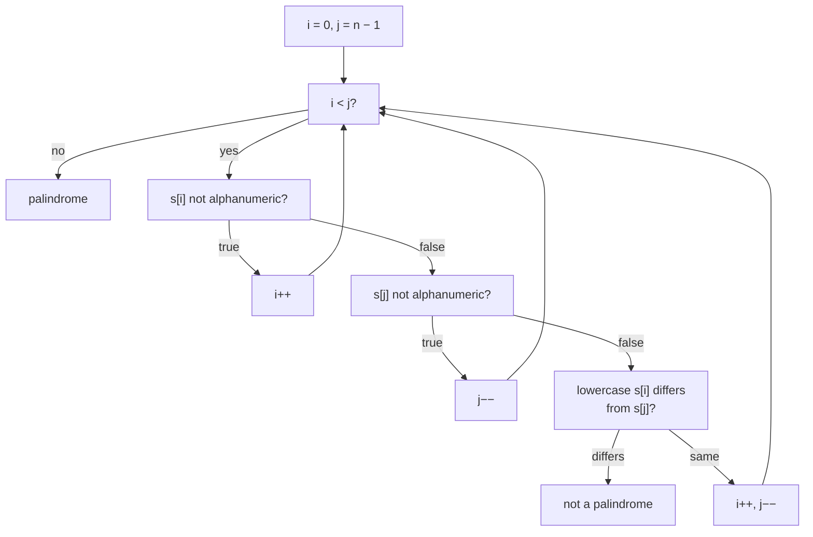

> [!tldr] Quick read
> - The problem: a string is a palindrome if, after lowercasing everything and **keeping only letters and digits**, it reads the same forward and backward. `"A man, a plan, a canal: Panama"` → `true`.
> - The easy way: build the clean string, reverse it, compare. O(n) time but O(n) memory for the clean string and its reverse.
> - [[en/concepts/two-pointers|Two pointers]]: `i` from the start, `j` from the end, skip invalid characters, compare pair by pair. O(1) memory, and it stops at the first mismatched pair.
> - Measured on 10⁶ characters: for a palindrome, two pointers are about 4 times faster; for a string that differs at the first character, two pointers finish almost instantly while filtering still takes 9 ms.
> - Traps: the regex `\w` includes `_`; Python's `str.isalnum()` accepts `"²"` and accented letters. The problem counts only `a–z`, `A–Z`, `0–9`.

> [!info] Context
> LeetCode problem 125, the opening problem of [[en/posts/2026-11-23-neetcode-two-pointers|station 4: Two Pointers]] on **the NeetCode line: Arrays and Strings**. It is the simplest form of two pointers: no sorting, only both ends having to match. The solutions come in TypeScript, Python, Go, Java and JavaScript. All you need to know is strings and loops.

> [!abstract]- Quick glossary for this post (click to open)
> - **Palindrome**: a string that reads the same forward and backward, like `"level"` or `"racecar"`.
> - **Alphanumeric character**: a letter or a digit. In this problem: only `a–z`, `A–Z`, `0–9`.
> - **Character code**: the number a computer uses for each character. `'A'` is 65 and `'a'` is 97, so adding 32 to an uppercase letter gives the lowercase one.
> - **Regex `\w`**: the "word character" class in regular expressions, `[A-Za-z0-9_]`, which **includes** the underscore.

## Picture it first: two people reading from both ends

Two people hold a strip of letters, one at each end, and read toward the middle together. Punctuation and spaces are stepped over. On a letter they read it aloud, and the two must read the same letter. One mismatch is enough to know the strip is not a palindrome, so there's no need to read on.

| Everyday life | Concept |
|---|---|
| Copy the strip without punctuation, then write it backward on another sheet to compare | filter, reverse, compare: O(n) memory |
| The two people at the two ends | two pointers `i = 0`, `j = n − 1` |
| Step over punctuation and spaces | skip non-alphanumeric characters |
| Read "A" and "a" as the same | compare after lowercasing |
| Stop at the first different reading | return `false` at the first mismatched pair |
| The two meet in the middle | `i ≥ j`: palindrome |



## The problem

**The problem (in my own words):** given a string `s` (1 ≤ length ≤ 2·10⁵, printable ASCII only), convert every uppercase letter to lowercase and remove every character that is not a letter or digit. Return `true` if what remains reads the same forward and backward. Original: [LeetCode 125](https://leetcode.com/problems/valid-palindrome/).

| Input | Clean string | Output |
|---|---|---|
| `"A man, a plan, a canal: Panama"` | `amanaplanacanalpanama` | `true` |
| `"race a car"` | `raceacar` | `false` |
| `" "` | (empty) | `true` |
| `"0P"` | `0p` | `false` |

I used to think this problem was just "reverse the string and compare". It turns out the hard part is defining "letter or digit", and every language has a function that looks right but defines it differently from the problem.

## How it works

<figure class="figure-map" style="--ar: 3 / 4">
<div class="frame"><iframe data-archify="../../diagrams/neetcode-valid-palindrome/worked-example.en.html" title="Compare both ends after skipping punctuation" loading="lazy"></iframe></div>
<figcaption><span><b>Figure 1.</b> Compare both ends after skipping punctuation.</span><a href="../diagrams/neetcode-valid-palindrome/worked-example.en.html" target="_blank" rel="noopener">Open full screen</a></figcaption>
</figure>

<details>
<summary>Read the steps</summary>
<ol>
<li>Start at both ends. <code>&quot;N-o:n&quot;</code></li>
<li>Compare lowercased N and n. <code>n = n</code></li>
<li>Skip the dash and colon. <code>&#x27;-&#x27;, &#x27;:&#x27;</code></li>
<li>The pointers meet at o. <code>&quot;non&quot; → true</code></li>
</ol>
</details>

### Approach 1, filter then reverse

Build the clean string (lowercase, only `a–z0–9`), reverse it, compare it with itself. Three passes over the data and two extra strings up to n long. This approach always reads the **whole** string, even when the first and last characters already differ.

### Approach 2, two pointers

`i` starts at 0, `j` at n − 1. Each iteration does **exactly one** thing: skip a junk character at `i`, or at `j`, or compare an alphanumeric pair. A differing pair returns `false`; when the pointers meet, return `true`.

Why nothing is missed: the clean string is a palindrome exactly when the k-th clean character from the start equals the k-th clean character from the end, for every k. `i` and `j` walk through exactly those pairs in order k = 1, 2, …, and stop once past the middle.

### Measured

TypeScript, a string of 10⁶ characters made of letters, commas and spaces, median of 5 runs:

| String | filter + reverse | two pointers |
|---|---|---|
| a palindrome (must read everything) | 9.63 ms | 2.50 ms |
| differs at the first character | 8.86 ms | under 0.001 ms |

Both are O(n) in the worst case. Two pointers win in the worst case because they build no new string, and win by far in the "fails early" case because they stop at once.

### Under the hood of the seven languages: what "letter or digit" means

| | Built-in function | Matches the problem? |
|---|---|---|
| TypeScript / JavaScript | regex `\w` | **no**: `\w` includes `_`, so `"a_"` becomes `a_` instead of `a` |
| TypeScript / JavaScript | `/[a-z0-9]/i` | yes |
| Python | `str.isalnum()` | **not quite**: accepts `"é"`, `"²"`, CJK characters; add `isascii()` to restrict to ASCII |
| Go | `unicode.IsLetter`, `IsDigit` | Unicode-aware; the problem is ASCII only, so comparing bytes directly is enough |
| Java | `Character.isLetterOrDigit` | Unicode-aware, like Python |
| PHP | `ctype_alnum` | yes: in the "C" locale it is ASCII only; but it takes a **string**, not a code |
| Rust | `u8::is_ascii_alphanumeric` | yes; `char::is_alphanumeric` is Unicode-aware like Python |

The problem is ASCII only, so `isalnum()` and `isLetterOrDigit` still pass on LeetCode. But copy that function somewhere that accepts Vietnamese text and "letter or digit" has quietly changed meaning.

## Runnable example

[TypeScript](../code/neetcode-valid-palindrome/valid-palindrome.ts) · [Python](../code/neetcode-valid-palindrome/valid_palindrome.py) · [Go](../code/neetcode-valid-palindrome/valid_palindrome.go) · [Java](../code/neetcode-valid-palindrome/valid-palindrome.java) · [JavaScript](../code/neetcode-valid-palindrome/valid-palindrome.js) · [PHP](../code/neetcode-valid-palindrome/valid-palindrome.php) · [Rust](../code/neetcode-valid-palindrome/valid_palindrome.rs)

Each file has both approaches and runs 8 cases (Python 9). Below is the two-pointer approach.

```ts
// Approach 2: two pointers from both ends, skipping anything that is not a letter or digit. O(1) extra memory.
function twoPointers(s: string): boolean {
  let i = 0, j = s.length - 1;
  while (i < j) {
    const a = s.charCodeAt(i), b = s.charCodeAt(j);
    if (!isAlnum(a)) { i++; continue; }
    if (!isAlnum(b)) { j--; continue; }
    if (lower(a) !== lower(b)) return false; // different: stop at once, no need to read the middle
    i++; j--;
  }
  return true;
}
```

```python
def two_pointers(s: str) -> bool:
    i, j = 0, len(s) - 1
    while i < j:
        if not (s[i].isascii() and s[i].isalnum()):
            i += 1
        elif not (s[j].isascii() and s[j].isalnum()):
            j -= 1
        elif s[i].lower() != s[j].lower():
            return False
        else:
            i, j = i + 1, j - 1
    return True
```

```go
func twoPointers(s string) bool {
	for i, j := 0, len(s)-1; i < j; {
		switch {
		case !isAlnum(s[i]):
			i++
		case !isAlnum(s[j]):
			j--
		case lower(s[i]) != lower(s[j]):
			return false
		default:
			i, j = i+1, j-1
		}
	}
	return true
}
```

```java
static boolean twoPointers(String s) {
    int i = 0, j = s.length() - 1;
    while (i < j) {
        char a = s.charAt(i), c = s.charAt(j);
        if (!isAlnum(a)) i++;
        else if (!isAlnum(c)) j--;
        else if (Character.toLowerCase(a) != Character.toLowerCase(c)) return false;
        else { i++; j--; }
    }
    return true;
}
```

```js
function twoPointers(s) {
  let i = 0, j = s.length - 1;
  while (i < j) {
    if (!isAlnum(s[i])) i++;
    else if (!isAlnum(s[j])) j--;
    else if (s[i].toLowerCase() !== s[j].toLowerCase()) return false;
    else { i++; j--; }
  }
  return true;
}
```

```php
function twoPointers(string $s): bool {
    $i = 0; $j = strlen($s) - 1;
    while ($i < $j) {
        if (!ctype_alnum($s[$i])) { $i++; continue; } // ctype_alnum takes a STRING and follows the "C" locale: ASCII only
        if (!ctype_alnum($s[$j])) { $j--; continue; }
        if (strtolower($s[$i]) !== strtolower($s[$j])) return false; // different: stop right away
        $i++; $j--;
    }
    return true;
}
```

```rust
fn two_pointers(s: &str) -> bool {
    let b = s.as_bytes();
    if b.is_empty() {
        return true;
    }
    let (mut i, mut j) = (0usize, b.len() - 1); // b.len() - 1 on a usize underflows for an empty string, so check first
    while i < j {
        if !b[i].is_ascii_alphanumeric() {
            i += 1;
        } else if !b[j].is_ascii_alphanumeric() {
            j -= 1;
        } else if b[i].to_ascii_lowercase() != b[j].to_ascii_lowercase() {
            return false; // different: stop right away
        } else {
            i += 1;
            j -= 1;
        }
    }
    true
}
```


```text
$ node valid-palindrome.ts
cleanReverse  8/8 cases passed
twoPointers   8/8 cases passed
wordRegex     7/8 cases passed; wrong on "a_"

n = 10⁶ characters      filter + reverse   two pointers   (ms, median of 5 runs)
palindrome                  9.63         2.497
wrong at first char         8.86         0.000
```

*(Output labels translated; the files themselves print Vietnamese.)*

```text
$ python3 valid_palindrome.py
clean_reverse   9/9 cases passed
two_pointers    9/9 cases passed
unicode_isalnum 8/9 cases passed; wrong on ['a²']
```

The `\w` version keeps the `_`, so `"a_"` becomes `a_`, which is not a palindrome. The Python version that uses only `isalnum()` keeps `²` (superscript two) because Unicode counts it as a digit. Go, Java and JavaScript print `8/8 ca đúng` ("8/8 cases passed") for both approaches. PHP and Rust also print `8/8 ca đúng` for both approaches, and the `\w`-style filter prints `7/8 ca đúng; sai ở "a_"` ("7/8 cases passed; wrong on \"a_\"") like TypeScript.

## Misconceptions and common traps

- **Filtering with `\w`.** `\w` is `[A-Za-z0-9_]`, underscore included.
- **Trusting `isalnum()` to be ASCII only.** Python, Java and Go all follow Unicode. Right for this problem because it is ASCII only, wrong when real data has accented letters.
- **Moving both pointers on a junk character.** Only the junk character on **one** side should be skipped; moving both skips a real character on the other side.
- **Forgetting `i < j` in the skip loop.** A string of only punctuation such as `".,"` lets `i` run past `j`, or off the array if the skip loop is written separately without a bounds check.
- **Comparing before lowercasing.** `"Aa"` is a palindrome by the problem's rules.
- **PHP: `strrev` reverses bytes.** Right for the problem's ASCII, but a string with a UTF-8 letter such as `"é"` (two bytes) comes back as garbage bytes. Also, `ctype_alnum` takes a string; pass it an integer from `ord()` and PHP reads it as an ASCII code (behaviour deprecated since PHP 8.1).
- **Rust: indexing a string.** `s[i]` does not compile because Rust strings are UTF-8; work on `s.as_bytes()` instead. And `b.len() - 1` on a `usize` underflows for an empty string (a panic in a debug build), so the file checks for the empty string first.

## Self-check questions

> [!question]- What does `".,"` return, and why?
> `true`. The clean string is empty, and the empty string reads the same both ways. In the code, `i` and `j` skip junk characters until `i ≥ j`.

> [!question]- Why do two pointers use O(1) memory while filtering uses O(n)?
> Two pointers keep two indices and read the original string directly. Filtering builds the clean string and its reverse, each up to n long.

> [!question]- How much work does the two-pointer loop do per iteration, and why only one thing?
> Exactly one thing: skip junk at `i`, or at `j`, or compare one pair. Doing one thing at a time means `i < j` is rechecked after every move, so it never reads out of bounds or compares a character with itself after the pointers cross.

> [!question]- If the problem became "palindrome after deleting **at most one** character", what would two pointers need?
> At the first mismatched pair, try both options: drop `s[i]` (check `i+1..j`) or drop `s[j]` (check `i..j−1`). Each option is one more two-pointer run, still O(n). That is LeetCode 680.

## References

- [LeetCode 125: Valid Palindrome](https://leetcode.com/problems/valid-palindrome/) (the original problem)
- [MDN: Character classes](https://developer.mozilla.org/en-US/docs/Web/JavaScript/Guide/Regular_expressions/Character_classes) (`\w` is `[A-Za-z0-9_]`)
- [Python: `str.isalnum`](https://docs.python.org/3/library/stdtypes.html#str.isalnum) (true when every character is a letter or digit under Unicode)
- [Java 21 `Character.isLetterOrDigit`](https://docs.oracle.com/en/java/javase/21/docs/api/java.base/java/lang/Character.html#isLetterOrDigit(char))
