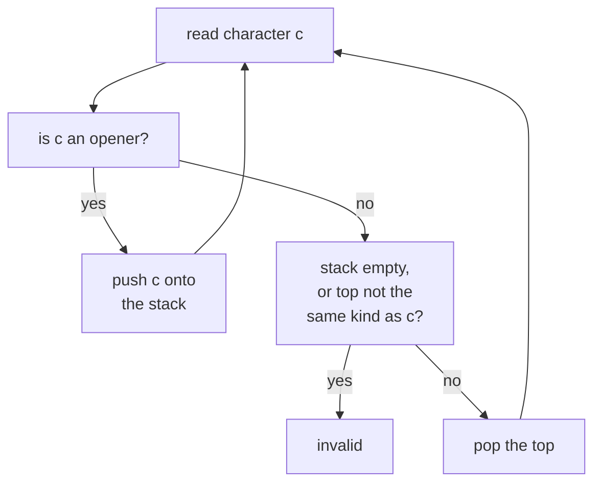

> [!tldr] Quick read
> - The problem: a string made only of `()[]{}`. It is valid when each opener is closed by **the same kind**, in **the right order**, with nothing left over.
> - Counting is not enough: one shared counter lets `"(]"` through; three separate counters let `"([)]"` through. What you must remember is the **order** of the openers not yet closed.
> - A closer always matches the **nearest** unclosed opener: that is the top of a [[en/concepts/stack|stack]]. Push openers; on a closer, pop the top and compare. O(n), one pass.
> - Removing `()`, `[]`, `{}` pairs repeatedly is also correct but O(n²): 180 ms at 16 000 characters, against 0.35 ms for the stack.
> - Two things people forget: popping an **empty** stack (Python raises `IndexError`, Java throws `NoSuchElementException`, Go panics) and forgetting to check the stack is empty at the **end** (`"(("`).

> [!info] Context
> LeetCode problem 20, the anchor problem of [[en/posts/2026-11-23-neetcode-stack|station 6: Stack]] on **the NeetCode line: Arrays and Strings**. The solutions come in TypeScript, Python, Go, Java, JavaScript, PHP and Rust. All you need to know is loops, strings and arrays.

> [!abstract]- Quick glossary for this post (click to open)
> - **Stack**: a list you only add to and take from at **one end** (the top). Last in, first out (LIFO). See [[en/concepts/stack|Stack]].
> - **push / pop**: put an element on top / take the top element off.
> - **Bracket matching**: pairing each closer with its corresponding opener. See [[en/concepts/bracket-matching|Bracket Matching]].

## Picture it first: nested boxes

You open a present: a big box, a medium box inside it, a small box inside that. To close it all up properly, you must close the small box first, then the medium one, then the big one. The box opened **last** has to be closed **first**.

| Everyday life | Concept |
|---|---|
| Opening a box | meeting an opener: push it onto the stack |
| The most recently opened box, the innermost one | the top of the stack |
| Putting on a lid: it must be the innermost box's lid | a closer must match the top |
| Holding a round lid when the innermost box is square | `"(]"`: wrong kind |
| Closing the big box while the small one inside is still open | `"([)]"`: wrong order |
| Holding a lid when no box is open | popping an empty stack |
| Finishing with boxes still open | elements left on the stack at the end |



End of string: valid if and only if the stack is empty.

## The problem

**The problem (in my own words):** given a string `s` (1 ≤ length ≤ 10⁴) made only of `(`, `)`, `[`, `]`, `{`, `}`, return `true` if every opener is closed by a bracket of the same kind, in the correct nesting order, and every closer has a corresponding opener. Original: [LeetCode 20](https://leetcode.com/problems/valid-parentheses/).

| Input | Output | Why |
|---|---|---|
| `"()[]{}"` | `true` | three pairs side by side |
| `"{[]}"` | `true` | nested in the right order |
| `"(]"` | `false` | wrong kind |
| `"([)]"` | `false` | right count of each kind, but closed in the wrong order |
| `"(("` | `false` | brackets left unclosed |

I used to think counting was enough: add on an opener, subtract on a closer, end at 0. It turns out a count only knows **how many** brackets are open, not **which one** was opened last.

## How it works

<figure class="figure-map" style="--ar: 3 / 4">
<div class="frame"><iframe data-archify="../../diagrams/neetcode-valid-parentheses/worked-example.en.html" title="Match each closing bracket to the stack top" loading="lazy"></iframe></div>
<figcaption><span><b>Figure 1.</b> Match each closing bracket to the stack top.</span><a href="../diagrams/neetcode-valid-parentheses/worked-example.en.html" target="_blank" rel="noopener">Open full screen</a></figcaption>
</figure>

<details>
<summary>Read the steps</summary>
<ol>
<li>Push the two opening brackets. <code>&quot;{[&quot; → [&#x27;{&#x27;, &#x27;[&#x27;]</code></li>
<li>Read ] and pop its matching [. <code>[&#x27;{&#x27;]</code></li>
<li>Read } and pop its matching {. <code>[]</code></li>
<li>The input ends with an empty stack. <code>&quot;{[]}&quot; → true</code></li>
</ol>
</details>

### Approach 1, one counter: wrong

Add 1 on an opener, subtract 1 on a closer, negative means invalid, and it must end at 0. Correct when there is only one kind of bracket. With three kinds, `"(]"` goes 1 then 0: it slips through.

### Approach 2, three counters: still wrong

One counter per kind. It catches `"(]"` (the `[` counter goes to −1), but `"([)]"` still slips through: each counter goes 0 → 1 → 0, and none goes negative. The missing information is the **order**: when `)` arrives, the nearest opener is `[`, not `(`.

### Approach 3, removing pairs repeatedly: correct but O(n²)

A valid string always contains at least one adjacent pair `()`, `[]` or `{}` (the innermost pair). Remove it and what remains is still valid. Repeat until nothing more can be removed; the string is valid when nothing is left. Each removal pass reads the whole string again, and the deeply nested `"((((…))))"` loses only one pair, in the middle, per pass: n/2 passes × O(n) each = O(n²).

### Approach 4, a stack: O(n)

A closer must match the **nearest** opener not yet closed. "The nearest of the things not yet handled" is exactly the top of a stack:
- on an opener: push it;
- on a closer: if the stack is empty, invalid; pop the top, and if it is a different kind, invalid;
- at the end of the string: anything left on the stack means invalid.

Each character enters and leaves the stack at most once: O(n) time, O(n) memory. A small trick: an odd length is always invalid, so return `false` straight away.

Removing pairs and using a stack actually do the same thing: the stack removes the innermost pair **as soon as it appears**, so it never has to reread the string.

### Measured

The deeply nested string `"(" × n/2 + ")" × n/2`, the worst case for pair removal, TypeScript, median of 3 runs:

| n | removing pairs | stack |
|---|---|---|
| 2 000 | 3.0 ms | 0.08 ms |
| 4 000 | 11.4 ms | 0.08 ms |
| 8 000 | 45.5 ms | 0.15 ms |
| 16 000 | 179.9 ms | 0.35 ms |
| 10⁶ | (not run) | 20.51 ms |

Double n and pair removal gets about 4 times slower: exactly the n² shape. At the problem's limit of 10⁴ it still passes (between the measured 45.5 ms at n = 8 000 and 179.9 ms at n = 16 000), so LeetCode doesn't force you to use a stack; only measuring shows the difference.

### Under the hood of the seven languages

| | The stack | Popping an empty stack |
|---|---|---|
| TypeScript / JavaScript | an array: `push`, `pop` at the end (O(1)); don't use `shift`/`unshift` at the front (O(n)) | `pop()` returns `undefined`, no error |
| Python | a `list`: `append`, `pop()` | `IndexError: pop from empty list` |
| Go | a slice: `append`, reslice `st[:len(st)-1]` | `st[len(st)-1]` on an empty slice: panic |
| Java | `ArrayDeque`: `push`, `pop`, `peek` | `NoSuchElementException` |
| PHP | array: `$st[] = …`, `array_pop` | `array_pop` returns `null` without an error; `SplStack::pop` throws `RuntimeException` |
| Rust | `Vec<char>`: `push`, `pop` | `pop()` returns an `Option`: empty is `None`, and the compiler makes you handle it |

Java also has a `Stack` class, but the official documentation recommends `Deque` instead. The reason is not speed: measured on 10⁶ characters, `ArrayDeque` takes 5.2 ms and `Stack` 4.6 ms, because an uncontended `synchronized` lock costs almost nothing. The reason is design: `Stack` extends `Vector`, so anyone can call `get(i)` or `add(0, x)` into the middle of the stack.

## Runnable example

[TypeScript](../code/neetcode-valid-parentheses/valid-parentheses.ts) · [Python](../code/neetcode-valid-parentheses/valid_parentheses.py) · [Go](../code/neetcode-valid-parentheses/valid_parentheses.go) · [Java](../code/neetcode-valid-parentheses/valid-parentheses.java) · [JavaScript](../code/neetcode-valid-parentheses/valid-parentheses.js) · [PHP](../code/neetcode-valid-parentheses/valid-parentheses.php) · [Rust](../code/neetcode-valid-parentheses/valid_parentheses.rs)

Each file has the pair-removal and stack approaches and runs 9 cases, including the empty string, `"(("` and `"){"`. Below is the stack approach.

```ts
// Stack: push openers; a closer must match the opener on top.
function stack(s: string): boolean {
  if (s.length % 2 === 1) return false; // an odd length always leaves a bracket unpaired
  const open: Record<string, string> = { ")": "(", "]": "[", "}": "{" };
  const st: string[] = [];
  for (const ch of s) {
    if (!(ch in open)) st.push(ch);
    else if (st.pop() !== open[ch]) return false; // pop on an empty array returns undefined, which also differs from "(", so this stays correct
  }
  return st.length === 0; // openers still unclosed means invalid
}
```

```python
def stack(s: str) -> bool:
    st: list[str] = []  # a list as the stack: append and pop at the end are both O(1)
    for ch in s:
        if ch not in OPEN:
            st.append(ch)
        elif not st or st.pop() != OPEN[ch]:  # check for empty first: pop() on an empty list raises IndexError
            return False
    return not st
```

```go
func stack(s string) bool {
	open := map[byte]byte{')': '(', ']': '[', '}': '{'}
	st := make([]byte, 0, len(s)) // a slice as the stack; preallocate capacity so append never has to grow
	for i := 0; i < len(s); i++ {
		want, isClose := open[s[i]]
		if !isClose {
			st = append(st, s[i])
			continue
		}
		if len(st) == 0 || st[len(st)-1] != want { // st[len(st)-1] on an empty slice panics: check the length first
			return false
		}
		st = st[:len(st)-1] // "pop": slice off the last element
	}
	return len(st) == 0
}
```

```java
static boolean stack(String s) {
    Deque<Character> st = new ArrayDeque<>(); // ArrayDeque instead of Stack: Stack extends Vector and every method is synchronized
    for (char ch : s.toCharArray()) {
        char want = switch (ch) { case ')' -> '('; case ']' -> '['; case '}' -> '{'; default -> 0; };
        if (want == 0) st.push(ch);
        else if (st.isEmpty() || st.pop() != want) return false; // pop() on an empty deque throws NoSuchElementException
    }
    return st.isEmpty();
}
```

```js
function stack(s) {
  const open = { ")": "(", "]": "[", "}": "{" };
  const st = []; // an array as the stack: push and pop at the end are O(1); shift/unshift at the front are O(n)
  for (const ch of s) {
    if (!(ch in open)) st.push(ch);
    else if (st.pop() !== open[ch]) return false;
  }
  return st.length === 0;
}
```

```php
function stack(string $s): bool {
    if (strlen($s) % 2 === 1) return false;
    $st = [];
    foreach (str_split($s) as $ch) {
        if (!isset(OPEN[$ch])) $st[] = $ch;
        elseif (array_pop($st) !== OPEN[$ch]) return false; // array_pop on an empty array returns null, which differs from "(", so it stays correct
    }
    return !$st;
}
```

```rust
fn stack(s: &str) -> bool {
    if s.len() % 2 == 1 { return false; }
    let mut st: Vec<char> = Vec::with_capacity(s.len());
    for ch in s.chars() {
        match open_of(ch) {
            None => st.push(ch),
            // pop() returns an Option: an empty stack gives None, which differs from Some('('), so no separate check
            Some(o) => if st.pop() != Some(o) { return false; },
        }
    }
    st.is_empty()
}
```


The TypeScript file also runs three wrong versions, then measures:

```text
$ node valid-parentheses.ts
singleCounter      7/9 cases passed; wrong on "(]" "([)]"
threeCounters      8/9 cases passed; wrong on "([)]"
replacePairs       9/9 cases passed
stack              9/9 cases passed
stackNoFinalCheck  8/9 cases passed; wrong on "(("

n (length)   pair removal  stack      (ms, median of 3 runs, deeply nested string)
2000                 3.0       0.08
4000                11.4       0.08
8000                45.5       0.15
16000              179.9       0.35
1000000                —      20.51
```

*(Output labels translated; the files themselves print Vietnamese.)*

The Python file also runs a version that forgets to check for empty before `pop`:

```text
$ python3 valid_parentheses.py
replace_pairs    9/9 cases passed
stack            9/9 cases passed
stack_unguarded  8/9 cases passed; error on '){': IndexError(pop from empty list)
```

The TypeScript version with the same bug runs correctly, because `pop()` on an empty array returns `undefined`, and `undefined` differs from every opener. The same line of code is forgiven by one language and throws in another. The Java file compares `ArrayDeque` with `Stack`:

```text
$ java valid-parentheses.java
replacePairs  9/9 cases passed
stack         9/9 cases passed
legacyStack   9/9 cases passed

10^6 characters: ArrayDeque 5.2 ms, Stack 4.6 ms
```

Go, JavaScript and Rust print `9/9 ca đúng` ("9/9 cases passed") for both approaches. The PHP file runs the same algorithm on two kinds of stack:

```text
$ php valid-parentheses.php
singleCounter      7/9 ca đúng; sai ở "(]" "([)]"
threeCounters      8/9 ca đúng; sai ở "([)]"
replacePairs       9/9 ca đúng
stack              9/9 ca đúng
stackNoFinalCheck  8/9 ca đúng; sai ở "(("
splStackUnguarded  8/9 ca đúng; sai ở "){": RuntimeException(Can't pop from an empty datastructure)
```

A PHP array forgives like JS (`array_pop` returns `null`), while `SplStack` throws like Python. In Rust `pop()` returns an `Option`, so there is no way to forget the empty case and still compile.

## Misconceptions and common traps

- **"Counting brackets is enough."** One counter can't tell kinds apart, three counters can't tell order. Only a stack remembers the order.
- **Forgetting to check the stack is empty at the end.** `"(("` has no wrong closer, but two brackets are never closed.
- **Popping an empty stack.** A `")"` at the start of the string. Python, Java and Go throw or panic; JS quietly returns `undefined`.
- **Using `shift`/`unshift` as the stack in JS.** Adding at the front of an array moves every element: O(n) each time, and the whole algorithm becomes O(n²).
- **"Java's `Stack` is slow because it is synchronized."** Measured, it isn't noticeably slower. Its problem is an API that also exposes operations that don't belong to a stack.
- **PHP: `array_pop` and `SplStack::pop` treat an empty stack in opposite ways.** The array returns `null` and carries on; `SplStack` throws `RuntimeException`. Switching the stack type mid-way also switches the behavior on `"){"`.
- **Rust: `s.len()` counts bytes, not characters.** The odd-length check is only right because the input has just six ASCII bracket characters; for strings with multi-byte characters use `s.chars().count()`.

## Self-check questions

> [!question]- Write down the stack's contents after each character when checking `"{[()]}"`.
> `{` → `{[` → `{[(` → see `)`: `{[` → see `]`: `{` → see `}`: empty. Valid.

> [!question]- Why do three counters let `"([)]"` through?
> Each kind of bracket opens once and closes once, and no counter goes negative. The counters don't know that when `)` arrives, the nearest opener is `[`.

> [!question]- If the string had only one kind of bracket, `()`, would you need a stack?
> No. Every element on the stack would be `(`, so you only need to know how many: one counter (negative means invalid, it must end at 0), O(1) memory.

> [!question]- Why is repeated pair removal O(n²) on `"((((…))))"`?
> Each pass has only one adjacent pair (in the middle), so it takes n/2 passes, each reading the whole string in O(n).

## References

- [LeetCode 20: Valid Parentheses](https://leetcode.com/problems/valid-parentheses/) (the original problem)
- [Java 21 `Stack`](https://docs.oracle.com/en/java/javase/21/docs/api/java.base/java/util/Stack.html) (the docs recommend `Deque` instead) and [`ArrayDeque`](https://docs.oracle.com/en/java/javase/21/docs/api/java.base/java/util/ArrayDeque.html)
- [Python tutorial: Using lists as stacks](https://docs.python.org/3/tutorial/datastructures.html#using-lists-as-stacks)
- [MDN: `Array.prototype.pop`](https://developer.mozilla.org/en-US/docs/Web/JavaScript/Reference/Global_Objects/Array/pop) (an empty array returns `undefined`)
- [Go spec: Index expressions](https://go.dev/ref/spec#Index_expressions) (an out-of-range index panics at run time)
