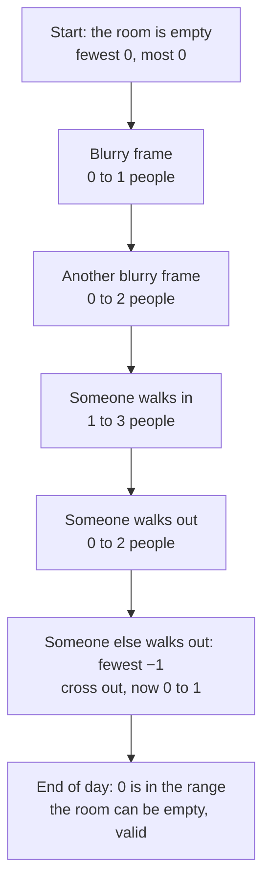
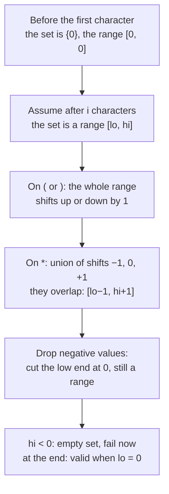

> [!tldr] Quick read
> - Each `*` has three readings: `)`, empty, or `(`. Brute force tries all 3^k combinations; with 12 stars that is already 531,441 readings.
> - A DP memoized on the pair (position, number of open brackets) has only O(n²) states: 5,050 at worst for n = 100.
> - After each character, the set of possible open counts is always a **contiguous range**, so its two endpoints `[lo, hi]` are enough. This is the [[en/concepts/open-count-range|open count range]]: `(` adds to both, `)` subtracts from both, `*` subtracts from `lo` and adds to `hi`.
> - If `hi < 0`, fail right away; if `lo < 0`, clamp it to 0, because that only drops readings with a negative open count. At the end, the string is valid when `lo = 0`. One pass, O(n) time, O(1) space.
> - The two-stack-of-indices approach is also O(n): `)` takes a `(` first and only then a `*`; at the end, each leftover `(` needs a `*` that comes **after** it.

> [!info] Context
> This is LeetCode problem 678 at [[en/posts/2026-11-28-neetcode-greedy-grouping|station MISC-04: Greedy Grouping]] on **the NeetCode Line: Mixed Techniques**. The version without `*` is [[en/problems/valid-parentheses|Valid Parentheses]]: there, with a single bracket type, one counter is enough. Here the counter "blurs" into a range. You only need loops and strings; reading Valid Parentheses first makes this one easier to follow.

> [!abstract]- Quick glossary for this post (click to open)
> - Wildcard: here it is `*`, and I get to choose whether it plays `(`, `)` or nothing at all.
> - Open count (`open`): the number of `(` seen so far that no `)` has closed yet. A string with one bracket type is valid when `open` never goes negative and ends at 0 ([[en/concepts/bracket-matching|bracket matching]]).
> - [[en/concepts/dp-state|DP state]]: the numbers that describe "where we are" well enough that the rest doesn't need the past. In this problem it is (position i, open count).
> - [[en/concepts/memoization|Memoization]]: store the answer for each state once computed, so the next lookup returns right away.
> - [[en/concepts/stack|Stack]]: last in, first out; here I store the **indices** of characters, not the characters.
> - [[en/concepts/greedy-choice|Greedy choice]]: commit to a local decision right away and prove it never loses the answer.

## Picture it first: the doorkeeper of a meeting room

I keep the door of a meeting room and log it from a camera. Each frame is one character: `(` is a person walking **in**, `)` is a person walking **out**. Some frames are blurry (`*`): it could be someone coming in, someone leaving, or just someone passing in the hallway. At the end of the day I have to answer: is there a way to read the blurry frames so the log makes sense, meaning the room never holds a negative number of people and is empty at the end?

I don't keep a separate log for every reading. I write down just two numbers: the **fewest** and the **most** people the room could hold. On a blurry frame the fewest goes down by one (assume someone left) and the most goes up by one (assume someone came in). If the fewest drops to −1, I cross it out and write 0: no reading may have −1 people. If the most goes negative, then even reading every blurry frame as "in" leaves someone walking out of an empty room: the log is wrong.

| Everyday life | Concept |
|---|---|
| Someone walks in | `(`: `lo++`, `hi++` |
| Someone walks out | `)`: `lo--`, `hi--` |
| A blurry camera frame | `*`: `lo--`, `hi++` |
| The fewest / most people in the room | `lo` / `hi` |
| There can't be −1 people, cross it out and write 0 | clamp `lo` to 0 |
| Even guessing "in" every time, someone leaves an empty room | `hi < 0`: fail right away |
| The room can be empty at the end | `lo = 0` |

For the string `**())`:



## The problem: can the stars rescue the brackets

You get a string `s` made only of the three characters `(`, `)` and `*`, with length from 1 to 100. Each `*` can be replaced by `(`, `)` or deleted, independently of the others. Return `true` if at least one replacement turns `s` into a correct bracket string: every `(` has a `)` after it that closes it, and no `)` lacks a `(` before it. My own examples: `(()*` is valid (read `*` as `)`), `*(` is not (no `*` comes after the `(` to close it), `**())` is valid. [Original problem: LeetCode 678](https://leetcode.com/problems/valid-parenthesis-string/)

At first I thought counting was enough: if the number of `(` minus the number of `)` can be made up with the stars, done. `*(` breaks that right away: one `(`, one `*`, the counts balance exactly, but the `*` comes first, so it can't close the `(`. Like [[en/problems/valid-parentheses|Valid Parentheses]], this problem is about **order**, not just counts.

## How it works

### Brute force: try all 3^k readings

Go left to right, branch three ways at each `*`, and at the end of the string you have an ordinary bracket string to check with a counter as in Valid Parentheses. With k stars there are 3^k strings, each checked in O(n): O(3^k · n) time in total, O(n) space for the recursion and the buffer. This is [[en/concepts/backtracking|backtracking]] with no pruning. At the limit, n = 100 and all stars, 3^100 is about 5·10⁴⁷ readings (computed, not measured). I keep it only as a referee for short strings; in the runnable file, brute force never exits early, so it counts all 3^k.

### DP memoized on (position, open count)

Looking back at brute force: two different readings of the prefix `s[0..i)` that leave the same open count look exactly the same to the rest `s[i..]`. So the [[en/concepts/dp-state|state]] only needs to be (i, open):

- `open < 0`: invalid, because some prefix closes more than it opens.
- `i = n`: valid when `open = 0`.
- `s[i] = (`: f(i + 1, open + 1). `s[i] = )`: f(i + 1, open − 1).
- `s[i] = *`: f(i + 1, open − 1) **or** f(i + 1, open) **or** f(i + 1, open + 1).

`open` never exceeds i, so there are at most about n²/2 states, each O(1): O(n²) time and space. [[en/concepts/memoization|Memoization]] turns the 3^k-branch tree into a table.

### The range [lo, hi]: why two numbers are enough

DP still stores each value of `open` separately. The question I asked myself: at each position, what does the **set** of reachable `open` values look like? It turns out it is always a contiguous range, with no gaps. Proof by induction:



The three small points in the figure:

- Shifting a contiguous range up or down by 1 keeps it contiguous.
- For `*`, the three shifts `[lo−1, hi−1]`, `[lo, hi]`, `[lo+1, hi+1]` overlap one step at a time, so their union is exactly `[lo−1, hi+1]`, with no value missing.
- Negative values are dead readings (some prefix closed too many). Dropping them cuts the range at 0: `[max(lo, 0), hi]`. That is the line `if (lo < 0) lo = 0`. Clamping `lo` is **safe** because it invents no reading: 0 is already in the set (a range `[lo, hi]` with `lo < 0 ≤ hi` contains 0), and I only cross out invalid values.

If `hi < 0`, the whole range is below 0, the set is empty, and no reading survives: return `false` right away. At the end, the string is valid when 0 is in the set, and since `lo ≥ 0` after clamping, the condition is `lo = 0`. One pass, two variables: O(n) time, O(1) space. This is a [[en/concepts/greedy-choice|greedy choice]] in the sense of "keep only what you need": it never goes back to reconsider an old reading.

Tracing `**())`:

| Character | `lo` before clamping | `lo` | `hi` | Possible open counts |
|---|---|---|---|---|
| `*` | −1 | 0 | 1 | {0, 1} |
| `*` | −1 | 0 | 2 | {0, 1, 2} |
| `(` | 1 | 1 | 3 | {1, 2, 3} |
| `)` | 0 | 0 | 2 | {0, 1, 2} |
| `)` | −1 | 0 | 1 | {0, 1} |

At the end `lo = 0`: valid. One concrete reading is `(())`, with the first `*` as `(` and the second as empty.

### Two stacks of indices

This approach keeps *positions*, which is closer to [[en/concepts/bracket-matching|bracket matching]]. One stack `opens` stores the indices of `(`, another stack `stars` stores the indices of `*`:

| Step | What to do | Why |
|---|---|---|
| on `(` or `*` | push its index onto the matching stack | save it, decide later |
| on `)` | take a `(` if there is one, else a `*`, else fail | a `(` has only one job, waiting to be closed; a `*` is more flexible, so save it |
| end of string | pop both tops in turn; a `(` after its `*` means fail | a `*` can only close a `(` that comes before it |
| finally | valid when `opens` is empty | leftover stars count as empty |

One thing I doubted: when `)` has to take a `*`, could taking the newest `*` lose a star needed later? No: `opens` being empty means every `(` so far has been closed, so the `(` left over at the end all come **after** this `)`, that is, after every `*` currently on the stack. Those stars are useless to them, so taking any of them is the same. In the final step, pairing the latest `(` with the latest `*` is the best choice: the latest `*` is the one most likely to come after some `(`. O(n) time, O(n) space.

| Approach | Time | Auxiliary space | Notes |
|---|---|---|---|
| Brute force over 3^k readings | O(3^k · n) | O(n) | Referee for short strings |
| DP memoized on (i, open) | O(n²) | O(n²) | At most about n²/2 states |
| Two stacks of indices | O(n) | O(n) | Keeps positions, pairs `(` with a later `*` |
| Range `[lo, hi]` | O(n) | O(1) | Main approach |

### Measuring: brute force, DP and the range [lo, hi]

So that DP can't exit early, I built the worst string at the limit n = 100: 99 stars and then a `(`. The answer is `false` (nothing closes the final `(`), so DP has to visit every pair (i, open) with 0 ≤ open ≤ i: 1 + 2 + … + 100 = 5,050 states. The range `[lo, hi]` takes exactly 100 steps. Brute force runs on a small string of the same shape, 12 stars and then a `(`: 3^12 = 531,441 readings. Each language measured once on my machine:

| Language | Brute force, n = 13 | DP, n = 100 | `[lo, hi]`, n = 100 |
|---|---|---|---|
| TypeScript (Node) | 15.6 ms | 0.12 ms | 0.001 ms |
| Python | 170.5 ms | 2.06 ms | 0.007 ms |
| Go | 6.2 ms | 0.09 ms | under 0.001 ms |
| Java | 20.1 ms | 0.06 ms | under 0.001 ms |
| JavaScript (Node) | 13.8 ms | 0.11 ms | 0.001 ms |
| PHP | 115.7 ms | 0.98 ms | 0.003 ms |
| Rust | 4.0 ms | 0.06 ms | under 0.001 ms |

At the problem's limit, even DP takes only a few thousandths of a second: n = 100 is too small for O(n²) to matter. The real difference is in steps (5,050 versus 100) and memory (a table of (n + 1)(n + 2) cells versus two variables). Brute force is another story: each extra `*` triples the time, so at 13 characters it is already about 70 to 330 times slower than DP at 100 characters, depending on the language.

## Runnable example

[TypeScript](../code/neetcode-valid-parenthesis-string/wildcard.ts) · [Python](../code/neetcode-valid-parenthesis-string/wildcard.py) · [Go](../code/neetcode-valid-parenthesis-string/wildcard.go) · [Java](../code/neetcode-valid-parenthesis-string/wildcard.java) · [JavaScript](../code/neetcode-valid-parenthesis-string/wildcard.js) · [PHP](../code/neetcode-valid-parenthesis-string/wildcard.php) · [Rust](../code/neetcode-valid-parenthesis-string/wildcard.rs)

```ts
// Main approach: keep the range [lo, hi] of possible open-bracket counts
function checkValidString(s: string, counter = { steps: 0 }): boolean {
    let lo = 0 // fewest open brackets possible
    let hi = 0 // most open brackets possible
    for (const c of s) {
        counter.steps++
        if (c === '(') {
            lo++
            hi++
        } else if (c === ')') {
            lo--
            hi--
        } else {
            lo-- // "*" as ")"
            hi++ // "*" as "("
        }
        if (hi < 0) return false // even reading every "*" as "(" closes too many
        if (lo < 0) lo = 0 // drop the readings that make the open count negative
    }
    return lo === 0 // 0 is in the range: some reading closes everything
}
```

```python
# Main approach: keep the range [lo, hi] of possible open-bracket counts
def check_valid_string(s, counter=None):
    lo = 0  # fewest open brackets possible
    hi = 0  # most open brackets possible
    for c in s:
        if counter is not None:
            counter["steps"] += 1
        if c == "(":
            lo += 1
            hi += 1
        elif c == ")":
            lo -= 1
            hi -= 1
        else:
            lo -= 1  # "*" as ")"
            hi += 1  # "*" as "("
        if hi < 0:
            return False  # even reading every "*" as "(" closes too many
        if lo < 0:
            lo = 0  # drop the readings that make the open count negative
    return lo == 0  # 0 is in the range: some reading closes everything
```

```go
// Main approach: keep the range [lo, hi] of possible open-bracket counts
func checkValidString(s string, steps *int64) bool {
	lo := 0 // fewest open brackets possible
	hi := 0 // most open brackets possible
	for i := 0; i < len(s); i++ {
		*steps++
		switch s[i] {
		case '(':
			lo++
			hi++
		case ')':
			lo--
			hi--
		default:
			lo-- // "*" as ")"
			hi++ // "*" as "("
		}
		if hi < 0 {
			return false // even reading every "*" as "(" closes too many
		}
		if lo < 0 {
			lo = 0 // drop the readings that make the open count negative
		}
	}
	return lo == 0 // 0 is in the range: some reading closes everything
}
```

```java
// Main approach: keep the range [lo, hi] of possible open-bracket counts
static boolean checkValidString(String s) {
    int lo = 0; // fewest open brackets possible
    int hi = 0; // most open brackets possible
    for (int i = 0; i < s.length(); i++) {
        char c = s.charAt(i);
        steps++;
        if (c == '(') {
            lo++;
            hi++;
        } else if (c == ')') {
            lo--;
            hi--;
        } else {
            lo--; // "*" as ")"
            hi++; // "*" as "("
        }
        if (hi < 0) return false; // even reading every "*" as "(" closes too many
        if (lo < 0) lo = 0; // drop the readings that make the open count negative
    }
    return lo == 0; // 0 is in the range: some reading closes everything
}
```

```js
// Main approach: keep the range [lo, hi] of possible open-bracket counts
function checkValidString(s, counter = { steps: 0 }) {
    let lo = 0 // fewest open brackets possible
    let hi = 0 // most open brackets possible
    for (const c of s) {
        counter.steps++
        if (c === '(') {
            lo++
            hi++
        } else if (c === ')') {
            lo--
            hi--
        } else {
            lo-- // "*" as ")"
            hi++ // "*" as "("
        }
        if (hi < 0) return false // even reading every "*" as "(" closes too many
        if (lo < 0) lo = 0 // drop the readings that make the open count negative
    }
    return lo === 0 // 0 is in the range: some reading closes everything
}
```

```php
// Main approach: keep the range [lo, hi] of possible open-bracket counts
function checkValidString(string $s): bool {
    global $steps;
    $lo = 0; // fewest open brackets possible
    $hi = 0; // most open brackets possible
    $n = strlen($s);
    for ($i = 0; $i < $n; $i++) {
        $c = $s[$i];
        $steps++;
        if ($c === '(') {
            $lo++;
            $hi++;
        } elseif ($c === ')') {
            $lo--;
            $hi--;
        } else {
            $lo--; // "*" as ")"
            $hi++; // "*" as "("
        }
        if ($hi < 0) return false; // even reading every "*" as "(" closes too many
        if ($lo < 0) $lo = 0; // drop the readings that make the open count negative
    }
    return $lo === 0; // 0 is in the range: some reading closes everything
}
```

```rust
// Main approach: keep the range [lo, hi] of possible open-bracket counts
fn check_valid_string(s: &[u8], steps: &mut u64) -> bool {
    let mut lo: i32 = 0; // fewest open brackets possible
    let mut hi: i32 = 0; // most open brackets possible
    for &c in s {
        *steps += 1;
        match c {
            b'(' => {
                lo += 1;
                hi += 1;
            }
            b')' => {
                lo -= 1;
                hi -= 1;
            }
            _ => {
                lo -= 1; // "*" as ")"
                hi += 1; // "*" as "("
            }
        }
        if hi < 0 {
            return false; // even reading every "*" as "(" closes too many
        }
        if lo < 0 {
            lo = 0; // drop the readings that make the open count negative
        }
    }
    lo == 0 // 0 is in the range: some reading closes everything
}
```

The tabs show the main approach, the range `[lo, hi]`; the line that increments `steps` is only there to count for the measurement. The downloadable file also has brute force, the memoized DP, the two stacks of indices and a wrong version that doesn't clamp `lo`. The ten hand-built cases are `*` on its own, `)` on its own, `*(`, `(*`, `((*`, `(()*`, `*)(*`, `(*)*)(`, `**())` and `((**)`; for each case, all four approaches must give the expected answer.

The second line cross-checks **every** string of length 1 to 8 over the three characters: 3 + 9 + … + 3⁸ = 9,840 strings. A string counts as passing when DP, the two stacks and `[lo, hi]` all return the same result as brute force. The third line runs the wrong version on the same 9,840 strings. The last two lines are the measurement above (these are the TypeScript numbers).

```text
10/10 cases passed
9840/9840 cases passed (cross-checked against brute force)
No clamping of lo: wrong on 1663/9840 cases
n = 100, answer false/false: DP 5050 states (0.12 ms), range [lo, hi] 100 steps (0.001 ms)
n = 13, answer false: brute force 531441 readings (15.6 ms)
```

*(Output labels translated; the files themselves print Vietnamese.)*

All seven languages print the same first three lines and the same numbers of states, steps and readings on the last two; only the times differ, as in the table under How it works. Go, Java and Rust print `0.000 ms` for `[lo, hi]`, meaning under 0.001 ms.

## Misconceptions and common traps

- Counting only: "if the stars can make up the difference between `(` and `)`, it's fine". `*(` has matching counts and is still invalid, because the `*` comes before the `(`.
- Not clamping `lo`, then checking `lo == 0` at the end. With `(**`, `lo` goes 1, 0, −1 and the function returns `false`, while `(*` plus an empty `*` is `()`. A negative `lo` means the "fewest" reading died long ago; you have to clamp at every step, not only at the end.
- Not clamping `lo`, then "fixing" it with `lo <= 0`. It looks reasonable, but `lo` then allows a negative open count **in the middle** of the string. `*(` makes `lo` go −1, 0 and the function returns `true`. The third output line above shows this version is wrong on 1,663/9,840 strings.
- Checking `hi < 0` only at the end instead of at every step. `)*` makes `hi` go −1, 0 and `lo` gets clamped to 0 twice, so an end-only check returns `true`, even though the first `)` has nothing to close.
- Two stacks: letting `)` take a `*` before a `(`. With `((*)`, the `)` takes the `*`, both `(` are left with no `*` after them, and the function returns `false`; the right answer is `true` (read `*` as `)` to get `(())`).
- Two stacks: forgetting to compare indices in the final step and only comparing the two stack sizes. That is the "counting only" mistake again.
- TypeScript, JavaScript: `s[i]` is a one-character string, and comparing it to `'('` with `===` is correct. But memoizing with an object keyed by `` `${i},${open}` `` builds a new string on every lookup; the file uses an `Int8Array` keyed by `i * (n + 2) + open`.
- Python: naming a variable `open` shadows the built-in `open()`; the file uses `open_`. The recursive DP goes at most n = 100 levels deep, below Python's default recursion limit of 1,000.
- Go: `for _, c := range s` yields a `rune`, while `s[i]` yields a `byte`. The string is ASCII only, so both work, but don't mix the two types in one comparison.
- Java: `ArrayDeque<Integer>` stores boxed numbers. `opens.pop() > stars.pop()` unboxes automatically, so it is correct, but writing `==` between two `Integer` values compares references, which is only "accidentally" right for values in −128..127 thanks to the `Integer` cache.
- PHP: `array_pop` on an empty array returns `null` instead of raising an error, so forgetting to check for an empty array before popping silently keeps going. The file checks `if ($opens)` first.
- Rust: declaring `lo` as `usize` because "a bracket count is never negative". `lo -= 1` at 0 makes a debug build panic (`attempt to subtract with overflow`), and a `-O` build wraps around to a huge number, so the clamp test `lo < 0` is never true. Use `i32` and clamp.

## Self-check questions

> [!question]- Why is the set of possible open counts always a contiguous range?
> It starts as {0}. `(` and `)` shift the whole range by 1. `*` takes the union of the range shifted by −1, 0 and +1, and those three overlap, so the union stays contiguous. Dropping negative values only cuts the low end at 0. No step creates a gap.

> [!question]- Can clamping `lo` to 0 make the function wrongly return `true`?
> No. Clamping only happens when `lo < 0 ≤ hi` (if `hi < 0`, we have already returned `false`). Then 0 is already in the range; I only cross out the negative values, and add none.

> [!question]- Trace `[lo, hi]` for `(*)*)(`. What is the result?
> `(` → [1, 1]; `*` → [0, 2]; `)` → [−1, 1] clamped to [0, 1]; `*` → [0, 2]; `)` → [0, 1]; `(` → [1, 2]. At the end `lo = 1`, so `false`: nothing comes after the final `(` to close it.

> [!question]- In the two-stack approach, why must `)` take a `(` before a `*`?
> A `(` has only one role, waiting to be closed, while a `*` can be empty or close some other `(` later. Using the `*` first can leave a `(` with no `*` after it, as in `((*)`.

> [!question]- How many states does the DP visit for 99 stars followed by a `(`? Why?
> 5,050. At position i, `open` runs from 0 to i, and the `false` answer forces DP to visit all of them: 1 + 2 + … + 100.

## References

- [LeetCode 678: Valid Parenthesis String](https://leetcode.com/problems/valid-parenthesis-string/)
- [Java SE 21 JLS §5.1.7: Boxing Conversion](https://docs.oracle.com/javase/specs/jls/se21/html/jls-5.html#jls-5.1.7)
- [PHP manual: array_pop](https://www.php.net/manual/en/function.array-pop.php)
