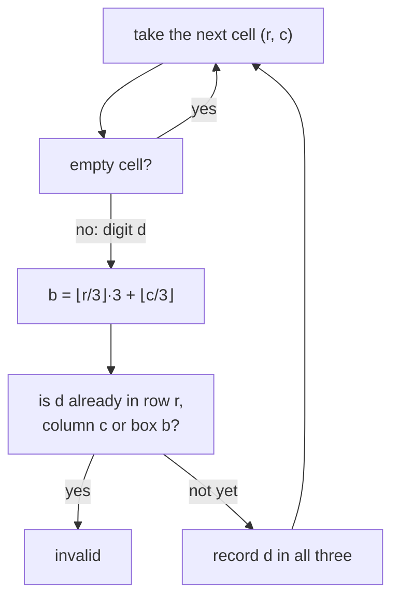

> [!tldr] Quick read
> - The problem: a half-filled 9×9 board, `"."` is an empty cell. Do the **filled** cells break the rules: no repeated digit in any row, column or 3×3 box? You don't have to solve the Sudoku.
> - Each digit at cell (r, c) belongs to three groups: row r, column c and 3×3 box number `⌊r/3⌋·3 + ⌊c/3⌋`. Seeing a digit again in the same group means invalid. This is the "ask first, write later" template of [[en/posts/2026-11-22-neetcode-hash-lookup|station 1]] with three [[en/concepts/canonical-key|keys]].
> - The board is always 9×9, so strictly speaking every approach is O(1). The difference is in the constant: a [[en/concepts/bitmask|bitmask]] (each group is a 9-bit number) beats 27 Sets by about **10 times**.
> - Two traps: writing the box index as `⌊r/3⌋ + ⌊c/3⌋` (the times 3 is missing), and creating 9 Sets with `[set()] * 9` or `Array(9).fill(new Set())`; both make a **valid board** look invalid.

> [!info] Context
> LeetCode problem 36, part of [[en/posts/2026-11-22-neetcode-counting-keys|station 2: Canonical Keys and Counting]] on **the NeetCode line: Arrays and Strings**. The station post uses this problem as its "one element, several keys" example; this page compares three implementations and measures them. The solutions come in TypeScript, Python, Go, Java and JavaScript. All you need to know is loops, two-dimensional arrays and the rules of Sudoku.

> [!abstract]- Quick glossary for this post (click to open)
> - **3×3 box**: the nine 3×3 blocks that split the 9×9 board, numbered 0..8 left to right, top to bottom.
> - **Integer division `⌊x/3⌋`**: drop the remainder. `⌊7/3⌋ = 2`. TypeScript/JS write `Math.floor(x / 3)`, Python `x // 3`, Go and Java `x / 3` on integers.
> - **Set**: a collection that answers "have I seen x?" in O(1) on average. See [[en/concepts/hash-set|Hash Set]].
> - **Bitmask**: using each bit of an integer as a true/false slot. See [[en/concepts/bitmask|Bitmask]].
> - **The operators `|`, `&`, `<<`**: bitwise OR, bitwise AND, shift left. `1 << 4` is `0b10000`, bit 4 set.

## Picture it first: three attendance books

A school has 81 seats in 9 rows × 9 columns, split into 9 sections of 3×3. The rule: within a row, a column or a section, no two students wear the same shirt number. The supervisor walks past every occupied seat and writes the shirt number into **three books**: the row's book, the column's book and the section's book.

| Everyday life | Concept |
|---|---|
| 81 seats; empty seats need no entry | the 9×9 board, `"."` cells skipped |
| Shirt number of the student at seat (r, c) | the digit `board[r][c]` |
| Three books: row r, column c, the seat's section | three Sets `rows[r]`, `cols[c]`, `boxes[b]` |
| Knowing which section seat (r, c) is in without checking a map | the formula `b = ⌊r/3⌋·3 + ⌊c/3⌋` |
| The shirt number is already in one of the three books: report a violation | key seen again → `false` |
| Replace each book with a row of 9 bulbs, switch on bulb k for shirt number k | a 9-bit bitmask |



## The problem

**The problem (in my own words):** given a 9×9 `board` where each cell is a digit `"1"`…`"9"` or `"."`, return `true` if the filled cells break no rule: no repeated digit in the same row, the same column or the same 3×3 box. A valid board need not be solvable; the problem doesn't ask about that. Original: [LeetCode 36](https://leetcode.com/problems/valid-sudoku/).

I used to think you need three separate loops for rows, columns and boxes. Actually one pass over the 81 cells is enough, as long as each cell knows which box it is in.

### The 3×3 box formula

`⌊r/3⌋` tells which horizontal band the cell is in (0, 1, 2); `⌊c/3⌋` gives the vertical band. Number the nine blocks row by row and the block in horizontal band `R`, vertical band `C` gets number `R·3 + C`, just like turning (row, column) into an index of a one-dimensional array.

| r \ c | 0–2 | 3–5 | 6–8 |
|---|---|---|---|
| **0–2** | 0 | 1 | 2 |
| **3–5** | 3 | 4 | 5 |
| **6–8** | 6 | 7 | 8 |

Without the times 3 (`⌊r/3⌋ + ⌊c/3⌋`), block (0, 1) and block (1, 0) both come out as 1. Two equal digits in two different blocks are treated as duplicates, and a **valid** board is reported invalid.

## How it works

### Approach 1, three passes

Pass i takes row i, column i and block i, each checked with a new Set. Block i has its top-left corner at `(⌊i/3⌋·3, (i mod 3)·3)`. Each cell is read three times.

### Approach 2, one pass with 27 Sets

Nine Sets for rows, nine for columns, nine for blocks. Walk the 81 cells once; for each digit, ask the three Sets first, then record it in all three. It is the most natural approach, but it creates 27 Sets per call.

### Approach 3, bitmask

A digit has only 9 values, so each group needs only 9 true/false slots, which fit in one integer. Digit d maps to bit `1 << (d − 1)`. "Is d there yet" is `mask & bit`, "record d" is `mask |= bit`. All three groups are checked at once: `(rows[r] | cols[c] | boxes[b]) & bit`. The whole state is 27 integers, with no extra allocation.

### Measured: the three approaches differ in the constant

The board always has 81 cells, so all three approaches do a fixed amount of work. Checking the example board 100 000 times, median of 5 runs, TypeScript:

| Approach | ms |
|---|---|
| three passes (a new Set per group) | 266.9 |
| one pass, 27 Sets | 320.6 |
| bitmask | 32.9 |

One pass is even slower than three passes: both create 27 Sets, but one pass keeps all 27 alive at once and calls `has`/`add` on three different Sets per cell. The bitmask is about 10 times faster because bit operations need no hashing and no allocation. Big-O cannot tell these three apart here; only measuring shows the difference.

### Under the hood of the five languages

| | Turning a digit into an index 0..8 | Language-specific trap |
|---|---|---|
| TypeScript / JavaScript | `d.charCodeAt(0) - 49` or `Number(d) - 1` | `Array(9).fill(new Set())`: all nine slots point to **one** Set |
| Python | `int(d) - 1` | `[set()] * 9`: all nine elements point to **one** set; `[0] * 9` is safe because ints are immutable |
| Go | `board[r][c] - '1'` (type `byte`) | `&` binds before `!=`, so `x&bit != 0` means what you want |
| Java | `board[r][c] - '1'` (char minus char gives `int`) | `&` binds **after** `!=`: you must write `(x & bit) != 0` |

## Runnable example

[TypeScript](../code/neetcode-valid-sudoku/valid-sudoku.ts) · [Python](../code/neetcode-valid-sudoku/valid_sudoku.py) · [Go](../code/neetcode-valid-sudoku/valid_sudoku.go) · [Java](../code/neetcode-valid-sudoku/valid-sudoku.java) · [JavaScript](../code/neetcode-valid-sudoku/valid-sudoku.js)

Each file has all three approaches and runs 6 test cases. Below are the one-pass and bitmask approaches.

```ts
// Approach 2, one pass with 27 Sets: rows[r], cols[c], boxes[b].
function onePass(board: string[][]): boolean {
  const rows = Array.from({ length: 9 }, () => new Set<string>());
  const cols = Array.from({ length: 9 }, () => new Set<string>());
  const boxes = Array.from({ length: 9 }, () => new Set<string>());
  for (let r = 0; r < 9; r++) {
    for (let c = 0; c < 9; c++) {
      const d = board[r][c];
      if (d === ".") continue;
      const b = Math.floor(r / 3) * 3 + Math.floor(c / 3);
      if (rows[r].has(d) || cols[c].has(d) || boxes[b].has(d)) return false;
      rows[r].add(d); cols[c].add(d); boxes[b].add(d);
    }
  }
  return true;
}

// Approach 3, bitmask: each row/column/3×3 box is a 9-bit integer; bit k set means digit k+1 is already there.
function bitmask(board: string[][]): boolean {
  const rows = new Array(9).fill(0), cols = new Array(9).fill(0), boxes = new Array(9).fill(0);
  for (let r = 0; r < 9; r++) {
    for (let c = 0; c < 9; c++) {
      const d = board[r][c];
      if (d === ".") continue;
      const bit = 1 << (d.charCodeAt(0) - 49); // "1" is code 49 → bit 0
      const b = Math.floor(r / 3) * 3 + Math.floor(c / 3);
      if ((rows[r] | cols[c] | boxes[b]) & bit) return false;
      rows[r] |= bit; cols[c] |= bit; boxes[b] |= bit;
    }
  }
  return true;
}
```

```python
def one_pass(board: list[list[str]]) -> bool:
    rows = [set() for _ in range(9)]
    cols = [set() for _ in range(9)]
    boxes = [set() for _ in range(9)]  # don't write [set()] * 9: all nine elements point to ONE set
    for r in range(9):
        for c in range(9):
            d = board[r][c]
            if d == ".":
                continue
            b = r // 3 * 3 + c // 3
            if d in rows[r] or d in cols[c] or d in boxes[b]:
                return False
            rows[r].add(d)
            cols[c].add(d)
            boxes[b].add(d)
    return True

def bitmask(board: list[list[str]]) -> bool:
    rows, cols, boxes = [0] * 9, [0] * 9, [0] * 9  # ints are immutable, so [0] * 9 has no trap like [set()] * 9
    for r in range(9):
        for c in range(9):
            d = board[r][c]
            if d == ".":
                continue
            bit = 1 << (int(d) - 1)
            b = r // 3 * 3 + c // 3
            if (rows[r] | cols[c] | boxes[b]) & bit:
                return False
            rows[r] |= bit
            cols[c] |= bit
            boxes[b] |= bit
    return True
```

```go
func onePass(board [][]byte) bool {
	var rows, cols, boxes [9][9]bool
	for r := 0; r < 9; r++ {
		for c := 0; c < 9; c++ {
			if board[r][c] == '.' {
				continue
			}
			d, b := board[r][c]-'1', r/3*3+c/3
			if rows[r][d] || cols[c][d] || boxes[b][d] {
				return false
			}
			rows[r][d], cols[c][d], boxes[b][d] = true, true, true
		}
	}
	return true
}

func bitmask(board [][]byte) bool {
	var rows, cols, boxes [9]uint16
	for r := 0; r < 9; r++ {
		for c := 0; c < 9; c++ {
			if board[r][c] == '.' {
				continue
			}
			bit, b := uint16(1)<<(board[r][c]-'1'), r/3*3+c/3
			if (rows[r]|cols[c]|boxes[b])&bit != 0 { // Go: & binds before != so no extra parentheses needed
				return false
			}
			rows[r] |= bit
			cols[c] |= bit
			boxes[b] |= bit
		}
	}
	return true
}
```

```java
static boolean onePass(char[][] board) {
    List<Set<Character>> rows = new ArrayList<>(), cols = new ArrayList<>(), boxes = new ArrayList<>();
    for (int i = 0; i < 9; i++) { rows.add(new HashSet<>()); cols.add(new HashSet<>()); boxes.add(new HashSet<>()); }
    for (int r = 0; r < 9; r++)
        for (int c = 0; c < 9; c++) {
            char d = board[r][c];
            if (d == '.') continue;
            int b = r / 3 * 3 + c / 3;
            // add returns false when already present: check and record in one call
            if (!rows.get(r).add(d) || !cols.get(c).add(d) || !boxes.get(b).add(d)) return false;
        }
    return true;
}

static boolean bitmask(char[][] board) {
    int[] rows = new int[9], cols = new int[9], boxes = new int[9];
    for (int r = 0; r < 9; r++)
        for (int c = 0; c < 9; c++) {
            if (board[r][c] == '.') continue;
            int bit = 1 << (board[r][c] - '1'), b = r / 3 * 3 + c / 3;
            if (((rows[r] | cols[c] | boxes[b]) & bit) != 0) return false; // Java: parentheses required, & binds lower than !=
            rows[r] |= bit; cols[c] |= bit; boxes[b] |= bit;
        }
    return true;
}
```

```js
function onePass(board) {
  // Array(9).fill(new Set()) is a trap: all nine slots point to ONE Set. Use Array.from with a factory.
  const rows = Array.from({ length: 9 }, () => new Set());
  const cols = Array.from({ length: 9 }, () => new Set());
  const boxes = Array.from({ length: 9 }, () => new Set());
  for (let r = 0; r < 9; r++) {
    for (let c = 0; c < 9; c++) {
      const d = board[r][c];
      if (d === ".") continue;
      const b = Math.floor(r / 3) * 3 + Math.floor(c / 3);
      if (rows[r].has(d) || cols[c].has(d) || boxes[b].has(d)) return false;
      rows[r].add(d); cols[c].add(d); boxes[b].add(d);
    }
  }
  return true;
}

function bitmask(board) {
  const rows = new Array(9).fill(0), cols = new Array(9).fill(0), boxes = new Array(9).fill(0);
  for (let r = 0; r < 9; r++) {
    for (let c = 0; c < 9; c++) {
      const d = board[r][c];
      if (d === ".") continue;
      const bit = 1 << (Number(d) - 1);
      const b = Math.floor(r / 3) * 3 + Math.floor(c / 3);
      if ((rows[r] | cols[c] | boxes[b]) & bit) return false;
      rows[r] |= bit; cols[c] |= bit; boxes[b] |= bit;
    }
  }
  return true;
}
```


The TypeScript file also runs the wrong box formula, then measures:

```text
$ node valid-sudoku.ts
threePass      6/6 cases passed
onePass        6/6 cases passed
bitmask        6/6 cases passed
wrongBoxIndex  4/6 cases passed; wrong on: valid example, two 1s in two different boxes

100 000 checks of the example board (ms, median of 5 runs)
threePass    266.9
onePass      320.6
bitmask       32.9
```

*(Output labels translated; the files themselves print Vietnamese.)*

The wrong formula reports the **valid example board** as invalid: it doesn't miss violations, it invents them. The Python file also runs a version that creates its sets with `[set()] * 9`:

```text
$ python3 valid_sudoku.py
three_pass            6/6 cases passed
one_pass              6/6 cases passed
bitmask               6/6 cases passed
one_pass_shared_sets  4/6 cases passed; wrong on: valid example, two 1s in two different boxes
```

The nine "row sets" are really one set, so a 5 in row 0 and a 5 in row 4 count as being in the same row. Go, Java and JavaScript print `6/6 ca đúng` ("6/6 cases passed") for all three approaches.

## Misconceptions and common traps

- **"Valid means solvable."** The problem only asks whether the filled cells break a rule. A valid board can still have no solution.
- **The box formula without the times 3.** `⌊r/3⌋ + ⌊c/3⌋` produces only 5 values 0..4, so nine blocks get squeezed into five groups.
- **Creating several Sets by multiplication or `fill`.** `[set()] * 9` and `Array(9).fill(new Set())` repeat the **same** object nine times. Use a list comprehension or `Array.from({ length: 9 }, () => new Set())`.
- **Java: `x & bit != 0` doesn't compile.** `!=` is evaluated first, giving `x & true`. The parentheses are required.
- **"It's O(1), so every approach is the same."** All O(1), but the bitmask is 10 times faster in the measurement above. The constant only matters when the function is called very often, as in a Sudoku solver trying millions of boards.

## Self-check questions

> [!question]- Which 3×3 box is cell (4, 7) in?
> `⌊4/3⌋·3 + ⌊7/3⌋ = 1·3 + 2 = 5`: the middle block on the right.

> [!question]- Why is `[0] * 9` safe in Python while `[set()] * 9` is not?
> Both repeat the same object nine times. `rows[r] |= bit` on an int creates a **new** int and assigns it back to slot r, so the slots stay separate. `rows[r].add(d)` modifies **that very** set, and all nine slots see the change.

> [!question]- With a bitmask, how do you check three groups with a single comparison?
> OR the three masks together, then AND with the digit's bit: `(rows[r] | cols[c] | boxes[b]) & bit`. Non-zero means the digit is already in at least one group.

> [!question]- If the board were 16×16 (digits 1..16, 4×4 blocks), what would change?
> The block formula becomes `⌊r/4⌋·4 + ⌊c/4⌋`, and the mask needs 16 bits (still fits in one integer). Everything else stays the same.

## References

- [LeetCode 36: Valid Sudoku](https://leetcode.com/problems/valid-sudoku/) (the original problem)
- [Python FAQ: How do I create a multidimensional list?](https://docs.python.org/3/faq/programming.html#how-do-i-create-a-multidimensional-list) (why `[x] * n` repeats the same object)
- [MDN: `Array.prototype.fill`](https://developer.mozilla.org/en-US/docs/Web/JavaScript/Reference/Global_Objects/Array/fill) (filling with an object makes every slot share the reference)
- [Java tutorial: Operators](https://docs.oracle.com/javase/tutorial/java/nutsandbolts/operators.html) (precedence table: `==`/`!=` before `&`)
- [Go spec: Operator precedence](https://go.dev/ref/spec#Operator_precedence) (`&` sits at the level of `*`, before `==`/`!=`)
