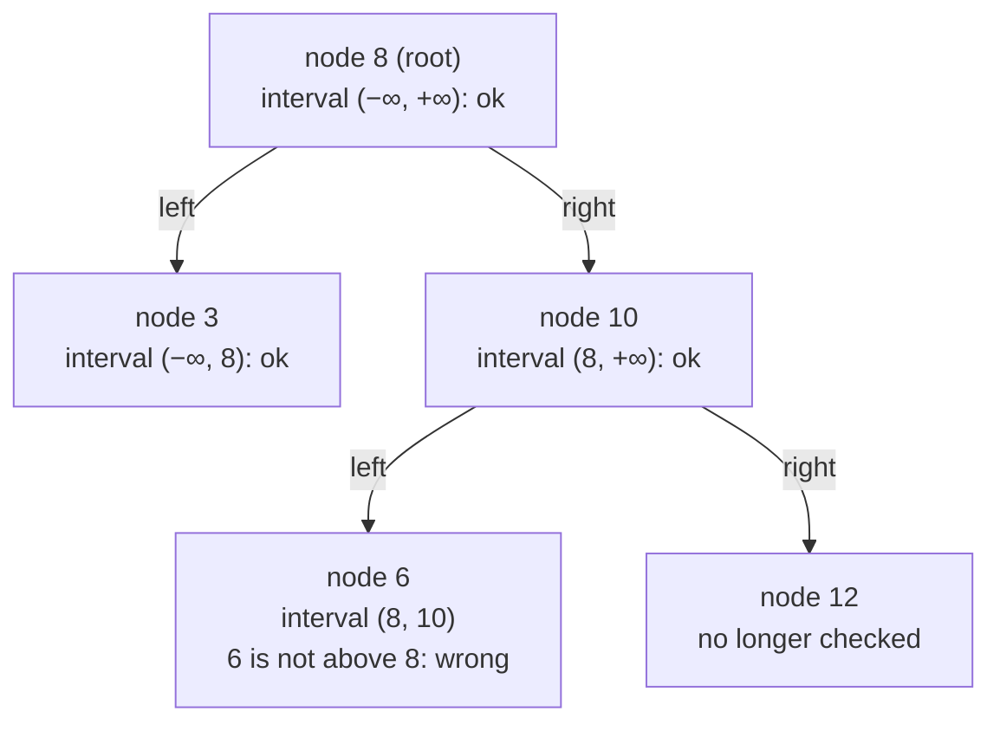
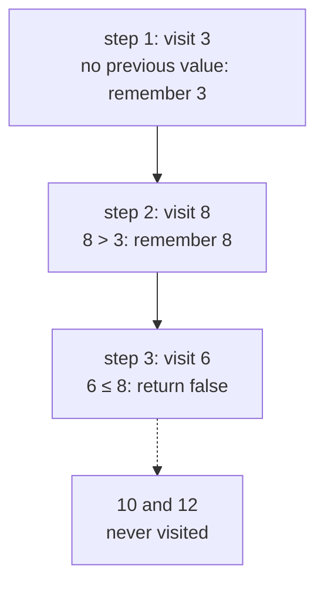

> [!tldr] Quick read
> - The problem: given the root of a binary tree, return `true` if it is a **binary search tree**: at every node, **every** value in the left subtree is strictly smaller than the node and **every** value in the right subtree is strictly larger. Duplicate values are invalid.
> - Comparing a node only with its two direct children is **wrong**: the tree `[8, 3, 10, null, null, 6, 12]` passes every parent-child comparison, yet 6 sits to the right of 8 while being smaller than 8.
> - The first O(n) approach: [[en/concepts/bounds-propagation|pass an open interval]] (lo, hi) down from the root. Going left, the upper bound becomes the node's value; going right, the lower bound does. The second: an [[en/concepts/in-order-traversal|in-order traversal]] must produce a **strictly increasing** sequence.
> - Values span the whole 32-bit range, so using `INT_MIN`/`INT_MAX` as "infinity" breaks on exactly the edge cases: Java and Go with `int` bounds fail 3/13 cases. Use `null`, `long` or `-Infinity`.
> - The problem allows up to 10⁴ nodes. A 10⁴-node skewed chain makes the recursive Python versions throw `RecursionError`, makes the recursive Java versions throw `StackOverflowError` before the JIT has compiled them, and Node survives only 7,959 to 10,428 levels depending on the run. The iterative versions are fine.

> [!info] Context
> LeetCode problem 98 (Medium), on [[en/posts/2026-11-25-neetcode-binary-search-tree|station 4: Binary Search Trees]] of **the NeetCode Line: Linked Structures**. The previous station, [[en/posts/2026-11-25-neetcode-tree-recursion|Tree Recursion]], teaches recursive functions that return results **bottom-up**; this problem goes the other way: information (the allowed interval) flows **top-down**. The other two problems on the station, [[en/problems/lowest-common-ancestor-of-a-binary-search-tree|Lowest Common Ancestor of a BST]] and [[en/problems/kth-smallest-element-in-a-bst|Kth Smallest Element in a BST]], both **assume** the tree is already a search tree; this problem is the test of that assumption. Solutions come in TypeScript, Python, Go, Java and JavaScript. You need to know what recursion is; search trees are explained right below.

> [!abstract]- Quick glossary for this post (click to open)
> - **Binary tree**: every node has at most two children, left and right. See [[en/concepts/binary-tree|Binary Tree]].
> - **Binary search tree (BST)**: a binary tree where at every node the whole left subtree is smaller than the node and the whole right subtree is larger. See [[en/concepts/binary-search-tree|Binary Search Tree]].
> - **Ancestors**: the parent, the parent's parent, … up to the root. **Grandchild** (on this page): a child of a child.
> - **Open interval (lo, hi)**: every number x with lo < x < hi, excluding both ends. See [[en/concepts/bounds-propagation|Bounds Propagation]].
> - **In-order**: visit the left subtree, then the node, then the right subtree. On a search tree it yields the values in increasing order. See [[en/concepts/in-order-traversal|In-order Traversal]].
> - **Sentinel value**: a value set up in advance to play the role of "none yet" or "infinity". See [[en/concepts/sentinel-value|Sentinel Value]].
> - **INT_MIN, INT_MAX**: the smallest and largest 32-bit integers, −2,147,483,648 and 2,147,483,647.
> - **Right chain**: every node has only a right child, so the tree is exactly as deep as it has nodes. The recursion depth limit: see [[en/concepts/recursion-depth-limit|Recursion Depth Limit]].
> - **Morris**: an in-order traversal with no stack, which temporarily rewires pointers in the tree and then restores them. Explained under How it works.

## Picture it first: a neighborhood with a signpost at every fork

A neighborhood grows like a tree: from the gate, every fork has a sign "house numbers below 8: turn left; above 8: turn right". Further on you reach another fork with its own sign. The inspector wants to know whether the neighborhood is numbered correctly, meaning every house sits on the side that **every** sign on the way to it promised.

- **The lazy check:** at each fork, look only at the two houses right next to it. House 6 sits behind the sign "turn right if above 8" and then the sign "turn left if below 10". The lazy inspector compares 6 only with the nearest sign, 10, finds it fine, and ignores the promise of sign 8.
- **Carrying a slip of paper:** the inspector carries a slip that says "the house number must be between … and …". At each sign they update one of the two ends. At house 6 the slip says "between 8 and 10": wrong right away.
- **A walk from left to right:** walk the whole neighborhood in the order "every house on the left, then the fork, then every house on the right". In a correct neighborhood the numbers you meet keep increasing and never repeat.

| Everyday life | Concept |
|---|---|
| The sign at a fork | a node, its value |
| The promises of every sign along the way | the search-tree property applies to the whole subtree |
| Comparing only with the nearest sign | misreading: comparing parent and child |
| The slip "between … and …" | the open interval (lo, hi) passed down |
| A slip with neither end written yet | a `null` bound, or ±∞ |
| Pre-writing "between −2,147,483,648 and …" | the INT_MIN sentinel, which breaks when a house carries exactly that number |
| A left-to-right walk with rising numbers | in-order traversal, a strictly increasing sequence |
| Two houses with the same number | a duplicate value: invalid |

The tree below is the "right grandchild smaller than grandparent" case from the test files. Each box shows the interval the node receives from its parent:



## The problem

The input is the root of a binary tree with 1 to 10⁴ nodes, each value any 32-bit integer, that is, in [−2³¹, 2³¹ − 1]. Return whether the tree is a binary search tree in the **strict** sense: every value in a node's left subtree is strictly smaller than the node, every value in its right subtree is strictly larger, and both subtrees are search trees too. Original problem: [LeetCode 98](https://leetcode.com/problems/validate-binary-search-tree/).

I used to think "search tree" meant "the left child is smaller than the parent, the right child is larger", and wrote exactly those three lines. The problem says "every node in the subtree", not "the child". That difference is the whole problem.

## How it works

<figure class="figure-map" style="--ar: 3 / 4">
<div class="frame"><iframe data-archify="../../diagrams/neetcode-validate-binary-search-tree/worked-example.en.html" title="Each node inherits all ancestor bounds" loading="lazy"></iframe></div>
<figcaption><span><b>Figure 1.</b> Each node inherits all ancestor bounds.</span><a href="../diagrams/neetcode-validate-binary-search-tree/worked-example.en.html" target="_blank" rel="noopener">Open full screen</a></figcaption>
</figure>

<details>
<summary>Read the steps</summary>
<ol>
<li>Root 10 bounds its left subtree. <code>left range = (-∞, 10)</code></li>
<li>Node 5 adds a lower bound for its right child. <code>right range = (5, 10)</code></li>
<li>The right child of 5 has value 12. <code>12 &gt; 10</code></li>
<li>Node 12 violates the root&#x27;s bound. <code>false</code></li>
</ol>
</details>

### The wrong way: comparing parent and child

```ts
// Wrong 1: compare a node only with its two direct children.
function wrongParentChild(root: TreeNode | null): boolean {
  if (root === null) return true;
  if (root.left !== null && root.left.val >= root.val) return false;
  if (root.right !== null && root.right.val <= root.val) return false;
  return wrongParentChild(root.left) && wrongParentChild(root.right);
}
```

It accepts the tree `[8, 3, 10, null, null, 6, 12]` from the figure above: 3 < 8 < 10 holds, 6 < 10 < 12 holds. But 6 is in the right subtree of 8. This approach only catches errors between two adjacent levels; an error between grandparent and grandchild (or further apart) slips through. In the TypeScript file it is wrong on 70 of 5,000 small random trees, and also on the 10⁴-node chain whose bottom node holds 0: 0 is smaller than its direct parent, but it sits to the right of every node above.

### Approach 1: brute-force max and min of every subtree

Written straight from the definition: at each node, the largest value of the left subtree must be smaller than the node, and the smallest value of the right subtree must be larger.

```ts
// Approach 1: brute force. At every node: max of left subtree < node < min of right subtree. O(n·h), O(n²) on a skewed chain.
function bruteMaxMin(root: TreeNode | null): boolean {
  if (root === null) return true;
  const stack: TreeNode[] = [root];
  while (stack.length > 0) {
    const node = stack.pop()!;
    if (node.left !== null) {
      if (scan(node.left)[1] >= node.val) return false;
      stack.push(node.left);
    }
    if (node.right !== null) {
      if (scan(node.right)[0] <= node.val) return false;
      stack.push(node.right);
    }
  }
  return true;
}
```

`scan` walks a whole subtree to get its min and max. Each node is scanned again once for each of its ancestors, so the total is O(n · h), with h the height: O(n log n) on a balanced tree, O(n²) on a skewed chain. A 10⁴-node right chain (a valid tree, so no early exit) takes 49,995,000 visits, exactly n(n − 1)/2. I wrote the outer loop with a stack too, so the measurement measures only time and does not run into the recursion limit.

### Approach 2: passing bounds down

Turn the question around: instead of asking "what values does my subtree hold", each node asks "what interval do my ancestors allow me". The root may hold anything. Going left from node v, everything below must be smaller than v, so the upper bound becomes v; going right, the lower bound becomes v. The other bound stays as it is, and that is where the grandparent's promise is carried down to the grandchild.

```ts
// Approach 2: pass the open interval (lo, hi) down. null means no bound yet, so no sentinel is needed.
function validBounds(root: TreeNode | null): boolean {
  const go = (node: TreeNode | null, lo: number | null, hi: number | null): boolean => {
    if (node === null) return true;
    if ((lo !== null && node.val <= lo) || (hi !== null && node.val >= hi)) return false;
    return go(node.left, lo, node.val) && go(node.right, node.val, hi);
  };
  return go(root, null, null);
}
```

Each node is checked once: O(n) time, O(h) memory for the call stack. Why is **one** interval enough, rather than remembering every sign along the way? Because every promise has the form "above a" or "below b", and their intersection is always an interval: only the largest lower bound and the smallest upper bound matter. At each turn, the new node's value always lies inside the old interval (otherwise we would already have returned `false`), so replacing one end with it can only narrow the interval.

**A sentinel for "infinity".** The easiest part to get wrong is the value for the "no bound yet" end. The problem's values span the whole 32-bit range, so no `int` lies outside the range to act as infinity:

| Language | Broken choice | Correct choice |
|---|---|---|
| Java | `int lo = Integer.MIN_VALUE`: a node holding exactly INT_MIN is rejected, 3/13 cases wrong | `long` bounds with `Long.MIN_VALUE`, or a nullable `Integer` |
| Go | `math.MinInt32`, `math.MaxInt32`: 3/13 wrong, like Java | a `*int` pointer with `nil`; or `math.MinInt`, since Go's `int` is 64 bits |
| Python | `-2**31` | `float("-inf")`, which compares with any `int` |
| TypeScript / JavaScript | `-2147483648` | `-Infinity`, `Infinity`, or `null` |

A variant of the same trap lives in approach 3: initializing the "previous value" variable to INT_MIN.

### Approach 3: in-order traversal, the sequence must strictly increase

A second property of a search tree: visiting left, node, right yields the values in increasing order. The converse also holds: if the in-order sequence strictly increases, the tree is a search tree (every node of the left subtree comes before the node in the sequence, every node of the right subtree comes after). So it is enough to remember the value just visited and compare it with the next one, without storing the whole sequence.

On the tree at the top of the page, the in-order sequence is 3, 8, 6, 10, 12 and the check stops at step 3:



The iterative version uses an explicit [[en/concepts/stack|stack]]: go left as far as possible pushing each node, pop the top node and visit it, then move to its right subtree.

```ts
// Approach 3b: iterative in-order: go all the way left, pop, move right.
function validInorderIterative(root: TreeNode | null): boolean {
  const stack: TreeNode[] = [];
  let cur = root;
  let prev: number | null = null;
  while (cur !== null || stack.length > 0) {
    while (cur !== null) { stack.push(cur); cur = cur.left; }
    cur = stack.pop()!;
    if (prev !== null && cur.val <= prev) return false;
    prev = cur.val;
    cur = cur.right;
  }
  return true;
}
```

`prev = null` means "no node visited yet". If you initialize `prev = INT_MIN` to skip the `null` check, a one-node tree holding INT_MIN is rejected because INT_MIN ≤ INT_MIN (the function `wrongPrevIntMin` fails 2/13 cases). In JavaScript, `-Infinity` does that job because it is smaller than every number.

Compared with approach 2: both are O(n), but in-order stops at the **first adjacent pair** out of order in the sequence, while passing bounds stops at the first node outside its interval in pre-order. On a valid tree, both walk all n nodes.

**Morris: O(1) extra memory.** Both approaches above spend O(h) on a stack. Morris (1979) drops the stack by temporarily borrowing the empty right pointer of the last node in the left subtree (the node just before in in-order) and pointing it back at the current node. The second time it crosses that thread, it removes it.

```ts
// Approach 3c: Morris, O(1) extra memory. Temporarily link the last node of the left subtree back to the current node.
// Even after finding a violation it must keep going to the end to remove every temporary thread.
function validMorris(root: TreeNode | null): boolean {
  let cur = root;
  let prev: number | null = null;
  let ok = true;
  while (cur !== null) {
    if (cur.left === null) {
      if (prev !== null && cur.val <= prev) ok = false;
      prev = cur.val;
      cur = cur.right;
    } else {
      let p = cur.left;
      while (p.right !== null && p.right !== cur) p = p.right;
      if (p.right === null) { p.right = cur; cur = cur.left; }
      else {
        p.right = null;
        if (prev !== null && cur.val <= prev) ok = false;
        prev = cur.val;
        cur = cur.right;
      }
    }
  }
  return ok;
}
```

The price: Morris **modifies the tree while it runs**. Write `return false` right at the violation, as the other two approaches do, and the threads not yet removed stay in the tree. The TypeScript file records every pointer before the run and compares afterwards: `wrongMorrisEarlyReturn` leaves threads behind in 2 of 13 cases. In the tree at the top of the page, node 6 is left with its right pointer aimed back at 10, forming a cycle: any function that walks that tree later runs forever. The correct version must go to the end even after it knows the answer, so it loses the early exit. Morris is also unsafe while another thread is reading the same tree.

| Approach | Time | Extra memory | Note |
|---|---|---|---|
| Parent vs child | O(n) | O(h) | **wrong** |
| Brute-force max/min | O(n·h): O(n log n) balanced, O(n²) skewed chain | O(h) | correct but slow |
| Bounds, recursive | O(n) | O(h) | mind the sentinel |
| Bounds, iterative | O(n) | O(h) | no depth limit |
| In-order, recursive | O(n) | O(h) | mind the first `prev` value |
| In-order, iterative | O(n) | O(h) | no depth limit |
| Morris | O(n) | O(1) | modifies the tree temporarily, no early exit |

### Measurements

TypeScript, Node 24, median of 5 runs. Every tree is valid, so no approach exits early:

| Tree | n | Brute force: visits | Brute force | Bounds (iterative) | In-order (iterative) |
|---|---|---|---|---|---|
| balanced | 10,000 | 113,631 | 0.89 ms | 0.12 ms | 0.05 ms |
| right chain | 1,000 | 499,500 | 2.22 ms | 0.05 ms | 0.00 ms |
| right chain | 2,000 | 1,999,000 | 9.48 ms | 0.01 ms | 0.01 ms |
| right chain | 4,000 | 7,998,000 | 33.8 ms | 0.03 ms | 0.02 ms |
| right chain | 10,000 | 49,995,000 | 215 ms | 0.24 ms | 0.04 ms |

- Right chain: doubling n quadruples the brute force's visits, the n² shape. The two O(n) approaches visit exactly n nodes.
- Balanced tree of 10⁴ nodes: brute force makes 113,631 visits, about 11 times n, the n log n shape.
- The iterative bounds version in TypeScript is slower than the iterative in-order because every node creates a three-element array `[node, lo, hi]` to push on the stack.

Other languages, median of 5 runs (ms); the bounds column is the recursive version:

| | Balanced 10⁴: brute force | bounds | in-order | Morris | Right chain 10⁴: brute force | bounds | in-order | Morris |
|---|---|---|---|---|---|---|---|---|
| Go | 0.59 | 0.049 | 0.042 | 0.051 | 121 | 0.096 | 0.027 | 0.017 |
| Java | 1.27 | 0.021 | 0.148 | 0.087 | 164 | 0.073 | 0.041 | 0.023 |

Python 3.12, median of 5 runs: brute force on a 4,000-node right chain takes 1,390 ms, the iterative bounds version 0.32 ms, the iterative in-order 0.21 ms, Morris 0.12 ms. On a 10⁴-node chain the Python brute force takes about 9 seconds per run, so the file does not time it 5 times at that size.

### Under the five languages

| | A safe "infinity" | Language-specific trap |
|---|---|---|
| TypeScript / JavaScript | `-Infinity`, `Infinity`, or `null` | Node survives 7,959 to 10,428 levels of `validBounds` depending on the run, right around the problem's 10⁴ limit; in the test cases it still passes the 10⁴-node chain, but don't rely on it |
| Python | `float("-inf")` | a 10⁴-node chain exceeds the default limit of 1,000 levels; `sys.setrecursionlimit(50000)` lets the recursive version run |
| Go | a `*int` pointer with `nil`, or `math.MinInt` (64 bits) | `math.MinInt32` breaks; 10⁴ levels of recursion are fine because goroutine stacks grow on their own |
| Java | `long` with `Long.MIN_VALUE`, or a `null` `Integer` | `Integer.MIN_VALUE` breaks; a 10⁴-node chain makes the recursive version throw `StackOverflowError` while the function still runs in the interpreter, even though the same function finishes the 10⁴-node chain in the measurement section once the JIT has compiled it |

## Runnable example

[TypeScript](../code/neetcode-validate-binary-search-tree/validate-bst.ts) · [Python](../code/neetcode-validate-binary-search-tree/validate_bst.py) · [Go](../code/neetcode-validate-binary-search-tree/validate_bst.go) · [Java](../code/neetcode-validate-binary-search-tree/validate-bst.java) · [JavaScript](../code/neetcode-validate-binary-search-tree/validate-bst.js) · [PHP](../code/neetcode-validate-binary-search-tree/validate-bst.php) · [Rust](../code/neetcode-validate-binary-search-tree/validate_bst.rs)

Each of the original five files builds trees from a LeetCode-style level-order array (`null` marks an empty slot) and runs 13 shared cases: one node, three valid nodes, right grandchild smaller than grandparent (the tree at the top of the page), left grandchild larger than grandparent (`[8, 3, 10, 1, 9]`), a duplicate on the left, a duplicate on the right, a single INT_MIN node, a single INT_MAX node, INT_MIN with INT_MAX as its right child, two nodes both INT_MAX, a balanced 10⁴-node tree, a 10⁴-node right chain, and a 10⁴-node chain whose bottom node holds 0. The TypeScript file also cross-checks the six correct approaches on 5,000 random trees of 1 to 8 nodes with values 0 to 5 (generated with mulberry32, so duplicates and violations are common), and checks whether Morris returns the tree intact.

Bounds, recursive:

```ts
function validBounds(root: TreeNode | null): boolean {
  const go = (node: TreeNode | null, lo: number | null, hi: number | null): boolean => {
    if (node === null) return true;
    if ((lo !== null && node.val <= lo) || (hi !== null && node.val >= hi)) return false;
    return go(node.left, lo, node.val) && go(node.right, node.val, hi);
  };
  return go(root, null, null);
}
```

```python
def valid_bounds(root):
    """Approach 2: pass the open interval (lo, hi); float infinity compares with any int."""
    def go(node, lo, hi):
        if node is None:
            return True
        if not (lo < node.val < hi):
            return False
        return go(node.left, lo, node.val) and go(node.right, node.val, hi)

    return go(root, float("-inf"), float("inf"))
```

```go
// Approach 2: pass the open interval; lo and hi are pointers, nil means no bound yet. No sentinel needed.
func validBounds(root *TreeNode) bool {
	var walk func(node *TreeNode, lo, hi *int) bool
	walk = func(node *TreeNode, lo, hi *int) bool {
		if node == nil {
			return true
		}
		if (lo != nil && node.Val <= *lo) || (hi != nil && node.Val >= *hi) {
			return false
		}
		return walk(node.Left, lo, &node.Val) && walk(node.Right, &node.Val, hi)
	}
	return walk(root, nil, nil)
}
```

```java
// Approach 2: pass the open interval as long. Long.MIN_VALUE is below every int, so it is a safe "minus infinity".
static boolean validBounds(TreeNode root) { return walk(root, Long.MIN_VALUE, Long.MAX_VALUE); }

static boolean walk(TreeNode node, long lo, long hi) {
    if (node == null) return true;
    if (node.val <= lo || node.val >= hi) return false;
    return walk(node.left, lo, node.val) && walk(node.right, node.val, hi);
}
```

```js
// Approach 2: pass the open interval. -Infinity and Infinity are real numbers in JS and compare with any value.
function validBounds(root) {
  const go = (node, lo, hi) => {
    if (node === null) return true;
    if (node.val <= lo || node.val >= hi) return false;
    return go(node.left, lo, node.val) && go(node.right, node.val, hi);
  };
  return go(root, -Infinity, Infinity);
}
```

```php
<?php
declare(strict_types=1);

final class TreeNode {
    public function __construct(
        public int $val,
        public ?TreeNode $left = null,
        public ?TreeNode $right = null,
    ) {}
}

function isValidBst(?TreeNode $node, ?int $lo = null, ?int $hi = null): bool {
    if ($node === null) return true;
    if (($lo !== null && $node->val <= $lo) || ($hi !== null && $node->val >= $hi)) {
        return false;
    }
    return isValidBst($node->left, $lo, $node->val)
        && isValidBst($node->right, $node->val, $hi);
}
```

```rust
use std::{cell::RefCell, rc::Rc};

type Node = Option<Rc<RefCell<TreeNode>>>;

struct TreeNode {
    val: i32,
    left: Node,
    right: Node,
}

fn node(val: i32, left: Node, right: Node) -> Node {
    Some(Rc::new(RefCell::new(TreeNode { val, left, right })))
}

fn is_valid_bst(root: &Node) -> bool {
    fn check(root: &Node, lo: Option<i32>, hi: Option<i32>) -> bool {
        let Some(root) = root else { return true };
        let root = root.borrow();
        let val = root.val;
        if lo.is_some_and(|lo| val <= lo) || hi.is_some_and(|hi| val >= hi) {
            return false;
        }
        check(&root.left, lo, Some(val)) && check(&root.right, Some(val), hi)
    }
    check(root, None, None)
}
```

Iterative in-order, safe on a 10⁴-node chain in every language:

```ts
function validInorderIterative(root: TreeNode | null): boolean {
  const stack: TreeNode[] = [];
  let cur = root;
  let prev: number | null = null;
  while (cur !== null || stack.length > 0) {
    while (cur !== null) { stack.push(cur); cur = cur.left; }
    cur = stack.pop()!;
    if (prev !== null && cur.val <= prev) return false;
    prev = cur.val;
    cur = cur.right;
  }
  return true;
}
```

```python
def valid_inorder_iterative(root):
    """Approach 3b: iterative in-order."""
    stack, cur, prev = [], root, None
    while cur or stack:
        while cur:
            stack.append(cur)
            cur = cur.left
        cur = stack.pop()
        if prev is not None and cur.val <= prev:
            return False
        prev = cur.val
        cur = cur.right
    return True
```

```go
// Approach 3b: iterative in-order.
func validInorderIterative(root *TreeNode) bool {
	stack := []*TreeNode{}
	cur := root
	prev, hasPrev := 0, false
	for cur != nil || len(stack) > 0 {
		for cur != nil {
			stack = append(stack, cur)
			cur = cur.Left
		}
		cur = stack[len(stack)-1]
		stack = stack[:len(stack)-1]
		if hasPrev && cur.Val <= prev {
			return false
		}
		prev, hasPrev = cur.Val, true
		cur = cur.Right
	}
	return true
}
```

```java
// Approach 3b: iterative in-order.
static boolean validInorderIterative(TreeNode root) {
    Deque<TreeNode> stack = new ArrayDeque<>();
    TreeNode cur = root;
    boolean hasPrev = false;
    int p = 0;
    while (cur != null || !stack.isEmpty()) {
        while (cur != null) { stack.push(cur); cur = cur.left; }
        cur = stack.pop();
        if (hasPrev && cur.val <= p) return false;
        p = cur.val;
        hasPrev = true;
        cur = cur.right;
    }
    return true;
}
```

```js
// Approach 3b: iterative in-order.
function validInorderIterative(root) {
  const stack = [];
  let cur = root, prev = -Infinity;
  while (cur !== null || stack.length > 0) {
    while (cur !== null) { stack.push(cur); cur = cur.left; }
    cur = stack.pop();
    if (cur.val <= prev) return false;
    prev = cur.val;
    cur = cur.right;
  }
  return true;
}
```

Output of `node validate-bst.ts`:

```text
bruteMaxMin           13/13 cases passed
validBounds           13/13 cases passed
validBoundsIterative  13/13 cases passed
validInorder          13/13 cases passed
validInorderIterative 13/13 cases passed
validMorris           13/13 cases passed
wrongParentChild      10/13 cases passed; wrong on right grandchild smaller than grandparent → true, left grandchild larger than grandparent → true, 10^4-node chain, bad bottom → true
wrongAllowDuplicates  10/13 cases passed; wrong on duplicate on the left → true, duplicate on the right → true, duplicate INT_MAX → true
wrongPrevIntMin       11/13 cases passed; wrong on single INT_MIN node → false, INT_MIN then INT_MAX → false

Morris: is the tree intact afterwards?
validMorris             tree intact in all 13 cases
wrongMorrisEarlyReturn  left threads behind in: right grandchild smaller than grandparent, 10^4-node chain, bad bottom

cross-check on 5000 random trees of 1..8 nodes: the six approaches agree 5000/5000 (947 valid trees); wrongParentChild wrong on 70 trees

node visits and median time of 5 runs (ms), every tree is valid
tree                      n  brute force: visits   ms   bounds: visits   ms   iterative in-order: visits ms
balanced            10000         113631      0.89        10000    0.12                  10000    0.05
right chain           1000         499500      2.22         1000    0.05                   1000    0.00
right chain           2000        1999000      9.48         2000    0.01                   2000    0.01
right chain           4000        7998000     33.81         4000    0.03                   4000    0.02
right chain          10000       49995000    215.22        10000    0.24                  10000    0.04

longest right chain the recursive version survives (the problem allows up to 10^4 nodes):
validBounds   7959 nodes
validInorder  11377 nodes
10^5-node right chain: validInorderIterative → true, validMorris → true
```

*(Output labels translated; the files themselves print Vietnamese.)*

The "longest" lines binary-search the chain length the recursive version still survives, and they run **after** the measurement section, once the function has been optimized by the JIT. Over six runs of the file, `validBounds` came out at 7,959 five times and 10,428 once; a separate experiment with a function that never went through the measurement section gave about 10,450 to 11,100. The number wanders right around the problem's limit, so the recursive version in Node is correct but not dependable.

`python3 validate_bst.py`:

```text
brute_max_min           13/13 cases passed
valid_bounds            11/13 cases passed; wrong on 10^4-node right chain → throws RecursionError, 10^4-node chain, bad bottom → throws RecursionError
valid_bounds_iterative  13/13 cases passed
valid_inorder           11/13 cases passed; wrong on 10^4-node right chain → throws RecursionError, 10^4-node chain, bad bottom → throws RecursionError
valid_inorder_iterative 13/13 cases passed
valid_morris            13/13 cases passed
wrong_parent_child      9/13 cases passed; wrong on right grandchild smaller than grandparent → True, left grandchild larger than grandparent → True, 10^4-node right chain → throws RecursionError, 10^4-node chain, bad bottom → throws RecursionError
wrong_prev_int_min      9/13 cases passed; wrong on single INT_MIN node → False, INT_MIN then INT_MAX → False, 10^4-node right chain → throws RecursionError, 10^4-node chain, bad bottom → throws RecursionError

median time of 5 runs (ms), valid trees
tree                n     brute   bounds (iter)   in-order (iter)      Morris
balanced       10000        23.3           0.80                 0.60     0.92
right chain      1000        86.6           0.08                 0.06     0.03
right chain      2000       344.9           0.17                 0.11     0.07
right chain      4000      1389.7           0.32                 0.21     0.12
(10^4-node right chain: brute force takes about 9 seconds per run, so it is not timed 5 times; the test cases above include it)

after sys.setrecursionlimit(50000): valid_bounds on a 10^4-node right chain → True
```

`go run validate_bst.go`:

```text
bruteMaxMin           13/13 cases passed
validBounds           13/13 cases passed
validBoundsIterative  13/13 cases passed
validInorder          13/13 cases passed
validInorderIterative 13/13 cases passed
validMorris           13/13 cases passed
wrongParentChild      10/13 cases passed; wrong on right grandchild smaller than grandparent → true, left grandchild larger than grandparent → true, 10^4-node chain, bad bottom → true
wrongInt32Sentinel    10/13 cases passed; wrong on single INT_MIN node → false, single INT_MAX node → false, INT_MIN then INT_MAX → false

node visits and median time of 5 runs (ms), valid trees
tree               n   brute: visits      ms   bounds (recursive)   in-order (iter)   Morris
balanced     10000         113631     0.59             0.049                0.042    0.051
right chain    1000         499500     1.51             0.011                0.003    0.002
right chain    4000        7998000    19.52             0.037                0.011    0.007
right chain   10000       49995000   121.38             0.096                0.027    0.017
```

`java validate-bst.java`:

```text
bruteMaxMin           13/13 cases passed
validBounds           11/13 cases passed; wrong on 10^4-node right chain → throws StackOverflowError, 10^4-node chain, bad bottom → throws StackOverflowError
validBoundsIterative  13/13 cases passed
validInorder          11/13 cases passed; wrong on 10^4-node right chain → throws StackOverflowError, 10^4-node chain, bad bottom → throws StackOverflowError
validInorderIterative 13/13 cases passed
validMorris           13/13 cases passed
wrongParentChild      10/13 cases passed; wrong on right grandchild smaller than grandparent → true, left grandchild larger than grandparent → true, 10^4-node chain, bad bottom → true
wrongIntSentinel      10/13 cases passed; wrong on single INT_MIN node → false, single INT_MAX node → false, INT_MIN then INT_MAX → false

node visits and median time of 5 runs (ms), valid trees
tree               n   brute: visits      ms   bounds (recursive)   in-order (iter)   Morris
balanced     10000         113631     1.27             0.021                0.148    0.087
right chain    1000         499500     1.44             0.006                0.010    0.003
right chain    4000        7998000    23.35             0.025                0.067    0.010
right chain   10000       49995000   164.08             0.073                0.041    0.023
```

In Java, `validBounds` throws `StackOverflowError` on the 10⁴-node chain in the test cases, yet the very same function finishes the 10⁴-node chain in the measurement table below it (0.073 ms). The difference: while the test cases run, the function still runs in the interpreter, with large stack frames; by the measurement section the JIT has compiled it and its frames are smaller. In another run, the "bad bottom" case of `validBounds` passed (12/13). A separate experiment, with the function already warm, survived 23,577 levels.

`node validate-bst.js`:

```text
bruteMaxMin           13/13 cases passed
validBounds           13/13 cases passed
validBoundsIterative  13/13 cases passed
validInorder          13/13 cases passed
validInorderIterative 13/13 cases passed
validMorris           13/13 cases passed
wrongParentChild      10/13 cases passed; wrong on right grandchild smaller than grandparent → true, left grandchild larger than grandparent → true, 10^4-node chain, bad bottom → true
wrongAllowDuplicates  10/13 cases passed; wrong on duplicate on the left → true, duplicate on the right → true, duplicate INT_MAX → true
```

The added versions use open bounds, with PHP `null` and Rust `None` for an absent bound. The smallest and largest integers remain valid leaf values. PHP `5/5 ca đúng` · Rust `5/5 ca đúng`.

## Misconceptions and common traps

- **"Left child smaller than the parent, right child larger, is enough."** The property applies to **the whole subtree**. The tree `[8, 3, 10, null, null, 6, 12]` passes every parent-child comparison and is still invalid, because 6 is to the right of 8.
- **Using `<=` instead of `<`.** The problem's definition is strict: two nodes with the same value are invalid, on the left or on the right. `wrongAllowDuplicates` accepts all three duplicate cases.
- **INT_MIN and INT_MAX as "infinity".** The values span the whole 32-bit range, so a node may hold exactly INT_MIN. `int` bounds in Java and Go fail 3/13 cases; `prev = INT_MIN` in the in-order version fails 2/13. Use `null`, `long`, a pointer, or floating-point infinity.
- **"Remembering the parent's bound is enough."** Each node needs both a lower and an upper bound. Going left changes only the upper bound; the lower bound is inherited from ancestors further up. The 10⁴-node chain whose bottom node holds 0 catches exactly this mistake.
- **Morris returning early.** Morris modifies the tree temporarily; leaving halfway leaves threads behind, sometimes forming a cycle. It must go to the end before returning the result.
- **The problem's limit is not safe for recursion.** A 10⁴-node skewed chain exceeds Python's 1,000-level limit, exceeds the Java stack before the JIT has compiled the function, and sits right at the edge of Node's limit. The iterative versions and Morris do not have this problem.

## Self-check questions

> [!question]- Draw a tree in which every parent-child pair is in the right direction but which is not a search tree.
> `[8, 3, 10, null, null, 6, 12]`: 3 < 8 < 10 and 6 < 10 < 12, but 6 is in the right subtree of 8 and smaller than 8. Mirrored: `[8, 3, 10, 1, 9]`, with 9 in the left subtree of 8.

> [!question]- Going from node v to its left child, what does the interval (lo, hi) become, and why does lo stay the same?
> It becomes (lo, v). Every node in v's left subtree is still inside the subtrees of the ancestors above, so it must still keep their promise "above lo"; only the new promise "below v" is added.

> [!question]- Why is `Integer.MIN_VALUE` wrong as the initial lower bound, while `Long.MIN_VALUE` is right?
> The check is "`val <= lo` means wrong". A node holding exactly −2,147,483,648 makes `val <= Integer.MIN_VALUE` true, so a valid tree is rejected. `Long.MIN_VALUE` is below every `int` value, so no node can equal it.

> [!question]- Is a strictly increasing in-order sequence enough to conclude the tree is a search tree? Why?
> Yes. In the in-order sequence, every node of v's left subtree comes before v and every node of its right subtree comes after v. If the sequence strictly increases, every node before v is smaller than v and every node after is larger, which is exactly the condition at every node.

> [!question]- Why does the brute-force max/min cost O(n²) on a skewed chain but only O(n log n) on a balanced tree?
> Each node is scanned again once per ancestor, so the visit count is the sum of all node depths. On a chain the depths are 1, 2, …, n, summing to n(n − 1)/2 (49,995,000 for n = 10⁴). On a balanced tree no depth exceeds log₂ n.

> [!question]- The Morris version already knows the answer is `false` at the third node. Why does it keep going?
> Because it has temporarily pointed some nodes' right pointers back at their ancestors. Leaving at that moment would leave those threads in the caller's tree, sometimes forming a cycle. Only by going to the end are all threads removed.

## References

- [LeetCode 98: Validate Binary Search Tree](https://leetcode.com/problems/validate-binary-search-tree/) (original problem: 1 to 10⁴ nodes, values in [−2³¹, 2³¹ − 1])
- [Python `sys.setrecursionlimit`](https://docs.python.org/3/library/sys.html#sys.setrecursionlimit)
- Cormen, Leiserson, Rivest, Stein, *Introduction to Algorithms*, chapter 12 (binary search trees; an in-order walk prints the keys in sorted order)
- Joseph M. Morris, "Traversing binary trees simply and cheaply", *Information Processing Letters* 9(5), 1979: in-order traversal without a stack
