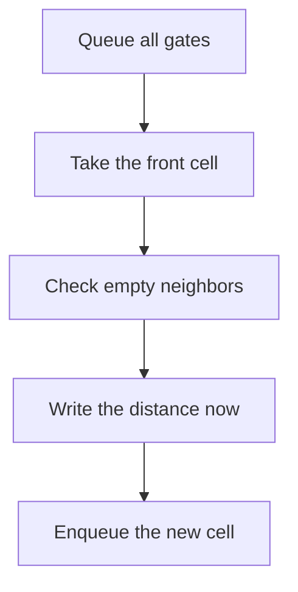
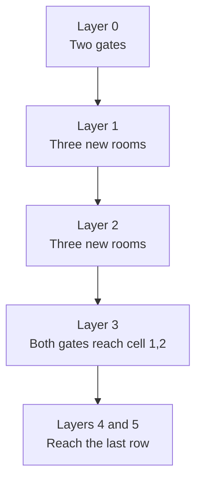

> [!tldr] Quick read
> - A BFS from each room finds its nearest gate, but several rooms can search the same corridors again.
> - [[en/concepts/multi-source-bfs|Multi-source BFS]] puts all gates in one queue at distance 0. The first time it discovers a room, it has found the shortest walk to any gate.
> - Write the distance as you enqueue a room. It doubles as a visited marker, and walls, gates, and rooms cut off from every gate keep their original values.

> [!info] Context
> LeetCode 286 (Medium) belongs to [[en/posts/2026-11-26-neetcode-grid-traversal|station 1: Grid Traversal]] on **the NeetCode Line: Graphs**. I want to post the number of steps to the closest gate in each room of a building with blocked corridors. You only need row and column indices and a first-in, first-out queue.

> [!abstract]- Quick glossary for this post (click to open)
> - A [[en/concepts/grid-graph|grid graph]] treats each traversable cell as a vertex and each legal horizontal or vertical step as an edge.
> - [[en/concepts/breadth-first-search|BFS]] expands one distance layer at a time with a FIFO queue.
> - **INF** is a sentinel for a room whose distance is still unknown. The integer stored in a room is `2147483647`.
> - **In-place update** means writing the answers into the cells of the input grid.

## Picture it first: posting signs inside a building

A crew starts at each gate. All crews leave together and move one room per round, using doors that connect rooms with a common wall. The first crew to reach a room hangs a sign with its step count, so later crews know the room is done.

| Everyday life | Concept |
|---|---|
| A door between rooms with a common wall | A horizontal or vertical edge |
| A solid wall | A blocked cell |
| All crews leave from their gates together | Multi-source BFS, with every source at layer 0 |
| Hang a sign as soon as a room is assigned | [[en/concepts/mark-on-enqueue\|Mark on enqueue]] |
| A cut-off room keeps its empty sign | A room unreachable from every gate keeps `INF` |



## The problem: distances follow routes around walls

A grid cell has one of three roles. `-1` is an impassable wall, `0` is a gate, and `INF = 2³¹ − 1` is a room to fill. Each step goes to a horizontal or vertical neighbor. Write the fewest steps from each room to a gate directly into the input grid. A room that can reach no gate keeps `INF`. NeetCode's public version bounds each dimension between 1 and 100. [LeetCode 286](https://leetcode.com/problems/walls-and-gates/) · [NeetCode's public version](https://neetcode.io/problems/islands-and-treasure/question)

I write `I` for `INF` and `#` for a wall. The example uses zero-based row and column indices.

```text
Input                 Result
0 # I I 0             0 # 2 1 0
I I I # I             1 2 3 # 1
I # I # #             2 # 4 # #
I I I # I             3 4 5 # I
```

Room `(1,2)` is three steps from either gate. From the left gate, go down and right twice. From the right gate, go left twice and then down. Room `(3,4)` is isolated and keeps `I`. Row and column differences give only a lower bound when walls can block a route.

## How it works

<figure class="figure-map" style="--ar: 3 / 4">
<div class="frame"><iframe data-archify="../../diagrams/neetcode-walls-and-gates/worked-example.en.html" title="Record the distance from the first gate to arrive" loading="lazy"></iframe></div>
<figcaption><span><b>Figure 1.</b> Record the distance from the first gate to arrive.</span><a href="../diagrams/neetcode-walls-and-gates/worked-example.en.html" target="_blank" rel="noopener">Open full screen</a></figcaption>
</figure>

<details>
<summary>Read the steps</summary>
<ol>
<li>Queue both gates at distance zero. <code>(0,0), (0,4)</code></li>
<li>One step reaches three rooms. <code>(1,0), (1,4), (0,3)</code></li>
<li>Both gates can reach (1,2). <code>min(3, 3) = 3</code></li>
<li>Walls isolate room (3,4). <code>room[3][4] = INF</code></li>
<li>Update only rooms reached from a gate. <code>(1,2) = 3; (3,4) = INF</code></li>
</ol>
</details>

### Approach 1 — Search from each room

Start a BFS at one room and search all traversable cells. The queue processes cells in order of distance from the starting room, so the first gate dequeued is the nearest. If the queue runs dry, the room keeps `INF`. Repeat for every room, using a separate distance array for each search. When a later search reads the grid, **a room with a positive number is still traversable**. Only `-1` blocks it.

Let `V = m × n` and let `R` be the original number of empty rooms. Every cell has at most four neighbors, so a search takes at most `O(V)` time and `O(V)` auxiliary space. Scanning the grid and running `R` searches takes `O(V + R · V)` time, which is `O(V²)` in the worst case. The preceding search's array can be released before the next starts.

### Approach 2 — Expand from all gates together

A room-to-gate route can be reversed because every traversable grid edge goes both ways. I add every gate to one queue and use the numbers in the grid as distances. Take a cell at distance `d` off the queue. For each neighbor still set to `INF`, write `d + 1` and append the neighbor to the queue. Check the bounds before reading the cell.



In the example, once both gates have been processed, the queue contains only rooms one step away. When the distance-2 rooms expand, the first route to reach `(1,2)` writes 3 immediately. The other route sees 3 in place of `INF` and skips it. Reordering the gates still gives 3.

I check the reasoning one layer at a time. A cell labeled `d + 1` has a valid route through a parent one layer closer, at distance `d`. If there were a shorter route to the room, its penultimate cell would belong to a layer below `d` and would have been processed earlier. It would have written the room's distance first, so the first write gives the minimum. Rooms with no route from any gate never enter the queue.

Scanning for sources takes `O(V)). Each gate and each reachable room enters the queue once. Checking at most four neighbors per cell keeps the total time at `O(V)`. The input grid stores both the answer and the visited state, and the queue can still use `O(V)` space.

### Counting dequeued cells

On an open 24 × 24 grid, the only gate is at `(0,0)`. Both methods fill the same matrix.

| Method | Dequeued cells |
|---|---:|
| Separate BFS per room | 238775 |
| One multi-source BFS | 576 |

The counter includes dequeued gates. The shared search dequeues every cell once. This grid shows the repeated work when the gate is in a corner. The counts measure work rather than elapsed time and depend on the location of gates and walls.

## Runnable example

Download [TypeScript](../code/neetcode-walls-and-gates/gate-distances.ts), [Python](../code/neetcode-walls-and-gates/gate_distances.py), [Go](../code/neetcode-walls-and-gates/gate_distances.go), [Java](../code/neetcode-walls-and-gates/gate-distances.java), [JavaScript](../code/neetcode-walls-and-gates/gate-distances.js), [PHP](../code/neetcode-walls-and-gates/gate-distances.php), or [Rust](../code/neetcode-walls-and-gates/gate_distances.rs). All seven files run both methods on the same seven cases. Each method edits the grid passed to it and returns a dequeue count for the comparison.

```ts
const INF = 2 ** 31 - 1
const directions = [[-1, 0], [1, 0], [0, -1], [0, 1]]

function fromRoom(rooms: number[][], start: number) {
  const rows = rooms.length
  const cols = rooms[0].length
  const queue = [start]
  const distance = Array(rows * cols).fill(-1)
  distance[start] = 0

  for (let head = 0; head < queue.length; head++) {
    const cell = queue[head]
    const r = Math.floor(cell / cols)
    const c = cell % cols
    if (rooms[r][c] === 0) return [distance[cell], head + 1]
    for (const [dr, dc] of directions) {
      const nr = r + dr
      const nc = c + dc
      const next = nr * cols + nc
      if (nr < 0 || nr >= rows || nc < 0 || nc >= cols) continue
      if (rooms[nr][nc] === -1 || distance[next] !== -1) continue
      distance[next] = distance[cell] + 1
      queue.push(next)
    }
  }
  return [INF, queue.length]
}

function perRoom(rooms: number[][]) {
  let popped = 0
  const cols = rooms[0].length
  for (let r = 0; r < rooms.length; r++) {
    for (let c = 0; c < cols; c++) {
      if (rooms[r][c] !== INF) continue
      const [distance, visits] = fromRoom(rooms, r * cols + c)
      rooms[r][c] = distance
      popped += visits
    }
  }
  return popped
}

function fromAllGates(rooms: number[][]) {
  const rows = rooms.length
  const cols = rooms[0].length
  const queue: number[] = []
  for (let r = 0; r < rows; r++) {
    for (let c = 0; c < cols; c++) {
      if (rooms[r][c] === 0) queue.push(r * cols + c)
    }
  }

  for (let head = 0; head < queue.length; head++) {
    const cell = queue[head]
    const r = Math.floor(cell / cols)
    const c = cell % cols
    for (const [dr, dc] of directions) {
      const nr = r + dr
      const nc = c + dc
      if (nr < 0 || nr >= rows || nc < 0 || nc >= cols) continue
      if (rooms[nr][nc] !== INF) continue
      rooms[nr][nc] = rooms[r][c] + 1
      queue.push(nr * cols + nc)
    }
  }
  return queue.length
}

function check(before: number[][], expected: number[][]) {
  for (const fill of [perRoom, fromAllGates]) {
    const work = before.map(row => row.slice())
    fill(work)
    if (JSON.stringify(work) !== JSON.stringify(expected)) throw new Error(fill.name)
  }
}

const cases = [
  [
    [[0, -1, INF, INF, 0], [INF, INF, INF, -1, INF], [INF, -1, INF, -1, -1], [INF, INF, INF, -1, INF]],
    [[0, -1, 2, 1, 0], [1, 2, 3, -1, 1], [2, -1, 4, -1, -1], [3, 4, 5, -1, INF]],
  ],
  [[[INF, 0, INF, INF, 0, INF]], [[1, 0, 1, 1, 0, 1]]],
  [[[0, -1, INF]], [[0, -1, INF]]],
  [[[INF, INF], [INF, -1]], [[INF, INF], [INF, -1]]],
  [[[0]], [[0]]],
  [[[-1], [INF], [0], [INF]], [[-1], [1], [0], [1]]],
  [[[0, -1, INF], [INF, INF, INF]], [[0, -1, 4], [1, 2, 3]]],
]
for (const [before, expected] of cases) check(before, expected)
console.log(`${cases.length}/${cases.length} ca đúng`)

const roomByRoom = Array.from({ length: 24 }, () => Array(24).fill(INF))
roomByRoom[0][0] = 0
const inOnePass = roomByRoom.map(row => row.slice())
const repeatedPops = perRoom(roomByRoom)
const sharedPops = fromAllGates(inOnePass)
if (JSON.stringify(roomByRoom) !== JSON.stringify(inOnePass)) throw new Error("24 × 24")
console.log(`Số lượt lấy ô khỏi hàng đợi: ${repeatedPops} / ${sharedPops}`)
```
```python
INF = 2**31 - 1
DIRECTIONS = [(-1, 0), (1, 0), (0, -1), (0, 1)]


def from_room(rooms, start):
    rows, cols = len(rooms), len(rooms[0])
    queue = [start]
    distance = [-1] * (rows * cols)
    distance[start] = 0

    for head, cell in enumerate(queue):
        r, c = divmod(cell, cols)
        if rooms[r][c] == 0:
            return distance[cell], head + 1
        for dr, dc in DIRECTIONS:
            nr, nc = r + dr, c + dc
            if not (0 <= nr < rows and 0 <= nc < cols):
                continue
            neighbor = nr * cols + nc
            if rooms[nr][nc] == -1 or distance[neighbor] != -1:
                continue
            distance[neighbor] = distance[cell] + 1
            queue.append(neighbor)
    return INF, len(queue)


def per_room(rooms):
    popped = 0
    cols = len(rooms[0])
    for r, row in enumerate(rooms):
        for c in range(cols):
            if row[c] != INF:
                continue
            row[c], visits = from_room(rooms, r * cols + c)
            popped += visits
    return popped


def from_all_gates(rooms):
    rows, cols = len(rooms), len(rooms[0])
    queue = [r * cols + c for r in range(rows) for c in range(cols) if rooms[r][c] == 0]
    for cell in queue:
        r, c = divmod(cell, cols)
        for dr, dc in DIRECTIONS:
            nr, nc = r + dr, c + dc
            if not (0 <= nr < rows and 0 <= nc < cols):
                continue
            if rooms[nr][nc] != INF:
                continue
            rooms[nr][nc] = rooms[r][c] + 1
            queue.append(nr * cols + nc)
    return len(queue)


def check(before, expected):
    for fill in (per_room, from_all_gates):
        work = [row[:] for row in before]
        fill(work)
        assert work == expected, fill.__name__


cases = [
    (
        [[0, -1, INF, INF, 0], [INF, INF, INF, -1, INF], [INF, -1, INF, -1, -1], [INF, INF, INF, -1, INF]],
        [[0, -1, 2, 1, 0], [1, 2, 3, -1, 1], [2, -1, 4, -1, -1], [3, 4, 5, -1, INF]],
    ),
    ([[INF, 0, INF, INF, 0, INF]], [[1, 0, 1, 1, 0, 1]]),
    ([[0, -1, INF]], [[0, -1, INF]]),
    ([[INF, INF], [INF, -1]], [[INF, INF], [INF, -1]]),
    ([[0]], [[0]]),
    ([[-1], [INF], [0], [INF]], [[-1], [1], [0], [1]]),
    ([[0, -1, INF], [INF, INF, INF]], [[0, -1, 4], [1, 2, 3]]),
]
for before, expected in cases:
    check(before, expected)
print(f"{len(cases)}/{len(cases)} ca đúng")

room_by_room = [[INF] * 24 for _ in range(24)]
room_by_room[0][0] = 0
in_one_pass = [row[:] for row in room_by_room]
repeated_pops = per_room(room_by_room)
shared_pops = from_all_gates(in_one_pass)
assert room_by_room == in_one_pass
print(f"Số lượt lấy ô khỏi hàng đợi: {repeated_pops} / {shared_pops}")
```
```go
package main

import (
	"fmt"
	"slices"
)

const inf = 1<<31 - 1

var directions = [][2]int{{-1, 0}, {1, 0}, {0, -1}, {0, 1}}

func fromRoom(rooms [][]int, start int) (int, int) {
	rows, cols := len(rooms), len(rooms[0])
	queue := []int{start}
	distance := make([]int, rows*cols)
	for i := range distance {
		distance[i] = -1
	}
	distance[start] = 0

	for head := 0; head < len(queue); head++ {
		cell := queue[head]
		r, c := cell/cols, cell%cols
		if rooms[r][c] == 0 {
			return distance[cell], head + 1
		}
		for _, step := range directions {
			nr, nc := r+step[0], c+step[1]
			if nr < 0 || nr >= rows || nc < 0 || nc >= cols {
				continue
			}
			next := nr*cols + nc
			if rooms[nr][nc] == -1 || distance[next] != -1 {
				continue
			}
			distance[next] = distance[cell] + 1
			queue = append(queue, next)
		}
	}
	return inf, len(queue)
}

func perRoom(rooms [][]int) int {
	popped, cols := 0, len(rooms[0])
	for r, row := range rooms {
		for c, cell := range row {
			if cell != inf {
				continue
			}
			distance, visits := fromRoom(rooms, r*cols+c)
			row[c] = distance
			popped += visits
		}
	}
	return popped
}

func fromAllGates(rooms [][]int) int {
	rows, cols := len(rooms), len(rooms[0])
	queue := []int{}
	for r, row := range rooms {
		for c, cell := range row {
			if cell == 0 {
				queue = append(queue, r*cols+c)
			}
		}
	}

	for head := 0; head < len(queue); head++ {
		cell := queue[head]
		r, c := cell/cols, cell%cols
		for _, step := range directions {
			nr, nc := r+step[0], c+step[1]
			if nr < 0 || nr >= rows || nc < 0 || nc >= cols {
				continue
			}
			if rooms[nr][nc] != inf {
				continue
			}
			rooms[nr][nc] = rooms[r][c] + 1
			queue = append(queue, nr*cols+nc)
		}
	}
	return len(queue)
}

func clone(rooms [][]int) [][]int {
	copy := make([][]int, len(rooms))
	for r, row := range rooms {
		copy[r] = slices.Clone(row)
	}
	return copy
}

func checkEqual(a, b [][]int) {
	for r, row := range a {
		if !slices.Equal(row, b[r]) {
			panic("distance mismatch")
		}
	}
}

func main() {
	cases := [][2][][]int{
		{
			{{0, -1, inf, inf, 0}, {inf, inf, inf, -1, inf}, {inf, -1, inf, -1, -1}, {inf, inf, inf, -1, inf}},
			{{0, -1, 2, 1, 0}, {1, 2, 3, -1, 1}, {2, -1, 4, -1, -1}, {3, 4, 5, -1, inf}},
		},
		{{{inf, 0, inf, inf, 0, inf}}, {{1, 0, 1, 1, 0, 1}}},
		{{{0, -1, inf}}, {{0, -1, inf}}},
		{{{inf, inf}, {inf, -1}}, {{inf, inf}, {inf, -1}}},
		{{{0}}, {{0}}},
		{{{-1}, {inf}, {0}, {inf}}, {{-1}, {1}, {0}, {1}}},
		{{{0, -1, inf}, {inf, inf, inf}}, {{0, -1, 4}, {1, 2, 3}}},
	}
	for _, test := range cases {
		for _, fill := range []func([][]int) int{perRoom, fromAllGates} {
			work := clone(test[0])
			fill(work)
			checkEqual(work, test[1])
		}
	}
	fmt.Printf("%d/%d ca đúng\n", len(cases), len(cases))

	roomByRoom := make([][]int, 24)
	for r := range roomByRoom {
		roomByRoom[r] = make([]int, 24)
		for c := range roomByRoom[r] {
			roomByRoom[r][c] = inf
		}
	}
	roomByRoom[0][0] = 0
	inOnePass := clone(roomByRoom)
	repeatedPops := perRoom(roomByRoom)
	sharedPops := fromAllGates(inOnePass)
	checkEqual(roomByRoom, inOnePass)
	fmt.Printf("Số lượt lấy ô khỏi hàng đợi: %d / %d\n", repeatedPops, sharedPops)
}
```
```java
import java.util.Arrays;

class GateDistances {
    static final int INF = Integer.MAX_VALUE;
    static final int[][] DIRECTIONS = {{-1, 0}, {1, 0}, {0, -1}, {0, 1}};

    record Search(int distance, int popped) {}

    static Search fromRoom(int[][] rooms, int start) {
        int rows = rooms.length, cols = rooms[0].length;
        int[] queue = new int[rows * cols];
        int[] distance = new int[rows * cols];
        Arrays.fill(distance, -1);
        queue[0] = start;
        distance[start] = 0;
        int tail = 1;

        for (int head = 0; head < tail; head++) {
            int cell = queue[head], r = cell / cols, c = cell % cols;
            if (rooms[r][c] == 0) return new Search(distance[cell], head + 1);
            for (int[] step : DIRECTIONS) {
                int nr = r + step[0], nc = c + step[1];
                if (nr < 0 || nr >= rows || nc < 0 || nc >= cols) continue;
                int next = nr * cols + nc;
                if (rooms[nr][nc] == -1 || distance[next] != -1) continue;
                distance[next] = distance[cell] + 1;
                queue[tail++] = next;
            }
        }
        return new Search(INF, tail);
    }

    static int perRoom(int[][] rooms) {
        int popped = 0, cols = rooms[0].length;
        for (int r = 0; r < rooms.length; r++) {
            for (int c = 0; c < cols; c++) {
                if (rooms[r][c] != INF) continue;
                Search result = fromRoom(rooms, r * cols + c);
                rooms[r][c] = result.distance();
                popped += result.popped();
            }
        }
        return popped;
    }

    static int fromAllGates(int[][] rooms) {
        int rows = rooms.length, cols = rooms[0].length;
        int[] queue = new int[rows * cols];
        int tail = 0;
        for (int r = 0; r < rows; r++) {
            for (int c = 0; c < cols; c++) {
                if (rooms[r][c] == 0) queue[tail++] = r * cols + c;
            }
        }

        for (int head = 0; head < tail; head++) {
            int cell = queue[head], r = cell / cols, c = cell % cols;
            for (int[] step : DIRECTIONS) {
                int nr = r + step[0], nc = c + step[1];
                if (nr < 0 || nr >= rows || nc < 0 || nc >= cols) continue;
                if (rooms[nr][nc] != INF) continue;
                rooms[nr][nc] = rooms[r][c] + 1;
                queue[tail++] = nr * cols + nc;
            }
        }
        return tail;
    }

    static int[][] copyGrid(int[][] rooms) {
        return Arrays.stream(rooms).map(int[]::clone).toArray(int[][]::new);
    }

    static void check(int[][] before, int[][] expected) {
        int[][] roomByRoom = copyGrid(before);
        int[][] inOnePass = copyGrid(before);
        perRoom(roomByRoom);
        fromAllGates(inOnePass);
        if (!Arrays.deepEquals(expected, roomByRoom) || !Arrays.deepEquals(expected, inOnePass)) {
            throw new AssertionError("distance mismatch");
        }
    }

    public static void main(String[] args) {
        int[][][][] cases = {
            {
                {{0, -1, INF, INF, 0}, {INF, INF, INF, -1, INF}, {INF, -1, INF, -1, -1}, {INF, INF, INF, -1, INF}},
                {{0, -1, 2, 1, 0}, {1, 2, 3, -1, 1}, {2, -1, 4, -1, -1}, {3, 4, 5, -1, INF}},
            },
            {{{INF, 0, INF, INF, 0, INF}}, {{1, 0, 1, 1, 0, 1}}},
            {{{0, -1, INF}}, {{0, -1, INF}}},
            {{{INF, INF}, {INF, -1}}, {{INF, INF}, {INF, -1}}},
            {{{0}}, {{0}}},
            {{{-1}, {INF}, {0}, {INF}}, {{-1}, {1}, {0}, {1}}},
            {{{0, -1, INF}, {INF, INF, INF}}, {{0, -1, 4}, {1, 2, 3}}},
        };
        for (int[][][] test : cases) check(test[0], test[1]);
        System.out.printf("%d/%d ca đúng%n", cases.length, cases.length);

        int[][] roomByRoom = new int[24][24];
        for (int[] row : roomByRoom) Arrays.fill(row, INF);
        roomByRoom[0][0] = 0;
        int[][] inOnePass = copyGrid(roomByRoom);
        int repeatedPops = perRoom(roomByRoom);
        int sharedPops = fromAllGates(inOnePass);
        if (!Arrays.deepEquals(roomByRoom, inOnePass)) throw new AssertionError("24 × 24");
        System.out.printf("Số lượt lấy ô khỏi hàng đợi: %d / %d%n", repeatedPops, sharedPops);
    }
}
```
```js
const INF = 2 ** 31 - 1
const directions = [[-1, 0], [1, 0], [0, -1], [0, 1]]

function fromRoom(rooms, start) {
  const rows = rooms.length
  const cols = rooms[0].length
  const queue = [start]
  const distance = Array(rows * cols).fill(-1)
  distance[start] = 0

  for (let head = 0; head < queue.length; head++) {
    const cell = queue[head]
    const r = Math.floor(cell / cols)
    const c = cell % cols
    if (rooms[r][c] === 0) return [distance[cell], head + 1]
    for (const [dr, dc] of directions) {
      const nr = r + dr
      const nc = c + dc
      const next = nr * cols + nc
      if (nr < 0 || nr >= rows || nc < 0 || nc >= cols) continue
      if (rooms[nr][nc] === -1 || distance[next] !== -1) continue
      distance[next] = distance[cell] + 1
      queue.push(next)
    }
  }
  return [INF, queue.length]
}

function perRoom(rooms) {
  let popped = 0
  const cols = rooms[0].length
  for (let r = 0; r < rooms.length; r++) {
    for (let c = 0; c < cols; c++) {
      if (rooms[r][c] !== INF) continue
      const [distance, visits] = fromRoom(rooms, r * cols + c)
      rooms[r][c] = distance
      popped += visits
    }
  }
  return popped
}

function fromAllGates(rooms) {
  const rows = rooms.length
  const cols = rooms[0].length
  const queue = []
  for (let r = 0; r < rows; r++) {
    for (let c = 0; c < cols; c++) {
      if (rooms[r][c] === 0) queue.push(r * cols + c)
    }
  }

  for (let head = 0; head < queue.length; head++) {
    const cell = queue[head]
    const r = Math.floor(cell / cols)
    const c = cell % cols
    for (const [dr, dc] of directions) {
      const nr = r + dr
      const nc = c + dc
      if (nr < 0 || nr >= rows || nc < 0 || nc >= cols) continue
      if (rooms[nr][nc] !== INF) continue
      rooms[nr][nc] = rooms[r][c] + 1
      queue.push(nr * cols + nc)
    }
  }
  return queue.length
}

function check(before, expected) {
  for (const fill of [perRoom, fromAllGates]) {
    const work = before.map(row => row.slice())
    fill(work)
    if (JSON.stringify(work) !== JSON.stringify(expected)) throw new Error(fill.name)
  }
}

const cases = [
  [
    [[0, -1, INF, INF, 0], [INF, INF, INF, -1, INF], [INF, -1, INF, -1, -1], [INF, INF, INF, -1, INF]],
    [[0, -1, 2, 1, 0], [1, 2, 3, -1, 1], [2, -1, 4, -1, -1], [3, 4, 5, -1, INF]],
  ],
  [[[INF, 0, INF, INF, 0, INF]], [[1, 0, 1, 1, 0, 1]]],
  [[[0, -1, INF]], [[0, -1, INF]]],
  [[[INF, INF], [INF, -1]], [[INF, INF], [INF, -1]]],
  [[[0]], [[0]]],
  [[[-1], [INF], [0], [INF]], [[-1], [1], [0], [1]]],
  [[[0, -1, INF], [INF, INF, INF]], [[0, -1, 4], [1, 2, 3]]],
]
for (const [before, expected] of cases) check(before, expected)
console.log(`${cases.length}/${cases.length} ca đúng`)

const roomByRoom = Array.from({ length: 24 }, () => Array(24).fill(INF))
roomByRoom[0][0] = 0
const inOnePass = roomByRoom.map(row => row.slice())
const repeatedPops = perRoom(roomByRoom)
const sharedPops = fromAllGates(inOnePass)
if (JSON.stringify(roomByRoom) !== JSON.stringify(inOnePass)) throw new Error("24 × 24")
console.log(`Số lượt lấy ô khỏi hàng đợi: ${repeatedPops} / ${sharedPops}`)
```

```php
<?php
declare(strict_types=1);

const EMPTY_ROOM = 2 ** 31 - 1; // phòng trống; không đặt tên INF vì PHP đã có hằng INF (số thực vô cực)
const DIRECTIONS = [[-1, 0], [1, 0], [0, -1], [0, 1]];

function fromRoom(array $rooms, int $start): array
{
    $rows = count($rooms);
    $cols = count($rooms[0]);
    $queue = [$start];
    $distance = array_fill(0, $rows * $cols, -1);
    $distance[$start] = 0;

    for ($head = 0; $head < count($queue); $head++) {
        $cell = $queue[$head];
        $r = intdiv($cell, $cols);
        $c = $cell % $cols;
        if ($rooms[$r][$c] === 0) return [$distance[$cell], $head + 1];
        foreach (DIRECTIONS as [$dr, $dc]) {
            $nr = $r + $dr;
            $nc = $c + $dc;
            $next = $nr * $cols + $nc;
            if ($nr < 0 || $nr >= $rows || $nc < 0 || $nc >= $cols) continue;
            if ($rooms[$nr][$nc] === -1 || $distance[$next] !== -1) continue;
            $distance[$next] = $distance[$cell] + 1;
            $queue[] = $next;
        }
    }
    return [EMPTY_ROOM, count($queue)];
}

function perRoom(array &$rooms): int
{
    $popped = 0;
    $cols = count($rooms[0]);
    for ($r = 0; $r < count($rooms); $r++) {
        for ($c = 0; $c < $cols; $c++) {
            if ($rooms[$r][$c] !== EMPTY_ROOM) continue;
            [$distance, $visits] = fromRoom($rooms, $r * $cols + $c);
            $rooms[$r][$c] = $distance;
            $popped += $visits;
        }
    }
    return $popped;
}

function fromAllGates(array &$rooms): int
{
    $rows = count($rooms);
    $cols = count($rooms[0]);
    $queue = [];
    for ($r = 0; $r < $rows; $r++) {
        for ($c = 0; $c < $cols; $c++) {
            if ($rooms[$r][$c] === 0) $queue[] = $r * $cols + $c;
        }
    }

    for ($head = 0; $head < count($queue); $head++) {
        $cell = $queue[$head];
        $r = intdiv($cell, $cols);
        $c = $cell % $cols;
        foreach (DIRECTIONS as [$dr, $dc]) {
            $nr = $r + $dr;
            $nc = $c + $dc;
            if ($nr < 0 || $nr >= $rows || $nc < 0 || $nc >= $cols) continue;
            if ($rooms[$nr][$nc] !== EMPTY_ROOM) continue;
            $rooms[$nr][$nc] = $rooms[$r][$c] + 1;
            $queue[] = $nr * $cols + $nc;
        }
    }
    return count($queue);
}

function check(array $before, array $expected): void
{
    foreach (['perRoom', 'fromAllGates'] as $fill) {
        $work = $before;
        $fill($work);
        if ($work !== $expected) throw new RuntimeException($fill);
    }
}

$cases = [
    [
        [[0, -1, EMPTY_ROOM, EMPTY_ROOM, 0], [EMPTY_ROOM, EMPTY_ROOM, EMPTY_ROOM, -1, EMPTY_ROOM], [EMPTY_ROOM, -1, EMPTY_ROOM, -1, -1], [EMPTY_ROOM, EMPTY_ROOM, EMPTY_ROOM, -1, EMPTY_ROOM]],
        [[0, -1, 2, 1, 0], [1, 2, 3, -1, 1], [2, -1, 4, -1, -1], [3, 4, 5, -1, EMPTY_ROOM]],
    ],
    [[[EMPTY_ROOM, 0, EMPTY_ROOM, EMPTY_ROOM, 0, EMPTY_ROOM]], [[1, 0, 1, 1, 0, 1]]],
    [[[0, -1, EMPTY_ROOM]], [[0, -1, EMPTY_ROOM]]],
    [[[EMPTY_ROOM, EMPTY_ROOM], [EMPTY_ROOM, -1]], [[EMPTY_ROOM, EMPTY_ROOM], [EMPTY_ROOM, -1]]],
    [[[0]], [[0]]],
    [[[-1], [EMPTY_ROOM], [0], [EMPTY_ROOM]], [[-1], [1], [0], [1]]],
    [[[0, -1, EMPTY_ROOM], [EMPTY_ROOM, EMPTY_ROOM, EMPTY_ROOM]], [[0, -1, 4], [1, 2, 3]]],
];
foreach ($cases as [$before, $expected]) check($before, $expected);
$n = count($cases);
echo "{$n}/{$n} ca đúng\n";

$roomByRoom = array_fill(0, 24, array_fill(0, 24, EMPTY_ROOM));
$roomByRoom[0][0] = 0;
$inOnePass = $roomByRoom;
$repeatedPops = perRoom($roomByRoom);
$sharedPops = fromAllGates($inOnePass);
if ($roomByRoom !== $inOnePass) throw new RuntimeException("24 × 24");
echo "Số lượt lấy ô khỏi hàng đợi: {$repeatedPops} / {$sharedPops}\n";
```

```rust
const INF: i32 = i32::MAX;
const DIRECTIONS: [(i32, i32); 4] = [(-1, 0), (1, 0), (0, -1), (0, 1)];

fn from_room(rooms: &[Vec<i32>], start: usize) -> (i32, usize) {
    let (rows, cols) = (rooms.len(), rooms[0].len());
    let mut queue = vec![start];
    let mut distance = vec![-1; rows * cols];
    distance[start] = 0;

    let mut head = 0;
    while head < queue.len() {
        let cell = queue[head];
        head += 1;
        let (r, c) = (cell / cols, cell % cols);
        if rooms[r][c] == 0 {
            return (distance[cell], head);
        }
        for (dr, dc) in DIRECTIONS {
            let (nr, nc) = (r as i32 + dr, c as i32 + dc);
            if nr < 0 || nr >= rows as i32 || nc < 0 || nc >= cols as i32 {
                continue;
            }
            let (nr, nc) = (nr as usize, nc as usize);
            let next = nr * cols + nc;
            if rooms[nr][nc] == -1 || distance[next] != -1 {
                continue;
            }
            distance[next] = distance[cell] + 1;
            queue.push(next);
        }
    }
    (INF, queue.len())
}

fn per_room(rooms: &mut [Vec<i32>]) -> usize {
    let mut popped = 0;
    let cols = rooms[0].len();
    for r in 0..rooms.len() {
        for c in 0..cols {
            if rooms[r][c] != INF {
                continue;
            }
            let (distance, visits) = from_room(rooms, r * cols + c);
            rooms[r][c] = distance;
            popped += visits;
        }
    }
    popped
}

fn from_all_gates(rooms: &mut [Vec<i32>]) -> usize {
    let (rows, cols) = (rooms.len(), rooms[0].len());
    let mut queue = Vec::new();
    for r in 0..rows {
        for c in 0..cols {
            if rooms[r][c] == 0 {
                queue.push(r * cols + c);
            }
        }
    }

    let mut head = 0;
    while head < queue.len() {
        let cell = queue[head];
        head += 1;
        let (r, c) = (cell / cols, cell % cols);
        for (dr, dc) in DIRECTIONS {
            let (nr, nc) = (r as i32 + dr, c as i32 + dc);
            if nr < 0 || nr >= rows as i32 || nc < 0 || nc >= cols as i32 {
                continue;
            }
            let (nr, nc) = (nr as usize, nc as usize);
            if rooms[nr][nc] != INF {
                continue;
            }
            rooms[nr][nc] = rooms[r][c] + 1;
            queue.push(nr * cols + nc);
        }
    }
    queue.len()
}

fn check(before: &[Vec<i32>], expected: &[Vec<i32>]) {
    let fills: [(&str, fn(&mut [Vec<i32>]) -> usize); 2] = [("per_room", per_room), ("from_all_gates", from_all_gates)];
    for (name, fill) in fills {
        let mut work = before.to_vec();
        fill(&mut work);
        if work != expected {
            panic!("{}", name);
        }
    }
}

fn main() {
    let cases: Vec<(Vec<Vec<i32>>, Vec<Vec<i32>>)> = vec![
        (
            vec![vec![0, -1, INF, INF, 0], vec![INF, INF, INF, -1, INF], vec![INF, -1, INF, -1, -1], vec![INF, INF, INF, -1, INF]],
            vec![vec![0, -1, 2, 1, 0], vec![1, 2, 3, -1, 1], vec![2, -1, 4, -1, -1], vec![3, 4, 5, -1, INF]],
        ),
        (vec![vec![INF, 0, INF, INF, 0, INF]], vec![vec![1, 0, 1, 1, 0, 1]]),
        (vec![vec![0, -1, INF]], vec![vec![0, -1, INF]]),
        (vec![vec![INF, INF], vec![INF, -1]], vec![vec![INF, INF], vec![INF, -1]]),
        (vec![vec![0]], vec![vec![0]]),
        (vec![vec![-1], vec![INF], vec![0], vec![INF]], vec![vec![-1], vec![1], vec![0], vec![1]]),
        (vec![vec![0, -1, INF], vec![INF, INF, INF]], vec![vec![0, -1, 4], vec![1, 2, 3]]),
    ];
    for (before, expected) in &cases {
        check(before, expected);
    }
    println!("{}/{} ca đúng", cases.len(), cases.len());

    let mut room_by_room = vec![vec![INF; 24]; 24];
    room_by_room[0][0] = 0;
    let mut in_one_pass = room_by_room.clone();
    let repeated_pops = per_room(&mut room_by_room);
    let shared_pops = from_all_gates(&mut in_one_pass);
    if room_by_room != in_one_pass {
        panic!("24 × 24");
    }
    println!("Số lượt lấy ô khỏi hàng đợi: {} / {}", repeated_pops, shared_pops);
}
```

```text
7/7 cases passed
Dequeued cells: 238775 / 576
```

*(Output labels translated; the files themselves print Vietnamese.)*

## Misconceptions and common traps

- **Finish one gate's BFS, then the next, and keep the first write.** The first gate might record a distance larger than the distance to a later gate. Seed every source before the loop so dequeued distances are nondecreasing.
- **Mark a cell when dequeuing it.** Two cells in the same layer can both enqueue a room. Write its distance just before enqueueing so the next encounter sees it as discovered.
- **In-place updates imply constant extra space.** The queue still holds cell indices. TypeScript and JavaScript advance a head index instead of calling `shift()`. Python's list iterator advances by index while new cells are appended.
- **Copy just the outer array to compare methods.** The inner rows would still be shared. The fixtures copy each row so the second method sees the original input. Java uses `Integer.MAX_VALUE` for INF and adds 1 only to a known distance to avoid integer overflow. TypeScript and JavaScript use `2 ** 31 - 1` to obtain INF without coercing the result to a signed 32-bit integer.
- **PHP: naming the constant `INF`.** PHP already has a built-in constant `INF` (floating-point infinity), so `const INF = 2 ** 31 - 1;` only raises an "already defined" warning, and every `=== INF` comparison silently uses float infinity instead of the problem's `2147483647`. The PHP version uses the name `EMPTY_ROOM`; `EMPTY` does not work either, because `empty` is a keyword.
- **Rust: `i32::MAX + 1` overflows.** A debug build panics and an `-O` build wraps to a negative number. The addition `rooms[r][c] + 1` is safe because it only runs from a cell that already has a real distance, never from an `INF` cell, the same advice as for Java above.

## Self-check questions

> [!question]- Why does searching outward from gates give room-to-gate distances?
> Every legal step can go in reverse. A route of d steps in either direction gives a route of d in the other direction, so the minimum distances are equal.

> [!question]- What happens if two gates are each three steps from the same room?
> The route processed first writes 3 and enqueues the room. The other route sees a recorded distance and skips it.

> [!question]- What does multi-source BFS do when there are no gates?
> The initial scan enqueues no cells. The BFS loop is skipped, and all rooms keep INF.

## References

- [LeetCode 286, Walls and Gates](https://leetcode.com/problems/walls-and-gates/) identifies the problem by number and title. The full statement requires Premium.
- [NeetCode, Islands and Treasure](https://neetcode.io/problems/islands-and-treasure/question) is the public version with the same model of walls, sources, and distances.
- [Princeton Algorithms, BreadthFirstPaths](https://raw.githubusercontent.com/kevin-wayne/algs4/master/src/main/java/edu/princeton/cs/algs4/BreadthFirstPaths.java) implements both single-source and multi-source BFS on undirected graphs.
