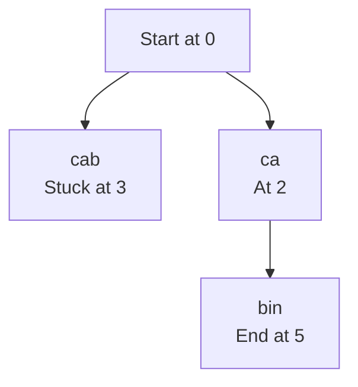

> [!tldr] Quick read
> - Each position is a boundary. There is an edge i → j when the slice from i up to j is a dictionary word.
> - Store [[en/concepts/prefix-reachability|boundary reachability]] to tell whether a prefix can be fully segmented. Paths that reach the same boundary have the same work left.
> - Mark boundary 0 and sweep forward, or recursively memoize the answer at each position. Store false results as well.

> [!info] Context
> This is LeetCode 139 at [[en/posts/2026-11-27-neetcode-word-break-lis|station DP-04: Word Break and Increasing Subsequences]] on **the NeetCode Line: Dynamic Programming**. I picture a strip of labels pressed together, each carrying a code from a catalog. All you need is strings and loops.

> [!abstract]- Quick glossary for this post (click to open)
> - The slice `s[i:j]` begins at i and ends just before j.
> - A [[en/concepts/dp-state|DP state]] specifies what information an index stores.
> - [[en/concepts/memoization|Memoization]] saves the answer the first time a state is queried.
> - A [[en/concepts/recurrence-relation|recurrence relation]] identifies the state answers used to compute the current state.

## Picture it first: peeling labels from a strip

The strip `cabin` can start with either the label `cab` or `ca`. Peel `cab` and the leftover `in` has no label in the catalog. Peel `ca` and `bin` covers the rest. I mark both valid cut boundaries and continue from each one with a possible next label.

| Everyday life | Concept |
|---|---|
| Edge immediately before character i | Boundary i |
| A label that starts at boundary i | Word matching the suffix starting at i |
| Peel every label up to boundary j | Prefix `s[0:j]` can be fully segmented |
| Two segmentations reach the same boundary | A shared state |



## The problem: check whether the entire string can be segmented

The string `s` has 1–300 characters and the dictionary has 1–1,000 distinct words. Each word has 1–20 characters. Both the string and words use lowercase English letters. Return `true` if `s` can be divided into consecutive pieces, each equal to a dictionary word. Each word may be reused. For example, `mintminttea` with `["mint", "tea"]` splits into `mint | mint | tea`. [Original LeetCode 139 problem](https://leetcode.com/problems/word-break/)

## How it works

### Enumerate cuts and memoize suffixes

I start at i, try every word that matches there, and ask about the remainder starting at `i + word.length`. Reaching n means the string is completely covered. Every word has positive length, so each move goes forward. At `in` in the example, the function returns `false` and backtracks to try a different label.

Let n be the string length, k the number of words, and L the maximum word length. Brute force can examine an exponential number of cut choices. Its upper bounds are O(2ⁿkL) time and O(n) stack space. When multiple branches reach i they have the same suffix, so I cache the result of `solve(i)` by i. At most n positions must scan the dictionary, each trying k words, with each comparison taking up to O(L). With O(1) cache access, total time is O(nkL) and auxiliary space is O(n).

### Fill the prefix reachability table

Let `reachable[i]` indicate whether `s[0:i]` can be fully segmented. I start with `reachable[0] = true` because the empty prefix is already covered. At each marked i, I try words that match immediately at i. A word of length m marks `i + m`. A mismatch or a word longer than the remainder creates no edge.

Each marked cell comes from appending a valid word to an already segmentable prefix. Conversely, if there is a segmentation up to j, removing its final word gives a boundary i smaller than j. The loop examines i earlier and marks j. The forward pass respects the dependencies for both implications. The table uses O(n) space and O(nkL) time, with no recursion. For a large dictionary with many shared prefixes, a [[en/concepts/trie-prefix-pruning|trie]] can reduce repeated comparisons. The version below scans the dictionary directly to show where each edge comes from.

## Runnable example

[TypeScript](../code/neetcode-word-break/segments.ts) · [Python](../code/neetcode-word-break/segments.py) · [Go](../code/neetcode-word-break/segments.go) · [Java](../code/neetcode-word-break/segments.java) · [JavaScript](../code/neetcode-word-break/segments.js) · [PHP](../code/neetcode-word-break/segments.php) · [Rust](../code/neetcode-word-break/segments.rs)

```ts
function wordBreakDp(s: string, words: string[]) {
    const reachable = Array(s.length + 1).fill(false)
    reachable[0] = true
    for (let i = 0; i < s.length; i++) {
        if (!reachable[i]) continue
        for (const word of words) {
            if (s.startsWith(word, i)) reachable[i + word.length] = true
        }
    }
    return reachable[s.length]
}
```

```python
def word_break_dp(s, words):
    reachable = [True] + [False] * len(s)
    for i in range(len(s)):
        if not reachable[i]:
            continue
        for word in words:
            if s.startswith(word, i):
                reachable[i + len(word)] = True
    return reachable[-1]
```

```go
func wordBreakDp(s string, words []string) bool {
	reachable := make([]bool, len(s)+1)
	reachable[0] = true
	for i := 0; i < len(s); i++ {
		if !reachable[i] {
			continue
		}
		for _, word := range words {
			if strings.HasPrefix(s[i:], word) {
				reachable[i+len(word)] = true
			}
		}
	}
	return reachable[len(s)]
}
```

```java
static boolean wordBreakDp(String s, String[] words) {
    boolean[] reachable = new boolean[s.length() + 1];
    reachable[0] = true;
    for (int i = 0; i < s.length(); i++) {
        if (!reachable[i]) continue;
        for (String word : words) {
            if (s.startsWith(word, i)) reachable[i + word.length()] = true;
        }
    }
    return reachable[s.length()];
}
```

```js
function wordBreakDp(s, words) {
    const reachable = Array(s.length + 1).fill(false)
    reachable[0] = true
    for (let i = 0; i < s.length; i++) {
        if (!reachable[i]) continue
        for (const word of words) {
            if (s.startsWith(word, i)) reachable[i + word.length] = true
        }
    }
    return reachable[s.length]
}
```

```php
function wordBreakDp(string $s, array $words): bool {
    $n = strlen($s);
    $reachable = array_fill(0, $n + 1, false);
    $reachable[0] = true;
    for ($i = 0; $i < $n; $i++) {
        if (!$reachable[$i]) continue;
        foreach ($words as $word) {
            if (substr_compare($s, $word, $i, strlen($word)) === 0) {
                $reachable[$i + strlen($word)] = true;
            }
        }
    }
    return $reachable[$n];
}
```

```rust
fn word_break_dp(s: &str, words: &[&str]) -> bool {
    let bytes = s.as_bytes();
    let mut reachable = vec![false; bytes.len() + 1];
    reachable[0] = true;
    for i in 0..bytes.len() {
        if !reachable[i] {
            continue;
        }
        for word in words {
            if bytes[i..].starts_with(word.as_bytes()) {
                reachable[i + word.len()] = true;
            }
        }
    }
    reachable[bytes.len()]
}
```

The tabs show the table implementation. Downloads also include brute force and memoization. The 11 cases include word reuse, a word longer than the remainder, strings of length 300, and a late failure. The two Node.js files cross-check with an oracle that enumerates every set of cuts for `a/b` strings of length 1–5 and each nonempty dictionary drawn from `a,b,aa,ab,ba,bb`.

The call counts are for 18 copies of `a` followed by one `b`, with the dictionary `["a", "aa"]`. Every branch fails at the end. The counter includes calls that return a cached answer. It measures entries into the function rather than wall-clock time.

```text
11/11 cases passed
3906/3906 cases passed (exhaustive cuts)
Brute force: 10945 calls, memoization: 36 calls
```

*(Output labels translated; the files themselves print Vietnamese.)*

## Misconceptions and common traps

- Always taking the longest word can choose `cab` and get stuck at `in`. Always taking the shortest can also get stuck, for example when it chooses `c` from `["c", "ca", "bin"]`. Keep every reachable boundary in the table.
- Testing a cached value for truthiness mistakes `false` for a missing entry. The examples test whether the entry exists before reading it.
- TypeScript and JavaScript compare at i with `startsWith(word, i)`. PHP uses `substr_compare` and checks for zero. Rust uses a byte slice and `starts_with`. Lowercase English letters keep the index increments consistent across all implementations.

## Self-check questions

> [!question]- Why does the table need n + 1 cells?
> n characters have n + 1 boundaries, including the start and end.

> [!question]- Why is one cell per position enough?
> All segmentations reaching i leave the same suffix. Dictionary words are reusable, so earlier choices do not change later options.

> [!question]- Why doesn't this also enforce “each word may be used once”?
> That rule makes the answer depend on which words have already been used. A position alone would lack that information, so the state would need to track more.

## References

- [LeetCode 139](https://leetcode.com/problems/word-break/)
- [MIT 6.006 on choosing string subproblems](https://ocw.mit.edu/courses/6-006-introduction-to-algorithms-fall-2011/3484e876d81aba07911a1109f5b5e81e_MIT6_006F11_lec21.pdf)
- [ECMAScript String.prototype.startsWith](https://tc39.es/ecma262/multipage/text-processing.html#sec-string.prototype.startswith) · [PHP substr_compare](https://www.php.net/manual/en/function.substr-compare.php) · [Rust str::as_bytes](https://doc.rust-lang.org/std/primitive.str.html#method.as_bytes)
