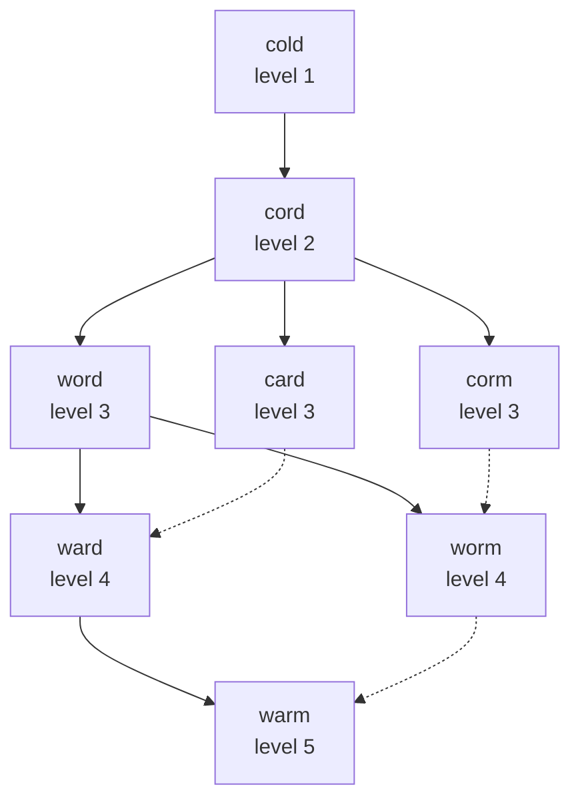
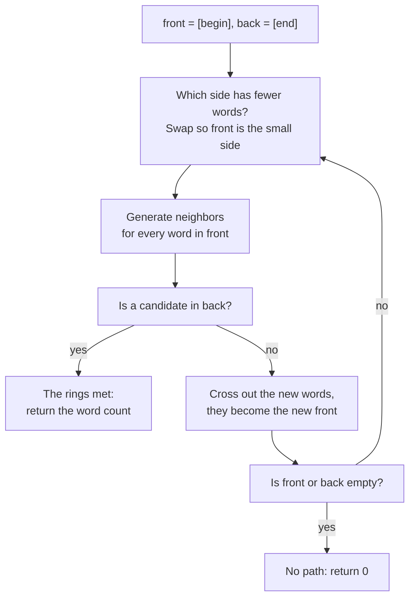

> [!tldr] Quick read
> - Each word is a vertex. Two words that differ in exactly **one letter** share an edge. The problem asks for the shortest path, so use [[en/concepts/breadth-first-search|BFS]], not DFS.
> - Nobody hands you the edges. This is an [[en/concepts/implicit-graph|implicit graph]]: I **generate neighbors on demand** by changing each letter to `a`…`z` and asking the word set.
> - The answer counts **words** on the path, both ends included, not steps. If the target is not in the list, return `0`.
> - [[en/concepts/mark-on-enqueue|Cross a word out the moment it enters the queue]]. Crossing it out late still gives the right answer but makes the queue almost four times busier.
> - On 5,000 words, comparing every pair takes 236–1,990 ms. Grouping by patterns like `c*ld` takes 7–15 ms. [[en/concepts/bidirectional-bfs|Bidirectional BFS]] takes out only 222 words instead of 5,000.

> [!info] Context
> LeetCode problem 127 (Hard), on [[en/posts/2026-11-26-neetcode-graph-bfs|station 2: Graph Traversal and BFS]] of **the NeetCode Line: Graphs**. At [[en/posts/2026-11-26-neetcode-grid-traversal|station 1]], a cell's neighbors are the four cells beside it, visible at a glance. Here, a word's neighbors have to be found. You only need loops, queues and sets; BFS is explained again right below.

> [!abstract]- Quick glossary for this post (click to open)
> - **Vertex, edge**: a vertex is a "point" (here, a word); an edge links two points (two words that differ in exactly one letter).
> - [[en/concepts/breadth-first-search|BFS]] (breadth-first search): visit every vertex 1 step from the start, then 2 steps, then 3… The vertices at the same distance form a **level**.
> - **Queue**: a first-in, first-out list. BFS takes a vertex from the front and adds its neighbors at the back.
> - [[en/concepts/hash-set|Hash set]] (`Set`): asking "is this word in the set?" takes nearly constant time.
> - [[en/concepts/implicit-graph|Implicit graph]]: a graph that stores no edges, only a rule that computes a vertex's neighbors.
> - [[en/concepts/adjacency-list|Adjacency list]]: the usual way to store a graph, where each vertex keeps a list of its neighbors. This problem deliberately avoids building one.
> - **Pattern bucket**: the group of words that match one pattern with a single letter hidden, such as `c*ld`, which holds `cold` and `cald`.

## Picture it first: a stone thrown into a pond

Throw a stone into a pond and the waves spread out in rings. The first ring touches the nearest points, the second ring touches points a little farther away. A point that gets wet earlier is closer. To know how far the target is, I only need to count **which ring** reaches it first.

In this problem, each word is a point on the pond. Two words that differ in one letter sit right next to each other. Throw the stone at the start word and count the rings until the target word.

| Everyday life | Concept |
|---|---|
| A point on the pond | A word, that is, a vertex |
| Two points side by side | Two words differing in exactly one letter, that is, an edge |
| Throwing the stone at the start word | Putting `beginWord` in the queue |
| The k-th ring | Level k of BFS: the words that need exactly k words on the path |
| A wet point does not get wet again from a later ring | Crossing a word out of the set the moment it enters the queue |
| The pond is not drawn; you look around to see what is next to you | Implicit graph: generate neighbors by changing each letter |
| Two stones at both ends, waiting for the rings to meet | Bidirectional BFS |
| The target point is not on the pond | `endWord` is not in the list, return `0` |

Take the example from `cold` to `warm` with the list `cord, card, ward, warm, corm, worm, word`. The rings look like this:



A solid arrow is a ring reaching a word **for the first time**. A dashed arrow is a ring arriving at a word that is already wet, so it is skipped. `warm` sits on level 5, so the shortest chain has **5 words**, for example `cold → cord → card → ward → warm`.

## The problem: count the words on the shortest letter-change chain

You get a start word `beginWord`, a target word `endWord` and a word list `wordList`. All have the same length and use lowercase letters only. Each step changes **exactly one letter** at one position, and the new word must be in `wordList`. The start word need not be in the list. Return the number of words in the shortest chain from `beginWord` to `endWord`, both ends included, or `0` if there is no chain. [Problem LC-0127](https://leetcode.com/problems/word-ladder/)

Limits (I checked them against LeetCode on 26 November 2026): words have 1 to 10 letters; the list has 1 to 5,000 words, all distinct; `beginWord` differs from `endWord`.

Three points are easy to miss in the statement itself:

| Question | Answer | Example |
|---|---|---|
| Count words or steps? | Count **words**. One change makes 2 words. | `ab → cb` returns `2`, not `1` |
| `endWord` not in the list? | Return `0`, even if it is one letter away. | `cat → dog` with `[cot, cog]` returns `0` |
| `beginWord` in the list? | Allowed, just never step back into it. | `pen → pin` with `[pen, pin]` returns `2` |

## How it works

<figure class="figure-map" style="--ar: 3 / 4">
<div class="frame"><iframe data-archify="../../diagrams/neetcode-word-ladder/worked-example.en.html" title="Word Ladder: BFS walks level by level from cold to warm" loading="lazy"></iframe></div>
<figcaption><span><b>Figure 1.</b> BFS finishes one level before starting the next, so the first level that holds <code>warm</code> gives the shortest length at once.</span><a href="../diagrams/neetcode-word-ladder/worked-example.en.html" target="_blank" rel="noopener">Open full screen</a></figcaption>
</figure>

<details>
<summary>Read the steps</summary>
<ol>
<li>Level 1: start at cold, cross cold out of the unvisited set. <code>queue: [cold]</code></li>
<li>Change each letter of cold to a…z. Of the 104 tries, only cord is in the set. <code>level 2: [cord]</code></li>
<li>From cord: changing the first letter gives word, the second gives card, the last gives corm. <code>level 3: [word, card, corm]</code></li>
<li>word finds ward and worm. When card and corm take their turn, those words are already crossed out, so nothing is added. <code>level 4: [ward, worm]</code></li>
<li>ward changes its last letter into warm. <code>level 5: [warm]</code></li>
<li>warm comes out of the queue: it is the target. <code>answer = 5 words</code></li>
</ol>
</details>

### Why DFS does not work

DFS (depth-first search) goes as deep as it can along one branch before backing up. It **finds a path**, but nothing guarantees that path is the shortest. With `aa → bb` and the list `[ca, cb, bb, ab]`, DFS tries the first letter first, so it walks `aa → ca → cb → ab → bb` and returns `5`. The shortest path is `aa → ab → bb`, only `3` words. The test file records exactly this mistake: `wrongDfsFirstPath` fails 2 of 8 cases.

BFS is different: it handles every word on level k before it touches level k + 1. So the first time `endWord` shows up, it sits on the lowest possible level. There is no need to keep going and compare.

### Approach 1: compare every pair, O(n²·L)

The most direct way: for each word taken out of the queue, scan the whole list and add every unvisited word that differs in exactly one letter. With `n` words of length `L`, each word is compared with `n` others, and each comparison costs `L` letter checks: `O(n²·L)` in total.

```ts
for (const candidate of wordList) {
  if (!seen.has(candidate) && differByOne(word, candidate)) {
    seen.add(candidate) // đánh dấu lúc đưa vào
    next.push(candidate)
  }
}
```

This is correct, and for a few dozen words it is fast enough. But with 5,000 words, every word taken out is compared with all 5,000: 25 million comparisons.

### Approach 2: change each letter to a…z, O(26·n·L²)

Flip the question. Instead of asking "which of the 5,000 words are next to me?", ask "which words **could** be next to me?". A word of length `L` has only `25·L` words that differ in exactly one letter. I generate all of them (change letter `i` to `a`, `b`, …, `z`) and ask the [[en/concepts/hash-set|hash set]] about each one. This is exactly how you walk an [[en/concepts/implicit-graph|implicit graph]]: edges are stored nowhere, only computed when needed.

| Level | Taken out | Tries found in the set | Added to the next level |
|---|---|---|---|
| 1 | cold | cord | cord |
| 2 | cord | word, card, corm | word, card, corm |
| 3 | word | ward, worm (cord crossed out) | ward, worm |
| 3 | card, corm | only crossed-out words | nothing |
| 4 | ward | warm | warm |
| 5 | warm | the target | return 5 |

Each word generates `26·L` candidates, and each candidate costs `O(L)` to build and hash. The total is `O(26·n·L²)`. With `L ≤ 10`, that is far smaller than `n²·L` once `n` is large.

The key detail is **crossing a word out the moment it enters the queue** (`unseen.delete(candidate)`), just as a wet patch does not count again for a later ring. If you wait until a word comes out to cross it out, several words on the previous level can each add it. The answer stays right, but on the test file's 5,000-word dictionary the queue receives **19,234** additions instead of at most 5,000.

### Approach 3: group words by a pattern with a star

Two words that differ only at position `i` **are identical once letter `i` is hidden**. `cold` and `cord` both match the pattern `co*d`. So I build a table in advance: each pattern (one letter hidden) points to the list of words that match it. That is a [[en/concepts/hash-map|hash map]] from pattern to a "bucket" of words.

```ts
for (const word of wordList) {
  for (let i = 0; i < word.length; i++) {
    const key = word.slice(0, i) + "*" + word.slice(i + 1)
    if (!buckets.has(key)) buckets.set(key, [])
    buckets.get(key)!.push(word)
  }
}
```

A word's neighbors are all the words in its `L` buckets. The trick that keeps it fast: **open each bucket once, then delete it** (`buckets.delete(key)`). Every word in the bucket was added to the queue the first time it was opened, so opening it again would only find crossed-out words. Without deleting, a bucket of `k` words is opened `k` times and costs `k²` checks.

Building the table costs `O(n·L²)` (each word has `L` patterns, each `L` long). BFS afterwards touches each bucket only once. It is the fastest of the one-sided searches in the measurements below.

### Approach 4: bidirectional BFS

Back to the pond: throw **two** stones, one at `beginWord` and one at `endWord`, and let both rings grow until they touch. The number of points inside a ring of radius `d` grows very fast with `d`. Two rings of radius `d/2` usually cover far fewer points than one ring of radius `d`.

[[en/concepts/bidirectional-bfs|Bidirectional BFS]] keeps two levels: `front` (spreading from one end) and `back` (spreading from the other). Each round, I **expand whichever side has the smaller level**, because expanding a small level costs the least work. While generating candidates, if a candidate is in the other side's level, the rings have met: return the current word count.



Counting words needs care here. `words` starts at 2, because if `begin` generates `end` directly the chain has 2 words. Each expanded level makes the chain joining both sides one word longer. The worst case is still the same as Approach 2, but on real data it usually touches far fewer words.

### Measured on 5,000 words

The test file builds two dictionaries of 5,000 six-letter words. The **dense** one holds random words using only `a`…`e`, so each word has many neighbors. The **sparse** one is grown over `a`…`z`, each new word changing one letter of an existing word, so it looks like a tree with many branches. The target is the word farthest from `list[0]`, so the three one-sided approaches must walk the whole graph.

| Dense dictionary, answer 9 words | Words taken out | TS | Python | Go | Java |
|---|---:|---:|---:|---:|---:|
| Approach 1: every pair | 5,000 | 463 ms | 1,420 ms | 314 ms | 236 ms |
| Approach 2: a…z | 5,000 | 92 ms | 46 ms | 21 ms | 12 ms |
| Approach 3: pattern buckets | 5,000 | 14 ms | 15 ms | 9 ms | 7 ms |
| Approach 4: bidirectional | **222** | 5 ms | 3 ms | 1.4 ms | 1.4 ms |

| Sparse dictionary, answer 17 words | Words taken out | TS | Python | Go | Java |
|---|---:|---:|---:|---:|---:|
| Approach 1: every pair | 5,000 | 513 ms | 1,990 ms | 345 ms | 265 ms |
| Approach 2: a…z | 5,000 | 91 ms | 45 ms | 22 ms | 25 ms |
| Approach 3: pattern buckets | 5,000 | 9 ms | 15 ms | 8 ms | 12 ms |
| Approach 4: bidirectional | **233** | 4.5 ms | 2.7 ms | 1.9 ms | 1.5 ms |

Timings change with the machine and from run to run; the "words taken out" column is identical in all five languages. Two things are worth remembering:

- Approach 1 is 20 to 130 times slower than Approach 3. The gap grows with `n`, because Approach 1 grows with `n²`.
- Bidirectional BFS takes out only about **4–5%** of the words a one-sided BFS does, because two small rings meet sooner than one large ring reaches the far end.

In TypeScript, Approach 2 is clearly slower than in Python. The culprit is how the candidate word is built; see the traps below.

## Runnable example

Each file runs the same 8 cases: the `cold → warm` example, a target missing from the list, no path, one-letter words, a start word that is in the list, and the `aa → bb` case that sends DFS the long way round. The file also cross-checks the four correct approaches on 2,000 random dictionaries, measures the two 5,000-word dictionaries, and counts queue additions when words are crossed out late. Below are the three fast approaches; Approach 1 and the wrong versions are in the full files. Comments and printed text in the code stay in Vietnamese.

[TypeScript](../code/neetcode-word-ladder/word-ladder.ts) · [Python](../code/neetcode-word-ladder/word_ladder.py) · [Go](../code/neetcode-word-ladder/word_ladder.go) · [Java](../code/neetcode-word-ladder/word-ladder.java) · [JavaScript](../code/neetcode-word-ladder/word-ladder.js)

```ts
// Cách 2: BFS, sinh hàng xóm bằng cách đổi từng chữ thành a..z. O(n·L·26).
function ladderLetters(begin: string, end: string, wordList: string[]): number {
  const unseen = new Set(wordList)
  if (!unseen.has(end)) return 0
  unseen.delete(begin)
  const queue = [begin]
  const dist = new Map([[begin, 1]])
  for (let head = 0; head < queue.length; head++) {
    const word = queue[head]
    expanded++
    const d = dist.get(word)!
    if (word === end) return d
    const chars = word.split("")
    for (let i = 0; i < chars.length; i++) {
      const original = chars[i]
      for (let c = 97; c <= 122; c++) {
        chars[i] = String.fromCharCode(c)
        const candidate = chars.join("")
        if (unseen.has(candidate)) {
          unseen.delete(candidate)
          dist.set(candidate, d + 1)
          queue.push(candidate)
        }
      }
      chars[i] = original
    }
  }
  return 0
}

// Cách 3: gom từ theo mẫu có dấu *, ví dụ "c*ld" chứa cold và cald.
function ladderBuckets(begin: string, end: string, wordList: string[]): number {
  if (!wordList.includes(end)) return 0
  const buckets = new Map<string, string[]>()
  for (const word of wordList) {
    for (let i = 0; i < word.length; i++) {
      const key = word.slice(0, i) + "*" + word.slice(i + 1)
      if (!buckets.has(key)) buckets.set(key, [])
      buckets.get(key)!.push(word)
    }
  }
  const seen = new Set([begin])
  let level = [begin]
  for (let words = 1; level.length > 0; words++) {
    const next: string[] = []
    for (const word of level) {
      expanded++
      if (word === end) return words
      for (let i = 0; i < word.length; i++) {
        const key = word.slice(0, i) + "*" + word.slice(i + 1)
        for (const candidate of buckets.get(key) ?? []) {
          if (!seen.has(candidate)) {
            seen.add(candidate)
            next.push(candidate)
          }
        }
        buckets.delete(key) // một xô chỉ cần mở một lần
      }
    }
    level = next
  }
  return 0
}

// Cách 4: BFS hai đầu, luôn nới bên có tầng nhỏ hơn.
function ladderBidirectional(begin: string, end: string, wordList: string[]): number {
  const unseen = new Set(wordList)
  if (!unseen.has(end)) return 0
  unseen.delete(begin)
  unseen.delete(end)
  // mỗi phía: một mảng giữ thứ tự duyệt, một Set để hỏi "có trong tầng này không"
  let front = [begin], frontSet = new Set(front)
  let back = [end], backSet = new Set(back)
  for (let words = 2; front.length > 0 && back.length > 0; words++) {
    if (front.length > back.length) {
      [front, back] = [back, front];
      [frontSet, backSet] = [backSet, frontSet]
    }
    const next: string[] = []
    for (const word of front) {
      expanded++
      const chars = word.split("")
      for (let i = 0; i < chars.length; i++) {
        const original = chars[i]
        for (let c = 97; c <= 122; c++) {
          chars[i] = String.fromCharCode(c)
          const candidate = chars.join("")
          if (backSet.has(candidate)) return words // hai phía gặp nhau
          if (unseen.has(candidate)) {
            unseen.delete(candidate)
            next.push(candidate)
          }
        }
        chars[i] = original
      }
    }
    front = next
    frontSet = new Set(next)
  }
  return 0
}
```

```python
# Cách 2: BFS, đổi từng chữ thành a..z. O(n·L·26).
def ladder_letters(begin, end, word_list):
    global expanded
    unseen = set(word_list)
    if end not in unseen:
        return 0
    unseen.discard(begin)
    queue = deque([(begin, 1)])
    while queue:
        word, d = queue.popleft()
        expanded += 1
        if word == end:
            return d
        for i in range(len(word)):
            prefix, suffix = word[:i], word[i + 1:]
            for ch in LETTERS:
                candidate = prefix + ch + suffix
                if candidate in unseen:
                    unseen.remove(candidate)
                    queue.append((candidate, d + 1))
    return 0


# Cách 3: gom từ theo mẫu có dấu *, ví dụ "c*ld".
def ladder_buckets(begin, end, word_list):
    global expanded
    if end not in word_list:
        return 0
    buckets = defaultdict(list)
    for word in word_list:
        for i in range(len(word)):
            buckets[word[:i] + "*" + word[i + 1:]].append(word)
    seen = {begin}
    level = [begin]
    words = 1
    while level:
        nxt = []
        for word in level:
            expanded += 1
            if word == end:
                return words
            for i in range(len(word)):
                key = word[:i] + "*" + word[i + 1:]
                for candidate in buckets.pop(key, ()):  # một xô chỉ mở một lần
                    if candidate not in seen:
                        seen.add(candidate)
                        nxt.append(candidate)
        level = nxt
        words += 1
    return 0


# Cách 4: BFS hai đầu, luôn nới bên có tầng nhỏ hơn.
def ladder_bidirectional(begin, end, word_list):
    global expanded
    unseen = set(word_list)
    if end not in unseen:
        return 0
    unseen.discard(begin)
    unseen.discard(end)
    front, front_set = [begin], {begin}
    back, back_set = [end], {end}
    words = 2
    while front and back:
        if len(front) > len(back):
            front, back = back, front
            front_set, back_set = back_set, front_set
        nxt = []
        for word in front:
            expanded += 1
            for i in range(len(word)):
                prefix, suffix = word[:i], word[i + 1:]
                for ch in LETTERS:
                    candidate = prefix + ch + suffix
                    if candidate in back_set:
                        return words  # hai phía gặp nhau
                    if candidate in unseen:
                        unseen.remove(candidate)
                        nxt.append(candidate)
        front, front_set = nxt, set(nxt)
        words += 1
    return 0
```

```go
// Cách 2: BFS, đổi từng chữ thành a..z. O(n·L·26).
// Dùng []byte để sửa một chữ tại chỗ; string(buf) tạo một chuỗi mới cho mỗi lần tra.
func ladderLetters(begin, end string, wordList []string) int {
	unseen := toSet(wordList)
	if !unseen[end] {
		return 0
	}
	delete(unseen, begin)
	queue := []string{begin}
	dist := map[string]int{begin: 1}
	for head := 0; head < len(queue); head++ {
		word := queue[head]
		expanded++
		d := dist[word]
		if word == end {
			return d
		}
		buf := []byte(word)
		for i := range buf {
			original := buf[i]
			for c := byte('a'); c <= 'z'; c++ {
				buf[i] = c
				candidate := string(buf)
				if unseen[candidate] {
					delete(unseen, candidate)
					dist[candidate] = d + 1
					queue = append(queue, candidate)
				}
			}
			buf[i] = original
		}
	}
	return 0
}

// Cách 3: gom từ theo mẫu có dấu *, ví dụ "c*ld".
func ladderBuckets(begin, end string, wordList []string) int {
	if !contains(wordList, end) {
		return 0
	}
	buckets := map[string][]string{}
	for _, word := range wordList {
		for i := range word {
			key := word[:i] + "*" + word[i+1:]
			buckets[key] = append(buckets[key], word)
		}
	}
	seen := map[string]bool{begin: true}
	level := []string{begin}
	for words := 1; len(level) > 0; words++ {
		var next []string
		for _, word := range level {
			expanded++
			if word == end {
				return words
			}
			for i := range word {
				key := word[:i] + "*" + word[i+1:]
				for _, candidate := range buckets[key] {
					if !seen[candidate] {
						seen[candidate] = true
						next = append(next, candidate)
					}
				}
				delete(buckets, key) // một xô chỉ mở một lần
			}
		}
		level = next
	}
	return 0
}

// Cách 4: BFS hai đầu, luôn nới bên có tầng nhỏ hơn.
func ladderBidirectional(begin, end string, wordList []string) int {
	unseen := toSet(wordList)
	if !unseen[end] {
		return 0
	}
	delete(unseen, begin)
	delete(unseen, end)
	front, frontSet := []string{begin}, map[string]bool{begin: true}
	back, backSet := []string{end}, map[string]bool{end: true}
	for words := 2; len(front) > 0 && len(back) > 0; words++ {
		if len(front) > len(back) {
			front, back = back, front
			frontSet, backSet = backSet, frontSet
		}
		var next []string
		for _, word := range front {
			expanded++
			buf := []byte(word)
			for i := range buf {
				original := buf[i]
				for c := byte('a'); c <= 'z'; c++ {
					buf[i] = c
					candidate := string(buf)
					if backSet[candidate] {
						return words // hai phía gặp nhau
					}
					if unseen[candidate] {
						delete(unseen, candidate)
						next = append(next, candidate)
					}
				}
				buf[i] = original
			}
		}
		front, frontSet = next, toSet(next)
	}
	return 0
}
```

```java
// Cách 2: BFS, đổi từng chữ thành a..z. O(n·L·26).
// Sửa một chữ trong char[], rồi new String(chars) chép cả mảng thành chuỗi mới.
static int ladderLetters(String begin, String end, List<String> wordList) {
    Set<String> unseen = new HashSet<>(wordList);
    if (!unseen.contains(end)) return 0;
    unseen.remove(begin);
    ArrayDeque<String> queue = new ArrayDeque<>(List.of(begin));
    Map<String, Integer> dist = new HashMap<>(Map.of(begin, 1));
    while (!queue.isEmpty()) {
        String word = queue.pollFirst();
        expanded++;
        int d = dist.get(word);
        if (word.equals(end)) return d;
        char[] chars = word.toCharArray();
        for (int i = 0; i < chars.length; i++) {
            char original = chars[i];
            for (char c = 'a'; c <= 'z'; c++) {
                chars[i] = c;
                String candidate = new String(chars);
                if (unseen.remove(candidate)) { // remove trả true nếu từ có trong tập
                    dist.put(candidate, d + 1);
                    queue.addLast(candidate);
                }
            }
            chars[i] = original;
        }
    }
    return 0;
}

// Cách 3: gom từ theo mẫu có dấu *, ví dụ "c*ld".
static int ladderBuckets(String begin, String end, List<String> wordList) {
    if (!wordList.contains(end)) return 0;
    Map<String, List<String>> buckets = new HashMap<>();
    for (String word : wordList) {
        for (int i = 0; i < word.length(); i++) {
            String key = word.substring(0, i) + "*" + word.substring(i + 1);
            buckets.computeIfAbsent(key, k -> new ArrayList<>()).add(word);
        }
    }
    Set<String> seen = new HashSet<>(List.of(begin));
    List<String> level = new ArrayList<>(List.of(begin));
    for (int words = 1; !level.isEmpty(); words++) {
        List<String> next = new ArrayList<>();
        for (String word : level) {
            expanded++;
            if (word.equals(end)) return words;
            for (int i = 0; i < word.length(); i++) {
                String key = word.substring(0, i) + "*" + word.substring(i + 1);
                List<String> bucket = buckets.remove(key); // một xô chỉ mở một lần
                if (bucket == null) continue;
                for (String candidate : bucket) {
                    if (seen.add(candidate)) next.add(candidate);
                }
            }
        }
        level = next;
    }
    return 0;
}

// Cách 4: BFS hai đầu, luôn nới bên có tầng nhỏ hơn.
static int ladderBidirectional(String begin, String end, List<String> wordList) {
    Set<String> unseen = new HashSet<>(wordList);
    if (!unseen.contains(end)) return 0;
    unseen.remove(begin);
    unseen.remove(end);
    List<String> front = new ArrayList<>(List.of(begin)), back = new ArrayList<>(List.of(end));
    Set<String> frontSet = new HashSet<>(front), backSet = new HashSet<>(back);
    for (int words = 2; !front.isEmpty() && !back.isEmpty(); words++) {
        if (front.size() > back.size()) {
            List<String> t = front; front = back; back = t;
            Set<String> ts = frontSet; frontSet = backSet; backSet = ts;
        }
        List<String> next = new ArrayList<>();
        for (String word : front) {
            expanded++;
            char[] chars = word.toCharArray();
            for (int i = 0; i < chars.length; i++) {
                char original = chars[i];
                for (char c = 'a'; c <= 'z'; c++) {
                    chars[i] = c;
                    String candidate = new String(chars);
                    if (backSet.contains(candidate)) return words; // hai phía gặp nhau
                    if (unseen.remove(candidate)) next.add(candidate);
                }
                chars[i] = original;
            }
        }
        front = next;
        frontSet = new HashSet<>(next);
    }
    return 0;
}
```

```js
// Cách 2: BFS, sinh hàng xóm bằng cách đổi từng chữ thành a..z. O(n·L·26).
function ladderLetters(begin, end, wordList) {
    const unseen = new Set(wordList);
    if (!unseen.has(end))
        return 0;
    unseen.delete(begin);
    const queue = [begin];
    const dist = new Map([[begin, 1]]);
    for (let head = 0; head < queue.length; head++) {
        const word = queue[head];
        expanded++;
        const d = dist.get(word);
        if (word === end)
            return d;
        const chars = word.split("");
        for (let i = 0; i < chars.length; i++) {
            const original = chars[i];
            for (let c = 97; c <= 122; c++) {
                chars[i] = String.fromCharCode(c);
                const candidate = chars.join("");
                if (unseen.has(candidate)) {
                    unseen.delete(candidate);
                    dist.set(candidate, d + 1);
                    queue.push(candidate);
                }
            }
            chars[i] = original;
        }
    }
    return 0;
}

// Cách 3: gom từ theo mẫu có dấu *, ví dụ "c*ld" chứa cold và cald.
function ladderBuckets(begin, end, wordList) {
    if (!wordList.includes(end))
        return 0;
    const buckets = new Map();
    for (const word of wordList) {
        for (let i = 0; i < word.length; i++) {
            const key = word.slice(0, i) + "*" + word.slice(i + 1);
            if (!buckets.has(key))
                buckets.set(key, []);
            buckets.get(key).push(word);
        }
    }
    const seen = new Set([begin]);
    let level = [begin];
    for (let words = 1; level.length > 0; words++) {
        const next = [];
        for (const word of level) {
            expanded++;
            if (word === end)
                return words;
            for (let i = 0; i < word.length; i++) {
                const key = word.slice(0, i) + "*" + word.slice(i + 1);
                for (const candidate of buckets.get(key) ?? []) {
                    if (!seen.has(candidate)) {
                        seen.add(candidate);
                        next.push(candidate);
                    }
                }
                buckets.delete(key); // một xô chỉ cần mở một lần
            }
        }
        level = next;
    }
    return 0;
}

// Cách 4: BFS hai đầu, luôn nới bên có tầng nhỏ hơn.
function ladderBidirectional(begin, end, wordList) {
    const unseen = new Set(wordList);
    if (!unseen.has(end))
        return 0;
    unseen.delete(begin);
    unseen.delete(end);
    // mỗi phía: một mảng giữ thứ tự duyệt, một Set để hỏi "có trong tầng này không"
    let front = [begin], frontSet = new Set(front);
    let back = [end], backSet = new Set(back);
    for (let words = 2; front.length > 0 && back.length > 0; words++) {
        if (front.length > back.length) {
            [front, back] = [back, front];
            [frontSet, backSet] = [backSet, frontSet];
        }
        const next = [];
        for (const word of front) {
            expanded++;
            const chars = word.split("");
            for (let i = 0; i < chars.length; i++) {
                const original = chars[i];
                for (let c = 97; c <= 122; c++) {
                    chars[i] = String.fromCharCode(c);
                    const candidate = chars.join("");
                    if (backSet.has(candidate))
                        return words; // hai phía gặp nhau
                    if (unseen.has(candidate)) {
                        unseen.delete(candidate);
                        next.push(candidate);
                    }
                }
                chars[i] = original;
            }
        }
        front = next;
        frontSet = new Set(next);
    }
    return 0;
}
```

Output of `node word-ladder.ts` (the other four print the same case lines and the same "words taken out" counts; only the timings differ). `ca đúng` means "cases correct", `sai ở` lists the failing cases, `lấy ra … từ` is the number of words taken out, and `lượt đưa vào hàng đợi` counts queue additions:

```text
ladderPairwise       8/8 ca đúng
ladderLetters        8/8 ca đúng
ladderBuckets        8/8 ca đúng
ladderBidirectional  8/8 ca đúng
wrongDfsFirstPath    6/8 ca đúng; sai ở từ một chữ → 3, DFS đi vòng → 5
wrongCountEdges      2/8 ca đúng; sai ở cold → warm → 4, cat → dog → 3, một bước → 1, từ đầu nằm trong danh sách → 1, từ một chữ → 1, DFS đi vòng → 2
wrongSkipEndCheck    7/8 ca đúng; sai ở đích không có trong danh sách → 4
ngẫu nhiên: 2000/2000 bộ từ điển, bốn cách khớp nhau
từ điển dày, 5000 từ: cdecae → eedbba
  ladderPairwise       đáp án 9, lấy ra 5000 từ, 463.2 ms
  ladderLetters        đáp án 9, lấy ra 5000 từ, 91.6 ms
  ladderBuckets        đáp án 9, lấy ra 5000 từ, 14.3 ms
  ladderBidirectional  đáp án 9, lấy ra 222 từ, 5.2 ms
từ điển thưa, 5000 từ: bkarpa → gstmeb
  ladderPairwise       đáp án 17, lấy ra 5000 từ, 513.1 ms
  ladderLetters        đáp án 17, lấy ra 5000 từ, 90.7 ms
  ladderBuckets        đáp án 17, lấy ra 5000 từ, 9.2 ms
  ladderBidirectional  đáp án 17, lấy ra 233 từ, 4.5 ms
từ điển dày, đánh dấu lúc lấy ra: đáp án 9, 19234 lượt đưa vào hàng đợi; đánh dấu lúc đưa vào: đáp án 9, tối đa 5000 lượt
sinh 780000 từ ứng viên (68466 = 68466 lần trúng): split/join 85.5 ms, ghép slice 30.6 ms
```

## Misconceptions and common traps

- **Using DFS because "any traversal will do".** DFS finds *a* path, not the shortest. The `aa → bb` case returns `5` instead of `3`, and `a → c` returns `3` instead of `2`.
- **Counting steps instead of words.** Returning `levels − 1` fails 6 of 8 cases. One letter change gives a chain of 2 words.
- **Returning as soon as the target is one letter away.** If `endWord` is not in the list, you may not step into it. The `wrongSkipEndCheck` version returns `4` for `cat → dog` with `[cot, cog]`; the right answer is `0`.
- **Crossing a word out when it comes out instead of when it goes in.** The answer does not change, but the queue receives 19,234 additions instead of at most 5,000. On denser graphs the gap is larger.
- **Never crossing out visited words.** Two neighboring words keep adding each other to the queue: the loop never ends.
- **Not deleting a bucket after opening it** (Approach 3). Still correct, but a bucket of `k` words is opened `k` times.
- **TypeScript and JavaScript: building candidates with `split("")` and `join("")`.** `join` builds a new string from the whole array on every try. Concatenating `prefix + letter + suffix` (with `prefix` and `suffix` cut once per position) is almost 3 times faster: the file measures 780,000 candidates at 85 ms with `join` and 31 ms with `slice` concatenation.
- **Python: `list.pop(0)` as a queue.** Every removal from the front shifts the whole list. Use `collections.deque` and `popleft()`.
- **Java: `contains` followed by `remove`.** `Set.remove` returns `true` when the element was in the set, so one call both checks and crosses out. `new String(chars)` copies the whole character array for each candidate; with `L ≤ 10` that cost is small.
- **Go: editing a `string` directly.** Go strings are immutable. Convert to `[]byte` once, change one byte at a time, then use `string(buf)` to look up the map.

## Self-check questions

> [!question]- Changing `cold` into `warm` gives 5. Why not 4?
> The problem counts the words on the chain, both ends included: `cold, cord, card, ward, warm` is 5 words. The number of letter changes is 4.

> [!question]- Why can BFS stop as soon as `endWord` comes out, without exploring further to compare paths?
> BFS finishes level k before moving to level k + 1. The first time `endWord` appears, it is on the lowest possible level, so no shorter path exists.

> [!question]- The list has 5,000 words of 10 letters. How many tries does each word cost in Approach 1 and Approach 2?
> Approach 1 compares against 5,000 words, each with up to 10 letter checks. Approach 2 generates `26 × 10 = 260` candidates, each built and hashed over 10 letters. 260 is much smaller than 5,000, so Approach 2 wins when the list is large.

> [!question]- In bidirectional BFS, why always expand the side with the smaller level?
> The work to expand a level is proportional to the number of words in it. Expanding the small side costs the least and still brings the two rings one step closer.

> [!question]- What if `beginWord` is not in the list?
> That is fine. The start word is only the starting point; only the words visited after it must be in the list.

## References

- [LeetCode · Word Ladder](https://leetcode.com/problems/word-ladder/): the letter-change rule and the input limits.
- [Princeton · Breadth-first paths](https://github.com/kevin-wayne/algs4/blob/master/src/main/java/edu/princeton/cs/algs4/BreadthFirstPaths.java): BFS marks a vertex when it enters the queue and yields shortest paths on an unweighted graph.
- [Python · collections.deque](https://docs.python.org/3/library/collections.html#collections.deque): `popleft()` removes from the front in O(1).
- [Java · Set.remove](https://docs.oracle.com/en/java/javase/21/docs/api/java.base/java/util/Set.html#remove(java.lang.Object)): returns `true` when the set contained the element.
- [Go · Conversions between string and []byte](https://go.dev/ref/spec#Conversions_to_and_from_a_string_type).
