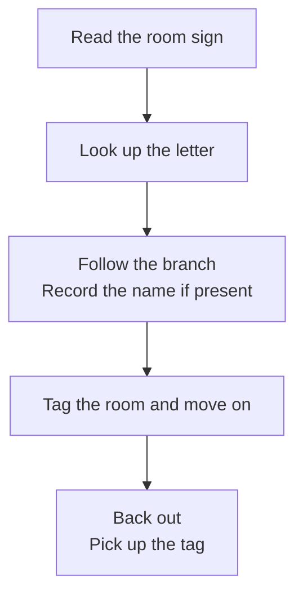
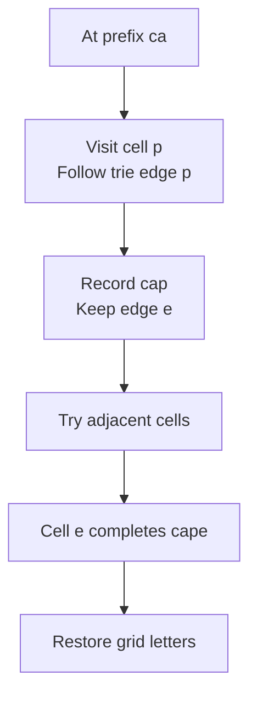

> [!tldr] Quick read
> - [[en/concepts/backtracking|Backtracking]] for each word gives me a baseline I can check. Words with a common prefix may traverse the same stretch repeatedly.
> - Carry the [[en/concepts/trie|trie]] node with each call to see if any word continues from this prefix. A missing child edge ends the search at that cell.
> - Mark each cell for the current path and restore it on return. After recording a word, clear its [[en/concepts/terminal-marker|terminal marker]] for the rest of the search.
> - Keep any branch that still holds a word to find. Remove an edge when its child has run out of words and descendants to search.

> [!info] Context
> LeetCode 212 (Hard) belongs to [[en/posts/2026-11-26-neetcode-trie|station 7: Tries]] on **the NeetCode Line: Linked Structures**. In [[en/problems/implement-trie-prefix-tree|LC-0208]], the trie answers questions about a string. Here I build a string as I move across a grid, so I track both my position in the trie and which cells the current path already uses. You only need to know row and column indices and the four directions from a cell.

> [!abstract]- Quick glossary for this post (click to open)
> - A **prefix** of `cape` starts at the beginning of the word. Examples include `ca` and `cap`.
> - A **terminal marker** lives at a trie node when the path from the root spells a dictionary entry. Here the node stores the entire word.
> - **Depth-first search (DFS)** follows one choice as far as it can, then comes back to try another.
> - **[[en/concepts/trie-prefix-pruning|Prefix pruning]]** cuts off a path when no remaining word begins with the letters already read.
> - The **sentinel** `#` temporarily replaces the letter of a cell used on the current path. The input only permits lowercase English letters, which keeps the marker distinct.

## Picture it first: reading signs in a museum

Every room has a letter on its sign. I pass through connecting doors to spell the names of exhibits. Visitors carry a map indexed one letter at a time, leave a temporary tag in each room they visit, and pick it up when they back out. When they find a name, the inventory desk crosses it off even if visitors can reach the same name by another route.

| Everyday life | Concept |
|---|---|
| A door between rooms sharing a wall | Horizontal or vertical adjacency |
| A temporary tag left in a room | Mark a cell on the current path |
| A map of names with one branch per letter | A trie of candidate words |
| The next letter leads off the map | Prefix pruning |
| Cross off the name I just found | Clear the terminal marker |
| Remove a drawer when it holds no remaining names | Detach an exhausted trie branch |



## The problem: several words share the same stretch

The grid is `m × n`, with each dimension between 1 and 12. The distinct word list has between 1 and 30,000 entries, each from 1 to 10 letters long. Grid cells and words use lowercase English letters. Return each word spelled by a path of horizontal or vertical moves, using any given cell at most once on that path. [LeetCode 212](https://leetcode.com/problems/word-search-ii/)

Try the following board with the list `cap, cape, car, cart, capa, cat`.

```text
c a r
t p x
x e x
```

The path `c → a → p` spells `cap`, and continuing down from `p` to `e` spells `cape`. Turning from `a` to `r` spells `car`. The word `capa` would revisit the same `a` cell, and `cat` would require a diagonal step from `a` to `t`. The word `cart` gets stuck at `r`, which has no adjacent `t`. The resulting words are `cap, cape, car`. Searching for each word separately tries `c → a` repeatedly.

## How it works

### Approach 1 — Backtrack for each word

For every word, try all cells as starting points. The current call holds the index of its next required character. Stop at a mismatched letter or an out-of-bounds cell. On a match, mark the cell and try the four neighbors with the next character index. Restore the original letter before returning to the caller. Once every character matches, stop searching for this word, because one valid path is enough.

A mark belongs to **the current path**. The same `a` cell can appear in the path that spells `cap` and another path that spells `car`. Restoring it lets the branch toward `r` see `a` again when it starts from `c`.

### Approach 2 — Use a trie to search for several words along one path

Insert the entire word list into a trie. The grid path `c → a` travels with trie node `ca`. In each call, the parent node represents the letters already matched and the cell under consideration supplies the next letter. The `p` cell leads to node `cap`, which stores the complete word `cap` and has an `e` edge for `cape`. A cell whose letter lacks an edge cannot lead to a valid word, so I stop before making four more calls.



Two updates have different lifetimes.

1. Add the word to the result, then clear the terminal marker. The word `cap` has a valid path, so subsequent paths can skip recording it. Keep the node's child edges.
2. On return, detach the node from its parent once it has no child edges. Any word at the node has already been recorded, and all words below it have been found. Removing the parent edge preserves every missing answer.

To see why this finds every word, consider a path spelling an outstanding word. Each next step has an edge in the trie, because deletion touches only exhausted branches. Starting from its first cell, DFS tries all valid adjacent cells and uses each cell at most once on that path. It reaches the terminal marker unless another path finds the word first.

### Cost and measured advances

Let `B = m × n`, let `S` be the sum of word lengths, and let `P` be the number of trie nodes. Let `D` be the smaller of `B` and the longest word length, an upper bound on path depth. The second step from a starting cell has up to four options. Subsequent steps have at most three because the previous cell is already marked. Boundaries, visited cells, and mismatches further reduce the actual choices.

| Approach | Time | Auxiliary space, excluding the result |
|---|---|---|
| Per word | Sum `O(B · 3^d)` over the words, where `d` is the smaller of the word length and `B` | `O(D)` for the call stack |
| Trie | `O(S + B · 3^D)` upper bound. The actual search takes `O(B + A)`, with `A` successful advances | `O(P + D)`, with `P ≤ S + 1` |

The alphabet has 26 letters, which bounds how many edges a trie node can hold. A successful advance makes at most four neighbor calls, and the root tries every cell once. Counting successful advances therefore also explains how much extra visiting work they can generate. The trie reduces repeated traversal, while path count still grows quickly with `D` in the worst case.

The measured case uses a `3 × 3` grid of `a` letters and ten words that start with `aaaaa` and end in one letter from `b` through `k`. Both searches return an empty list. The per-word search makes **2,610** successful advances. The trie makes **261**, because it shares the `aaaaa` prefix. The counter increments after a letter matches. It measures matched-path work and excludes trie construction, failed comparisons, and allocation. I deliberately chose a shared prefix to illustrate reuse, so the 10× factor applies to advances in this fixture.

## Runnable example

Both approaches run the same six cases, covering words that are prefixes of other words, multiple paths for the same word, rejected diagonal moves, and words that would need to reuse a cell. Five small cases also check that each approach leaves the board intact.

Download [TypeScript](../code/neetcode-word-search-ii/search-grid.ts), [Python](../code/neetcode-word-search-ii/search-grid.py), [Go](../code/neetcode-word-search-ii/search-grid.go), [Java](../code/neetcode-word-search-ii/search-grid.java), or [JavaScript](../code/neetcode-word-search-ii/search-grid.js). Run with `node search-grid.ts`, `python3 search-grid.py`, `go run search-grid.go`, `java search-grid.java`, or `node search-grid.js`.

```ts
const directions = [[0, 1], [1, 0], [0, -1], [-1, 0]]

type SearchRun = { found: string[]; advances: number }
type TrieNode = { children: Map<string, TrieNode>; word?: string }

function perWord(board: string[][], words: string[]): SearchRun {
  const rows = board.length
  const cols = board[0].length
  const found: string[] = []
  let advances = 0

  function match(row: number, col: number, word: string, index: number): boolean {
    if (row < 0 || row >= rows || col < 0 || col >= cols) return false
    if (board[row][col] !== word[index]) return false
    advances++
    if (index + 1 === word.length) return true

    const letter = board[row][col]
    board[row][col] = "#"
    const hit = directions.some(([dr, dc]) => match(row + dr, col + dc, word, index + 1))
    board[row][col] = letter
    return hit
  }

  for (const word of words) {
    if (board.some((line, row) => line.some((_, col) => match(row, col, word, 0)))) {
      found.push(word)
    }
  }
  return { found, advances }
}

function withTrie(board: string[][], words: string[]): SearchRun {
  const root: TrieNode = { children: new Map() }
  for (const word of words) {
    let node = root
    for (const letter of word) {
      let child = node.children.get(letter)
      if (!child) {
        child = { children: new Map() }
        node.children.set(letter, child)
      }
      node = child
    }
    node.word = word
  }

  const rows = board.length
  const cols = board[0].length
  const found: string[] = []
  let advances = 0

  function visit(row: number, col: number, parent: TrieNode) {
    if (row < 0 || row >= rows || col < 0 || col >= cols) return
    const letter = board[row][col]
    const node = parent.children.get(letter)
    if (!node) return
    advances++

    if (node.word !== undefined) {
      found.push(node.word)
      delete node.word
    }
    board[row][col] = "#"
    for (const [dr, dc] of directions) {
      if (!node.children.size) break
      visit(row + dr, col + dc, node)
    }
    board[row][col] = letter
    if (!node.children.size) parent.children.delete(letter)
  }

  for (let row = 0; row < rows; row++) {
    for (let col = 0; col < cols; col++) visit(row, col, root)
  }
  return { found, advances }
}

const cases = [
  [["car", "tpx", "xex"], ["cap", "cape", "car", "cart", "capa", "cat"], ["cap", "cape", "car"]],
  [["aaa"], ["a", "aa", "aaa", "aaaa"], ["a", "aa", "aaa"]],
  [["ax", "xb"], ["ab", "axb", "axxb"], ["axb"]],
  [["z"], ["a", "z", "zz"], ["z"]],
  [["yx", "xy"], ["aaa", "zzz"], []],
]

for (const [rows, words, expected] of cases) {
  const board = rows.map(row => [...row])
  for (const search of [perWord, withTrie]) {
    const { found } = search(board, words)
    if (found.sort().join(",") !== expected.join(",")) throw new Error("Sai kết quả")
    if (board.map(row => row.join("")).join(",") !== rows.join(",")) {
      throw new Error("Bảng chữ đã thay đổi")
    }
  }
}

const board = Array.from({ length: 3 }, () => [..."aaa"])
const words = [..."bcdefghijk"].map(last => "aaaaa" + last)
const left = perWord(board, words)
const right = withTrie(board, words)
if (left.found.length || right.found.length || !right.advances || left.advances !== 10 * right.advances) {
  throw new Error("Sai số bước khớp")
}
console.log((cases.length + 1) + "/" + (cases.length + 1) + " ca đúng")
console.log("Bước khớp: " + left.advances + " / " + right.advances)
```
```python
DIRECTIONS = ((0, 1), (1, 0), (0, -1), (-1, 0))


def per_word(board, words):
    rows, cols = len(board), len(board[0])
    found = []
    advances = 0

    def match(row, col, word, index):
        nonlocal advances
        if not (0 <= row < rows and 0 <= col < cols):
            return False
        if board[row][col] != word[index]:
            return False
        advances += 1
        if index + 1 == len(word):
            return True
        letter = board[row][col]
        board[row][col] = "#"
        hit = any(
            match(row + dr, col + dc, word, index + 1)
            for dr, dc in DIRECTIONS
        )
        board[row][col] = letter
        return hit

    for word in words:
        if any(match(r, c, word, 0) for r in range(rows) for c in range(cols)):
            found.append(word)
    return found, advances


class Node:
    def __init__(self):
        self.children = {}
        self.word = None


def with_trie(board, words):
    root = Node()
    for word in words:
        node = root
        for letter in word:
            if letter not in node.children:
                node.children[letter] = Node()
            node = node.children[letter]
        node.word = word

    rows, cols = len(board), len(board[0])
    found = []
    advances = 0

    def visit(row, col, parent):
        nonlocal advances
        if not (0 <= row < rows and 0 <= col < cols):
            return
        letter = board[row][col]
        node = parent.children.get(letter)
        if node is None:
            return
        advances += 1
        if node.word is not None:
            found.append(node.word)
            node.word = None
        board[row][col] = "#"
        for dr, dc in DIRECTIONS:
            if not node.children:
                break
            visit(row + dr, col + dc, node)
        board[row][col] = letter
        if not node.children:
            del parent.children[letter]

    for row in range(rows):
        for col in range(cols):
            visit(row, col, root)
    return found, advances


CASES = [
    (["car", "tpx", "xex"], ["cap", "cape", "car", "cart", "capa", "cat"], ["cap", "cape", "car"]),
    (["aaa"], ["a", "aa", "aaa", "aaaa"], ["a", "aa", "aaa"]),
    (["ax", "xb"], ["ab", "axb", "axxb"], ["axb"]),
    (["z"], ["a", "z", "zz"], ["z"]),
    (["yx", "xy"], ["aaa", "zzz"], []),
]

for rows, words, expected in CASES:
    board = [list(row) for row in rows]
    for search in (per_word, with_trie):
        found, _ = search(board, words)
        assert sorted(found) == expected
        assert ["".join(row) for row in board] == rows

board = [list("aaa") for _ in range(3)]
words = ["aaaaa" + last for last in "bcdefghijk"]
left, separate = per_word(board, words)
right, shared = with_trie(board, words)
assert not left and not right and separate == 10 * shared and shared > 0
print(f"{len(CASES) + 1}/{len(CASES) + 1} ca đúng")
print(f"Bước khớp: {separate} / {shared}")
```
```go
package main

import (
	"fmt"
	"slices"
	"strings"
)

var directions = [][2]int{{0, 1}, {1, 0}, {0, -1}, {-1, 0}}

type result struct {
	found    []string
	advances int
}

func perWord(board [][]byte, words []string) result {
	rows, cols := len(board), len(board[0])
	out := result{}
	var match func(int, int, string, int) bool
	match = func(row, col int, word string, index int) bool {
		if row < 0 || row >= rows || col < 0 || col >= cols {
			return false
		}
		letter := board[row][col]
		if letter != word[index] {
			return false
		}
		out.advances++
		if index+1 == len(word) {
			return true
		}

		board[row][col] = '#'
		hit := false
		for _, dir := range directions {
			if match(row+dir[0], col+dir[1], word, index+1) {
				hit = true
				break
			}
		}
		board[row][col] = letter
		return hit
	}

wordsLoop:
	for _, word := range words {
		for row := range rows {
			for col := range cols {
				if match(row, col, word, 0) {
					out.found = append(out.found, word)
					continue wordsLoop
				}
			}
		}
	}
	return out
}

type node struct {
	children map[byte]*node
	word     string
}

func withTrie(board [][]byte, words []string) result {
	root := &node{children: make(map[byte]*node)}
	for _, word := range words {
		parent := root
		for index := range len(word) {
			letter := word[index]
			child := parent.children[letter]
			if child == nil {
				child = &node{children: make(map[byte]*node)}
				parent.children[letter] = child
			}
			parent = child
		}
		parent.word = word
	}

	rows, cols := len(board), len(board[0])
	out := result{}
	var visit func(int, int, *node)
	visit = func(row, col int, parent *node) {
		if row < 0 || row >= rows || col < 0 || col >= cols {
			return
		}
		letter := board[row][col]
		child := parent.children[letter]
		if child == nil {
			return
		}
		out.advances++
		if child.word != "" {
			out.found = append(out.found, child.word)
			child.word = ""
		}
		board[row][col] = '#'
		for _, dir := range directions {
			if len(child.children) == 0 {
				break
			}
			visit(row+dir[0], col+dir[1], child)
		}
		board[row][col] = letter
		if len(child.children) == 0 {
			delete(parent.children, letter)
		}
	}

	for row := range rows {
		for col := range cols {
			visit(row, col, root)
		}
	}
	return out
}

func makeBoard(rows []string) [][]byte {
	board := make([][]byte, len(rows))
	for index, row := range rows {
		board[index] = []byte(row)
	}
	return board
}

func main() {
	cases := []struct{ rows, words, expected []string }{
		{[]string{"car", "tpx", "xex"}, []string{"cap", "cape", "car", "cart", "capa", "cat"}, []string{"cap", "cape", "car"}},
		{[]string{"aaa"}, []string{"a", "aa", "aaa", "aaaa"}, []string{"a", "aa", "aaa"}},
		{[]string{"ax", "xb"}, []string{"ab", "axb", "axxb"}, []string{"axb"}},
		{[]string{"z"}, []string{"a", "z", "zz"}, []string{"z"}},
		{[]string{"yx", "xy"}, []string{"aaa", "zzz"}, nil},
	}
	for _, fixture := range cases {
		board := makeBoard(fixture.rows)
		for _, search := range []func([][]byte, []string) result{perWord, withTrie} {
			found := search(board, fixture.words).found
			slices.Sort(found)
			if !slices.Equal(found, fixture.expected) {
				panic("Sai kết quả")
			}
			for index, row := range board {
				if string(row) != fixture.rows[index] {
					panic("Bảng chữ đã thay đổi")
				}
			}
		}
	}

	board := makeBoard([]string{"aaa", "aaa", "aaa"})
	var words []string
	for _, last := range strings.Split("bcdefghijk", "") {
		words = append(words, "aaaaa"+last)
	}
	left, right := perWord(board, words), withTrie(board, words)
	if len(left.found) != 0 || len(right.found) != 0 || right.advances == 0 || left.advances != 10*right.advances {
		panic("Sai số bước khớp")
	}
	fmt.Printf("%d/%d ca đúng\n", len(cases)+1, len(cases)+1)
	fmt.Printf("Bước khớp: %d / %d\n", left.advances, right.advances)
}
```
```java
import java.util.ArrayList;
import java.util.Arrays;
import java.util.HashMap;
import java.util.List;
import java.util.Map;

class SearchGrid {
    private static final int[][] DIRECTIONS = {{0, 1}, {1, 0}, {0, -1}, {-1, 0}};

    private static final class Result {
        final List<String> found = new ArrayList<>();
        int advances;
    }

    static Result perWord(char[][] board, List<String> words) {
        Result out = new Result();
        wordsLoop:
        for (String word : words) {
            for (int row = 0; row < board.length; row++) {
                for (int col = 0; col < board[0].length; col++) {
                    if (match(board, row, col, word, 0, out)) {
                        out.found.add(word);
                        continue wordsLoop;
                    }
                }
            }
        }
        return out;
    }

    private static boolean match(char[][] board, int row, int col, String word, int index, Result out) {
        if (row < 0 || row >= board.length || col < 0 || col >= board[0].length) return false;
        char letter = board[row][col];
        if (letter != word.charAt(index)) return false;
        out.advances++;
        if (index + 1 == word.length()) return true;

        board[row][col] = '#';
        boolean hit = false;
        for (int[] dir : DIRECTIONS) {
            if (match(board, row + dir[0], col + dir[1], word, index + 1, out)) {
                hit = true;
                break;
            }
        }
        board[row][col] = letter;
        return hit;
    }

    private static final class Node {
        final Map<Character, Node> children = new HashMap<>();
        String word;
    }

    static Result withTrie(char[][] board, List<String> words) {
        Node root = new Node();
        for (String word : words) {
            Node node = root;
            for (int index = 0; index < word.length(); index++) {
                node = node.children.computeIfAbsent(word.charAt(index), unused -> new Node());
            }
            node.word = word;
        }

        Result out = new Result();
        for (int row = 0; row < board.length; row++) {
            for (int col = 0; col < board[0].length; col++) {
                visit(board, row, col, root, out);
            }
        }
        return out;
    }

    private static void visit(char[][] board, int row, int col, Node parent, Result out) {
        if (row < 0 || row >= board.length || col < 0 || col >= board[0].length) return;
        char letter = board[row][col];
        Node node = parent.children.get(letter);
        if (node == null) return;
        out.advances++;
        if (node.word != null) {
            out.found.add(node.word);
            node.word = null;
        }
        board[row][col] = '#';
        for (int[] dir : DIRECTIONS) {
            if (node.children.isEmpty()) break;
            visit(board, row + dir[0], col + dir[1], node, out);
        }
        board[row][col] = letter;
        if (node.children.isEmpty()) parent.children.remove(letter);
    }

    private record Fixture(List<String> rows, List<String> words, List<String> expected) {}

    private static char[][] makeBoard(List<String> rows) {
        return rows.stream().map(String::toCharArray).toArray(char[][]::new);
    }

    private static void check(Result out, char[][] board, Fixture fixture) {
        out.found.sort(String::compareTo);
        if (!out.found.equals(fixture.expected())) throw new AssertionError("Sai kết quả");
        if (!Arrays.deepEquals(board, makeBoard(fixture.rows()))) {
            throw new AssertionError("Bảng chữ đã thay đổi");
        }
    }

    public static void main(String[] args) {
        var cases = List.of(
            new Fixture(List.of("car", "tpx", "xex"), List.of("cap", "cape", "car", "cart", "capa", "cat"), List.of("cap", "cape", "car")),
            new Fixture(List.of("aaa"), List.of("a", "aa", "aaa", "aaaa"), List.of("a", "aa", "aaa")),
            new Fixture(List.of("ax", "xb"), List.of("ab", "axb", "axxb"), List.of("axb")),
            new Fixture(List.of("z"), List.of("a", "z", "zz"), List.of("z")),
            new Fixture(List.of("yx", "xy"), List.of("aaa", "zzz"), List.of())
        );
        for (Fixture fixture : cases) {
            char[][] board = makeBoard(fixture.rows());
            check(perWord(board, fixture.words()), board, fixture);
            check(withTrie(board, fixture.words()), board, fixture);
        }

        char[][] board = makeBoard(List.of("aaa", "aaa", "aaa"));
        List<String> words = new ArrayList<>();
        for (char last = 'b'; last <= 'k'; last++) words.add("aaaaa" + last);
        Result left = perWord(board, words);
        Result right = withTrie(board, words);
        if (!left.found.isEmpty() || !right.found.isEmpty() || right.advances == 0 || left.advances != 10 * right.advances) {
            throw new AssertionError("Sai số bước khớp");
        }
        System.out.printf("%d/%d ca đúng%n", cases.size() + 1, cases.size() + 1);
        System.out.printf("Bước khớp: %d / %d%n", left.advances, right.advances);
    }
}
```
```js
const directions = [[0, 1], [1, 0], [0, -1], [-1, 0]]


function perWord(board, words) {
  const rows = board.length
  const cols = board[0].length
  const found = []
  let advances = 0

  function match(row, col, word, index) {
    if (row < 0 || row >= rows || col < 0 || col >= cols) return false
    if (board[row][col] !== word[index]) return false
    advances++
    if (index + 1 === word.length) return true

    const letter = board[row][col]
    board[row][col] = "#"
    const hit = directions.some(([dr, dc]) => match(row + dr, col + dc, word, index + 1))
    board[row][col] = letter
    return hit
  }

  for (const word of words) {
    if (board.some((line, row) => line.some((_, col) => match(row, col, word, 0)))) {
      found.push(word)
    }
  }
  return { found, advances }
}

function withTrie(board, words) {
  const root = { children: new Map() }
  for (const word of words) {
    let node = root
    for (const letter of word) {
      let child = node.children.get(letter)
      if (!child) {
        child = { children: new Map() }
        node.children.set(letter, child)
      }
      node = child
    }
    node.word = word
  }

  const rows = board.length
  const cols = board[0].length
  const found = []
  let advances = 0

  function visit(row, col, parent) {
    if (row < 0 || row >= rows || col < 0 || col >= cols) return
    const letter = board[row][col]
    const node = parent.children.get(letter)
    if (!node) return
    advances++

    if (node.word !== undefined) {
      found.push(node.word)
      delete node.word
    }
    board[row][col] = "#"
    for (const [dr, dc] of directions) {
      if (!node.children.size) break
      visit(row + dr, col + dc, node)
    }
    board[row][col] = letter
    if (!node.children.size) parent.children.delete(letter)
  }

  for (let row = 0; row < rows; row++) {
    for (let col = 0; col < cols; col++) visit(row, col, root)
  }
  return { found, advances }
}

const cases = [
  [["car", "tpx", "xex"], ["cap", "cape", "car", "cart", "capa", "cat"], ["cap", "cape", "car"]],
  [["aaa"], ["a", "aa", "aaa", "aaaa"], ["a", "aa", "aaa"]],
  [["ax", "xb"], ["ab", "axb", "axxb"], ["axb"]],
  [["z"], ["a", "z", "zz"], ["z"]],
  [["yx", "xy"], ["aaa", "zzz"], []],
]

for (const [rows, words, expected] of cases) {
  const board = rows.map(row => [...row])
  for (const search of [perWord, withTrie]) {
    const { found } = search(board, words)
    if (found.sort().join(",") !== expected.join(",")) throw new Error("Sai kết quả")
    if (board.map(row => row.join("")).join(",") !== rows.join(",")) {
      throw new Error("Bảng chữ đã thay đổi")
    }
  }
}

const board = Array.from({ length: 3 }, () => [..."aaa"])
const words = [..."bcdefghijk"].map(last => "aaaaa" + last)
const left = perWord(board, words)
const right = withTrie(board, words)
if (left.found.length || right.found.length || !right.advances || left.advances !== 10 * right.advances) {
  throw new Error("Sai số bước khớp")
}
console.log((cases.length + 1) + "/" + (cases.length + 1) + " ca đúng")
console.log("Bước khớp: " + left.advances + " / " + right.advances)
```

All five files print the same result.

```text
6/6 cases passed
Successful advances: 2610 / 261
```

*(Output labels translated; the files themselves print Vietnamese.)*

## Misconceptions and common traps

- **Stop at a node once you find a word.** A terminal node can also have child edges. Record `cap` and still try `e` to find `cape`.
- **A word appears on multiple paths, so record every path.** The output is a list of words. Clearing the terminal marker after recording a word makes it appear in the output once.
- **The cell and trie node are enough to memoize.** On the single-row board `baaa`, paths starting in either column 2 or column 4 can reach the `a` in column 3 with prefix `aa`. The path from column 4 has column 2 available to finish `aaab`. The other path already uses column 2, so they have different valid continuations.
- **Mark the cell, then return immediately on success.** When a child in the per-word search succeeds, the caller still has to restore its cell. The examples run both approaches on the same board, so a restoration bug shows up.
- **Write directly to a row string.** Python and JavaScript/TypeScript turn each row into a mutable array of characters. Go uses `[]byte` for ASCII letters because `string` is immutable. Java uses `char[]` for each row.
- **Reuse one row object to build several rows.** In JavaScript/TypeScript, `Array(m).fill(sameArray)` repeats references. Python's `[row] * m` does the same. Every row then points to the same data. The examples build each mutable row separately from its input string.

## Self-check questions

> [!question]- What changes at node cap when it contains both a terminal marker and an e edge?
> Record `cap`, clear the terminal marker, and keep the `e` edge to continue toward `cape`.

> [!question]- If two different paths spell axb, how many copies are returned?
> One. The first path reads the word from the terminal node and clears its marker.

> [!question]- Why restore cell p but leave the terminal marker for cap cleared?
> The cell mark prevents reuse within one path. Finding `cap` is permanent for the current search.

> [!question]- When can an edge be removed from the trie?
> After processing its child, that node has no word left to report and no child edge leading to an outstanding word.

## References

- The original problem defines four-way adjacency and the lowercase alphabet constraints. [LeetCode 212](https://leetcode.com/problems/word-search-ii/)
- The lecture describes prefix pruning for Boggle, a variant with diagonal moves. [Princeton COS 226, Combinatorial Search](https://www.cs.princeton.edu/courses/archive/spring11/cos226/lectures/24-99CombinatorialSearch.pdf)
- The trie source shows a value stored at a terminal node and removes nodes with neither a value nor children. [Princeton Algorithms, TrieST](https://raw.githubusercontent.com/kevin-wayne/algs4/master/src/main/java/edu/princeton/cs/algs4/TrieST.java)
